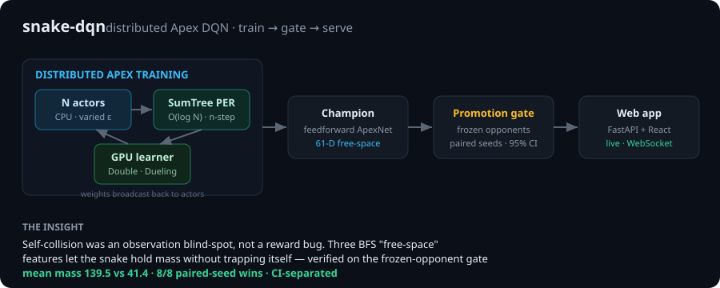

# snake-dqn

A reinforcement-learning project for a multi-snake, slither.io-style arena.
Agents train with DQN-family methods. A FastAPI + React web app streams
server-side games to the browser, where you can watch the trained agent or play
against it. No command in this repository replaces the served checkpoint
silently. Releases are explicit and need the owner's OK.



## Served agent (as of 2026-10-17)

The Watch hero is **bare B8 seed 3 (`b8-s3`), served without a veto**
(checkpoint SHA prefix `3e649783`). Watch defaults to a **mixed** roster: the B8
hero faces `frp3-s12 + v8` opponents. The release claim is **more mass at equal
survival against the previously served agent, with no veto**. It does not claim
that B8 is safer. Evidence: T7 Phase R `STRICT_PASS` + Tier 2 PASS, then the
T12/T15 serving checks. See the
[release record](docs/research/b8_s3_release_2026-10-17.md) and the
[mixed-Watch erratum](docs/research/b8_s3_release_erratum_mixed_watch_2026-10-17.md).

Rollback means restarting the server with an explicit selection:

```bash
SNAKE_SERVE_WATCH_ROSTER=all_b8 ./venv/bin/python web/serve.py   # all-B8 roster
SNAKE_SERVE_CHECKPOINT=frp3-s12 ./venv/bin/python web/serve.py   # frp3-s12 + v8
SNAKE_SERVE_CHECKPOINT=champion ./venv/bin/python web/serve.py   # champion + v8
```

[docs/STATUS.md](docs/STATUS.md) is the authority for the released agent,
monitoring thresholds, and operating rules.

## Current campaign

The active campaign is **T34 ExIt-B8**: an exact-simulator search teacher plus
DAgger into the B8 network. Start here:

1. [docs/research/final_run_20261019/HANDOFF_2026-10-20.md](docs/research/final_run_20261019/HANDOFF_2026-10-20.md)
   (read the **START HERE** section)
2. [CAMPAIGN_LOG.md](docs/research/final_run_20261019/CAMPAIGN_LOG.md): decisions and results
3. [docs/STATUS.md](docs/STATUS.md): the "Campaign authority" block and the binding contract documents

## Quick start

Use the project virtual environment for every Python command.

```bash
python3 -m venv venv
make install            # runtime deps (requirements.txt)
make install-dev        # dev deps + pre-commit hooks

make web                # build the frontend, then serve at http://localhost:8000
# or, step by step:
cd web/frontend && npm install && npm run build && cd ../..
./venv/bin/python web/serve.py
```

The browser is a pure view. Game state, inference, scoring and the SQLite
leaderboard all stay on the server. The panels, dev mode (`npm run dev` on :5173)
and the REST API are in [web/README.md](web/README.md).

## Tests and lint

```bash
make test               # full pytest suite (2 workers by default; PYTEST_WORKERS=N)
make test-fast          # skips tests marked slow
make test-web           # frontend vitest (npm ci && npm test)
make lint               # black --check, isort --check, flake8 (src, web/backend)
make format             # isort + black at line length 100
```

Do not run the suite while a governed study is using the Mac's CPU slots. The
compute rules are in [AGENTS.md](AGENTS.md) and [docs/STATUS.md](docs/STATUS.md).

## Training and evaluation

- **Legacy Apex DQN (vector61):**
  `./venv/bin/python src/main.py --headless --episodes 100000`. The vector61 line is
  frozen for new governed studies (STATUS.md).
- **Raster PQN:** `src/scripts/train_pqn.py` and the bounded
  `src/scripts/pqn_correctness_diagnostic.py`.
- **B8 lineage** (GridBatchSim + ego2s raster, distil then RL) comes from the
  `research/redesign_m4*` and `research/redesign_t7_phase_r_20261016` packages.
  Current work is in the `research/t34_*` packages.
- **Evaluation:** `src/scripts/tournament_eval.py`. Diagnostic runs are
  `authority: "diagnostic-only"`, and their exit code is never a release
  decision. Strict promotion is a separate live-only mode
  (`--strict-promotion-request …`) that runs on the Mac. A passing receipt is
  evidence only. It does not change the served default.

Before you make a model-selection claim, read the
[project history and findings](docs/project_history_and_findings.md). It records
corrected claims, for example that CNNs were never trained in the older trials.

## Where things are

| What | Where |
|---|---|
| Documentation map | [docs/README.md](docs/README.md) |
| Glossary | [docs/GLOSSARY.md](docs/GLOSSARY.md) (study terms: [docs/research/GLOSSARY.md](docs/research/GLOSSARY.md)) |
| Timeline | [docs/TIMELINE.md](docs/TIMELINE.md) |
| Research study packages | [research/INDEX.md](research/INDEX.md) |
| Specs | [docs/research/specs/INDEX.md](docs/research/specs/INDEX.md) |
| Advisor advice | [docs/research/advice/INDEX.md](docs/research/advice/INDEX.md) |
| Research catalog | [docs/research/catalog/](docs/research/catalog/) |
| Source map (`src/`) | [docs/architecture/SRC_MAP.md](docs/architecture/SRC_MAP.md) |
| Tests map (`tests/`) | [docs/architecture/TESTS_MAP.md](docs/architecture/TESTS_MAP.md) |
| Web app map (`web/`) | [docs/architecture/WEB_MAP.md](docs/architecture/WEB_MAP.md) |
| Repository top level | [docs/architecture/REPO_TOP_LEVEL.md](docs/architecture/REPO_TOP_LEVEL.md) |
| Agent working rules | [AGENTS.md](AGENTS.md) |
| Algorithm design (Apex DQN) | [docs/ml_algorithm.md](docs/ml_algorithm.md) |
| Simulator contract | [docs/simd_env_spec.md](docs/simd_env_spec.md) |

## License

MIT
