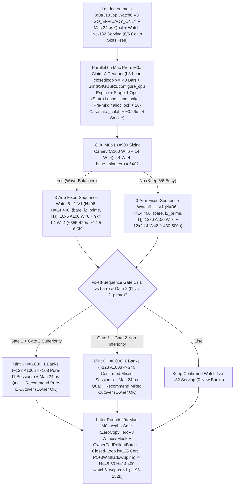

# T34 ExIt-B8 Research Roadmap (Round-19 Synthesis — Advice, Not Decisions)

Start: [project index](../INDEX.md) · [current status & authority](../STATUS.md) · [research record index](INDEX.md) · [study packages](../../research/INDEX.md) · [campaign log](final_run_20261019/CAMPAIGN_LOG.md).

> [!IMPORTANT]
> **Status: Research advice, NOT ratified decisions or release authorization.**
> Every current-round and later-round plan on this page is synthesized advisor guidance from Round 19 (2026-11-01 PT; primary synthesis artifact: `snake-dqn-artifacts/big-lever/exp/argon-rounds/round-19/synthesis/answer.md`, reconciling `round-19/{current,later,process}/answer.md` and `round-18/synthesis/answer.md` against `HEAD` `d0a3133b` and superseding Rounds 01–18). Nothing here amends a pre-registration, ratifies a confirmation gate, or changes served defaults. Binding campaign authority remains [`SUCCESS_CONTRACT.md`](final_run_20261019/SUCCESS_CONTRACT.md), [`DESIGN_V2_SHADOW.md`](final_run_20261019/DESIGN_V2_SHADOW.md) (+ Amendment 1), [`P7_STATISTICS.md`](final_run_20261019/P7_STATISTICS.md), unsuperseded parts of [`FINAL_PLAN.md`](final_run_20261019/FINAL_PLAN.md), and [`STATUS.md`](../STATUS.md); any serving or release change requires confirmation-lane evidence, Mac serving qualification, and the owner's explicit OK.

---

## 1. Snapshot Context & Code-Verified Round-19 State (`d0a3133b`, Nov 1)

### 1.1 Watch6 V3 `GO_EFFICACY_ONLY`, Watch `live-132` release, all-length screen & `DeviceSim` parity

- **Watch6 V3 confirmation finished — `GO_EFFICACY_ONLY` (`52135312`, 2026-11-01 14:40 PT)** ([`REGISTRATION_V3.md`](../../research/watch6_search_efficacy_v3/REGISTRATION_V3.md), `t34-sol/watch6-v3-final-look-20261101/final-look-01/final_look.json`):
  - Sole registered final look (`75471246` V6.1 adapter) over all **`96/96` primary `H = 14,400` (`10 min @ 24 fps`) Watch6-v2 pairs** (`0` reserves, `24/24` L4 `W = 4` shards in `28` attempts — shards `00, 09, 12, 19` passed on single retry after the `09:16 PT` Fable-ratified quarantine of `23` historical non-V3 H100-503 manifests; `2,764,800/2,764,800` live-mirror frames matched):
  - **`Δdeaths/1k = -0.125`** (`CI95 [-0.153, -0.097] < 0`; `0.1580` vs `0.2830`, **`-44.2%`**) and **Fieller pooled mean-mass ratio `+63.7%`** (`CI95 [+49.8%, +78.5%] >= -5%`; **`+214.12` mass**, `550.25` vs `336.13`), with boost `0.733%` vs `0.625%`, `mean_max_length = 1,073.4` (peak `L <= 2,296`) vs `780.9`, and **`2,549.4` mean branches/session** (`5.67×` `H = 6,000`'s `449.6`, confirming superlinear late-horizon branch growth) $\Rightarrow$ **`ELIGIBLE_FOR_REPLAY_QUALIFICATION` for `exact-stop-l2-prime` (`L >= 600`) only**.
  - **Operational unlock:** Frees all **`6/6` Colab slots (`3 A100 + 3 L4`, balance `~2,154.66 u`)**, lifts V3's closure-hash freeze on `main`, and closes V3 non-`GO` counterfactual branches.
- **Watch `live-132` serving guards, Mac `24 fps` qualification & release — ALREADY LANDED (`dc834ded`–`f5912f44`, ~16:00 PT):**
  - [`.claude/launch.json`](../../.claude/launch.json) (`lines 8–11`) serves confirmed **`watch-replay-bank-live-132`** (`132` `exact-stop-l2-prime` `H = 6,000` sessions from banks `01–08, 10–12`) with **`SNAKE_WATCH_REPLAY_CONTROLLER=exact-stop-l2-prime`** on `:8000` (retaining `watch-replay-bank-live-168` on disk while `exact-stop-l1` awaits `H = 14,400` confirmation).
  - [`GameSession`](../../web/backend/session.py) gates Watch replay on [`_is_clean_mixed_watch6_b8()`](../../web/backend/session.py) (`lines 722–753`) across `__init__` (`line 573`), `_build` (`line 769`), `reset_game` (`line 1261`), and `set_mode` (`lines 1520, 1563, 1576`); refuses `MODE_TRAIN` on forward-only `EGO2S_OBS_SPECS`, `(RASTER31V2, RASTER31V3)`, and un-overridden `_reward_contract_mismatch` **before** calling `_leave_watch_replay()` (`lines 1510–1550`, with replay recovery on Watch fallback); and scopes `_replay_opted_out = True` to `set_epsilon` (`line 1204`), live `set_hero` change (`line 1222`), and `set_food` (`line 1241`), cleared by `_build` (`line 763`) and [`new_game()`](../../web/backend/session.py) (`lines 1279–1284`, wired to `"new_game"` in [`app.py`](../../web/backend/app.py) `line 311`).
  - [`ReplayBank`](../../web/backend/watch_replay.py) (`lines 348–417`) implements `SNAKE_WATCH_REPLAY_CONTROLLER` (`all | exact-stop-l2-prime | exact-stop-l1`, failing closed to live B8 on invalid values), line-1 [`peek_header`](../../web/backend/watch_replay.py) (`lines 138–150`, `0` non-target `verify_payload` decodes), cycle-1 `shuffle_discovery: bool = True`, shallow [`Recording.snapshot`](../../web/backend/watch_replay.py) (`lines 315–330`), and **`0.25 ms`-slice / `64`-frame cooperative GIL yield (`max(1.0 ms, 4.0 * slice_elapsed)` = `<= 20%` GIL duty cycle)** in [`verify_payload`](../../web/backend/watch_replay.py) (`lines 30–33, 244–275`).
  - [`research/watch_replay/qualify.py`](../../research/watch_replay/qualify.py) (`t34-sol/argon-replay-qual/SUMMARY.md`, Fable review `APPROVE_WITH_CONDITIONS` with `C1–C3` resolved at `fec81656`) passed `132/132` inventory parity, cold session readiness **`0.349–0.435 s` (`< 0.45 s`)**, concurrent cold-verification live-B8 fallback **`update p95 = 8.78 ms <= 11.688 ms`**, **`0/120` paced-`24 fps` overruns** (`step p99 = 11.34 ms <= 41.67 ms`), and seamless recorded playback cutover after **`~18.5–23.1 s`** (`recorded update p95 = 0.002 ms`).
- **All-length exact-stop screen — `ADOPT` for new replay banks; `36` `l1` sessions staged for `Watch6-L1-V1`** ([`watch6_alllen_screen`](../../research/watch6_alllen_screen/README.md), `t34-sol/argon-alllen-a100/analysis.json`, `N = 48` paired `H = 6,000` Watch6-v2 sessions):
  - `exact_stop_alllen` (`L >= 1`, `interval = 5`, `H = 300`) reached **`559.43` mass** (`+208.37` / Fieller `+59.35%` vs `bare` `351.07`; **`+98.27` / Fieller `+21.31%` vs `l2_prime_600` `461.16`**, `CI95 [+50.57, +145.98]`) and **`0.0521` `deaths/1k`** (`-81.9%` vs `bare` `0.2882`; **`-67.4%` / `-0.1076/1k` vs `l2_prime_600` `0.1597`**, `CI95 [-0.1609, -0.0544]`), cutting `L < 600` deaths **`53 (bare) / 34 (L >= 600) -> 1`** (`mean_max_length = 1,096.0`) at **`2.821×` branches** (`1,268.5` vs `449.6`, `1,200.1` roots = **`1.057` branches/root**, stopping on `bare` at **`94.3%`** of roots). **`14/15` remaining deaths occur at `L >= 600` (`13/15` at `L >= 800`, `-14.2%` per-frame `L >= 800` hazard at `1.379×` living exposure).**
  - Three `12`-session A100 banks (`14l1–16l1`, `W = 6`, `H = 6,000`, `t34-sol/argon-banks-l1/SUMMARY.md:38-40`) completed `36/36` on Cap-6 `36285bc6` in **`3.03–3.07 h/bank`** (**`~61.5 A100 u` total**). They remain unserved on disk (`watch-replay-bank-live-168`) pending `H = 14,400` `Watch6-L1-V1` confirmation, Mac qualification, and owner OK.
- **GPU `DeviceSim` v2 parity — `PASS` on A100** ([`devicesim_v2_parity`](../../research/devicesim_v2_parity/README.md), commit `b500d111`): **`0` mismatches** across **`1,536,000` snake-ticks** (`E = 256 × 1,000` Watch6-v2 ticks, `1,434.6` steps/s under SplitMix64 RNG and `<= 1e-4` CUDA FP32 near-tie tolerances; SplitMix64 cannot mint MT19937 live Watch replay banks).
- **Still unrun / unshipped on `main` at `d0a3133b`:**
  1. `0 u` Mac `M0a` readout on completed `b8-head-closedloop` (`t34-sol/b8-head-closedloop/main-01/output/receipt.json`, `rc = 0`, `4.51 A100 u`; `readout-01` still absent; `spatial-qbytes-01` is strictly a GPU Q-byte/`.so` cache parity & throughput ruler, with the `40–48 A100 u` `spatial-student-pilot` fit canceled at `0 u`).
  2. Unconditional `session.live.snapshot()` at [`research/watch_replay/engine.py`](../../research/watch_replay/engine.py) (`line 216`) when `record=None`, and missing [`configure_cpu()`](../../research/t1_commitment_20261015/replay.py) (`lines 20–28`, `torch.set_num_threads(1)` / `torch.set_num_interop_threads(1)`) in [`watch6_alllen_screen/run.py`](../../research/watch6_alllen_screen/run.py) (`lines 51–62`) and [`watch_replay/run.py`](../../research/watch_replay/run.py) (`lines 77–88`).
  3. Stage-1 [`tools/ops/`](../../tools/ops/) confirmation packaging/audit upgrades, Stage-2 additive [`research/colab_cli/`](../../research/colab_cli/) (`36285bc6` still active), outcome-blind `watch6_l1_confirm` (`Watch6-L1-V1`), and later-round `WCPHS-L1` / `RWRPS-L1`.

### 1.2 Closed single-pass critics, distillations, RL, and standalone macro fallbacks

Between 2026-10-29 and 2026-11-01, every single-pass learned-policy, critic, distillation, and standalone macro-fallback track closed below its promotion or selectivity bars:

| Track | Scope & primary artifact | Measured outcome | Disposition |
| --- | --- | --- | --- |
| **TRAIN-01** ([`sandbox_a_resident`](../../research/sandbox_a_resident/README.md)) | `100.7M`-row (`384`-update) GPU-resident PPO from `b8-s3` (`t34-sol/train01-closeout/SUMMARY.md`) | H5000 equal-mix paired mass **`+8.09`** (`CI95 [-18.66, +34.85]`; scripted `+26.32`, frozen `+2.85`, mixed `-4.90`; update-320 peak `+14.23` `[-11.86, +40.32]`) vs bar `>= +40` | **Closed** (no strict-gate nomination) |
| **C/T Stage-2 distillation** | Continuation-teacher causal-root distillation (`t34-sol/ct-stage2-verdict/SUMMARY.md`) | Teacher rescued **`22/32` (`68.75%`)** deaths (`22/32 <= 65` ticks; indep-suffix H300 `+66.77`, `LB90 +51.61`), but student retention was **`46.9–50.0%`** (`0 pp` over `frozen_phi` vs `>= +15 pp`; topology AUC `0.5752 < 0.83`), ordinary flips **`44.4–64.5%`** (bar `<= 1%`), and lethal ordinary flips **`3–5`** (bar `<= 1`) | **`FAIL_DISTILLATION_RETENTION_OR_SAFETY`** |
| **Doom U-Net & `spatial-student-pilot`** | `83 × 145` spatial U-Net vs 33.7k B8-feature head (`t34-sol/doom-result-01/result.json`; `t34-sol/student-direction/{astra,fable}.md`) | Spatial U-Net lost late per-action doom ROC-AUC to frozen B8 features (**`0.753` vs `0.810`**, `Δ = -0.056`, `CI95 [-0.091, -0.023]`; all-strata death-lookback `0.7626` vs `0.8226`; ordinary late `0.690` vs `0.706`) | **`GRAY` / `40–48 A100 u` pilot fit canceled (`0 u`; retain `.so` caches)** |
| **B8 advantage head (offline OOF)** | `256 -> 128 -> 6` ReLU head on frozen B8 features (`t34-sol/b8-head-test/RESULT.md`) | Mass rule `GO` (late H300 `+30.09`, `LB90 +23.96`), Fable selectivity **`FAIL`**: **`26.42%`** late rescue (bar `>= 35%`) at **`97.60%`** non-death flips (bar `<= 15%`) | **Selectivity `FAIL`** (192-world closed-loop A100 `rc = 0`, awaiting Mac `M0a` readout) |
| **T4 Gate-1 factored critic** ([`t4_gate1`](../../research/t4_gate1/README.md)) | Clean-slate privileged `83 × 145` (`H = 320` 7-source BFS) hazard + foraging mass-flux critic on `384` disjoint Watch6-v2 worlds (`t34-sol/argon-t4-gate1-fix2/queue-03/READOUT.json`) | **`0/8` bars passed**: `L >= 600` residual EV **`+0.0266`** (`[-0.0280, +0.0869]` vs `>= 0.25`), death-root H300 rescue **`+19.99`** (vs `>= +40`), mature doom AUC **`0.5617`** (vs `>= 0.80`), ordinary H300 mass **`-22.21`** (vs `>= -15.0`), lethal flips **`3.13%`** (vs `<= 3.0%`) | **`KILL_T4`** (proves even privileged `83 × 145` critic lacks late value signal) |
| **R6 `L < 600` harvest census** ([`r6_l600_census`](../../research/r6_l600_census/README.md)) | `64`-world (`384`-root) Watch6-v2 early-game counterfactual + 5-fold OOF corpse/trail plane probes (`t34-sol/argon-mac-checks/r6-census/RESULT.json`) | **`34.90%` (`134/384`)** oracle-harvestable roots (`>= +5` H500 mass), **`7.69%`** non-bare H500 lethal flips, OOF ROC-AUC **`0.474–0.521`** (`0` passing threshold points); superseded operationally by `exact-stop-l1` | **`KILL`** |
| **R7 macro-option fallback** ([`r7_macro_fallback`](../../research/r7_macro_fallback/README.md)) | Pruned depth-2 (`2K = 30` ticks) spatial macro-options `{O_0..O_5}` on C/T train `1-step-all-die` roots (`t34-sol/argon-r7-repack/R7_READOUT.json`) | `3/5` bars passed (`0.316 ms` Mac 1-thread p95; **`33.0%` vs `9.0%`** `L >= 800` `all_die_sel0` rescue on `25/129` roots — `9/25` `macro_triggered` at `+66.7 pp` rescue vs `16/25` tick-`30` B8 re-traps, while `104/129` `80.6%` survived `H = 300`), but total `L >= 600` lift **`+3.85 pp`** (`< +10.0 pp`) and **`2 > 0`** ordinary lethal flips (`0` assessment roots opened) | **`KILL`** as standalone `30`-tick fallback |

### 1.3 Eight Code-Verified Round-19 Findings Over Round 18

1. **Cap-6 `28–54 s` poll cycle & worker `.complete` race ([`supervisor.py`](../../research/colab_cli/supervisor.py) `lines 975–1025, 1933–2050`, [`watch6_alllen_screen/run.py`](../../research/watch6_alllen_screen/run.py) `lines 134, 172, 224`):**
   [`export_file`](../../research/colab_cli/supervisor.py) (`6–10 s` for 3 `_contents_call` downloads at `lines 988–1025`) + `sleep(15)` (`line 2050`) + `poll % 4 == 0` `account_locked` `usage()`/`sessions()` (`5–25 s` under Cap-6 contention, `lines 1934–1945`) + [`renew(force=True)`](../../research/colab_cli/supervisor.py) (`2–4 s`, `line 1981`) spans **`28–54 s`**, while [`generate()`](../../research/watch6_alllen_screen/run.py) (`line 134`) publishes inside `W = 4..6` children, writes `contract.json.complete` at startup (`line 172`), and writes `operational.json.complete` in `finally:` (`line 224`) even on `SIGUSR1` (alongside printing `mass(B/L600/L1)` to `stdout` and waiting on `as_completed` on `SIGUSR1` at `lines 139–250`). Parent-only `.complete` writes gated on [`runtime.py`](../../research/colab_cli/runtime.py) (`lines 340–392`)'s `state.json["exports"]` ($t_{\text{state}}$) + `lease.json["renewed_at"] > t_{\text{state}}$ handshake (`+12 s` tail, `>= 30 s` floor, skipping `.complete` on `SIGUSR1`) guarantee `len(batch) <= 1` (`0` WS [`export_batch`](../../research/colab_cli/export_batches.py)).
2. **Missing [`configure_cpu()`](../../research/t1_commitment_20261015/replay.py) (`lines 20–28`):**
   Both [`watch6_alllen_screen/run.py`](../../research/watch6_alllen_screen/run.py) (`lines 51–62`) and [`watch_replay/run.py`](../../research/watch_replay/run.py) (`lines 77–88`) omit `torch.set_num_threads(1)` and `torch.set_num_interop_threads(1)` in worker processes (unlike [`watch6_search_efficacy/run.py`](../../research/watch6_search_efficacy/run.py) `lines 60–63`).
3. **Unreachable `capacity_refused` ([`ready_queue.py`](../../tools/ops/ready_queue.py) `lines 783–795` vs [`dispatch.py`](../../tools/ops/dispatch.py) `lines 2849–2878`):**
   [`dispatch()`](../../tools/ops/dispatch.py) (`lines 2849–2855`) creates `ops/dispatch/<name>` and `ops/manifests/<name>.json` *before* [`refresh_assignments()`](../../tools/ops/dispatch.py) (`line 2878`), breaking `ready_queue.py:790-791`'s non-existence guard and turning capacity refusals into permanent `HELD`/`FAILED` rows.
4. **Single-GPU `412`/`503` & `-retry-1` bugs ([`dispatch.py`](../../tools/ops/dispatch.py) `lines 2152–2155, 2935–2948`, [`ready_queue.py`](../../tools/ops/ready_queue.py) `lines 257–260, 435`):**
   [`wait_allocation()`](../../tools/ops/dispatch.py) (`lines 2152–2155`) only awaits `^EXIT=\d+$` on `exact_retry or stale_candidate`, single-GPU `dispatch()` skips [`reconcile_unavailable()`](../../tools/ops/dispatch.py) (`line 2683`), [`retire_unavailable()`](../../tools/ops/ready_queue.py) (`line 435`) uses `manifest.stem` (`<name>-retry-1`) instead of `Path(row["argv"][1]).name`, and [`observations()`](../../tools/ops/ready_queue.py) (`lines 257–260`) leaves exited `endpoint is None` rows `active=True`.
5. **Missed `ACCOUNTING` races in [`auto_retry.py`](../../tools/ops/auto_retry.py) (`lines 296–302`):**
   Rejects 5 of 6 mechanical `ACCOUNTING` strings (admitting only `POLLING_ASSIGNMENT_CAP_ERROR`, while rejecting calibration timeouts at [`supervisor.py`](../../research/colab_cli/supervisor.py) `line 1462` and sibling-stop `unaccounted active assignment endpoints` at [`accounting.py`](../../research/colab_cli/accounting.py) `lines 347, 532`).
6. **`ZeroCopyHeroV8` ([`ego_raster.py`](../../src/simd_env/ego_raster.py) `line 511`, [`ego_raster_bv8.py`](../../src/simd_env/ego_raster_bv8.py) `line 73`):**
   `vs, _ = v8_scalars(...)` runs `12` `"painted"` BFS floods per hero step and **discards `res` (`_`)**. Switching to `membership="owner_pad"` ([`_eager_templates_owner`](../../src/simd_env/v8_nb.py) `lines 733–850`) and caching `sim._last_hero_v8 = res` makes `WitnessMask` Tier-1 **`O(1)` (`0` extra floods on `> 93%` of steps, `0.03–0.12 ms/tick`)**.
7. **Redundant [`decision_free_space`](../../src/simd_env/vector61_policy.py) (`lines 670–679`) at [`vector61_policy.py`](../../src/simd_env/vector61_policy.py) (`line 816`):**
   Runs a full 61-D `featurize(..., update_memory=False)` before `_kernel_hook` ([`bl_k1/native.py`](../../research/bl_k1/native.py) `lines 93–103`) recomputes `counts` in `v8_decide`, alongside `live_vetoes[int(env)]` collision (`line 761`) and `rowwise` forwards (`line 771`).
8. **Closed-loop `WitnessMask` rollouts + leaf cert ($H_{\text{sim}} = 128 \Rightarrow H_{\text{eff}} = 128 + L_0$):**
   Open-loop `bare` continuations (`H = 300` in [`exact_stop.py`](../../research/bl_served_search/exact_stop.py) `lines 46–52`) accept uncertified coils of volume $V \in [305, L_0 - 50]$ (`104/129 = 80.6%` of `L >= 800` roots in `t34-sol/argon-r7-repack/R7_READOUT.json:130-143`). Applying `O(1)` Tier-1 / `< 7%` Tier-2 `WitnessMask` on rollout ticks $h = 1 \dots 127$ + leaf certification at $h = 128$ cuts rollout steps `2.34×`.

---

## 2. Current-Round Plan (Advice, Not Decisions)

### 2.1 `0 u` Mac `M0a` Claim-A closeout, outcome-blind confirmation engine & C4 telemetry

1. **Run `M0a` Claim-A readout (`< 2 min` Mac, `0 u`) & enforce binding v1 `H = 5,000` `>= +40` closure bar:**
   - Run [`closedloop_readout`](../../research/INDEX.md) (`t34-sol/b8-head-closedloop/SUMMARY.md:50-52`, `origin/astra-doom-auc-smoke` @ `591d94c3`) on completed `b8-head-closedloop` (`N = 192` v1 `H = 5,000` worlds, `m in {0, 10, 25, 50}`, `4.51 A100 u`). Audit `spatial-qbytes-01` (`t34-sol/spatial-qbytes-fix/SUMMARY.md:85-88`) strictly as a Q-byte/`.so` cache ruler (`40–48 A100 u` `spatial-student-pilot` fit stays canceled at `0 u`).
   - **Recommended Claim-A kill rule:** Permanently **freeze Claim A (`0 u`)** unless some fixed `m in {0, 10, 25, 50}` clears [`SUCCESS_CONTRACT.md`](final_run_20261019/SUCCESS_CONTRACT.md) §2 (`lines 29–33`) and [`P7_STATISTICS.md`](final_run_20261019/P7_STATISTICS.md) §§3–4 (`lines 33–48`): pooled mass **`>= +40.0`**, Bonferroni-4 `LB97.5 > 0`, scripted Guard B `>= +0.03` (`0` mix losses), Guard A `Δalive >= -0.05` pooled / `>= -0.075` single mix, and living overrides `<= 15%`, followed by a `0 u`, `10 min` `[0.5×bare, 10%]` v2 boost check before nominating any Mac strict gate.
2. **Patch `record=None` confirmation engine, add `configure_cpu()`, seal outcome leaks & monitor live `:8000` C4 telemetry (`0 u`, fresh worktree; V3/`ops/`/`exports/`/`pair-*.json` untouched):**
   - Guard `if record is not None: snapshot = session.live.snapshot()` at [`research/watch_replay/engine.py`](../../research/watch_replay/engine.py) (`line 216`) and call [`configure_cpu()`](../../research/t1_commitment_20261015/replay.py) (`lines 20–28`, `torch.set_num_threads(1)` / `torch.set_num_interop_threads(1)`) in worker initialization (`watch_replay/run.py:77-88` and `watch6_l1_confirm/run.py`).
   - Add `mass_sum_le6000`, `mass_sum_gt6000`, `death_frames`, `timing` (`main_seconds`, `search_seconds`), and [`watch6_search_efficacy/run.py`](../../research/watch6_search_efficacy/run.py) (`lines 36–39`)'s 100k-decision `> 90%` action-collapse check to `snapshot()`-free [`research/watch6_alllen_screen/engine.py:run_arm`](../../research/watch6_alllen_screen/engine.py) (`lines 187–303`, `audit_live_mirror=True`, paired-world atomic unit running `{bare, l2_prime, l1}` sequentially on the same worker to eliminate A100/L4 x86 FP32 tie drift).
   - Build `watch6_l1_confirm/run.py` with **worker-returned payloads + parent-only `state.json`+`lease.json` `.complete` handshake** (`>= 30 s` floor, `0` `.complete` writes on `SIGUSR1`), **metadata-only `stdout` (`poll-*.json`) and `operational.json`** (`0` `mass_integral`/`deaths_per_1k` fields outside `exports/units/unit-{index:06d}.json`, verified by `confirm_audit.py --blind-check`), and **immediate `SIGUSR1` child termination** (`for child in pool._processes.values(): child.terminate()`, matching [`watch6_search_efficacy/run.py`](../../research/watch6_search_efficacy/run.py) `lines 136, 168–170`).
   - Keep `SNAKE_WATCH_SOURCE=live` pinned in [`watch6_search_efficacy/product.py:open_watch`](../../research/watch6_search_efficacy/product.py) (`line 41`), monitor C4 live `:8000` `update_ms` / overrun telemetry on released `watch-replay-bank-live-132`, and mint **`0`** new `.watch.gz` banks before `Watch6-L1-V1`'s verdict lands.

### 2.2 Deploy Code-Verified Two-Stage Transport (`0 u` Stage 1 + Metric-Gated `~1.5 u` Stage 2)

1. **Stage 1 (`0 u` Colab, [`tools/ops/`](../../tools/ops/) on active Cap-6 `36285bc6`, zero `research/colab_cli/` edits):**
   - **`tools/ops/study_package.py` (`4` `< 2 MiB` single-chunk Contents PUTs, `0` WS `UPLOAD_ASSEMBLE`, `0` Mac `"url"` downloads, parent-only `state.json`+`lease.json` `.complete` handshake):**
     1. Generalize [`watch_replay/uploads.py:pack_inputs`](../../research/watch_replay/uploads.py) (`lines 96–170`) so every shard uploads exactly **`4` `< 2 MiB` single-chunk files**: `bootstrap.sh`, `source.py`, shard-invariant `<= 1.5 MiB` `inputs/input-metadata.tar.gz` (`study-contract.json` with `unit_ids: 0..N-1`, `HMAC-SHA256(study_seed, f"{namespace}:{unit_id}")` seeds, and `git ls-tree` `science_tree_sha256`; `public-inputs.json`; `release-evidence.tar.gz` + sidecars; `0` manifest `"url"` entries), and dynamic **uncompressed `65,536 B` `inputs/verified-ledger.tar.gz`** (`verified-ledger.json` + `.sha256` + `.complete` + zero-filled `.padding`, unpacked `.complete`-last).
     2. Materialize and SHA-verify public checkpoints on the VM **before** writing `exports/workload-started.json` (`fetch_public_assets_or_exit74()`, `rc = 74`). Set `"lease_seconds": 600` and `"required_exports": ["resume/verified-skip-proof.json", "shard-complete.json"]`.
     3. Workers return completed unit payloads to the parent; the parent alone writes `.complete` (`resume/verified-skip-proof.json`, each paired-world `exports/units/unit-{index:06d}.json` with `.sha256` before `.complete`, and `shard-complete.json`) gated on [`runtime.py`](../../research/colab_cli/runtime.py) (`lines 340–392`)'s **`state.json["exports"]` ($t_{\text{state}}$) + `lease.json["renewed_at"] > t_{\text{state}}$ handshake (`+12 s` download tail, `>= 30 s` floor, skipping `.complete` on `SIGUSR1`)**, covering [`supervisor.py`](../../research/colab_cli/supervisor.py) `lines 975–1025, 1933–2050`'s `28–54 s` Cap-6 poll cycle $\Rightarrow$ `len(batch) <= 1` Contents HTTP [`export_file`](../../research/colab_cli/supervisor.py) (`lines 975–989`), `0` WS [`export_batch`](../../research/colab_cli/export_batches.py).
   - **Side-effect-free `check_capacity_and_settle()`, single-GPU `412`/`503` & `-retry-1` fixes, two-tier `auto_retry.py` & `confirm_audit.py` (`0` post-data judge rounds):**
     - Pass `--no-internal-retry` from [`ready_queue.py`](../../tools/ops/ready_queue.py) to [`dispatch.py`](../../tools/ops/dispatch.py) and run side-effect-free `check_capacity_and_settle()` inside `ops/alloc.lock` (`total < 6`, `L4 < 3`, `0` `pending-*.json`, **`>= 20 s` sibling settle**) **before** creating `ops/dispatch/<name>` or `ops/manifests/<name>.json` (keeping [`ready_queue.py:capacity_refused`](../../tools/ops/ready_queue.py) `lines 783–795` reachable with `f"REFUSE: account L4 assignment cap {ACCOUNT_L4_CAP}"` so capacity-refused rows stay `READY` with backoff).
     - In [`dispatch.py`](../../tools/ops/dispatch.py), wait for `^EXIT=\d+$` on all single-GPU receipts (`lines 2152–2155`) and call [`reconcile_unavailable()`](../../tools/ops/dispatch.py) (`lines 2683, 2935–2948`); fix [`retire_unavailable()`](../../tools/ops/ready_queue.py) (`line 435`) to use `Path(row["argv"][1]).name` instead of `manifest.stem` (`<name>-retry-1`); and mark exited `endpoint is None` rows `active=False` in [`observations()`](../../tools/ops/ready_queue.py) (`lines 257–260`).
     - In [`auto_retry.py:eligible`](../../tools/ops/auto_retry.py), check structured `receipt["terminal"]` **before** `line 284`'s `r"child.*exit"` veto:
       - **Tier-0 Pre-Workload (`<= 6`, `0` completions burned, `0` extra canaries):** `blocked_before_allocation` / `0`-allocation pre-`output.mkdir()` exits, verified `unavailable.json`, `UPLOAD_CAP`, pre-start `KERNEL_CREATION_GUARD_ERROR`, all **7** mechanical `ACCOUNTING` strings (`auto_retry.py:296-302`, incl. calibration timeout at `supervisor.py:1462` and sibling-stop `unaccounted active assignment endpoints` at `accounting.py:347, 532`), or pre-`workload-started.json` `rc = 74`.
       - **Tier-1 Mid-Workload (`<= 2` completions, verified partial units kept):** `stop_verified is True` and `cleanup_error is None` with structural transport proof from `receipt["cli_calls"]` / `control_operations` (`RPC_EXEC_POLL_TIMEOUT`, `SUPERVISOR`, `ACCOUNTING` `poll % 4` lag) or `terminal.reason in {"lease_expired", "release_credential_expiring"}` (refusing `reason == "timeout"` or `reason is None and returncode != 0`), plus relative onset **`elapsed_seconds - (cli_calls[-1]["ended_monotonic"] - first_failed_tail["started_monotonic"]) < timeout_minutes * 60 - (lease_seconds + 90)`**. Coalesce `60 s` before rebuilding the `65,536 B` union `verified-ledger.tar.gz` (`1` shared `1-unit` canary per affected GPU on Stage 1; `0` on Stage 2).
     - `tools/ops/confirm_audit.py`: auto-reexec under `python -B` (`/tmp` `PYTHONPYCACHEPREFIX` + `NUMBA_CACHE_DIR`), isolate lineage under `ops/studies/<namespace>/attempts/*.json`, enforce `--blind-check` via `sys.addaudithook` blocking `unit-*.json` / `pair-*.json` / `summary*` / `job.log` / `*.npz` and scanning `poll-*.json` (`job_log_tail`) + `operational.json` for zero outcome tokens $\rightarrow$ `blind-accounting-certificate.json` (`N/N` `multiplicity == 1`), and require `PASS` before `--unseal`.
     - **Stage-1 gate:** Pass **`16` offline cases** (`12` mechanical faults + `4` negative controls) on [`tests/fixtures/fake_colab.py`](../../tests/fixtures/fake_colab.py) (`0 u`) + **`~0.26 L4 u` (`4`-unit) live smoke** + [`qualification.py`](../../tools/ops/qualification.py) `review --tree <sha> --status ACCEPT`.
2. **Stage 2 (`~1.5 u` Colab, additive `colab_cli` via [`requalify.sh`](../../tools/ops/requalify.sh) + `ACCEPT` review, triggered iff Stage 1 incurs `>= 2` WS timeouts or `> 2.0 u` in Tier-1 recovery canaries):**
   - Log `returncode` / `head_500` / `tail_4000` on failed `cli_calls`; adopt `colab-cli 0.7.4` retry kernels on `KERNEL_CREATION_GUARD_ERROR` via `self.exec_uncertain = True` in [`supervisor.py:wait_runtime_ready`](../../research/colab_cli/supervisor.py); keep single-window `account.lock` while dropping `account_locked` around read-only `poll % 4` [`spend`](../../research/colab_cli/supervisor.py) (`line 1934`); convert `0o644` Contents `release-credential.next.json` via `0o600` [`write_release_credential`](../../research/colab_cli/release.py) in **both** running (`line 626`) and post-terminal (`line 712`) loops of [`runtime.py`](../../research/colab_cli/runtime.py); use Contents-only `runtime-poll.json` + `<= 16`-file `export_file` when `observer is None and not lease.contents_disabled` (`0` steady-state WS RPCs); exempt schema-verified `65,536 B` `verified-ledger.tar.gz` SHA in [`canary.py:check`](../../research/colab_cli/canary.py) (`line 318`, **`0` Tier-1 retry canaries**); and pass **`12/12` `requalify.py` gates**.

### 2.3 `M0b` `L >= 900` sizing canary (`~8.0 u`) & 3-Arm Fixed-Sequence `Watch6-L1-V1` (`N = 96, H = 14,400`)

With Watch6 V3 `GO_EFFICACY_ONLY` recorded (`52135312`), Watch `live-132` qualified and live (`f5912f44`), and all `6/6` Colab slots free, run **`M0b` (`~8.0 u` total incl. `1` A100 `W = 6` + `1` L4 `W = 4` family canary, `~45 min`, 2× cap `16 u` / `90 m`)** on `6` `L >= 900` fixtures × `1,200` frames through `snapshot()`-free `record=None, horizon=14400` paired-world confirmation to freeze shard walls and L4 worker width:

- **If `M0b` L4 `W = 4` shard `base_minutes <= 540`** (`<= 660` [`MAX_BASE_MINUTES`](../../research/watch6_search_efficacy/performance.py) `line 21`): dispatch wave-balanced **`10 × 6` A100 `W = 6` (`60` worlds, `3.33` waves) + `9 × 4` L4 `W = 4` (`36` worlds, `3.0` waves)** (**`~355–420 u`**, 2× cap `840 u`, `~14.5–16.5 h`).
- **Else (`M0b` L4 `W = 4` `base_minutes > 540`):** dispatch **`12 × 6` A100 `W = 6` (`72` worlds) + `12 × 2` L4 `W = 2` (`24` worlds)** (**`~430–500 u`**, 2× cap `1,000 u`, keeping all **`6/6` slots busy** per Fast-process Rule #6).

- **3-arm fixed-sequence confirmation contract (`Watch6-L1-V1`, `N = 96` fresh paired `H = 14,400` Watch6-v2 worlds, `{bare, l2_prime, l1}`, `record=None`, $\alpha = 0.05$):**
  1. **Gate 1 (`l1 vs bare`, $\alpha = 0.05$):** `CI95_high(Δdeaths/1k) < 0`, Fieller pooled mass ratio `LB95 >= -5%`, and hero boost share $\in [0.5\times\text{bare}, 10\%]$.
  2. **Gate 2 (`l1 vs l2_prime`, tested at full $\alpha = 0.05$ iff Gate 1 passes):**
     - *Superiority:* `CI95_high(Δdeaths/1k) < 0`, Fieller mass `LB95 >= 0%`, and session-denominator `Δd_ge800/1k UB95 <= +0.05/1k` $\Rightarrow$ mint **`6` `H = 6,000` `exact-stop-l1` `.watch.gz` banks** (`72` sessions, `~123 A100 u` $\rightarrow$ **`108` pure-`l1` sessions** with `14l1–16l1`), pass Mac `24 fps` qualification, and recommend pure-`l1` Watch cutover (**owner OK**).
     - *Non-inferiority:* `Δdeaths/1k UB95 <= +0.02/1k`, Fieller mass `LB95 >= -2.5%`, and `Δd_ge800/1k UB95 <= +0.05/1k` $\Rightarrow$ mint **`6` `H = 6,000` `exact-stop-l1` banks** (`~123 A100 u` $\rightarrow$ **`240` confirmed mixed `l2-prime + l1` sessions**), pass Mac `24 fps` qualification, and recommend mixed Watch cutover (**owner OK**).
     - *Else:* retain confirmed `watch-replay-bank-live-132` (`0` new banks) and advance to §3's `WCPHS-L1` / `RWRPS-L1`.

---

## 3. Later-Round Plan: Witness-Certified Pinch & Harvest Search (`WCPHS-L1` / `RWRPS-L1`) & Spawned `P1+3W` `ShadowSpine` (Advice, Not Decisions)

### 3.1 `WCPHS-L1` / `RWRPS-L1`: `ZeroCopyHeroV8` `WitnessMask`, `OwnerPadRolloutBatch`, and Closed-Loop `h = 128` Leaf Certification

1. **`ZeroCopyHeroV8` + constructive two-tier Numba `WitnessMask` (`interval = 1`, `0.03–0.12 ms` online *and* on rollout continuation ticks $h = 1 \dots 127$ + leaf cert at $h = 128$):**
   - Switch [`ego_raster_bv8.py`](../../src/simd_env/ego_raster_bv8.py) (`line 73`, called by [`ego_raster.py`](../../src/simd_env/ego_raster.py) `line 511`) from `membership="painted"` to `membership="owner_pad"` ([`_eager_templates_owner`](../../src/simd_env/v8_nb.py) `lines 733–850`) after bitwise parity check, and cache `sim._last_hero_v8 = res` instead of discarding `res`. At every tick (`interval = 1`), evaluate $\mathcal{A}_{\text{wit}}(s) = \{a \in \mathcal{A}_{\text{legal}}(s) : \text{Witness}(s \xrightarrow{a} s') = 1\}$ and select:
     $$a^\star = \arg\max_{a \in \mathcal{A}_{\text{wit}}(s)} Q_{\text{B8}}(s, a)$$
   - **Tier 1 (`> 93%` of ticks, `O(1)` = `0` extra BFS floods):** Reads cached `sim._last_hero_v8` (`res.area[r, a] == res.area_cap[r]`, `not res.head_risky[r, a]`, and $\ge 2$ next-step actions with `area >= L_0` / [`_bfs_owner`](../../src/simd_env/v8_nb.py) `lines 217–266` reaching $\ge 3$ open exits with $t_{\text{hero}}(u) + 2 < \lceil d_{\text{opp}}(u) / 2 \rceil$).
   - **Tier 2 (`< 7%` pocket ticks, `~0.15 ms`):** Simulates a constructive wall-hugging **`TailTrackWitness`** trajectory $\pi_{\text{witness}} = (a_0, \dots, a_K)$ ($K \le L_0 + 32$) on an `int16[12035]` release grid (`145 × 83` arena, `2`-edge hero boost with `1.167` pops/edge / `2.33` pops/tick in [`GridBatchSim._move_all`](../../src/simd_env/grid_sim.py) `lines 481–554`, [`CORPSE_TRAIL_MAX_PELLETS_V2 = 150`](../../src/core/mechanics_constants.py) `lines 53–64` trail cap, food $+1$ slack, and $< \lceil d_{\text{opp}} / 2 \rceil$ enemy boost seals). Unlike single-inequality `TailReach_v2`, `TailTrackWitness` rejects width-1/2 articulation bridges where walking to tail segment $s_k$ severs the remaining pocket, guarantees **`0` cruising flips** whenever `bare` is certified, provides **recursive CBF feasibility** on tick $t+1$ via suffix $(a_1, \dots, a_K)$, and prunes dead-end rollout branches early (`DeadPocketPrune`).
   - **Closed-loop `WitnessMask` rollouts + terminal leaf certification ($H_{\text{sim}} = 128 \Rightarrow H_{\text{eff}} = 128 + L_0$):** Applying `O(1)` Tier-1 / `< 7%` Tier-2 `WitnessMask` on rollout ticks $h = 1 \dots 127$ and requiring `WitnessMask(s_{t+128})` certification at leaf $h = 128$ rejects uncertified coils of volume $V \in [305, L_0 - 50]$ (`104/129 = 80.6%` of `L >= 800` death roots in `t34-sol/argon-r7-repack/R7_READOUT.json:130-143`) and eliminates open-loop re-traps (`16/25 = 64.0%`) while cutting rollout steps **`2.34×`** (`128` vs `300`).
2. **Digest-safe, `decision_free_space`-free `OwnerPadRolloutBatch` (`~20–45 ms` singleton, `~0.055–0.16 s` `E = 4` batch):**
   - Keep **5 separate [`Vector61SimdPolicy`](../../src/simd_env/vector61_policy.py) objects on the main/shadow spine** (so `live_vetoes[int(env)]` at `line 761` and [`_root_bytes`](../../research/bl_served_search/ruler_operator.py) `lines 89–96` never collide across opponent slots `1..5`), while rollout workers bypass [`decision_free_space`](../../src/simd_env/vector61_policy.py) (`lines 670–679, 816`) and execute **one `(5E, 61)` `batched` BLAS forward** (`line 770`) + [`v8_decide(..., membership="owner_pad")`](../../src/simd_env/v8_nb.py) (`lines 1567–1686`, reusing the `owner_pad` flood from `vector61` featurization and skipping `CARRY_FIELDS` `deepcopy(live_vetoes)` in [`bank_engine.py`](../../research/t3_rollout_labels_20261015/bank_engine.py) `line 548`).
3. **White-box `v8` post-burn `1.15×` defensive mask & `<= 8%`-root Pinch-Funnel / Corpse-Surge value:**
   - *Defensive (`L_{0,\text{post}} < 1.15(L_j + 1)`):* Mask 1-step mutual-death head-ons ([`hero_wins_head_on`](../../src/evaluation/safety_veto_v6.py) `lines 163–198, 224`) whenever an opponent is in [`OUTCOME_NO_SPACIOUS`](../../src/evaluation/safety_veto_v8.py) (`lines 289–296`, [`v8_nb.py`](../../src/simd_env/v8_nb.py) `lines 1781–1800`), where `v7/v8` skips `_head_layer` and lunges via raw `argmax`.
   - *Offensive & harvest (`<= 8%` of roots, `10`-tick cooldown, `E <= 4, H_sim = 128`):* Trigger multi-branch rollouts only on **Pinch-Funnels** ($L_{0,\text{post}} \ge 1.15(L_j + 1)$ and `<= 2` opponent `v5_eligible` moves within `Chebyshev <= 10`) or **Corpse-Surges** (`>= 12` corpse pellets within `14` cells or a `+15`-pellet drop within `18` cells before `150`-pellet FIFO eviction in [`grid_sim.py`](../../src/simd_env/grid_sim.py) `lines 480–505`), overriding `bare` iff leaf-certified at `h = 128` and:
     $$\Delta L_{128} + 0.25\,\Delta\text{corpse}_{128} \ge +6.0$$

### 3.2 Spawned Mac `P1+3W` `ShadowSpine`, Unshielded Play, `M0_wcphs` & `watch6_wcphs_v1`

- **Live M5 Pro Mac `P1+3W` serving (`W = 4, K <= 8` per [`SUCCESS_CONTRACT.md`](final_run_20261019/SUCCESS_CONTRACT.md) `lines 119–123`, `spawn` + `gc.freeze()`):**
  1. **Watch (`P1` `D = 120–240` `ShadowSpine` + `P2–P4` `3` `OwnerPadRolloutBatch` workers):** Skip [`dto_split.py`](../../research/bl_served_search/dto_split.py) (`0.843 ms` `build_frame` delta), run `0.03–0.12 ms` `ZeroCopyHeroV8` + `WitnessMask` inline on main Watch ticks (`update p95 < 9.0 ms <= 11.688 ms`), dedicate **`P1`** (`multiprocessing.get_context("spawn")` + `gc.freeze()`) to a `D = 120–240` (`5–10 s`) `WitnessMask`-consistent `ShadowSpine` (`< 0.5 ms` graft, `3`-tick/frame refill in `~14 ms < 41.67 ms`, causal digest excluding `_veto` telemetry counters), and dedicate **`P2–P4`** to `OwnerPadRolloutBatch(E<=4, H_sim=128)` rescue/pinch/harvest search (exposing `witness_path_xy` and `assist_mode` in Watch Inspector). Keep recorded `.watch.gz` v2 banks at **`H = 6,000`** (`< 512 MiB` [`MAX_DECODED`](../../web/backend/watch_replay.py) `line 24`); build `< 90–120 MiB` keyframe+delta `H = 14,400` `.watch.gz` v3 **only** if live `P1+3W` fails Mac `24 fps` qualification.
  2. **Play — bare `b8-s3` untouched (`0` boss toggles, `0` `WitnessMask` in Play):** Keep Play strictly live bare `b8-s3` (`scores.db` clean) per [`SUCCESS_CONTRACT.md`](final_run_20261019/SUCCESS_CONTRACT.md) (`lines 44–45`) and [`STATUS.md`](../STATUS.md) (`lines 48, 69–74`), which restrict assisted controllers (`WitnessMask`) strictly to **Watch (Claim B)**, and keep [`CORPSE_FOOD_CAP_MULTIPLE_V2 = 0.5`](../../src/core/mechanics_constants.py) (`line 53`) frozen.
- **Mandatory `0 u` Mac `M0_wcphs` gate (`~15–20 min`, `0` `exports/` or `pair-*.json` opened) before Colab spend:**
  - Verify bitwise parity of `v8_scalars(..., membership="owner_pad")` (`ZeroCopyHeroV8`) and `decision_free_space`-free `OwnerPadRolloutBatch` on `1,000` frames; benchmark `WitnessMask` (`TailTrackWitness`), `DeadPocketPrune`, and `OwnerPadRolloutBatch(E<=4, H_sim=128)` on `watch6_alllen_screen`'s `13` `L >= 800` (`15` total) death seeds + `129` `L >= 800` death-lookback (`25` `all_die_sel0`) R7 C/T train traps (`0` assessment roots) + `3 × 1,500–3,600`-frame `24 fps` paced Mac `P1+3W` Watch6 sessions.
  - **Kill rules:** Kill `WitnessMask` / `TailTrackWitness` if bitwise parity fails, 1-thread `WitnessMask` `p95 > 0.30 ms` (`p99 > 0.45 ms`), `H_sim = 128` singleton `> 60 ms`, `E = 4` batch `> 220 ms`, post-certification `300`-tick self-collision rate `> 0`, cruising flip rate `> 2.5%`, false-prune rate on `bare`-surviving branches `> 0.5%`, or `H = 600` trap survival fails to beat `exact-stop-l1` by `>= +25 pp`; route `WCPHS-L1` to `< 90–120 MiB` `.watch.gz` v3 replay banks if live `P1+3W` misses `update p95 <= 11.688 ms`, `step p99 <= 41.67 ms`, or `0` paced-`24 fps` overruns.
- **Conditional `N = 48–60, H = 14,400` paired 3-arm Watch6-v2 screen `watch6_wcphs_v1` (`3 A100 W = 6 + 3 L4 W = 4`, `~195–252 u`, 2× cap `504–550 u`):**
  - Run single-horizon paired **`{bare, exact-stop-l1, wcphs-l1}`** (`record=None, horizon=14400`, paired-world atomic units) across all `6/6` slots (`~8–11 h` wall).
  - **Kill rule (binding [`SUCCESS_CONTRACT.md`](final_run_20261019/SUCCESS_CONTRACT.md) §3 Watch6 metrics):** Kill `WCPHS-L1` unless vs `exact-stop-l1` it achieves **`Δdeaths/1k <= -0.020`** (`>= 35%` death cut, `CI95_high < 0`, `>= 40%` cut at `L >= 800`), **`Δmass >= +35.0`** (Fieller `LB95 >= 0%`, boost $\in [0.5\times\text{bare}, 10\%]$), and **search runtime `<= 0.35×` `exact-stop-l1`**. Passing all three gates `N = 96` confirmation, Mac `24 fps` qualification, and owner release sign-off.
- **Do not fund (`0 u`):** fixed `25.0 s` `.complete` sleeps or worker-child `.complete` writes (`supervisor.py:1933-2050`, `watch6_alllen_screen/run.py:134,172,224`), creating `ops/dispatch/<name>` before `refresh_assignments()` (`dispatch.py:2849-2878`), `max_straggler_reassignments: 2` (`> 1 + 2` completion attempts forbidden by `JUDGMENT_RESUME_POLICY.md:94`), `1`-canary mixed-GPU shortcuts (`canary.py:302`), manifest `"url"` / `transport="public_https"` (`supervisor.py:280-291`), `stdout`/`operational.json` outcome logging in confirmation packages (`watch6_alllen_screen/run.py:139-250`), shared-instance `Vector61SimdPolicy(veto_slots=(1..5))` (`vector61_policy.py:761`), single-inequality `TailReach_v2` without `TailTrackWitness`, `WitnessMask` or boss-mode toggles in Play (`SUCCESS_CONTRACT.md:44-45`), mixed `H = 6,000`/`H = 14,400` GPU-split confirmation screens (`P7_STATISTICS.md`), `COIL_HOLD` cruising overrides (`PCCS-L1`), `CertStop@16` truncation (`TCES-L1`), `dto_split.py` helper dedication, cross-host `(world_idx, arm)` splits, `> 512 MiB` full-DTO `H = 14,400` `.watch.gz` v2 files, new bare PPO (`TRAIN-01`), single-pass distillation (`C/T Stage-2`, `spatial-student-pilot`), spatial/privileged critics (`Doom U-Net`, `T4 Gate-1`), `R6` harvest rules, standalone `30`-tick `R7` macros, or SplitMix64 `DeviceSim` live-bank minting.

---

## 4. Settled Round-19 Disagreements & Primary Code/Artifact Citations

1. **`watch6_alllen_screen` arm/N, `Watch6-L1-V1` unit cost & V3 counterfactuals (`current` vs. artifacts/`STATUS.md`):**
   `t34-sol/argon-alllen-a100/analysis.json` (`n = 48`, `"exact_stop_alllen"` `min_length=1, interval=5, H=300`, `mass_mean = 559.43` `+98.27` vs `l2_prime_600`, `deaths/1k = 0.0521` `-0.1076`, `1,268.5` branches = `2.821×`) refutes `current`'s `"64-pair l1_d1_alllen (depth=1, k_root=4, k_child=2, 2.42× lower search cost)"`; `t34-sol/argon-banks-l1/SUMMARY.md:38-40` (`20.36–20.67 A100 u/bank` for 12 `H = 6,000` sessions) refutes `current`'s `~7.0–10.5 A100 u` `Watch6-L1-V1` and `~14–18 L4 u` 132-bank estimates; and [`STATUS.md`](../STATUS.md) (`lines 54, 114`: V3 finished `GO_EFFICACY_ONLY`) retires V3 counterfactuals.
2. **Parent `state.json`+`lease.json` handshake vs. fixed `25.0 s` sleep (`current` vs. `process`/Round 18):**
   [`supervisor.py`](../../research/colab_cli/supervisor.py) (`lines 975–1025, 1933–1981, 2024, 2050`: `28–54 s` poll cycle under Cap-6 `account.lock` contention) and [`runtime.py`](../../research/colab_cli/runtime.py) (`lines 340–392`) settle parent-only `state.json["exports"]` ($t_{\text{state}}$) + `lease.json["renewed_at"] > t_{\text{state}}$ handshake (`+12 s` tail, `>= 30 s` floor, `0` `.complete` on `SIGUSR1`) over a fixed `25.0 s` spacer.
3. **`WitnessMask` in Play & 2-wave `3 L4 + 3 A100` split (`later` vs. contract/policy):**
   [`SUCCESS_CONTRACT.md`](final_run_20261019/SUCCESS_CONTRACT.md) (`lines 44–45`) and [`STATUS.md`](../STATUS.md) (`lines 48, 69–74`) restrict assisted controllers (`WitnessMask`) strictly to **Watch (Claim B)**, keeping Play bare `b8-s3`; single-look confirmation ([`P7_STATISTICS.md`](final_run_20261019/P7_STATISTICS.md)) settles single-horizon `H = 14,400` paired worlds (`~195–252 u`) over `later`'s `H = 6,000`/`H = 14,400` GPU split (`~28 u`).
