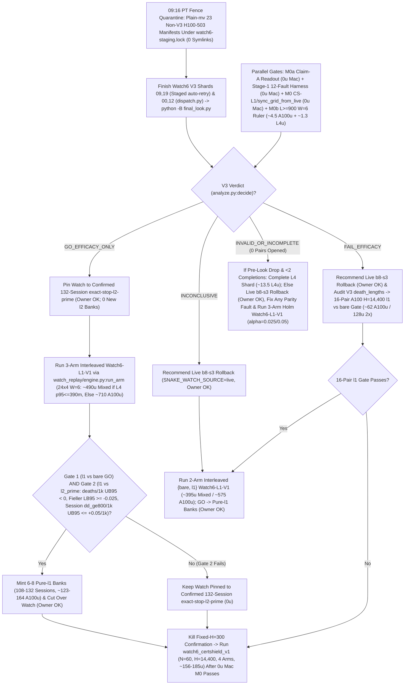

# T34 ExIt-B8 Research Roadmap (Round-12 Synthesis — Advice, Not Decisions)

Start: [project index](../INDEX.md) · [current status & authority](../STATUS.md) · [research record index](INDEX.md) · [study packages](../../research/INDEX.md) · [campaign log](final_run_20261019/CAMPAIGN_LOG.md).

> [!IMPORTANT]
> **Status: Research advice, NOT ratified decisions or release authorization.**
> Every current-round and later-round plan on this page is synthesized advisor guidance from Round 12 (2026-11-01 PT; primary synthesis artifact: `snake-dqn-artifacts/big-lever/exp/argon-rounds/round-12/synthesis/answer.md`, superseding Rounds 01–11; `round-12/current/answer.md` exited `0 B` on a startup HTTP `404` and was verified directly against `HEAD` `919e17a8`). Nothing here amends a pre-registration, ratifies a confirmation gate, or changes served defaults. Binding campaign authority remains [`SUCCESS_CONTRACT.md`](final_run_20261019/SUCCESS_CONTRACT.md), [`DESIGN_V2_SHADOW.md`](final_run_20261019/DESIGN_V2_SHADOW.md) (+ Amendment 1), [`P7_STATISTICS.md`](final_run_20261019/P7_STATISTICS.md), unsuperseded parts of [`FINAL_PLAN.md`](final_run_20261019/FINAL_PLAN.md), and [`STATUS.md`](../STATUS.md); any serving or release change requires confirmation-lane evidence, Mac serving qualification, and the owner's explicit OK.

---

## 1. Snapshot Context & Code-Verified Round-12 Corrections (Oct 29 – Nov 1)

### 1.1 Nov 1 exploration, bank-minting, parity & Watch6 V3 fence quarantine ruling

- **All-length exact-stop screen — `ADOPT` for new replay banks** ([`watch6_alllen_screen`](../../research/watch6_alllen_screen/README.md), `t34-sol/argon-alllen-a100/analysis.json`, `N = 48` paired `H = 6,000` Watch6-v2 sessions uniting `12` L4 `W = 4` units `0..11` at `568b09e4` with `36` A100 `W = 6` units `12..47` across three `12`-unit shards at `73c26ccc` on `origin/argon-alllen-a100-1031`):
  - `bare` (`b8-s3`): **`351.07` mass** (`CI95 [320.22, 381.91]`), **`0.2882` `deaths/1k`** (`CI95 [0.2427, 0.3337]`; `83` deaths: `53` at `L < 600`, `30` at `L >= 600`, `21` at `L >= 800`), `mean_max_length = 794.3`.
  - `l2_prime_600` (served `L >= 600`): **`461.16` mass** (`CI95 [414.30, 508.02]`; `+110.09` vs `bare`, `CI95 [+72.06, +148.13]`), **`0.1597` `deaths/1k`** (`CI95 [0.1060, 0.2134]`; `-44.6%` vs `bare`; `46` deaths: `34` at `L < 600`, `12` at `L >= 600`, `11` at `L >= 800`), `449.6` mean branches/session (`403.7` roots, `mean_max_length = 943.4`).
  - **`exact_stop_alllen` (`L >= 1`, `interval = 5`, `H = 300`):** **`559.43` mass** (`CI95 [533.59, 585.27]`; **`+208.37` / `+59.35%` vs `bare`**, `CI95 [+170.07, +246.66]`; **`+98.27` / `+21.31%` vs `L >= 600`**, `CI95 [+50.57, +145.98]`, clearing `>= +15.0`) and **`0.0521` `deaths/1k`** (`CI95 [0.0294, 0.0748]`; **`-81.9%` / `-0.2361/1k` vs `bare`**, `CI95 [-0.2828, -0.1895]`; **`-67.4%` / `-0.1076/1k` vs `L >= 600`**, `CI95 [-0.1609, -0.0544]`, clearing `<= 0.0`), cutting `L < 600` deaths **`53 (bare) / 34 (L >= 600) -> 1`** (`0.142%` `L < 600` overrides, `mean_max_length = 1,096.0`) at **`2.821×` branches** (`1,268.5` vs `449.6`, `1,200.1` roots = **`1.057` branches/root**, stopping on `bare` at **`94.3%`** of roots, with `53.6%` cheap `L < 600` roots in frames `0..6,000`). **`14/15` remaining deaths occur at `L >= 600` (`13/15` at `L >= 800`).**
  - *Exposure & per-world notes:* Eliminating `34 -> 1` early deaths gives `exact_stop_alllen` **`1.379×` more `L >= 600` living exposure** (`403.7 -> 556.6` roots/session), so `11 -> 13` raw `L >= 800` deaths reflects **`-14.2%` lower per-frame `L >= 800` hazard** despite raw session-normalized `Δd_ge800 = +0.0069/1k`. Across paired worlds, `exact_stop_alllen` regressed deaths vs `L >= 600` on `3/48` seeds (`3075941873`, `3394546952`, `121131908`) and mass on `14/48` seeds.
- **All-length Watch banks `14l1–16l1` completed `36/36` on active Cap-6 `36285bc6` (freeing all `3` A100 slots):**
  - Verified receipts (`t34-sol/argon-banks-l1/packet-bank{14l1,15l1,16l1}-a100/output-main/receipt.json`, `SUMMARY.md`) confirm Cap-6 (`36285bc6`) ran `6/6` concurrent runtimes (`3 A100 @ 6.73 u/h + 3 L4 @ 1.94 u/h = 26.01 u/h`), finishing all `3 × 12` `exact-stop-l1` sessions (`W = 6`, `H = 6,000`) in **`3.03–3.07 h/bank`** (**`~20.36–20.67 u/bank` = `~61.5 A100 u` observed total** vs `~227 u` forecast; balance **`~2,154.66 u`**, leaving `3` A100 slots immediately available). Because survived trajectories spend frames `6,000..14,400` almost entirely at `L >= 800`, `exact-stop-l1` compute scales **superlinearly (`~2.9–3.3×`)** from `H = 6,000` to `H = 14,400` (`argon-banks-l1/SUMMARY.md:38-40`).
  - Commit `395eacbb` switched `.claude/launch.json` to **`watch-replay-bank-live-168`** (`132` `exact-stop-l2-prime` banks `01–08, 10–12` + `36` unconfirmed `exact-stop-l1` banks `14l1–16l1`, [`web/serve.py`](../../web/serve.py) restarted on `b5b63cd1`, keeping `watch-replay-bank-live-132` intact for rollback). Confirming `exact-stop-l1` at `H = 14,400` still requires prospective confirmation (`Watch6-L1-V1`), Mac serving qualification, and owner OK; defer minting new banks until Watch6 V3's verdict lands.
- **GPU `DeviceSim` v2 parity — `PASS` on A100** ([`devicesim_v2_parity`](../../research/devicesim_v2_parity/README.md), `t34-sol/argon-devicesim-v2/packet-a100-v2-parity-01/main-run-01/receipt.json`): **`0` mismatches** across **`1,536,000` snake-ticks** (`E = 256 × 1,000` Watch6-v2 ticks in `3,505.6 s` = `1,434.6` steps/s under 5-opponent CUDA flood launches, commit `b500d111`), using `DeviceSim`'s SplitMix64 RNG and `<= 1e-4` CUDA FP32 near-tie Q re-decision tolerances.
- **Active confirmation — Watch6 V3 (`09:16 PT` staging-fence quarantine ruling, identity closure & linear-retry lineage guard)** ([`REGISTRATION_V3.md`](../../research/watch6_search_efficacy_v3/REGISTRATION_V3.md)): `24 × 4` L4 `W = 4` shards (`96` fresh paired `H = 14,400` Watch6-v2 sessions) confirming **`exact-stop-l2-prime` (`L >= 600`) only**. At `05:01 PT`, **`14/24` shards were `PASS`** (`01..08, 10, 11, 13..16`), **`6/24` active** (`17, 18, 20..23`), and **`4/24` V6.1-accepted mechanical failures** (`00` `412` unallocated, `09` `UPLOAD_CAP`, `12` renewal-WS drop, `19` warmup `GuardError`; `75471246`):
  - *`09:16 PT` V6.1 staging-fence quarantine ruling (`APPROVE_WITH_CONDITIONS`, `t34-sol/v61-fence-ruling-20261101.md`, `t34-sol/v61-fence-evidence-20261101.json`):* `23` historical non-V3 H100-503 pre-fallback manifests in `ops/manifests/` return `_attempt_state == "FENCE"`, blocking [`tools/watch6_v3_accounting/dispatch.py:wait_other_jobs_staged`](../../tools/watch6_v3_accounting/dispatch.py) (`lines 219–245`) for V3 recovery shards `00` and `12`. The Fable stand-in judge approved plain-`mv` quarantine of **only** those `23` manifests + `.live.json` siblings to `ops/manifests-archive-20261101/` under `flock` on `ops/watch6-staging.lock` (**`0` symlinks**, because [`final_look.py`](../../tools/watch6_v3_accounting/final_look.py) `lines 473–483` fails closed on `is_symlink()` before namespace filtering).
  - *Identity closure & linear lineage:* [`watch6_search_efficacy_v3/protocol.py`](../../research/watch6_search_efficacy_v3/protocol.py) hashes both [`tools/ops/package_spec.py`](../../tools/ops/package_spec.py) (`line 94`) and `web/backend/` (`line 96`) into `identity()`, and [`final_look.py:_verify_shard_lineage`](../../tools/watch6_v3_accounting/final_look.py) (`lines 380–386`) fails closed on forked attempt trees sharing a parent receipt. Keep all V3 worktrees untouched; dispatch **only** staged `ops/auto-retry` children on shards **`09` and `19`** (**do NOT run [`recover.py`](../../tools/watch6_v3_accounting/recover.py)** on `09, 19`); run `recovery-shard-{00,12}-01` via `python -B -m tools.watch6_v3_accounting.dispatch`; and invoke [`final_look.py`](../../tools/watch6_v3_accounting/final_look.py) under **`python -B`** from clean `snake-dqn-argon-v3-accounting` ([`_forbid_pycache_directory`](../../tools/watch6_v3_accounting/__init__.py) `lines 747–777`).
- **Completed Oct-30 Claim-A GPU receipts awaiting `0 u` Mac readout (`< 3 min`):** `b8-head-closedloop` (`t34-sol/b8-head-closedloop/main-01/output/receipt.json`, `rc = 0`) and `spatial-qbytes-01` (`t34-sol/spatial-qbytes-fix/t34-spatial-qbytes-01/ruler-output-a100-fallback/receipt.json`, `rc = 0`) completed cleanly on A100, while `T4 Gate-1` (`0/8` bars, `KILL_T4`) cancels the `40–48 A100 u` `spatial-student-pilot` fit (retaining compiled `.so` caches).

### 1.2 Closed single-pass critics, distillations, RL, and standalone macro fallbacks

Between 2026-10-29 and 2026-11-01, every single-pass learned-policy, critic, distillation, and standalone macro-fallback track closed below its promotion or selectivity bars:

| Track | Scope & primary artifact | Measured outcome | Disposition |
| --- | --- | --- | --- |
| **TRAIN-01** ([`sandbox_a_resident`](../../research/sandbox_a_resident/README.md)) | `100.7M`-row (`384`-update) GPU-resident PPO from `b8-s3` (`t34-sol/train01-closeout/SUMMARY.md`) | H5000 equal-mix paired mass **`+8.09`** (`CI95 [-18.66, +34.85]`; scripted `+26.32`, frozen `+2.85`, mixed `-4.90`; update-320 peak `+14.23` `[-11.86, +40.32]`) vs bar `>= +40` | **Closed** (no strict-gate nomination) |
| **C/T Stage-2 distillation** | Continuation-teacher causal-root distillation (`t34-sol/ct-stage2-verdict/SUMMARY.md`) | Teacher rescued **`22/32` (`68.75%`)** deaths (`22/32 <= 65` ticks; indep-suffix H300 `+66.77`, `LB90 +51.61`), but student retention was **`46.9–50.0%`** (`0 pp` over `frozen_phi` vs `>= +15 pp`; topology AUC `0.5752 < 0.83`), ordinary flips **`44.4–64.5%`** (bar `<= 1%`), and lethal ordinary flips **`3–5`** (bar `<= 1`) | **`FAIL_DISTILLATION_RETENTION_OR_SAFETY`** |
| **Doom U-Net & `spatial-student-pilot`** | `83 × 145` spatial U-Net vs 33.7k B8-feature head (`t34-sol/doom-result-01/result.json`; `t34-sol/student-direction/{astra,fable}.md`) | Spatial U-Net lost late per-action doom ROC-AUC to frozen B8 features (**`0.753` vs `0.810`**, `Δ = -0.056`, `CI95 [-0.091, -0.023]`; all-strata death-lookback `0.7626` vs `0.8226`; ordinary late `0.690` vs `0.706`) | **`GRAY` / `40–48 A100 u` pilot fit canceled (`0 u`; retain `.so` caches)** |
| **B8 advantage head (offline OOF)** | `256 -> 128 -> 6` ReLU head on frozen B8 features (`t34-sol/b8-head-test/RESULT.md`) | Mass rule `GO` (late H300 `+30.09`, `LB90 +23.96`), Fable selectivity **`FAIL`**: **`26.42%`** late rescue (bar `>= 35%`) at **`97.60%`** non-death flips (bar `<= 15%`) | **Selectivity `FAIL`** (192-world closed-loop A100 `rc = 0`, awaiting Mac readout) |
| **T4 Gate-1 factored critic** ([`t4_gate1`](../../research/t4_gate1/README.md)) | Clean-slate privileged `83 × 145` (`H = 320` 7-source BFS) hazard + foraging mass-flux critic on `384` disjoint Watch6-v2 worlds (`t34-sol/argon-t4-gate1-fix2/queue-03/READOUT.json`) | **`0/8` bars passed**: `L >= 600` residual EV **`+0.0266`** (`[-0.0280, +0.0869]` vs `>= 0.25`), death-root H300 rescue **`+19.99`** (vs `>= +40`), mature doom AUC **`0.5617`** (vs `>= 0.80`), ordinary H300 mass **`-22.21`** (vs `>= -15.0`), lethal flips **`3.13%`** (vs `<= 3.0%`) | **`KILL_T4`** (proves even privileged `83 × 145` critic lacks late value signal) |
| **R6 `L < 600` harvest census** ([`r6_l600_census`](../../research/r6_l600_census/README.md)) | `64`-world (`384`-root) Watch6-v2 early-game counterfactual + 5-fold OOF corpse/trail plane probes (`t34-sol/argon-mac-checks/r6-census/RESULT.json`) | **`34.90%` (`134/384`)** oracle-harvestable roots (`>= +5` H500 mass), **`7.69%`** non-bare H500 lethal flips, OOF ROC-AUC **`0.474–0.521`** (`0` passing threshold points); superseded operationally by `exact-stop-l1` | **`KILL`** |
| **R7 macro-option fallback** ([`r7_macro_fallback`](../../research/r7_macro_fallback/README.md)) | Pruned depth-2 (`2K = 30` ticks) spatial macro-options `{O_0..O_5}` on C/T train `1-step-all-die` roots (`t34-sol/argon-r7-repack/R7_READOUT.json`) | `3/5` bars passed (`0.316 ms` Mac 1-thread p95; **`33.0%` vs `9.0%`** `L >= 800` `all_die_sel0` rescue on `25/129` roots — `9/25` `macro_triggered` at `+66.7 pp` rescue vs `16/25` tick-`30` B8 re-traps, while `104/129` `80.6%` survived `H = 300`), but total `L >= 600` lift **`+3.85 pp`** (`< +10.0 pp`) and **`2 > 0`** ordinary lethal flips (`0` assessment roots opened) | **`KILL`** as standalone `30`-tick fallback |

### 1.3 Code-verified Round-12 corrections over Round 11

Round 12 preserves Round 11's verified Watch serving fixes ([`GameSession.set_mode`](../../web/backend/session.py) `lines 1445–1462` `MODE_TRAIN` guard reorder before `_leave_watch_replay()`, `64`-frame [`verify_payload`](../../web/backend/watch_replay.py) yield) and interleaved `24 × 4` `W = 6` [`watch_replay/engine.py:run_arm`](../../research/watch_replay/engine.py) (`lines 85–265`, including `session.live.snapshot()`), while correcting **six transport/packaging defects** and **four later-round search/live-serving flaws** in Round 11:

1. **Six transport & confirmation-packaging corrections (`PUBLIC_INPUTS.json`, `canary.py`, `supervisor.py`, `runtime.py`, `bootstrap.sh`, `requalify.py`):**
   - *(1) Non-existent standalone `frp3_m3_s12` URL (`404` in `inputs.preflight`):* [`PUBLIC_INPUTS.json`](../../research/t34_exit_b8/PUBLIC_INPUTS.json) (`lines 4–15`) publishes only `B8_s3_final.pth` (`6.56 MB`) and `league.tar.gz` (`21.36 MB`, bundling `frp3_m3_s12_u60000_20261005.pth`, SHA `eec144bf...`); a standalone `frp3_m3_s12` URL `404`s in [`inputs.preflight`](../../research/colab_cli/inputs.py) (`lines 113–132`). Bind `B8_s3_final.pth` + `league.tar.gz` via `public_inputs` (`0` Mac checkpoint upload bytes; VM extracts `frp3_m3_s12` and checks SHA against [`served_checkpoint_pins.json`](../../web/backend/served_checkpoint_pins.json)) and upload `< 28 KiB` shard-invariant `input-metadata.tar.gz` (`env["CONFIRM_SHARD"]` $\Rightarrow$ **`1` initial canary/24 shards** under [`canary.family`](../../research/colab_cli/canary.py) `lines 55–62`) + fixed-`64 KiB` padded `verified-ledger.tar` (`< 96 KiB` total Mac upload, `~15 s << 150 s` cap).
   - *(2) Stage-1 ledger rebuild vs [`canary.check`](../../research/colab_cli/canary.py) (`lines 315–321`) & [`auto_retry.py`](../../tools/ops/auto_retry.py) (`lines 265–270`):* Unmodified `36285bc6` enforces exact input `sha256` in `canary.check` and `exports == []` in `auto_retry.py`. Tier-0 pre-workload retries reuse the empty `64 KiB` `verified-ledger.tar` (`0` extra canaries), whereas a Tier-1 mid-workload completion retry changes `verified-ledger.tar`'s `sha256` and auto-queues **one `15 min` (`~0.4 u`) `pending_canary`** on `36285bc6` (`0` extra canaries once Stage 2 exempts schema-verified `<= 64 KiB` `verified-ledger.tar`).
   - *(3) Pre-warmup [`calibrate_rate`](../../research/colab_cli/supervisor.py) (`lines 1489–1574`) leaves paid VMs unfenced & breaks [`AcceptanceObserver`](../../research/colab_cli/acceptance_faults.py) (`lines 98–108`):* [`execute`](../../research/colab_cli/supervisor.py) (`lines 1593–1674`) runs `wait_runtime_ready` + `upload_credential` + `recoverable_rpc(initial)` to arm [`runtime.py`](../../research/colab_cli/runtime.py)'s self-stop lease watchdog; running `calibrate_rate` first leaves VMs unfenced for `120–730 s`, calls `cli.renew()` (`line 1507`) before `cli.start_lease`, and breaks `AcceptanceObserver` stage ordering. Instead, use a **two-window `account.lock` split (`~18 s` total hold, remote watchdog armed FIRST)**: Window #1 (`~4–6 s`) runs admission + `colab new` + `active-<session>.json`; unlocked warmup (`15–180 s`) runs `wait_runtime_ready` (`2`-probe `~6 s` `KERNEL_CREATION_GUARD_ERROR` fast-abort) + `upload_credential` + `recoverable_rpc(initial)`; Window #2 (`~12–14 s`) re-acquires `account.lock`, refreshes `baseline_endpoints` & `baseline_rate_units_per_hour` from `active-*.json` in [`calibration_read`](../../research/colab_cli/accounting.py) (`lines 247–284`), and runs `calibrate_rate`.
   - *(4) `hardware.json` split falsely kills shards on post-`hardware.json` pre-workload VM failures:* `public-input-fetch-failed.json` is VM-only ([`runtime.py`](../../research/colab_cli/runtime.py) `lines 257–268`), surfacing on Mac as `returncode == 74` and `terminal.reason == "public_input_fetch_failed"` (`lines 652–686`), while both URL `503`s (`rc = 74`) and [`bootstrap.sh`](../../research/colab_cli/bootstrap.sh) (`lines 19–44`) wheel `503`s write `terminal.json` (`exports: []`) after `hardware.json` and before `bootstrap.sh:61` `exec` runs study code. Split retries at outcome-blind **`exports/workload-started.json`** (published after `bootstrap.sh` + `public_inputs` + pin verification right before world `0`): **Tier-0** (`workload-started.json` & `.meta.json` absent $\Rightarrow$ `prestart_attempt < 8`, `0` completions burned) vs **Tier-1** (`workload-started.json` present $\Rightarrow$ `completion_attempt < 2`).
   - *(5) Global `ops/manifests/` `FENCE` & ops/web closure coupling:* Isolate future confirmation state under `ops/studies/<namespace>/`, hash science-only `identity()` via `git ls-tree -r <commit>` (excluding `tools/ops/*`, [`watch_replay.py`](../../web/backend/watch_replay.py), [`app.py`](../../web/backend/app.py), and untracked `__pycache__`), ratify Tier-0/Tier-1 once as standard template **`r34-confirm-accounting/v1`** audited by `confirm_audit.py` (**`0` judge rounds/glitch**), and verify via a **12-fault** [`fake_colab.py`](../../tests/fixtures/fake_colab.py) harness (`0 u`).
   - *(6) Direct-dispatch `ACCOUNT_L4_CAP = 3` & `requalify.py` `"PENDING"` review gate:* Enforce `total < 6` and `L4 < 3` under `ops/alloc.lock` directly inside [`tools/ops/dispatch.py`](../../tools/ops/dispatch.py), and require independent reviewer `"ACCEPT"` ([`qualification.py`](../../tools/ops/qualification.py) `lines 58–59`) after [`requalify.py`](../../tools/ops/requalify.py) (`line 166`) writes `"PENDING"`.
2. **Four later-round search & live-serving corrections (`RESULT_EXTEND.md`, `exact_stop.py`, `safety_veto_v8.py`, `dto_split.py`):**
   - *(1) Open-loop `cert-stop-h128` (`interval = 5`) re-enters pockets on tick `t+1`:* In T35 ([`RESULT_EXTEND.md`](../../research/t35_two_deviation/RESULT_EXTEND.md) `line 11`), **`26/26` extension `all-die` windows failed 2-deviation search** across `300`-frame delay chains in `> 350`-tick sealed pockets (`L = 1,000..1,400`), while 1-deviation rollouts and [`DenseTrigger(interval=5)`](../../research/watch_replay/engine.py) (`lines 118–189`) hand ticks `t+1..t+4` back to greedy `b8-s3`, whose corpse-Q gradient re-enters the pocket mouth. Upgrade `TailExitCert` into **`interval = 1` closed-loop `CertShield` (`TailExitCert_v8`) running both online and on rollout ticks `1..128`** (`CS-L1`).
   - *(2) Bare-first `94.3%` early-stop silences tie-breaks & misses two-regime `v8`-pinch:* [`exact_stop.run`](../../research/bl_served_search/exact_stop.py) (`lines 48–55`) stops on `bare` at `94.3%` of roots (`1.057` branches/root), while `frp3-s12 + v8(lambda=8.0)` flees `< 1.75 * L_j` ([`safety_veto_v7.py`](../../src/evaluation/safety_veto_v7.py) `lines 47–51`) and yields `Manhattan <= 2` contested cells whenever `L_j < 1.15 * (L_0 + 1)` except in `OUTCOME_NO_SPACIOUS` ([`safety_veto_v8.py`](../../src/evaluation/safety_veto_v8.py) `lines 18–34, 289`). Model spacious smaller opponents as yielding in `TailExitCert_v8`, and expand top `K = 3` `CertShield`-safe actions for `H = 48` ticks (`+7%` compute) on the `< 8%` of roots with `Chebyshev(head_0, head_j) <= 16` and `L_0 >= 1.15 * L_j`.
   - *(3) `PredictiveSpinePool` `176`-tick re-probes cost `1.01 s`, [`adapter_v2.py`](../../research/t34_pathb/adapter_v2.py) (`lines 346–376`) lacks mid-session sync, & [`dto_split.py`](../../research/bl_served_search/dto_split.py) (`lines 61–62`) refuses `pathb`:* At `2.30–5.75 ms/tick` (`L = 900`, `argon-banks-l1/preflight/benchmark.json`), `176`-tick block re-probes take up to `1.01 s`. Build `< 0.35 ms` `sync_grid_from_live(game) -> CapturedWorld` (verified via [`full_digest`](../../research/t34_shadow/shadow.py) `lines 427–465`) and run `W = 4` process-isolated **`D = 384` (`16.0 s`) `ShadowSpine`** (unlocked `dto_split.py` + `1`-tick/frame [`ShadowEngineV2`](../../research/t34_pathb/engine_v2.py) + `2` [`evaluate_decisions`](../../research/t34_pathb/batch_v2.py) workers).
   - *(4) `H = 6,000` evaluation censors `L >= 1,100` coiling:* Mint and evaluate Watch trajectories at **`H = 14,400` (`10 min`)**, keep Play `5×` bare `b8-s3` unshielded (`scores.db` clean), and freeze [`CORPSE_FOOD_CAP_MULTIPLE_V2 = 0.5`](../../src/core/mechanics_constants.py) (`line 29`) until Claim B closes.

---

## 2. Current-Round Plan (Advice, Not Decisions)

### 2.1 Unblock Watch6 V3 (`0 u`), run `M0a` Claim-A readout (`0 u`), & patch Watch replay on `main`

1. **Execute V3 `23`-manifest plain-`mv` quarantine & finish Watch6 V3 linearly (`0 u`, `N = 96`, `exact-stop-l2-prime` only):**
   - Under `flock` on `ops/watch6-staging.lock` per `t34-sol/v61-fence-ruling-20261101.md` and `t34-sol/v61-fence-evidence-20261101.json`, record `colab usage` + SHA256s in `ops/manifests-archive-20261101/MANIFEST.json`, plain-`mv` **only** the `23` historical non-V3 H100-503 `FENCE` manifests + `.live.json` siblings to `ops/manifests-archive-20261101/` (**`0` symlinks**), and verify `0` `FENCE` rows in [`wait_other_jobs_staged`](../../tools/watch6_v3_accounting/dispatch.py) (`lines 219–245`).
   - Dispatch **only** the staged `ops/auto-retry` packets on shards **`09` and `19`** (**do NOT run `recover.py`** on `09, 19`), complete shards **`00` and `12`** via `python -B -m tools.watch6_v3_accounting.dispatch`, and run `python -B` [`final_look.py`](../../tools/watch6_v3_accounting/final_look.py) from clean `snake-dqn-argon-v3-accounting` (never opening `exports/` or `pair-*.json` on `INVALID_OR_INCOMPLETE`).
2. **Run `M0a` Claim-A readout & enforce v1 `H = 5,000` closure bar (`0 u`, `< 3 min` Mac):**
   - Run `nice -n 15 ./venv/bin/python -m research.b8_head_test.closedloop_readout` (`origin/astra-doom-auc-smoke` @ `591d94c3`) on completed `b8-head-closedloop` (`N = 192` v1 `H = 5,000` worlds, `m in {0, 10, 25, 50}`) and audit completed `spatial-qbytes-01` (`mapped-parity.json`); keep `spatial-student-pilot` (`40–48 A100 u`) canceled (`0 u`, retaining `.so` caches).
   - **Recommended Claim-A kill rule:** Recommend **closing Claim A permanently (`0 u`)** unless some `m in {0, 10, 25, 50}` clears v1 `H = 5,000` bars (`>= +40` pooled mass per `b8-head-closedloop/SUMMARY.md:16,45` and [`SUCCESS_CONTRACT.md`](final_run_20261019/SUCCESS_CONTRACT.md) `lines 29–33`, Bonferroni `LB97.5 > 0`, scripted no-death `>= +0.03` with no mix loss, [`P7_STATISTICS.md`](final_run_20261019/P7_STATISTICS.md) Guard A `Δalive >= -0.05` pooled / `>= -0.075` per mix, and `<= 15%` living overrides), followed by a `0 u`, `10 min` v2 boost `[0.5%, 10%]` check before nominating any Mac strict gate.
3. **Patch & Mac-qualify Watch replay serving on `main` & decouple confirmation closures (`0 u`, V3 worktrees untouched):**
   - Leave all V3 worktrees untouched, set `"SNAKE_WATCH_SOURCE": "live"` in [`watch6_search_efficacy/product.py:open_watch`](../../research/watch6_search_efficacy/product.py) (`line 41`, matching [`watch_replay/product.py`](../../research/watch_replay/product.py) `line 43`), and hash confirmation `identity()` via `git ls-tree -r <commit>` over runtime science blobs only (excluding `tools/ops/*`, [`watch_replay.py`](../../web/backend/watch_replay.py), [`app.py`](../../web/backend/app.py), and untracked `__pycache__`):
     - In [`GameSession.set_mode`](../../web/backend/session.py) (`lines 1441–1462`), refuse `MODE_TRAIN` on forward-only `EGO2S_OBS_SPECS` / `RASTER31V2` **before** calling `self._leave_watch_replay()`, preserving active Watch replay across rejected train-mode switches.
     - Replace per-frame `stop.wait(0.001)` in [`verify_payload`](../../web/backend/watch_replay.py) (`line 176`) with a **`64`-frame cooperative yield** (`< 0.35 s` cold load without `24 fps` GIL stalls); filter `SNAKE_WATCH_REPLAY_CONTROLLER` (`all | exact-stop-l2-prime | exact-stop-l1`) via line-1 `.watch.gz` header peeks; add injectable `shuffle_discovery: bool = True` for cycle 1 (with cross-cycle boundary holdback); shallow-copy `dict(self.frame)` + `dict(session)` in [`Recording.snapshot`](../../web/backend/watch_replay.py) (`lines 226–238`); and accept `horizon in {6000, 14400}` in [`validate_header`](../../web/backend/watch_replay.py) (`lines 48–65`).
     - Set `_replay_opted_out = True` **only** inside [`set_epsilon`](../../web/backend/session.py) (`lines 1154–1160`) and [`set_food`](../../web/backend/session.py) (`lines 1173–1200`) — **never** inside `_leave_watch_replay()`, keeping `Play -> Watch` via `set_mode("watch")` intact — and clear `_replay_opted_out = False` in [`_build`](../../web/backend/session.py) (`lines 714–738`) plus a split `"new_game"` control handler in [`app.py`](../../web/backend/app.py) (`lines 310–311`); gate `__init__`, `reset_game`, and `set_mode` strictly on clean mixed-Watch6 `b8-s3` (`served_checkpoint["name"] == "b8-s3"`, `watch_roster == "mixed"`, `watch_roster_reason is None`, `len(snakes) == 6`, `not _replay_opted_out`).
   - Pass `1,500` unpaced + `120` paced-`24 fps` Mac qualification ticks (`update p95 <= 11.688 ms`, `0/120` overruns per [`t15_mixed_roster_qualification_2026-10-17.md`](t15_mixed_roster_qualification_2026-10-17.md), `< 1.0 s` cold readiness) while cold `.watch.gz` verification runs concurrently across `L >= 1,000` bodies, `6,000 -> 1` rotation, `set_mode("train")` refusal, `Play -> Watch`, and live-B8 fallback.

### 2.2 Deploy Round-12 Glitch-Proof Two-Stage Transport (`0 u` Stage 1 + `~1.5 u` Stage 2)

1. **Stage 1 (`0 u` Colab, [`tools/ops/`](../../tools/ops/) on active Cap-6 `36285bc6`, zero `colab_cli` edits):**
   - **Zero-checkpoint `< 96 KiB` Mac packaging (`tools/ops/confirm_package.py`):** Bind `B8_s3_final.pth` (`6.56 MB`) and `league.tar.gz` (`21.36 MB`) via `public_inputs` from [`PUBLIC_INPUTS.json`](../../research/t34_exit_b8/PUBLIC_INPUTS.json) (`lines 4–15`, `0` Mac checkpoint upload bytes; VM extracts `frp3_m3_s12_u60000_20261005.pth` and verifies SHA `eec144bf...` against [`served_checkpoint_pins.json`](../../web/backend/served_checkpoint_pins.json)), upload `< 28 KiB` shard-invariant `input-metadata.tar.gz` (`env["CONFIRM_SHARD"]`, **`1` initial canary/24 shards** under [`canary.family`](../../research/colab_cli/canary.py) `lines 55–62`) + fixed-`64 KiB` padded `verified-ledger.tar` (`~15 s << 150 s` cap), isolate confirmation state under `ops/studies/<namespace>/`, and hash science-only `identity()` via `git ls-tree -r <commit>`.
   - **Three outcome-blind exports (`.sha256` + `.complete`):** Publish `exports/workload-started.json` (`{namespace, study_sha256, shard}`, `0` timing/outcomes, emitted after [`bootstrap.sh`](../../research/colab_cli/bootstrap.sh) + `public_inputs` + pin verification right before world `0`), survival-blind `exports/unit-{w:03d}.meta.json` (`{unit_id, payload_relpath, payload_size, payload_sha256}`, `0` timing/gameplay fields) alongside sealed `unit-{w:03d}.payload.json`, and outer-trap `exports/slot-fault.json`.
   - **Locked caps, single-GPU `reconcile_unavailable`, & `workload-started.json` Tier-0/Tier-1 retries (`r34-confirm-accounting/v1`):** Enforce `total < 6` and `L4 < 3` under `ops/alloc.lock` inside [`tools/ops/dispatch.py`](../../tools/ops/dispatch.py) with `--ops-study-root ops/studies/<namespace>` + `--no-internal-retry` and single-GPU [`reconcile_unavailable`](../../tools/ops/dispatch.py) (`lines 2358–2490`). Split [`auto_retry.py`](../../tools/ops/auto_retry.py) linear chains at `exports/workload-started.json`:
     - **Tier-0 Pre-Workload (`workload-started.json` & `.meta.json` absent):** `0` study ticks ran (`412`/`503`, `L4` cap, `UPLOAD_CAP`, `GuardError`, `rc = 74` `public_input_fetch_failed` in [`runtime.py`](../../research/colab_cli/runtime.py) `lines 652–686`, or [`bootstrap.sh`](../../research/colab_cli/bootstrap.sh) `lines 19–44` wheel `503`) $\Rightarrow$ `prestart_attempt < 8`, **`0`** `completion_attempt` burned, reuses empty `64 KiB` ledger (`0` extra canaries).
     - **Tier-1 Mid-Workload (`workload-started.json` present, `< K` units):** Requires `status == "INCOMPLETE"`, `stop_verified is True`, `cleanup_error is None`, `slot-fault.json` & `terminal.json` absent (or `lease_expired`), and `elapsed_seconds < timeout_minutes * 60 - 180`; rebuilds `64 KiB` `verified-ledger.tar` from `.meta.json` + raw `stat`/`sha256` (**`0` `pair-*.json` reads**), `completion_attempt < 2`, auto-queuing one `15 min` (`~0.4 u`) `pending_canary` on `36285bc6` (`0` extra canaries on Stage 2). Audit via `python -B -m tools.ops.confirm_audit` (**`0` judge rounds/glitch**).
   - **12-fault offline glitch-immunity harness (`0 u`, `< 10 min` Mac):** Prove `16/16` unit bijection and `0` `pair-*.json` opens on [`tests/fixtures/fake_colab.py`](../../tests/fixtures/fake_colab.py) across `L4 = 3`, `412`, `503`, `UPLOAD_CAP`, `GuardError`, `rc = 74` URL `503`, bootstrap wheel `503`, mid-run WS drop, `23` global `FENCE` manifests + symlink, ops/`.pyc` edits, near-timeout refusal, and `slot-fault.json` refusal.
2. **Stage 2 (`~1.5 u` Colab, additive `colab_cli` via [`qualification.py`](../../tools/ops/qualification.py) `add`, live jobs on `36285bc6` untouched):**
   - **Two-window `account.lock` (`~18 s` total hold, remote watchdog armed FIRST) & fast `GuardError` abort:** Window #1 (`~4–6 s`) runs admission + `colab new` + `active-<session>.json`; unlocked warmup (`15–180 s`) fast-aborts `KERNEL_CREATION_GUARD_ERROR` after `2` probes (`~6 s`) and runs `wait_runtime_ready` + `upload_credential` + `recoverable_rpc(initial)` so [`runtime.py`](../../research/colab_cli/runtime.py)'s self-stop watchdog is armed and [`AcceptanceObserver`](../../research/colab_cli/acceptance_faults.py) (`lines 98–108`) stage ordering holds; Window #2 (`~12–14 s`) re-acquires `account.lock`, refreshes `baseline_endpoints` & `baseline_rate_units_per_hour` from `active-*.json` in [`calibration_read`](../../research/colab_cli/accounting.py) (`lines 247–284`), and runs [`calibrate_rate`](../../research/colab_cli/supervisor.py) (`lines 1489–1574`).
   - **Zero-WS polling/exports, ledger canary exemption & reviewer `"ACCEPT"`:** Route `<= 8 MiB` exports via Contents [`export_file`](../../research/colab_cli/supervisor.py) (`lines 885–906`) + Contents `state.json` GET + `90 s` pre-stop Contents salvage whenever `self.observer is None` (**`0` post-`initial` WS RPCs** vs [`export_batch`](../../research/colab_cli/export_batches.py) `line 312`), exempt schema-verified `<= 64 KiB` `verified-ledger.tar` in [`canary.check`](../../research/colab_cli/canary.py) (`lines 315–321`), `flock`-cache public URL digests in [`inputs.preflight`](../../research/colab_cli/inputs.py) (`670 MB -> 27.92 MB`), pass all **`12/12` gates** (`11` `final-only` + `d1024`, `~1.2 u`) via [`tools/ops/requalify.sh`](../../tools/ops/requalify.sh) + `10 min` L4 WS-blackout canary (`~0.3 u`), and obtain independent reviewer `"ACCEPT"` ([`qualification.py`](../../tools/ops/qualification.py) `lines 58–59`, flipping [`requalify.py`](../../tools/ops/requalify.py) `line 166`'s `"PENDING"`).

### 2.3 `M0b` `L >= 900` `W = 6` tail ruler (`~4.5 A100 u` + `~1.3 L4 u`) & Watch6 V3 routing (serving switches need owner OK)

Before freezing `Watch6-L1-V1` manifests, run **`M0b` (`~4.5 A100 u` + `~1.3 L4 u` when free)**: `6` `L >= 900` fixtures × `1,200` frames at `W = 6` through [`watch_replay/engine.py:run_arm`](../../research/watch_replay/engine.py) (`lines 85–265`, `record=None, horizon=14400`, full live mirror + `session.live.snapshot()`). If **L4 `p95 > 390 m`**, kill L4 placement (`A100`-only); if **A100 `p95 > 380 m`**, switch pre-data from `24 × 4` to `32 × 3` A100 `W = 6`. Otherwise schedule **`24` shards × `4` interleaved triples at `W = 6`** (`[l1_0, l1_1, l1_2, bare_0, l2_0, l2_1, l1_3, bare_1, l2_2, l2_3, bare_2, bare_3]`; 2-arm `{bare, l1}`: `[l1_0..3, bare_0..3]`, committing survival-blind `.meta.json` + sealed `.payload.json` as each triple completes on the same host: **`~490 u`** mixed `12 A100 + 12 L4`, or **`~710 A100 u`** A100-only).

- **On `GO_EFFICACY_ONLY` ([`analyze.py:decide`](../../research/watch6_search_efficacy/analyze.py) `lines 73–91`: `deaths/1k UB95 < 0` and Fieller mass `LB95 >= -0.05`):**
  1. *Mac (`0 u`):* Land §2.1's replay patch + `1,500`-unpaced / `120`-paced-`24 fps` qualification on `main`, and pin Watch serving to confirmed `132`-session `exact-stop-l2-prime` (`watch-replay-bank-live-132` or `SNAKE_WATCH_REPLAY_CONTROLLER=exact-stop-l2-prime`, **owner OK**). Mint **0** new `l2` banks.
  2. *Colab (`~490 u` mixed if L4 `p95 <= 390 m`, else `~710 A100 u` A100-only; `1` `15 m` `H = 300` initial canary/platform via `CONFIRM_SHARD`):* Run fixed-sequence **3-arm interleaved `Watch6-L1-V1`** (`{bare, l2_prime, l1}`; `N = 96, H = 14,400`) on `r34-confirm-accounting/v1`:
     - *Gate 1:* `l1` vs `bare` clears `deaths/1k UB95 < 0` and Fieller mass `LB95 >= -0.05` (`-5%`).
     - *Gate 2 (cutting over to pure-`l1`):* `l1` vs `l2_prime` clears `deaths/1k UB95 < 0`, `H = 14,400` Fieller mass **`LB95 >= -0.025`** (`-2.5%`), and **session-denominator `Δd_ge800/1k UB95 <= +0.05 / 1k`** (`±0.022` half-width, `> 98%` null pass; pooled `h_ge800` and `prefix_6000` reported diagnostically) $\rightarrow$ mint **`6–8` pure-`l1` banks** (`108–132` sessions on top of `14l1–16l1`, `~123–164 A100 u`) and cut over Watch (**owner OK**; if Gate 1 passes and Gate 2 fails, stay pinned to confirmed `132`-session `exact-stop-l2-prime`).
- **On non-`GO` (`INCONCLUSIVE`, `INVALID_OR_INCOMPLETE`, or `FAIL_EFFICACY`):**
  - *`INCONCLUSIVE`:* Recommend live bare `b8-s3` rollback (`SNAKE_WATCH_SOURCE=live`, **owner OK**) and run **2-arm interleaved `{bare, l1}` `Watch6-L1-V1`** (`~395 u` mixed / `~575 A100 u`; `GO` clears `deaths/1k UB95 < 0`, Fieller `LB95 >= -0.05`, and session `Δd_ge800/1k UB95 <= +0.05/1k` $\rightarrow$ pure-`l1` bank, **owner OK**).
  - *`INVALID_OR_INCOMPLETE` (`0` pairs opened):* If pre-look transport drop with `< 2` `MAX_COMPUTE_COMPLETIONS_PER_SHARD` remaining, complete the missing L4 shard (`~13.5 L4 u/shard`); on retry exhaustion or mirror/child fault, recommend live `b8-s3` rollback (**owner OK**), fix any Mac parity fault first, and run **3-arm Holm `Watch6-L1-V1`** (`α_1 = 0.025, α_2 = 0.05` over `{l1 vs bare, l2_prime vs bare}` + gated `l1 vs l2_prime`) so the `132` already-minted `l2-prime` sessions can still be confirmed if `l2_prime` clears and Gate 2 fails.
  - *`FAIL_EFFICACY`:* Recommend live `b8-s3` rollback (**owner OK**), audit V3's `death_lengths`, and run a **`16`-pair A100 `H = 14,400` `l1 vs bare` gate** (`3` shards `W = 6`, `~62 A100 u` / `128 u` 2×; requires `Δdeaths/1k <= -0.08`, Fieller `>= +0.10`, and `6,000..14,400` deaths `<= bare`); if it fails, kill fixed-`H = 300` confirmation and pivot to §3's `0 u` Mac `M0` + `watch6_certshield_v1`.

---

## 3. Later-Round Plan: Closed-Loop `CS-L1` (`TailExitCert_v8`, `H = 128`) & `W = 4` `D = 384` `ShadowSpine` (Advice, Not Decisions)

### 3.1 Every-tick closed-loop `CertShield` (`TailExitCert_v8`, `~0.20 ms`), `TailFollow` & `< 8%`-root `v8`-pinch (`CS-L1`)

1. **Why open-loop `H = 300` `exact-stop-l1` and Round 11's `interval = 5` `cert-stop-h128` fail at `L >= 800`:**
   - Out of `129` `L >= 800` C/T `train` death-lookback roots (`R7_READOUT.json:130-165`), **`104/129` (`80.6%`) survive `H = 300`** inside `450`-cell closing coils, while in T35 ([`RESULT_EXTEND.md`](../../research/t35_two_deviation/RESULT_EXTEND.md) `line 11`), **`26/26` extension `all-die` windows failed 2-deviation search** across `300`-frame delay ratchets in `> 350`-tick sealed pockets (`L = 1,000..1,400`). Meanwhile, 1-deviation rollouts and [`DenseTrigger(interval=5)`](../../research/watch_replay/engine.py) (`lines 118–189`) hand ticks `t+1..t+4` back to greedy `b8-s3`, whose corpse-Q gradient immediately re-enters the pocket mouth (`16/25` `64.0%` R7 tick-`30` re-traps).
2. **`TailExitCert_v8(S)` (`~0.20 ms` Numba dynamic-clearing + parity-capacity kernel extending [`options.py`](../../research/r7_macro_fallback/options.py) `lines 473–619`) & closed-loop `CertShield` (`interval = 1`):**
   - **`ExitCert` (`L`-segment body conservation):** Exists a block-cut path from `head` to an exterior component **`|C_ext| >= max(1.25 * L_0, 220)`** with **`>= 2` unsealed exits** through gate `g` whose **single-path additive** parity waiting capacity (`2 * min(black, white) - F_mandatory`, counting mandatory corridor food growth and consuming each traversed block once) satisfies `Cap_path(head -> g) >= tau(g) - d(head, g)` and `t_open(g) < d_opp_seal(g)` (under live [`min_boost_length = 5`](../../src/core/game_config.py) `line 46` `2`-cell/tick enemy boost arrival and two-regime [`SafetyVetoV8`](../../src/evaluation/safety_veto_v8.py) `lines 18–34, 289`: spacious `L_j < 1.15 * (L_0 + 1)` opponents yield `Manhattan <= 2` contested cells except in `OUTCOME_NO_SPACIOUS`).
   - **`TailCert`:** Vacating tail tip `s_{L-1}` (`tau = 1`) or boundary segment `s_k` (`tau = L - k <= Cap_path(head -> s_k)`) is reachable strictly before opponent seal — certifying tight `30`-cell tail-chases while rejecting `< L` closed coils.
   - **Closed-loop `CertShield` (`interval = 1`) & `TailFollow`:** Run `CertShield` **both online at every frame (`~0.20 ms`) and on rollout continuation steps `1..128`** (switching to shortest-path `TailFollow` toward `s_{L-1}` while `ExitCert == 0, TailCert == 1`), requiring `alive(S_128)` and `TailExitCert_v8(S_128) == 1` (**`0.43×`** `H = 300` rollout ticks, preventing tick-`t+1` pocket re-entry).
   - **Selective `< 8%`-root `v8`-pinch (`K = 3, H = 48`, `+7%` compute):** Keep `B = 1` bare-first on `> 92%` of roots ([`exact_stop.run`](../../research/bl_served_search/exact_stop.py) `lines 48–55` stops on `bare` at `94.3%` of roots); whenever `Chebyshev(head_0, head_j) <= 16` and `L_0 >= 1.15 * L_j` (`< 8%` of roots), expand top `K = 3` `CertShield`-safe actions for `H = 48` ticks even when `bare` is certified to pinch opponents below [`SpaceSoftVeto`](../../src/evaluation/safety_veto_v7.py) (`lines 47–51`)'s `1.75 * L_j` threshold (`100%` `CORPSE_DROP_FRACTION_V2`).

### 3.2 `sync_grid_from_live` + `W = 4` `D = 384` `ShadowSpine` Mac serving, unshielded Play & `M0` / `watch6_certshield_v1`

- **Live Mac serving & fallback architecture (within [`SUCCESS_CONTRACT.md`](final_run_20261019/SUCCESS_CONTRACT.md) `lines 119–123` `<= 4` helper processes):**
  1. **Watch (`< 0.35 ms` `sync_grid_from_live` + `W = 4` `D = 384` `ShadowSpine` + `O(1)` [`FoodManager`](../../src/game/food_manager.py)):** Build `< 0.35 ms` `sync_grid_from_live(game) -> CapturedWorld` (verified via [`full_digest`](../../research/t34_shadow/shadow.py) `lines 427–465`, bridging [`adapter_v2.py`](../../research/t34_pathb/adapter_v2.py) `lines 346–376`) and isolate `4` helper processes (`0` GIL contention, replacing [`PathBControllerV2`](../../research/t34_pathb/controller_v2.py) `lines 80–82`'s 1-thread executor and Round 11's `1.01 s` `176`-tick block re-probes): **P1** [`dto_split.py`](../../research/bl_served_search/dto_split.py) (`lines 61–62`, unlocking `pathb is not None` for assisted Watch6, `update p95 <= 11.688 ms`, `0` overruns); **P2** incremental `D = 384` (`16.0 s`) [`ShadowEngineV2`](../../research/t34_pathb/engine_v2.py) (`lines 517–597`, `1` `CertShield(B8)` tick per `41.67 ms` frame = `2.5–5.9 ms`, queuing `[t_trap - 64, t_trap]`, `K <= 8`); **P3–P4** [`evaluate_decisions`](../../research/t34_pathb/batch_v2.py) (`lines 21–51`) rescue workers (`0.35–0.70 s << 16.0 s` lead), backed by inline `0.20 ms` `CertShield` and an **`H = 14,400` `CS-L1` `ReplayBank`** ([`validate_header`](../../web/backend/watch_replay.py) `lines 48–65`) fallback.
  2. **Play — keep default `5×` bare `b8-s3` unshielded (`scores.db` clean) & freeze `CORPSE_FOOD_CAP_MULTIPLE_V2 = 0.5`:** Because [`_build_impl`](../../web/backend/session.py) (`lines 897–904`) places `HumanSnake` in slot `0` and `b8-s3` in opponent slots `1..11`, keep default Play **bare `b8-s3`** per [`SUCCESS_CONTRACT.md`](final_run_20261019/SUCCESS_CONTRACT.md) (`lines 44–45`); any `CertShield`-assisted **"Apex Rival"** (`1` assisted AI, `+0.20 ms/tick`) stays opt-in, visibly badged, and isolated from `scores.db` (**owner OK**), and [`CORPSE_FOOD_CAP_MULTIPLE_V2 = 0.5`](../../src/core/mechanics_constants.py) (`line 29`) stays frozen until Claim B closes.
- **Mandatory `0 u` Mac `M0` gate (`~18 min`, `0` `exports/` or `pair-*.json` opened) before any Colab spend:**
  - Verify `TailExitCert_v8` **`p99 <= 0.35 ms`** at `L in {600, 900, 1200}`, **`0` `sync_grid_from_live` `full_digest` mismatches** across `500` mutated frames, **`>= 120`-frame pre-seal lead** on `>= 50%` of pocket deaths, **`>= 35%` `[doom - 600, doom]` rescue gain** over `exact-stop-l1` on `24` fresh disjoint seeds, **`<= 3.0%` open-space false-doom override**, and **`0/1,024` newly caused ordinary lethal flips**.
- **Conditional `N = 60, H = 14,400` 4-arm screen `watch6_certshield_v1` (`3 × L4 (W=4)` + `3 × A100/H100 (W=6)`, `~156–185 u`, `370 u` 2× cap, `~5.6–7.2 h`, queued after `M0`):**
  - Compare `{bare, exact_stop_l1, cs_l1_h128, cs_l1_h128_pinch}` on `60` fresh disjoint paired `H = 14,400` Watch6-v2 worlds: **kill `v8`-pinch** if `< +20.0` incremental mass or `> +0.005` `deaths/1k` vs `cs_l1_h128`; **kill `CertShield` as a stronger hero** if `< +35.0` mass or `> -0.015` `deaths/1k` vs `exact-stop-l1`; otherwise advance the winner to `N = 96` confirmation (`r34-confirm-accounting/v1`), Mac `24 fps` `W = 4` `ShadowSpine` qualification (`update p95 <= 11.688 ms`, `0` overruns), and owner release review.
- **Do not fund (`0 u`):** Open-loop `interval = 5` `cert-stop-h128` without closed-loop continuation `CertShield`, `1.01 s` `176`-tick `PredictiveSpinePool` block re-probes, eager `B = 4` branch batching, Dial-flood `CausalCert-v10`, new bare-network PPO (`TRAIN-01`), single-pass distillation (`C/T Stage-2`, `spatial-student-pilot`), spatial/privileged value critics (`Doom U-Net`, `T4 Gate-1`), `L < 600` harvest rules (`R6`), standalone `30`-tick / aggressive `O3`/`O5` macro options (`R7`), inline Play opponent shields on `scores.db`, or GPU `DeviceSim` branch-proposal bank minting.

---

## 4. Settled Round-12 Disagreements & Primary Code/Artifact Citations

1. **Public checkpoint inputs, Stage-1 `pending_canary` & `workload-started.json` Tier-0/Tier-1 split (Round 11 vs. `process`):**
   Settled by [`PUBLIC_INPUTS.json`](../../research/t34_exit_b8/PUBLIC_INPUTS.json) (`lines 4–15`, no standalone `frp3_m3_s12` URL), [`canary.py`](../../research/colab_cli/canary.py) (`lines 315–321`, input `sha256` check on `36285bc6`), [`auto_retry.py`](../../tools/ops/auto_retry.py) (`lines 265–270`, `exports == []`), [`runtime.py`](../../research/colab_cli/runtime.py) (`lines 257–268, 652–686`, VM-only `public-input-fetch-failed.json` $\Rightarrow$ Mac `rc = 74`), and [`bootstrap.sh`](../../research/colab_cli/bootstrap.sh) (`lines 19–44`, post-`hardware.json` wheel `503`s): bind `B8_s3_final.pth` + `league.tar.gz`, split Tier-0 (`prestart_attempt < 8`) vs Tier-1 (`completion_attempt < 2`, `15 min` `~0.4 u` `pending_canary` on `36285bc6`) at `exports/workload-started.json` under `r34-confirm-accounting/v1`, isolate state in `ops/studies/<namespace>/`, and hash `git ls-tree` science-only `identity()`.
2. **Watchdog-first two-window `account.lock` & Stage-2 reviewer `"ACCEPT"` (Round 11 vs. `process`):**
   Settled by [`supervisor.py`](../../research/colab_cli/supervisor.py) (`lines 1489–1674`), [`accounting.py`](../../research/colab_cli/accounting.py) (`lines 247–284`), [`acceptance_faults.py`](../../research/colab_cli/acceptance_faults.py) (`lines 98–108`), [`requalify.py`](../../tools/ops/requalify.py) (`line 166`), and [`qualification.py`](../../tools/ops/qualification.py) (`lines 58–59`): arm `runtime.py`'s self-stop watchdog during unlocked warmup *before* re-acquiring `account.lock` (`~18 s` total hold) for `active-*.json`-refreshed `calibrate_rate`, and flip `"independent_review_status"` from `"PENDING"` to `"ACCEPT"` after `12/12` `requalify.sh` gates.
3. **Closed-loop `CS-L1` (`interval = 1`) + `< 8%`-root `v8`-pinch vs. open-loop `cert-stop-h128` (Round 11 vs. `later`):**
   Settled by [`RESULT_EXTEND.md`](../../research/t35_two_deviation/RESULT_EXTEND.md) (`line 11`, `26/26` 2-dev failures across `300`-frame delay chains), [`exact_stop.py`](../../research/bl_served_search/exact_stop.py) (`lines 48–55`, `94.3%` bare-first stop silencing tie-breaks), [`safety_veto_v7.py`](../../src/evaluation/safety_veto_v7.py) (`lines 47–51`, `1.75 * L_j` soft threshold), [`safety_veto_v8.py`](../../src/evaluation/safety_veto_v8.py) (`lines 18–34, 289`, two-regime `Manhattan <= 2` yield), and [`options.py`](../../research/r7_macro_fallback/options.py) (`lines 473–619`): run `~0.20 ms` `TailExitCert_v8` (with single-path parity waiting capacity `Cap_path >= tau(g) - d(head, g)` to `|C_ext| >= max(1.25 * L_0, 220)` or vacating `s_{L-1}`) at `interval = 1` both online and on rollout steps `1..128`, plus `< 8%`-root `K = 3, H = 48` `v8`-pinch.
4. **`sync_grid_from_live` + `W = 4` `D = 384` `ShadowSpine` vs. `PredictiveSpinePool` (Round 11 vs. `later`):**
   Settled by `t34-sol/argon-banks-l1/preflight/benchmark.json` (`2.30–5.75 ms/tick` at `L = 900` $\Rightarrow$ `1.01 s` per `176`-tick re-probe), [`adapter_v2.py`](../../research/t34_pathb/adapter_v2.py) (`lines 346–376`), [`engine_v2.py`](../../research/t34_pathb/engine_v2.py) (`lines 517–597`, `1`-tick/frame `D = 384` `ShadowEngineV2`), and [`dto_split.py`](../../research/bl_served_search/dto_split.py) (`lines 61–62`, `pathb` refusal): use `< 0.35 ms` `sync_grid_from_live` + `W = 4` process-isolated `ShadowSpine` (unlocked `dto_split.py` + `D = 384` shadow + `2` `evaluate_decisions` workers) with `H = 14,400` `ReplayBank` fallback.
5. **`Watch6-L1-V1` schedule & Claim-A closure bar (preserved from Round 11):**
   Settled by [`REGISTRATION_V3.md`](../../research/watch6_search_efficacy_v3/REGISTRATION_V3.md) (`line 102`, `126 m/pair`), [`watch_replay/engine.py:run_arm`](../../research/watch_replay/engine.py) (`line 216`, `session.live.snapshot()`), `t34-sol/b8-head-closedloop/SUMMARY.md` (`lines 16, 45`), and [`SUCCESS_CONTRACT.md`](final_run_20261019/SUCCESS_CONTRACT.md) (`lines 29–33`): gate interleaved `24 × 4` `W = 6` `Watch6-L1-V1` on `M0b`, and require v1 `H = 5,000` `>= +40` pooled mass + survival/`<= 15%` overrides for Claim A.
