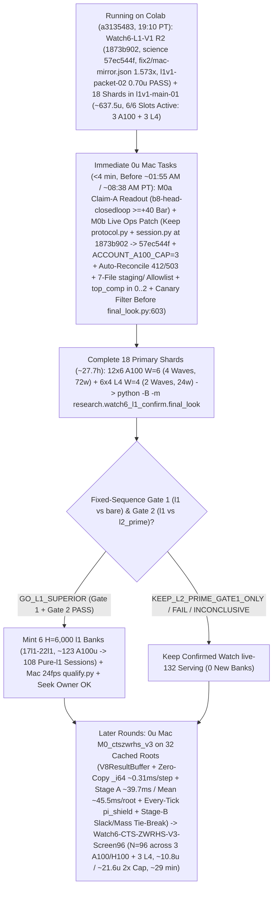

# T34 ExIt-B8 Research Roadmap (Round-24 Synthesis — Advice, Not Decisions)

Start: [project index](../INDEX.md) · [current status & authority](../STATUS.md) · [research record index](INDEX.md) · [study packages](../../research/INDEX.md) · [campaign log](final_run_20261019/CAMPAIGN_LOG.md).

> [!IMPORTANT]
> **Status: Research advice, NOT ratified decisions or release authorization.**
> Every current-round and later-round plan on this page is synthesized advisor guidance from Round 24 (2026-11-01 PT; primary synthesis artifact: `snake-dqn-artifacts/big-lever/exp/argon-rounds/round-24/synthesis/answer.md`, reconciling `round-24/{current,later,process}/answer.md` and `round-23/synthesis/answer.md` against `HEAD` `05fa0974` / `7c11eb77` and superseding Rounds 01–23). Nothing here amends a pre-registration, ratifies a confirmation gate, or changes served defaults. Binding campaign authority remains [`SUCCESS_CONTRACT.md`](final_run_20261019/SUCCESS_CONTRACT.md), [`DESIGN_V2_SHADOW.md`](final_run_20261019/DESIGN_V2_SHADOW.md) (+ Amendment 1), [`P7_STATISTICS.md`](final_run_20261019/P7_STATISTICS.md), unsuperseded parts of [`FINAL_PLAN.md`](final_run_20261019/FINAL_PLAN.md), and [`STATUS.md`](../STATUS.md); any serving or release change requires confirmation-lane evidence, Mac serving qualification, and the owner's explicit OK.

---

## 1. Snapshot Context & Code-Verified Round-24 State (`05fa0974` / `7c11eb77`, Nov 1)

### 1.1 Watch6 V3 `GO_EFFICACY_ONLY`, Watch `live-132` release, all-length screen, `DeviceSim` parity & live `Watch6-L1-V1` (`l1v1-main-01` running on `6/6` Colab slots)

- **Watch6 V3 confirmation finished — `GO_EFFICACY_ONLY` (`52135312`, 2026-11-01 14:40 PT)** ([`REGISTRATION_V3.md`](../../research/watch6_search_efficacy_v3/REGISTRATION_V3.md), `t34-sol/watch6-v3-final-look-20261101/final-look-01/final_look.json`):
  - Sole registered final look (`75471246` V6.1 adapter) over all **`96/96` primary `H = 14,400` (`10 min @ 24 fps`) Watch6-v2 pairs** (`0` reserves, `24/24` L4 `W = 4` shards in `28` attempts — shards `00, 09, 12, 19` passed on single retry after the `09:16 PT` Fable-ratified quarantine of `23` historical non-V3 H100-503 manifests; `2,764,800/2,764,800` live-mirror frames matched):
  - **`Δdeaths/1k = -0.125`** (`CI95 [-0.153, -0.097] < 0`; `0.1580` vs `0.2830`, **`-44.2%`**) and **Fieller pooled mean-mass ratio `+63.7%`** (`CI95 [+49.8%, +78.5%] >= -5%`; **`+214.12` mass**, `550.25` vs `336.13`), with boost `0.733%` vs `0.625%`, `mean_max_length = 1,073.4` (peak `L <= 2,296`) vs `780.9`, and **`2,549.4` mean branches/session** (`5.67×` `H = 6,000`'s `449.6`, confirming superlinear late-horizon branch growth) $\Rightarrow$ **`ELIGIBLE_FOR_REPLAY_QUALIFICATION` for `exact-stop-l2-prime` (`L >= 600`) only**.
- **Watch `live-132` serving guards, Mac `24 fps` qualification & release — ALREADY LANDED (`dc834ded`–`f5912f44`, ~16:00 PT):**
  - [`.claude/launch.json`](../../.claude/launch.json) (`lines 8–11`) serves confirmed **`watch-replay-bank-live-132`** (`132` `exact-stop-l2-prime` `H = 6,000` sessions from banks `01–08, 10–12`) with **`SNAKE_WATCH_REPLAY_CONTROLLER=exact-stop-l2-prime`** on `:8000` (retaining `watch-replay-bank-live-168` on disk while `exact-stop-l1` runs `H = 14,400` confirmation).
  - [`GameSession`](../../web/backend/session.py) gates Watch replay on [`_is_clean_mixed_watch6_b8()`](../../web/backend/session.py) (`lines 722–753`) across `__init__` (`line 573`), `_build` (`line 769`), `reset_game` (`line 1261`), and `set_mode` (`lines 1520, 1563, 1576`); refuses `MODE_TRAIN` on forward-only `EGO2S_OBS_SPECS`, `(RASTER31V2, RASTER31V3)`, and un-overridden `_reward_contract_mismatch` **before** calling `_leave_watch_replay()` (`lines 1510–1550`, with replay recovery on Watch fallback); and scopes `_replay_opted_out = True` to `set_epsilon` (`line 1204`), live `set_hero` change (`line 1222`), and `set_food` (`line 1241`), cleared by `_build` (`line 763`) and [`new_game()`](../../web/backend/session.py) (`lines 1279–1284`, wired to `"new_game"` in [`app.py`](../../web/backend/app.py) `line 311`).
  - [`ReplayBank`](../../web/backend/watch_replay.py) (`lines 348–417`) implements `SNAKE_WATCH_REPLAY_CONTROLLER` (`all | exact-stop-l2-prime | exact-stop-l1`, failing closed to live B8 on invalid values), line-1 [`peek_header`](../../web/backend/watch_replay.py) (`lines 138–150`, `0` non-target `verify_payload` decodes), cycle-1 `shuffle_discovery: bool = True`, shallow [`Recording.snapshot`](../../web/backend/watch_replay.py) (`lines 315–330`), and **`0.25 ms`-slice / `64`-frame cooperative GIL yield (`max(1.0 ms, 4.0 * slice_elapsed)` = `<= 20%` GIL duty cycle)** in [`verify_payload`](../../web/backend/watch_replay.py) (`lines 30–33, 244–275`).
  - [`research/watch_replay/qualify.py`](../../research/watch_replay/qualify.py) (`t34-sol/argon-replay-qual/SUMMARY.md`, Fable review `APPROVE_WITH_CONDITIONS` with `C1–C3` resolved at `fec81656`) passed `132/132` inventory parity, cold session readiness **`0.349–0.435 s` (`< 0.45 s`)**, concurrent cold-verification live-B8 fallback **`update p95 = 8.78 ms <= 11.688 ms`**, **`0/120` paced-`24 fps` overruns** (`step p99 = 11.34 ms <= 41.67 ms`), and seamless recorded playback cutover after **`~18.5–23.1 s`** (`recorded update p95 = 0.002 ms`).
- **All-length exact-stop screen — `ADOPT` for new replay banks; `36` `l1` sessions staged for `Watch6-L1-V1`** ([`watch6_alllen_screen`](../../research/watch6_alllen_screen/README.md), `t34-sol/argon-alllen-a100/analysis.json`, `N = 48` paired `H = 6,000` Watch6-v2 sessions):
  - `exact_stop_alllen` (`L >= 1`, `interval = 5`, `H = 300`) reached **`559.43` mass** (`+208.37` / Fieller `+59.35%` vs `bare` `351.07`; **`+98.27` / Fieller `+21.31%` vs `l2_prime_600` `461.16`**, `CI95 [+50.57, +145.98]`) and **`0.0521` `deaths/1k`** (`-81.9%` vs `bare` `0.2882`; **`-67.4%` / `-0.1076/1k` vs `l2_prime_600` `0.1597`**, `CI95 [-0.1609, -0.0544]`), cutting `L < 600` deaths **`53 (bare) / 34 (L >= 600) -> 1`** (`mean_max_length = 1,096.0`) at **`2.821×` branches** (`1,268.5` vs `449.6`, `1,200.1` roots = **`1.057` branches/root**, stopping on `bare` at **`94.3%`** of roots). **`14/15` remaining deaths occur at `L >= 600` (`13/15` at `L >= 800`, `-14.2%` per-frame `L >= 800` hazard at `1.379×` living exposure), while per-session comparisons vs `l2_prime_600` show `14/48` (`29.2%`) mass losses (`27` wins, `7` ties) and `3/48` worlds with more deaths (`idx 36` `seed = 3075941873`, `idx 39` `seed = 3394546952`, `idx 47` `seed = 121131908`) due to inter-root unshielded `bare` ticks (`frame % 5 != 0` in `watch_replay/engine.py:146`).**
  - Three `12`-session A100 banks (`14l1–16l1`, `W = 6`, `H = 6,000`, `t34-sol/argon-banks-l1/SUMMARY.md:38-40`) completed `36/36` on Cap-6 `36285bc6` in **`3.03–3.07 h/bank`** (**`~61.5 A100 u` total**). They remain unserved on disk (`watch-replay-bank-live-168`) pending `H = 14,400` `Watch6-L1-V1` confirmation, Mac qualification, and owner OK.
- **GPU `DeviceSim` v2 parity — `PASS` on A100** ([`devicesim_v2_parity`](../../research/devicesim_v2_parity/README.md), commit `b500d111`): **`0` mismatches** across **`1,536,000` snake-ticks** (`E = 256 × 1,000` Watch6-v2 ticks, `1,434.6` steps/s under SplitMix64 RNG and `<= 1e-4` CUDA FP32 near-tie tolerances; SplitMix64 cannot mint MT19937 live Watch replay banks).
- **`Watch6-L1-V1` R2 Ratified (`1873b902` / `93c77f43`), `l1v1-packet-02` Canaries Passed & `18` Primary Shards Launched (`l1v1-main-01`, `a3135483`, 19:10 PT — `6/6` Colab Slots Active):**
  - [`research/watch6_l1_confirm/`](../../research/watch6_l1_confirm/) (`7,105` LOC; [`REGISTRATION_L1_V1.md`](../../research/watch6_l1_confirm/REGISTRATION_L1_V1.md) SHA-256 `8b46779ff52d0c9648ff8de00c1893f77beb9bd99eb4a4e51afbe0bdf36800a0`; initial `cf07791b` science identity `c015d5cb906066842c04202b66dac778eb04fb0b9b917882e1385a0e4474e84f`) was initially ratified pre-data by Fable (`t34-sol/argon-l1v1-pkg/RULING_L1_V1.md`; per Fable Condition 1, never cite `argon-l1v1-pkg-fix1/SUMMARY.md` or non-existent `prepare-receipt.json`).
  - **Two Full-`14,400`-Frame Mac 3-Arm Mirror Receipts (`fix1/mac-mirror.json` `de43850b…` & R2 `fix2/mac-mirror.json` `e89cc8c2…`):** On excluded fixture seed `34910101`, `{bare, l2_prime, l1}` passed **`43,200/43,200` mirrored frames (`0` mismatches)** across both Mac mirror runs (`1.272×–1.573×` 3-arm `l1 / (bare + l2_prime)` wall ratio per Fable R2 Condition 5):
    - `t34-sol/argon-l1v1-pkg-fix1/mac-mirror.json` (SHA-256 `de43850bc67bc230d6803335a6ce4635ac12767cc22354f5b28b92bc0a83a476`): `bare` `291.8 s` (`2` deaths), `l2_prime` `1,343.5 s` (`1,811` branches, `2` deaths), `l1` `2,079.7 s` total / `1,763.9 s` search (`3,108` branches across `2,880` roots = **`1.079` branches/root**, `567.5 ms/branch`, **`1.892 ms/step`**, `612.5 ms/root`, `1` death at **`L = 1,694`** where both `l1` and `l2_prime` died after `l1` eliminated `l2_prime`'s `L = 307` death), **`1.272×`** wall ratio, and **`1.115×`** serpentine step-cost ratio ($L = 150 \to 1,500$, `1.997 -> 2.227 ms/step`).
    - `t34-sol/argon-l1v1-pkg-fix2/mac-mirror.json` (SHA-256 `e89cc8c2ca8f5c3e5e96c9b24bd4f7e5538a787bbf1c753ae2ce940509b47079`, commit `1873b902`, `science = 57ec544fe45f7a8a876dbc9363048468b63358e224b2ee8e11dff41401dcfbd3`): `bare` `296.4 s`, `l2_prime` `1,325.4 s`, `l1` `2,550.7 s` wall / `2,190.2 s` search (`3,108` branches across `2,880` batches, `4,428,215` kernel rows, `2.035–2.105 ms/step` serpentine probe), **`1.573×`** wall ratio.
  - **`l1v1-packet-01` Canary Failure, Fable R2 Ruling (`1873b902` / `93c77f43`), `l1v1-packet-02` Canaries Passed & `l1v1-main-01` Running (`a3135483`):** After `l1v1-packet-01` canaries (`0.447 A100 + 0.103 L4 = 0.55 u` observed) failed with `CHILD_NONZERO_EXIT` on `job.sh:21` `COLAB_EXPORT_DIR: unbound variable` (`runtime.py:575-576` sets `COLAB_OUTPUT_DIR`), commit `1873b902` (`t34-sol/argon-l1v1-pkg-fix2/SUMMARY.md`) patched [`job.sh:21-45`](../../research/watch6_l1_confirm/job.sh) (`COLAB_OUTPUT_DIR` + `--fixture-horizon 6`) under science identity **`57ec544f…`**, Fable issued `t34-sol/argon-l1v1-pkg/RULING_L1_V1_R2.md` (`APPROVE-WITH-CONDITIONS`, amending `REGISTRATION_L1_V1.md` §5.2 canary `H=60 -> H=6` and retiring `cf07791b` to `superseded-cf07791b/`), rebuilt `t34-sol/l1v1-packet-02` canaries **passed** (`A100`: `365.4 s`, `0.574 u` observed / `0.688 u` priced; `L4`: `421.0 s`, `0.126 u` observed / `0.157 u` priced = **`0.70 u` observed**, `stop_verified = true`, `7/7` exports), and [`finalize.py`](../../research/watch6_l1_confirm/finalize.py) sealed and launched all `18` single-wave primary shards (`t34-sol/l1v1-main-01`, commit `1873b902`, `science = 57ec544f…`, `inputs/input-metadata.tar.gz` SHA-256 `cb72db0fa3e595e5c8284b76709e44257a49505fa649a4734d349dc9df585999`, **`~636.8 u` central** = `558.6 A100 + 78.1 L4 u`, **`~637.5 u` w/ `0.70 u` `l1v1-packet-02` canaries**, linear-to-p95 range `598.1–739.5 u`, **`~27.7 h` calendar wall**) at `19:10 PT` (`a3135483`), occupying **`6/6` Colab slots (`3 A100` shards `00, 02, 04` + `3 L4` shards `12, 13, 14`; remaining balance `~1,515 u` post-run)**.

### 1.2 Closed single-pass critics, distillations, RL, and standalone macro fallbacks

Between 2026-10-29 and 2026-11-01, every single-pass learned-policy, critic, distillation, and standalone macro-fallback track closed below its promotion or selectivity bars:

| Track | Scope & primary artifact | Measured outcome | Disposition |
| --- | --- | --- | --- |
| **TRAIN-01** ([`sandbox_a_resident`](../../research/sandbox_a_resident/README.md)) | `100.7M`-row (`384`-update) GPU-resident PPO from `b8-s3` (`t34-sol/train01-closeout/SUMMARY.md`) | H5000 equal-mix paired mass **`+8.09`** (`CI95 [-18.66, +34.85]`; scripted `+26.32`, frozen `+2.85`, mixed `-4.90`; update-320 peak `+14.23` `[-11.86, +40.32]`) vs bar `>= +40` | **Closed** (no strict-gate nomination) |
| **C/T Stage-2 distillation** | Continuation-teacher causal-root distillation (`t34-sol/ct-stage2-verdict/SUMMARY.md`) | Teacher rescued **`22/32` (`68.75%`)** deaths (`22/32 <= 65` ticks; indep-suffix H300 `+66.77`, `LB90 +23.96`), but student retention was **`46.9–50.0%`** (`0 pp` over `frozen_phi` vs `>= +15 pp`; topology AUC `0.5752 < 0.83`), ordinary flips **`44.4–64.5%`** (bar `<= 1%`), and lethal ordinary flips **`3–5`** (bar `<= 1`) | **`FAIL_DISTILLATION_RETENTION_OR_SAFETY`** |
| **Doom U-Net & `spatial-student-pilot`** | `83 × 145` spatial U-Net vs 33.7k B8-feature head (`t34-sol/doom-result-01/result.json`; `t34-sol/student-direction/{astra,fable}.md`) | Spatial U-Net lost late per-action doom ROC-AUC to frozen B8 features (**`0.753` vs `0.810`**, `Δ = -0.056`, `CI95 [-0.091, -0.023]`; all-strata death-lookback `0.7626` vs `0.8226`; ordinary late `0.690` vs `0.706`) | **`GRAY` / `40–48 A100 u` pilot fit canceled (`0 u`; retain `.so` caches)** |
| **B8 advantage head (offline OOF)** | `256 -> 128 -> 6` ReLU head on frozen B8 features (`t34-sol/b8-head-test/RESULT.md`) | Mass rule `GO` (late H300 `+30.09`, `LB90 +23.96`), Fable selectivity **`FAIL`**: **`26.42%`** late rescue (bar `>= 35%`) at **`97.60%`** non-death flips (bar `<= 15%`) | **Selectivity `FAIL`** (192-world closed-loop A100 `rc = 0`, awaiting Mac `M0a` readout) |
| **T4 Gate-1 factored critic** ([`t4_gate1`](../../research/t4_gate1/README.md)) | Clean-slate privileged `83 × 145` (`H = 320` 7-source BFS) hazard + foraging mass-flux critic on `384` disjoint Watch6-v2 worlds (`t34-sol/argon-t4-gate1-fix2/queue-03/READOUT.json`) | **`0/8` bars passed**: `L >= 600` residual EV **`+0.0266`** (`[-0.0280, +0.0869]` vs `>= 0.25`), death-root H300 rescue **`+19.99`** (vs `>= +40`), mature doom AUC **`0.5617`** (vs `>= 0.80`), ordinary H300 mass **`-22.21`** (vs `>= -15.0`), lethal flips **`3.13%`** (vs `<= 3.0%`) | **`KILL_T4`** (proves even privileged `83 × 145` critic lacks late value signal) |
| **R6 `L < 600` harvest census** ([`r6_l600_census`](../../research/r6_l600_census/README.md)) | `64`-world (`384`-root) Watch6-v2 early-game counterfactual + 5-fold OOF corpse/trail plane probes (`t34-sol/argon-mac-checks/r6-census/RESULT.json`) | **`34.90%` (`134/384`)** oracle-harvestable roots (`>= +5` H500 mass), **`7.69%`** non-bare H500 lethal flips, OOF ROC-AUC **`0.474–0.521`** (`0` passing threshold points); superseded operationally by `exact-stop-l1` | **`KILL`** |
| **R7 macro-option fallback** ([`r7_macro_fallback`](../../research/r7_macro_fallback/README.md)) | Pruned depth-2 (`2K = 30` ticks) spatial macro-options `{O_0..O_5}` on C/T train `1-step-all-die` roots (`t34-sol/argon-r7-repack/R7_READOUT.json`) | `3/5` bars passed (`0.316 ms` Mac 1-thread p95; **`33.0%` vs `9.0%`** `L >= 800` `all_die_sel0` rescue on `25/129` roots — `9/25` `36.0%` `macro_triggered` at `+66.7 pp` rescue vs `16/25` tick-`30` B8 re-traps, while `104/129` `80.6%` survived `H = 300` inside uncertified coils), but total `L >= 600` lift **`+3.85 pp`** (`< +10.0 pp`) and **`2 > 0`** ordinary lethal flips (`0` assessment roots opened) | **`KILL`** as standalone `30`-tick fallback |

### 1.3 Live `l1v1-main-01` Traps Armed on Disk (`19:12–20:00 PT`) & Code-Verified `CTS-ZWRHS-L1-v3` Advances (`05fa0974`)

1. **Live Trap 1 — `19:12 PT` `shard-01, 03, 05` Backoff into L4 Wave 1 & the `t ≈ 6.71 h` (`~01:55 AM PT`) / `t ≈ 13.42 h` (`~08:38 AM PT`) Permanent `3`-Slot A100 Trap ([`ready_queue.py:41,324-460,641,679-685`](../../tools/ops/ready_queue.py), [`auto_retry.py:407`](../../tools/ops/auto_retry.py), [`dispatch.py:2935`](../../tools/ops/dispatch.py), `t34-sol/l1v1-main-01/output-shard-{01,03,05}/receipt.json`):**
   - None of Round 23's code patches landed on `main` (`05fa0974` is docs-only). At `19:10:40 PT`, [`ready_queue.py`](../../tools/ops/ready_queue.py) (which defines `ACCOUNT_ASSIGNMENT_CAP = 6` and `ACCOUNT_L4_CAP = 3` at `line 40`, but no `ACCOUNT_A100_CAP = 3`) launched `6` A100 shards (`00..05`): `shard-00, 02, 04` took the `3` A100s (`20.19 u/h`); `shard-03` hit HTTP `412` (`assignments: 3.0`, `3.43 s`, `0` exports) leaving `cleanup_error: "ALLOCATION_UNRESOLVED: retained pending record"`; and `shard-01` (`1.7 ms`) + `shard-05` (`1.6 ms`) failed on the `pending` fence because single-GPU [`dispatch.py:2935`](../../tools/ops/dispatch.py) skips `reconcile_unavailable()` (`line 2890`). At `19:12 PT`, [`retire_unavailable()`](../../tools/ops/ready_queue.py) (`lines 419–460`) unlinked `shard-03`'s `pending` record and [`reconcile()`](../../tools/ops/ready_queue.py) (`lines 324–395`) queued `shard-01, 03, 05` into `ops/auto-retry/<id>/` with **`"completion_attempt": 1`** ([`auto_retry.py:407`](../../tools/ops/auto_retry.py)) and `not_before = +30 s` ([`ready_queue.py:377-382`](../../tools/ops/ready_queue.py)), causing [`tick()`](../../tools/ops/ready_queue.py) (`lines 679–685`) to skip them during that `30 s` window and launch `shard-12, 13, 14` (`3` L4s) alongside `shard-00, 02, 04` (`3` A100s).
   - **Hard operational deadlines (`~01:55 AM PT` and `~08:38 AM PT`):** Beyond the `~13 min` gap at **`t ≈ 6.71 h` (`~01:55 AM PT`)** (L4 Wave 1 `6.71 h` vs A100 Wave 1 `6.92 h`), at **`t ≈ 13.42 h` (`~08:38 AM PT`)** L4 Wave 2 (`shard-15..17`) finishes completely (`6` L4 vs `12` A100 shards across `4` waves = `~27.7 h`), leaving `3` open account slots (`slots = 6 - 3 = 3`) **permanently positive** for the final `~14.3 h`. Without `ACCOUNT_A100_CAP = 3` (`ACCOUNT_GPU_SUBCAPS = {"L4": 3, "A100": 3}`) in [`ready_queue.py:41,641,682`](../../tools/ops/ready_queue.py), `ready_queue.py` will fire every queued A100 shard into the `3`-A100 wall across two `30 s`/`60 s` backoffs and permanently abort them (`attempt = 2 >= maximum = 2` $\to$ `AUTO_RETRY_REFUSED` in `< 2 min`).
2. **Live Trap 2 — Exact 7-File Pre-Allocation `staging/` Inventory in `output-shard-{01,03,05}` & `shard-13` `119.34 s / 150 s` Upload Margin ([`supervisor.py:1225,1300-1314,1602`](../../research/colab_cli/supervisor.py), [`auto_retry.py:169,185-194`](../../tools/ops/auto_retry.py), [`admission.py:55-67,474-490`](../../research/watch6_l1_confirm/admission.py), [`transfer_policy.py:19`](../../research/colab_cli/transfer_policy.py)):**
   - [`supervisor.py:1602`](../../research/colab_cli/supervisor.py) writes the exact 7-file set `{"bootstrap.sh", "release.py", "runtime.py", "schema-validation.json", "source-plan.json", "source.py", "source.tar.gz"}` under `output-shard-{01,03,05}/staging/` (plus `accounting-baseline.json` at [`supervisor.py:1225`](../../research/colab_cli/supervisor.py) in `shard-03`), which both [`blocked_before_allocation()`](../../tools/ops/auto_retry.py) (`lines 169, 185–194`) and [`_prealloc_tree_clean()`](../../research/watch6_l1_confirm/admission.py) (`lines 55–67, 474–490`) currently reject. Additionally, `t34-sol/l1v1-main-01/output-shard-13/upload-measurement.json` took **`119.34 s / 150.0 s` (`79.6%` of `DEFAULT_TRANSFER_SECONDS` at [`transfer_policy.py:19`](../../research/colab_cli/transfer_policy.py))** and must be allowlisted in `_prealloc_tree_clean()` while raising `DEFAULT_TRANSFER_SECONDS` to `300.0`.
3. **Live Trap 3 — Why [`protocol.py`](../../research/watch6_l1_confirm/protocol.py) Must NOT Be Edited During `Watch6-L1-V1`, `0 <= top_comp <= 2` Lineage, & 4-Site Canary Isolation ([`protocol.py:75,251-280`](../../research/watch6_l1_confirm/protocol.py), [`final_look.py:369,603,662,674,683`](../../research/watch6_l1_confirm/final_look.py)):**
   - **Self-hash constraint on `57ec544f…`:** Round 23 proposed adding `"web/backend/session.py"` to `EXCLUDED_WEB_NON_SCIENCE` in [`protocol.py:84-90`](../../research/watch6_l1_confirm/protocol.py). However, [`protocol.py:75,270-280`](../../research/watch6_l1_confirm/protocol.py) hashes `digest("research/watch6_l1_confirm/protocol.py")` **and** the `1873b902` digest of `web/backend/session.py` (`2df8bb76…`) into `57ec544fe45f7a8a876dbc9363048468b63358e224b2ee8e11dff41401dcfbd3`. Any edit to `protocol.py` mutates its own SHA-256 and drops `session.py` from `values`, breaking `p.identity() == "57ec544f…"`! Instead, because [`protocol.py:251-256`](../../research/watch6_l1_confirm/protocol.py) excludes `final_look.py`, `admission.py`, `prepare.py`, and `recover.py` from `SCIENCE_PACKAGE_MODULES`, **keep `protocol.py` and `web/backend/session.py` at their `1873b902` bytes during `Watch6-L1-V1`** (and defer two-hash allowlist refactoring to post-`L1-V1` packages).
   - **Pre-start `top_comp in {0, 1}` & 4-site canary filter:** Because `ops/auto-retry/` already minted immutable `RETRY.json` files at `19:12 PT` for `shard-01, 03, 05` with `"completion_attempt": 1`, keep `next_attempt = attempt` on future `0`-export pre-start retries in [`auto_retry.py:407`](../../tools/ops/auto_retry.py), accept `0 <= top_comp <= 2` in [`final_look.py:369`](../../research/watch6_l1_confirm/final_look.py) + non-additive `top_completion <= 2` in [`admission.py:871`](../../research/watch6_l1_confirm/admission.py), and filter `canary.is_canary(data) or WATCH6_FIXTURE == "1"` **before** [`final_look.py:603`](../../research/watch6_l1_confirm/final_look.py) (`lines 603, 662, 674, 683`) so `l1v1-packet-01` (`c015d5cb…`) does not abort final look.
4. **Why [`exact_stop_alllen`](../../research/watch6_alllen_screen/README.md) Regressed on `14/48` Worlds (`29.2%`) & Died More on `3/48` Worlds (`idx 36, 39, 47`) in `argon-alllen-a100/analysis.json` ([`watch_replay/engine.py:141-149`](../../research/watch_replay/engine.py), [`exact_stop.py:48-57`](../../research/bl_served_search/exact_stop.py), [`vector61_policy.py:113`](../../src/simd_env/vector61_policy.py), [`v8_nb.py:1572-1595`](../../src/simd_env/v8_nb.py)):**
   - In `t34-sol/argon-alllen-a100/analysis.json`, `exact_stop_alllen` beat `l2_prime_600` overall (`+98.27` mass, `-0.108` deaths/1k) but lost mass on `14/48` sessions (`29.2%`) and had more deaths on `3/48` (`idx 36` `seed = 3075941873`: `560.9` mass / `1` death vs `630.7` / `0`; `idx 39` `seed = 3394546952`: `391.4` / `1` vs `656.9` / `0`; `idx 47` `seed = 121131908`: `454.2` / `1` vs `566.6` / `0`).
   - Root cause: [`watch_replay/engine.py:146`](../../research/watch_replay/engine.py) executes raw unshielded `bare = argmax Q` on the `4` inter-root ticks (`frame % 5 != 0`), ignoring `obs["v8_result"]` (`line 141`) already computed on that frame and creating a rollout-vs-real policy mismatch if `v8_tail_redecide` only shields inside rollouts (`v2`), while trapped opponents (`max(last_veto["tail_reaches"]) == 0` in [`vector61_policy.py:113`](../../src/simd_env/vector61_policy.py), [`v8_nb.py:1572-1595`](../../src/simd_env/v8_nb.py)) lunge with boost across 2-step head-on zones between roots, and [`exact_stop.py:51-54`](../../research/bl_served_search/exact_stop.py) stops on the first survivor regardless of terminal slack or mass.
5. **How Hero Featurization Drops from `1.892 ms` (and Round 23's `~0.44 ms`) to `~0.31 ms/step` (`6.1×` Speedup, `~45.5 ms/root` Mean, `~39.7 ms <= 41.67 ms` Stage-A) in `CTS-ZWRHS-L1-v3` ([`v8_nb.py:1613-1661`](../../src/simd_env/v8_nb.py), [`ego_raster_nb.py:412-426,705-727`](../../src/simd_env/ego_raster_nb.py), [`engine_v2.py:519`](../../research/t34_pathb/engine_v2.py)):**
   - Pre-allocating thread-local [`V8Result`](../../src/simd_env/v8_nb.py) buffers (`lines 1613–1629`, eliminating `15 × 6 = 90` `np.zeros` allocations/step) and fast-pathing [`_i64()`](../../src/simd_env/ego_raster_nb.py) (`lines 412–426`) / `np.ascontiguousarray` (`23` array copies/step across [`ego_raster_nb.py:416-426,705-727`](../../src/simd_env/ego_raster_nb.py) and [`v8_nb.py:1645-1661`](../../src/simd_env/v8_nb.py)) on top of `CoalescedKernelOpponents(precomputed_counts=counts_sel)` (`4,428,215/4,428,215` bitwise-identical rows in `fix2/mac-mirror.json`, skipping `15` opponent `v2` BFS floods/tick) + single-pass `rel_shift` (`v8_nb.py:752`) + `step_prepared(hero_policies=[])` (`bank_engine.py:471`) cuts `E = 1` step time to **`~0.31 ms/step` (`6.1×` speedup)**, Stage-A (`94.3%` of roots) to **`~39.7 ms <= 41.67 ms` (`1` frame @ `24 fps`)**, and mean root latency to **`~45.5 ms/root` (`13.5×` faster than `l1`'s `612.5 ms/root`)**, replacing Path B v2's `500 × 1.89 ms ≈ 945 ms` refork stall ([`engine_v2.py:519`](../../research/t34_pathb/engine_v2.py)) with a **1-frame-lookahead `spawn` worker pool** (`0 ms` refork stalls).

---

## 2. Current-Round Plan (Advice, Not Decisions)

### 2.1 `0 u` Mac `M0a` Claim-A closeout (`< 2 min`) & C4 telemetry

1. **Run `M0a` Claim-A readout (`< 2 min` Mac, `0 u`) & enforce binding v1 `H = 5,000` `>= +40` closure bar:**
   - Run [`closedloop_readout.py`](../../research/INDEX.md) (`t34-sol/b8-head-closedloop/SUMMARY.md:50-52`, `origin/astra-doom-auc-smoke` @ `591d94c3`) on completed `b8-head-closedloop` (`N = 192` v1 `H = 5,000` worlds, `m in {0, 10, 25, 50}`, `4.51 A100 u`). Audit `spatial-qbytes-01` (`t34-sol/spatial-qbytes-fix/SUMMARY.md:85-88`) strictly as a Q-byte/`.so` cache ruler (`40–48 A100 u` `spatial-student-pilot` fit stays canceled at `0 u`).
   - **Recommended Claim-A kill rule:** Permanently **close Claim A (`0 u`)** if no `m in {0, 10, 25, 50}` clears [`SUCCESS_CONTRACT.md`](final_run_20261019/SUCCESS_CONTRACT.md) §2 (`lines 29–33`) and [`P7_STATISTICS.md`](final_run_20261019/P7_STATISTICS.md) §§3–4 (`lines 33–48`): pooled `Δmass >= +40.0`, Bonferroni-4 `LB97.5 > 0`, scripted Guard B `>= +0.03` (`0` mix losses), Guard A `Δalive >= -0.05` pooled / `>= -0.075` single mix, and living overrides `<= 15%`.
2. **Monitor live `:8000` `watch-replay-bank-live-132` C4 telemetry (`0 u`):**
   - Keep `watch-replay-bank-live-132` (`exact-stop-l2-prime`) live on `:8000`, monitor `update_ms` / overrun telemetry (Fable C4), and mint **`0`** new `.watch.gz` banks before `Watch6-L1-V1`'s verdict lands.

### 2.2 `0 u` Mac `M0b` Live `l1v1-main-01` Ops & Final-Look Patch (`< 3 min`, Before `~01:55 AM PT` / `~08:38 AM PT`)

Work in a clean worktree with live runs/`ops/`/`exports/`/`pair-*.json` untouched and **keep `protocol.py` and `web/backend/session.py` at their `1873b902` bytes** so `p.identity() == "57ec544fe45f7a8a876dbc9363048468b63358e224b2ee8e11dff41401dcfbd3"` is preserved without mutating `protocol.py`'s self-hash:

1. **Enforce `ACCOUNT_A100_CAP = 3`, auto-reconcile proven 412/503 non-allocations, & raise `DEFAULT_TRANSFER_SECONDS` to `300.0`:**
   - Enforce `ACCOUNT_A100_CAP = 3` (`ACCOUNT_GPU_SUBCAPS = {"L4": 3, "A100": 3}`) in [`ready_queue.py:41,641,682`](../../tools/ops/ready_queue.py) so neither the `t ≈ 6.71 h` (`~01:55 AM PT`) L4 Wave-1 gap nor the `t ≈ 13.42 h` (`~08:38 AM PT`) permanent `3`-open-slot L4 Wave-2 finish can fire queued A100 shards into the `3`-A100 wall.
   - Auto-reconcile proven HTTP 412/503 non-allocations (`endpoint is None`, `not cli.assignment_record.exists()`, `recover_assignment(...) is None`, and `set(cli.sessions()) <= set(before)`) inside [`supervisor.py:1300-1314`](../../research/colab_cli/supervisor.py) (for post-requalification trees) and single-GPU [`dispatch.py:2935`](../../tools/ops/dispatch.py); raise `DEFAULT_TRANSFER_SECONDS` from `150.0` to `300.0` in [`transfer_policy.py:19`](../../research/colab_cli/transfer_policy.py).
2. **Preserve `next_attempt = attempt` on `0`-export retries, allow `0 <= top_comp <= 2` & the 7-file `staging/` set, and filter canaries before `final_look.py:603`:**
   - Keep `next_attempt = attempt` on `0`-export pre-start retries (`unallocated` or `is_prestart_transport_failure`) in [`auto_retry.py:407`](../../tools/ops/auto_retry.py) (so `shard-06..17` stay at `0` while already-minted `shard-01, 03, 05` stay at `1`), allow `0 <= top_comp <= 2` in [`final_look.py:369`](../../research/watch6_l1_confirm/final_look.py), and enforce non-additive `top_completion <= 2` in [`admission.py:871`](../../research/watch6_l1_confirm/admission.py).
   - Allow the exact 7-file `staging/` set (`{"bootstrap.sh", "release.py", "runtime.py", "schema-validation.json", "source-plan.json", "source.py", "source.tar.gz"}`) + `accounting-baseline.json` + `upload-measurement.json` in [`_prealloc_tree_clean()`](../../research/watch6_l1_confirm/admission.py) (`lines 55–67, 474–490`) and [`blocked_before_allocation()`](../../tools/ops/auto_retry.py) (`lines 185–194`) when `exports/` is empty; filter `canary.is_canary(data) or WATCH6_FIXTURE == "1"` before [`final_look.py:603`](../../research/watch6_l1_confirm/final_look.py) (`lines 603, 662, 674, 683`); and diff `*p.science_paths()` instead of `*p.source_paths()` in [`prepare.py:47`](../../research/watch6_l1_confirm/prepare.py).
3. **Kill rule (`M0b`):** Block `ready_queue` reload / final-look seal if `p.identity() != "57ec544f…"`, if `is_prestart_transport_failure()` is `False` on live `output-shard-{01,03,05}`, if `final_look.py` rejects `l1v1-packet-01` canaries or `top_comp in {0, 1}`, or if `ready_queue` dispatches a 4th A100 when `3` A100s are active.

### 2.3 Complete Live 18-Shard `Watch6-L1-V1` (`l1v1-main-01`, `~637.5 u`, `~27.7 h`) & Execute Sole Final Look

1. **Wave Progression (`12` A100 shards `00..11` `W = 6` = `72` worlds in `4` waves, `~6.92 h/wave`; `6` L4 shards `12..17` `W = 4` = `24` worlds in `2` waves, `~6.71 h/wave`):**
   - Under `M0b`'s `ACCOUNT_A100_CAP = 3` and `ACCOUNT_L4_CAP = 3`, L4 Wave 1 (`shards 12..14`) finishes at `t ≈ 6.71 h` (`~01:55 AM PT`) and L4 Wave 2 (`shards 15..17`) finishes at `t ≈ 13.42 h` (`~08:38 AM PT`) without triggering A100 stampedes, while A100 completes `4` waves in `~27.7 h` (`shards 00, 02, 04` $\to$ `06, 07, 08` $\to$ `09, 10, 11` $\to$ `01-r1, 03-r1, 05-r1`).
2. **Sole Final Look & Fixed-Sequence Decision Rules (`python -B -m research.watch6_l1_confirm.final_look`, $\alpha = 0.05$, `df = 95`):**
   - **Gate 1 (`l1` vs `bare`, $\alpha = 0.05$):** `UB95(Δdeaths/1k) < 0` (nondegenerate) AND paired Fieller pooled mass `LB95 >= -5.0%` (`-0.05`, bounded & connected).
   - **Gate 2 (`l1` vs `l2_prime`, tested ONLY IF Gate 1 passes, $\alpha = 0.05$):** `UB95(Δdeaths/1k) < 0` (nondegenerate) AND paired Fieller pooled mass `LB95 >= -2.5%` (`-0.025`, bounded & connected) AND session-denominator `Δd_ge800/1k UB95 <= +0.05/1k` (zero-variance `[0, 0]` passes).
   - **If `GO_L1_SUPERIOR` (Gate 1 PASS + Gate 2 PASS):** Mint **`6` `H = 6,000` `exact-stop-l1` `.watch.gz` banks** (`17l1–22l1`, `72` sessions, `~123 A100 u` in `~6.1 h` $\rightarrow$ **`108` pure-`l1` sessions** with `14l1–16l1`), pass Mac `24 fps` [`qualify.py`](../../research/watch_replay/qualify.py), and seek **owner OK** for Watch cutover.
   - **If `KEEP_L2_PRIME_GATE1_ONLY` / `FAIL_GATE1` / `INCONCLUSIVE_GATE1`:** Retain confirmed `watch-replay-bank-live-132` (`0` new banks) and advance to §3 (`CTS-ZWRHS-L1-v3`).

---

## 3. Later-Round Plan: `CTS-ZWRHS-L1-v3` (`~0.31 ms/step`, Every-Tick $\pi_{\text{shield}}$, Stage-B Slack/Mass Tie-Break & 1-Frame-Lookahead `spawn` Pool — Advice, Not Decisions)

### 3.1 `CTS-ZWRHS-L1-v3`: `V8ResultBuffer` + Zero-Copy `_i64` (`~0.31 ms/step`), Every-Tick $\pi_{\text{shield}}$, & Stage-B Slack/Mass Tie-Breaking (`~39.7 ms` Stage-A / `~45.5 ms/root` Mean)

1. **`V8ResultBuffer` + Zero-Copy `_i64` + `CoalescedKernelOpponents(precomputed_counts=counts_sel)` (`1.892 -> ~0.31 ms/step`, `6.1×` Speedup; Stage A `~39.7 ms <= 41.67 ms`; Mean `~45.5 ms/root` = `13.5×` Faster Than `l1`):**
   - Pre-allocate thread-local [`V8Result`](../../src/simd_env/v8_nb.py) buffers (`lines 1613–1629`, eliminating `15 × 6 = 90` `np.zeros` allocations/step) and fast-path [`_i64(a)`](../../src/simd_env/ego_raster_nb.py) (`lines 412–426`) / `np.ascontiguousarray(a)` when `a.dtype == np.int64 and a.flags.c_contiguous` (eliminating `23` array copies/step across [`ego_raster_nb.py:416-426,705-727`](../../src/simd_env/ego_raster_nb.py) and [`v8_nb.py:1645-1661`](../../src/simd_env/v8_nb.py)), saving `~0.13 ms/step` with **100% bitwise-identical features**.
   - Combine with **`CoalescedKernelOpponents(precomputed_counts=counts_sel)`** (`(5E, 3)` `decision_free_space` counts from `Vector61Runtime.prepare()` at [`vector61_policy.py:329,601-617`](../../src/simd_env/vector61_policy.py), proven `100%` bitwise identical to `_v8_rows` `out_counts` across **`4,428,215/4,428,215` rows** in `fix2/mac-mirror.json`, [`bl_k1/native.py:101-103`](../../research/bl_k1/native.py), skipping all `15` opponent `v2` BFS floods/tick in `v8_nb.py:1047-1082`), single-pass hero `rel_shift` (`v8_nb.py:752`), `membership = "owner_pad" if hasattr(sim, "_owner_pad") else "painted"` (`ego_raster_bv8.py:73`), single-clone `root.sim._policy_phase_prepared = True` (`ruler_operator.py:57`), `step_prepared(hero_policies=[])` (`bank_engine.py:471`), `12.5×` `_recap_sim` (`teacher.py:69-147`), and binary `full_digest` v3 (`shadow.py:146-250`). Keep **5 separate `Vector61SimdPolicy` objects on the main/shadow spine** so `live_vetoes[int(env)]` (`vector61_policy.py:761`) never collides across opponent slots `1..5`.
2. **Every-Tick Shielded Base Policy $\pi_{\text{shield}}$ (`0` Extra Floods, Fixing the `14/48` `exact_stop_alllen` Regressions) & $h = 128$ Leaf Certification:**
   - Apply $\pi_{\text{shield}}$ — [`v8_tail_redecide(q, obs["v8_result"], L)`](../../src/simd_env/ego_raster.py) (`lines 401–448`, replacing unmodified `v8_redecide` at `v8_nb.py:1838` to fix `FREE_SPACE_BFS_CAP = 160` trap blindness, `off = 3 if v5 >= 3 else 0` speed-mode lock, and `OUTCOME_NO_SPACIOUS == 2` `head_risky` disablement) plus **`DesperateOppHeadOnShield`** (reading cached `opponents[j].last_veto["tail_reaches"] == 0` / `res_opp.outcome[j] == 2` within distance $\le 8$ when $L_{0,\text{post}} < 1.15(L_j + 1)$ to mask 2-step opponent boost lunges and trigger immediate root search) — on **every real tick $t$ (including the 4 non-search inter-root ticks `frame % 5 != 0` in [`watch_replay/engine.py:146`](../../research/watch_replay/engine.py)) and every rollout tick $h = 1 \dots 127$**.
   - At leaf $h = 128$ (`res = obs_128["v8_result"]`), Tier-1 (`> 93%` of leaves, `0` floods) certifies immediately if $\max_a \text{elig}_L[a]$ holds; otherwise Tier-2 (`< 7%` of leaves, `~0.15 ms`) runs constructive `TailTrackWitness` (`ext_gain >= L_128`, `min_boost_length = 5`, `2.33` boost tail pops/tick in `grid_sim.py:481-554`, `150`-pellet trail cap, and throat-persistence re-test).
3. **Two-Stage Exact-Stop (`Stage A: ~39.7 ms <= 41.67 ms` on `94.3%` of roots; `Stage B: E = B - 1 <= 5` lockstep with Slack/Mass Tie-Break; Mean `~45.5 ms/root`):**
   - **Stage A (`E = 1` $\pi_{\text{shield}}$, $H_{\text{sim}} = 128$, `~39.7 ms`):** Roll out `E = 1` $\pi_{\text{shield}}$ for $H_{\text{sim}} = 128$ steps. If it survives, is leaf-certified ($\mathcal{C}_{\text{tail}}(s_{128})$), and no `PinchFunnel` / `CorpseSurge` trigger fires, return immediately (`0` cruising flips).
   - **Stage B (`< 6%` of roots, `E = B - 1 <= 5` lockstep `GridBatchSim`):** Evaluate all remaining legal actions in one lockstep `GridBatchSim(E = B - 1)` batch and rank certified survivors by **`(tail_certified, flood_count >= 1.5*L, final_length + 0.02 * tail_slack, root_Q)`** instead of stopping on the first survivor in [`exact_stop.py:51-54`](../../research/bl_served_search/exact_stop.py).

### 3.2 1-Frame-Lookahead `spawn` Worker Pool, Unshielded Play, `0 u` Mac `M0_ctszwrhs_v3` & `Watch6-CTS-ZWRHS-V3-Screen96`

- **Live Mac 1-Frame-Lookahead `spawn` Worker Pool (`W = 4, K <= 8` per [`SUCCESS_CONTRACT.md`](final_run_20261019/SUCCESS_CONTRACT.md) `lines 119–123`, `gc.freeze()`) & Unshielded Play:**
  1. **Watch (`0 ms` refork stalls, `<= 1` frame on `94%` of roots):** Because Stage-A roots take `~39.7 ms <= 41.67 ms` (`1` frame @ `24 fps`), a 1-frame-lookahead `spawn` worker pool (`1` primary + `2` standby processes, `gc.freeze()`) computes `CTS-ZWRHS-L1-v3` live on the Mac in `<= 1` frame on `94%` of roots and `<= 2` frames (`~89 ms` across 2 workers) on `< 6%` Stage-B roots, replacing Path B v2's `500 × 1.89 ms ≈ 945 ms` refork stall ([`engine_v2.py:519`](../../research/t34_pathb/engine_v2.py)). Keep recorded `.watch.gz` v2 banks at **`H = 6,000`** (`< 512 MiB` `MAX_DECODED`).
  2. **Play — bare `b8-s3` untouched:** Keep Play strictly live bare `b8-s3` (`0` boss toggles, `0` `v8_tail_redecide` / `WitnessMask` in Play) per [`SUCCESS_CONTRACT.md:44-45`](final_run_20261019/SUCCESS_CONTRACT.md) and [`STATUS.md:48,69-74`](../STATUS.md), and keep `CORPSE_FOOD_CAP_MULTIPLE_V2 = 0.5` frozen.
- **Mandatory `0 u` Mac `M0_ctszwrhs_v3` gate (`~10 min` CPU on `32` cached roots, `0` `exports/` or `pair-*.json` opened) before Colab spend:**
  - Run a read-only benchmark on **`32` cached roots** (`16` $L \ge 800$ death roots from `t34-sol/argon-r7-repack/R7_READOUT.json` + `16` regression roots from the `14/48` mass-loss sessions in `t34-sol/argon-alllen-a100/analysis.json`) measuring: (1) bitwise identity and `E = 1` step time (`ms/step`) of `V8ResultBuffer` + zero-copy `_i64`, (2) false-safe rate of $H_{\text{sim}} = 128 + \mathcal{C}_{\text{tail}}(s_{128})$ vs full $H = 300$ rollouts, and (3) fraction of the `14/48` `exact_stop_alllen` regressions prevented by Every-Tick $\pi_{\text{shield}}$.
  - **Kill rule (`M0_ctszwrhs_v3`):** Kill the kernel/featurizer change (`0 u` spent) if `E = 1` step time exceeds **`0.48 ms/step`** (`< 3.9×` speedup over `1.892 ms/step`) or shows any bitwise mismatch vs `v8_nb.py`; kill $H_{\text{sim}} = 128$ truncation if the false-safe rate vs $H = 300$ exceeds **`2.0%`** (`> 0/32` roots) and fall back to $H_{\text{sim}} = 160$.
- **Conditional 3-Arm `N = 96` Colab Screen `Watch6-CTS-ZWRHS-V3-Screen96` (`3 A100/H100 + 3 L4` at once, `~29 min` wall-clock, `~10.8 u` expected / `~21.6 u` 2× cap):**
  - Compare **(1) `exact-stop-l1`**, **(2) `CTS-ZWRHS-L1-v2`** (rollout-only shield), and **(3) `CTS-ZWRHS-L1-v3`** (Every-Tick $\pi_{\text{shield}}$ + `DesperateOppHeadOnShield` + Stage-B slack/mass tie-break) across `N = 96` fresh paired worlds (`18,000` frames each: `3 × A100/H100` $\times 22$ worlds = `66` worlds in `~28 min` $\approx 7.8\text{ u}$; `3 × L4` $\times 10$ worlds = `30` worlds in `~29 min` $\approx 3.0\text{ u}$; total **`~10.8 u` / `~21.6 u` 2× cap**).
  - **Kill rule (`Watch6-CTS-ZWRHS-V3-Screen96`):** Kill `CTS-ZWRHS-L1-v3` if on `N = 96` paired worlds vs `exact-stop-l1` it fails **any** of: (1) mean wall-clock **$\le 80\text{ s/world}$** (`>= 4.3×` faster than `exact-stop-l1`'s `345.7 s/world`), (2) paired **$\Delta\text{deaths/1k} \le 0.00$** vs `exact-stop-l1` ($\ge +0.05$ immediately fatal) **and** per-world mass-loss rate vs `l2_prime_600` cut from `29.2%` to **$\le 15\%$**, or (3) paired final mass **$\ge +35.0$** vs `exact-stop-l1` (or within `-10.0` mass while achieving $\ge 5.0\times$ wall-clock speedup and lower death rate).
- **Do not fund (`0 u`):** editing `research/watch6_l1_confirm/protocol.py` before `Watch6-L1-V1` seals (`protocol.py:75,270-280` hashes its own bytes and `1873b902`'s `web/backend/session.py` into `57ec544f…`), re-running `prepare.py` on live `l1v1-main-01` (`final_look.py:459` duplicate-root rejection), relying on `WATCH6_RECOVERY_LEDGER_B64` for `1873b902`-pinned `l1v1-main-01` shards (`uploads.py:112-178`), rollout-only shielding (`v2`) leaving `watch_replay/engine.py:146` unshielded on inter-root ticks `frame % 5 != 0`, calling unmodified `v8_redecide` (`v8_nb.py:1838`) at $L \ge 600$ without `v8_tail_redecide`, recomputing `_v8_rows` `v2` `160`-cell BFS inside `CoalescedKernelOpponents` (`precomputed_counts=counts_sel` saves `15` floods/tick), per-tick `V8Result` `np.zeros` allocations or redundant `_i64` copies, editing [`research/watch6_l1_confirm/job.sh`](../../research/watch6_l1_confirm/job.sh) (`protocol.py:258`), per-step Python BFS inside `H = 128` rollouts, reserve seed substitution in `Watch6-L1-V1` (`RULING_L1_V1.md:18,32`, `admission.py:792`), citing `argon-l1v1-pkg-fix1/SUMMARY.md` (`RULING_L1_V1.md` §4 Condition 1), upfront `B`-way batching on all roots (`1.057–1.079` branches/root), unconditional `membership="owner_pad"` on `LiveV8Source` (`ego_live_bv8.py:51`), shared-instance `Vector61SimdPolicy(veto_slots=(1..5))` on the main/shadow spine (`vector61_policy.py:761`), single-inequality `TailReach_v2` without `TailTrackWitness`, `WitnessMask` or boss-mode toggles in Play (`SUCCESS_CONTRACT.md:44-45`), `COIL_HOLD` cruising overrides (`PCCS-L1`), `CertStop@16` truncation (`TCES-L1`), `dto_split.py` helper dedication, cross-host `(world_idx, arm)` splits, `> 512 MiB` full-DTO `H = 14,400` `.watch.gz` v2 files, new bare PPO (`TRAIN-01`), single-pass distillation (`C/T Stage-2`, `spatial-student-pilot`), spatial/privileged critics (`Doom U-Net`, `T4 Gate-1`), `R6` harvest rules, standalone `30`-tick `R7` macros, or SplitMix64 `DeviceSim` live-bank minting.

---

## 4. Settled Round-24 Disagreements & Primary Code/Artifact Citations

1. **Editing [`protocol.py`](../../research/watch6_l1_confirm/protocol.py) now (`current` / `process` / Round 23) vs. keeping `1873b902` bytes (`protocol.py:75,251-280`, `t34-sol/argon-l1v1-pkg-fix2/mac-mirror.json`):**
   [`protocol.py:75,270-280`](../../research/watch6_l1_confirm/protocol.py) hashes `digest("research/watch6_l1_confirm/protocol.py")` and the `1873b902` digest of `web/backend/session.py` into `57ec544fe45f7a8a876dbc9363048468b63358e224b2ee8e11dff41401dcfbd3`. Any edit to `protocol.py` mutates its own SHA-256 and drops `session.py` from `values`, breaking `p.identity() == "57ec544f…"`. **Settled:** Keep `protocol.py` and `web/backend/session.py` at their `1873b902` bytes during `Watch6-L1-V1` (`final_look.py`, `admission.py`, `prepare.py`, and `recover.py` are excluded at [`protocol.py:251-256`](../../research/watch6_l1_confirm/protocol.py)); apply `process`'s two-hash allowlist (`science_paths()` vs `execution_identity()` + `canary.py:314-321` `verified-ledger.json` SHA exemption) to post-`L1-V1` packages.
2. **New `prestart_attempt` field (`process`) vs. `next_attempt = attempt` + `0 <= top_comp <= 2` (`current` / [`auto_retry.py:407`](../../tools/ops/auto_retry.py), [`final_look.py:369`](../../research/watch6_l1_confirm/final_look.py), [`admission.py:871`](../../research/watch6_l1_confirm/admission.py)):**
   `ops/auto-retry/` already minted immutable `RETRY.json` files at `19:12 PT` for `shard-01, 03, 05` with `"completion_attempt": 1`. **Settled:** Keep `next_attempt = attempt` on future `0`-export pre-start retries in [`auto_retry.py:407`](../../tools/ops/auto_retry.py) and accept `0 <= top_comp <= 2` in [`final_look.py:369`](../../research/watch6_l1_confirm/final_look.py) (with non-additive `top_completion <= 2` in [`admission.py:871`](../../research/watch6_l1_confirm/admission.py)) so both `shard-01, 03, 05` (`top_comp == 1`) and `shard-06..17` (`top_comp == 0`) pass without rewriting immutable retry records.
3. **Rollout-only shield `v2` & `~0.44 ms/step` (Round 23) vs. Every-Tick $\pi_{\text{shield}}$ `v3` & `~0.31 ms/step` (`later` / [`watch_replay/engine.py:146`](../../research/watch_replay/engine.py), [`v8_nb.py:1613-1661`](../../src/simd_env/v8_nb.py), [`ego_raster_nb.py:412-426,705-727`](../../src/simd_env/ego_raster_nb.py), `t34-sol/argon-alllen-a100/analysis.json`):**
   [`watch_replay/engine.py:146`](../../research/watch_replay/engine.py) executes unshielded `bare` on non-root frames `frame % 5 != 0`, causing `14/48` mass losses and `3/48` death regressions (`idx 36, 39, 47`) in `argon-alllen-a100/analysis.json`, while pre-allocating `V8ResultBuffer` (`90` `np.zeros` allocs/step) and fast-pathing `_i64` (`23` copies/step) cuts `E = 1` step time from `~0.44 ms` to **`~0.31 ms/step` (`6.1×` speedup, `~39.7 ms` Stage-A, `~45.5 ms/root` mean)**. **Settled:** Apply $\pi_{\text{shield}}$ on every real and rollout tick (`CTS-ZWRHS-L1-v3`) with Stage-B slack/mass tie-breaking and `V8ResultBuffer` + zero-copy `_i64`.
