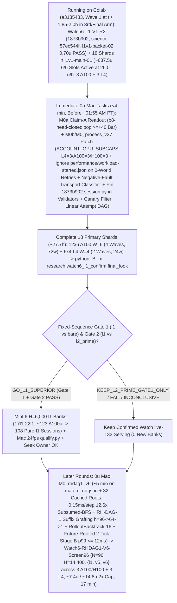

# T34 ExIt-B8 Research Roadmap (Round-27 Synthesis — Advice, Not Decisions)

Start: [project index](../INDEX.md) · [current status & authority](../STATUS.md) · [research record index](INDEX.md) · [study packages](../../research/INDEX.md) · [campaign log](final_run_20261019/CAMPAIGN_LOG.md).

> [!IMPORTANT]
> **Status: Research advice, NOT ratified decisions or release authorization.**
> Every current-round and later-round plan on this page is synthesized advisor guidance from Round 27 (2026-11-01 PT; primary synthesis artifact: `snake-dqn-artifacts/big-lever/exp/argon-rounds/round-27/synthesis/answer.md`, reconciling `round-27/{current,later,process}/answer.md` and `round-26/synthesis/answer.md` against `HEAD` `b4bd68ca` / `e3be0e72` and superseding Rounds 01–26). Nothing here amends a pre-registration, ratifies a confirmation gate, or changes served defaults. Binding campaign authority remains [`SUCCESS_CONTRACT.md`](final_run_20261019/SUCCESS_CONTRACT.md), [`DESIGN_V2_SHADOW.md`](final_run_20261019/DESIGN_V2_SHADOW.md) (+ Amendment 1), [`P7_STATISTICS.md`](final_run_20261019/P7_STATISTICS.md), unsuperseded parts of [`FINAL_PLAN.md`](final_run_20261019/FINAL_PLAN.md), and [`STATUS.md`](../STATUS.md); any serving or release change requires confirmation-lane evidence, Mac serving qualification, and the owner's explicit OK.

---

## 1. Snapshot Context & Code-Verified Round-27 State (`b4bd68ca`, Nov 1)

### 1.1 Watch6 V3 `GO_EFFICACY_ONLY`, Watch `live-132` release, all-length screen, `DeviceSim` parity & live `Watch6-L1-V1` (`l1v1-main-01` Wave-1 at `t ≈ 1.85–2.0 h`, 3rd/final arm on `6/6` Colab slots at `26.01 u/h`)

- **Watch6 V3 confirmation finished — `GO_EFFICACY_ONLY` (`52135312`, 2026-11-01 14:40 PT)** ([`REGISTRATION_V3.md`](../../research/watch6_search_efficacy_v3/REGISTRATION_V3.md), `t34-sol/watch6-v3-final-look-20261101/final-look-01/final_look.json`):
  - Sole registered final look (`75471246` V6.1 adapter) over all **`96/96` primary `H = 14,400` (`10 min @ 24 fps`) Watch6-v2 pairs** (`0` reserves, `24/24` L4 `W = 4` shards in `28` attempts — shards `00, 09, 12, 19` passed on single retry after the `09:16 PT` Fable-ratified quarantine of `23` historical non-V3 H100-503 manifests; `2,764,800/2,764,800` live-mirror frames matched):
  - **`Δdeaths/1k = -0.125`** (`CI95 [-0.153, -0.097] < 0`; `0.1580` vs `0.2830`, **`-44.2%`**) and **Fieller pooled mean-mass ratio `+63.7%`** (`CI95 [+49.8%, +78.5%] >= -5%`; **`+214.12` mass**, `550.25` vs `336.13`), with boost `0.733%` vs `0.625%`, `mean_max_length = 1,073.4` (peak `L <= 2,296`) vs `780.9`, and **`2,549.4` mean branches/session** (`5.67×` `H = 6,000`'s `449.6`, confirming superlinear late-horizon branch growth) $\Rightarrow$ **`ELIGIBLE_FOR_REPLAY_QUALIFICATION` for `exact-stop-l2-prime` (`L >= 600`) only**.
- **Watch `live-132` serving guards, Mac `24 fps` qualification & release — ALREADY LANDED (`dc834ded`–`f5912f44`, ~16:00 PT):**
  - [`.claude/launch.json`](../../.claude/launch.json) (`lines 8–11`) serves confirmed **`watch-replay-bank-live-132`** (`132` `exact-stop-l2-prime` `H = 6,000` sessions from banks `01–08, 10–12`) with **`SNAKE_WATCH_REPLAY_CONTROLLER=exact-stop-l2-prime`** on `:8000` (retaining `watch-replay-bank-live-168` on disk while `exact-stop-l1` runs `H = 14,400` confirmation).
  - [`GameSession`](../../web/backend/session.py) gates Watch replay on [`_is_clean_mixed_watch6_b8()`](../../web/backend/session.py) (`lines 722–753`) across `__init__` (`line 573`), `_build` (`line 769`), `reset_game` (`line 1261`), and `set_mode` (`lines 1520, 1563, 1576`); refuses `MODE_TRAIN` on forward-only `EGO2S_OBS_SPECS`, `(RASTER31V2, RASTER31V3)`, and un-overridden `_reward_contract_mismatch` **before** calling `_leave_watch_replay()` (`lines 1510–1550`, with replay recovery on Watch fallback); and scopes `_replay_opted_out = True` to `set_epsilon` (`line 1204`), live `set_hero` change (`line 1222`), and `set_food` (`line 1241`), cleared by `_build` (`line 763`) and [`new_game()`](../../web/backend/session.py) (`lines 1279–1284`, wired to `"new_game"` in [`app.py`](../../web/backend/app.py) `line 311`).
  - [`ReplayBank`](../../web/backend/watch_replay.py) (`lines 348–417`) implements `SNAKE_WATCH_REPLAY_CONTROLLER` (`all | exact-stop-l2-prime | exact-stop-l1`, failing closed to live B8 on invalid values), line-1 [`peek_header`](../../web/backend/watch_replay.py) (`lines 138–150`, `0` non-target `verify_payload` decodes), cycle-1 `shuffle_discovery: bool = True`, shallow [`Recording.snapshot`](../../web/backend/watch_replay.py) (`lines 315–330`), and **`0.25 ms`-slice / `64`-frame cooperative GIL yield (`max(1.0 ms, 4.0 * slice_elapsed)` = `<= 20%` GIL duty cycle)** in [`verify_payload`](../../web/backend/watch_replay.py) (`lines 30–33, 244–275`).
  - [`research/watch_replay/qualify.py`](../../research/watch_replay/qualify.py) (`t34-sol/argon-replay-qual/SUMMARY.md`, Fable review `APPROVE_WITH_CONDITIONS` with `C1–C3` resolved at `fec81656`) passed `132/132` inventory parity, cold session readiness **`0.349–0.435 s` (`< 0.45 s`)**, concurrent cold-verification live-B8 fallback **`update p95 = 8.78 ms <= 11.688 ms`**, **`0/120` paced-`24 fps` overruns** (`step p99 = 11.34 ms <= 41.67 ms`), and seamless recorded playback cutover after **`~18.5–23.1 s`** (`recorded update p95 = 0.002 ms`).
- **All-length exact-stop screen — `ADOPT` for new replay banks; `36` `l1` sessions staged for `Watch6-L1-V1`** ([`watch6_alllen_screen`](../../research/watch6_alllen_screen/README.md), `t34-sol/argon-alllen-a100/analysis.json`, `N = 48` paired `H = 6,000` Watch6-v2 sessions):
  - `exact_stop_alllen` (`L >= 1`, `interval = 5`, `H = 300`) reached **`559.43` mass** (`+208.37` / Fieller `+59.35%` vs `bare` `351.07`; **`+98.27` / Fieller `+21.31%` vs `l2_prime_600` `461.16`**, `CI95 [+50.57, +145.98]`) and **`0.0521` `deaths/1k`** (`-81.9%` vs `bare` `0.2882`; **`-67.4%` / `-0.1076/1k` vs `l2_prime_600` `0.1597`**, `CI95 [-0.1609, -0.0544]`), cutting `L < 600` deaths **`53 (bare) / 34 (L >= 600) -> 1`** (`mean_max_length = 1,096.0`) at **`2.821×` branches** (`1,268.5` vs `449.6`, `1,200.1` roots = **`1.057` branches/root**, stopping on `bare` at **`94.3%`** of roots). **`14/15` remaining deaths occur at `L >= 600` (`13/15` at `L >= 800`, `-14.2%` per-frame `L >= 800` hazard at `1.379×` living exposure), while per-session comparisons vs `l2_prime_600` show `14/48` (`29.2%`) mass losses (`27` wins, `7` ties) and `3/48` worlds with more deaths (`idx 36` `seed = 3075941873`, `idx 39` `seed = 3394546952`, `idx 47` `seed = 121131908`) due to modulo-5 phase shift (`DenseTrigger.fires()` in `trigger.py:35-42`) and inter-root unshielded `bare` ticks (`frame % 5 != 0` in `watch_replay/engine.py:146`).**
  - Three `12`-session A100 banks (`14l1–16l1`, `W = 6`, `H = 6,000`, `t34-sol/argon-banks-l1/SUMMARY.md:38-40`) completed `36/36` on Cap-6 `36285bc6` in **`3.03–3.07 h/bank`** (**`~61.5 A100 u` total**). They remain unserved on disk (`watch-replay-bank-live-168`) pending `H = 14,400` `Watch6-L1-V1` confirmation, Mac qualification, and owner OK.
- **GPU `DeviceSim` v2 parity — `PASS` on A100** ([`devicesim_v2_parity`](../../research/devicesim_v2_parity/README.md), commit `b500d111`): **`0` mismatches** across **`1,536,000` snake-ticks** (`E = 256 × 1,000` Watch6-v2 ticks, `1,434.6` steps/s under SplitMix64 RNG and `<= 1e-4` CUDA FP32 near-tie tolerances; SplitMix64 cannot mint MT19937 live Watch replay banks).
- **`Watch6-L1-V1` R2 Ratified (`1873b902` / `93c77f43`), `l1v1-packet-02` Canaries Passed & `18` Primary Shards Running (`l1v1-main-01`, `a3135483`, Wave 1 at `t ≈ 1.85–2.0 h` in 3rd/Final Arm on `6/6` Colab Slots at `26.01 u/h`):**
  - [`research/watch6_l1_confirm/`](../../research/watch6_l1_confirm/) (`7,105` LOC; [`REGISTRATION_L1_V1.md`](../../research/watch6_l1_confirm/REGISTRATION_L1_V1.md) SHA-256 `8b46779ff52d0c9648ff8de00c1893f77beb9bd99eb4a4e51afbe0bdf36800a0`; initial `cf07791b` science identity `c015d5cb906066842c04202b66dac778eb04fb0b9b917882e1385a0e4474e84f`) was initially ratified pre-data by Fable (`t34-sol/argon-l1v1-pkg/RULING_L1_V1.md`; per Fable Condition 1, never cite `argon-l1v1-pkg-fix1/SUMMARY.md` or non-existent `prepare-receipt.json`).
  - **Two Full-`14,400`-Frame Mac 3-Arm Mirror Receipts (`fix1/mac-mirror.json` `de43850b…` & R2 `fix2/mac-mirror.json` `e89cc8c2…`):** On excluded fixture seed `34910101`, `{bare, l2_prime, l1}` passed **`43,200/43,200` mirrored frames (`0` mismatches)** across both Mac mirror runs (`1.272×–1.573×` 3-arm `l1 / (bare + l2_prime)` wall ratio per Fable R2 Condition 5):
    - `t34-sol/argon-l1v1-pkg-fix1/mac-mirror.json` (SHA-256 `de43850bc67bc230d6803335a6ce4635ac12767cc22354f5b28b92bc0a83a476`): `bare` `291.8 s` (`2` deaths), `l2_prime` `1,343.5 s` (`1,811` branches, `2` deaths), `l1` `2,079.7 s` total / `1,763.9 s` search (`3,108` branches across `2,880` roots = **`1.079` branches/root**, `567.5 ms/branch`, **`1.892 ms/step`**, `612.5 ms/root`, `1` death at **`L = 1,694`** where both `l1` and `l2_prime` died after `l1` eliminated `l2_prime`'s `L = 307` death), **`1.272×`** wall ratio, and **`1.115×`** serpentine step-cost ratio ($L = 150 \to 1,500$, `1.997 -> 2.227 ms/step`).
    - `t34-sol/argon-l1v1-pkg-fix2/mac-mirror.json` (SHA-256 `e89cc8c2ca8f5c3e5e96c9b24bd4f7e5538a787bbf1c753ae2ce940509b47079`, commit `1873b902`, `science = 57ec544fe45f7a8a876dbc9363048468b63358e224b2ee8e11dff41401dcfbd3`): `bare` `296.4 s`, `l2_prime` `1,325.4 s`, `l1` `2,550.7 s` wall / `2,190.2 s` search (`3,108` branches across `2,880` batches, `4,428,215` kernel rows, `2.035–2.105 ms/step` serpentine probe), **`1.573×`** wall ratio.
  - **`l1v1-packet-01` Canary Failure, Fable R2 Ruling (`1873b902` / `93c77f43`), `l1v1-packet-02` Canaries Passed & `l1v1-main-01` Wave-1 Progress (`t ≈ 1.85–2.0 h`):** After `l1v1-packet-01` canaries (`0.447 A100 + 0.103 L4 = 0.55 u` observed) failed with `CHILD_NONZERO_EXIT` on `job.sh:21` `COLAB_EXPORT_DIR: unbound variable` (`runtime.py:575-576` sets `COLAB_OUTPUT_DIR`), commit `1873b902` (`t34-sol/argon-l1v1-pkg-fix2/SUMMARY.md`) patched [`job.sh:21-45`](../../research/watch6_l1_confirm/job.sh) (`COLAB_OUTPUT_DIR` + `--fixture-horizon 6`) under science identity **`57ec544f…`**, Fable issued `t34-sol/argon-l1v1-pkg/RULING_L1_V1_R2.md` (`APPROVE-WITH-CONDITIONS`, amending `REGISTRATION_L1_V1.md` §5.2 canary `H=60 -> H=6` and retiring `cf07791b` to `superseded-cf07791b/`), rebuilt `t34-sol/l1v1-packet-02` canaries **passed** (`A100`: `365.4 s`, `0.574 u` observed / `0.688 u` priced; `L4`: `421.0 s`, `0.126 u` observed / `0.157 u` priced = **`0.70 u` observed**, `stop_verified = true`, `7/7` exports, with each `world-XX.json` measuring `18.4 KiB`), and [`finalize.py`](../../research/watch6_l1_confirm/finalize.py) sealed and launched all `18` single-wave primary shards (`t34-sol/l1v1-main-01`, commit `1873b902`, `science = 57ec544f…`, `inputs/input-metadata.tar.gz` SHA-256 `cb72db0fa3e595e5c8284b76709e44257a49505fa649a4734d349dc9df585999`, **`~636.8 u` central** = `558.6 A100 + 78.1 L4 u`, **`~637.5 u` w/ `0.70 u` `l1v1-packet-02` canaries**, linear-to-p95 range `598.1–739.5 u`, **`~27.7 h` calendar wall**) at `19:10 PT` (`a3135483`). Across `3 A100` (`shard-00` `poll-000178.json` at `6,840 s`, `shard-02` `poll-000195.json` & `shard-04` `poll-000400.json` at `6,720–6,840 s` @ `6.73 u/h`) and `3 L4` (`shard-14` `poll-000163.json` at `6,480 s`, `shard-12, 13` at `6,360–6,480 s` @ `1.94 u/h` = `26.01 u/h`, balance `2,106.84 u` at calibration / `~1,515 u` post-run), workers have crossed their **2nd intra-world `H = 14,400` arm boundary into their 3rd/final arm** (`Wave-1 L4 exit ~01:55 AM PT`, `~12.6 min` before A100 Wave 1).

### 1.2 Closed single-pass critics, distillations, RL, and standalone macro fallbacks

Between 2026-10-29 and 2026-11-01, every single-pass learned-policy, critic, distillation, and standalone macro-fallback track closed below its promotion or selectivity bars:

| Track | Scope & primary artifact | Measured outcome | Disposition |
| --- | --- | --- | --- |
| **TRAIN-01** ([`sandbox_a_resident`](../../research/sandbox_a_resident/README.md)) | `100.7M`-row (`384`-update) GPU-resident PPO from `b8-s3` (`t34-sol/train01-closeout/SUMMARY.md`) | H5000 equal-mix paired mass **`+8.09`** (`CI95 [-18.66, +34.85]`; scripted `+26.32`, frozen `+2.85`, mixed `-4.90`; update-320 peak `+14.23` `[-11.86, +40.32]`) vs bar `>= +40` | **Closed** (no strict-gate nomination) |
| **C/T Stage-2 distillation** | Continuation-teacher causal-root distillation (`t34-sol/ct-stage2-verdict/SUMMARY.md`) | Teacher rescued **`22/32` (`68.75%`)** deaths (`22/32 <= 65` ticks; indep-suffix H300 `+66.77`, `LB90 +23.96`), but student retention was **`46.9–50.0%`** (`0 pp` over `frozen_phi` vs `>= +15 pp`; topology AUC `0.5752 < 0.83`), ordinary flips **`44.4–64.5%`** (bar `<= 1%`), and lethal ordinary flips **`3–5`** (bar `<= 1`) | **`FAIL_DISTILLATION_RETENTION_OR_SAFETY`** |
| **Doom U-Net & `spatial-student-pilot`** | `83 × 145` spatial U-Net vs 33.7k B8-feature head (`t34-sol/doom-result-01/result.json`; `t34-sol/student-direction/{astra,fable}.md`) | Spatial U-Net lost late per-action doom ROC-AUC to frozen B8 features (**`0.753` vs `0.810`**, `Δ = -0.056`, `CI95 [-0.091, -0.023]`; all-strata death-lookback `0.7626` vs `0.8226`; ordinary late `0.690` vs `0.706`) | **`GRAY` / `40–48 A100 u` pilot fit canceled (`0 u`; retain `.so` caches)** |
| **B8 advantage head (offline OOF)** | `256 -> 128 -> 6` ReLU head on frozen B8 features (`t34-sol/b8-head-test/RESULT.md`) | Mass rule `GO` (late H300 `+30.09`, `LB90 +23.96`), Fable selectivity **`FAIL`**: **`26.42%`** late rescue (bar `>= 35%`) at **`97.60%`** non-death flips (bar `<= 15%`) | **Selectivity `FAIL`** (192-world closed-loop A100 `rc = 0` in `2,666.1 s` / `4.51 A100 u`, awaiting `< 90 s` Mac `M0a` readout) |
| **T4 Gate-1 factored critic** ([`t4_gate1`](../../research/t4_gate1/README.md)) | Clean-slate privileged `83 × 145` (`H = 320` 7-source BFS) hazard + foraging mass-flux critic on `384` disjoint Watch6-v2 worlds (`t34-sol/argon-t4-gate1-fix2/queue-03/READOUT.json`) | **`0/8` bars passed**: `L >= 600` residual EV **`+0.0266`** (`[-0.0280, +0.0869]` vs `>= 0.25`), death-root H300 rescue **`+19.99`** (vs `>= +40`), mature doom AUC **`0.5617`** (vs `>= 0.80`), ordinary H300 mass **`-22.21`** (vs `>= -15.0`), lethal flips **`3.13%`** (vs `<= 3.0%`) | **`KILL_T4`** (proves even privileged `83 × 145` critic lacks late value signal) |
| **R6 `L < 600` harvest census** ([`r6_l600_census`](../../research/r6_l600_census/README.md)) | `64`-world (`384`-root) Watch6-v2 early-game counterfactual + 5-fold OOF corpse/trail plane probes (`t34-sol/argon-mac-checks/r6-census/RESULT.json`) | **`34.90%` (`134/384`)** oracle-harvestable roots (`>= +5` H500 mass), **`7.69%`** non-bare H500 lethal flips, OOF ROC-AUC **`0.474–0.521`** (`0` passing threshold points); superseded operationally by `exact-stop-l1` | **`KILL`** |
| **R7 macro-option fallback** ([`r7_macro_fallback`](../../research/r7_macro_fallback/README.md)) | Pruned depth-2 (`2K = 30` ticks) spatial macro-options `{O_0..O_5}` on C/T train `1-step-all-die` roots (`t34-sol/argon-r7-repack/R7_READOUT.json`) | `3/5` bars passed (`0.316 ms` Mac 1-thread p95; **`33.0%` vs `9.0%`** `L >= 800` `all_die_sel0` rescue on `25/129` roots — `9/25` `36.0%` `macro_triggered` at `+66.7 pp` rescue vs `16/25` tick-`30` B8 re-traps, while `104/129` `80.6%` survived `H = 300` inside uncertified coils), but total `L >= 600` lift **`+3.85 pp`** (`< +10.0 pp`) and **`2 > 0`** ordinary lethal flips (`0` assessment roots opened) | **`KILL`** as standalone `30`-tick fallback |

### 1.3 Five Newly Verified Code Corrections & Live Ops Traps (`b4bd68ca`) + `CTS-ZWRHS-L1-v6` (`RH-DAG-1`, `~0.15 ms/step`, `p99 <= 12 ms`) Advances

1. **Live Trap 1 — FIFO L4 Wave-2 Starvation at `~01:55 AM PT` & `retry_limit = 1` Zero-Retry Cliff on `shard-01, 03, 05` ([`CAMPAIGN_LOG.md:2111`](final_run_20261019/CAMPAIGN_LOG.md#L2111), [`ready_queue.py:40,335,641,682`](../../tools/ops/ready_queue.py), [`auto_retry.py:334-337,364-407`](../../tools/ops/auto_retry.py), [`dispatch.py:2935`](../../tools/ops/dispatch.py)):**
   - At `19:10:40 PT`, [`ready_queue.py`](../../tools/ops/ready_queue.py) (`ACCOUNT_ASSIGNMENT_CAP = 6`, `ACCOUNT_L4_CAP = 3` at `line 40`, no `ACCOUNT_A100_CAP = 3`) launched `6` A100 shards (`00..05`): `shard-00, 02, 04` took the `3` A100s; `shard-03` hit HTTP `412` (`assignments: 3.0`, `3.43 s`, `0` exports) leaving `cleanup_error: "ALLOCATION_UNRESOLVED: retained pending record"`; and `shard-01` (`1.7 ms`) + `shard-05` (`1.6 ms`) failed on the `pending` fence because single-GPU [`dispatch.py:2935`](../../tools/ops/dispatch.py) skips `reconcile_unavailable()` (`line 2890`). At `19:12 PT`, [`retire_unavailable()`](../../tools/ops/ready_queue.py) (`lines 419–460`) unlinked `shard-03`'s `pending` record and [`reconcile()`](../../tools/ops/ready_queue.py) (`lines 324–395`) queued `shard-01, 03, 05` into `ops/auto-retry/<id>/` with **`"completion_attempt": 1`** ([`auto_retry.py:407`](../../tools/ops/auto_retry.py)) while launching `shard-12, 13, 14` (`3` L4s) alongside `shard-00, 02, 04` (`3` A100s).
   - **FIFO L4 Wave-2 starvation at `~01:55 AM PT`:** When L4 Wave 1 (`shards 12..14`, `~6.71 h`) exits `~12.6 min` before A100 Wave 1 (`shards 00, 02, 04`, `~6.92 h`), `slots = 3` opens while `by_gpu = {"A100": 3, "L4": 0}`. Without `ACCOUNT_GPU_SUBCAPS = {"L4": 3, "A100": 3, "H100": 3}` at [`ready_queue.py:682`](../../tools/ops/ready_queue.py), FIFO scanning consumes all `3` slots dispatching A100 `shards 06..08` into the `3`-A100 wall (`412`) **instead of launching L4 Wave 2 (`shards 15..17`)**, and then increments `completion_attempt` `1 -> 2` on `01-r1, 03-r1, 05-r1` ([`line 335`](../../tools/ops/ready_queue.py)), while all `18` rows in `l1v1-main-01` were enqueued with **`retry_limit = 1`** (`maximum = min(2, 2, 1) = 1` in [`auto_retry.py:334-337`](../../tools/ops/auto_retry.py)).
2. **Live Trap 2 — Exact `output-shard-{01,03,05}` Footprint (Correcting Round 26's `write_once()` Claim) & Both `performance.json` + `workload-started.json` Exported at `t = 0 s` vs `~112 KiB` 6-World Batches ([`supervisor.py:69-84,1066-1081,1225`](../../research/colab_cli/supervisor.py), [`job.sh:40`](../../research/watch6_l1_confirm/job.sh), [`run.py:197`](../../research/watch6_l1_confirm/run.py), [`auto_retry.py:265-270`](../../tools/ops/auto_retry.py), [`admission.py:55-67,474-519`](../../research/watch6_l1_confirm/admission.py)):**
   - **Correction to Round 26 `write_once()` & `shard-{01,03,05}` footprint:** [`write_once()`](../../research/colab_cli/supervisor.py) (`lines 69–84`) writes plain JSON **without** `.sha256`/`.complete` sidecars, and [`supervisor.py:1066-1081,1225`](../../research/colab_cli/supervisor.py) writes `manifest.json` (`max_outcome_blind_retries: 2` on `output-shard-01/manifest.json`), `7` files in `staging/`, and (on `03`) `accounting-baseline.json` before HTTP `412` — so [`_prealloc_tree_clean()`](../../research/watch6_l1_confirm/admission.py) (`lines 474–490`) fails specifically on `len(rel.parts) != 1` (`staging/*`) and missing `accounting-baseline.json` / `public-input-preflight.json` in [`ALLOWED_PREALLOC_FILES`](../../research/watch6_l1_confirm/admission.py) (`lines 55–67`). Replacing the filename allowlist with a **pre-compute forbid-list** (and keeping a `read(executed if executed.is_file() else manifest)` defensive fallback at [`auto_retry.py:401`](../../tools/ops/auto_retry.py) plus `"research/watch6_l1_confirm/"` in `package_check()` at `line 364`) repairs both [`final_look.py:317`](../../research/watch6_l1_confirm/final_look.py) and [`resume.py:44`](../../research/watch6_l1_confirm/resume.py).
   - **Both `performance.json` (`job.sh:40`) AND `workload-started.json` (`run.py:197`) export at `t = 0 s`, while 6-world export batches are only `~112 KiB`:** Live `exports/` (`poll-000178.json:2-13`) contains **both** `performance.json` (`2,671 B`, published by [`job.sh:40`](../../research/watch6_l1_confirm/job.sh)) and `workload-started.json` (`302 B`, published by [`run.py:197`](../../research/watch6_l1_confirm/run.py)) at `t = 0 s`, poisoning `0`-world retries unless both are ignored in [`auto_retry.py:265-270`](../../tools/ops/auto_retry.py) and [`admission.py:503-509`](../../research/watch6_l1_confirm/admission.py). Conversely, `t34-sol/l1v1-packet-02/output-canary-a100/receipt.json:1360-1378` proves each `world-XX.json` (`record=None`) is **`18.4 KiB`** (`6` worlds = **`~112 KiB < 2.8%` of `4 MiB`** `max_export_bytes`), removing Round 26's `4 MiB` export-batch worry during `l1v1-main-01`.
3. **Live Trap 3 — [`is_external_transport_compute_failure()`](../../research/watch6_l1_confirm/admission.py) (`lines 682–706`) Rejects 100% of Standard `supervisor.py` Poll Timeouts & Polling `AccountingError`s + Dead Zones A & B ([`supervisor.py:655,1284,1355-1385,1858-1905,1973`](../../research/colab_cli/supervisor.py), [`failures.py:64,76-89`](../../research/colab_cli/failures.py), [`accounting.py:333,347,438,536`](../../research/colab_cli/accounting.py), [`admission.py:115,177-184,285-325,618-706`](../../research/watch6_l1_confirm/admission.py)):**
   - [`supervisor.py:1284,1355-1385`](../../research/colab_cli/supervisor.py) sets `receipt["error"] = redact(repr(exc))` and **never writes a `"traceback"` key to `receipt.json`**, so [`failures.py:64,76-89`](../../research/colab_cli/failures.py) `RPC_EXEC_POLL_TIMEOUT` strings (`"Refused('deadline reached during telemetry recovery')"`, `"Refused('kernel remains busy/unknown after telemetry hiccup')"`, `"Refused('kernel completion not acknowledged (busy/error/timeout)')"`, `"Refused('supervised assignment disappeared during telemetry recovery')"`, `"TimeoutExpired(...)"`) fail both [`has_verified_transport_traceback()`](../../research/watch6_l1_confirm/admission.py) (`line 296`) and [`_RENEWAL_WS_TRUNCATED_RE`](../../research/watch6_l1_confirm/admission.py) (`line 177`).
   - [`_ACCOUNTING_PROVIDER_LAG_RE`](../../research/watch6_l1_confirm/admission.py) (`lines 181–184`) misses all **5** actual polling `AccountingError`/`Refused` strings in [`accounting.py:333,347,438,536`](../../research/colab_cli/accounting.py) and [`supervisor.py:1973`](../../research/colab_cli/supervisor.py) (`"provider assignment count disagrees with sessions during polling"`, `"unaccounted active assignment endpoints: ..."`, `"supervised assignment disappeared from sessions"`, `"account-wide assignment cap exceeded during polling/job"`).
   - **Dead Zone A (`supervisor.py:1858–1905`) & Dead Zone B (`admission.py:115`):** Failures between `input-hashes.json` (`line 1858`) and `hardware.json` (`line 1905`) are rejected by both `is_prestart_transport_failure()` (`lines 618–627`, which admits only `UPLOAD_CAP`) and `is_external_transport_compute_failure()` (`line 646`, which requires `hardware.json`), while `_NON_TRANSPORT_FAULT_RE` (`line 115`) hardcodes `"kernel error despite cli exit zero"` (`supervisor.py:655`) as a fatal science fault even when wrapping `cli_guard.py`'s `GuardError`.
   - **Fix (Negative-Fault Transport Classifier):** Replace `admission.py:511-706`'s brittle positive regexes with a negative-fault proof: any stopped `INCOMPLETE` attempt (`stop_verified is True` or `endpoint is None` with no `world-*.json`) with `0` `rc == 86`, `0` child tracebacks (`_audit_job_log_clean()` + `_audit_poll_files()`), and `0` `_NON_TRANSPORT_FAULT_RE` matches is admitted as `prestart` (Tier-0, `0` compute completions consumed) if `0` `world-*.json` exported, or `external_transport_compute` (`<= 2`/shard) if `>= 1` `world-*.json` exported.
4. **Live Trap 4 — Non-Mutating `1873b902:web/backend/session.py` (`da7b4971…`) Pin in Operational Validators, 4-Site Canary Filter, & Unified Attempt-DAG Lineage ([`protocol.py:75,251-280`](../../research/watch6_l1_confirm/protocol.py), [`ratify.py:142`](../../research/watch6_l1_confirm/ratify.py), [`final_look.py:345-465,538,603-689`](../../research/watch6_l1_confirm/final_look.py)):**
   - [`protocol.py:75,271-274`](../../research/watch6_l1_confirm/protocol.py) hashes `protocol.py` itself **and** `web/backend/session.py` (`da7b4971…`) into `57ec544f…` at `1873b902`, while `main` (`fec81656`) updated `web/backend/session.py` (`2df8bb76…`); editing `protocol.py` (`EXCLUDED_WEB_NON_SCIENCE`) shifts `compute_identity()` away from `57ec544f…`. Leave `protocol.py` untouched during `L1-V1` and pin `1873b902:web/backend/session.py` (`da7b4971…`) inside operational validators (`admission.py`, `ratify.py:142`, `final_look.py`, `prepare.py`, `recover.py` — all outside `SCIENCE_PACKAGE_MODULES`).
   - Filter `canary.is_canary(data) or WATCH6_FIXTURE == "1"` before [`final_look.py:603`](../../research/watch6_l1_confirm/final_look.py) (`lines 603, 662, 674, 683`), record `mf_path.resolve()` in `unallocated_manifests` (`lines 648–654`) whenever `_is_proven_unallocated()` holds even if `has_bound_receipt == True`, accept `0 <= top_comp <= 2` (`line 369`), and unify `-retry-1`, `RETRY.json`/`unalloc_ref` (linking bridged unallocated gaps after an existing root `att0` to `att0.receipt_path`), and `prior_receipts` into one linear DAG under `pre_outcome_open_guard()`.
5. **Search & Kernel Advances in `CTS-ZWRHS-L1-v6` (`RH-DAG-1`: Suffix Grafting $h = 96 \to 64 \to 1$ + `RolloutBacktrack-16`, Future-Rooted 2-Tick Stage B from $\hat{w}_{t+1}$ `p99 <= 12 ms`, Read-Only `tail_flat[6]`, Subsumed-BFS `~0.15 ms/step`, & `res_opp.head_risky[j, action]`):**
   - **Why `CTS-ZWRHS-L1-v5` (`RHCC-1` + Root `Stage B`) fails multi-deviation coils & causal live serving:** When leaf $\hat{w}_{t+128}$ steps to $\hat{w}_{t+129}$ and fails $\mathcal{C}_{\text{tail}}$, the fatal turn entered the coil *near the end of the horizon* ($\le 65$ ticks before the trap, where `ct-stage2-verdict` proved `22/32 = 68.75%` of late deaths are rescuable). Branching `Stage B` at the **root $w_t$** (`129` steps early) under open-loop $\pi_{\text{shield}}$ either re-converges to the same fatal food-chasing turn at $t + 96 \dots t + 120$ (scoring all root actions dead) or overrides $a_t$ `128` frames prematurely. Moreover, executing $a_t = Q[0]$ at frame $t$ transitions the real game to $w_{t+1} = f(w_t, Q[0])$, making any 2-tick Stage-B branches $a \neq Q[0]$ rooted at $w_t$ **counterfactual orphans** by frame $t+1$.
   - **Suffix-Grafting MPC (`RH-DAG-1`, $h = 96 \to 64 \to 1$) + `RolloutBacktrack-16` & Future-Rooted 2-Tick Stage B from $\hat{w}_{t+1}$ (`p99 <= 12.0 ms < 33.0 ms`):** Branching `32` steps from cached $\hat{w}_{t+96}$ (`~5.2 ms`, resolving `> 80%` of triggers in 1 frame) or `64` steps from $\hat{w}_{t+64}$ (`~10.4 ms`) with 16-step interior backtrack (`RolloutBacktrack-16`) turns 1-deviation root shooting into closed-loop $k$-deviation MPC ($k \ge 2$), while rooting rare 2-tick Stage B at **$\hat{w}_{t+1}$** (`64 + 64` steps across frames $t$ and $t+1$ while executing $a_t = Q[0]$) fixes Round 26's counterfactual-orphan bug (`p99 <= 12.0 ms < 33.0 ms`, `0` workers).
   - **Read-only `tail_flat[6]` in [`_region_kernel` (`ego_raster_nb.py:574,628`)](../../src/simd_env/ego_raster_nb.py), Subsumed-BFS (`~0.15 ms/step`, `12.6×`), & `res_opp.head_risky[j, action]` ([`v8_nb.py:1330-1350,1626`](../../src/simd_env/v8_nb.py)):** Stack-local `tail_flat[6]` (`ty_o * Wp + tx_o` when `seg_count == length`, else `-1`) avoids mutating `sim._owner_pad` in `@njit(parallel=True)` `_region_kernel_chunks` (`line 628`); reusing normal `area[0..2]` (`out_counts[r, d] = min(area[d], cap)` when no own-body cell released at $d_{\text{bfs}} < 160$) + the Component-Ceiling triangle-inequality theorem (`area[speed*3 + d'] == area_cap` when `area[speed*3 + 0] == 3400` and `min_blocked_own_rel_val > max_qd + 2`) cuts hero BFS work **`2.5×`** (`21,360` queue pops) to **`~0.15 ms/step` (`12.6×` vs `1.892 ms`)**; and `res_opp.head_risky[j, res_opp.action[j]] == True` (`line 1626`) catches both `OUTCOME_NO_SPACIOUS == 2` (`line 1330`) and `ne == 0` opponent lunges (`line 1350`) at `0` extra cost.

---

## 2. Current-Round Plan (Advice, Not Decisions)

### 2.1 `0 u` Mac `M0a` Claim-A closeout (`< 90 s`) & C4 telemetry

1. **Run `M0a` Claim-A readout (`< 90 s` Mac, `0 u`) & enforce binding v1 `H = 5,000` `>= +40` closure bar:**
   - Run `closedloop_readout.py` (`t34-sol/b8-head-closedloop/SUMMARY.md:50-52`, `origin/astra-doom-auc-smoke` @ `591d94c3`) on completed `b8-head-closedloop` (`N = 192` v1 `H = 5,000` worlds, `m in {0, 10, 25, 50}`, `2,666.1 s` / `4.51 A100 u` in `t34-sol/b8-head-closedloop/main-01/output/receipt.json`). Audit `spatial-qbytes-01` (`t34-sol/spatial-qbytes-fix/SUMMARY.md:85-88`) strictly as a Q-byte/`.so` cache ruler (`40–48 A100 u` `spatial-student-pilot` fit stays canceled at `0 u`).
   - **Recommended Claim-A kill rule:** Permanently **close Claim A (`0 u` further)** if no `m in {0, 10, 25, 50}` clears [`SUCCESS_CONTRACT.md`](final_run_20261019/SUCCESS_CONTRACT.md) §2 (`lines 29–33`) and [`P7_STATISTICS.md`](final_run_20261019/P7_STATISTICS.md) §§3–4 (`lines 33–48`): pooled `Δmass >= +40.0`, Bonferroni-4 `LB97.5 > 0`, scripted Guard B `>= +0.03` (`0` mix losses), Guard A `Δalive >= -0.05` pooled / `>= -0.075` single mix, and living overrides `<= 15%`.
2. **Monitor live `:8000` `watch-replay-bank-live-132` C4 telemetry (`0 u`):**
   - Keep `watch-replay-bank-live-132` (`exact-stop-l2-prime`) live on `:8000`, monitor `update_ms` / overrun telemetry (Fable C4), and mint **`0`** new `.watch.gz` banks before `Watch6-L1-V1`'s verdict lands.

### 2.2 `0 u` Mac `M0b` / `M0_process_v27` Live `l1v1-main-01` Ops & Final-Look Patch (`< 2.5 min`, Before `~01:55 AM PT`)

Work in a clean worktree with live runs/`ops/`/`exports/`/`pair-*.json` untouched, leaving `protocol.py`, `run.py`, `main`'s `web/backend/session.py`, and `research/colab_cli/*` (`36285bc6`) unedited while pinning `1873b902:web/backend/session.py` (`da7b4971…`) inside operational validators so `p.identity() == "57ec544fe45f7a8a876dbc9363048468b63358e224b2ee8e11dff41401dcfbd3"` holds across `admission.py`, `ratify.py`, `mirror.py`, `resume.py`, and `final_look.py`:

1. **Enforce `ACCOUNT_GPU_SUBCAPS = {"L4": 3, "A100": 3, "H100": 3}`, define Tier-0 retry eligibility by `0` `world-*.json` units (ignoring `{"workload-started.json", "performance.json"}`), bypass `attempt >= maximum` (`retry_limit = 1`), & keep defensive `read(manifest)` fallback at `auto_retry.py:401`:**
   - Enforce `ACCOUNT_GPU_SUBCAPS = {"L4": 3, "A100": 3, "H100": 3}` inside `ops/alloc.lock` before `mkdir` in [`ready_queue.py:40,641,682`](../../tools/ops/ready_queue.py) and [`dispatch.py:2820-2935`](../../tools/ops/dispatch.py) (with single-GPU HTTP 412/503 `reconcile_unavailable()`) so neither the `t ≈ 6.71 h` (`~01:55 AM PT`) L4 Wave-1 exit (`~12.6 min` before A100 Wave 1) nor the `t ≈ 13.42 h` (`~08:38 AM PT`) L4 Wave-2 finish can starve L4 `shards 15..17` or fire queued A100 shards into the `3`-A100 wall.
   - Ignore `{"workload-started.json", "performance.json"}` in [`auto_retry.py:265-270`](../../tools/ops/auto_retry.py) and [`admission.py:503-519`](../../research/watch6_l1_confirm/admission.py) so `0`-`world-*.json` drops stay Tier-0 (`completion_attempt += 0`, `prestart_attempt <= 6`, bypassing `if attempt >= maximum` on `retry_limit = 1` in [`ready_queue.py:335`](../../tools/ops/ready_queue.py) and [`auto_retry.py:397`](../../tools/ops/auto_retry.py)); keep `read(executed if executed.is_file() else manifest)` at [`auto_retry.py:401`](../../tools/ops/auto_retry.py) and add `research/watch6_l1_confirm/` to [`auto_retry.py:364`](../../tools/ops/auto_retry.py) `package_check()`.
2. **Replace `admission.py:474-706` with a pre-compute forbid-list + negative-fault transport classifier; pin `1873b902:web/backend/session.py` (`da7b4971…`) in operational validators; filter canaries before `final_look.py:603`; and unify `RETRY.json`/`unalloc_ref`/`prior_receipts` into one linear DAG:**
   - Replace [`_prealloc_tree_clean()`](../../research/watch6_l1_confirm/admission.py) (`lines 474–490`, repairing both `final_look.py:317` and `resume.py:44`) with a pre-compute forbid-list (admitting `staging/*`, `accounting-baseline.json`, `public-input-preflight.json`, and `upload-measurement.json` when `endpoint is None` and `0` `world-*.json`/`poll-*.json`/`hardware.json` exist), and replace `admission.py:511-706`'s brittle regexes with a **negative-fault transport classifier** (admitting Dead Zone A `1858–1905`, Dead Zone B `GuardError` at `line 115`, all `failures.py:76-89` `RPC_EXEC_POLL_TIMEOUT` strings with `traceback=None`, and all 5 polling `AccountingError`/`Refused` strings whenever `stop_verified`, `0` `rc == 86`, and `0` child/science faults hold).
   - Pin `1873b902:web/backend/session.py` (`da7b4971…`) inside [`admission.py`](../../research/watch6_l1_confirm/admission.py), [`ratify.py:142`](../../research/watch6_l1_confirm/ratify.py), [`final_look.py`](../../research/watch6_l1_confirm/final_look.py), [`prepare.py`](../../research/watch6_l1_confirm/prepare.py), and [`recover.py`](../../research/watch6_l1_confirm/recover.py) (leaving `protocol.py` untouched); filter `canary.is_canary(data) or WATCH6_FIXTURE == "1"` before [`final_look.py:603`](../../research/watch6_l1_confirm/final_look.py) (`lines 603, 662, 674, 683`); record `mf_path.resolve()` in `unallocated_manifests` (`lines 648–654`) whenever `_is_proven_unallocated()` holds even if `has_bound_receipt == True`; accept `0 <= top_comp <= 2` (`line 369`); and unify `RETRY.json`/`unalloc_ref`/`prior_receipts` into one linear DAG under `pre_outcome_open_guard()`. Defer AST-only `science_identity()`, single-file unit export (`run.py`), `science-contract.tar.gz` split (`uploads.py`), and `colab_cli` changes (`canary.py:318` `verified-ledger.json` SHA exemption, HTTP `export_file` for `len(batch) <= 12`) to post-`L1-V1`.
3. **Verification & kill rule (`M0b` / `M0_process_v27`):** Verify on **6 fixtures** in `/tmp` under `sys.addaudithook` (`0` non-`digest()` `world-*.json` opens): (1) live `output-shard-{01,03,05}` (`staging/*`, `accounting-baseline.json`, `retry_limit = 1`), (2) `supervisor.py:833` `RPC_EXEC_POLL_TIMEOUT` (`traceback=None`) + `exports/{performance,workload-started}.json` (`0` worlds), (3) polling `AccountingError` + Dead Zone A (`input-hashes.json` without `hardware.json`), (4) chained `-r1 -> -r2` with unallocated `-r1` after root `receipt.json`, (5) `3/6`-world mid-shard drop resumed to `6/6` via Tier-1 auto-retry, and (6) `final_look.py` with superseded `l1v1-packet-01` canaries. Block `ready_queue` reload / `final_look.py` if `p.identity() != "57ec544f…"`, if any of the 6 fixtures fails or opens `world-*.json` outside `digest()`, or if `ready_queue --dry-run` dispatches a 4th A100 or 4th L4.

### 2.3 Complete Live 18-Shard `Watch6-L1-V1` (`l1v1-main-01`, `~637.5 u`, `~27.7 h`) & Execute Sole Final Look

1. **Wave Progression (`12` A100 shards `00..11` `W = 6` = `72` worlds in `4` waves, `~6.92 h/wave`; `6` L4 shards `12..17` `W = 4` = `24` worlds in `2` waves, `~6.71 h/wave`):**
   - Under `M0b`'s `ACCOUNT_GPU_SUBCAPS = {"L4": 3, "A100": 3, "H100": 3}` and `0`-`world-*.json` Tier-0 retry rules, L4 Wave 1 (`shards 12..14`, now in its 3rd/final arm at `t ≈ 1.85–2.0 h`) exits at `t ≈ 6.71 h` (`~01:55 AM PT`) and immediately dispatches L4 Wave 2 (`shards 15..17`, finishing at `t ≈ 13.42 h` / `~08:38 AM PT`) without triggering A100 `412` stampedes, while A100 completes `4` waves in `~27.7 h` (`shards 00, 02, 04` $\to$ `06, 07, 08` $\to$ `09, 10, 11` $\to$ `01-r1, 03-r1, 05-r1`).
2. **Sole Final Look & Fixed-Sequence Decision Rules (`python -B -m research.watch6_l1_confirm.final_look`, $\alpha = 0.05$, `df = 95`):**
   - **Gate 1 (`l1` vs `bare`, $\alpha = 0.05$):** `UB95(Δdeaths/1k) < 0` (nondegenerate) AND paired Fieller pooled mass `LB95 >= -5.0%` (`-0.05`, bounded & connected).
   - **Gate 2 (`l1` vs `l2_prime`, tested ONLY IF Gate 1 passes, $\alpha = 0.05$):** `UB95(Δdeaths/1k) < 0` (nondegenerate) AND paired Fieller pooled mass `LB95 >= -2.5%` (`-0.025`, bounded & connected) AND session-denominator `Δd_ge800/1k UB95 <= +0.05/1k` (zero-variance `[0, 0]` passes).
   - **If `GO_L1_SUPERIOR` (Gate 1 PASS + Gate 2 PASS):** Mint **`6` `H = 6,000` `exact-stop-l1` `.watch.gz` banks** (`17l1–22l1`, `72` sessions, `~123 A100 u` in `~6.1 h` $\rightarrow$ **`108` pure-`l1` sessions** with `14l1–16l1`), pass Mac `24 fps` [`qualify.py`](../../research/watch_replay/qualify.py) (`0 u`, `< 15 min`), and seek **owner OK** for Watch cutover (`SNAKE_WATCH_REPLAY_CONTROLLER=exact-stop-l1`).
   - **If `KEEP_L2_PRIME_GATE1_ONLY` / `FAIL_GATE1` / `INCONCLUSIVE_GATE1`:** Spend **`0 u`** on new `l1` banks, retain confirmed `watch-replay-bank-live-132` (`exact-stop-l2-prime`) on `:8000`, and advance to §3 (`CTS-ZWRHS-L1-v6` / `RH-DAG-1`).
   - **If `INVALID_OR_INCOMPLETE` (`0` outcomes opened under `pre_outcome_open_guard()`):** Fix pre-alloc/canary/identity mismatches via `M0b` (`0 u` Mac); re-queue `0`-world shards via Tier-0 `auto_retry.py` reusing `cb72db0f…` + `l1v1-packet-02` canaries (`0 u` canary); or run `recover.py` (`0 u` Mac) + 1 same-tier `H = 6` canary (`~0.13 L4 u` / `~0.57 A100 u`) on `1..N-1` partial drops before the sole `final_look.py`.

---

## 3. Later-Round Plan: `CTS-ZWRHS-L1-v6` (`RH-DAG-1`: Suffix-Grafting MPC, `RolloutBacktrack-16`, Subsumed-BFS `~0.15 ms/step`, & Future-Rooted 2-Tick Stage B `p99 <= 12 ms` — Advice, Not Decisions)

### 3.1 `CTS-ZWRHS-L1-v6` (`RH-DAG-1`): Subsumed-BFS + Read-Only `tail_flat[6]` (`~0.15 ms/step`, `12.6×` Speedup), Suffix Grafting ($h = 96 \to 64 \to 1$) + `RolloutBacktrack-16`, & `res_opp.head_risky[j, action]`

1. **Subsumed-BFS + Component-Ceiling Theorem, Read-Only `tail_flat[6]` in `_region_kernel`, & Exact Post-Move `slot_pad` Parity (`1.892 -> ~0.15 ms/step`, `12.6×` Speedup):**
   - Reuse [`free_space_counts(self.sel_state[e, s], sim.length[e, s])`](../../src/simd_env/vector61_policy.py) (`lines 329, 601–617, 677, 816`) instead of re-running the full 61-D featurizer in `decision_free_space` and pass precomputed `counts_sel` into `_v8_rows` ([`v8_nb.py:1047`](../../src/simd_env/v8_nb.py), proven `100%` bitwise identical across **`4,428,215/4,428,215` rows** in `fix2/mac-mirror.json`), cutting opponent `v2` floods **`45 -> 15`/step**, while passing scalar `(max_j = max(0, ln - nh), ix, iy, nx, ny)` into `_bfs_owner` ([`v8_nb.py:217,753-843`](../../src/simd_env/v8_nb.py)) restores **100% post-move bitwise parity** (`0` body walks).
   - **Subsumed-BFS + Component-Ceiling Theorem in [`_eager_templates_owner` (`v8_nb.py:741-850,1051`)](../../src/simd_env/v8_nb.py):** In hero `v8_scalars(..., features=True)` ([`ego_raster_bv8.py:73`](../../src/simd_env/ego_raster_bv8.py)), run normal `area[0..2]` first; whenever `not used_own_release_under_160`, set `out_counts[r, d] = min(area[d], cap)` (`0` `v2` floods). Track `min_blocked_own_rel_val` during `area[speed*3 + 0]`; when `area[speed*3 + 0] == area_cap` (`3,400`), `not used_own_release`, `min_blocked_own_rel_val > max_qd + 2`, and neighbor `d' in {1, 2}` was reached at BFS distance `2`, triangle inequality guarantees `area[speed*3 + d'] == area_cap` (`0` mismatches), cutting hero BFS work **`2.5×`** (`21,360` queue pops/step).
   - **Read-Only `tail_flat[6]` in [`_region_kernel` (`ego_raster_nb.py:574,628`)](../../src/simd_env/ego_raster_nb.py):** Instead of mutating `sim._owner_pad` in-place (which races in `@njit(parallel=True)` `_region_kernel_chunks` at `line 628` and violates [`ego_raster.py:457`](../../src/simd_env/ego_raster.py)), compute a 6-register stack array `tail_flat[o] = ty_o * Wp + tx_o` (when `seg_count[e, o] == length[e, o]`, else `-1`), removing all `slot_pad` modulo reads with **`0` grid writes**. Together with `hero_policies=[]` + `V8ResultBuffer` + zero-copy `_i64`, `E = 1` step time drops to **`~0.15 ms/step` (`12.6×` vs `1.892 ms`)**. Keep **5 separate `Vector61SimdPolicy` objects on the main/shadow spine** (`vector61_policy.py:761`).
2. **Receding-Horizon Suffix-Grafting MPC (`RH-DAG-1`, $h = 96 \to 64 \to 1$) & `RolloutBacktrack-16` (`interval = 1`, Multi-Deviation Closed-Loop MPC at `4×` Lower Repair Cost):**
   - Maintain action tape `Q[0..127]` and 5 cached snapshots $\hat{w}_{t+1}, \hat{w}_{t+32}, \hat{w}_{t+64}, \hat{w}_{t+96}, \hat{w}_{t+128}$, advancing $\hat{w}_{t+128} \to \hat{w}_{t+129}$ by `1` step/frame (`~0.15 ms`) under Every-Tick $\pi_{\text{shield}}$.
   - When $\hat{w}_{t+129}$ fails $\mathcal{C}_{\text{tail}}$ (`TailTrackWitness` with `ext_gain >= L_128` & `min_boost_length = 5`):
     1. **Step 1 — Suffix Graft at $\hat{w}_{t+96}$ (`32` steps, `E <= 5`, `~5.2 ms`):** Branch $a \neq Q[96]$ from $\hat{w}_{t+96}$ ($t+96 \to t+129$, where `ct-stage2-verdict` proved `68.75%` of late deaths are rescuable within $\le 65$ ticks). If certified, splice $Q[96:129]$ and $\hat{w}_{t+129}$ in-place while keeping $a_t = Q[0]$ (`0` premature root flips).
     2. **Step 2 — Mid-Horizon Graft at $\hat{w}_{t+64}$ (`64` steps, `~10.4 ms`):** Triggered only if $h = 96$ fails. Because spliced overrides slide backward along $Q$ as $t$ advances while later frames splice new suffixes, $Q[0..127]$ accumulates **closed-loop $k$-deviation trajectories ($k \ge 2$)** across the 128-step horizon.
     3. **`RolloutBacktrack-16` Inside Candidate Rollouts:** Whenever a rollout branch fails `alive` or `any(elig_L)` at step $h_{\text{fail}}$, rewind once to checkpoint $\lfloor(h_{\text{fail}}-1)/16\rfloor \times 16$ (`8..23` steps prior) and force the second-best `elig_L` action, recording the interior override in $Q$ so the real world executes it at $t + h_{\text{ckpt}}$.
3. **Exact Opponent Lunge Condition (`res_opp.head_risky[j, res_opp.action[j]] == True`) & `OppPinchProbe`:**
   - In [`v8_nb.py:1330-1350,1626`](../../src/simd_env/v8_nb.py), checking only `OUTCOME_NO_SPACIOUS == 2` (`line 1330`) misses **`ne == 0` at `line 1350`** (opponent has spacious moves, but all spacious moves are `out_risky`, so `v8` aborts and lunges with `final = v7`). Testing **`res_opp.head_risky[j, res_opp.action[j]] == True`** (`line 1626`) captures both `OUTCOME_NO_SPACIOUS` and `ne == 0` at `0` extra cost in `DesperateOppHeadOnShield` and `OppPinchProbe` (`+1..2` rows forcing $K_{\text{opp}} = 8$ cutoff moves at `v8_nb.py:898`).

### 3.2 Future-Rooted 2-Tick Mac Live Serving (`p99 <= 12 ms < 33.0 ms`), Unshielded Play, `0 u` Mac `M0_rhdag1_v6` & `Watch6-RHDAG1-V6-Screen96`

- **Causally Exact Live Mac Watch Serving (`p99 <= 12.0 ms < 33.0 ms`, `0` Worker Processes) & Unshielded Play:**
  1. **Watch (`~0.8 ms` on `98.9%` of frames, `~6.2 ms` single-frame $h = 96$ graft on `> 80%` of triggers, `p99 <= 12.0 ms`):** Because `> 80%` of leaf triggers resolve via `32`-step Suffix Grafting at $\hat{w}_{t+96}$ (`~5.2 ms`), most repairs complete in **1 frame (`~6.2 ms`)**. When root escalation ($h = 1$) is needed and `elig_L[Q[0]]` holds at $w_t$, execute $a_t = Q[0]$ on frame $t$ while rooting 2-tick Stage B at **$\hat{w}_{t+1}$** (running steps $1 \dots 64$ from $\hat{w}_{t+1}$ on frame $t$ and steps $65 \dots 128$ on frame $t+1$), delivering $a^*_{t+1}$ at $w_{t+1} \equiv \hat{w}_{t+1}$ with **`0` counterfactual-orphan branches** and **`p99 <= 12.0 ms < 33.0 ms`**. Keep recorded `.watch.gz` v2 banks at **`H = 6,000`** (`< 512 MiB` `MAX_DECODED`).
  2. **Play — bare `b8-s3` untouched:** Keep Play strictly live bare `b8-s3` (`0` boss toggles, `0` `v8_tail_redecide` / `WitnessMask` in Play) per [`SUCCESS_CONTRACT.md:44-45`](final_run_20261019/SUCCESS_CONTRACT.md) and [`STATUS.md:48,69-74`](../STATUS.md), and keep `CORPSE_FOOD_CAP_MULTIPLE_V2 = 0.5` frozen.
- **Mandatory `0 u` Mac `M0_rhdag1_v6` gate (`~5 min` CPU on `mac-mirror.json` + `32` cached roots, `0` `exports/` or `pair-*.json` opened) before Colab spend:**
  - Run a read-only benchmark on `t34-sol/argon-l1v1-pkg-fix2/mac-mirror.json` (`seed = 34910101` shared `L = 1,694` death root) + **`32` cached roots** (`16` $L \ge 800$ `all-die` / coil roots from `t34-sol/argon-r7-repack/R7_READOUT.json` + `16` phase-divergent regression roots from `t34-sol/argon-alllen-a100/analysis.json`).
  - **Kill rule (`M0_rhdag1_v6`):** Kill kernel changes (`0 u` spent) on **`> 0` bitwise mismatches** across `43,200` mirror frames or `E = 1` step time **`> 0.22 ms/step`**; kill `RH-DAG-1` if synchronous Mac Watch `p99` exceeds **`18.0 ms`** (`> 0` frames `> 33.0 ms`) or if Suffix Grafting ($h = 96/64$) + `RolloutBacktrack-16` rescues **`< 50%` (`< 8/16`)** of $L \ge 800$ `all_die` roots (`>= +17 pp` over R7's `33%`).
- **Conditional 3-Arm `N = 96, H = 14,400` Colab Screen `Watch6-RHDAG1-V6-Screen96` (`3 A100/H100 + 3 L4` at once, `~17 min` wall-clock, `~7.4 u` expected / `~14.8 u` 2× cap):**
  - Compare **(1) `exact-stop-l1`** (fast kernel), **(2) `CTS-ZWRHS-L1-v5`** (`RHCC-1` root-only Stage B), and **(3) `CTS-ZWRHS-L1-v6`** (`RH-DAG-1` suffix grafting + `RolloutBacktrack-16` + `res_opp.head_risky[j, action]` shield) across `N = 96` fresh paired `H = 14,400` Watch6-v2 worlds (`3 × A100/H100` $\times 20$ worlds `W = 6` = `60` worlds in `~17 min` $\approx 5.7\text{ u}$; `3 × L4` $\times 12$ worlds `W = 4` = `36` worlds in `~17 min` $\approx 1.7\text{ u}$; total **`~7.4 u` / `~14.8 u` 2× cap**).
  - **Kill rule (`Watch6-RHDAG1-V6-Screen96`):** Kill `CTS-ZWRHS-L1-v6` (`RH-DAG-1`) if on `N = 96` paired `H = 14,400` worlds vs `exact-stop-l1` it fails **any** of: (1) mean search wall-clock **$\le 15\text{ s/world}$** (`>= 140×` faster than `exact-stop-l1`'s `2,190.2 s` in `fix2/mac-mirror.json` and `>= 1.5×` faster than `v5`), (2) paired **$\Delta\text{deaths/1k} \le -0.045$** vs `exact-stop-l1` (`CI95_upper < 0`, cutting $L \ge 800$ deaths by $\ge 50\%$) **and** $\Delta\text{deaths/1k} < 0$ vs `v5`, or (3) paired pooled mass delta **$\ge +75.0$** over `exact-stop-l1` (`LB95 > 0`).
- **Do not fund (`0 u`):** editing `research/watch6_l1_confirm/protocol.py` or `run.py`, reverting `main`'s `web/backend/session.py`, or editing `research/colab_cli/*` before `Watch6-L1-V1` seals (`protocol.py:75` and `run.py:77` are in `SCIENCE_PACKAGE_MODULES`, `session.py` holds live `:8000` guards, and editing `colab_cli` invalidates `36285bc6`), relying on positive-regex transport matching in `admission.py:682-706` (which rejects `RPC_EXEC_POLL_TIMEOUT` with `traceback=None`, Dead Zone A `1858–1905`, and all 5 polling `AccountingError` strings) or counting `exports/{performance,workload-started}.json` against `0`-world Tier-0 retries (`auto_retry.py:265-270`, `admission.py:503-519`), leaving `ACCOUNT_A100_CAP = 3` unset in `ready_queue.py:682` (starving L4 Wave 2 at `~01:55 AM PT`) or `retry_limit = 1` (`attempt >= maximum`) un-exempted, re-running `prepare.py` on live `l1v1-main-01` (`final_look.py:459` duplicate-root rejection), mutating `sim._owner_pad` in-place inside `_region_kernel` (`ego_raster_nb.py:628` parallel race), rooting 2-tick Stage B at $w_t$ instead of $\hat{w}_{t+1}$ (counterfactual-orphan bug), checking only `OUTCOME_NO_SPACIOUS` without `ne == 0` (`res_opp.head_risky[j, action]` at `v8_nb.py:1350,1626`), using Round 25's unguarded `slot_pad` $O(1)$ TTL formula without `j < max(0, ln - nh)` and `(nx, ny)`/`(ix, iy)` overrides (`v8_nb.py:753-843`), reading stale `last_veto["tail_reaches"]` (`vector61_policy.py:830,960`), discarding `V8Result` in `ego_raster.py:511` or leaving `watch_replay/engine.py:146` unshielded, calling unmodified `v8_redecide` (`v8_nb.py:1838`) at $L \ge 600$ without `v8_tail_redecide`, re-running the 2nd full 61-D featurizer in `decision_free_space` (`vector61_policy.py:677`) or the 3rd `15`-flood loop in `_v8_rows` (`v8_nb.py:1047`), editing [`research/watch6_l1_confirm/job.sh`](../../research/watch6_l1_confirm/job.sh) (`protocol.py:258`), reserve seed substitution in `Watch6-L1-V1` (`RULING_L1_V1.md:18,32`, `admission.py:792`), citing `argon-l1v1-pkg-fix1/SUMMARY.md` (`RULING_L1_V1.md` §4 Condition 1), shared-instance `Vector61SimdPolicy(veto_slots=(1..5))` on the main/shadow spine (`vector61_policy.py:761`), `WitnessMask` or boss-mode toggles in Play (`SUCCESS_CONTRACT.md:44-45`), `> 512 MiB` full-DTO `H = 14,400` `.watch.gz` v2 files, new bare PPO (`TRAIN-01`), single-pass distillation (`C/T Stage-2`, `spatial-student-pilot`), spatial/privileged critics (`Doom U-Net`, `T4 Gate-1`), `R6` harvest rules, standalone `30`-tick `R7` macros, or SplitMix64 `DeviceSim` live-bank minting.

---

## 4. Settled Round-27 Disagreements & Primary Code/Artifact Citations

1. **Editing `EXCLUDED_WEB_NON_SCIENCE` in [`protocol.py:84-90`](../../research/watch6_l1_confirm/protocol.py) (`current` & `process`) vs. pinning `1873b902:web/backend/session.py` (`da7b4971…`) inside operational validators (Round 26):**
   [`protocol.py:75,271-274`](../../research/watch6_l1_confirm/protocol.py) hashes `protocol.py` itself **and** `web/backend/session.py` into `57ec544f…` at `1873b902`; editing `protocol.py` or dropping `session.py` from `science_paths()` changes `compute_identity()` away from `57ec544f…`. **Settled:** Leave `protocol.py` untouched during `Watch6-L1-V1`; pin `1873b902:web/backend/session.py` (`da7b4971…`) inside `admission.py`, `ratify.py`, `final_look.py`, `prepare.py`, and `recover.py` (which are outside `SCIENCE_PACKAGE_MODULES`), and move to AST-only `science_identity()` post-`L1-V1`.
2. **Root-only `CTS-ZWRHS-L1-v5` (`current`) vs. Suffix-Grafting `CTS-ZWRHS-L1-v6` (`RH-DAG-1`, `later`) for Screen96:**
   Root-only 2-tick Stage B rooted at $w_t$ orphans branches after $a_t = Q[0]$ executes and misses multi-deviation tail traps (`<= 65` ticks before the trap), whereas Suffix Grafting ($h = 96 \to 64 \to 1$) + `RolloutBacktrack-16` + Future-Rooted 2-Tick Stage B from $\hat{w}_{t+1}$ repairs tail traps in `32–64` steps (`~5.2–10.4 ms`, `p99 <= 12.0 ms`), while `~112 KiB` 6-world export batches (`18.4 KiB/world` in `l1v1-packet-02/output-canary-a100/receipt.json:1360-1378`) also remove Round 26's `4 MiB` export worry. **Settled:** Test both `v5` and `v6` head-to-head against `exact-stop-l1` in the 3-arm `Watch6-RHDAG1-V6-Screen96` (`N = 96, H = 14,400`, **`~7.4 u` / `~14.8 u` 2× cap**, `~17 min`).
