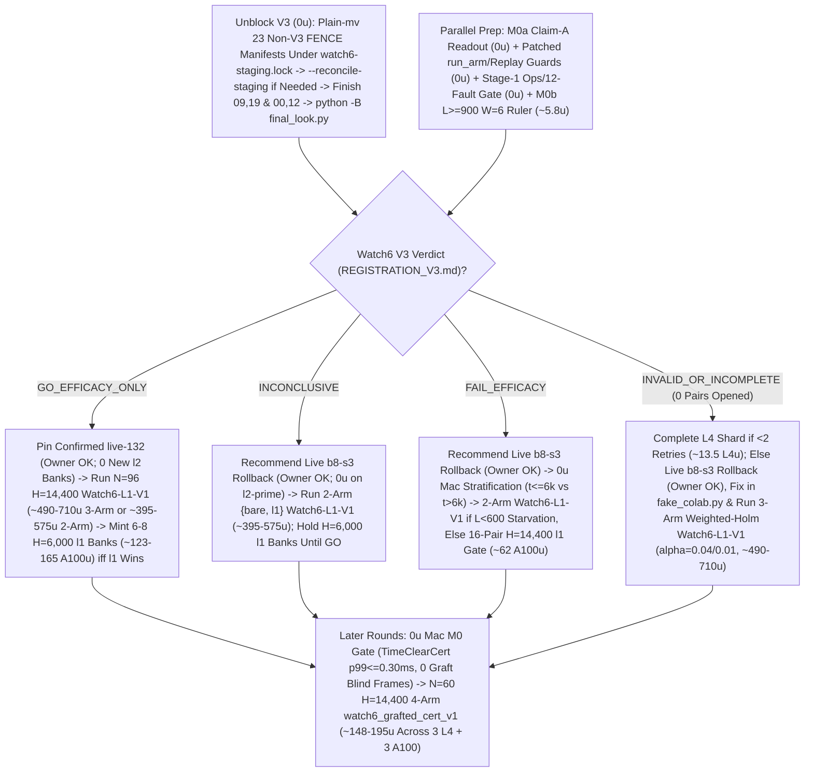

# T34 ExIt-B8 Research Roadmap (Round-13 Synthesis — Advice, Not Decisions)

Start: [project index](../INDEX.md) · [current status & authority](../STATUS.md) · [research record index](INDEX.md) · [study packages](../../research/INDEX.md) · [campaign log](final_run_20261019/CAMPAIGN_LOG.md).

> [!IMPORTANT]
> **Status: Research advice, NOT ratified decisions or release authorization.**
> Every current-round and later-round plan on this page is synthesized advisor guidance from Round 13 (2026-11-01 PT; primary synthesis artifact: `snake-dqn-artifacts/big-lever/exp/argon-rounds/round-13/synthesis/answer.md`, reconciling `round-13/{current,later,process}/answer.md` against `HEAD` `d6526987` and superseding Rounds 01–12). Nothing here amends a pre-registration, ratifies a confirmation gate, or changes served defaults. Binding campaign authority remains [`SUCCESS_CONTRACT.md`](final_run_20261019/SUCCESS_CONTRACT.md), [`DESIGN_V2_SHADOW.md`](final_run_20261019/DESIGN_V2_SHADOW.md) (+ Amendment 1), [`P7_STATISTICS.md`](final_run_20261019/P7_STATISTICS.md), unsuperseded parts of [`FINAL_PLAN.md`](final_run_20261019/FINAL_PLAN.md), and [`STATUS.md`](../STATUS.md); any serving or release change requires confirmation-lane evidence, Mac serving qualification, and the owner's explicit OK.

---

## 1. Snapshot Context & Code-Verified Round-13 Corrections (Oct 29 – Nov 1)

### 1.1 Nov 1 exploration, bank-minting, parity & Watch6 V3 fence quarantine ruling

- **All-length exact-stop screen — `ADOPT` for new replay banks** ([`watch6_alllen_screen`](../../research/watch6_alllen_screen/README.md), `t34-sol/argon-alllen-a100/analysis.json`, `N = 48` paired `H = 6,000` Watch6-v2 sessions uniting `12` L4 `W = 4` units `0..11` at `568b09e4` with `36` A100 `W = 6` units `12..47` across three `12`-unit shards at `73c26ccc` on `origin/argon-alllen-a100-1031`):
  - `bare` (`b8-s3`): **`351.07` mass** (`CI95 [320.22, 381.91]`), **`0.2882` `deaths/1k`** (`CI95 [0.2427, 0.3337]`; `83` deaths: `53` at `L < 600`, `30` at `L >= 600`, `21` at `L >= 800`), `mean_max_length = 794.3`.
  - `l2_prime_600` (served `L >= 600`): **`461.16` mass** (`CI95 [414.30, 508.02]`; `+110.09` vs `bare`, `CI95 [+72.06, +148.13]`), **`0.1597` `deaths/1k`** (`CI95 [0.1060, 0.2134]`; `-44.6%` vs `bare`; `46` deaths: `34` at `L < 600`, `12` at `L >= 600`, `11` at `L >= 800`), `449.6` mean branches/session (`403.7` roots, `mean_max_length = 943.4`).
  - **`exact_stop_alllen` (`L >= 1`, `interval = 5`, `H = 300`):** **`559.43` mass** (`CI95 [533.59, 585.27]`; **`+208.37` / `+59.35%` vs `bare`**, `CI95 [+170.07, +246.66]`; **`+98.27` / `+21.31%` vs `L >= 600`**, `CI95 [+50.57, +145.98]`, clearing `>= +15.0`) and **`0.0521` `deaths/1k`** (`CI95 [0.0294, 0.0748]`; **`-81.9%` / `-0.2361/1k` vs `bare`**, `CI95 [-0.2828, -0.1895]`; **`-67.4%` / `-0.1076/1k` vs `L >= 600`**, `CI95 [-0.1609, -0.0544]`, clearing `<= 0.0`), cutting `L < 600` deaths **`53 (bare) / 34 (L >= 600) -> 1`** (`0.142%` `L < 600` overrides, `mean_max_length = 1,096.0`) at **`2.821×` branches** (`1,268.5` vs `449.6`, `1,200.1` roots = **`1.057` branches/root**, stopping on `bare` at **`94.3%`** of roots, with `53.6%` cheap `L < 600` roots in frames `0..6,000`). **`14/15` remaining deaths occur at `L >= 600` (`13/15` at `L >= 800`).**
  - *Exposure & per-world notes:* Eliminating `34 -> 1` early deaths gives `exact_stop_alllen` **`1.379×` more `L >= 600` living exposure** (`403.7 -> 556.6` roots/session), so `11 -> 13` raw `L >= 800` deaths reflects **`-14.2%` lower per-frame `L >= 800` hazard** despite raw session-normalized `Δd_ge800 = +0.0069/1k`. Across paired worlds, `exact_stop_alllen` regressed deaths vs `L >= 600` on `3/48` seeds (`3075941873`, `3394546952`, `121131908`) and mass on `14/48` seeds.
- **All-length Watch banks `14l1–16l1` completed `36/36` on active Cap-6 `36285bc6` (freeing all `3` A100 slots):**
  - Verified receipts (`t34-sol/argon-banks-l1/packet-bank{14l1,15l1,16l1}-a100/output-main/receipt.json`, `SUMMARY.md:38-40`) confirm Cap-6 (`36285bc6`) ran `6/6` concurrent runtimes (`3 A100 @ 6.73 u/h + 3 L4 @ 1.94 u/h = 26.01 u/h`), finishing all `3 × 12` `exact-stop-l1` sessions (`W = 6`, `H = 6,000`) in **`3.03–3.07 h/bank`** (**`~20.36–20.67 u/bank` = `~61.5 A100 u` observed total** vs `75.6 u/bank` base / `151.2 u/bank` 2× forecast calibrated to the `2.821×` `L >= 1` branch ratio; balance **`~2,154.66 u`**, leaving `3` A100 slots immediately available). At `20.36 A100 u` per `12` `H = 6,000` sessions (`~164 A100 u` for `96` sessions at `H = 6,000`), survived trajectories spend frames `6,000..14,400` almost entirely at `L >= 800`, so `H = 14,400` `exact-stop-l1` compute scales **superlinearly (`>= 2.4×`, projected `~2.4–3.1×`)** over `H = 6,000`.
  - Commit `395eacbb` switched `.claude/launch.json` to **`watch-replay-bank-live-168`** (`132` `exact-stop-l2-prime` banks `01–08, 10–12` + `36` unconfirmed `exact-stop-l1` banks `14l1–16l1`, [`web/serve.py`](../../web/serve.py) restarted on `b5b63cd1`, keeping `watch-replay-bank-live-132` intact for rollback). Confirming `exact-stop-l1` at `H = 14,400` still requires prospective confirmation (`Watch6-L1-V1`), Mac serving qualification, and owner OK; defer minting new banks until Watch6 V3's verdict lands.
- **GPU `DeviceSim` v2 parity — `PASS` on A100** ([`devicesim_v2_parity`](../../research/devicesim_v2_parity/README.md), `t34-sol/argon-devicesim-v2/packet-a100-v2-parity-01/main-run-01/receipt.json`): **`0` mismatches** across **`1,536,000` snake-ticks** (`E = 256 × 1,000` Watch6-v2 ticks in `3,505.6 s` = `1,434.6` steps/s under 5-opponent CUDA flood launches, commit `b500d111`), using `DeviceSim`'s SplitMix64 RNG and `<= 1e-4` CUDA FP32 near-tie Q re-decision tolerances (SplitMix64 cannot mint MT19937 live Watch replay banks).
- **Active confirmation — Watch6 V3 (`09:16 PT` staging-fence quarantine ruling, `--reconcile-staging`, identity closure & linear-retry lineage guard)** ([`REGISTRATION_V3.md`](../../research/watch6_search_efficacy_v3/REGISTRATION_V3.md)): `24 × 4` L4 `W = 4` shards (`96` fresh paired `H = 14,400` Watch6-v2 sessions) confirming **`exact-stop-l2-prime` (`L >= 600`) only**. At `05:01 PT`, **`14/24` shards were `PASS`** (`01..08, 10, 11, 13..16`), **`6/24` active** (`17, 18, 20..23`), and **`4/24` V6.1-accepted mechanical failures** (`00` `412` unallocated, `09` `UPLOAD_CAP`, `12` renewal-WS drop, `19` warmup `GuardError`; `75471246`):
  - *`09:16 PT` V6.1 staging-fence quarantine ruling (`APPROVE_WITH_CONDITIONS`, `t34-sol/v61-fence-ruling-20261101.md`, `t34-sol/v61-fence-evidence-20261101.json`):* `23` historical non-V3 H100-503 pre-fallback manifests in `ops/manifests/` return `_attempt_state == "FENCE"`, blocking [`tools/watch6_v3_accounting/dispatch.py:wait_other_jobs_staged`](../../tools/watch6_v3_accounting/dispatch.py) (`lines 219–245`) for V3 recovery shards `00` and `12`. The Fable stand-in judge approved plain-`mv` quarantine of **only** those `23` manifests + `.live.json` siblings to `ops/manifests-archive-20261101/` under `flock` on `ops/watch6-staging.lock` (**`0` symlinks**, because [`final_look.py`](../../tools/watch6_v3_accounting/final_look.py) `lines 473–483` fails closed on `is_symlink()` before namespace filtering; if `ops/watch6-staging-reconcile.json` was written, clear it via `--reconcile-staging` in [`dispatch.py`](../../tools/watch6_v3_accounting/dispatch.py) `lines 178–185, 316–354`).
  - *Identity closure & linear lineage:* [`watch6_search_efficacy_v3/protocol.py`](../../research/watch6_search_efficacy_v3/protocol.py) hashes both [`tools/ops/package_spec.py`](../../tools/ops/package_spec.py) (`line 94`) and `web/backend/` (`line 96`) into `identity()`, and [`final_look.py:_verify_shard_lineage`](../../tools/watch6_v3_accounting/final_look.py) (`lines 380–386`) fails closed on forked attempt trees sharing a parent receipt. Keep all V3 worktrees untouched; dispatch **only** staged `ops/auto-retry` children on shards **`09` and `19`** (**do NOT run [`recover.py`](../../tools/watch6_v3_accounting/recover.py)** on `09, 19`); run `recovery-shard-{00,12}-01` via `python -B -m tools.watch6_v3_accounting.dispatch`; and invoke [`final_look.py`](../../tools/watch6_v3_accounting/final_look.py) under **`python -B`** from clean `snake-dqn-argon-v3-accounting` ([`_forbid_pycache_directory`](../../tools/watch6_v3_accounting/__init__.py) `lines 747–777`).
- **Completed Oct-30 Claim-A GPU receipts awaiting `0 u` Mac readout (`< 3 min`):** `b8-head-closedloop` (`t34-sol/b8-head-closedloop/main-01/output/receipt.json`, `rc = 0`) and `spatial-qbytes-01` (`t34-sol/spatial-qbytes-fix/t34-spatial-qbytes-01/ruler-output-a100-fallback/receipt.json`, `rc = 0`) completed cleanly on A100, while `T4 Gate-1` (`0/8` bars, `KILL_T4`) cancels the `40–48 A100 u` `spatial-student-pilot` fit (retaining compiled `.so` caches).

### 1.2 Closed single-pass critics, distillations, RL, and standalone macro fallbacks

Between 2026-10-29 and 2026-11-01, every single-pass learned-policy, critic, distillation, and standalone macro-fallback track closed below its promotion or selectivity bars:

| Track | Scope & primary artifact | Measured outcome | Disposition |
| --- | --- | --- | --- |
| **TRAIN-01** ([`sandbox_a_resident`](../../research/sandbox_a_resident/README.md)) | `100.7M`-row (`384`-update) GPU-resident PPO from `b8-s3` (`t34-sol/train01-closeout/SUMMARY.md`) | H5000 equal-mix paired mass **`+8.09`** (`CI95 [-18.66, +34.85]`; scripted `+26.32`, frozen `+2.85`, mixed `-4.90`; update-320 peak `+14.23` `[-11.86, +40.32]`) vs bar `>= +40` | **Closed** (no strict-gate nomination) |
| **C/T Stage-2 distillation** | Continuation-teacher causal-root distillation (`t34-sol/ct-stage2-verdict/SUMMARY.md`) | Teacher rescued **`22/32` (`68.75%`)** deaths (`22/32 <= 65` ticks; indep-suffix H300 `+66.77`, `LB90 +51.61`), but student retention was **`46.9–50.0%`** (`0 pp` over `frozen_phi` vs `>= +15 pp`; topology AUC `0.5752 < 0.83`), ordinary flips **`44.4–64.5%`** (bar `<= 1%`), and lethal ordinary flips **`3–5`** (bar `<= 1`) | **`FAIL_DISTILLATION_RETENTION_OR_SAFETY`** |
| **Doom U-Net & `spatial-student-pilot`** | `83 × 145` spatial U-Net vs 33.7k B8-feature head (`t34-sol/doom-result-01/result.json`; `t34-sol/student-direction/{astra,fable}.md`) | Spatial U-Net lost late per-action doom ROC-AUC to frozen B8 features (**`0.753` vs `0.810`**, `Δ = -0.056`, `CI95 [-0.091, -0.023]`; all-strata death-lookback `0.7626` vs `0.8226`; ordinary late `0.690` vs `0.706`) | **`GRAY` / `40–48 A100 u` pilot fit canceled (`0 u`; retain `.so` caches)** |
| **B8 advantage head (offline OOF)** | `256 -> 128 -> 6` ReLU head on frozen B8 features (`t34-sol/b8-head-test/RESULT.md`) | Mass rule `GO` (late H300 `+30.09`, `LB90 +23.96`), Fable selectivity **`FAIL`**: **`26.42%`** late rescue (bar `>= 35%`) at **`97.60%`** non-death flips (bar `<= 15%`) | **Selectivity `FAIL`** (192-world closed-loop A100 `rc = 0`, awaiting Mac readout) |
| **T4 Gate-1 factored critic** ([`t4_gate1`](../../research/t4_gate1/README.md)) | Clean-slate privileged `83 × 145` (`H = 320` 7-source BFS) hazard + foraging mass-flux critic on `384` disjoint Watch6-v2 worlds (`t34-sol/argon-t4-gate1-fix2/queue-03/READOUT.json`) | **`0/8` bars passed**: `L >= 600` residual EV **`+0.0266`** (`[-0.0280, +0.0869]` vs `>= 0.25`), death-root H300 rescue **`+19.99`** (vs `>= +40`), mature doom AUC **`0.5617`** (vs `>= 0.80`), ordinary H300 mass **`-22.21`** (vs `>= -15.0`), lethal flips **`3.13%`** (vs `<= 3.0%`) | **`KILL_T4`** (proves even privileged `83 × 145` critic lacks late value signal) |
| **R6 `L < 600` harvest census** ([`r6_l600_census`](../../research/r6_l600_census/README.md)) | `64`-world (`384`-root) Watch6-v2 early-game counterfactual + 5-fold OOF corpse/trail plane probes (`t34-sol/argon-mac-checks/r6-census/RESULT.json`) | **`34.90%` (`134/384`)** oracle-harvestable roots (`>= +5` H500 mass), **`7.69%`** non-bare H500 lethal flips, OOF ROC-AUC **`0.474–0.521`** (`0` passing threshold points); superseded operationally by `exact-stop-l1` | **`KILL`** |
| **R7 macro-option fallback** ([`r7_macro_fallback`](../../research/r7_macro_fallback/README.md)) | Pruned depth-2 (`2K = 30` ticks) spatial macro-options `{O_0..O_5}` on C/T train `1-step-all-die` roots (`t34-sol/argon-r7-repack/R7_READOUT.json`) | `3/5` bars passed (`0.316 ms` Mac 1-thread p95; **`33.0%` vs `9.0%`** `L >= 800` `all_die_sel0` rescue on `25/129` roots — `9/25` `macro_triggered` at `+66.7 pp` rescue vs `16/25` tick-`30` B8 re-traps, while `104/129` `80.6%` survived `H = 300`), but total `L >= 600` lift **`+3.85 pp`** (`< +10.0 pp`) and **`2 > 0`** ordinary lethal flips (`0` assessment roots opened) | **`KILL`** as standalone `30`-tick fallback |

### 1.3 Code-verified Round-13 corrections over Round 12

Auditing `HEAD` (`d6526987`) against Round 12's design exposes **five concrete code-level defects** across Watch replay/efficacy, Stage-1/Stage-2 transport, and later-round certificate/spine serving:

1. **Recorded Watch bank horizon (`H = 6,000`) vs. `record=None` confirmation (`H = 14,400`), `run_arm` `snapshot()` guard & `alpha` parameterization:**
   - [`web/backend/watch_replay.py`](../../web/backend/watch_replay.py) (`lines 24, 40, 57–58`) and [`research/watch_replay/run.py`](../../research/watch_replay/run.py) (`lines 46, 125`) enforce `MAX_DECODED = 512 MiB`, which `14,400` full-segment DTO lines breach at `L >= 1,000`. Keep **recorded `.watch.gz` banks at `H = 6,000`** (`< 512 MiB`) and run `record=None` confirmation (`Watch6-L1-V1`, `watch6_grafted_cert_v1`) at **`H = 14,400`**.
   - [`research/watch_replay/engine.py:run_arm`](../../research/watch_replay/engine.py) (`lines 216–265`) currently calls `session.live.snapshot()` unconditionally even when `record is None` and omits `timing`/`respawns_per_slot` expected by [`watch6_search_efficacy/performance.py:summarize_arm`](../../research/watch6_search_efficacy/performance.py) (`line 81`). Because [`build_frame`](../../web/backend/serialize.py) (`lines 355–431`) is pure DTO construction + `forward_with_activations` (`line 383`, zero RNG/carry/veto side effects), guard `snapshot = session.live.snapshot()` inside `if record is not None:` (skipping `43,200` unused serializations per 3-arm `H = 14,400` triple) and return `timing` (`main_seconds`, `search_seconds`) + `respawns_per_slot`.
   - [`watch6_search_efficacy/analyze.py:decide`](../../research/watch6_search_efficacy/analyze.py) (`line 41`) hardcodes `t.ppf(0.975, ...)` (`alpha = 0.05`); parameterize `alpha` (`t.ppf(1.0 - alpha / 2.0, df)`) in `Watch6-L1-V1`'s new analyzer across Student-`t` and Fieller CIs without editing sealed V2/V3 files.
2. **Stage-1 three-way `inputs[]` split, single-GPU `reconcile_unavailable`, `outage_onset_elapsed` censorship guard & `qualification.py review` (`0 u` on `36285bc6`):**
   - *Three-way `inputs[]` + per-unit Contents streaming:* Embedding `verified-ledger.json` inside `metadata.tar` mutates `WATCH6_METADATA_SHA256` on completion retries ([`watch6_search_efficacy/admission.py`](../../research/watch6_search_efficacy/admission.py) `lines 61–81`). Split `inputs[]` into: (a) `public_inputs` for `B8_s3_final.pth` (`6.56 MB`) + `league.tar.gz` (`21.36 MB`, bundling `frp3_m3_s12`, [`PUBLIC_INPUTS.json`](../../research/t34_exit_b8/PUBLIC_INPUTS.json) `lines 4–15`; `0 B` Mac upload), (b) frozen `inputs/study-static.tar` (`<= 1.5 MiB`, fixed SHA before data across all attempts, `env["CONFIRM_SHARD"]` $\Rightarrow$ `1` initial canary/24 shards), and (c) standalone `<= 64 KiB` `inputs/verified-ledger.json` (or `.tar`; total private upload `< 1.6 MiB < 8 MiB` [`UPLOAD_SPLIT_THRESHOLD_BYTES`](../../research/colab_cli/transfers.py) `lines 28–29`, `0` `UPLOAD_ASSEMBLE` WS RPCs; `1` `15 min` `~0.4 u` `pending_canary` on Stage-1 Tier-1 retry per [`canary.py`](../../research/colab_cli/canary.py) `lines 314–321`, `0` on Stage 2). Stream each completed paired unit (`<= 64 KiB`) over Contents HTTP GET via [`export_file`](../../research/colab_cli/export_batches.py) (`lines 172–214`) with `"required_exports": []`.
   - *Single-GPU `503` `pending-*.json` strand:* [`reconcile_unavailable`](../../tools/ops/dispatch.py) (`lines 2380–2489`) runs only in `dispatch_preferred` (`lines 2676–2688`); single-GPU L4 `503`s in [`dispatch`](../../tools/ops/dispatch.py) (`lines 2871–2948`) leave `account/pending-<session>.json` stranded and halt [`ready_queue.py`](../../tools/ops/ready_queue.py) (`lines 668–670`) account-wide. Wire `reconcile_unavailable()` into single-GPU `dispatch()`.
   - *`EXEC_POLL_RECOVERY_SECONDS = 1200.0` breaks Round 12's `elapsed < timeout * 60 - 180`:* Under [`policy.py`](../../research/colab_cli/policy.py) (`line 30`), any WebSocket outage in the final `20 min` sleeps until `cli.deadline` (`elapsed_seconds ~= timeout * 60 - 45`), falsely failing Round 12's `180 s` elapsed check. Gate Tier-1 completion retries on **`outage_onset_elapsed < timeout_minutes * 60 - 300`** from `receipt["cli_calls"]` (first consecutive failed control call minus session start) plus `terminal.reason != "timeout"`.
   - *Slot visibility & `qualification.py review`:* Keep operational manifests in `ops/manifests/` so [`ready_queue.py`](../../tools/ops/ready_queue.py) (`line 217`) and [`membership_evidence`](../../tools/ops/dispatch.py) (`line 2296`) see every slot, while recording study-scoped confirmation lineage in `ops/studies/<namespace>/attempts/<id>.json` (`r34-confirm-accounting/v1`, `confirm_audit.py` with `0` payload reads), and add `qualification.py review --tree <sha> --status ACCEPT` ([`qualification.py`](../../tools/ops/qualification.py) `lines 79–83` rejects `add` after [`requalify.py`](../../tools/ops/requalify.py) `line 166` publishes `"PENDING"`).
3. **Stage-2 `32`-min OAuth rotation WS RPC & `poll % 4` `account.lock` contention (`~1.5 u` additive `colab_cli`):**
   - [`supervisor.py`](../../research/colab_cli/supervisor.py) (`lines 1692–1710`) rotates `3,600 s` OAuth tokens at `t ~= 32 min` via WebSocket `cli.recoverable_rpc(...)` (without rotation, [`runtime.py`](../../research/colab_cli/runtime.py) `lines 626–627` aborts at `t ~= 54.4 min` with `release_credential_expiring`), and [`supervisor.py`](../../research/colab_cli/supervisor.py) (`lines 1934–1945`) locks `account.lock` every `poll % 4` (`~60 s`) around read-only `usage()`/`sessions()` `spend` checks. Replace the rotation RPC with Contents PUT to `release-credential.next.json` + atomic `chmod(0o600)`/`os.replace` inside `runtime.py`'s `0.2 s` watchdog loop (`line 642`) and remove `account_locked` from `poll % 4` `spend` reads (preserving Round 12's watchdog-first 2-window `account.lock` `~18 s` hold) to reach true **`0` post-`initial` WebSocket RPCs** across 6-hour runs.
4. **Constructive `TCC-L1` (`TimeClearCert`) + exact `t+1` `v8` / `2`-cell/tick seal / safe-ratio pinch vs. Round 12's unsound `2 * min(B, W)` & yield rules:**
   - Static $\Omega_1$ block-cut `2 * min(black, white)` ([`options.py`](../../research/r7_macro_fallback/options.py) `lines 355–370, 692–712`) is an **upper bound**, not a lower bound, on non-Hamiltonian 2D 2-cores (false-safe risk), ignores dynamic self-body release $1 < \tau_{\text{own}}(u) \le t$ (false-doom risk), and uses shortest-path `TailFollow` (`orphan > 0` pocket bisection). Replace with `< 0.22 ms` Numba **`TimeClearCert = OpenEscapeCert OR ConstructiveCoilCert`** at `interval = 1` online and on rollout ticks `1..128` (`0.43×` `H = 300` ticks).
   - Under [`HEADON_SIZE_RATIO = 1.15`](../../src/core/mechanics_constants.py) (`line 22`), $[0.87 L_0, 1.15(L_0 + 1)]$ kills **both** snakes; [`SpaceAndHeadVeto._head_layer`](../../src/evaluation/safety_veto_v8.py) (`lines 312–357`) refuses to yield (`REASON_HEAD_KEPT`, `line 134`) when hero's 7-cell boost fan covers spacious turns; and [`HeadAwareVeto`](../../src/evaluation/safety_veto_v6.py) (`lines 171, 216`) is 1-frame myopic (`Manhattan <= 2`), so at $t \ge 2$ opponents sprint at `2` cells/tick (`L_j >= 5`) and seal gates with their **body**. Simulate exact 1-step `SpaceAndHeadVeto` at `t+1`, keep `t >= 2` $d_{\text{opp}}^{\text{boost}}(g)$ at `2` cells/tick, and restrict `< 6%`-root `K = 3, H = 48` `v8`-pinch strictly to `Chebyshev <= 14` and post-burn $L_{0,\text{post}} \ge 1.15(L_j + 1)$.
5. **`0`-blind-frame Branch-Grafted `W = 4` `D = 384` `ShadowSpine` + 4-domain `sync_grid_from_live` vs. fenced cold-rebuilds:**
   - [`PathBControllerV2.decide`](../../research/t34_pathb/controller_v2.py) (`lines 170–171`) calls `self._fence("intervention_executed")` on every override, forcing [`PathBSearchEngine.maintain`](../../research/t34_pathb/engine_v2.py) (`lines 512–520`) to cold-rebuild `D = 384` ticks (`1.02–2.56 s` = **`25–62` blind `24 fps` frames** at `2.30–5.75 ms/tick`, `argon-banks-l1/preflight/benchmark.json`), while [`identity.py`](../../research/t34_shadow/identity.py) (`lines 79–260`) proves [`full_digest`](../../research/t34_shadow/shadow.py) (`lines 427–458`) parity requires 4-domain sync (isolated `live_rng`, `"rowwise"` forward, `_carry`, `_veto`). Retain `(digests[1..128], W_{t*+128})` on rescue workers (**P3–P4**) so **P2** (`D = 384` spine) **branch-grafts** overrides in **`0.0 ms` (`0` blind frames)**, isolate `session._watch_rng` (`< 0.05 ms/tick` digest confirm; full 4-domain `sync_grid_from_live` `< 0.40 ms` on cold start / food mutations), and keep `H = 6,000` `ReplayBank` fallback + frozen [`CORPSE_FOOD_CAP_MULTIPLE_V2 = 0.5`](../../src/core/mechanics_constants.py) (`line 53`).

---

## 2. Current-Round Plan (Advice, Not Decisions)

### 2.1 Unblock Watch6 V3 (`0 u`), run `M0a` Claim-A readout (`0 u`), & patch Watch replay/engine on `main`

1. **Execute V3 `23`-manifest plain-`mv` quarantine, `--reconcile-staging` if fenced, & linear V3 completion (`0 u`, `N = 96`, `exact-stop-l2-prime` only):**
   - Under `flock` on `ops/watch6-staging.lock` per `t34-sol/v61-fence-ruling-20261101.md` and `t34-sol/v61-fence-evidence-20261101.json`, record `colab usage` + SHA256s in `ops/manifests-archive-20261101/MANIFEST.json`, plain-`mv` **only** the `23` historical non-V3 H100-503 `FENCE` manifests + `.live.json` siblings to `ops/manifests-archive-20261101/` (**`0` symlinks**), run `--reconcile-staging` in [`tools/watch6_v3_accounting/dispatch.py`](../../tools/watch6_v3_accounting/dispatch.py) (`lines 178–354`) if `ops/watch6-staging-reconcile.json` exists, and verify `0` `FENCE` rows in `wait_other_jobs_staged` (`lines 219–245`).
   - Dispatch **only** the staged `ops/auto-retry` packets on shards **`09` and `19`** (**do NOT run `recover.py`** on `09, 19`), complete shards **`00` and `12`** via `python -B -m tools.watch6_v3_accounting.dispatch`, and run `python -B` [`final_look.py`](../../tools/watch6_v3_accounting/final_look.py) from clean `snake-dqn-argon-v3-accounting` (never opening `exports/` or `pair-*.json` on `INVALID_OR_INCOMPLETE`).
2. **Run `M0a` Claim-A readout & enforce v1 `H = 5,000` closure bar (`0 u`, `< 3 min` Mac):**
   - Run `nice -n 15 ./venv/bin/python -m research.b8_head_test.closedloop_readout` (`origin/astra-doom-auc-smoke` @ `591d94c3`) on completed `b8-head-closedloop` (`N = 192` v1 `H = 5,000` worlds, `m in {0, 10, 25, 50}`) and audit completed `spatial-qbytes-01` (`mapped-parity.json`); keep `spatial-student-pilot` (`40–48 A100 u`) canceled (`0 u`, retaining `.so` caches).
   - **Recommended Claim-A kill rule:** Recommend **closing Claim A permanently (`0 u`)** unless some `m in {0, 10, 25, 50}` clears v1 `H = 5,000` bars (`>= +40` pooled mass per `b8-head-closedloop/SUMMARY.md:16,45` and [`SUCCESS_CONTRACT.md`](final_run_20261019/SUCCESS_CONTRACT.md) `lines 29–33`, Bonferroni `LB97.5 > 0`, scripted no-death `>= +0.03` with no mix loss, [`P7_STATISTICS.md`](final_run_20261019/P7_STATISTICS.md) Guard A `Δalive >= -0.05` pooled / `>= -0.075` per mix, and `<= 15%` living overrides), followed by a `0 u`, `10 min` v2 boost `[0.5%, 10%]` check before nominating any Mac strict gate.
3. **Patch `watch_replay/engine.py:run_arm`, parameterize `alpha`, & Mac-qualify Watch replay serving on `main` (`0 u`, V3 worktrees untouched):**
   - Leave all V3 worktrees untouched, set `"SNAKE_WATCH_SOURCE": "live"` in [`watch6_search_efficacy/product.py:open_watch`](../../research/watch6_search_efficacy/product.py) (`line 41`, matching [`watch_replay/product.py`](../../research/watch_replay/product.py) `line 43`), and hash confirmation `identity()` via `git ls-tree -r <commit>` over runtime science blobs only (excluding `tools/ops/*`, [`watch_replay.py`](../../web/backend/watch_replay.py), [`app.py`](../../web/backend/app.py), and untracked `__pycache__`):
     - In [`watch_replay/engine.py:run_arm`](../../research/watch_replay/engine.py) (`lines 216–265`), guard `snapshot = session.live.snapshot()` inside `if record is not None:` and emit `timing` (`main_seconds`, `search_seconds`) + `respawns_per_slot`; parameterize `alpha: float = 0.05` in `Watch6-L1-V1`'s analyzer; and keep **recorded `.watch.gz` banks at `H = 6,000`** (`< 512 MiB` `MAX_DECODED`, running `record=None` confirmation at `H = 14,400`).
     - In [`GameSession.set_mode`](../../web/backend/session.py) (`lines 1441–1462`), refuse `MODE_TRAIN` on forward-only `EGO2S_OBS_SPECS` / `RASTER31V2` **before** calling `self._leave_watch_replay()`, preserving active Watch replay across rejected train-mode switches.
     - Replace per-frame `stop.wait(0.001)` in [`verify_payload`](../../web/backend/watch_replay.py) (`line 176`) with a **`64`-frame cooperative yield** (`< 0.35 s` cold load without `24 fps` GIL stalls); filter `SNAKE_WATCH_REPLAY_CONTROLLER` (`all | exact-stop-l2-prime | exact-stop-l1`) via line-1 `.watch.gz` header peeks; add injectable `shuffle_discovery: bool = True` for cycle 1 (with cross-cycle boundary holdback); and shallow-copy `dict(self.frame)` + `dict(session)` in [`Recording.snapshot`](../../web/backend/watch_replay.py) (`lines 226–238`).
     - Set `_replay_opted_out = True` **only** inside [`set_epsilon`](../../web/backend/session.py) (`lines 1154–1160`) and [`set_food`](../../web/backend/session.py) (`lines 1173–1200`) — **never** inside `_leave_watch_replay()`, keeping `Play -> Watch` via `set_mode("watch")` intact — and clear `_replay_opted_out = False` in [`_build`](../../web/backend/session.py) (`lines 714–738`) plus a split `"new_game"` control handler in [`app.py`](../../web/backend/app.py) (`lines 310–311`); gate `__init__`, `reset_game`, and `set_mode` strictly on clean mixed-Watch6 `b8-s3` (`served_checkpoint["name"] == "b8-s3"`, `watch_roster == "mixed"`, `watch_roster_reason is None`, `len(snakes) == 6`, `not _replay_opted_out`).
   - Pass `1,500` unpaced + `120` paced-`24 fps` Mac qualification ticks (`update p95 <= 11.688 ms`, `0/120` overruns per [`t15_mixed_roster_qualification_2026-10-17.md`](t15_mixed_roster_qualification_2026-10-17.md), `< 1.0 s` cold readiness) while cold `.watch.gz` verification runs concurrently across `L >= 1,000` bodies, `6,000 -> 1` rotation, `set_mode("train")` refusal, `Play -> Watch`, and live-B8 fallback.

### 2.2 Deploy Round-13 Glitch-Immune Two-Stage Transport (`0 u` Stage 1 + `~1.5 u` Stage 2)

1. **Stage 1 (`0 u` Colab, [`tools/ops/`](../../tools/ops/) on active Cap-6 `36285bc6`, zero `colab_cli` edits):**
   - **Three-way `inputs[]` (`< 1.6 MiB` private upload) & per-unit Contents HTTP streaming:** Bind `B8_s3_final.pth` (`6.56 MB`) and `league.tar.gz` (`21.36 MB`) via `public_inputs` from [`PUBLIC_INPUTS.json`](../../research/t34_exit_b8/PUBLIC_INPUTS.json) (`lines 4–15`, `0` Mac checkpoint upload bytes; VM extracts `frp3_m3_s12_u60000_20261005.pth` and verifies SHA `eec144bf...` against [`served_checkpoint_pins.json`](../../web/backend/served_checkpoint_pins.json)), upload frozen `inputs/study-static.tar` (`<= 1.5 MiB`, SHA fixed before data across all attempts, `env["CONFIRM_SHARD"]` $\Rightarrow$ **`1` initial canary/24 shards** under [`canary.family`](../../research/colab_cli/canary.py) `lines 55–62`) + standalone `<= 64 KiB` `inputs/verified-ledger.json`/`.tar` (`< 1.6 MiB < 8 MiB` [`UPLOAD_SPLIT_THRESHOLD_BYTES`](../../research/colab_cli/transfers.py) `lines 28–29`, `0` `UPLOAD_ASSEMBLE` WS RPCs), and stream each completed unit (`<= 64 KiB`) over Contents HTTP GET via [`export_file`](../../research/colab_cli/export_batches.py) (`lines 172–214`, `"required_exports": []`) alongside outcome-blind `exports/workload-started.json`, survival-blind `exports/unit-{w:03d}.meta.json`, and outer-trap `exports/slot-fault.json`.
   - **Single-GPU `reconcile_unavailable`, locked caps, `outage_onset_elapsed` retries & `qualification.py review` (`r34-confirm-accounting/v1`):** Wire [`reconcile_unavailable`](../../tools/ops/dispatch.py) (`lines 2380–2489`) into single-GPU [`dispatch`](../../tools/ops/dispatch.py) (`lines 2871–2948`) so L4 `503`s write `unavailable.json` and unlink `account/pending-<session>.json`; enforce `total < 6` and `L4 < 3` under `ops/alloc.lock` plus `--no-internal-retry`; add `qualification.py review --tree <sha> --status ACCEPT` ([`qualification.py`](../../tools/ops/qualification.py) `lines 79–83`); keep operational manifests in `ops/manifests/` while appending study-scoped confirmation lineage to `ops/studies/<namespace>/attempts/<id>.json`; and split [`auto_retry.py`](../../tools/ops/auto_retry.py) linear chains at `exports/workload-started.json`:
     - **Tier-0 Pre-Workload (`workload-started.json` & `.meta.json` absent):** `0` study ticks ran (`412`/`503`, `L4` cap, `UPLOAD_CAP`, `GuardError`, `rc = 74` `public_input_fetch_failed` in [`runtime.py`](../../research/colab_cli/runtime.py) `lines 652–686`, or [`bootstrap.sh`](../../research/colab_cli/bootstrap.sh) `lines 19–44` wheel `503`) $\Rightarrow$ `prestart_attempt <= 8`, **`0`** `completion_attempt` burned, reuses empty ledger (`0` extra canaries).
     - **Tier-1 Mid-Workload (`workload-started.json` present, `< K` units):** Requires `status == "INCOMPLETE"`, `stop_verified is True`, `cleanup_error is None`, `slot-fault.json` absent, **`terminal.reason != "timeout"`**, and **`outage_onset_elapsed < timeout_minutes * 60 - 300`** from `receipt["cli_calls"]` (immune to [`EXEC_POLL_RECOVERY_SECONDS = 1200.0`](../../research/colab_cli/policy.py) `line 30`); rebuilds `verified-ledger` strictly from `.meta.json` / Mac-verified `(path, size, sha256)` sidecars (**`0` payload JSON reads**), `completion_attempt <= 2`, auto-queuing one `15 min` (`~0.4 u`) `pending_canary` on `36285bc6` (`0` extra canaries on Stage 2). Audit via `python -B -m tools.ops.confirm_audit` (**`0` post-data judge rounds**).
   - **12-fault offline glitch-immunity harness (`0 u`, `< 15 min` Mac):** Prove exact unit bijection and `0` payload JSON reads on [`tests/fixtures/fake_colab.py`](../../tests/fixtures/fake_colab.py) across `L4 = 3`, `412`, single-GPU L4 `503`, `UPLOAD_CAP`, `GuardError`, `rc = 74` URL `503`, bootstrap wheel `503`, `t = timeout - 10 min` WS blackout (`outage_onset_elapsed` retry), `23` global `FENCE` manifests + symlink, ops/`.pyc` edits, true `terminal.reason == "timeout"` refusal, and `slot-fault.json` refusal.
2. **Stage 2 (`~1.5 u` Colab, additive `colab_cli` via [`requalify.sh`](../../tools/ops/requalify.sh) + `qualification.py review --status ACCEPT`, live jobs on `36285bc6` untouched):**
   - **Contents PUT `32`-min OAuth rotation & zero-WS polling/exports:** Replace [`supervisor.py`](../../research/colab_cli/supervisor.py) (`lines 1692–1710`)'s `32`-min OAuth rotation `recoverable_rpc` with Contents PUT to `release-credential.next.json` + atomic endpoint/expiry validation, `chmod(0o600)`, and `os.replace` inside [`runtime.py`](../../research/colab_cli/runtime.py)'s `0.2 s` watchdog loop (`lines 626–642`), and route `<= 8 MiB` exports + `15 s` state polls + `90 s` pre-stop salvage over Contents HTTP (`export_file` + Contents `state.json` GET) whenever `self.observer is None` (**`0` post-`initial` WebSocket RPCs** across 6-hour runs).
   - **Two-window `account.lock` (`~18 s` total hold, remote watchdog armed FIRST), unlocked `poll % 4` `spend`, & ledger canary exemption:** Window #1 (`~4–6 s`) runs admission + `colab new` + `active-<session>.json`; unlocked warmup (`15–180 s`) fast-aborts `KERNEL_CREATION_GUARD_ERROR` after `2` probes (`~6 s`) and runs `wait_runtime_ready` + `upload_credential` + `recoverable_rpc(initial)` so `runtime.py`'s self-stop watchdog is armed and [`AcceptanceObserver`](../../research/colab_cli/acceptance_faults.py) (`lines 98–108`) stage ordering holds; Window #2 (`~12–14 s`) re-acquires `account.lock`, refreshes `baseline_endpoints` & `baseline_rate_units_per_hour` from `active-*.json` in [`calibration_read`](../../research/colab_cli/accounting.py) (`lines 247–284`), and runs [`calibrate_rate`](../../research/colab_cli/supervisor.py) (`lines 1489–1574`). Drop `account_locked` around read-only `poll % 4` [`spend`](../../research/colab_cli/supervisor.py) (`line 1934`) reads, exempt schema-verified `<= 64 KiB` ledgers in [`canary.check`](../../research/colab_cli/canary.py) (`lines 314–321`), `flock`-cache public URL digests in [`inputs.preflight`](../../research/colab_cli/inputs.py), pass all **`12/12` gates** (`11` `final-only` + `d1024`, `~1.2 u`) + `10 min` L4 `t = 35 min` OAuth/WS-blackout canary (`~0.3 u`), and record independent reviewer `"ACCEPT"` via `qualification.py review`.

### 2.3 `M0b` `L >= 900` `W = 6` tail ruler (`~5.8 u`) & Watch6 V3 routing (serving switches need owner OK)

Before freezing `Watch6-L1-V1` manifests, run **`M0b` (`~4.5 A100 u` + `~1.3 L4 u`, `~40 min` on 1 free A100 + first free L4; 2× cap `12 u` / `90 m`)**: `6` `L >= 900` fixtures × `1,200` frames at `W = 6` through patched [`watch_replay/engine.py:run_arm`](../../research/watch_replay/engine.py) (`record=None, horizon=14400`, full live mirror, `snapshot()` skipped). If **L4 `4 * p95 + 15 m > 390 m`**, drop L4 `4`-world shards (use `2–3` worlds/shard or A100-only); if **A100 `6 * p95 + 15 m > 380 m`**, size A100 at `24 × 4` (or `32 × 3`) `W = 6` instead of `16 × 6`. Otherwise schedule **`24` shards × `4` interleaved worlds at `W = 6`** (`[l1_0, l1_1, l1_2, bare_0, l2_0, l2_1, l1_3, bare_1, l2_2, l2_3, bare_2, bare_3]` for 3-arm: **`~490 u`** mixed `12 A100 + 12 L4` / **`~710 A100 u`** A100-only; `[l1_0..3, bare_0..3]` for 2-arm `{bare, l1}`: **`~395 u`** mixed / **`~575 A100 u`** A100-only, anchored to `bank14l1` `20.36 A100 u / 12` `H = 6,000` sessions × `2.4–3.1×` `H = 14,400` scaling against `~2,155 u` available balance).

- **On `GO_EFFICACY_ONLY` ([`REGISTRATION_V3.md`](../../research/watch6_search_efficacy_v3/REGISTRATION_V3.md) `lines 53–65`, [`analyze.py:decide`](../../research/watch6_search_efficacy/analyze.py) `lines 67–82`: `deaths/1k UB95 < 0` and Fieller mass `LB95 >= -0.05`):**
  1. *Mac (`0 u`):* Land §2.1's replay/engine patch + `1,500`-unpaced / `120`-paced-`24 fps` qualification on `main`, and pin Watch serving to confirmed `132`-session `exact-stop-l2-prime` (`watch-replay-bank-live-132` or `SNAKE_WATCH_REPLAY_CONTROLLER=exact-stop-l2-prime`, **owner OK**). Mint **0** new `l2` banks.
  2. *Colab (`~490–710 u` 3-arm fixed-sequence `{bare, l2_prime, l1}`, or `~395–575 u` 2-arm `{bare, l1}`; `N = 96, H = 14,400`, `record=None`):* Run **`Watch6-L1-V1`** on `r34-confirm-accounting/v1`. Under 3-arm fixed-sequence gating: Gate 1 requires `l1` vs `bare` `deaths/1k UB95 < 0` and Fieller mass `LB95 >= -0.05`; Gate 2 requires `l1` vs `l2_prime` `deaths/1k UB95 < 0`, Fieller mass `LB95 >= -0.025`, and session-denominator `Δd_ge800/1k UB95 <= +0.05/1k` (under 2-arm: `l1` vs `bare` `GO` and effect exceeding V3's delta). Mint **`6–8` pure-`l1` `H = 6,000` recorded banks** (`72–96` sessions $\rightarrow$ `108–132` total on top of `14l1–16l1`, **`~123–165 A100 u`**) and cut over Watch (**owner OK**) iff `l1` wins; else keep confirmed `live-132`.
- **On non-`GO` (`INCONCLUSIVE`, `FAIL_EFFICACY`, or `INVALID_OR_INCOMPLETE`):**
  - *`INCONCLUSIVE`:* Spend `0 u` topping up `l2-prime` (`34` pre-`L = 600` deaths dilute `l2-prime`, whereas `l1` cuts them `34 -> 1`), recommend live bare `b8-s3` rollback (`SNAKE_WATCH_SOURCE=live`, **owner OK**), and run **2-arm `{bare, l1}` `Watch6-L1-V1`** (`~395–575 u`; hold `H = 6,000` `l1` bank minting until `GO`).
  - *`FAIL_EFFICACY`:* Recommend immediate live `b8-s3` rollback (**owner OK**) and run a **`0 u`, `15 min` Mac stratification** of V3 by `t <= 6,000` vs `t > 6,000` and death length: if failure was early-death starvation (`L < 600` deaths swamped `l2-prime` while `600 <= L < 800` improved), run **2-arm `{bare, l1}` `Watch6-L1-V1`** (`~395–575 u`); if late-horizon (`t > 6,000, L >= 800`) coil-trap reversal occurred, run a **`16`-pair A100 `H = 14,400` `l1 vs bare` gate** (`3` shards `W = 6`, **`~62 A100 u`** / `128 u` 2×; requires `Δdeaths/1k <= -0.08`, Fieller `>= +0.10`, and `t > 6,000` deaths `<= bare`), pivoting directly to §3's `TCC-L1` if it fails.
  - *`INVALID_OR_INCOMPLETE` (`0` pairs opened):* If pre-look transport drop with `< 2` `MAX_COMPUTE_COMPLETIONS_PER_SHARD` remaining, complete the missing L4 shard (`~13.5 L4 u/shard`); on retry exhaustion or mirror/child fault, quarantine V3 (`0` pairs reused), recommend live `b8-s3` rollback (**owner OK**), prove the fix in `fake_colab.py`, and run **3-arm weighted-Holm `Watch6-L1-V1`** (`{bare, l2_prime, l1}`, `N = 96, H = 14,400`, parameterized `alpha_1 = 0.04` on `l1 vs bare` and `alpha_2 = 0.01` on `l2_prime vs bare`, recycling to `0.05`, **`~490–710 u`**) so `live-132` is still rescued if only `l2_prime` clears.

---

## 3. Later-Round Plan: Constructive `TCC-L1` (`TimeClearCert`, `H = 128`) & Branch-Grafted `W = 4` `D = 384` `ShadowSpine` (Advice, Not Decisions)

### 3.1 Constructive `TimeClearCert` (`< 0.22 ms`, `interval = 1`), exact `t+1` `v8` + `2`-cell/tick seal & `< 6%`-root safe-ratio pinch (`TCC-L1`)

1. **Why `H = 300` `exact-stop-l1` and Round 12's `2 * min(B, W)` `TailExitCert_v8` mis-certify `L >= 800` pockets:**
   - [`exact_stop_action`](../../research/bl_served_search/exact_stop.py) (`lines 48–55`) stops on `bare` at **`94.3%`** of roots (`1.057` branches/root) whenever `H = 300` `survives == True`, never testing action #2 when `bare` enters `> 300`-tick coils (`104/129` = `80.6%` of `L >= 800` C/T train death roots in `R7_READOUT.json`; `26/26` T35 `all-die` chains in [`RESULT_EXTEND.md`](../../research/t35_two_deviation/RESULT_EXTEND.md) `lines 3–12`).
   - Meanwhile, Round 12's static $\Omega_1$ block-cut `2 * min(black, white)` bound ([`options.py`](../../research/r7_macro_fallback/options.py) `lines 355–370, 692–712`) is an **upper bound**, not a lower bound, on non-Hamiltonian 2D 2-cores (false-safe risk), ignores dynamic self-body release $1 < \tau_{\text{own}}(u) \le t$ (false-doom risk), and uses shortest-path `TailFollow` (`orphan > 0` pocket bisection).
2. **`TimeClearCert(S) = OpenEscapeCert(S) OR ConstructiveCoilCert(S)` (`< 0.22 ms` Numba) at `interval = 1` online and on rollout ticks `1..128`:**
   - **`OpenEscapeCert`:** Dynamic-release BFS ($t \ge \max(\tau_{\text{own}}(u) - \text{burn}(t), \tau_{\text{opp}}(u))$ and $t < d_{\text{opp}}^{\text{boost}}(u)$) reaches an unsealable trunk $|C_{\text{open}}| \ge \max(1.25 L_0, 250)$ with $\ge 2$ disjoint exits.
   - **`ConstructiveCoilCert` (when `OpenEscapeCert == 0`):** Step-simulates a wall-hugging ($\max \tau_{\text{adj}}$, zero-bisection) self-avoiding walk for $\le L_0$ ticks that either exits through gate $g$ at $t \ge \tau(g)$ before enemy seal or reaches vacating tail $s_{L_0-1}(t)$ (constructive closed **Tail-Loop**). Runs at **`interval = 1` both online and on rollout continuation steps `1..128`**, requiring `alive(S_128)` and `TimeClearCert(S_128) == 1` (**`0.43×`** `H = 300` rollout ticks, preventing tick-`t+1` corpse-Q pocket re-entry).
3. **Exact `t+1` `SpaceAndHeadVeto`, `2`-cell/tick `t >= 2` body seal, & `< 6%`-root safe-ratio `v8`-pinch (`K = 3, H = 48`):**
   - Simulate exact 1-step [`SpaceAndHeadVeto`](../../src/evaluation/safety_veto_v8.py) (`lines 280–358`) at `t+1` (handling [`HEADON_SIZE_RATIO = 1.15`](../../src/core/mechanics_constants.py) `line 22` mutual-death band $[0.87 L_0, 1.15(L_0 + 1)]$ and `_head_layer` `REASON_HEAD_KEPT` non-yield under hero's 7-cell boost fan), keep `t >= 2` $d_{\text{opp}}^{\text{boost}}(g)$ at `2` cells/tick for all $L_j \ge 5$ ([`safety_veto_v6.py`](../../src/evaluation/safety_veto_v6.py) `lines 171, 216`), and expand top `K = 3` `TimeClearCert`-safe actions for `H = 48` ticks strictly on the **`< 6%`** of roots with `Chebyshev(head_0, head_j) <= 14` and post-burn $L_{0,\text{post}} \ge 1.15(L_j + 1)$ to pinch smaller opponents below [`SpaceSoftVeto`](../../src/evaluation/safety_veto_v7.py) (`lines 46–51`)'s `1.75 * L_j` threshold (`100%` [`CORPSE_DROP_FRACTION_V2`](../../src/core/mechanics_constants.py) `line 28`).

### 3.2 `0`-Blind-Frame Branch-Grafted `W = 4` `D = 384` `ShadowSpine`, 4-Domain Sync, Unshielded Play & `M0` / `watch6_grafted_cert_v1`

- **Live Mac serving & fallback architecture (within [`SUCCESS_CONTRACT.md`](final_run_20261019/SUCCESS_CONTRACT.md) `lines 119–123` `<= 4` helper processes):**
  1. **Watch (`0`-ms Branch-Grafted `W = 4` `D = 384` `ShadowSpine` + 4-domain `sync_grid_from_live`):** Isolate `session._watch_rng` around [`GameSession.step`](../../web/backend/session.py) (`lines 941–1024`, `< 0.05 ms/tick` digest confirmation; full `< 0.40 ms` 4-domain `sync_grid_from_live` syncing `live_rng`, `"rowwise"` forward, `_carry`, and `_veto` per [`identity.py`](../../research/t34_shadow/identity.py) `lines 79–260` only on cold start or UI [`_enforce_food_target`](../../web/backend/session.py) `line 1021` mutations). Run `4` isolated helper processes: **P1** [`Renderer`](../../research/bl_served_search/dto_split.py) (`lines 51–121`, unlocking `pathb is not None`, `update p95 <= 11.688 ms`, `0` overruns); **P2** incremental `D = 384` (`16.0 s`) [`ShadowEngineV2`](../../research/t34_pathb/engine_v2.py) (`lines 512–526`, `1` `TCC-L1(B8)` tick per `41.67 ms` frame); **P3–P4** [`evaluate_decisions`](../../research/t34_pathb/batch_v2.py) (`lines 21–51`) rescue workers retaining `(digests[1..128], W_{t*+128})` so **P2 branch-grafts overrides in `0.0 ms` (`0` blind frames)** instead of calling `self._fence("intervention_executed")` ([`controller_v2.py`](../../research/t34_pathb/controller_v2.py) `lines 170–171`), backed by inline `0.20 ms` `TimeClearCert` and an **`H = 6,000` `ReplayBank`** (`< 512 MiB` `MAX_DECODED`) fallback.
  2. **Play — keep default `5×` bare `b8-s3` unshielded (`scores.db` clean) & freeze `CORPSE_FOOD_CAP_MULTIPLE_V2 = 0.5`:** Keep default Play (`HumanSnake` in slot `0`, bare `b8-s3` in opponent slots `1..11`, [`session.py`](../../web/backend/session.py) `lines 897–905`) unshielded per [`SUCCESS_CONTRACT.md`](final_run_20261019/SUCCESS_CONTRACT.md) (`lines 44–45`); any `TimeClearCert`-assisted **"Apex Rival"** (`1` assisted AI, `+0.18 ms/tick`) stays opt-in, visibly badged, and isolated from `scores.db` (**owner OK**), and [`CORPSE_FOOD_CAP_MULTIPLE_V2 = 0.5`](../../src/core/mechanics_constants.py) (`line 53`) stays frozen until Claim B closes.
- **Mandatory `0 u` Mac `M0` gate (`~15 min`, `0` `exports/` or `pair-*.json` opened) before any Colab spend:**
  - Verify `TimeClearCert` **`p99 <= 0.30 ms`** at `L in {600, 900, 1200}`; **`0` `full_digest` / branch-graft mismatches and `0` blind frames** across `500` mutated/overridden `GameSession.step` frames (`20` branch grafts); **`>= 120`-frame pre-seal lead** over `doom - 300` on `>= 50%` of pocket deaths; **`>= +35%` `[doom - 600, doom]` rescue gain** over `exact-stop-l1` on `24` fresh disjoint seeds; **`<= 2.5%` open-space false-doom override**; and **`0/1,024` newly caused ordinary lethal flips**.
- **Conditional `N = 60, H = 14,400` 4-arm screen `watch6_grafted_cert_v1` (`3 × L4 (W=4, 8 worlds)` + `3 × A100/H100 (W=6, 12 worlds)`, `~148 u` on `3 L4 + 3 A100` / `~195 u` with `3 H100`, `390 u` 2× cap, `~5.3–6.8 h`, queued after `M0`):**
  - Compare `{bare, exact_stop_l1, tcc_l1_h128, tcc_l1_h128_pinch}` (`record=None, horizon=14400`) on `60` fresh disjoint paired Watch6-v2 worlds: **kill `v8`-pinch** if `< +20.0` incremental mass or `> +0.005` `deaths/1k` vs `tcc_l1_h128`; **kill `TCC-L1` as a stronger-hero claim** if best `tcc_l1_*` fails `>= +35.0` paired mass (`CI95 > 0`) AND `<= -0.015` `deaths/1k` vs `exact-stop-l1` (retaining `H = 128` solely for Mac speed iff non-inferior: `mass >= -5.0`, `deaths/1k <= 0.0`, `<= 0.50×` ticks; else serve `exact-stop-l1` live on the Branch-Grafted `W = 4` `ShadowSpine`); otherwise advance the winner to `N = 96` confirmation (`r34-confirm-accounting/v1`), Mac `24 fps` `W = 4` `ShadowSpine` qualification (`update p95 <= 11.688 ms`, `0` overruns), and owner release review.
- **Do not fund (`0 u`):** Static `2 * min(B, W)` parity-capacity certificates (`TailExitCert_v8`), bisecting shortest-path `TailFollow`, fenced `_fence("intervention_executed")` cold-rebuild spines, `> 512 MiB` `H = 14,400` `.watch.gz` recordings, open-loop `interval = 5` `cert-stop-h128`, eager `B = 4` branch batching, Dial-flood `CausalCert-v10`, new bare-network PPO (`TRAIN-01`), single-pass distillation (`C/T Stage-2`, `spatial-student-pilot`), spatial/privileged value critics (`Doom U-Net`, `T4 Gate-1`), `L < 600` harvest rules (`R6`), standalone `30`-tick / aggressive `O3`/`O5` macro options (`R7`), inline Play opponent shields on `scores.db`, or SplitMix64 GPU `DeviceSim` live-bank minting.

---

## 4. Settled Round-13 Disagreements & Primary Code/Artifact Citations

1. **Recorded Watch bank horizon (`H = 6,000`) & guarded `run_arm` `snapshot()` (`later` / Round 12 vs. `current`):**
   Settled by [`watch_replay.py`](../../web/backend/watch_replay.py) (`lines 24, 40, 57–58`, `MAX_DECODED = 512 MiB`), [`watch_replay/run.py`](../../research/watch_replay/run.py) (`lines 46, 125`), [`watch_replay/engine.py`](../../research/watch_replay/engine.py) (`lines 216–265`), [`performance.py`](../../research/watch6_search_efficacy/performance.py) (`line 81`), and [`serialize.py`](../../web/backend/serialize.py) (`line 383`, side-effect-free `build_frame`): keep recorded `.watch.gz` banks at `H = 6,000`, run `record=None` confirmation at `H = 14,400`, guard `if record is not None: snapshot()`, and add `timing` + `respawns_per_slot`.
2. **Watch6 V3 co-primary bars & `Watch6-L1-V1` empirical unit envelope (`current` vs. Round 12):**
   Settled by [`REGISTRATION_V3.md`](../../research/watch6_search_efficacy_v3/REGISTRATION_V3.md) (`lines 53–65`), [`analyze.py`](../../research/watch6_search_efficacy/analyze.py) (`lines 41, 67–82`), and `t34-sol/argon-banks-l1/packet-bank14l1-a100/output-main/receipt.json` (`20.36 A100 u` for `12` `H = 6,000` `l1` sessions = `~164 A100 u` per `96` sessions before `>= 2.4×` `H = 14,400` late-body scaling): use V3's registered `deaths/1k UB95 < 0` + Fieller mass `LB95 >= -0.05` bars, parameterize `alpha` for weighted-Holm (`0.04/0.01`), and budget `~395–575 u` (2-arm) / `~490–710 u` (3-arm) sized by `M0b`.
3. **Retry split, `outage_onset_elapsed` censorship predicate & 3-way `inputs[]` (`process` vs. `current` / Round 12):**
   Settled by [`policy.py`](../../research/colab_cli/policy.py) (`line 30`, `EXEC_POLL_RECOVERY_SECONDS = 1200.0`), [`runtime.py`](../../research/colab_cli/runtime.py) (`lines 257–268, 652–686`), [`bootstrap.sh`](../../research/colab_cli/bootstrap.sh) (`lines 19–44`), [`watch6_search_efficacy/admission.py`](../../research/watch6_search_efficacy/admission.py) (`lines 61–81`), [`PUBLIC_INPUTS.json`](../../research/t34_exit_b8/PUBLIC_INPUTS.json) (`lines 4–15`), and [`canary.py`](../../research/colab_cli/canary.py) (`lines 314–321`): split Tier-0 (`<= 8`) vs Tier-1 (`<= 2`) at `exports/workload-started.json`, gate Tier-1 on `outage_onset_elapsed < timeout_minutes * 60 - 300` (`terminal.reason != "timeout"`), and split `inputs[]` into `public_inputs` (`B8_s3_final.pth` + `league.tar.gz`), frozen `study-static.tar`, and standalone `<= 64 KiB` ledger (`1` `~0.4 u` `pending_canary` on Stage-1 retry; `0` on Stage 2).
4. **Watchdog-first 2-window `account.lock`, unlocked `poll % 4` `spend`, & Contents PUT OAuth rotation (`process` vs. Round 12):**
   Settled by [`supervisor.py`](../../research/colab_cli/supervisor.py) (`lines 1593–1722, 1934`), [`runtime.py`](../../research/colab_cli/runtime.py) (`lines 626–642`), and [`acceptance_faults.py`](../../research/colab_cli/acceptance_faults.py) (`lines 98–108`): keep watchdog-first 2-window `account.lock` (`~18 s`), drop `account_locked` around read-only `poll % 4` `spend` checks, and replace `32`-min OAuth rotation's `recoverable_rpc` with Contents PUT `release-credential.next.json` + atomic watchdog swap (`0` post-`initial` WS RPCs).
5. **Constructive `TCC-L1` & `0`-ms Branch-Grafted `ShadowSpine` vs. `2 * min(B, W)` & fenced cold-rebuild spine (`later` vs. Round 12):**
   Settled by [`options.py`](../../research/r7_macro_fallback/options.py) (`lines 355–370, 692–712`), [`mechanics_constants.py`](../../src/core/mechanics_constants.py) (`lines 22, 53`), [`safety_veto_v8.py`](../../src/evaluation/safety_veto_v8.py) (`lines 134, 280–358`), [`safety_veto_v6.py`](../../src/evaluation/safety_veto_v6.py) (`lines 171, 216`), [`controller_v2.py`](../../research/t34_pathb/controller_v2.py) (`lines 170–171`), [`engine_v2.py`](../../research/t34_pathb/engine_v2.py) (`lines 512–520`), and [`identity.py`](../../research/t34_shadow/identity.py) (`lines 79–260`): replace unsound `2 * min(B, W)` and `_fence` (`25–62` blind frames) with `TimeClearCert = OpenEscapeCert OR ConstructiveCoilCert`, exact `t+1` `SpaceAndHeadVeto` + `2`-cell/tick seal + `Chebyshev <= 14, L_{0,post} >= 1.15(L_j + 1)` pinch, and `0`-ms branch-grafting on `W = 4` `D = 384` `ShadowSpine`.
