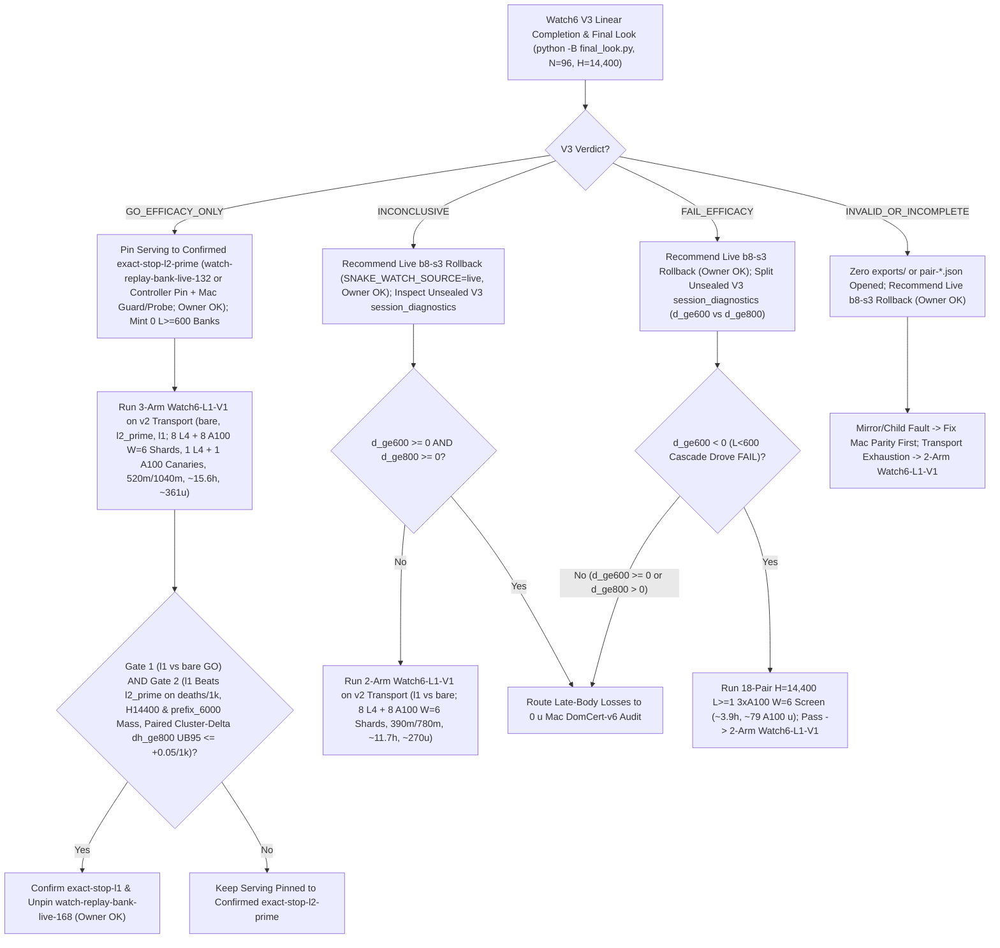

# T34 ExIt-B8 Research Roadmap (Round-06 Synthesis — Advice, Not Decisions)

Start: [project index](../INDEX.md) · [current status & authority](../STATUS.md) · [research record index](INDEX.md) · [study packages](../../research/INDEX.md) · [campaign log](final_run_20261019/CAMPAIGN_LOG.md).

> [!IMPORTANT]
> **Status: Research advice, NOT ratified decisions or release authorization.**
> Every current-round and later-round plan on this page is synthesized advisor guidance from Round 06 (2026-11-01 PT; primary synthesis artifact: `snake-dqn-artifacts/big-lever/exp/argon-rounds/round-06/synthesis/answer.md`, superseding Rounds 01–05). Nothing here amends a pre-registration, ratifies a confirmation gate, or changes served defaults. Binding campaign authority remains [`SUCCESS_CONTRACT.md`](final_run_20261019/SUCCESS_CONTRACT.md), [`DESIGN_V2_SHADOW.md`](final_run_20261019/DESIGN_V2_SHADOW.md) (+ Amendment 1), [`P7_STATISTICS.md`](final_run_20261019/P7_STATISTICS.md), unsuperseded parts of [`FINAL_PLAN.md`](final_run_20261019/FINAL_PLAN.md), and [`STATUS.md`](../STATUS.md); any serving or release change requires confirmation-lane evidence, Mac serving qualification, and the owner's explicit OK.

---

## 1. Snapshot Context & Newly Audited Gaps (Oct 29 – Nov 1)

### 1.1 Nov 1 exploration, bank-minting, parity & Watch6 V3 `05:01 PT` audit

- **All-length exact-stop screen — `ADOPT` for new replay banks** ([`watch6_alllen_screen`](../../research/watch6_alllen_screen/README.md), `t34-sol/argon-alllen-a100/analysis.json`, `N = 48` paired `H = 6,000` Watch6-v2 sessions uniting `12` L4 `W = 4` units `0..11` at `568b09e4` with `36` A100 `W = 6` units `12..47` across three `12`-unit shards at `73c26ccc` on `origin/argon-alllen-a100-1031`):
  - `bare` (`b8-s3`): **`351.07` mass** (`CI95 [320.22, 381.91]`), **`0.2882` `deaths/1k`** (`CI95 [0.2427, 0.3337]`; `83` deaths: `53` at `L < 600`, `30` at `L >= 600`, `21` at `L >= 800`), `mean_max_length = 794.3`.
  - `l2_prime_600` (served `L >= 600`): **`461.16` mass** (`CI95 [414.30, 508.02]`; `+110.09` vs `bare`, `CI95 [+72.06, +148.13]`), **`0.1597` `deaths/1k`** (`CI95 [0.1060, 0.2134]`; `-44.6%` vs `bare`; `46` deaths: `34` at `L < 600`, `12` at `L >= 600`, `11` at `L >= 800`), `449.6` mean branches/session (`403.7` roots, `mean_max_length = 943.4`).
  - **`exact_stop_alllen` (`L >= 1`, `interval = 5`, `H = 300`):** **`559.43` mass** (`CI95 [533.59, 585.27]`; **`+208.37` / `+59.35%` vs `bare`**, `CI95 [+170.07, +246.66]`; **`+98.27` / `+21.31%` vs `L >= 600`**, `CI95 [+50.57, +145.98]`, clearing `>= +15.0`) and **`0.0521` `deaths/1k`** (`CI95 [0.0294, 0.0748]`; **`-81.9%` / `-0.2361/1k` vs `bare`**, `CI95 [-0.2828, -0.1895]`; **`-67.4%` / `-0.1076/1k` vs `L >= 600`**, `CI95 [-0.1609, -0.0544]`, clearing `<= 0.0`), cutting `L < 600` deaths **`53 (bare) / 34 (L >= 600) -> 1`** (`0.142%` `L < 600` overrides, `mean_max_length = 1,096.0`) at **`2.821×` branches** (`1,268.5` vs `449.6`, `1,200.1` roots = `1.057` branches/root). **`14/15` remaining deaths occur at `L >= 600` (`13/15` at `L >= 800`).**
  - *Exposure & per-world notes:* Eliminating `34 -> 1` early deaths gives `exact_stop_alllen` **`1.379×` more `L >= 600` living exposure** (`403.7 -> 556.6` roots/session), so `11 -> 13` raw `L >= 800` deaths reflects **`-14.2%` lower per-frame `L >= 800` hazard** despite raw session-normalized `Δd_ge800 = +0.0069/1k`. Across paired worlds, `exact_stop_alllen` regressed deaths vs `L >= 600` on `3/48` seeds (`3075941873`, `3394546952`, `121131908`) and mass on `14/48` seeds.
- **All-length Watch banks `14l1–16l1` completed `36/36` on active Cap-6 `36285bc6`:**
  - Verified receipts (`t34-sol/argon-banks-l1/packet-bank{14l1,15l1,16l1}-a100/output-main/receipt.json`, `SUMMARY.md`) confirm Cap-6 (`36285bc6`) ran `6/6` concurrent runtimes (`3 A100 @ 6.73 u/h + 3 L4 @ 1.94 u/h = 26.01 u/h`), finishing all `3 × 12` `exact-stop-l1` sessions (`W = 6`, `H = 6,000`) in **`3.03–3.07 h/bank`** (**`~20.36–20.67 u/bank` = `~61.5 A100 u` observed total** vs `~227 u` forecast; balance **`~2,154.66 u`**, freeing all `3` A100 slots).
  - Commit `395eacbb` switched `.claude/launch.json` to **`watch-replay-bank-live-168`** (`132` `exact-stop-l2-prime` banks `01–08, 10–12` + `36` unconfirmed `exact-stop-l1` banks `14l1–16l1`, [`web/serve.py`](../../web/serve.py) restarted on `b5b63cd1`, leaving `watch-replay-bank-live-132` intact). Confirming `exact-stop-l1` at `H = 14,400` still requires prospective confirmation (`Watch6-L1-V1`), Mac serving qualification, and owner OK.
- **GPU `DeviceSim` v2 parity — `PASS` on A100** ([`devicesim_v2_parity`](../../research/devicesim_v2_parity/README.md), `t34-sol/argon-devicesim-v2/packet-a100-v2-parity-01/main-run-01/receipt.json`): **`0` mismatches** across **`1,536,000` snake-ticks** (`E = 256 × 1,000` Watch6-v2 ticks, commit `b500d111`), relying on `<= 1e-4` CUDA FP32 near-tie Q re-decision tolerances.
- **Active confirmation — Watch6 V3 (`05:01 PT` snapshot & linear-retry lineage guard)** ([`REGISTRATION_V3.md`](../../research/watch6_search_efficacy_v3/REGISTRATION_V3.md)): `24 × 4` L4 `W = 4` shards (`96` fresh paired `H = 14,400` Watch6-v2 sessions) confirming **`exact-stop-l2-prime` (`L >= 600`) only**. At `05:01 PT`, **`14/24` shards are `PASS`** (`01..08, 10, 11, 13..16`), **`6/24` are active** (`3/24` running `17, 18, 20` + `3/24` queued `21..23`), and **`4/24` are V6.1-accepted mechanical failures** (`00` `412` unallocated, `09` `UPLOAD_CAP`, `12` renewal-WS drop, `19` warmup `GuardError`; `75471246`, `0` new rulings) — *provided* attempt lineage stays strictly linear:
  - [`final_look.py:_verify_shard_lineage`](../../tools/watch6_v3_accounting/final_look.py) (`lines 380–386`) fails closed (`"forked/concurrent attempt lineage detected"`) whenever two attempts share the same parent receipt. Shards **`09` and `19`** already have staged `ops/auto-retry` children and **must NOT run [`recover.py`](../../tools/watch6_v3_accounting/recover.py)**; shards **`00` and `12`** run `recovery-shard-{00,12}-01` via `python -B -m tools.watch6_v3_accounting.dispatch`; and [`final_look.py`](../../tools/watch6_v3_accounting/final_look.py) **must run under `python -B`** from clean `snake-dqn-argon-v3-accounting` ([`_forbid_pycache_directory`](../../tools/watch6_v3_accounting/__init__.py) `lines 747–777`).
- **Completed Oct-30 Claim-A GPU receipts awaiting `0 u` Mac readout (`< 3 min`):** `b8-head-closedloop` (`t34-sol/b8-head-closedloop/main-01/output/terminal.json`, `rc = 0`) and `spatial-qbytes-01` (`t34-sol/spatial-qbytes-fix/t34-spatial-qbytes-01/ruler-output-a100-fallback/terminal.json`, `rc = 0`) completed cleanly on A100, while `T4 Gate-1` (`0/8` bars, `KILL_T4`) cancels the `40–48 A100 u` `spatial-student-pilot` fit (retaining compiled `.so` caches).

### 1.2 Closed single-pass critics, distillations, RL, and standalone macro fallbacks

Between 2026-10-29 and 2026-11-01, every single-pass learned-policy, critic, distillation, and standalone macro-fallback track closed below its promotion or selectivity bars:

| Track | Scope & primary artifact | Measured outcome | Disposition |
| --- | --- | --- | --- |
| **TRAIN-01** ([`sandbox_a_resident`](../../research/sandbox_a_resident/README.md)) | `100.7M`-row (`384`-update) GPU-resident PPO from `b8-s3` (`t34-sol/train01-closeout/SUMMARY.md`) | H5000 equal-mix paired mass **`+8.09`** (`CI95 [-18.66, +34.85]`; scripted `+26.32`, frozen `+2.85`, mixed `-4.90`; update-320 peak `+14.23` `[-11.86, +40.32]`) vs bar `>= +40` | **Closed** (no strict-gate nomination) |
| **C/T Stage-2 distillation** | Continuation-teacher causal-root distillation (`t34-sol/ct-stage2-verdict/SUMMARY.md`) | Teacher rescued **`22/32` (`68.75%`)** deaths (`22/32 <= 65` ticks; indep-suffix H300 `+66.77`, `LB90 +51.61`), but student retention was **`46.9–50.0%`** (`0 pp` over `frozen_phi` vs `>= +15 pp`; topology AUC `0.5752 < 0.83`), ordinary flips **`44.4–64.5%`** (bar `<= 1%`), and lethal ordinary flips **`3–5`** (bar `<= 1`) | **`FAIL_DISTILLATION_RETENTION_OR_SAFETY`** |
| **Doom U-Net & `spatial-student-pilot`** | `83 × 145` spatial U-Net vs 33.7k B8-feature head (`t34-sol/doom-result-01/result.json`; `t34-sol/student-direction/{astra,fable}.md`) | Spatial U-Net lost late per-action doom ROC-AUC to frozen B8 features (**`0.753` vs `0.810`**, `Δ = -0.056`, `CI95 [-0.091, -0.023]`; all-strata death-lookback `0.7626` vs `0.8226`; ordinary late `0.690` vs `0.706`) | **`GRAY` / `40–48 A100 u` pilot fit canceled (`0 u`; retain `.so` caches)** |
| **B8 advantage head (offline OOF)** | `256 -> 128 -> 6` ReLU head on frozen B8 features (`t34-sol/b8-head-test/RESULT.md`) | Mass rule `GO` (late H300 `+30.09`, `LB90 +23.96`), Fable selectivity **`FAIL`**: **`26.42%`** late rescue (bar `>= 35%`) at **`97.60%`** non-death flips (bar `<= 15%`) | **Selectivity `FAIL`** (192-world closed-loop A100 `rc = 0`, awaiting Mac readout) |
| **T4 Gate-1 factored critic** ([`t4_gate1`](../../research/t4_gate1/README.md)) | Clean-slate privileged `83 × 145` (`H = 320` 7-source BFS) hazard + foraging mass-flux critic on `384` disjoint Watch6-v2 worlds (`t34-sol/argon-t4-gate1-fix2/queue-03/READOUT.json`) | **`0/8` bars passed**: `L >= 600` residual EV **`+0.0266`** (`[-0.0280, +0.0869]` vs `>= 0.25`), death-root H300 rescue **`+19.99`** (vs `>= +40`), mature doom AUC **`0.5617`** (vs `>= 0.80`), ordinary H300 mass **`-22.21`** (vs `>= -15.0`), lethal flips **`3.13%`** (vs `<= 3.0%`) | **`KILL_T4`** (proves even privileged `83 × 145` critic lacks late value signal) |
| **R6 `L < 600` harvest census** ([`r6_l600_census`](../../research/r6_l600_census/README.md)) | `64`-world (`384`-root) Watch6-v2 early-game counterfactual + 5-fold OOF corpse/trail plane probes (`t34-sol/argon-mac-checks/r6-census/RESULT.json`) | **`34.90%` (`134/384`)** oracle-harvestable roots (`>= +5` H500 mass), **`7.69%`** non-bare H500 lethal flips, OOF ROC-AUC **`0.474–0.521`** (`0` passing threshold points); superseded operationally by `exact-stop-l1` | **`KILL`** |
| **R7 macro-option fallback** ([`r7_macro_fallback`](../../research/r7_macro_fallback/README.md)) | Pruned depth-2 (`K = 15` ticks) spatial macro-options `{O_0..O_5}` on C/T train `1-step-all-die` roots (`t34-sol/argon-r7-repack/R7_READOUT.json`) | `3/5` bars passed (`0.316 ms` Mac 1-thread p95; **`33.0%` vs `9.0%`** `L >= 800` `all-die` rescue), but total `L >= 600` lift **`+3.85 pp`** (`< +10.0 pp`) and **`2 > 0`** newly caused ordinary lethal flips from single-suffix `sel0` & aggressive `O3`/`O5` (`0` assessment roots opened) | **`KILL`** as standalone fallback |

### 1.3 Newly audited Round-05 serving, Gate-2 statistical, and transport flaws

- **Watch replay serving bugs & Round-05 regressions:**
  1. *Sorted cycle-1 starvation, `~8–10 s` cold sleep, and Round-05's test/GIL regressions:* [`ReplayBank._prefetch`](../../web/backend/watch_replay.py) (`lines 314–343`) walks `sorted(self.root.glob("*.watch.gz"))[:1024]` on cycle 1 before shuffling on cycle 2 (`132 × 250 s = 9.17 h` of `l2-prime` before `14l1–16l1` after every restart), while [`verify_payload`](../../web/backend/watch_replay.py) (`line 176`) calls `stop.wait(0.001)` per frame (`~8–10 s` pure sleep per `6,000`-frame cold load). However, Round-05's unconditional `shuffle` breaks `tests/test_watch_replay.py:test_discovery_queues_first_record_before_verifying_second` 50% of runs, and Round-05's zero-sleep `stop.is_set()` holds the GIL for `~300 ms` (`7+` frames at `24 fps`) during cold rotation.
  2. *`reset_game` wiping user `set_epsilon`/`set_food` opt-outs + multi-entrypoint bypass:* [`GameSession.reset_game`](../../web/backend/session.py) (`lines 1201–1206`) re-enters `_select_watch_replay()` without tracking [`_leave_watch_replay`](../../web/backend/session.py) (`lines 1128–1133`), silently overriding user [`set_epsilon`](../../web/backend/session.py) (`lines 1154–1160`) and [`set_food`](../../web/backend/session.py) (`lines 1173–1200`) live opt-outs on Reset; [`__init__`](../../web/backend/session.py), `reset_game`, and [`set_mode`](../../web/backend/session.py) lack a clean mixed-Watch6 `b8-s3` guard; [`Recording.snapshot`](../../web/backend/watch_replay.py) (`lines 226–238`) runs `copy.deepcopy(self.frame)` at `24 Hz`; and `ReplayBank` lacks `SNAKE_WATCH_REPLAY_CONTROLLER`.
- **Claim-A v1/boost gap & Gate-2 Fieller `L >= 800` hazard-ratio false-kill trap:**
  1. *`b8-head-closedloop` ran v1 without `boost_decisions`:* `origin/astra-doom-auc-smoke:research/b8_head_test/closedloop.py` ran `mechanics_version = 1` without logging `boost_decisions`, so `closedloop_readout.py` alone cannot certify [`SUCCESS_CONTRACT.md`](final_run_20261019/SUCCESS_CONTRACT.md) §2's v2 `[0.5%, 10%]` boost band.
  2. *Fieller `L >= 800` hazard ratio `UB95 <= 1.10` has `~90%` Type-II false-kill:* At `11` vs `13` `L >= 800` deaths in `watch6_alllen_screen` (`~26–31` deaths/arm at `N = 96`), a Fieller ratio CI on `deaths_ge800 / alive_frames_ge800` has `~±50–53%` half-width (or an unbounded denominator), failing `UB95 <= 1.10` `~90%` of the time under true parity, whereas [`SUCCESS_CONTRACT.md`](final_run_20261019/SUCCESS_CONTRACT.md) (`lines 38–40`) designates `late_large_body_deaths` diagnostic and paired cluster-delta `Δh_ge800` remains well-behaved.
- **Five code-verified flaws in Round-05's Layer-A / Layer-B (`lease_seconds = 600` + `0o644` PUT) transport proposal:**
  1. *3-place partial-ledger coupling:* [`auto_retry.py`](../../tools/ops/auto_retry.py) (`lines 265–270`) refuses `exports != []`, [`canary.py`](../../research/colab_cli/canary.py) (`lines 312–321`) requires exact input SHA equality, and [`uploads.py`](../../research/watch6_search_efficacy/uploads.py) (`lines 55–76`) bundles `verified-ledger.json` inside `input-metadata.tar.gz` — blocking Layer-A-only partial-ledger resume unless `colab_cli`, `tools/ops/`, and `uploads.py` update together.
  2. *`admission.py` URL crash & `> 2 MiB` WS upload split:* [`watch6_search_efficacy/admission.py`](../../research/watch6_search_efficacy/admission.py) (`lines 61–63`) crashes (`KeyError: 'path'`) on `"url"` inputs (`b8-s3` `6.56 MB`, `frp3-s12` `6.91 MB`), while [`transfers.py`](../../research/colab_cli/transfers.py) (`lines 374–476`) splits `> 2 MiB` file uploads via WS RPCs (`CREATE_DIR`, `UPLOAD_ASSEMBLE`).
  3. *`lease_seconds = 600` overflows the `1,800 s` L4 acceptance cap & `0o644` Contents PUT aborts `load_release_credential`:* [`ROBUSTNESS.md`](../../research/colab_cli/ROBUSTNESS.md) (`lines 89–105`) budgets `1,320 s + 180 s + 300 s = 1,800 s` (`lease_seconds = 600` overflows L4 acceptance), and direct Contents PUT writes mode `0o644`, which raises `ReleaseError("release credential permissions are not private")` in [`release.py:load_release_credential`](../../research/colab_cli/release.py) (`lines 181–183`, `mode & 0o077`) and aborts VMs via [`runtime.py:_release_credential_expiring`](../../research/colab_cli/runtime.py) (`lines 412–426`).
  4. *`KERNEL_CREATION_GUARD_ERROR` with `state.kernel_id is None` & `body == []` warmup livelock:* Aborting the first `POST /api/kernels` leaves `state.kernel_id is None`, and [`cli_guard.py:_kernel_idle_once`](../../research/colab_cli/cli_guard.py) (`lines 458–461`) returns `{"idle": False}` forever on `body == []` (`300 s` livelock, as hit on V3 shard `19`).
  5. *`Broker.execute` `renew(force=True)` before `collect_exports`:* [`supervisor.py`](../../research/colab_cli/supervisor.py) (`lines 1981–2025`) runs `renew(force=True)` before `collect_exports`, so any poll drop triggers `Broker.run` `stop_verified` and destroys `.complete` units still on the VM.

---

## 2. Current-Round Plan (Advice, Not Decisions)

### 2.1 `0 u` Mac gates (`< 3 min`): Claim-A readout/closure & Watch replay fixes

1. **Read completed Claim-A receipts & enforce closure bar (`0 u`, `< 3 min` Mac):**
   - Run `closedloop_readout.py` (`origin/astra-doom-auc-smoke` @ `591d94c3`) on completed `b8-head-closedloop` (`N = 192` v1 `H = 5,000` worlds, `m in {0, 10, 25, 50}`) and audit completed `spatial-qbytes-01` (`mapped-parity.json`); keep `spatial-student-pilot` (`40–48 A100 u`) canceled (`0 u`, retaining `.so` caches).
   - **Recommended Claim-A kill rule:** Recommend **closing Claim A permanently (`0 u`)** unless some `m in {0, 10, 25, 50}` clears `ci95[0] > 0` (`== LB97.5`, exact 4-arm `alpha = 0.10/4` Bonferroni), `H = 5,000` pooled mass `>= +40`, scripted no-death `>= +0.03` (no mix loss), [`P7_STATISTICS.md`](final_run_20261019/P7_STATISTICS.md) Guard A (`Δalive >= -0.05` pooled, `>= -0.075`/mix), and `<= 15%` living-decision overrides — followed by a `0 u`, `10 min` v2 boost `[0.5%, 10%]` check before nominating any Mac strict gate.
2. **Fix & Mac-qualify Watch replay serving (`0 u`):**
   - Add injectable `shuffle_discovery: bool = True` to [`ReplayBank`](../../web/backend/watch_replay.py) (shuffling before cycle 1 with cross-cycle boundary holdback while letting deterministic order tests pass `False` or a fixed seed); replace per-frame `stop.wait(0.001)` in [`verify_payload`](../../web/backend/watch_replay.py) with a **`64`-frame cooperative yield** (`if count % 64 == 0 and stop.wait(0.0005): return None` -> `< 0.35 s` cold load without `24 fps` GIL stalls); shallow-copy top-level + `session` dict in [`Recording.snapshot`](../../web/backend/watch_replay.py); add `SNAKE_WATCH_REPLAY_CONTROLLER` (`all | exact-stop-l2-prime | exact-stop-l1`); set `_replay_opted_out = True` inside [`_leave_watch_replay`](../../web/backend/session.py) (cleared only on explicit `set_mode("watch")` or `new_game`, so `reset_game` preserves `set_epsilon`/`set_food` live opt-outs); and gate [`__init__`](../../web/backend/session.py), [`reset_game`](../../web/backend/session.py), and [`set_mode`](../../web/backend/session.py) strictly on clean mixed-Watch6 `b8-s3` (`served_checkpoint["name"] == "b8-s3"`, `watch_roster == "mixed"`, `watch_roster_reason is None`, `len(snakes) == 6`, `not _replay_opted_out`).
   - Pass `1,500` unpaced + `120` paced-`24 fps` qualification ticks (`p95 <= 11.688 ms`, `0/120` overruns per [`t15_mixed_roster_qualification_2026-10-17.md`](t15_mixed_roster_qualification_2026-10-17.md), `< 1.0 s` cold readiness) while cold `.watch.gz` verification runs concurrently across `L >= 1,000` bodies, `6,000 -> 1` rotation, and live-B8 fallback.

### 2.2 Unified v2 transport (`lease_seconds = 180`), `ops-ledger-retry/v2` & `tools/ops/confirm_audit.py`

Because partial-ledger resume couples `colab_cli`, `tools/ops/`, and `uploads.py` (§1.3), ship one **unified additive v2 transport** (`qualification.py add`, never disturbing active V3 jobs on `40985ca4` / `36285bc6`):

1. **Packaging (`4` Contents PUTs `< 150 KB` / `< 25 s`, `0` chunked WS RPCs):**
   - Unbundle `inputs/verified-ledger.json` from `input-metadata.tar.gz` ([`uploads.py`](../../research/watch6_search_efficacy/uploads.py) `lines 55–76`); accept `normalize_public_url_input` HTTPS URLs in [`admission.py`](../../research/watch6_search_efficacy/admission.py) (`lines 61–64`) so `b8-s3` and `frp3-s12` fetch VM-side with SHA-256 verification; emit outcome-free `pair-XXXX.meta.json` (`namespace`, `unit_index`, `seed`, `payload_sha256`, `payload_bytes`); and write `operational.json` / `contract.json` only post-loop ([`run.py`](../../research/watch6_search_efficacy/run.py) `lines 155–183`).
2. **Contents-only v2 supervision keeping `lease_seconds = 180` (`900 s` OAuth floor):**
   - *`0` post-`ready.json` WS calls & private `.next.json` token rotation:* Poll [`state.json`](../../research/colab_cli/runtime.py) via `60 s` Contents GET (`20`-miss budget); stage refreshed OAuth tokens to `release-credential.next.json` via Contents PUT and have [`runtime.py:_supervise`](../../research/colab_cli/runtime.py) (`lines 615–630`) validate, `chmod(0o600)`, and atomically `os.replace` into `release-credential.json` (satisfying [`load_release_credential`](../../research/colab_cli/release.py) `mode & 0o077 == 0` with zero kernel RPCs); and decouple `_credential_min_valid_seconds` from `exec_poll_recovery_seconds` to `max(900, 180 + 300) = 900 s` while keeping `lease_seconds = 180` (`1,320 + 180 + 300 = 1,800 s` L4 acceptance budget intact).
   - *Warmup recovery, pre-stop salvage & monotonic-ledger resume:* Treat `KERNEL_CREATION_GUARD_ERROR` as transient and `2` consecutive `body == []` probes (`>= 10 s` apart) in [`cli_guard.py:_kernel_idle_once`](../../research/colab_cli/cli_guard.py) (`lines 458–461`) as `idle = True`; run a `<= 90 s` `finally:` Contents-only `export_file` salvage before `stop_verified`; enforce `ops/alloc.lock` `L4 <= 3` / `total <= 6` + automatic `reconcile_unavailable` on `503`/precondition refusal; archive full CLI stderr (`cli-error-NNNN.txt`) while stripping `[colab]` banners; and exempt monotonic-superset `verified-ledger` growth in [`canary.check`](../../research/colab_cli/canary.py) (`lines 312–321`) + `ops-ledger-retry/v2` (`<= 2` mid-compute retries/shard; uncapped pre-start `0`-compute retries).
   - *Qualification:* Prove via `0 u` [`fake_colab.py`](../../tests/fixtures/fake_colab.py) fault replay (`412`/`503`, `body == []`, `20`-min WS blackout, `.next.json` `0o600` rotation, `finally:` salvage, monotonic-ledger retry) plus one `~0.4–0.5 L4 u` 2-unit poll-drop canary.
3. **Zero-judge confirmation auditor (`python -B -m tools.ops.confirm_audit`):**
   - Run under `python -B` with isolated `/tmp` `PYTHONPYCACHEPREFIX` and `NUMBA_CACHE_DIR`, enforcing structural attempt classes (pre-start `0`-compute uncapped mechanical retry; mid-compute transport drop `<= 2`/shard `.meta.json` ledger retry; child nonzero or wall timeout `INVALID_OR_INCOMPLETE` with `0` look) and a single unblinding gate checking `0..N-1` `.meta.json`/`.complete` bijection (`0` `pair-*.json` reads, `0` judge rounds) before emitting `audit-pass.json`.

### 2.3 Finish Watch6 V3 linearly (`python -B final_look.py`, `N = 96`) & route `Watch6-L1-V1`

Watch6 V3 confirms `exact-stop-l2-prime` (`L >= 600`) only ([`REGISTRATION_V3.md`](../../research/watch6_search_efficacy_v3/REGISTRATION_V3.md)). To avoid forking `_verify_shard_lineage` (§1.1):
- Dispatch **only** the already-staged `ops/auto-retry` packets on shards **`09` and `19`** (**do NOT run `recover.py`** on `09, 19`); dispatch `recovery-shard-{00,12}-01` on shards **`00` and `12`** via `python -B -m tools.watch6_v3_accounting.dispatch --evidence-dir .../argon-v3-accounting-v6`; publish V6.1 sidecars via `proof.py:publish_renewal_ws_transport_evidence` (`0 u`, `0` rulings) on any zero-export renewal-WS drop on `17..23` (`<= 2` compute completions); and invoke [`final_look.py`](../../tools/watch6_v3_accounting/final_look.py) with **`python -B`** from clean `snake-dqn-argon-v3-accounting` (never opening `exports/` or `pair-*.json` on `INVALID_OR_INCOMPLETE`).

- **On `GO_EFFICACY_ONLY` (`deaths/1k UB95 < 0` and Fieller mass `LB95 >= -0.05`):**
  1. *Mac (`0 u`):* Apply §2.1's `GameSession` guard + `_replay_opted_out` + `shuffle_discovery` + `64`-frame yield + shallow-snapshot fixes and `1,500`-unpaced / `120`-paced-`24 fps` qualification, and pin Watch serving to confirmed `exact-stop-l2-prime` (`watch-replay-bank-live-132` or `SNAKE_WATCH_REPLAY_CONTROLLER=exact-stop-l2-prime`, **owner OK**). Mint **0** additional `L >= 600` banks.
  2. *Colab (`3 L4 + 3 A100` on §2.2's v2 transport, fixed per-manifest GPU `8 × L4 + 8 × A100` `W = 6` shards — adding `16` to [`run.py`](../../research/watch6_search_efficacy/run.py) `--shards`, `1 × L4 + 1 × A100` family canaries with `<= 1.33×` L4 unit time and `hardware.json`, `520 m` base / `1,040 m` 2× wall `<= 660 m` `MAX_BASE_MINUTES`, `~15.6 h` wall, `~361 u` + `~4.8 u` canaries):* Run fixed-sequence **3-arm `Watch6-L1-V1`** (`bare`, `l2_prime`, `l1`; `N = 96, H = 14,400`, logging `death_frames`, `prefix_6000`, and `alive_frames_ge800`):
     - *Gate 1:* `l1` vs `bare` clears V3's `GO` bar (`deaths/1k UB95 < 0`, Fieller mass `LB95 >= -0.05`).
     - *Gate 2 (unpinning `exact-stop-l1` / `watch-replay-bank-live-168`):* `l1 - l2_prime` clears `deaths/1k UB95 < 0`, Fieller mass `LB95 >= 0` at both `H = 14,400` and `prefix_6000`, and paired cluster-delta late hazard difference **`Δh_ge800 UB95 <= +0.05 / 1k L >= 800 frames`** (**owner OK**; otherwise stay pinned to `exact-stop-l2-prime`).
- **On `INCONCLUSIVE`, `FAIL_EFFICACY`, or `INVALID_OR_INCOMPLETE`:**
  - Recommend rolling Watch back to live bare `b8-s3` (`SNAKE_WATCH_SOURCE=live`, **owner OK**).
  - Run **2-arm `Watch6-L1-V1`** (`l1` vs `bare`, `8 × L4 + 8 × A100` `W = 6` shards, `390 m` base / `780 m` 2× wall, `~11.7 h`, `~270 u` + `~4.8 u` canaries) on `INCONCLUSIVE` (unless `Δd_ge600 >= 0` and `Δd_ge800 >= 0`), `INVALID_OR_INCOMPLETE` transport exhaustion (fix Mac parity first on mirror/child fault), or `Δd_ge600 < 0` `FAIL_EFFICACY` (gated first on an `18`-pair `3 × A100` `W = 6` screen, `~3.9 h`, `~79 A100 u`); route `Δd_ge600 >= 0` / `Δd_ge800 > 0` late-body search losses to §3's `0 u` Mac `DomCert-v6` audit.

---

## 3. Later-Round Plan: `DomCert-v6` + `GridBridge` Spatial Shield & UX (Advice, Not Decisions)

### 3.1 Code-verified root causes of `13/15` `L >= 800` deaths, R7's `33%` ceiling & live-Mac stalls

1. **R7's opponent-blind `v2_surv` & frozen `omega1` rock:** [`_evaluate_options_nb`](../../research/r7_macro_fallback/options.py) (`lines 150–758`, `0.3158 ms` Mac 1-thread p95) rescued only `33.0%` at `L >= 800` because `v2_surv` (`lines 667–691`) omitted `du < d_opp[u]` — certifying pockets an opponent can seal first — while `omega1` (`lines 355–370`) froze `tau > 1` segments as static rock rather than release-time BFS.
2. **Horizon-300 coffin blindness (`1.057` branches/root) & private-RNG peeking:** [`watch_replay/engine.py:_clone_root`](../../research/watch_replay/engine.py) (`lines 40–50`) peeks private `EnvRng._rng` across `300` ticks (forbidden in live serving per [`SUCCESS_CONTRACT.md`](final_run_20261019/SUCCESS_CONTRACT.md) `lines 51–53`), while [`exact_stop.run`](../../research/bl_served_search/exact_stop.py) stops immediately on `alive(300)` without a terminal volume certificate — entering `L >= 800` coffins that seal at `t + 320..700` and regressing deaths on `3/48` screen worlds (`3075941873`, `3394546952`, `121131908`) and mass on `14/48`.
3. **Exact `v8` `[0.87, 1.15] * L_opp` opponent yield band (unless cornered):** In [`hero_wins_head_on`](../../src/evaluation/safety_veto_v6.py) (`lines 163–230`), `v8` opponents test `L_opp_post >= 1.15 * (L_hero + 1)` — so `frp3-s12 + v8` opponents deterministically yield head-on cells down to **`L_hero > (L_opp_post / 1.15) - 1 ≈ 0.87 * L_opp`** (not just `>= 1.15 * L_opp`), *except* when cornered (`OUTCOME_NO_SPACIOUS` or `head_risky_kept_no_alternative` in [`safety_veto_v8.py`](../../src/evaluation/safety_veto_v8.py) `lines 289–351`).
4. **Live-Mac `FoodManager` `> 1.3M`-op linear scans & `dto_split` `pathb` block:** [`FoodManager.add_food`](../../src/game/food_manager.py) (`lines 128–160`) and [`evict_oldest_corpse`](../../src/core/mechanics_constants.py) (`lines 67–90`) execute `> 1.3M` linear scan operations on `L = 1,200` v2 corpse drops (driving `34/39` post-`20 s` `game.update` stalls in `big-lever/exp/JUDGMENT_D1.md`), while [`dto_split.py`](../../research/bl_served_search/dto_split.py) (`line 61`) currently rejects `pathb` sessions and `PathBHelper` serializes via `cloudpickle`.

### 3.2 `DomCert-v6` + live Mac `GridBridge` spatial shield, `14,400`-frame banks & Play Boss

- **Architecture (later rounds):**
  1. **`DomCert-v6` (`< 0.40 ms` Numba) + `K = 3` public SplitMix64 CRN:** Upgrade [`_evaluate_options_nb`](../../research/r7_macro_fallback/options.py) with `2`-ply exact [`v8_decide`](../../src/simd_env/v8_nb.py) (`line 58`) `[0.87, 1.15] * L_opp` non-cornered opponent yield cones, release-time Voronoi BFS (`d_hero < d_opp` opening at `d >= max(tau_own, tau_opp)`), and dominated 2-core volume `V2_dom >= L_hero` (or monotone own-tail chase with `>= 6`-cell slack). Across `K = 3` public-state-seeded SplitMix64 CRN streams (zero private-RNG peeking), override `bare` at `L < 600` only if `min_k surv(bare) < 120` ticks, and at `L >= 600` require `min_k DomCert_k(S_{t+300}) == 1` (falling back to `20`-step closed-loop `{O0, O1, O2, O4} -> B8`, dropping `O3`/`O5`).
  2. **Live Mac Claim-B `GridBridge` spatial hazard shield (`W = 4, K <= 8` per Contract §4):** Add an `O(1)` shadow `_food_set` + `deque` corpse FIFO in [`FoodManager`](../../src/game/food_manager.py) (`0`-byte food-list/RNG drift; `> 1.3M -> 1,200` ops), enable `gc.freeze()` and `pathb` in [`dto_split.py`](../../research/bl_served_search/dto_split.py), and dispatch `< 20 KB` flat NumPy `GameState -> GridBatchSim` packets (`< 0.15 ms`, every `12` ticks) to `W = 3` persistent 1-thread `bl_k1` workers (`+ 1` `dto_split` worker). Workers publish **spatial coffin-mouth hazard cells (`TTL = 48` ticks)** into an every-tick **`0.35 ms` closed-loop `DomCert(0)` shield** — staying immune to `35`-tick open-loop action staleness because arena throat geometry persists `40–100` ticks while exact kinematics re-evaluate every tick.
  3. **`14,400`-frame (`10 min`) Watch banks & opt-in unscored Play Boss:** Mint `14,400`-frame Watch banks via GPU [`DeviceSim`](../../research/gpu_sim_spike/device_sim.py) v2 branch-proposal + CPU [`GridBatchSim`](../../src/simd_env/grid_sim.py) / live `GameState` mirror-commit (`~12×` faster) with `"Coffin Avoided"` markers and seamless live `DomCert(0) + W = 3` handoff on interactive controls, plus an opt-in, visibly labelled, **unscored** Play **"Titan Boss (`DomCert`)"** mode (`b8-s3 + DomCert(0)`, `0` workers, isolated from `scores.db`) and **"Tactical Sense"** throat-danger HUD.
- **Mandatory `0 u`, `~12 min` Mac gate before any GPU spend:**
  - Replay the `13` `watch6_alllen_screen` `L >= 800` deaths, the `3` world regressions (`3075941873`, `3394546952`, `121131908`), and `1,024` R7 ordinary train roots on `K = 3` public SplitMix64 (`0` `exports/` opened), and benchmark `L = 1,200` `FoodManager` corpse drops.
  - **Kill rule (`0 u`):** Block GPU spend if 1-thread `DomCert(0)` `p99 > 0.50 ms`, if `DomCert-v6` rescues **`< 6/13` (`46%`)** `L >= 800` deaths `>= 40` ticks pre-`all-die`, if it causes **`> 0/1,024`** ordinary lethal flips, or if `FoodManager` drifts `> 0` bytes.
- **Conditional 6-slot Colab factorial (`3 × A100 + 3 × L4`, `N = 72` fresh `H = 14,400` worlds, `~3.4 h` wall, `~76 u` expected / `155 u` 2× guard, queued after `Watch6-L1-V1` and the `0 u` Mac gate):**
  - 4-arm paired Watch6 factorial (`exact-stop-l1` oracle, `public-crn-l1`, `DomCert-v6`, `DomCert-LiveSim-W3`), advancing to `14,400`-frame bank minting and Mac `JUDGMENT_D1` live serving qualification iff `DomCert-v6` cuts `deaths/1k` **`>= 40%` vs `public-crn-l1`** and **`>= 25%` (`UB95 < 0`, Fieller mass `LB95 >= 0`, paired `Δh_ge800 < 0`) vs oracle `exact-stop-l1`**, and `DomCert-LiveSim-W3` retains **`>= 70%`** of synchronous `DomCert-v6`'s death reduction.
- **Do not fund (`0 u`):** New bare-network PPO (`TRAIN-01`), single-pass distillation (`C/T Stage-2`, `spatial-student-pilot`), spatial/privileged value critics (`Doom U-Net`, `T4 Gate-1`), `L < 600` harvest rules (`R6`), or single-suffix / aggressive `O3`/`O5` macro options (`R7`).

---

## 4. Settled Round-06 Disagreements & Supporting Evidence

1. **`lease_seconds = 180` + `.next.json` `0o600` in-VM rotation + unified v2 transport vs. Round-05's `600 s` / direct `0o644` PUT / Layer-A split:**
   Settled by [`ROBUSTNESS.md`](../../research/colab_cli/ROBUSTNESS.md) (`lines 89–105`), [`release.py`](../../research/colab_cli/release.py) (`lines 181–183`), [`runtime.py`](../../research/colab_cli/runtime.py) (`lines 412–426, 615–630`), [`auto_retry.py`](../../tools/ops/auto_retry.py) (`lines 265–270`), [`canary.py`](../../research/colab_cli/canary.py) (`lines 312–321`), and [`uploads.py`](../../research/watch6_search_efficacy/uploads.py) (`lines 55–76`): `lease_seconds = 600` overflows the `1,800 s` L4 acceptance budget (`1,320 + 180 + 300 = 1,800 s`), direct Contents PUT writes `0o644` and fails `load_release_credential` (`mode & 0o077`), and partial-ledger resume requires `colab_cli`, `tools/ops/`, and `uploads.py` to change together. Keeping `lease_seconds = 180` with decoupled `900 s` OAuth margin, `.next.json` $\rightarrow$ in-VM `chmod(0o600)` + `os.replace`, and `<= 90 s` `finally:` Contents salvage fixes every failure class within existing acceptance caps.
2. **Paired cluster-delta `Δh_ge800 UB95 <= +0.05/1k` vs. Round-05's Fieller `L >= 800` hazard ratio `UB95 <= 1.10`:**
   Settled by `t34-sol/argon-alllen-a100/analysis.json` (`11` vs `13` `L >= 800` deaths at `N = 48` $\rightarrow$ `~26–31` deaths/arm at `N = 96`) and [`SUCCESS_CONTRACT.md`](final_run_20261019/SUCCESS_CONTRACT.md) (`lines 38–40`, `late_large_body_deaths` diagnostic): at `~26–31` events/arm, Fieller's ratio CI has `~±50–53%` half-width (`~90%` false-kill under `UB95 <= 1.10`), whereas paired cluster-delta `Δh_ge800` (`UB95 <= +0.05 / 1k` in `Watch6-L1-V1` Gate 2; `< 0` in §3.2's `DomCert-v6` factorial) avoids ratio denominator blow-ups while guarding exposure-adjusted late hazard.
3. **`DomCert-v6` (`[0.87, 1.15] * L_opp` non-cornered `v8` yield) + `GridBridge` (`TTL = 48` hazard cells) vs. Round-05's `LeafCert-v5` (`>= 1.15 * L_opp`) + `35`-tick action `PlanLatch`:**
   Settled by [`safety_veto_v6.py`](../../src/evaluation/safety_veto_v6.py) (`lines 163–230`), [`safety_veto_v8.py`](../../src/evaluation/safety_veto_v8.py) (`lines 289–351`), and [`options.py`](../../research/r7_macro_fallback/options.py) (`lines 355–370, 667–691`): `v8` opponents yield head-on cells down to `L_hero > (L_opp_post / 1.15) - 1 ≈ 0.87 * L_opp` unless cornered (`OUTCOME_NO_SPACIOUS` / `head_risky_kept_no_alternative`), and publishing `TTL = 48` spatial coffin-mouth hazard cells from `W = 3` workers into an every-tick `0.35 ms` closed-loop `DomCert(0)` shield eliminates `35`-tick open-loop action staleness.
