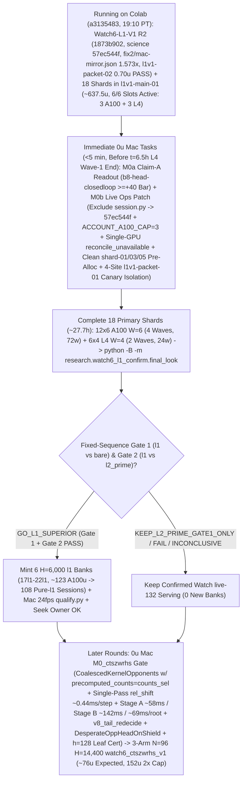

# T34 ExIt-B8 Research Roadmap (Round-23 Synthesis — Advice, Not Decisions)

Start: [project index](../INDEX.md) · [current status & authority](../STATUS.md) · [research record index](INDEX.md) · [study packages](../../research/INDEX.md) · [campaign log](final_run_20261019/CAMPAIGN_LOG.md).

> [!IMPORTANT]
> **Status: Research advice, NOT ratified decisions or release authorization.**
> Every current-round and later-round plan on this page is synthesized advisor guidance from Round 23 (2026-11-01 PT; primary synthesis artifact: `snake-dqn-artifacts/big-lever/exp/argon-rounds/round-23/synthesis/answer.md`, reconciling `round-23/{current,later,process}/answer.md` and `round-22/synthesis/answer.md` against `HEAD` `7c11eb77` / `a3135483` / `ca5b93d1` and superseding Rounds 01–22). Nothing here amends a pre-registration, ratifies a confirmation gate, or changes served defaults. Binding campaign authority remains [`SUCCESS_CONTRACT.md`](final_run_20261019/SUCCESS_CONTRACT.md), [`DESIGN_V2_SHADOW.md`](final_run_20261019/DESIGN_V2_SHADOW.md) (+ Amendment 1), [`P7_STATISTICS.md`](final_run_20261019/P7_STATISTICS.md), unsuperseded parts of [`FINAL_PLAN.md`](final_run_20261019/FINAL_PLAN.md), and [`STATUS.md`](../STATUS.md); any serving or release change requires confirmation-lane evidence, Mac serving qualification, and the owner's explicit OK.

---

## 1. Snapshot Context & Code-Verified Round-23 State (`7c11eb77` / `a3135483`, Nov 1)

### 1.1 Watch6 V3 `GO_EFFICACY_ONLY`, Watch `live-132` release, all-length screen, `DeviceSim` parity & live `Watch6-L1-V1` (`l1v1-main-01` running on `6/6` Colab slots)

- **Watch6 V3 confirmation finished — `GO_EFFICACY_ONLY` (`52135312`, 2026-11-01 14:40 PT)** ([`REGISTRATION_V3.md`](../../research/watch6_search_efficacy_v3/REGISTRATION_V3.md), `t34-sol/watch6-v3-final-look-20261101/final-look-01/final_look.json`):
  - Sole registered final look (`75471246` V6.1 adapter) over all **`96/96` primary `H = 14,400` (`10 min @ 24 fps`) Watch6-v2 pairs** (`0` reserves, `24/24` L4 `W = 4` shards in `28` attempts — shards `00, 09, 12, 19` passed on single retry after the `09:16 PT` Fable-ratified quarantine of `23` historical non-V3 H100-503 manifests; `2,764,800/2,764,800` live-mirror frames matched):
  - **`Δdeaths/1k = -0.125`** (`CI95 [-0.153, -0.097] < 0`; `0.1580` vs `0.2830`, **`-44.2%`**) and **Fieller pooled mean-mass ratio `+63.7%`** (`CI95 [+49.8%, +78.5%] >= -5%`; **`+214.12` mass**, `550.25` vs `336.13`), with boost `0.733%` vs `0.625%`, `mean_max_length = 1,073.4` (peak `L <= 2,296`) vs `780.9`, and **`2,549.4` mean branches/session** (`5.67×` `H = 6,000`'s `449.6`, confirming superlinear late-horizon branch growth) $\Rightarrow$ **`ELIGIBLE_FOR_REPLAY_QUALIFICATION` for `exact-stop-l2-prime` (`L >= 600`) only**.
- **Watch `live-132` serving guards, Mac `24 fps` qualification & release — ALREADY LANDED (`dc834ded`–`f5912f44`, ~16:00 PT):**
  - [`.claude/launch.json`](../../.claude/launch.json) (`lines 8–11`) serves confirmed **`watch-replay-bank-live-132`** (`132` `exact-stop-l2-prime` `H = 6,000` sessions from banks `01–08, 10–12`) with **`SNAKE_WATCH_REPLAY_CONTROLLER=exact-stop-l2-prime`** on `:8000` (retaining `watch-replay-bank-live-168` on disk while `exact-stop-l1` runs `H = 14,400` confirmation).
  - [`GameSession`](../../web/backend/session.py) gates Watch replay on [`_is_clean_mixed_watch6_b8()`](../../web/backend/session.py) (`lines 722–753`) across `__init__` (`line 573`), `_build` (`line 769`), `reset_game` (`line 1261`), and `set_mode` (`lines 1520, 1563, 1576`); refuses `MODE_TRAIN` on forward-only `EGO2S_OBS_SPECS`, `(RASTER31V2, RASTER31V3)`, and un-overridden `_reward_contract_mismatch` **before** calling `_leave_watch_replay()` (`lines 1510–1550`, with replay recovery on Watch fallback); and scopes `_replay_opted_out = True` to `set_epsilon` (`line 1204`), live `set_hero` change (`line 1222`), and `set_food` (`line 1241`), cleared by `_build` (`line 763`) and [`new_game()`](../../web/backend/session.py) (`lines 1279–1284`, wired to `"new_game"` in [`app.py`](../../web/backend/app.py) `line 311`).
  - [`ReplayBank`](../../web/backend/watch_replay.py) (`lines 348–417`) implements `SNAKE_WATCH_REPLAY_CONTROLLER` (`all | exact-stop-l2-prime | exact-stop-l1`, failing closed to live B8 on invalid values), line-1 [`peek_header`](../../web/backend/watch_replay.py) (`lines 138–150`, `0` non-target `verify_payload` decodes), cycle-1 `shuffle_discovery: bool = True`, shallow [`Recording.snapshot`](../../web/backend/watch_replay.py) (`lines 315–330`), and **`0.25 ms`-slice / `64`-frame cooperative GIL yield (`max(1.0 ms, 4.0 * slice_elapsed)` = `<= 20%` GIL duty cycle)** in [`verify_payload`](../../web/backend/watch_replay.py) (`lines 30–33, 244–275`).
  - [`research/watch_replay/qualify.py`](../../research/watch_replay/qualify.py) (`t34-sol/argon-replay-qual/SUMMARY.md`, Fable review `APPROVE_WITH_CONDITIONS` with `C1–C3` resolved at `fec81656`) passed `132/132` inventory parity, cold session readiness **`0.349–0.435 s` (`< 0.45 s`)**, concurrent cold-verification live-B8 fallback **`update p95 = 8.78 ms <= 11.688 ms`**, **`0/120` paced-`24 fps` overruns** (`step p99 = 11.34 ms <= 41.67 ms`), and seamless recorded playback cutover after **`~18.5–23.1 s`** (`recorded update p95 = 0.002 ms`).
- **All-length exact-stop screen — `ADOPT` for new replay banks; `36` `l1` sessions staged for `Watch6-L1-V1`** ([`watch6_alllen_screen`](../../research/watch6_alllen_screen/README.md), `t34-sol/argon-alllen-a100/analysis.json`, `N = 48` paired `H = 6,000` Watch6-v2 sessions):
  - `exact_stop_alllen` (`L >= 1`, `interval = 5`, `H = 300`) reached **`559.43` mass** (`+208.37` / Fieller `+59.35%` vs `bare` `351.07`; **`+98.27` / Fieller `+21.31%` vs `l2_prime_600` `461.16`**, `CI95 [+50.57, +145.98]`) and **`0.0521` `deaths/1k`** (`-81.9%` vs `bare` `0.2882`; **`-67.4%` / `-0.1076/1k` vs `l2_prime_600` `0.1597`**, `CI95 [-0.1609, -0.0544]`), cutting `L < 600` deaths **`53 (bare) / 34 (L >= 600) -> 1`** (`mean_max_length = 1,096.0`) at **`2.821×` branches** (`1,268.5` vs `449.6`, `1,200.1` roots = **`1.057` branches/root**, stopping on `bare` at **`94.3%`** of roots). **`14/15` remaining deaths occur at `L >= 600` (`13/15` at `L >= 800`, `-14.2%` per-frame `L >= 800` hazard at `1.379×` living exposure).**
  - Three `12`-session A100 banks (`14l1–16l1`, `W = 6`, `H = 6,000`, `t34-sol/argon-banks-l1/SUMMARY.md:38-40`) completed `36/36` on Cap-6 `36285bc6` in **`3.03–3.07 h/bank`** (**`~61.5 A100 u` total**). They remain unserved on disk (`watch-replay-bank-live-168`) pending `H = 14,400` `Watch6-L1-V1` confirmation, Mac qualification, and owner OK.
- **GPU `DeviceSim` v2 parity — `PASS` on A100** ([`devicesim_v2_parity`](../../research/devicesim_v2_parity/README.md), commit `b500d111`): **`0` mismatches** across **`1,536,000` snake-ticks** (`E = 256 × 1,000` Watch6-v2 ticks, `1,434.6` steps/s under SplitMix64 RNG and `<= 1e-4` CUDA FP32 near-tie tolerances; SplitMix64 cannot mint MT19937 live Watch replay banks).
- **`Watch6-L1-V1` R2 Ratified (`1873b902` / `93c77f43`), `l1v1-packet-02` Canaries Passed & `18` Primary Shards Launched (`l1v1-main-01`, `a3135483`, 19:10 PT — `6/6` Colab Slots Active):**
  - [`research/watch6_l1_confirm/`](../../research/watch6_l1_confirm/) (`7,105` LOC; [`REGISTRATION_L1_V1.md`](../../research/watch6_l1_confirm/REGISTRATION_L1_V1.md) SHA-256 `8b46779ff52d0c9648ff8de00c1893f77beb9bd99eb4a4e51afbe0bdf36800a0`; initial `cf07791b` science identity `c015d5cb906066842c04202b66dac778eb04fb0b9b917882e1385a0e4474e84f`) was initially ratified pre-data by Fable (`t34-sol/argon-l1v1-pkg/RULING_L1_V1.md`; per Fable Condition 1, never cite `argon-l1v1-pkg-fix1/SUMMARY.md` or non-existent `prepare-receipt.json`).
  - **Two Full-`14,400`-Frame Mac 3-Arm Mirror Receipts (`fix1/mac-mirror.json` `de43850b…` & R2 `fix2/mac-mirror.json` `e89cc8c2…`):** On excluded fixture seed `34910101`, `{bare, l2_prime, l1}` passed **`43,200/43,200` mirrored frames (`0` mismatches)** across both Mac mirror runs (`1.272×–1.573×` 3-arm `l1 / (bare + l2_prime)` wall ratio per Fable R2 Condition 5):
    - `t34-sol/argon-l1v1-pkg-fix1/mac-mirror.json` (SHA-256 `de43850bc67bc230d6803335a6ce4635ac12767cc22354f5b28b92bc0a83a476`): `bare` `291.8 s` (`2` deaths), `l2_prime` `1,343.5 s` (`1,811` branches, `2` deaths), `l1` `2,079.7 s` total / `1,763.9 s` search (`3,108` branches across `2,880` roots = **`1.079` branches/root**, `567.5 ms/branch`, **`1.892 ms/step`**, `612.5 ms/root`, `1` death at **`L = 1,694`** where both `l1` and `l2_prime` died after `l1` eliminated `l2_prime`'s `L = 307` death), **`1.272×`** wall ratio, and **`1.115×`** serpentine step-cost ratio ($L = 150 \to 1,500$, `1.997 -> 2.227 ms/step`).
    - `t34-sol/argon-l1v1-pkg-fix2/mac-mirror.json` (SHA-256 `e89cc8c2ca8f5c3e5e96c9b24bd4f7e5538a787bbf1c753ae2ce940509b47079`, commit `1873b902`, `science = 57ec544fe45f7a8a876dbc9363048468b63358e224b2ee8e11dff41401dcfbd3`): `bare` `296.4 s`, `l2_prime` `1,325.4 s`, `l1` `2,550.7 s` wall / `2,190.2 s` search (`3,108` branches across `2,880` batches, `4,428,215` kernel rows, `2.035–2.105 ms/step` serpentine probe), **`1.573×`** wall ratio.
  - **`l1v1-packet-01` Canary Failure, Fable R2 Ruling (`1873b902` / `93c77f43`), `l1v1-packet-02` Canaries Passed & `l1v1-main-01` Running (`a3135483`):** After `l1v1-packet-01` canaries (`0.447 A100 + 0.103 L4 = 0.55 u` observed) failed with `CHILD_NONZERO_EXIT` on `job.sh:21` `COLAB_EXPORT_DIR: unbound variable` (`runtime.py:575-576` sets `COLAB_OUTPUT_DIR`), commit `1873b902` (`t34-sol/argon-l1v1-pkg-fix2/SUMMARY.md`) patched [`job.sh:21-45`](../../research/watch6_l1_confirm/job.sh) (`COLAB_OUTPUT_DIR` + `--fixture-horizon 6`) under science identity **`57ec544f…`**, Fable issued `t34-sol/argon-l1v1-pkg/RULING_L1_V1_R2.md` (`APPROVE-WITH-CONDITIONS`, amending `REGISTRATION_L1_V1.md` §5.2 canary `H=60 -> H=6` and retiring `cf07791b` to `superseded-cf07791b/`), rebuilt `t34-sol/l1v1-packet-02` canaries **passed** (`A100`: `365.4 s`, `0.574 u` observed / `0.688 u` priced; `L4`: `421.0 s`, `0.126 u` observed / `0.157 u` priced = **`0.70 u` observed**, `stop_verified = true`, `7/7` exports), and [`finalize.py`](../../research/watch6_l1_confirm/finalize.py) sealed and launched all `18` single-wave primary shards (`t34-sol/l1v1-main-01`, commit `1873b902`, `science = 57ec544f…`, `inputs/input-metadata.tar.gz` SHA-256 `cb72db0fa3e595e5c8284b76709e44257a49505fa649a4734d349dc9df585999`, **`~636.8 u` central** = `558.6 A100 + 78.1 L4 u`, **`~637.5 u` w/ `0.70 u` `l1v1-packet-02` canaries**, linear-to-p95 range `598.1–739.5 u`, **`~27.7 h` calendar wall**) at `19:10 PT` (`a3135483`), occupying **`6/6` Colab slots (`3 A100` shards `00, 02, 04` + `3 L4` shards `12, 13, 14`; remaining balance `~1,515 u` post-run)**.

### 1.2 Closed single-pass critics, distillations, RL, and standalone macro fallbacks

Between 2026-10-29 and 2026-11-01, every single-pass learned-policy, critic, distillation, and standalone macro-fallback track closed below its promotion or selectivity bars:

| Track | Scope & primary artifact | Measured outcome | Disposition |
| --- | --- | --- | --- |
| **TRAIN-01** ([`sandbox_a_resident`](../../research/sandbox_a_resident/README.md)) | `100.7M`-row (`384`-update) GPU-resident PPO from `b8-s3` (`t34-sol/train01-closeout/SUMMARY.md`) | H5000 equal-mix paired mass **`+8.09`** (`CI95 [-18.66, +34.85]`; scripted `+26.32`, frozen `+2.85`, mixed `-4.90`; update-320 peak `+14.23` `[-11.86, +40.32]`) vs bar `>= +40` | **Closed** (no strict-gate nomination) |
| **C/T Stage-2 distillation** | Continuation-teacher causal-root distillation (`t34-sol/ct-stage2-verdict/SUMMARY.md`) | Teacher rescued **`22/32` (`68.75%`)** deaths (`22/32 <= 65` ticks; indep-suffix H300 `+66.77`, `LB90 +23.96`), but student retention was **`46.9–50.0%`** (`0 pp` over `frozen_phi` vs `>= +15 pp`; topology AUC `0.5752 < 0.83`), ordinary flips **`44.4–64.5%`** (bar `<= 1%`), and lethal ordinary flips **`3–5`** (bar `<= 1`) | **`FAIL_DISTILLATION_RETENTION_OR_SAFETY`** |
| **Doom U-Net & `spatial-student-pilot`** | `83 × 145` spatial U-Net vs 33.7k B8-feature head (`t34-sol/doom-result-01/result.json`; `t34-sol/student-direction/{astra,fable}.md`) | Spatial U-Net lost late per-action doom ROC-AUC to frozen B8 features (**`0.753` vs `0.810`**, `Δ = -0.056`, `CI95 [-0.091, -0.023]`; all-strata death-lookback `0.7626` vs `0.8226`; ordinary late `0.690` vs `0.706`) | **`GRAY` / `40–48 A100 u` pilot fit canceled (`0 u`; retain `.so` caches)** |
| **B8 advantage head (offline OOF)** | `256 -> 128 -> 6` ReLU head on frozen B8 features (`t34-sol/b8-head-test/RESULT.md`) | Mass rule `GO` (late H300 `+30.09`, `LB90 +23.96`), Fable selectivity **`FAIL`**: **`26.42%`** late rescue (bar `>= 35%`) at **`97.60%`** non-death flips (bar `<= 15%`) | **Selectivity `FAIL`** (192-world closed-loop A100 `rc = 0`, awaiting Mac `M0a` readout) |
| **T4 Gate-1 factored critic** ([`t4_gate1`](../../research/t4_gate1/README.md)) | Clean-slate privileged `83 × 145` (`H = 320` 7-source BFS) hazard + foraging mass-flux critic on `384` disjoint Watch6-v2 worlds (`t34-sol/argon-t4-gate1-fix2/queue-03/READOUT.json`) | **`0/8` bars passed**: `L >= 600` residual EV **`+0.0266`** (`[-0.0280, +0.0869]` vs `>= 0.25`), death-root H300 rescue **`+19.99`** (vs `>= +40`), mature doom AUC **`0.5617`** (vs `>= 0.80`), ordinary H300 mass **`-22.21`** (vs `>= -15.0`), lethal flips **`3.13%`** (vs `<= 3.0%`) | **`KILL_T4`** (proves even privileged `83 × 145` critic lacks late value signal) |
| **R6 `L < 600` harvest census** ([`r6_l600_census`](../../research/r6_l600_census/README.md)) | `64`-world (`384`-root) Watch6-v2 early-game counterfactual + 5-fold OOF corpse/trail plane probes (`t34-sol/argon-mac-checks/r6-census/RESULT.json`) | **`34.90%` (`134/384`)** oracle-harvestable roots (`>= +5` H500 mass), **`7.69%`** non-bare H500 lethal flips, OOF ROC-AUC **`0.474–0.521`** (`0` passing threshold points); superseded operationally by `exact-stop-l1` | **`KILL`** |
| **R7 macro-option fallback** ([`r7_macro_fallback`](../../research/r7_macro_fallback/README.md)) | Pruned depth-2 (`2K = 30` ticks) spatial macro-options `{O_0..O_5}` on C/T train `1-step-all-die` roots (`t34-sol/argon-r7-repack/R7_READOUT.json`) | `3/5` bars passed (`0.316 ms` Mac 1-thread p95; **`33.0%` vs `9.0%`** `L >= 800` `all_die_sel0` rescue on `25/129` roots — `9/25` `macro_triggered` at `+66.7 pp` rescue vs `16/25` tick-`30` B8 re-traps, while `104/129` `80.6%` survived `H = 300` inside uncertified coils), but total `L >= 600` lift **`+3.85 pp`** (`< +10.0 pp`) and **`2 > 0`** ordinary lethal flips (`0` assessment roots opened) | **`KILL`** as standalone `30`-tick fallback |

### 1.3 Four Live `l1v1-main-01` Traps Armed on Disk & Two Code-Verified `CTS-ZWRHS-L1` v2 Advances (`7c11eb77`)

1. **Live Trap 1 — Missing `ACCOUNT_A100_CAP = 3` Stampede (`shard-01, 03, 05`) & `t ≈ 6.7 h` Retry Timebomb ([`ready_queue.py:40,682`](../../tools/ops/ready_queue.py), [`dispatch.py:2935`](../../tools/ops/dispatch.py), `t34-sol/l1v1-main-01/output-shard-{01,03,05}/receipt.json`):**
   [`ready_queue.py:40`](../../tools/ops/ready_queue.py) defines `ACCOUNT_ASSIGNMENT_CAP = 6` and `ACCOUNT_L4_CAP = 3` but **no `ACCOUNT_A100_CAP = 3`**. At `19:10:40 PT`, `ready_queue` launched `6` A100 shards (`00..05`) at once: `shard-00, 02, 04` took the `3` A100s (`20.19 u/h`); `shard-03` hit HTTP `412` (`assignments: 3.0`, `3.43 s`, `0` exports) leaving `cleanup_error: "ALLOCATION_UNRESOLVED: retained pending record"` (`ops/supervisor/pending/watch6-l1-shard-03-l1v1-main-01.json`); and `shard-01` (`1.7 ms`) + `shard-05` (`1.6 ms`) failed with `Refused('unresolved allocation/stop: reconcile pending records first')` because single-GPU [`dispatch.py:2935`](../../tools/ops/dispatch.py) skips `reconcile_unavailable()` (`line 2890`, called only on multi-GPU cascade at `line 2917`). Next `ready_queue` tick (`19:11:46 PT`), `reconcile_active_sessions()` cleared the pending record, `shard-12, 13, 14` took the `3` L4s, and [`auto_retry.py:282`](../../tools/ops/auto_retry.py) wrote `ops/manifests/watch6-l1-shard-{01,03,05}-l1v1-main-01-r1.json` with **`completion_attempt = 1` (`1 of 2` completion retries already consumed for `0` science frames)**. When L4 wave 1 (`~6.71 h`) or wave 2 (`~13.4 h`) frees slots while A100 (`4` waves, `~6.92 h/wave` = `~27.7 h`) still holds `3/3` A100s, `ready_queue.py:682` (`len(sessions) < 6`) will fire queued A100 shards into the `3`-A100 wall every `30–60 s`, burning `completion_attempt` `1 -> 2` and permanently exhausting [`auto_retry.py:318`](../../tools/ops/auto_retry.py) (`attempt < 2`).
2. **Live Trap 2 — `output-shard-{01,03,05}` Trees Crash [`_prealloc_tree_clean()`](../../research/watch6_l1_confirm/admission.py) (`lines 55–67, 474–490`) & `shard-13` `119.34 s / 150 s` Upload Margin:**
   On disk right now, `t34-sol/l1v1-main-01/output-shard-03/` contains `accounting-baseline.json`, `receipt.json`, `supervisor.log`, `terminal.json`, and `staging/`, while `output-shard-{01,05}/` contain `receipt.json`, `supervisor.log`, `terminal.json`, and `staging/`. Because [`ALLOWED_PREALLOC_FILES`](../../research/watch6_l1_confirm/admission.py) (`lines 55–61`) allows only `{receipt.json, terminal.json, supervisor.log, events.jsonl}`, [`_prealloc_tree_clean()`](../../research/watch6_l1_confirm/admission.py) (`lines 474–490`) returns `False` on all three directories, crashing [`final_look.py:322`](../../research/watch6_l1_confirm/final_look.py) (`unstopped or unclean runtime`) and [`recover.py:79`](../../research/watch6_l1_confirm/recover.py). Additionally, `t34-sol/l1v1-main-01/output-shard-13/upload-measurement.json` took **`119.34 s / 150.0 s` (`79.6%` of `DEFAULT_TRANSFER_SECONDS` at [`transfer_policy.py:19`](../../research/colab_cli/transfer_policy.py), with `53.62 s` for `299 KiB` `input-metadata.tar.gz`)**, so `upload-measurement.json` must also be allowlisted in `_prealloc_tree_clean()` and `RC_INPUT_PREPARATION_FAILED = 74` must be classified as a `0`-world pre-start transport drop.
3. **Live Trap 3 — Science Identity Drift on `main` (`5a1b0fd7… != 57ec544f…`) & 4-Site Canary Crash in [`final_look.py:603,662,674,683`](../../research/watch6_l1_confirm/final_look.py) ([`protocol.py:84-90,238-243`](../../research/watch6_l1_confirm/protocol.py)):**
   On `main`, `protocol.identity()` currently returns **`5a1b0fd7c6662c5f93477d05f83e71b3022a92fb39dfed1c44bd19283113dc23`**, **not** the R2-ratified **`57ec544fe45f7a8a876dbc9363048468b63358e224b2ee8e11dff41401dcfbd3`** recorded in all `18` running `l1v1-main-01` manifests (`1873b902`), because merging Watch `live-132` (`dc834ded`–`fec81656`) modified [`web/backend/session.py`](../../web/backend/session.py), which is globbed by `web/backend/*.py` in `SCIENCE_SOURCE_SPECS` (`protocol.py:77`) and omitted from `EXCLUDED_WEB_NON_SCIENCE` (`protocol.py:84-90`). Calling `final_look.py` or `recover.py` on `main` without adding `"web/backend/session.py"` to `EXCLUDED_WEB_NON_SCIENCE` immediately aborts at [`final_look.py:173`](../../research/watch6_l1_confirm/final_look.py) (`current code science identity does not match ratified ruling`). Furthermore, `l1v1-packet-01`'s failed canaries (`science = c015d5cb…`, `CHILD_NONZERO_EXIT`) in `ops/manifests/` crash `final_look.py` at **4 sequential sites** before `line 685` checks `canary.is_canary(exec_manifest)`: `line 603` (`science != expected_science`), `line 662` (`status == "FORBIDDEN_FAILURE"`), `line 674` (`manifest not in preparation receipt`), and `line 683` (`canary receipt missing or mismatched`).
4. **Live Trap 4 — Why Round 22's `<ops_fix_sha>` Re-Prepare & `WATCH6_RECOVERY_LEDGER_B64` Must NOT Run on Live `l1v1-main-01` ([`final_look.py:459`](../../research/watch6_l1_confirm/final_look.py), [`uploads.py:112-178`](../../research/watch6_l1_confirm/uploads.py)):**
   With `18` shards of `l1v1-main-01` already in `ops/manifests/` (`6` running on `1873b902`), re-running `prepare.py --commit <ops_fix_sha>` creates duplicate shard roots that abort `final_look.py:459` (`multiple root manifests for shard`). Moreover, `1873b902`'s [`stage_metadata()`](../../research/watch6_l1_confirm/uploads.py) (`lines 112–178`) unpacks `verified-ledger.json` strictly from `input-metadata.tar.gz` and never reads `WATCH6_RECOVERY_LEDGER_B64`. Settled split for live `l1v1-main-01`: keep `commit = 1873b902`; **Tier-0 (`0`-world) retries** reuse `cb72db0f…` and `l1v1-packet-02` canary receipts (`0` new canaries), while **Tier-1 (`1..N-1` world) recovery** runs `recover.py --commit 1873b902` (after changing `prepare.py:47` to `*p.science_paths()`) to repack the union ledger into `input-metadata.tar.gz` with a `~6 min` (`H = 6`, `~0.13 L4 u` / `~0.57 A100 u`) tier canary only if a mid-shard drop occurs.
5. **Four Bugs in [`_redecide_rows` / `v8_redecide`](../../src/simd_env/v8_nb.py) (`lines 67, 254–261, 859, 1045–1082, 1330, 1698–1838`) at $L \ge 600$ Fixed by `v8_tail_redecide` + `DesperateOppHeadOnShield`:**
   Code audit of `v8_nb.py` revealed why calling unmodified `v8_redecide(res, q, mask, lam=8.0)` (`line 1838`) fails at $L \ge 600$:
   - **(a) `FREE_SPACE_BFS_CAP = 160` (`line 67`) vs `res.area_cap` (`min(3400, 2L+200)` at `line 859`):** `_v8_rows` (`line 1054`) runs a separate static BFS (`use_rel=False`) capped at `160` cells. Any neck-sealed pocket with $V \in [160, L)$ sets `spac = True` (`spacious = 1.0`, `landing_ok = 1.0`, `v5_eligible = 1.0`), so `v8_redecide` treats lethal $160\text{--}1,600$ cell self-traps as `100%` safe while banning genuine tail-chasing escapes whose static throat is $< 160$ cells even when tail-aware `res.area[e, a] == 3,388 == acap`!
   - **(b) Speed-mode lock (`line 1782`):** `off = 3 if v5 >= 3 else 0` restricts `v7` fallback to `{0, 1, 2}` whenever `base < 3`, forbidding boost sprints (`3..5`) out of closing opponent pinches.
   - **(c) `OUTCOME_NO_SPACIOUS == 2` (`lines 1330, 1781, 1800`) disables `head_risky` & `v7` `_space_pref`:** When no action has static `count >= 160`, `v7` returns `base` (`raw argmax Q`) and `line 1800` requires `v7_outcome != 2`, disabling `head_risky` collision avoidance when cornered; simultaneously, opponents at `line 1330` with `OUTCOME_NO_SPACIOUS == 2` disable their own `v8` head-on veto and lunging blindly with raw `v5_choice`!
   - **(d) Shortest-path gate stamp (`lines 254–261`):** `_bfs_owner` checks `d + 1 < rel_val[nidx]` only at first visit $d$ without re-testing whether the exit neck stays open after coiling.
   Replacing `v8_redecide` with **`v8_tail_redecide`** ($\text{elig}_L[a] = \text{mask}[a] \wedge \neg\text{head\_risky}[a] \wedge \text{land\_gate}[a] \wedge (\text{res.area}[a] \ge \min(L_{\text{post}}(a), \text{acap}))$, cross-speed fallback across all `6` actions, and `!head_risky` + Tier-2 `TailTrackWitness` tie-break under `NO_TAIL_SPACIOUS`) plus **`DesperateOppHeadOnShield`** (masking hero moves into 1–2 step head reach of `res_opp.outcome[j] == 2` opponents when $L_{0,\text{post}} < 1.15(L_j + 1)$) fixes all four bugs at **`0` extra floods**.
6. **Step Cost Cut `4.3×` (`1.892 -> ~0.44 ms/step`, Stage A `~58 ms`, Stage B `~142 ms`, Mean `~69 ms/root` = `8.9×` Faster Than `l1`) via `precomputed_counts=counts_sel` + Single-Pass `rel_shift` (`vector61_policy.py:329,601-617`, `v8_nb.py:752,1047-1082`, `bank_engine.py:471`):**
   In `Vector61Runtime.prepare()` ([`vector61_policy.py:329,601-617`](../../src/simd_env/vector61_policy.py)), `decision_free_space` (`features_nb.py:678`) is **already** computed to build indices `58:61` of the `61`-D opponent input vector (`counts_sel` shape `(5E, 3)`), and is **100% bitwise identical** to `out_counts` recomputed inside `_v8_rows` ([`v8_nb.py:1047-1082`](../../src/simd_env/v8_nb.py)) — proven by [`bl_k1/native.py:101-103`](../../research/bl_k1/native.py) (`np.array_equal(res_op.counts, counts_op)`) across **`4,428,215/4,428,215` rows (`0` mismatches)** in `t34-sol/argon-l1v1-pkg-fix2/mac-mirror.json`. Passing `precomputed_counts=counts_sel` into `v8_decide` (`skip_v2_bfs = True`, eliminating **`15` opponent `v2` BFS floods/tick** so total floods drop from **`~36` floods + `10` passes to `~5–6` floods + `0` passes/tick**), fusing the 2nd `1,500`-segment hero walk out of `_eager_templates_owner` ([`v8_nb.py:752`](../../src/simd_env/v8_nb.py)) via `rel_shift[0, s] = pop_budget - tail_arm_0`, and passing `hero_policies=[]` in [`step_prepared`](../../research/t3_rollout_labels_20261015/bank_engine.py) (`line 471`, saving `+9` step-0 floods) cuts step time **`4.3×` (`1.892 -> ~0.44 ms/step`)**: Stage A (`E = 1` `bare`, $H_{\text{sim}} = 128$, `92.1–94.3%` of roots) drops to **`~58 ms`**, Stage B (`E = B - 1 <= 5`, `< 7.9%` of roots) to **`~142 ms`**, and mean root latency from **`612.5 ms` to `~69 ms/root`** (`8.9×` faster), cutting 3-arm `N = 96, H = 14,400` `watch6_ctszwrhs_v1` to **`~2.9 h` (`~76 u` expected, `152 u` 2× cap)**.

---

## 2. Current-Round Plan (Advice, Not Decisions)

### 2.1 `0 u` Mac `M0a` Claim-A closeout (`< 2 min`) & C4 telemetry

1. **Run `M0a` Claim-A readout (`< 2 min` Mac, `0 u`) & enforce binding v1 `H = 5,000` `>= +40` closure bar:**
   - Run [`closedloop_readout`](../../research/INDEX.md) (`t34-sol/b8-head-closedloop/SUMMARY.md:50-52`, `origin/astra-doom-auc-smoke` @ `591d94c3`) on completed `b8-head-closedloop` (`N = 192` v1 `H = 5,000` worlds, `m in {0, 10, 25, 50}`, `4.51 A100 u`). Audit `spatial-qbytes-01` (`t34-sol/spatial-qbytes-fix/SUMMARY.md:85-88`) strictly as a Q-byte/`.so` cache ruler (`40–48 A100 u` `spatial-student-pilot` fit stays canceled at `0 u`).
   - **Recommended Claim-A kill rule:** Permanently **close Claim A (`0 u`)** unless some fixed `m in {0, 10, 25, 50}` clears [`SUCCESS_CONTRACT.md`](final_run_20261019/SUCCESS_CONTRACT.md) §2 (`lines 29–33`) and [`P7_STATISTICS.md`](final_run_20261019/P7_STATISTICS.md) §§3–4 (`lines 33–48`): pooled mass **`>= +40.0`**, Bonferroni-4 `LB97.5 > 0`, scripted Guard B `>= +0.03` (`0` mix losses), Guard A `Δalive >= -0.05` pooled / `>= -0.075` single mix, and living overrides `<= 15%`, followed by a `0 u`, `10 min` `[0.5×bare, 10%]` v2 boost check before nominating any Mac strict gate.
2. **Monitor live `:8000` `watch-replay-bank-live-132` C4 telemetry (`0 u`):**
   - Keep `watch-replay-bank-live-132` (`exact-stop-l2-prime`) live on `:8000`, monitor `update_ms` / overrun telemetry (Fable C4), and mint **`0`** new `.watch.gz` banks before `Watch6-L1-V1`'s verdict lands.

### 2.2 `0 u` Mac `M0b` Live `l1v1-main-01` Ops & `final_look.py` Patch (`< 3 min`, Restoring `science == 57ec544f…`)

Because `18` shards of `l1v1-main-01` are already running/queued on `commit = 1873b902` (`science = 57ec544f…`), **do NOT re-run `prepare.py` for `l1v1-main-01`**. Land the following Mac-side patch (`< 3 min`, `0 u`, work in a fresh worktree with V3/`ops/`/`exports/`/`pair-*.json` untouched) **before L4 wave 1 finishes (`t < 6.5 h`, ~01:30 PT Nov 2)**:

1. **Restore `protocol.identity() == 57ec544f…` on `main` & relax [`prepare.py:47`](../../research/watch6_l1_confirm/prepare.py) ([`protocol.py:84-90`](../../research/watch6_l1_confirm/protocol.py)):**
   - Add `"web/backend/session.py"` to [`EXCLUDED_WEB_NON_SCIENCE`](../../research/watch6_l1_confirm/protocol.py) (`lines 84–90`, alongside `web/backend/app.py`, `watch_replay.py`, `dto.py`, and `PerfStats.py`, since `Watch6-L1-V1` executes via `research/watch_replay/product.py` + `src/simd_env/` and never imports `web.backend.session`) and assert `protocol.identity() == "57ec544fe45f7a8a876dbc9363048468b63358e224b2ee8e11dff41401dcfbd3"`.
   - Change [`_require_published_pin()`](../../research/watch6_l1_confirm/prepare.py) (`line 47`) from `git diff --quiet commit -- *p.source_paths()` to `*p.science_paths()` (`protocol.py:238-243`) so `recover.py --commit 1873b902` succeeds on `main` after non-science ops edits.
2. **Enforce `ACCOUNT_A100_CAP = 3` in [`ready_queue.py`](../../tools/ops/ready_queue.py) & single-GPU `reconcile_unavailable()` in [`dispatch.py`](../../tools/ops/dispatch.py):**
   - In [`ready_queue.py:40,602-607,682-702`](../../tools/ops/ready_queue.py), add `ACCOUNT_A100_CAP = 3` (alongside `ACCOUNT_L4_CAP = 3` and `ACCOUNT_ASSIGNMENT_CAP = 6`), count active A100 sessions via `_is_a100_gpu()`, gate A100 manifests when `a100_count >= ACCOUNT_A100_CAP`, and run capacity + `0` `pending-*.json` + settle checks (`>= 20 s` start settle, `>= 30 s` post-stop settle) inside `ops/alloc.lock` **before** creating `ops/dispatch/<name>` or `ops/manifests/<name>.json`.
   - In [`dispatch.py:2920-2945`](../../tools/ops/dispatch.py), call `reconcile_unavailable(manifest_path, result)` on single-GPU allocation failure (`rc == 72` or `"ALLOCATION_UNAVAILABLE"` / `"ALLOCATION_UNRESOLVED"`) before returning so a single `412` on one shard never leaves a stale pending record that poisons subsequent shards in the same tick.
3. **Clean live `output-shard-{01,03,05}` pre-alloc trees & isolate `l1v1-packet-01` canaries at all 4 [`final_look.py`](../../research/watch6_l1_confirm/final_look.py) sites:**
   - In [`admission.py:55-67,474-490,860-885`](../../research/watch6_l1_confirm/admission.py), add `"accounting-baseline.json"`, `"public-input-preflight.json"`, and `"upload-measurement.json"` to `ALLOWED_PREALLOC_FILES`, permit `rel.parts[0] == "staging"` inside `_prealloc_tree_clean()` provided no `world-*.json` or `.complete` file exists anywhere under `output_dir`, restrict `INERT_MACOS_METADATA_NAMES` to top-level directories (Fable Condition 2), classify `RC_INPUT_PREPARATION_FAILED = 74` + all `7` `ACCOUNTING` strings + `0`-world pre-start drops (`exports <= {"performance.json", "workload-started.json"}`) as pre-start transport failures, and allow `prestart_used >= 0` (`total_dispatches == 1 + prestart_used`) when `stage == "probe"`.
   - In [`final_look.py:368-460,600-735`](../../research/watch6_l1_confirm/final_look.py) and [`auto_retry.py:265-420`](../../tools/ops/auto_retry.py), branch on `is_canary = canary.is_canary(exec_manifest) or WATCH6_FIXTURE == "1"` **before** `line 603` (`science != expected_science`), `line 662` (`FORBIDDEN_FAILURE`), `line 674` (`manifest not in preparation receipt`), and `line 683` (`canary receipt missing or mismatched`) — recording failed or prior-science fixture canaries (`l1v1-packet-01`, `science = c015d5cb…`) with `stop_verified == True` and `0` `world-*.json` exports as `"canary_failed"` / `"canary_superseded"` while requiring `>= 1` `PASS` canary per GPU tier with `science == expected_science` (`57ec544f…`) at `line 728`; exempt `0`-export (`0` `world-*.json`) pre-start drops from the `1 <= top_comp <= 2` (`final_look.py:369`) and `attempt < 2` (`auto_retry.py:318`) completion-retry caps (saving `shard-01, 03, 05`); and add a line-1 `python -B` (`/tmp` cache) guard.
4. **Tier-0 vs. Tier-1 recovery split on `commit = 1873b902` & 24-case smoke (`0 u`):**
   - **Tier 0 (`0` verified worlds):** `auto_retry.py` reuses `cb72db0f…` and `l1v1-packet-02` canary receipts (`0` new canaries, `completion_attempt` not incremented for `0`-export drops).
   - **Tier 1 (`1..N-1` verified worlds, only if a mid-shard drop occurs):** Run `recover.py --commit 1873b902` (`prepare.py:47` using `*p.science_paths()`) to repack the Mac-verified union ledger into `input-metadata.tar.gz` and run a `~6 min` (`H = 6`, `~0.13 L4 u` / `~0.57 A100 u`) tier canary before dispatching `-rN`.
   - **Kill rule (`M0b`):** Abort before `final_look.py` if `protocol.identity() != "57ec544f…"` on `main`, if `final_look.py` rejects live `output-shard-{01,03,05}` or `l1v1-packet-01` canaries, or if `ready_queue --once` dispatches a 4th A100 when `3` A100 sessions are active.

### 2.3 Complete Live 18-Shard `Watch6-L1-V1` (`l1v1-main-01`, `~637.5 u` across `3 A100 + 3 L4`) & Execute Sole Final Look

With `l1v1-packet-02` canaries passed (`0.70 u` observed) and all `18` single-wave primary shards (`t34-sol/l1v1-main-01`, `~636.8 u` central / `~637.5 u` incl. canaries, `598.1–739.5 u` range, `~27.7 h` calendar wall) running across `3 A100 + 3 L4`:

1. **Wave Progression (`12` A100 shards `00..11` `W = 6` = `72` worlds `0..71` in `4` waves, `~6.92 h/wave`; `6` L4 shards `12..17` `W = 4` = `24` worlds `72..95` in `2` waves, `~6.71 h/wave`):**
   - Under `M0b`'s `ACCOUNT_A100_CAP = 3` and `ACCOUNT_L4_CAP = 3`, L4 waves complete in `~13.4 h` (`shards 12, 13, 14` $\to$ `15, 16, 17`) without triggering A100 stampedes, while A100 completes `4` waves in `~27.7 h` (`shards 00, 02, 04` $\to$ `06, 07, 08` $\to$ `09, 10, 11` $\to$ `01-r1, 03-r1, 05-r1`).
2. **Sole Final Look & Fixed-Sequence Decision Rules (`python -B -m research.watch6_l1_confirm.final_look`, $\alpha = 0.05$, `df = 95`):**
   - **Gate 1 (`l1` vs `bare`, $\alpha = 0.05$):** `UB95(Δdeaths/1k) < 0` (nondegenerate) AND paired Fieller pooled mass `LB95 >= -5.0%` (`-0.05`, bounded & connected).
   - **Gate 2 (`l1` vs `l2_prime`, tested ONLY IF Gate 1 passes, $\alpha = 0.05$):** `UB95(Δdeaths/1k) < 0` (nondegenerate) AND paired Fieller pooled mass `LB95 >= -2.5%` (`-0.025`, bounded & connected) AND session-denominator `Δd_ge800/1k UB95 <= +0.05/1k` (zero-variance `[0, 0]` passes).
   - **If `GO_L1_SUPERIOR` (Gate 1 PASS + Gate 2 PASS):** Mint **`6` `H = 6,000` `exact-stop-l1` `.watch.gz` banks** (`17l1–22l1`, `72` sessions, `~123 A100 u` in `~6.1 h` $\rightarrow$ **`108` pure-`l1` sessions** with `14l1–16l1`), pass Mac `24 fps` [`qualify.py`](../../research/watch_replay/qualify.py), and seek **owner OK** for Watch cutover.
   - **If `KEEP_L2_PRIME_GATE1_ONLY` / `FAIL_GATE1` / `INCONCLUSIVE_GATE1`:** Retain confirmed `watch-replay-bank-live-132` (`0` new banks) and advance to §3 (`CTS-ZWRHS-L1` v2).

---

## 3. Later-Round Plan: Coalesced Two-Stage Zero-Copy Witness & Root-Hoisted Horizon-Certified Search (`CTS-ZWRHS-L1` v2) & Spawned `P1+3W` `ShadowSpine` (Advice, Not Decisions)

### 3.1 `CTS-ZWRHS-L1` v2: `CoalescedKernelOpponents` with `precomputed_counts=counts_sel` (`~0.44 ms/step`), Single-Pass `rel_shift`, `v8_tail_redecide` + `DesperateOppHeadOnShield`, and Two-Stage Exact-Stop (`~58 ms` / `~69 ms/root`)

1. **`CoalescedKernelOpponents` with `precomputed_counts=counts_sel` (`~36 -> ~5–6` floods/tick, `1.892 -> ~0.44 ms/step`) + Single-Pass `rel_shift` + Single-Clone `_policy_phase_prepared = True`:**
   - Replace the 5 separate `Vector61SimdPolicy` opponent instances ([`product.py:63-73`](../../research/watch_replay/product.py), [`eval_engine.py:518-521`](../../src/simd_env/eval_engine.py)) inside search clones with **`CoalescedKernelOpponents`**: extract `(5E, 61)` features via `Vector61Runtime.prepare()` ([`vector61_policy.py:329,601-617`](../../src/simd_env/vector61_policy.py)), run batched `rowwise` Q-forwards, skip `decision_free_space` (`vector61_policy.py:816`), and pass **`precomputed_counts=counts_sel`** (`(5E, 3)` `decision_free_space` counts already computed in `prepare()`, proven `100%` bitwise identical to `_v8_rows` `out_counts` across **`4,428,215/4,428,215` rows** in `fix2/mac-mirror.json`, [`bl_k1/native.py:101-103`](../../research/bl_k1/native.py)) into **one** `v8_decide(..., membership="owner_pad", precomputed_counts=counts_sel)` call (`O(5)` `seg_count[e, o]` sum at [`v8_nb.py:1034`](../../src/simd_env/v8_nb.py)), skipping all **`15` opponent `v2` BFS floods/tick** (`_v8_rows` `lines 1047–1082`). Keep **5 separate `Vector61SimdPolicy` objects on the main/shadow spine** (so `live_vetoes[int(env)]` at `vector61_policy.py:761` never collides across opponent slots `1..5`), and hoist step-0 root opponent `v8_decide` before branching to obtain exact `opp_actions_t[j]` and **`res_opp.outcome[j] == 2` (`OUTCOME_NO_SPACIOUS = 2`)** at `0` extra floods.
   - Fuse the 2nd `1,500`-segment hero body walk out of [`_eager_templates_owner`](../../src/simd_env/v8_nb.py) (`line 752`) by recording `tail_arm_0` in Pass 1 and setting `rel_shift[0, s] = max(0, pop_budget - tail_arm_0)` (`O(1)` lookup in `_bfs_owner`).
   - In [`ego_raster_bv8.py`](../../src/simd_env/ego_raster_bv8.py) (`line 73`) and [`bl_k1/native.py`](../../research/bl_k1/native.py) (`line 93`), use `membership = "owner_pad" if hasattr(sim, "_owner_pad") else "painted"` (preserving live Watch compatibility with [`LiveV8Source`](../../src/simd_env/ego_live_bv8.py) `lines 51–92`).
   - Set `root.sim._policy_phase_prepared = True` at selector capture (fixing [`_clone_root`](../../research/bl_served_search/ruler_operator.py) `line 57`, which forced [`rollout_all`](../../research/t3_rollout_labels_20261015/bank_engine.py) `line 543` to clone a third time), pass `hero_policies=[]` in [`step_prepared`](../../research/t3_rollout_labels_20261015/bank_engine.py) (`line 471`, saving `+9` step-0 floods), reuse `selected["bare"]` in [`choose`](../../research/watch_replay/engine.py) (`line 165`), apply `_recap_sim(sim, max_seg + H_sim + 2)` + `_clone_mutable` ([`teacher.py:69-147`](../../research/t33_batched_teacher/teacher.py), shrinking `14,704`-cap `1.41 MiB` `sim.bodies` rings **`12.5×` to `~115 KiB`**), and replace dual JSON `.tolist()` `_root_bytes` with binary `full_digest` v3 ([`shadow.py:146-250`](../../research/t34_shadow/shadow.py), **`> 15×` faster**).
2. **Zero-extra-flood **`v8_tail_redecide`** + **`DesperateOppHeadOnShield`** & $h = 128$ leaf certification ($H_{\text{eff}} = 128 + \min(L_{128}, 1600) \in [928, 1728] > 1694$):**
   - Retain `obs["v8_result"] = res` discarded at [`ego_raster.py:511`](../../src/simd_env/ego_raster.py). At rollout ticks $h = 1 \dots 127$ (and root/leaf gates), replace unmodified `v8_redecide` ([`v8_nb.py:1698-1838`](../../src/simd_env/v8_nb.py), which fails at $L \ge 600$ due to static `FREE_SPACE_BFS_CAP = 160`, speed-mode lock `off = 3 if v5 >= 3 else 0`, and `OUTCOME_NO_SPACIOUS == 2` disabling `head_risky`) with **`v8_tail_redecide(res, q, mask, lengths, min_boost_len, lam=8.0)`** (**`0` extra floods**):
     $$\text{elig}_L[a] = \text{mask}[a] \;\wedge\; \neg\text{head\_risky}[a] \;\wedge\; \text{land\_gate}[a] \;\wedge\; \bigl(\text{res.area}[a] \ge \min(L_{\text{post}}(a),\, \text{res.area\_cap})\bigr)$$
     Keep `base = argmax(q)` when `elig_L[base]` holds; otherwise evaluate **both** normal (`0..2`) and boost (`3..5`) speed modes across all `6` actions, and under `NO_TAIL_SPACIOUS` ($\forall a:\neg\text{elig}_L[a]$) keep `!head_risky` active and pick $\arg\max_{a:\neg\text{risky}} (\text{res.area}[a] + 0.25\,\text{res.c2}[a])$ (breaking ties on Tier-2 `TailTrackWitness`).
   - **`DesperateOppHeadOnShield` (`v8_nb.py:1330`):** Because opponents with `res_opp.outcome[j] == 2` (`OUTCOME_NO_SPACIOUS`) disable their own `v8` `head_risky` check and lunge with raw `v5_choice`, mask any hero move entering 1-step (or 2-step boost) head reach of a `res_opp.outcome[j] == 2` opponent when $L_{0,\text{post}} < 1.15(L_j + 1)$ whenever any alternative with `elig_L[a]` exists.
   - **Leaf $h = 128$ certification fixing all 4 R7 bugs ([`options.py:55,462-500,710`](../../research/r7_macro_fallback/options.py), `t34-sol/argon-r7-repack/R7_READOUT.json:98-174`):** At leaf $h = 128$ (`res = obs_128["v8_result"]`), Tier-1 (`> 93%` of leaves, **`0` floods**) certifies immediately if $\max_a \text{elig}_L[a]$ holds; otherwise Tier-2 (`< 7%` of leaves, `~0.15 ms`) runs constructive wall-hugging `TailTrackWitness` (`ext_gain >= L_128`, `min_boost_length = 5`, `2.33` boost tail pops/tick in [`grid_sim.py:481-554`](../../src/simd_env/grid_sim.py), `150`-pellet trail cap, and throat-persistence re-test `exit_step + 1 < rel_val[exit_cell] - coil_delay`). Uncertified leaves receive $-10^6 + 0.5 \cdot \max_a \text{res.area}[0, a]$.
3. **Two-Stage Exact-Stop (`Stage A: ~58 ms` on `92.1–94.3%` of roots; `Stage B: ~142 ms` on `< 7.9%` of roots; mean `~69 ms/root`):**
   - **Stage A (`E = 1` `bare`, $H_{\text{sim}} = 128$, `~58 ms`):** Roll out **only** `bare` (`E = 1`, $H_{\text{sim}} = 128$) with `CoalescedKernelOpponents(precomputed_counts=counts_sel)`, `v8_tail_redecide` rollout shield, `DesperateOppHeadOnShield`, and $h = 128$ leaf certificate. If `bare` survives, is leaf-certified, and no `PinchFunnel` ($L_{0,\text{post}} \ge 1.15(L_j + 1)$ and `<= 2` opponent `elig_L` moves within `Chebyshev <= 10`) or `CorpseSurge` (`>= 12` corpse pellets within `14` cells) trigger fires, return `a_bare` immediately (`0` cruising flips).
   - **Stage B (`< 7.9%` of roots, `E = B - 1 <= 5` lockstep `GridBatchSim`, `~142 ms`):** Pack the remaining `B - 1 <= 5` legal actions into one lockstep `GridBatchSim(E = B - 1)` batch ([`batch_v2.py:119-152`](../../research/t34_pathb/batch_v2.py)) with hoisted step-0 `opp_actions_t`, `rowwise` hero `forward_q`, batched `(5E, 2)` `CoalescedKernelOpponents(precomputed_counts=counts_sel)`, `DesperateOppHeadOnShield`, and Pinch/Corpse tie-breaking ($\Delta L_{128} + 0.25\,\Delta\text{corpse}_{128} \ge +6.0$).

### 3.2 Spawned Mac `P1+3W` `ShadowSpine`, Unshielded Play, `0 u` Mac `M0_ctszwrhs` & 3-Arm `watch6_ctszwrhs_v1`

- **Live M5 Pro Mac `P1+3W` serving (`W = 4, K <= 8` per [`SUCCESS_CONTRACT.md`](final_run_20261019/SUCCESS_CONTRACT.md) `lines 119–123`, `spawn` + `gc.freeze()`):**
  1. **Watch (`P1` `D = 120–240` `ShadowSpine` + `P2–P4` workers & `.watch.gz` replay banks):** Skip [`dto_split.py`](../../research/bl_served_search/dto_split.py) (`0.843 ms` `build_frame` delta), dedicate **`P1`** (`multiprocessing.get_context("spawn")` + `gc.freeze()`) to a `D = 120–240` (`5–10 s`) `CTS-ZWRHS-L1` v2 `ShadowSpine` ([`adapter_v2.py:118-320`](../../research/t34_pathb/adapter_v2.py), `< 0.5 ms` graft, **`~69 ms` mean root latency <= `208.3 ms` 5-tick budget at `24 fps`**), and dedicate **`P2–P4`** to Stage-A/B rollouts (while also minting `.watch.gz` replay banks `~8.9×` faster offline). Keep recorded `.watch.gz` v2 banks at **`H = 6,000`** (`< 512 MiB` [`MAX_DECODED`](../../web/backend/watch_replay.py) `line 24`); build `< 90–120 MiB` keyframe+delta `H = 14,400` `.watch.gz` v3 **only** if live `P1+3W` fails Mac `24 fps` qualification.
  2. **Play — bare `b8-s3` untouched (`0` boss toggles, `0` `v8_tail_redecide` / `WitnessMask` in Play):** Keep Play strictly live bare `b8-s3` (`~0.8 ms/tick`, `scores.db` clean) per [`SUCCESS_CONTRACT.md`](final_run_20261019/SUCCESS_CONTRACT.md) (`lines 44–45`) and [`STATUS.md`](../STATUS.md) (`lines 48, 69–74`), and keep [`CORPSE_FOOD_CAP_MULTIPLE_V2 = 0.5`](../../src/core/mechanics_constants.py) (`line 53`) frozen.
- **Mandatory `0 u` Mac `M0_ctszwrhs` gate (`~10 min` CPU, `0` `exports/` or `pair-*.json` opened) before Colab spend:**
  1. **Bitwise parity & speed benchmark (`4` worlds × `300` ticks):** Verify `CoalescedKernelOpponents(precomputed_counts=counts_sel)` + single-pass `rel_shift` + `owner_pad` + `_policy_phase_prepared = True` + `step_prepared(hero_policies=[])` + `_recap_sim` + `full_digest` v3 (with open-loop `b8-s3` at $H = 300$) is **`100%` action-identical** to baseline `exact-stop-l1` (`0` mismatches on `res_op.counts == counts_sel`) with `0` root mutations and achieves **`<= 0.50 ms/step` (`<= 0.55 ms/step` kill bar; `>= 3.8×` step speedup; mean `CTS-ZWRHS-L1` root `<= 85–90 ms` vs `612.5 ms`)**.
  2. **Stored death-root & `mac-mirror.json` diagnostic (`129` `L >= 800` roots in `t34-sol/argon-r7-repack/R7_READOUT.json:98-174` + `seed = 34910101`):** Run `CTS-ZWRHS-L1` v2 ($H_{\text{sim}} = 128$, `v8_tail_redecide` vs unmodified `v8_redecide`) on the `104` open-loop uncertified coils and `25` `all_die_sel0` roots (`0` assessment roots) and check whether `seed = 34910101`'s shared `L = 1,694` death (`mac-mirror.json`) is averted.
  3. **Kill rule (`M0_ctszwrhs`):** Kill immediately (`0 u` spent) if action parity is `< 100%`, step time exceeds `0.55 ms/step` (or mean root exceeds `90 ms`), or `< 50%` of the `104` uncertified `L >= 800` death roots are converted into certified `300`-tick survivors.
- **Conditional 3-Arm `N = 96, H = 14,400` Colab Experiment `watch6_ctszwrhs_v1` (`3 A100/H100 + 3 L4` at once, `~2.9 h` wall, `~76 u` expected, `152 u` 2× cap):**
  - Compare **Arm 0** (`exact-stop-l1`, $H = 300$ open-loop `b8-s3` with coalesced kernel parity) vs **Arm 1** (`ctszwrhs_128_tailshield`: Two-Stage $H_{\text{sim}} = 128$ + `CoalescedKernelOpponents(precomputed_counts=counts_sel)` + zero-flood `v8_tail_redecide` + `DesperateOppHeadOnShield` + $h = 128$ leaf cert) vs **Arm 2** (`ctszwrhs_128_full`: Arm 1 + white-box `PinchFunnelMask` + `CorpseSurgeScore`) across `N = 96` paired dev worlds (`3 A100/H100 × 24w + 3 L4 × 8w`).
  - **Kill rule (`watch6_ctszwrhs_v1`):** Kill `CTS-ZWRHS-L1` v2 unless on `N = 96` paired worlds at $H = 14,400$ vs `exact-stop-l1` (Arm 0): (1) **`Δdeaths/1k <= -0.020`** (`>= 35%` relative cut, `CI95_high < 0`, and **`>= 40%` cut in `L >= 800` deaths**), (2) **`Δmass >= +35.0`** (paired Fieller `LB95 >= 0%`), and (3) total search seconds **`<= 0.22×` `exact-stop-l1`** (`mean root <= 85 ms`).
- **Do not fund (`0 u`):** re-running `prepare.py` on live `l1v1-main-01` (`final_look.py:459` duplicate-root rejection), relying on `WATCH6_RECOVERY_LEDGER_B64` for `1873b902`-pinned `l1v1-main-01` shards (`uploads.py:112-178`), calling `final_look.py` or `recover.py` on `main` before adding `"web/backend/session.py"` to `EXCLUDED_WEB_NON_SCIENCE` (`5a1b0fd7… != 57ec544f…`), calling unmodified `v8_redecide` (`v8_nb.py:1838`) at $L \ge 600$ without `v8_tail_redecide` (`FREE_SPACE_BFS_CAP = 160` trap blindness, speed-mode lock, and `OUTCOME_NO_SPACIOUS == 2` `head_risky` disablement), recomputing `_v8_rows` `v2` `160`-cell BFS inside `CoalescedKernelOpponents` (`precomputed_counts=counts_sel` saves `15` floods/tick), editing [`research/watch6_l1_confirm/job.sh`](../../research/watch6_l1_confirm/job.sh) (`protocol.py:258` science-hash mutation), per-step Python BFS inside `H = 128` rollouts, cross-file `package_spec.py` `.complete` holding of `performance.json` across processes, reserve seed substitution in `Watch6-L1-V1` (`RULING_L1_V1.md:18,32`, `admission.py:792`), citing `argon-l1v1-pkg-fix1/SUMMARY.md` (`RULING_L1_V1.md` §4 Condition 1), upfront `B`-way batching on all roots (`mac-mirror.json` `1.079` / `analysis.json` `1.057` branches/root), unconditional `membership="owner_pad"` on `LiveV8Source` (`ego_live_bv8.py:51`), shared-instance `Vector61SimdPolicy(veto_slots=(1..5))` on the main/shadow spine (`vector61_policy.py:761`), single-inequality `TailReach_v2` without `TailTrackWitness`, `WitnessMask` or boss-mode toggles in Play (`SUCCESS_CONTRACT.md:44-45`), `COIL_HOLD` cruising overrides (`PCCS-L1`), `CertStop@16` truncation (`TCES-L1`), `dto_split.py` helper dedication, cross-host `(world_idx, arm)` splits, `> 512 MiB` full-DTO `H = 14,400` `.watch.gz` v2 files, new bare PPO (`TRAIN-01`), single-pass distillation (`C/T Stage-2`, `spatial-student-pilot`), spatial/privileged critics (`Doom U-Net`, `T4 Gate-1`), `R6` harvest rules, standalone `30`-tick `R7` macros, or SplitMix64 `DeviceSim` live-bank minting.

---

## 4. Settled Round-23 Disagreements & Primary Code/Artifact Citations

1. **Re-preparing `l1v1-main-01` at `<ops_fix_sha>` & `WATCH6_RECOVERY_LEDGER_B64` (Round 22) vs. keeping `l1v1-main-01` pinned to `1873b902` (`current` / `process` / [`final_look.py:459`](../../research/watch6_l1_confirm/final_look.py), [`uploads.py:112-178`](../../research/watch6_l1_confirm/uploads.py), [`source.py:251,291`](../../research/colab_cli/source.py)):**
   Because all `18` primary shards of `l1v1-main-01` are already in `ops/manifests/` (`6` running on `1873b902`), re-running `prepare.py` creates duplicate shard roots that abort `final_look.py:459`, and `1873b902`'s `stage_metadata()` (`uploads.py:112-178`) unpacks `verified-ledger.json` strictly from `input-metadata.tar.gz` (ignoring `WATCH6_RECOVERY_LEDGER_B64`). Settled: keep `l1v1-main-01` on `1873b902`; Tier-0 (`0`-world) retries reuse `cb72db0f…` and `l1v1-packet-02` canary receipts (`0` new canaries), while Tier-1 (`1..N-1` world) recovery runs `recover.py --commit 1873b902` (after changing `prepare.py:47` to `*p.science_paths()`) to repack `input-metadata.tar.gz` and run a `~6 min` (`H = 6`) tier canary only if a mid-shard drop occurs.
2. **Science identity drift (`5a1b0fd7… != 57ec544f…`) & 4-site canary rejection in `final_look.py` (`current` vs. `process` / [`protocol.py:84-90`](../../research/watch6_l1_confirm/protocol.py), [`final_look.py:603,662,674,683`](../../research/watch6_l1_confirm/final_look.py)):**
   `process` missed that merging Watch `live-132` (`dc834ded`–`fec81656`) modified `web/backend/session.py`, mutating `protocol.identity()` on `main` to `5a1b0fd7…` (`!= 57ec544f…`), while `current` identified all 4 sequential crash sites (`lines 603, 662, 674, 683`) hit by `l1v1-packet-01`'s failed `c015d5cb…` canaries before `line 685`. Settled: add `"web/backend/session.py"` to `EXCLUDED_WEB_NON_SCIENCE` (`protocol.py:84-90`) to restore `57ec544f…`, and branch on `is_canary` before `line 603` to bypass `lines 603, 662, 674, 683` for failed/superseded fixture canaries with `stop_verified == True` and `0` `world-*.json`.
3. **Unmodified `v8_redecide` (`v8_nb.py:1838`) & `~0.52 ms/step` (Round 22) vs. `v8_tail_redecide` + `DesperateOppHeadOnShield` & `~0.44 ms/step` (`later` / [`v8_nb.py:67,752,859,1045-1082,1330,1698-1838`](../../src/simd_env/v8_nb.py), [`vector61_policy.py:329,601-617`](../../src/simd_env/vector61_policy.py), `t34-sol/argon-l1v1-pkg-fix2/mac-mirror.json`):**
   Code inspection of `v8_nb.py` proved that unmodified `v8_redecide` (`line 1838`) checks static `FREE_SPACE_BFS_CAP = 160` (`use_rel=False`), locks speed modes (`off = 3 if v5 >= 3 else 0`), and disables `head_risky` under `OUTCOME_NO_SPACIOUS == 2` (`lines 1330, 1781, 1800`), while `Vector61Runtime.prepare()` (`vector61_policy.py:329`) already computes `counts_sel` (`100%` bitwise identical to `_v8_rows` `out_counts` across `4,428,215` rows in `fix2/mac-mirror.json`). Settled: replace `v8_redecide` with `v8_tail_redecide` + `DesperateOppHeadOnShield` (`0` extra floods) and pass `precomputed_counts=counts_sel` + single-pass `rel_shift` + `step_prepared(hero_policies=[])`, cutting step cost `4.3×` (`1.892 -> ~0.44 ms/step`, Stage A `~58 ms`, Stage B `~142 ms`, mean `~69 ms/root`).
