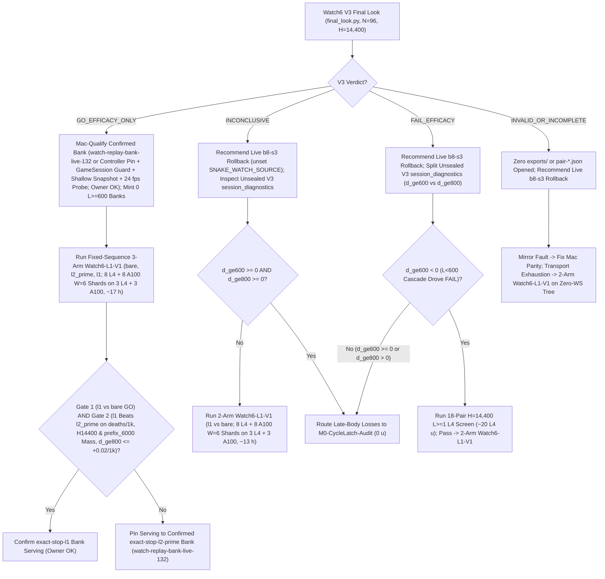

# T34 ExIt-B8 Research Roadmap (Round-04 Synthesis — Advice, Not Decisions)

Start: [project index](../INDEX.md) · [current status & authority](../STATUS.md) · [research record index](INDEX.md) · [study packages](../../research/INDEX.md) · [campaign log](final_run_20261019/CAMPAIGN_LOG.md).

> [!IMPORTANT]
> **Status: Research advice, NOT ratified decisions or release authorization.**
> Every current-round and later-round plan on this page is synthesized advisor guidance from Round 04 (2026-11-01 PT; primary synthesis artifact: `snake-dqn-artifacts/big-lever/exp/argon-rounds/round-04/synthesis/answer.md`, building on Rounds 01–03). Nothing here amends a pre-registration, ratifies a confirmation gate, or changes served defaults. Binding campaign authority remains [`SUCCESS_CONTRACT.md`](final_run_20261019/SUCCESS_CONTRACT.md), [`DESIGN_V2_SHADOW.md`](final_run_20261019/DESIGN_V2_SHADOW.md) (+ Amendment 1), [`P7_STATISTICS.md`](final_run_20261019/P7_STATISTICS.md), unsuperseded parts of [`FINAL_PLAN.md`](final_run_20261019/FINAL_PLAN.md), and [`STATUS.md`](../STATUS.md); any serving or release change requires confirmation-lane evidence, Mac serving qualification, and the owner's explicit OK.

---

## 1. Snapshot Context & Newly Audited Gaps (Oct 29 – Nov 1)

### 1.1 Nov 1 exploration, parity & active-run milestones

- **All-length exact-stop screen — `ADOPT` for new replay banks** ([`watch6_alllen_screen`](../../research/watch6_alllen_screen/README.md), `t34-sol/argon-alllen-a100/analysis.json`, `N = 48` paired `H = 6,000` Watch6-v2 sessions uniting `12` L4 `W = 4` units `0..11` at `568b09e4` with `36` A100 `W = 6` units `12..47` across three `12`-unit shards at `73c26ccc` on `origin/argon-alllen-a100-1031`):
  - `bare` (`b8-s3`): **`351.07` mass** (`CI95 [320.22, 381.91]`), **`0.2882` `deaths/1k`** (`CI95 [0.2427, 0.3337]`; `83` deaths: `53` at `L < 600`, `30` at `L >= 600`, `21` at `L >= 800`), `mean_max_length = 794.3`.
  - `l2_prime_600` (served `L >= 600`): **`461.16` mass** (`CI95 [414.30, 508.02]`; `+110.09` vs `bare`, `CI95 [+72.06, +148.13]`), **`0.1597` `deaths/1k`** (`CI95 [0.1060, 0.2134]`; `-44.6%` vs `bare`; `46` deaths: `34` at `L < 600`, `12` at `L >= 600`, `11` at `L >= 800`), `449.6` mean branches/session (`mean_max_length = 943.4`).
  - **`exact_stop_alllen` (`L >= 1`, `interval = 5`, `H = 300`):** **`559.43` mass** (`CI95 [533.59, 585.27]`; **`+208.37` / `+59.35%` vs `bare`**, `CI95 [+170.07, +246.66]`; **`+98.27` / `+21.31%` vs `L >= 600`**, `CI95 [+50.57, +145.98]`, clearing `>= +15.0`) and **`0.0521` `deaths/1k`** (`CI95 [0.0294, 0.0748]`; **`-81.9%` / `-0.2361/1k` vs `bare`**, `CI95 [-0.2828, -0.1895]`; **`-67.4%` / `-0.1076/1k` vs `L >= 600`**, `CI95 [-0.1609, -0.0544]`, clearing `<= 0.0`), cutting `L < 600` deaths **`53 (bare) / 34 (L >= 600) -> 1`** (`0.142%` `L < 600` overrides, `mean_max_length = 1,096.0`) at **`2.821×` branches** (`1,268.5` vs `449.6`). **`14/15` remaining deaths occur at `L >= 600` (`13/15` at `L >= 800`).**
  - Commit `73974411` landed controller `"exact-stop-l1"` ([`web/backend/watch_replay.py`](../../web/backend/watch_replay.py), [`research/watch_replay/prepare.py`](../../research/watch_replay/prepare.py)), and commit `395eacbb` verified `36/36` sessions from A100 `W = 6` bank packets `14l1–16l1` (`3 × 12` disjoint seeds; `t34-sol/argon-banks-l1/SUMMARY.md`) into the live **168-session** bank `watch-replay-bank-live-168` (`132` `exact-stop-l2-prime` + `36` `exact-stop-l1`, [`web/serve.py`](../../web/serve.py) restarted on `b5b63cd1`, keeping `watch-replay-bank-live-132` intact). Confirming `exact-stop-l1` as a Claim-B release at `H = 14,400` still requires prospective confirmation (`Watch6-L1-V1`), Mac serving qualification, and owner OK.
- **GPU `DeviceSim` v2 parity — `PASS` on A100** ([`devicesim_v2_parity`](../../research/devicesim_v2_parity/README.md), `t34-sol/argon-devicesim-v2/packet-a100-v2-parity-01/main-run-01/receipt.json`): **`0` mismatches** across **`1,536,000` snake-ticks** (`E = 256 × 1,000` Watch6-v2 ticks, commit `b500d111`), relying on `<= 1e-4` CUDA FP32 near-tie Q re-decision tolerances.
- **Active confirmation — Watch6 V3** ([`REGISTRATION_V3.md`](../../research/watch6_search_efficacy_v3/REGISTRATION_V3.md)): `24 × 4` L4 `W = 4` shards (`96` fresh paired `H = 14,400` Watch6-v2 sessions, `exact-stop-l2-prime` vs `bare`). Accounting adapter **V6.1** ratified (`75471246`, shard-00 never-allocated + shard-12 WebSocket renewal drop); sole final look runs via [`tools/watch6_v3_accounting/final_look.py`](../../tools/watch6_v3_accounting/final_look.py).
- **Completed Oct-30 Claim-A GPU receipts awaiting `0 u` Mac readout (`< 2.5 min`):** `b8-head-closedloop` (`t34-sol/b8-head-closedloop/main-01/output/terminal.json`, `rc = 0`) and `spatial-qbytes-01` (`t34-sol/spatial-qbytes-fix/t34-spatial-qbytes-01/ruler-output-a100-fallback/terminal.json`, `rc = 0`) completed cleanly on A100, while `T4 Gate-1` (`0/8` bars, `KILL_T4`) cancels the `40–48 A100 u` `spatial-student-pilot` fit (retaining compiled `.so` caches).

### 1.2 Closed single-pass critics, distillations, RL, and standalone macro fallbacks

Between 2026-10-29 and 2026-11-01, every single-pass learned-policy, critic, distillation, and standalone macro-fallback track closed below its promotion or selectivity bars:

| Track | Scope & primary artifact | Measured outcome | Disposition |
| --- | --- | --- | --- |
| **TRAIN-01** ([`sandbox_a_resident`](../../research/sandbox_a_resident/README.md)) | `100.7M`-row (`384`-update) GPU-resident PPO from `b8-s3` (`t34-sol/train01-closeout/SUMMARY.md`) | H5000 equal-mix paired mass **`+8.09`** (`CI95 [-18.66, +34.85]`; scripted `+26.32`, frozen `+2.85`, mixed `-4.90`; update-320 peak `+14.23` `[-11.86, +40.32]`) vs bar `>= +40` | **Closed** (no strict-gate nomination) |
| **C/T Stage-2 distillation** | Continuation-teacher causal-root distillation (`t34-sol/ct-stage2-verdict/SUMMARY.md`) | Teacher rescued **`22/32` (`68.75%`)** deaths (`22/32 <= 65` ticks; indep-suffix H300 `+66.77`, `LB90 +51.61`), but student retention was **`46.9–50.0%`** (`0 pp` over `frozen_phi` vs `>= +15 pp`; topology AUC `0.5752 < 0.83`), ordinary flips **`44.4–64.5%`** (bar `<= 1%`), and lethal ordinary flips **`3–5`** (bar `<= 1`) | **`FAIL_DISTILLATION_RETENTION_OR_SAFETY`** |
| **Doom U-Net & `spatial-student-pilot`** | `83 × 145` spatial U-Net vs 33.7k B8-feature head (`t34-sol/doom-result-01/result.json`; `t34-sol/student-direction/{astra,fable}.md`) | Spatial U-Net lost late per-action doom ROC-AUC to frozen B8 features (**`0.753` vs `0.810`**, `Δ = -0.056`, `CI95 [-0.091, -0.023]`; all-strata death-lookback `0.7626` vs `0.8226`; ordinary late `0.690` vs `0.706`) | **`GRAY` / `40–48 A100 u` pilot fit canceled (`0 u`; retain `.so` caches)** |
| **B8 advantage head (offline OOF)** | `256 -> 128 -> 6` ReLU head on frozen B8 features (`t34-sol/b8-head-test/RESULT.md`) | Mass rule `GO` (late H300 `+30.09`, `LB90 +23.96`), Fable selectivity **`FAIL`**: **`26.42%`** late rescue (bar `>= 35%`) at **`97.60%`** non-death flips (bar `<= 15%`) | **Selectivity `FAIL`** (192-world closed-loop A100 `rc = 0`, awaiting Mac readout) |
| **T4 Gate-1 factored critic** ([`t4_gate1`](../../research/t4_gate1/README.md)) | Clean-slate privileged `83 × 145` (`H = 320` 7-source BFS) hazard + foraging mass-flux critic on `384` disjoint Watch6-v2 worlds (`t34-sol/argon-t4-gate1-fix2/queue-03/READOUT.json`) | **`0/8` bars passed**: `L >= 600` residual EV **`+0.0266`** (`[-0.0280, +0.0869]` vs `>= 0.25`), death-root H300 rescue **`+19.99`** (vs `>= +40`), mature doom AUC **`0.5617`** (vs `>= 0.80`), ordinary H300 mass **`-22.21`** (vs `>= -15.0`), lethal flips **`3.13%`** (vs `<= 3.0%`) | **`KILL_T4`** (proves even privileged `83 × 145` critic lacks late value signal) |
| **R6 `L < 600` harvest census** ([`r6_l600_census`](../../research/r6_l600_census/README.md)) | `64`-world (`384`-root) Watch6-v2 early-game counterfactual + 5-fold OOF corpse/trail plane probes (`t34-sol/argon-mac-checks/r6-census/RESULT.json`) | **`34.90%` (`134/384`)** oracle-harvestable roots (`>= +5` H500 mass), **`7.69%`** non-bare H500 lethal flips, OOF ROC-AUC **`0.474–0.521`** (`0` passing threshold points); superseded operationally by `exact-stop-l1` | **`KILL`** |
| **R7 macro-option fallback** ([`r7_macro_fallback`](../../research/r7_macro_fallback/README.md)) | Pruned depth-2 (`K = 15` ticks) spatial macro-options `{O_0..O_5}` on C/T train `1-step-all-die` roots (`t34-sol/argon-r7-repack/R7_READOUT.json`) | `3/5` bars passed (`0.316 ms` Mac 1-thread p95; **`33.0%` vs `9.0%`** `L >= 800` `all-die` rescue), but total `L >= 600` lift **`+3.85 pp`** (`< +10.0 pp`) and **`2 > 0`** newly caused ordinary lethal flips from aggressive `O3`/`O5` (`0` assessment roots opened) | **`KILL`** as standalone fallback |

### 1.3 Replay-serving, V3-telemetry, and Colab-transport gaps audited in Round 04

- **Watch replay & V3 telemetry gaps:**
  1. *Unscoped `ReplayBank` attachment:* [`GameSession.__init__`](../../web/backend/session.py) (`lines 565–573`) attaches [`ReplayBank`](../../web/backend/watch_replay.py) whenever `SNAKE_WATCH_SOURCE == "replay"` and `checkpoint is None`, without checking `served_checkpoint["name"] == "b8-s3"`, `watch_roster == "mixed"`, `watch_roster_reason is None`, or `len(snakes) == 6` — hijacking `SNAKE_SERVE_WATCH_ROSTER=all_b8`, `SNAKE_SERVE_CHECKPOINT=frp3-s12`/`champion` rollbacks, and `Watch8/12` ([`SUCCESS_CONTRACT.md`](final_run_20261019/SUCCESS_CONTRACT.md) §3).
  2. *`24 Hz` `copy.deepcopy` & unpinned controller:* [`Recording.snapshot`](../../web/backend/watch_replay.py) (`lines 226–238`) runs `copy.deepcopy(self.frame)` at `24 Hz` over `L >= 1,000` body-segment lists despite mutating only top-level DTO keys and `frame["session"]`; [`ReplayBank._prefetch`](../../web/backend/watch_replay.py) accepts any controller in `CONTROLLERS` without `SNAKE_WATCH_REPLAY_CONTROLLER` pinning; and [`research/watch_replay/smoke.py`](../../research/watch_replay/smoke.py) (`12` unpaced frames) never tests paced `24 fps` across `6.0 s` startup SHA verification, `L >= 1,000` frames, `6,000 -> 1` rotation, and live-B8 fallback.
  3. *Dropped frame timestamps in V3 metrics:* [`run.metrics`](../../research/watch6_search_efficacy/run.py) (`lines 29–55`) drops `raw["frames"]`, leaving V3 [`decide`](../../research/watch6_search_efficacy/analyze.py) (`lines 103–105`) only `death_lengths` (`L >= 800` `late_large_body_deaths`, no death timestamps or `prefix_6000` slice).
- **Four Colab transport & ops traps:**
  1. *Hidden post-staging WebSocket RPCs:* [`_contents_call`](../../research/colab_cli/transfers.py) (`lines 170–192`) calls `renew()` twice per transfer, causing [`renew_runtime_lease`](../../research/colab_cli/supervisor.py) (`lines 423–450`) to fall back to WebSocket `poll_rpc` post-staging (`deadline == inf`) alongside per-PUT [`_verify_remote_file`](../../research/colab_cli/transfers.py) (`line 384`) WS RPCs and multi-unit WS `export_batch`.
  2. *`180 s` lease suicide inside `1,200 s` REST recovery & `2,000`-char stderr clip:* Default [`lease_seconds = 180`](../../research/colab_cli/supervisor.py) (`lines 261–264`) triggers [`_lease_expired`](../../research/colab_cli/runtime.py) (`lines 618–702`, `SystemExit(75)` + self-unassign) inside the `1,200 s` REST recovery window (as does immediate self-unassign on `reason == "timeout"`), while [`_call_once`](../../research/colab_cli/supervisor.py) (`line 586`) clips stderr to `2,000` chars (forcing [`tools/watch6_v3_accounting/proof.py`](../../tools/watch6_v3_accounting/proof.py) to grow to `3,103` LOC).
  3. *`60 s` `accounting.check` sibling-lag kills & non-`prefer` `dispatch.py` gaps:* `60 s` [`accounting.check`](../../research/colab_cli/accounting.py) (`lines 529–547`) kills healthy shards on transient sibling session-list lag, while non-`prefer` [`dispatch.py`](../../tools/ops/dispatch.py) (`lines 2871–2947`) skips `reconcile_unavailable` and [`ready_queue.tick`](../../tools/ops/ready_queue.py)'s (`lines 668–670`) `L4 <= 3` sub-cap.
  4. *`auto_retry.py` `contract.json` block & `canary.check` ledger lock:* [`auto_retry.py`](../../tools/ops/auto_retry.py) (`lines 265–435`) blocks automatic blind retries when startup `units/contract.json` or partial files exist (`exports != []` at `0` completed units) and increments `completion_attempt` on `unallocated=True`, while [`canary.check`](../../research/colab_cli/canary.py) (`lines 312–321`) enforces exact input SHA/size on updated `verified-ledger` inputs.

---

## 2. Current-Round Plan (Advice, Not Decisions)

### 2.1 `0 u` Mac gates (`< 2.5 min`): Claim-A readout/closure & Watch replay serving guards

1. **Read completed Claim-A receipts & enforce closure bar (`0 u`, `< 2.5 min` Mac):**
   - Run `closedloop_readout.py` (`origin/astra-doom-auc-smoke` @ `591d94c3`) on completed `b8-head-closedloop` (`N = 192` v1 `H = 5,000` worlds, `m in {0, 10, 25, 50}`) and audit completed `spatial-qbytes-01` (`mapped-parity.json`); keep the `40–48 A100 u` `spatial-student-pilot` fit canceled (`0 u`, retaining `.so` caches).
   - **Recommended Claim-A kill rule:** Recommend **closing Claim A permanently (`0 u`)** unless some margin `m in {0, 10, 25, 50}` clears `closedloop_readout.py`'s `ci95[0] > 0` (`== LB97.5`, exact 4-arm `alpha = 0.10/4` Bonferroni), `H = 5,000` pooled mass `>= +40`, scripted survival `>= +0.03` (no mix loss), boost `[0.5%, 10%]` ([`SUCCESS_CONTRACT.md`](final_run_20261019/SUCCESS_CONTRACT.md)), and `<= 15%` living-decision overrides.
2. **Harden & Mac-qualify Watch replay serving (`0 u`):**
   - Gate [`GameSession.__init__`](../../web/backend/session.py) `ReplayBank` attachment strictly on clean mixed-Watch6 `b8-s3` (`served_checkpoint["name"] == "b8-s3"`, `watch_roster == "mixed"`, `watch_roster_reason is None`, `len(snakes) == 6`), pin `SNAKE_WATCH_REPLAY_CONTROLLER`, and replace [`Recording.snapshot`](../../web/backend/watch_replay.py)'s `24 Hz` `copy.deepcopy` with a top-level + `session`-dict shallow copy.
   - Pass `1,500` unpaced + `120` paced-`24 fps` qualification ticks (`p95 <= 11.688 ms`, `0/120` overruns per [`t15_mixed_roster_qualification_2026-10-17.md`](t15_mixed_roster_qualification_2026-10-17.md)) covering `6.0 s` startup verification, `L >= 1,000` bodies, `6,000 -> 1` session rotation, and live-B8 fallback.

### 2.2 Cap-6 publication + zero-WS transport qualification (`0 u` 50-seed `fake_colab.py` + `~0.7 L4 u` canary)

1. **Publish Cap-6 `36285bc6` outside V3 staging:** Register `36285bc6` additively via [`tools/ops/qualification.py`](../../tools/ops/qualification.py) (`t34-sol/argon-qual-cap6/SUMMARY.md`, leaving `40985ca4` active for V3) so `3 L4 + 3 A100` (`6` total runtimes; `14l1–16l1` already completed `36/36` on A100) are available immediately for post-V3 work.
2. **Qualify one additive zero-WS transport tree before `Watch6-L1-V1`:**
   - *Unconditional REST `_put_lease` (`0` post-`hardware.json` WS calls):* Route renewals unconditionally through REST [`_put_lease`](../../research/colab_cli/supervisor.py) (`lines 408–421`), drop per-PUT WS `_verify_remote_file`, route small exports via REST `export_file`, and guard `release-credential.next.json` parsing inside `try/except`.
   - *`lease_seconds = 1,800` + `180 s` pre-stop drain & `16 KB` `stderr_tail`:* Raise `lease_seconds` to `1,800` so Mac REST blips inside `1,200 s` recovery never trigger `_lease_expired` (`SystemExit(75)`), hold `reason == "timeout"` inside a `180 s` pre-stop drain pulling `prestop-{terminal,state}.json`, and widen `_call_once` stderr retention to `16 KB` (`stderr_tail`).
   - *Warn-only `accounting.check` (`len(sessions) <= 6`) + `reconcile_unavailable`:* Demote `60 s` mid-run `accounting.check` drift to warn-only while `len(sessions) <= 6`, and wire `reconcile_unavailable` + `L4 <= 3` / `total <= 6` checks into non-`prefer` [`tools/ops/dispatch.py`](../../tools/ops/dispatch.py).
   - *4-PUT staging, `750 m` (`2,880`-root) base timeouts, wave-resetting retries & `tools/ops/confirm_audit.py`:* Fetch public checkpoints via runtime HTTPS and allow monotonic-superset `verified-ledger` updates in [`canary.check`](../../research/colab_cli/canary.py) (`4` PUTs total, `0` re-canaries); set `750 m` (`2,880`-root) base timeouts (`1,500 m` 2× guard) for `H = 14,400` `exact-stop-l1` `W = 6` shards; use sidecar-only wave-resetting retries (`prestart <= 20`, `stalled_transport <= 2`/wave ignoring `contract.json`, `0` on timeout/child faults); and ratify reusable positive-conjunction `tools/ops/confirm_audit.py`.
   - *Verification & kill rule:* Pass a 50-seed [`tests/fixtures/fake_colab.py`](../../tests/fixtures/fake_colab.py) offline matrix (`0 u`, including `3` negative-control rejection fixtures) plus one live fault-injected L4 canary (`~0.7 L4 u`); block `Watch6-L1-V1` dispatch if any offline check fails or post-`hardware.json` WS calls `> 0`.

### 2.3 Route Watch6 V3 (`final_look.py`, `N = 96`) & confirm `exact-stop-l1` (`Watch6-L1-V1`)

Watch6 V3 governs `exact-stop-l2-prime` (`L >= 600`) only ([`REGISTRATION_V3.md`](../../research/watch6_search_efficacy_v3/REGISTRATION_V3.md)). Never top up V3, never open `exports/` or `pair-*.json` on `INVALID_OR_INCOMPLETE`, and record `death_frames` + `prefix_6000` in `Watch6-L1-V1`.

- **On `GO_EFFICACY_ONLY` (`deaths/1k` `UB95 < 0` and Fieller mass `LB95 >= -0.05`):**
  1. *Mac (`0 u`):* Apply §2.1's `GameSession` mixed-Watch6 `b8-s3` guard, `SNAKE_WATCH_REPLAY_CONTROLLER` pin (note: `watch-replay-bank-live-168` currently mixes `132` `exact-stop-l2-prime` + `36` `exact-stop-l1`, whereas `watch-replay-bank-live-132` is pure `exact-stop-l2-prime`), shallow-copy `Recording.snapshot`, and `1,500`-unpaced / `120`-paced-`24 fps` qualification, then request **owner release sign-off**. Mint **0** additional `L >= 600` banks.
  2. *Colab (`3 L4 + 3 A100`, single-family `8 L4` + `8 A100` `W = 6` manifests now that `14l1–16l1` completed `36/36`, `~17 h` wall):* Run fixed-sequence **3-arm `Watch6-L1-V1`** (`bare`, `l2_prime`, `l1`; `N = 96, H = 14,400` paired on identical 12-vCPU x86 VMs with `mirror_identity_frames == 14400`):
     - *Gate 1:* `l1` vs `bare` clears V3's `GO` bar (`deaths/1k UB95 < 0`, Fieller mass `LB95 >= -0.05`).
     - *Gate 2 (confirmed promotion of `exact-stop-l1` over `l2_prime`):* `l1 - l2_prime` clears `deaths/1k UB95 < 0`, Fieller mass `LB95 >= 0` at both `H = 14,400` and `prefix_6000`, and `Δd_ge800 UB95 <= +0.02/1k` (**owner OK**; otherwise pin serving to pure `exact-stop-l2-prime`).
- **On `INCONCLUSIVE`, `FAIL_EFFICACY`, or `INVALID_OR_INCOMPLETE`:**
  - Recommend rolling Watch back to live bare `b8-s3` (`unset SNAKE_WATCH_SOURCE`), pause bank swaps, and never top up V3.
  - Run **2-arm `Watch6-L1-V1`** (`l1` vs `bare`, `8 L4` + `8 A100` `W = 6` shards across `3 L4 + 3 A100`, `~13 h`) on `INCONCLUSIVE` (unless `Δd_ge600 >= 0` and `Δd_ge800 >= 0`), `INVALID_OR_INCOMPLETE` transport exhaustion (zero `exports/` or `pair-*.json` opened; fix Mac parity first if a mirror fault tripped), or `Δd_ge600 < 0` `FAIL_EFFICACY` (gated first on an `18`-pair `H = 14,400` L4 screen, `~20 L4 u`); route `Δd_ge600 >= 0` / `Δd_ge800 > 0` late-body search losses to `M0-CycleLatch-Audit` (§3.2).

---

## 3. Later-Round Plan: `CycleLatch-v4` + `LiveMac-C15-Latch` & UX (Advice, Not Decisions)

### 3.1 Three code-verified flaws in Round-03's `TopoStop-v3` and current `LiveMac`

`watch6_alllen_screen` (`t34-sol/argon-alllen-a100/analysis.json`) cut deaths from `83 (bare) / 46 (l2_prime)` to **`15` (`0.0521/1k`, `559.4` mass)**, concentrating **`13/15` remaining deaths at `L >= 800`**. Round-04 code audit identified three flaws in Round-03's `TopoStop-v3` / `LiveMac` proposal:

1. **`interval = 5` blind gaps & `30`-tick handoff cliff:** [`DenseTrigger`](../../research/t3_rollout_labels_20261015/trigger.py) (`lines 20–41`, `interval = 5`) steps bare B8 unguarded on `t+1..t+4` ([`watch_replay/engine.py`](../../research/watch_replay/engine.py) `lines 146–153`), and `30`-tick macro handoffs ([`r7_macro_fallback/search.py`](../../research/r7_macro_fallback/search.py) `line 18`) drop multi-step escapes mid-maneuver inside `80–220`-tick coils (`t34-sol/argon-r7-repack/R7_READOUT.json`).
2. **Static `omega1` 2-core peeling false-vetoes `L >= 1,100` width-1 tail-loops:** [`options.py`](../../research/r7_macro_fallback/options.py) (`lines 414–756`) statically peels degree-1 corridors and caps BFS at depth `28`, falsely rejecting valid single-file tail-following cycles when an `L >= 1,100` body fills its own bay.
3. **Live-Mac stalls stem from IPC/food-scan/GC overhead — NOT a Contract §4 worker ban:** [`SUCCESS_CONTRACT.md`](final_run_20261019/SUCCESS_CONTRACT.md) (`lines 114–123`, `2026-10-21` owner amendment) **already permits `W <= 4` worker processes and `K <= 8` outstanding search requests on Mac** (correcting Round-03 §4.2). Live Path B stalls and stale-result discards stem from `cloudpickle` [`snapshot`](../../research/t34_pathb/live.py) (`lines 46–50`), `O(F)` [`FoodManager._position_overlaps_food`](../../src/game/food_manager.py) (`lines 120–134`), GC pauses (`big-lever/exp/JUDGMENT_D1.md`), and full-food [`prepared_state`](../../research/t34_pathb/live.py) (`lines 111–140`, [`web/backend/pathb.py`](../../web/backend/pathb.py) `lines 79–80`) invalidating plans whenever distant food spawns.

### 3.2 `CycleLatch-v4` + `LiveMac-C15-Latch` (`M0-CycleLatch-Audit` `0 u` -> `W6-CycleLatch-v4` `~66 u`)

- **Architecture (later rounds):**
  1. **`< 0.25 ms` Numba time-expanded `TimeEscapeCert`:** Replace static 2-core peeling with dynamic time-expanded reachability (`t >= tau_own[u]` own-tail release vs `2`-cell/tick opponent boost arrival `T_opp,2x[u]`), certifying both timed escape gates and width-1 tail-following cycles without `L >= 1,100` false vetoes.
  2. **`0.316 ms` `t+1..t+4` `TimeEscapeCert(0)` shield & `stride = 1` hold-until-certified `{O0, O1, O2, O4}` latching:** Run `TimeEscapeCert(0)` on non-root ticks `t+1..t+4` to trigger immediate search on sudden cutoffs, and latch survival-only `{O0, O1, O2, O4}` at `stride = 1` across `80–220`-tick coils until `1`-step B8 re-certifies across `K = 2` SplitMix64 private-RNG worlds (`E = 2..8`-batched in one [`GridBatchSim`](../../src/simd_env/grid_sim.py), eliminating Contract §4 hindsight RNG peeking).
  3. **`LiveMac-C15-Latch` (`W = 4, K = 4` within Contract §4):** Replace `cloudpickle` snapshots with `< 4 KB` [`WorldGridState`](../../research/r7_macro_fallback/options.py) (`lines 31–48`) IPC, `O(1)` food bitset lookup, and kinematics-bound (`head/dir/len`, food-insensitive) `W = 4, K = 4` Mac latching under `JUDGMENT_D1`'s paired `W0` `0`-overrun gate.
  4. **Watch & Play UX levers (frozen Watch6-v2 mechanics):** Add [`Recording`](../../web/backend/watch_replay.py) chapter jumps (`replay_search_override`, `L >= 1,000`, rescue highlights) + Inspector **"Doomed Ghost"** coffin overlay, and an opt-in, visibly labelled/unscored Play **"Apex Boss"** shield.
- **Mandatory `0 u` Mac gate (`M0-CycleLatch-Audit`, `~18 min` Mac):** Re-simulate the `48` `watch6_alllen_screen` seeds from scratch (zero `exports/` opened) to test `CycleLatch-v4` on all `13` unrescued `L >= 800` deaths, surviving `L >= 800` controls, and paced Mac `WorldGridState` IPC.
  - **Kill rule (`0 u`):** Block GPU spend unless `CycleLatch-v4` rescues **`>= 6/13`** unrescued `L >= 800` deaths over independent `H = 600` SplitMix suffixes, false-flags **`<= 1.0%`** of surviving `L >= 800` controls, causes **`0`** ordinary lethal flips, and records **`0`** Mac paced-tick overruns (`TimeEscapeCert` `p95 <= 0.50 ms`).
- **Conditional 6-slot Colab experiment (`W6-CycleLatch-v4`, `~4.4 h` wall, `~66 u` observed / `132 u` 2× cap + `5.5 u` canaries, queued after `Watch6-L1-V1` and `M0-CycleLatch-Audit` PASS):**
  - *`3 × A100/H100` (`N = 144, H = 14,400` on [`DeviceSim`](../../research/gpu_sim_spike/device_sim.py) + `TimeEscapeCert`):* 4-arm paired ablation (`exact-stop-l1`, `+TimeEscapeCert + shield`, `+stride=1 CycleLatch`, `+K=2 SplitMix64`).
  - *`3 × L4` (`N = 48, H = 6,000` on authoritative CPU `GridBatchSim` + `LiveMac-C15-Latch` emulator):* Verify CPU parity, export `.watch.gz` replays, and measure `LiveMac-C15-Latch` retention under Mac `W = 4, K = 4` IPC budgets.
- **Do not fund (`0 u`):** New bare-network PPO (`TRAIN-01`), single-pass distillation (`C/T Stage-2`, `spatial-student-pilot`), spatial/privileged value critics (`Doom U-Net`, `T4 Gate-1`), `L < 600` harvest rules (`R6`), or unlatched aggressive macro options (`O3`/`O5` in `R7`).

---

## 4. Settled Round-04 Disagreements & Supporting Evidence

1. **`Watch6-L1-V1` worker geometry (`2` workers/pair `77 m` waves vs. `1` pair/core `W = 6`, `750 m` base timeout):**
   Settled by `t34-sol/argon-alllen-a100/SUMMARY.md` and `analysis.json`: `77 m` extrapolates `L >= 600`; `exact-stop-l1` runs `2.821×` branches (`~3.6–4.0 h` `l1` vs `~15 m` `bare` at `H = 14,400`), idling dedicated `bare` workers `> 90%` (`~2×` wall time). Keep `W = 6` saturated (`16 × 6` / `32 × 3` shards or shared `(seed, arm)` pool, `750 m` base timeout).
2. **Mixed `["L4", "A100"]` `allowed_gpus` vs. single-family `8 L4` + `8 A100` manifests:**
   Settled by [`canary.py`](../../research/colab_cli/canary.py) (`lines 308–311`) and [`watch6_search_efficacy/run.py`](../../research/watch6_search_efficacy/run.py) (`lines 79–83`): `canary.py` rejects multi-GPU `allowed_gpus`, while every pair runs all arms on the same 12-vCPU x86 VM (`mirror_identity_frames == 14400`). Use single-family manifests (`8` `L4` + `8` `A100`, `1` canary each) across `3 L4 + 3 A100` (`~13–17 h`, with A100 slots now free after `14l1–16l1` completed `36/36`).
3. **Claim-A multiplicity (`LB97.5 > 0` vs. Round-03 Holm `LB90 > 0`) & `LiveMac` `W = 4` (`SUCCESS_CONTRACT.md` §4):**
   Settled by `closedloop_readout.py` (`lines 104–109`), [`SUCCESS_CONTRACT.md`](final_run_20261019/SUCCESS_CONTRACT.md) (`lines 114–123`), and `big-lever/exp/JUDGMENT_D1.md`: `closedloop_readout.py` emits `ci95[0]` (`== LB97.5`, exact 4-arm `alpha = 0.10/4` Bonferroni), and Contract §4's `2026-10-21` owner amendment already authorizes `W <= 4, K <= 8` on Mac under `JUDGMENT_D1`'s paired `W0` `0`-overrun gate.
