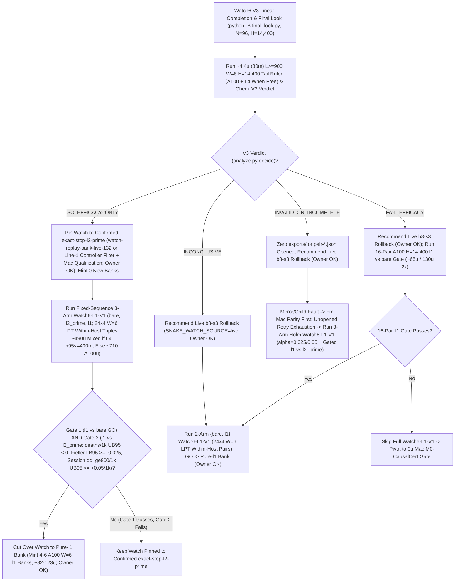

# T34 ExIt-B8 Research Roadmap (Round-10 Synthesis — Advice, Not Decisions)

Start: [project index](../INDEX.md) · [current status & authority](../STATUS.md) · [research record index](INDEX.md) · [study packages](../../research/INDEX.md) · [campaign log](final_run_20261019/CAMPAIGN_LOG.md).

> [!IMPORTANT]
> **Status: Research advice, NOT ratified decisions or release authorization.**
> Every current-round and later-round plan on this page is synthesized advisor guidance from Round 10 (2026-11-01 PT; primary synthesis artifact: `snake-dqn-artifacts/big-lever/exp/argon-rounds/round-10/synthesis/answer.md`, superseding Rounds 01–09). Nothing here amends a pre-registration, ratifies a confirmation gate, or changes served defaults. Binding campaign authority remains [`SUCCESS_CONTRACT.md`](final_run_20261019/SUCCESS_CONTRACT.md), [`DESIGN_V2_SHADOW.md`](final_run_20261019/DESIGN_V2_SHADOW.md) (+ Amendment 1), [`P7_STATISTICS.md`](final_run_20261019/P7_STATISTICS.md), unsuperseded parts of [`FINAL_PLAN.md`](final_run_20261019/FINAL_PLAN.md), and [`STATUS.md`](../STATUS.md); any serving or release change requires confirmation-lane evidence, Mac serving qualification, and the owner's explicit OK.

---

## 1. Snapshot Context & Code-Verified Round-10 Corrections (Oct 29 – Nov 1)

### 1.1 Nov 1 exploration, bank-minting, parity & Watch6 V3 linear-retry guard

- **All-length exact-stop screen — `ADOPT` for new replay banks** ([`watch6_alllen_screen`](../../research/watch6_alllen_screen/README.md), `t34-sol/argon-alllen-a100/analysis.json`, `N = 48` paired `H = 6,000` Watch6-v2 sessions uniting `12` L4 `W = 4` units `0..11` at `568b09e4` with `36` A100 `W = 6` units `12..47` across three `12`-unit shards at `73c26ccc` on `origin/argon-alllen-a100-1031`):
  - `bare` (`b8-s3`): **`351.07` mass** (`CI95 [320.22, 381.91]`), **`0.2882` `deaths/1k`** (`CI95 [0.2427, 0.3337]`; `83` deaths: `53` at `L < 600`, `30` at `L >= 600`, `21` at `L >= 800`), `mean_max_length = 794.3`.
  - `l2_prime_600` (served `L >= 600`): **`461.16` mass** (`CI95 [414.30, 508.02]`; `+110.09` vs `bare`, `CI95 [+72.06, +148.13]`), **`0.1597` `deaths/1k`** (`CI95 [0.1060, 0.2134]`; `-44.6%` vs `bare`; `46` deaths: `34` at `L < 600`, `12` at `L >= 600`, `11` at `L >= 800`), `449.6` mean branches/session (`403.7` roots, `mean_max_length = 943.4`).
  - **`exact_stop_alllen` (`L >= 1`, `interval = 5`, `H = 300`):** **`559.43` mass** (`CI95 [533.59, 585.27]`; **`+208.37` / `+59.35%` vs `bare`**, `CI95 [+170.07, +246.66]`; **`+98.27` / `+21.31%` vs `L >= 600`**, `CI95 [+50.57, +145.98]`, clearing `>= +15.0`) and **`0.0521` `deaths/1k`** (`CI95 [0.0294, 0.0748]`; **`-81.9%` / `-0.2361/1k` vs `bare`**, `CI95 [-0.2828, -0.1895]`; **`-67.4%` / `-0.1076/1k` vs `L >= 600`**, `CI95 [-0.1609, -0.0544]`, clearing `<= 0.0`), cutting `L < 600` deaths **`53 (bare) / 34 (L >= 600) -> 1`** (`0.142%` `L < 600` overrides, `mean_max_length = 1,096.0`) at **`2.821×` branches** (`1,268.5` vs `449.6`, `1,200.1` roots = `1.057` branches/root, with `53.6%` cheap `L < 600` roots in frames `0..6,000`). **`14/15` remaining deaths occur at `L >= 600` (`13/15` at `L >= 800`).**
  - *Exposure & per-world notes:* Eliminating `34 -> 1` early deaths gives `exact_stop_alllen` **`1.379×` more `L >= 600` living exposure** (`403.7 -> 556.6` roots/session), so `11 -> 13` raw `L >= 800` deaths reflects **`-14.2%` lower per-frame `L >= 800` hazard** despite raw session-normalized `Δd_ge800 = +0.0069/1k`. Across paired worlds, `exact_stop_alllen` regressed deaths vs `L >= 600` on `3/48` seeds (`3075941873`, `3394546952`, `121131908`) and mass on `14/48` seeds.
- **All-length Watch banks `14l1–16l1` completed `36/36` on active Cap-6 `36285bc6` (freeing all `3` A100 slots):**
  - Verified receipts (`t34-sol/argon-banks-l1/packet-bank{14l1,15l1,16l1}-a100/output-main/receipt.json`, `SUMMARY.md`) confirm Cap-6 (`36285bc6`) ran `6/6` concurrent runtimes (`3 A100 @ 6.73 u/h + 3 L4 @ 1.94 u/h = 26.01 u/h`), finishing all `3 × 12` `exact-stop-l1` sessions (`W = 6`, `H = 6,000`) in **`3.03–3.07 h/bank`** (**`~20.36–20.67 u/bank` = `~61.5 A100 u` observed total** vs `~227 u` forecast; balance **`~2,154.66 u`**, leaving `3` A100 slots immediately available). Because survived trajectories spend frames `6,000..14,400` almost entirely at `L >= 800`, `exact-stop-l1` compute scales **superlinearly (`~2.9–3.3×`)** from `H = 6,000` to `H = 14,400` (`argon-banks-l1/SUMMARY.md:38-40`).
  - Commit `395eacbb` switched `.claude/launch.json` to **`watch-replay-bank-live-168`** (`132` `exact-stop-l2-prime` banks `01–08, 10–12` + `36` unconfirmed `exact-stop-l1` banks `14l1–16l1`, [`web/serve.py`](../../web/serve.py) restarted on `b5b63cd1`, keeping `watch-replay-bank-live-132` intact for rollback). Confirming `exact-stop-l1` at `H = 14,400` still requires prospective confirmation (`Watch6-L1-V1`), Mac serving qualification, and owner OK; defer minting new banks until Watch6 V3's verdict lands.
- **GPU `DeviceSim` v2 parity — `PASS` on A100** ([`devicesim_v2_parity`](../../research/devicesim_v2_parity/README.md), `t34-sol/argon-devicesim-v2/packet-a100-v2-parity-01/main-run-01/receipt.json`): **`0` mismatches** across **`1,536,000` snake-ticks** (`E = 256 × 1,000` Watch6-v2 ticks in `3,505.6 s` = `1,434.6` steps/s under 5-opponent CUDA flood launches, commit `b500d111`), using `DeviceSim`'s SplitMix64 RNG and `<= 1e-4` CUDA FP32 near-tie Q re-decision tolerances.
- **Active confirmation — Watch6 V3 (`05:01 PT` snapshot, `web/backend/` hash-coupling & linear-retry lineage guard)** ([`REGISTRATION_V3.md`](../../research/watch6_search_efficacy_v3/REGISTRATION_V3.md)): `24 × 4` L4 `W = 4` shards (`96` fresh paired `H = 14,400` Watch6-v2 sessions) confirming **`exact-stop-l2-prime` (`L >= 600`) only**. At `05:01 PT`, **`14/24` shards are `PASS`** (`01..08, 10, 11, 13..16`), **`6/24` are active** (`3/24` running `17, 18, 20` + `3/24` queued `21..23`), and **`4/24` are V6.1-accepted mechanical failures** (`00` `412` unallocated, `09` `UPLOAD_CAP`, `12` renewal-WS drop, `19` warmup `GuardError`; `75471246`, `0` new rulings):
  - [`final_look.py:_verify_shard_lineage`](../../tools/watch6_v3_accounting/final_look.py) (`lines 380–386`) fails closed (`"forked/concurrent attempt lineage detected"`) whenever two attempts share a parent receipt, and [`watch6_search_efficacy_v3/protocol.py`](../../research/watch6_search_efficacy_v3/protocol.py) (`lines 59–120`) hashes `web/backend/` into `identity()`. Keep all V3 worktrees untouched; dispatch **only** staged `ops/auto-retry` children on shards **`09` and `19`** (**do NOT run [`recover.py`](../../tools/watch6_v3_accounting/recover.py)** on `09, 19`); run `recovery-shard-{00,12}-01` via `python -B -m tools.watch6_v3_accounting.dispatch`; and invoke [`final_look.py`](../../tools/watch6_v3_accounting/final_look.py) under **`python -B`** from clean `snake-dqn-argon-v3-accounting` ([`_forbid_pycache_directory`](../../tools/watch6_v3_accounting/__init__.py) `lines 747–777`).
- **Completed Oct-30 Claim-A GPU receipts awaiting `0 u` Mac readout (`< 3 min`):** `b8-head-closedloop` (`t34-sol/b8-head-closedloop/main-01/output/receipt.json`, `rc = 0`) and `spatial-qbytes-01` (`t34-sol/spatial-qbytes-fix/t34-spatial-qbytes-01/ruler-output-a100-fallback/receipt.json`, `rc = 0`) completed cleanly on A100, while `T4 Gate-1` (`0/8` bars, `KILL_T4`) cancels the `40–48 A100 u` `spatial-student-pilot` fit (retaining compiled `.so` caches).

### 1.2 Closed single-pass critics, distillations, RL, and standalone macro fallbacks

Between 2026-10-29 and 2026-11-01, every single-pass learned-policy, critic, distillation, and standalone macro-fallback track closed below its promotion or selectivity bars:

| Track | Scope & primary artifact | Measured outcome | Disposition |
| --- | --- | --- | --- |
| **TRAIN-01** ([`sandbox_a_resident`](../../research/sandbox_a_resident/README.md)) | `100.7M`-row (`384`-update) GPU-resident PPO from `b8-s3` (`t34-sol/train01-closeout/SUMMARY.md`) | H5000 equal-mix paired mass **`+8.09`** (`CI95 [-18.66, +34.85]`; scripted `+26.32`, frozen `+2.85`, mixed `-4.90`; update-320 peak `+14.23` `[-11.86, +40.32]`) vs bar `>= +40` | **Closed** (no strict-gate nomination) |
| **C/T Stage-2 distillation** | Continuation-teacher causal-root distillation (`t34-sol/ct-stage2-verdict/SUMMARY.md`) | Teacher rescued **`22/32` (`68.75%`)** deaths (`22/32 <= 65` ticks; indep-suffix H300 `+66.77`, `LB90 +51.61`), but student retention was **`46.9–50.0%`** (`0 pp` over `frozen_phi` vs `>= +15 pp`; topology AUC `0.5752 < 0.83`), ordinary flips **`44.4–64.5%`** (bar `<= 1%`), and lethal ordinary flips **`3–5`** (bar `<= 1`) | **`FAIL_DISTILLATION_RETENTION_OR_SAFETY`** |
| **Doom U-Net & `spatial-student-pilot`** | `83 × 145` spatial U-Net vs 33.7k B8-feature head (`t34-sol/doom-result-01/result.json`; `t34-sol/student-direction/{astra,fable}.md`) | Spatial U-Net lost late per-action doom ROC-AUC to frozen B8 features (**`0.753` vs `0.810`**, `Δ = -0.056`, `CI95 [-0.091, -0.023]`; all-strata death-lookback `0.7626` vs `0.8226`; ordinary late `0.690` vs `0.706`) | **`GRAY` / `40–48 A100 u` pilot fit canceled (`0 u`; retain `.so` caches)** |
| **B8 advantage head (offline OOF)** | `256 -> 128 -> 6` ReLU head on frozen B8 features (`t34-sol/b8-head-test/RESULT.md`) | Mass rule `GO` (late H300 `+30.09`, `LB90 +23.96`), Fable selectivity **`FAIL`**: **`26.42%`** late rescue (bar `>= 35%`) at **`97.60%`** non-death flips (bar `<= 15%`) | **Selectivity `FAIL`** (192-world closed-loop A100 `rc = 0`, awaiting Mac readout) |
| **T4 Gate-1 factored critic** ([`t4_gate1`](../../research/t4_gate1/README.md)) | Clean-slate privileged `83 × 145` (`H = 320` 7-source BFS) hazard + foraging mass-flux critic on `384` disjoint Watch6-v2 worlds (`t34-sol/argon-t4-gate1-fix2/queue-03/READOUT.json`) | **`0/8` bars passed**: `L >= 600` residual EV **`+0.0266`** (`[-0.0280, +0.0869]` vs `>= 0.25`), death-root H300 rescue **`+19.99`** (vs `>= +40`), mature doom AUC **`0.5617`** (vs `>= 0.80`), ordinary H300 mass **`-22.21`** (vs `>= -15.0`), lethal flips **`3.13%`** (vs `<= 3.0%`) | **`KILL_T4`** (proves even privileged `83 × 145` critic lacks late value signal) |
| **R6 `L < 600` harvest census** ([`r6_l600_census`](../../research/r6_l600_census/README.md)) | `64`-world (`384`-root) Watch6-v2 early-game counterfactual + 5-fold OOF corpse/trail plane probes (`t34-sol/argon-mac-checks/r6-census/RESULT.json`) | **`34.90%` (`134/384`)** oracle-harvestable roots (`>= +5` H500 mass), **`7.69%`** non-bare H500 lethal flips, OOF ROC-AUC **`0.474–0.521`** (`0` passing threshold points); superseded operationally by `exact-stop-l1` | **`KILL`** |
| **R7 macro-option fallback** ([`r7_macro_fallback`](../../research/r7_macro_fallback/README.md)) | Pruned depth-2 (`2K = 30` ticks) spatial macro-options `{O_0..O_5}` on C/T train `1-step-all-die` roots (`t34-sol/argon-r7-repack/R7_READOUT.json`) | `3/5` bars passed (`0.316 ms` Mac 1-thread p95; **`33.0%` vs `9.0%`** `L >= 800` `all_die_sel0` rescue on `25/129` roots — `9/25` `macro_triggered` at `+66.7 pp` rescue vs `16/25` tick-`30` B8 re-traps, while `104/129` `80.6%` survived `H = 300`), but total `L >= 600` lift **`+3.85 pp`** (`< +10.0 pp`) and **`2 > 0`** ordinary lethal flips (`0` assessment roots opened) | **`KILL`** as standalone `30`-tick fallback |

### 1.3 Code-verified Round-10 corrections over Round 09

1. **Watch/confirmation bugs (`open_watch` AST-closure leak, `~8.5 s` cold-load stall, & superlinear `H = 14,400` `l1` tail):**
   - *AST-closure leak into `watch_replay.py`:* [`GameSession.__init__`](../../web/backend/session.py) (`line 568`) imports [`watch_replay.py`](../../web/backend/watch_replay.py), so Round 09's proposal to hash [`open_watch`](../../research/watch6_search_efficacy/product.py) (`lines 16–52`)'s AST closure still pulls `watch_replay.py` into confirmation identity hashes unless `watch_replay.py` and [`app.py`](../../web/backend/app.py) are explicitly excluded alongside setting `"SNAKE_WATCH_SOURCE": "live"` (`product.py:41`).
   - *Cold-load stall & header controller filter:* Per-frame `stop.wait(0.001)` in [`verify_payload`](../../web/backend/watch_replay.py) (`line 176`) stalls cold load `~8.5 s` (`~200` live-B8 fallback ticks before replay attaches); replace it with a **`64`-frame cooperative yield** (`< 0.35 s` cold load) plus line-1 `.watch.gz` header filtering for `SNAKE_WATCH_REPLAY_CONTROLLER`.
   - *Superlinear `H = 14,400` `l1` tail & `L >= 900` `W = 6` ruler:* [`empirical_forecast`](../../research/watch6_search_efficacy_v3/costs.py) (`lines 202–211`)'s `2.4×` linear ratio under-forecasts `H = 14,400` `exact-stop-l1` (`~2.9–3.3×` mature tail: `~255–280 m` on A100 `W = 6` from `bank14l1` `receipt.json:107` vs `~365–425 m` on L4 near the `426.7 m` 1-wave `NOT_READY` cap). Gate L4 placement on a **`~4.4 u` (`30 m`) `L >= 900` `W = 6` tail ruler**: keep **`24 × 4` `W = 6` LPT within-host triples** (`4 × l1` + `2 × 2 × [bare + l2_prime]` finishing `~80 m` early per [`REGISTRATION_V3.md`](../../research/watch6_search_efficacy_v3/REGISTRATION_V3.md) `line 102`, matching `32 × 3` wall time at **`-25%` cost**: `~490 u` mixed if L4 `p95 <= 400 m`, else `~710 A100 u` A100-only vs `~950 u` `32 × 3`), run **3-arm Holm `Watch6-L1-V1`** (`α = 0.025 / 0.05`) on unopened V3 `INVALID_OR_INCOMPLETE` retry exhaustion (covering the `132` already-minted `l2-prime` sessions), and insert a **`16`-pair A100 `H = 14,400` gate (`~65 u`)** on `FAIL_EFFICACY`.
2. **Five bugs in Round 09's single-stage `colab_cli` v2 patch & Two-Stage Transport split:**
   - *(1)* Releasing `account.lock` at [`supervisor.py`](../../research/colab_cli/supervisor.py) (`line 1277`) before `calibrate_rate` unlinks `pending-<session>.json` at `line 1482` trips `line 1156` (`unresolved allocation/stop`);
   - *(2)* Marking `KERNEL_CREATION_GUARD_ERROR` transient hangs `300 s` when [`cli_guard.py`](../../research/colab_cli/cli_guard.py) (`lines 458–461`) returns `{"idle": False}` on `[]`;
   - *(3)* [`supervisor.py`](../../research/colab_cli/supervisor.py) (`line 1921`) kills VMs at `timeout_minutes * 60 - 45` (`15 s` before `cli.deadline + 15`) and `checkpoint_grace_seconds > 30` raises `SpecError` ([`runtime.py`](../../research/colab_cli/runtime.py) `lines 135–136`);
   - *(4)* Recording `"staged"` under `defer_verify` breaks [`canary.evidence`](../../research/colab_cli/canary.py) (`line 422`, requiring `status == "verified"`);
   - *(5)* [`inputs.py`](../../research/colab_cli/inputs.py) (`line 38`) `SIGALRM` fails outside the main thread, and [`requalify.py`](../../tools/ops/requalify.py) (`lines 155–190`) / [`acceptance.py`](../../research/colab_cli/acceptance.py) (`line 36`) require **`12/12` gates** (`11` `final-only` + `d1024`), not `8/8` (or `11/11` alone when `d1024` is staged).
   - Split transport work into **Stage 1 (`0 u` Colab, `tools/ops/` on active `36285bc6`, zero `colab_cli` edits)** and **Stage 2 (`~1.5 u` additive `colab_cli`, `12/12` `requalify.sh`)**.
3. **Five `ExtCert-v9` / rolling-Watch / Play-shield flaws & replacement by `CausalCert-v10` + `CausalTrigger`:**
   - *(1)* `exact-stop-l1` runs `64.4` ticks/frame (`22×` slower than `24 fps`/A100 core in `argon-banks-l1/SUMMARY.md:39`; `~5×` slower on Mac, draining a `30 s` rolling buffer in `< 38 s`);
   - *(2)* [`build_board_tables`](../../research/r7_macro_fallback/options.py) (`lines 356–370`) restricts `omega1` to `tau <= 1` (`48`/`64` caps), false-dooming safe multi-ring tail-chasing spirals;
   - *(3)* [`options.py`](../../research/r7_macro_fallback/options.py) (`line 55`) hardcodes `min_boost_length = 10` vs live [`GameSettings.min_boost_length = 5`](../../src/core/game_config.py) (`line 46`), while [`SafetyVetoV8`](../../src/evaluation/safety_veto_v8.py) (`line 289`) skips `_head_layer` on `OUTCOME_NO_SPACIOUS` and misses `d_opp <= t_hero - 2` smaller-snake body-seals;
   - *(4)* [`_build_impl`](../../web/backend/session.py) (`lines 897–904`) places `HumanSnake` in Play slot `0` and `b8-s3` in opponent slots `1..11`, so inline Play `ExtShield-0` would shield opponents and contaminate `scores.db` ([`SUCCESS_CONTRACT.md`](final_run_20261019/SUCCESS_CONTRACT.md) `lines 44–45`);
   - *(5)* [`validate_header`](../../web/backend/watch_replay.py) (`lines 57–58`) rejects `horizon != 6000` (and [`FoodManager`](../../src/game/food_manager.py) `lines 130–160` scans corpse overlaps in `O(|food|)`).
   - Replace `ExtCert-v9` with `~0.20 ms` Dial-bucket `CausalCert-v10` + every-tick `CausalTrigger` + batched [`GridBatchSim`](../../src/simd_env/grid_sim.py) `H_1 = 96 -> 288` (`~6.2` ticks/frame $\Rightarrow$ **`36–55 fps` on 1 Mac worker**) and keep default Play **unshielded bare `b8-s3`** (opt-in Boss mode off `scores.db`).

---

## 2. Current-Round Plan (Advice, Not Decisions)

### 2.1 `0 u` Mac gates (`< 3 min`): Claim-A readout/closure & Watch replay patch (V3 untouched)

1. **Read completed Claim-A receipts & enforce v1 `H = 5,000` closure bar (`0 u`, `< 3 min` Mac):**
   - Run `closedloop_readout` (`origin/astra-doom-auc-smoke` @ `591d94c3`) on completed `b8-head-closedloop` (`N = 192` v1 `H = 5,000` worlds, `m in {0, 10, 25, 50}`) and audit completed `spatial-qbytes-01` (`mapped-parity.json`); keep `spatial-student-pilot` (`40–48 A100 u`) canceled (`0 u`, retaining `.so` caches).
   - **Recommended Claim-A kill rule:** Recommend **closing Claim A permanently (`0 u`)** unless some `m in {0, 10, 25, 50}` clears v1 `H = 5,000` bars (`>= +40` pooled mass per `b8-head-closedloop/SUMMARY.md:16,45` and [`SUCCESS_CONTRACT.md`](final_run_20261019/SUCCESS_CONTRACT.md) `lines 29–33`, Bonferroni `LB97.5 > 0`, scripted no-death `>= +0.03` with no mix loss, [`P7_STATISTICS.md`](final_run_20261019/P7_STATISTICS.md) Guard A `Δalive >= -0.05` pooled / `>= -0.075` per mix, and `<= 15%` living overrides), followed by a `0 u`, `10 min` v2 boost `[0.5%, 10%]` check before nominating any Mac strict gate.
2. **Fix & Mac-qualify Watch replay serving on `main` & exclude `watch_replay.py`/`app.py` from confirmation closures (`0 u`, V3 untouched):**
   - Keep all V3 worktrees untouched (since [`watch6_search_efficacy_v3/protocol.py`](../../research/watch6_search_efficacy_v3/protocol.py) hashes `web/backend/`), set `"SNAKE_WATCH_SOURCE": "live"` in [`watch6_search_efficacy/product.py:open_watch`](../../research/watch6_search_efficacy/product.py) (`line 41`, matching [`watch_replay/product.py`](../../research/watch_replay/product.py) `line 43`), and explicitly exclude [`watch_replay.py`](../../web/backend/watch_replay.py) and [`app.py`](../../web/backend/app.py) from confirmation source closures (since [`session.py`](../../web/backend/session.py) `line 568` imports `watch_replay.py`):
     - Replace per-frame `stop.wait(0.001)` in [`verify_payload`](../../web/backend/watch_replay.py) (`line 176`) with a **`64`-frame cooperative yield** (`< 0.35 s` cold load without `24 fps` GIL stalls); filter `SNAKE_WATCH_REPLAY_CONTROLLER` (`all | exact-stop-l2-prime | exact-stop-l1`) via line-1 `.watch.gz` header peeks; add injectable `shuffle_discovery: bool = True` for cycle 1 (with cross-cycle boundary holdback); and shallow-copy `dict(self.frame)` + `dict(session)` in [`Recording.snapshot`](../../web/backend/watch_replay.py) (`lines 226–238`).
     - Set `_replay_opted_out = True` **only** inside [`set_epsilon`](../../web/backend/session.py) (`lines 1154–1160`) and [`set_food`](../../web/backend/session.py) (`lines 1173–1200`) — **never** inside `_leave_watch_replay()`, keeping `Play -> Watch` via `set_mode("watch")` intact — and clear `_replay_opted_out = False` in [`_build`](../../web/backend/session.py) (`lines 714–738`) plus a split `"new_game"` control handler in [`app.py`](../../web/backend/app.py) (`lines 310–311`, preserving live opt-outs across `reset_game` while [`load_checkpoint`](../../web/backend/session.py) `lines 1541–1544` exits replay); gate `__init__`, `reset_game`, and `set_mode` strictly on clean mixed-Watch6 `b8-s3` (`served_checkpoint["name"] == "b8-s3"`, `watch_roster == "mixed"`, `watch_roster_reason is None`, `len(snakes) == 6`, `not _replay_opted_out`).
   - Pass `1,500` unpaced + `120` paced-`24 fps` Mac qualification ticks (`p95 <= 11.688 ms`, `0/120` overruns per [`t15_mixed_roster_qualification_2026-10-17.md`](t15_mixed_roster_qualification_2026-10-17.md), `< 1.0 s` cold readiness) while cold `.watch.gz` verification runs concurrently across `L >= 1,000` bodies, `6,000 -> 1` rotation, `Play -> Watch`, and live-B8 fallback.

### 2.2 Finish Watch6 V3 linearly & deploy Two-Stage Transport (`0 u` Stage 1 + `~1.5 u` Stage 2)

1. **Finish Watch6 V3 linearly (`N = 96`, `exact-stop-l2-prime` `L >= 600` only):**
   - Dispatch **only** the already-staged `ops/auto-retry` packets on shards **`09` and `19`** (**do NOT run `recover.py`** on `09, 19`); dispatch `recovery-shard-{00,12}-01` on shards **`00` and `12`** via `python -B -m tools.watch6_v3_accounting.dispatch`; and invoke [`final_look.py`](../../tools/watch6_v3_accounting/final_look.py) (`lines 380–433`) with **`python -B`** from clean `snake-dqn-argon-v3-accounting` (never opening `exports/` or `pair-*.json` on `INVALID_OR_INCOMPLETE`).
2. **Stage 1 (`0 u` Colab, [`tools/ops/`](../../tools/ops/) on active Cap-6 `36285bc6`, zero `colab_cli` edits):**
   - Bind SHA-pinned `B8_s3_final.pth` (`6.56 MB`) and `league.tar.gz` (`21.36 MB`) via immutable `"url"` entries from [`PUBLIC_INPUTS.json`](../../research/t34_exit_b8/PUBLIC_INPUTS.json) (`0` Mac checkpoint upload bytes) plus `< 36 KiB` 2-file metadata/ledger uploads (`input-metadata.tar.gz` `< 32 KiB` + single-archive `verified-ledger.tar` `< 4 KiB`; note [`supervisor.py`](../../research/colab_cli/supervisor.py) `line 274` / [`canary.py`](../../research/colab_cli/canary.py) `line 318` still require a `15 m` recovery canary whenever `verified-ledger.tar` changes until Stage 2 lands).
   - Enforce locked `total < 6` and `L4 < 3` inside [`tools/ops/dispatch.py`](../../tools/ops/dispatch.py) with `--no-internal-retry` (retiring `-retry-1` and per-study `recover.py`), separate `prestart_retries <= 8` (`0` compute) from `zero_progress_compute_retries <= 2` (resetting on `.meta.json` progress) with explicit `exports/slot-fault.json` refusal on child/mirror/integrity faults, and audit confirmations via regex-free `python -B -m tools.ops.confirm_audit` (`elapsed_seconds < timeout_minutes * 60 - 180`, **`0` `pair-*.json` / `slot-*.json` reads** before `audit-pass.json`, `0` judge rounds).
3. **Stage 2 (`~1.5 u` Colab, additive `colab_cli` via [`qualification.py`](../../tools/ops/qualification.py) `add`, live jobs on `36285bc6` untouched):**
   - Confirm the newly assigned endpoint and unlink `pending-<session>.json` (with priced-rate fallback) in **`< 20 s` before warmup** so `account.lock` releases cleanly without tripping `supervisor.py:1156`, clean up `NEVER_ASSIGNED` `412`/`503` `pending-*.json` intents, and emit [`POLLING_ASSIGNMENT_CAP_ERROR`](../../research/colab_cli/accounting.py) (`supervisor.py:799, 1973`).
   - Run a **`90 s` Contents-only pre-stop salvage pass** in `Broker.run` `except:` before `stop_verified` alongside **`0`-WS post-`ready.json` polling** (self-contained VM `state.json` tails, stat-fenced `.next.json` renewals, and `allow_rpc=False` `<= 8 MiB` Contents exports when `observer is None`).
   - Exempt validated `dest == "verified-ledger.tar"` (`<= 64 KiB`) in [`canary.check`](../../research/colab_cli/canary.py) (`lines 312–321`) so partial-completion retries need `0` extra recovery canaries, use thread-safe socket-deadline probes + `flock`-guarded `~/.config/colab-cli/snake/public-cache/<sha256>` in [`inputs.py`](../../research/colab_cli/inputs.py), and pass all **`12/12` gates** (`11` `final-only` + `d1024`) via [`tools/ops/requalify.sh`](../../tools/ops/requalify.sh).

### 2.3 `L >= 900` `W = 6` tail ruler (`~4.4 u`, `30 m`) & Watch6 V3 routing (serving switches need owner OK)

Before freezing `Watch6-L1-V1` manifests, run a **`~4.4 u` (`30 m`) `L >= 900` `W = 6` tail ruler** (`12` `H = 14,400` `l1` worlds on `1` idle A100 `~3.4 u`, plus `1` L4 `~1.0 u` when free) to measure empirical `H = 14,400` `l1` `p95` against [`MAX_BASE_MINUTES = 660`](../../research/watch6_search_efficacy/performance.py) (`line 21`, `426.7 m` 1-wave `p95` ceiling). Schedule **`24` shards × `4` triples (`12` arm-tasks) at `W = 6` LPT** (`4` cores on `4 × l1` at `~255–280 m` A100; `2` cores each on `2 × [bare + l2_prime]` finishing `~80 m` early per [`REGISTRATION_V3.md`](../../research/watch6_search_efficacy_v3/REGISTRATION_V3.md) `line 102`, committing atomic `pair-{i:02d}.json` + outcome-free `.meta.json` **only when all 3 arms finish on the same host**), matching `32 × 3` wall time at **`-25%` cost** (**`~490 u`** across `12` A100 + `12` L4 shards if L4 `p95 <= 400 m`, else **`~710 A100 u`** A100-only vs `~950 u` for `32 × 3`).

- **On `GO_EFFICACY_ONLY` ([`analyze.py:decide`](../../research/watch6_search_efficacy/analyze.py) `lines 73–91`: `deaths/1k UB95 < 0` and Fieller mass `LB95 >= -0.05`):**
  1. *Mac (`0 u`):* Land §2.1's replay patch + `1,500`-unpaced / `120`-paced-`24 fps` qualification on `main`, and pin Watch serving to confirmed `exact-stop-l2-prime` (`watch-replay-bank-live-132` or `SNAKE_WATCH_REPLAY_CONTROLLER=exact-stop-l2-prime`, **owner OK**). Mint **0** new banks until `Watch6-L1-V1` finishes.
  2. *Colab (`24 × 4` `W = 6` LPT within-host triples: `~490 u` mixed if L4 `p95 <= 400 m`, else `~710 A100 u` A100-only + `15 m` `H = 300` family canaries):* Run fixed-sequence **3-arm `Watch6-L1-V1`** (`{bare, l2_prime, l1}`; `N = 96, H = 14,400`):
     - *Gate 1:* `l1` vs `bare` clears `deaths/1k UB95 < 0` and Fieller mass `LB95 >= -0.05` (`-5%`).
     - *Gate 2 (cutting over to pure-`l1`):* `l1` vs `l2_prime` clears `deaths/1k UB95 < 0`, `H = 14,400` Fieller mass **`LB95 >= -0.025`** (`-2.5%`), and **session-denominator `Δd_ge800/1k UB95 <= +0.05 / 1k`** (`±0.022` half-width, `> 98%` null pass; pooled `h_ge800` and `prefix_6000` reported diagnostically) $\rightarrow$ cut over Watch to a pure-`l1` bank (`4–6` A100 `W = 6` `l1` banks, `~82–123 A100 u`, **owner OK**; if Gate 1 passes and Gate 2 fails, stay pinned to confirmed `exact-stop-l2-prime`).
- **On non-`GO` (`INCONCLUSIVE`, `INVALID_OR_INCOMPLETE`, or `FAIL_EFFICACY`):**
  - Per [`REGISTRATION_V3.md`](../../research/watch6_search_efficacy_v3/REGISTRATION_V3.md) (`lines 62–68`), recommend rolling Watch back to live bare `b8-s3` (`SNAKE_WATCH_SOURCE=live`, **owner OK**; never open `exports/` or `pair-*.json` on `INVALID_OR_INCOMPLETE`).
  - *`INCONCLUSIVE`:* Run **2-arm `{bare, l1}` `Watch6-L1-V1`** (`24 × 4` `W = 6` LPT within-host pairs; `GO` clears `deaths/1k UB95 < 0`, Fieller `LB95 >= -0.05`, and session `Δd_ge800/1k UB95 <= +0.05/1k` $\rightarrow$ pure-`l1` bank, **owner OK**).
  - *`INVALID_OR_INCOMPLETE`:* On mirror/child fault, fix Mac parity first; on unopened transport retry exhaustion (`0` pairs opened), run **3-arm Holm `Watch6-L1-V1`** (`α_1 = 0.025, α_2 = 0.05` over `{l1 vs bare, l2_prime vs bare}` + gated `l1 vs l2_prime`) so the `132` already-minted `l2-prime` sessions ([`STATUS.md`](../STATUS.md) `lines 19–23`) can also be confirmed if `l2_prime` clears and Gate 2 fails.
  - *`FAIL_EFFICACY`:* Run a **`16`-pair A100 `H = 14,400` `l1 vs bare` gate (`~65 u`, `130 u` 2×)** before committing full 2-arm confirmation; if the `16`-pair gate fails, pivot directly to §3's `0 u` Mac `M0-CausalCert` gate.

---

## 3. Later-Round Plan: `CausalCert-v10`, `CausalTrigger` & `36–55 fps` 1-Worker Rolling Watch (Advice, Not Decisions)

### 3.1 `CausalCert-v10` Dial-bucket causal flood (`~0.20 ms`) & `CorralRank`

1. **Why `exact-stop-l1`, R7, and Round 09's `ExtCert-v9` misclassify `L >= 800` states:**
   - Out of `129` `L >= 800` death-lookback roots (`R7_READOUT.json:130-165`), **`104/129` (`80.6%`) survive `H = 300`** inside slow-closing `450`-cell coils (`exact_stop` stops uncertified at tick `300` and dies at ticks `310..550`), while [`options.py`](../../research/r7_macro_fallback/options.py) (`lines 55, 356–370, 463–496`) hardcodes `min_boost_length = 10` (vs live [`GameSettings.min_boost_length = 5`](../../src/core/game_config.py) `line 46`), restricts `omega1` to static `tau <= 1` (`48`/`64` caps, false-dooming safe multi-ring tail-chasing spirals where `t + 1 >= tau(v)`), and vacuously sets `t_cert[a] = 1` on internal tail cells (`ext_gain == 0`), and [`SafetyVetoV8`](../../src/evaluation/safety_veto_v8.py) (`line 289`) skips `_head_layer` under `OUTCOME_NO_SPACIOUS` while missing `d_opp <= t_hero - 2` smaller-snake body-seals.
2. **`CausalCert-v10` specification (`~0.20 ms` Numba Dial-bucket flood over `0..L+64`):**
   - Propagate exact causal arrival `t + 1 >= tau(v)` across Dial buckets `0..L+64` (certifying dynamic multi-ring tail-chasing spirals without `tau <= 1` false alarms), compute Tarjan biconnected `2`-core slack **minus mandatory corridor food** (accounting for body growth along forced escape corridors), enforce live **`min_boost_length = 5`** enemy `2`-cell/tick boost arrival **plus `d_opp <= t_hero - 2` smaller-snake body-seals**, and apply exact `v8` yield rules (handling `OUTCOME_NO_SPACIOUS` cornered opponents without assuming retreat).
   - Rank certified survivors with predatory **`CorralRank`** (rewarding corpse/corral capture only while `CausalCert == 1`, without risky `O3`/`O5` self-seals).

### 3.2 `CausalTrigger` + batched `GridBatchSim` `H_1 = 96 -> 288` (`36–55 fps` on 1 Mac worker), unshielded Play & `M0-CausalCert` gate

- **Throughput & serving architecture:**
  1. **Watch (`36–55 fps` on `1` Mac worker, eliminating `exact-stop-l1`'s `< 38 s` buffer underrun):** Combine every-tick **`CausalTrigger`** (skipping `~65%` open-cruise rollouts while firing off-grid immediately on `CausalCert: 1 -> 0` pinches) with batched 6-action [`GridBatchSim`](../../src/simd_env/grid_sim.py) **`H_1 = 96 -> 288`** (`CausalCert-v10` evaluated at tick `96`, extending only ambiguous branches to `288`, cutting search work from `64.4` to **`~6.2` ticks/frame** = **`36–55 fps` on 1 Mac worker**), `O(1)` spatial [`FoodManager`](../../src/game/food_manager.py) (`lines 130–160`), and `horizon in {6000, 14400}` support in [`validate_header`](../../web/backend/watch_replay.py) (`lines 57–58`).
  2. **Play — keep default bare `b8-s3` unshielded (`scores.db` clean):** Because [`_build_impl`](../../web/backend/session.py) (`lines 897–904`) assigns `HumanSnake` to slot `0` and `b8-s3` to opponent slots `1..11`, keep default Play **bare `b8-s3`** per [`SUCCESS_CONTRACT.md`](final_run_20261019/SUCCESS_CONTRACT.md) (`lines 44–45`); any `CausalCert`-assisted opponent or hero mode must live in an opt-in badged Boss mode isolated from `scores.db` (owner OK).
- **Mandatory `0 u` Mac `M0-CausalCert` gate before any Colab spend:**
  - Require **`<= 4%` false-safe rate** (`P(die <= 300 | CausalCert(S_{t+96}) = 1) <= 0.04`), **`>= 75%` recall** on the `104` `H = 300`-surviving `L >= 800` traps (`R7_READOUT.json`, `0` assessment roots opened), **`0` newly caused ordinary lethal flips**, and **`>= 30 fps` sustained generation on 1 Mac worker** (`0` `FoodManager` parity drift).
- **Conditional `N = 60, H = 14,400` Colab experiment (`12 × 5` `W = 6`, `~260–310 u`, queued after `Watch6-L1-V1` and `M0-CausalCert`):**
  - Compare `CausalCert-v10 + CausalTrigger (H_1 = 96 -> 288)` against `exact-stop-l1` on fresh paired `H = 14,400` Watch6-v2 worlds; advance to `N = 96` confirmation, Mac `24 fps` serving qualification (`p95 <= 11.688 ms`, `0` overruns), and owner release review iff `deaths/1k UB95 < 0` (`>= 25%` cut), session `Δd_ge800/1k UB95 <= 0`, and Fieller mass `LB95 >= -0.025`.
- **Do not fund (`0 u`):** New bare-network PPO (`TRAIN-01`), single-pass distillation (`C/T Stage-2`, `spatial-student-pilot`), spatial/privileged value critics (`Doom U-Net`, `T4 Gate-1`), `L < 600` harvest rules (`R6`), standalone `30`-tick / aggressive `O3`/`O5` macro options (`R7`), unbatched `64.4`-tick/frame live rolling `exact-stop-l1`, inline Play opponent shields on `scores.db`, or GPU `DeviceSim` branch-proposal bank minting.

---

## 4. Settled Round-10 Disagreements & Primary Code/Artifact Citations

1. **`Watch6-L1-V1` layout (`process` `4–6` shards vs. `current` `32 × 3` `~950 u` vs. Round-09 `24 × 4` `~446 u`):**
   Settled by [`MAX_BASE_MINUTES = 660`](../../research/watch6_search_efficacy/performance.py) (`line 21`), `t34-sol/argon-banks-l1/packet-bank14l1-a100/output-main/receipt.json` (`line 107`, projecting `~255–280 m/wave` for `H = 14,400` `l1` on A100 `W = 6`), and [`REGISTRATION_V3.md`](../../research/watch6_search_efficacy_v3/REGISTRATION_V3.md) (`line 102`): `4–6` shards breach `660 m`, while **`24 × 4` `W = 6` LPT** (`4 × l1` + `2 × 2 × [bare + l2_prime]` finishing `~80 m` early on the same host) matches `32 × 3` wall time at **`-25%` cost** (`~710 A100 u` A100-only; `~490 u` mixed if the `~4.4 u` `L >= 900` `W = 6` ruler confirms L4 `p95 <= 400 m`).
2. **Claim-A closure bar (`current` `LB90 > +15` vs. Round-09 v1 `H = 5,000`):**
   Settled by `t34-sol/b8-head-closedloop/SUMMARY.md` (`lines 16, 45`) and [`SUCCESS_CONTRACT.md`](final_run_20261019/SUCCESS_CONTRACT.md) (`lines 29–33`): Claim-A nomination requires clearing the v1 `H = 5,000` bar (**`>= +40` pooled mass**).
3. **Watch6 V3 non-`GO` & unopened `INVALID_OR_INCOMPLETE` routing (`current` vs. Round-09):**
   Settled by [`REGISTRATION_V3.md`](../../research/watch6_search_efficacy_v3/REGISTRATION_V3.md) (`lines 62–68`) and [`STATUS.md`](../STATUS.md) (`lines 19–23`): any non-`GO` verdict recommends live `b8-s3` rollback (owner OK), while `132` already-minted `l2-prime` sessions justify **3-arm Holm `Watch6-L1-V1`** (`α = 0.025 / 0.05`) on unopened `INVALID` retry exhaustion (and a `16`-pair `~65 u` A100 `l1 vs bare` gate on `FAIL_EFFICACY`).
4. **Stage-1 partial-retry canary & `open_watch` AST-closure leak (`process` vs. `current`):**
   Settled by [`supervisor.py`](../../research/colab_cli/supervisor.py) (`line 274`) / [`canary.py`](../../research/colab_cli/canary.py) (`line 318`), [`requalify.py`](../../tools/ops/requalify.py) (`lines 155–190`) / [`acceptance.py`](../../research/colab_cli/acceptance.py) (`line 36`), and [`session.py`](../../web/backend/session.py) (`line 568`): changing `verified-ledger.tar` requires a `15 m` recovery canary until Stage 2's `12/12`-gate `colab_cli` lands `canary.check` ledger exemption, and `GameSession.__init__` importing `watch_replay.py` requires explicitly excluding `watch_replay.py` (and `app.py`) from confirmation closures.
5. **Live Watch throughput, `ExtCert-v9` vs. `CausalCert-v10`, & Play slot-0 role (`later` vs. Round-09):**
   Settled by `t34-sol/argon-banks-l1/SUMMARY.md` (`line 39`, `64.4` ticks/frame = `22×` slower than `24 fps`/core), [`options.py`](../../research/r7_macro_fallback/options.py) (`lines 55, 356–370`), [`configs/mechanics_v2.yaml`](../../configs/mechanics_v2.yaml) / [`game_config.py`](../../src/core/game_config.py) (`line 46`, `min_boost_length = 5`), [`safety_veto_v8.py`](../../src/evaluation/safety_veto_v8.py) (`line 289`), and [`session.py`](../../web/backend/session.py) (`lines 897–904`): unbatched rolling `exact-stop-l1` underruns `24 fps` on Mac, `ExtCert-v9` false-dooms tail-chasing spirals (`tau <= 1`) and uses wrong boost/cornered-`v8` assumptions, and Play slot `0` is human (slots `1..11` are opponents) — settling `CausalCert-v10`, `CausalTrigger` + batched `H_1 = 96 -> 288` (`36–55 fps` on 1 Mac worker), and unshielded default Play.
