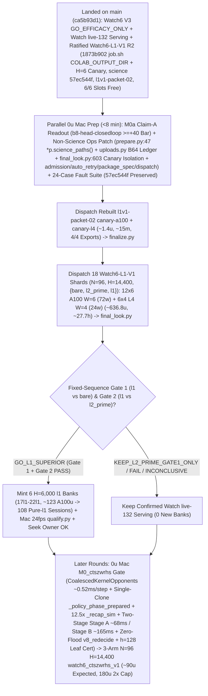

# T34 ExIt-B8 Research Roadmap (Round-22 Synthesis — Advice, Not Decisions)

Start: [project index](../INDEX.md) · [current status & authority](../STATUS.md) · [research record index](INDEX.md) · [study packages](../../research/INDEX.md) · [campaign log](final_run_20261019/CAMPAIGN_LOG.md).

> [!IMPORTANT]
> **Status: Research advice, NOT ratified decisions or release authorization.**
> Every current-round and later-round plan on this page is synthesized advisor guidance from Round 22 (2026-11-01 PT; primary synthesis artifact: `snake-dqn-artifacts/big-lever/exp/argon-rounds/round-22/synthesis/answer.md`, reconciling `round-22/{current,later,process}/answer.md` and `round-21/synthesis/answer.md` against `HEAD` `ca5b93d1` / `93c77f43` / `5541989e` and superseding Rounds 01–21). Nothing here amends a pre-registration, ratifies a confirmation gate, or changes served defaults. Binding campaign authority remains [`SUCCESS_CONTRACT.md`](final_run_20261019/SUCCESS_CONTRACT.md), [`DESIGN_V2_SHADOW.md`](final_run_20261019/DESIGN_V2_SHADOW.md) (+ Amendment 1), [`P7_STATISTICS.md`](final_run_20261019/P7_STATISTICS.md), unsuperseded parts of [`FINAL_PLAN.md`](final_run_20261019/FINAL_PLAN.md), and [`STATUS.md`](../STATUS.md); any serving or release change requires confirmation-lane evidence, Mac serving qualification, and the owner's explicit OK.

---

## 1. Snapshot Context & Code-Verified Round-22 State (`ca5b93d1`, Nov 1)

### 1.1 Watch6 V3 `GO_EFFICACY_ONLY`, Watch `live-132` release, all-length screen, `DeviceSim` parity, ratified `Watch6-L1-V1` & `l1v1-packet-01` -> `l1v1-packet-02` canary fix (`93c77f43` / `ca5b93d1`)

- **Watch6 V3 confirmation finished — `GO_EFFICACY_ONLY` (`52135312`, 2026-11-01 14:40 PT)** ([`REGISTRATION_V3.md`](../../research/watch6_search_efficacy_v3/REGISTRATION_V3.md), `t34-sol/watch6-v3-final-look-20261101/final-look-01/final_look.json`):
  - Sole registered final look (`75471246` V6.1 adapter) over all **`96/96` primary `H = 14,400` (`10 min @ 24 fps`) Watch6-v2 pairs** (`0` reserves, `24/24` L4 `W = 4` shards in `28` attempts — shards `00, 09, 12, 19` passed on single retry after the `09:16 PT` Fable-ratified quarantine of `23` historical non-V3 H100-503 manifests; `2,764,800/2,764,800` live-mirror frames matched):
  - **`Δdeaths/1k = -0.125`** (`CI95 [-0.153, -0.097] < 0`; `0.1580` vs `0.2830`, **`-44.2%`**) and **Fieller pooled mean-mass ratio `+63.7%`** (`CI95 [+49.8%, +78.5%] >= -5%`; **`+214.12` mass**, `550.25` vs `336.13`), with boost `0.733%` vs `0.625%`, `mean_max_length = 1,073.4` (peak `L <= 2,296`) vs `780.9`, and **`2,549.4` mean branches/session** (`5.67×` `H = 6,000`'s `449.6`, confirming superlinear late-horizon branch growth) $\Rightarrow$ **`ELIGIBLE_FOR_REPLAY_QUALIFICATION` for `exact-stop-l2-prime` (`L >= 600`) only**.
  - **Operational unlock:** Frees all **`6/6` Colab slots (`3 A100 + 3 L4`, balance `~2,154.0 u`)**, lifts V3's closure-hash freeze on `main`, and closes V3 non-`GO` counterfactual branches.
- **Watch `live-132` serving guards, Mac `24 fps` qualification & release — ALREADY LANDED (`dc834ded`–`f5912f44`, ~16:00 PT):**
  - [`.claude/launch.json`](../../.claude/launch.json) (`lines 8–11`) serves confirmed **`watch-replay-bank-live-132`** (`132` `exact-stop-l2-prime` `H = 6,000` sessions from banks `01–08, 10–12`) with **`SNAKE_WATCH_REPLAY_CONTROLLER=exact-stop-l2-prime`** on `:8000` (retaining `watch-replay-bank-live-168` on disk while `exact-stop-l1` awaits `H = 14,400` confirmation).
  - [`GameSession`](../../web/backend/session.py) gates Watch replay on [`_is_clean_mixed_watch6_b8()`](../../web/backend/session.py) (`lines 722–753`) across `__init__` (`line 573`), `_build` (`line 769`), `reset_game` (`line 1261`), and `set_mode` (`lines 1520, 1563, 1576`); refuses `MODE_TRAIN` on forward-only `EGO2S_OBS_SPECS`, `(RASTER31V2, RASTER31V3)`, and un-overridden `_reward_contract_mismatch` **before** calling `_leave_watch_replay()` (`lines 1510–1550`, with replay recovery on Watch fallback); and scopes `_replay_opted_out = True` to `set_epsilon` (`line 1204`), live `set_hero` change (`line 1222`), and `set_food` (`line 1241`), cleared by `_build` (`line 763`) and [`new_game()`](../../web/backend/session.py) (`lines 1279–1284`, wired to `"new_game"` in [`app.py`](../../web/backend/app.py) `line 311`).
  - [`ReplayBank`](../../web/backend/watch_replay.py) (`lines 348–417`) implements `SNAKE_WATCH_REPLAY_CONTROLLER` (`all | exact-stop-l2-prime | exact-stop-l1`, failing closed to live B8 on invalid values), line-1 [`peek_header`](../../web/backend/watch_replay.py) (`lines 138–150`, `0` non-target `verify_payload` decodes), cycle-1 `shuffle_discovery: bool = True`, shallow [`Recording.snapshot`](../../web/backend/watch_replay.py) (`lines 315–330`), and **`0.25 ms`-slice / `64`-frame cooperative GIL yield (`max(1.0 ms, 4.0 * slice_elapsed)` = `<= 20%` GIL duty cycle)** in [`verify_payload`](../../web/backend/watch_replay.py) (`lines 30–33, 244–275`).
  - [`research/watch_replay/qualify.py`](../../research/watch_replay/qualify.py) (`t34-sol/argon-replay-qual/SUMMARY.md`, Fable review `APPROVE_WITH_CONDITIONS` with `C1–C3` resolved at `fec81656`) passed `132/132` inventory parity, cold session readiness **`0.349–0.435 s` (`< 0.45 s`)**, concurrent cold-verification live-B8 fallback **`update p95 = 8.78 ms <= 11.688 ms`**, **`0/120` paced-`24 fps` overruns** (`step p99 = 11.34 ms <= 41.67 ms`), and seamless recorded playback cutover after **`~18.5–23.1 s`** (`recorded update p95 = 0.002 ms`).
- **All-length exact-stop screen — `ADOPT` for new replay banks; `36` `l1` sessions staged for `Watch6-L1-V1`** ([`watch6_alllen_screen`](../../research/watch6_alllen_screen/README.md), `t34-sol/argon-alllen-a100/analysis.json`, `N = 48` paired `H = 6,000` Watch6-v2 sessions):
  - `exact_stop_alllen` (`L >= 1`, `interval = 5`, `H = 300`) reached **`559.43` mass** (`+208.37` / Fieller `+59.35%` vs `bare` `351.07`; **`+98.27` / Fieller `+21.31%` vs `l2_prime_600` `461.16`**, `CI95 [+50.57, +145.98]`) and **`0.0521` `deaths/1k`** (`-81.9%` vs `bare` `0.2882`; **`-67.4%` / `-0.1076/1k` vs `l2_prime_600` `0.1597`**, `CI95 [-0.1609, -0.0544]`), cutting `L < 600` deaths **`53 (bare) / 34 (L >= 600) -> 1`** (`mean_max_length = 1,096.0`) at **`2.821×` branches** (`1,268.5` vs `449.6`, `1,200.1` roots = **`1.057` branches/root**, stopping on `bare` at **`94.3%`** of roots). **`14/15` remaining deaths occur at `L >= 600` (`13/15` at `L >= 800`, `-14.2%` per-frame `L >= 800` hazard at `1.379×` living exposure).**
  - Three `12`-session A100 banks (`14l1–16l1`, `W = 6`, `H = 6,000`, `t34-sol/argon-banks-l1/SUMMARY.md:38-40`) completed `36/36` on Cap-6 `36285bc6` in **`3.03–3.07 h/bank`** (**`~61.5 A100 u` total**). They remain unserved on disk (`watch-replay-bank-live-168`) pending `H = 14,400` `Watch6-L1-V1` confirmation, Mac qualification, and owner OK.
- **GPU `DeviceSim` v2 parity — `PASS` on A100** ([`devicesim_v2_parity`](../../research/devicesim_v2_parity/README.md), commit `b500d111`): **`0` mismatches** across **`1,536,000` snake-ticks** (`E = 256 × 1,000` Watch6-v2 ticks, `1,434.6` steps/s under SplitMix64 RNG and `<= 1e-4` CUDA FP32 near-tie tolerances; SplitMix64 cannot mint MT19937 live Watch replay banks).
- **Pre-Data Ratified `Watch6-L1-V1` Package (`cf07791b` / `ac250f05`), Full-`14,400`-Frame Mac Mirror Receipt, `l1v1-packet-01` Canary Failure (`17:29–17:30 PT`) & R2 Ratified Fix (`1873b902` / `93c77f43` / `ca5b93d1`):**
  - [`research/watch6_l1_confirm/`](../../research/watch6_l1_confirm/) (`7,105` LOC; [`REGISTRATION_L1_V1.md`](../../research/watch6_l1_confirm/REGISTRATION_L1_V1.md) SHA-256 `8b46779ff52d0c9648ff8de00c1893f77beb9bd99eb4a4e51afbe0bdf36800a0`; initial `cf07791b` science identity `c015d5cb906066842c04202b66dac778eb04fb0b9b917882e1385a0e4474e84f`) was ratified pre-data by Fable (`APPROVE-WITH-CONDITIONS` in `t34-sol/argon-l1v1-pkg/RULING_L1_V1.md` / `ruling-l1-v1.json`, delta review in `t34-sol/argon-l1v1-pkg/fable-review.md`; per Fable Condition 1, never cite `argon-l1v1-pkg-fix1/SUMMARY.md` or non-existent `prepare-receipt.json`).
  - **Full-`14,400`-Frame Mac 3-Arm Mirror Replaced `M0b` (`t34-sol/argon-l1v1-pkg-fix1/mac-mirror.json`, SHA-256 `de43850bc67bc230d6803335a6ce4635ac12767cc22354f5b28b92bc0a83a476`):** On excluded fixture seed `34910101`, `{bare, l2_prime, l1}` passed **`43,200/43,200` mirrored frames (`0` mismatches)** (`bare`: `291.8 s`, `2` deaths; `l2_prime`: `1,343.5 s`, `1,811` branches, `2` deaths; `l1`: `2,079.7 s` total / `1,763.9 s` search, `3,108` branches across `2,880` roots = **`1.079` branches/root**, `567.5 ms/branch`, **`1.892 ms/step`**, `612.5 ms/root`, `1` death at **`L = 1,694`** where both `l1` and `l2_prime` died after `l1` eliminated `l2_prime`'s `L = 307` death). Measured **`l1 / (bare + l2_prime)` wall ratio is `1.272×`** (`2,079.7 s` vs `1,635.3 s`; `l1 / l2_prime` search ratio `1.720×` / wall ratio `1.548×`), and the long-length serpentine probe ($L = 150 \to 1,500$, `2,950 -> 4,300` occupied board cells) measured a **`1.115×` step-cost ratio** (`1.997 -> 2.227 ms/step`).
  - **Prepared Canaries & `18` Single-Wave Shards (`t34-sol/argon-l1v1-pkg-fix1/staged-prep-check/forecast.json`, per Fable Condition 4):** Hardware-tier canaries (`canary-a100.json`, `canary-l4.json`, `~1.4 u` combined) and `18` single-wave primary shards (`00..11` A100 `W = 6`, `6` worlds/shard = `72` worlds `0..71`; `12..17` L4 `W = 4`, `4` worlds/shard = `24` worlds `72..95`; `0` reserve seeds) have a **receipts-based forecast of `~638.2 u` central** (`603.7–739.3 u` linear-to-p95 range; `558.6 A100 u + 78.1 L4 u + 1.4 canary u`, **`~27.7 h` calendar wall** across `3 A100 + 3 L4`, with `2×` timeouts `1,140 min` A100 / `1,080 min` L4 providing `>= 3.7×` headroom over the Mac-measured `1.272×` 3-arm ratio).
  - **Live `l1v1-packet-01` Canary Failure (`17:29–17:30 PT`), `job.sh` Fix + Fable R2 Ruling (`1873b902` / `93c77f43` / `ca5b93d1`) & Round-22 Zero-Amendment `prepare.py:206` Analysis (`t34-sol/l1v1-packet-01/output-canary-{a100,l4}/{terminal,receipt}.json`, [`job.sh:21-45`](../../research/watch6_l1_confirm/job.sh), [`protocol.py:258`](../../research/watch6_l1_confirm/protocol.py)):**
    Both `watch6-l1-canary-a100-l1v1-packet-01` (`elapsed 244.5 s`, `stop_verified = true`, `0.447 A100 u` observed / `0.531 u` priced) and `watch6-l1-canary-l4-l1v1-packet-01` (`elapsed 249.6 s`, `stop_verified = true`, `0.103 L4 u` observed / `0.133 u` priced) failed with `failure_class = "CHILD_NONZERO_EXIT"` (`returncode = 1`, `exports = []`) on `/content/snake-cli/<gen>/repo/research/watch6_l1_confirm/job.sh: line 21: COLAB_EXPORT_DIR: unbound variable` because [`runtime.py:575-576`](../../research/colab_cli/runtime.py) sets `COLAB_OUTPUT_DIR=$ROOT/output` (`_exports` at `runtime.py:122` scans `self.paths.output_dir`), not `COLAB_EXPORT_DIR`. Because [`protocol.py:258`](../../research/watch6_l1_confirm/protocol.py) hashes `SCRIPT = "research/watch6_l1_confirm/job.sh"` into `protocol.identity()`, editing `job.sh` directly (`1873b902`: `COLAB_OUTPUT_DIR` + `--fixture-horizon 6` + runtime-env `job.sh` e2e test) mutated `science` (`c015d5cb…e84f` $\to$ **`57ec544f…`**), requiring a full `14,400×3` Mac mirror re-run (`0` mismatches) and **Fable R2 `APPROVE_WITH_CONDITIONS`** (ruling an amendment to `REGISTRATION_L1_V1.md` §5.2 canary fixture horizon `H=60 -> H=6`, moving the old `cf07791b` receipt to `superseded-cf07791b/`, and rebuilding canaries in `t34-sol/l1v1-packet-02`, merged on `main` at `93c77f43` / `ca5b93d1`). Rebuilt `l1v1-packet-02` canaries **passed** (`A100 365 s`, `L4 421 s`, `stop_verified = true`), and all `18` primary manifests (`t34-sol/l1v1-main-01`, commit `1873b902`, identity `57ec544f`) are now **dispatched / running** (`a3135483`). Round 22's synthesis (`round-22/synthesis/answer.md`) also documents the **`0`-science-hash `prepare.py:206` pattern** (`"COLAB_EXPORT_DIR": "../output"` in `common["env"]`) for non-science env fixes and highlights why **`final_look.py:603-702` fixture-canary isolation** is required before sole final look (because `l1v1-packet-01`'s failed canary manifests in `ops/manifests/` carry the superseded `c015d5cb…` science hash and `CHILD_NONZERO_EXIT`).
- **Still unrun / unshipped on `main` at `ca5b93d1`:**
  1. `0 u` Mac `M0a` readout on completed `b8-head-closedloop` (`t34-sol/b8-head-closedloop/main-01/output/receipt.json`, `rc = 0`, `4.51 A100 u`; `readout-01` still absent; `spatial-qbytes-01` is strictly a GPU Q-byte/`.so` cache parity & throughput ruler, with the `40–48 A100 u` `spatial-student-pilot` fit canceled at `0 u`).
  2. Remaining non-science operational patches from Round 22's synthesis to [`prepare.py`](../../research/watch6_l1_confirm/prepare.py), [`uploads.py`](../../research/watch6_l1_confirm/uploads.py), [`admission.py`](../../research/watch6_l1_confirm/admission.py), [`recover.py`](../../research/watch6_l1_confirm/recover.py), [`final_look.py`](../../research/watch6_l1_confirm/final_look.py), [`package_spec.py`](../../tools/ops/package_spec.py), [`auto_retry.py`](../../tools/ops/auto_retry.py), [`dispatch.py`](../../tools/ops/dispatch.py), and [`ready_queue.py`](../../tools/ops/ready_queue.py) (all outside [`protocol.science_paths()`](../../research/watch6_l1_confirm/protocol.py) `lines 73–82`), live `Watch6-L1-V1` Colab execution (`l1v1-packet-02`), and later-round `CTS-ZWRHS-L1`.

### 1.2 Closed single-pass critics, distillations, RL, and standalone macro fallbacks

Between 2026-10-29 and 2026-11-01, every single-pass learned-policy, critic, distillation, and standalone macro-fallback track closed below its promotion or selectivity bars:

| Track | Scope & primary artifact | Measured outcome | Disposition |
| --- | --- | --- | --- |
| **TRAIN-01** ([`sandbox_a_resident`](../../research/sandbox_a_resident/README.md)) | `100.7M`-row (`384`-update) GPU-resident PPO from `b8-s3` (`t34-sol/train01-closeout/SUMMARY.md`) | H5000 equal-mix paired mass **`+8.09`** (`CI95 [-18.66, +34.85]`; scripted `+26.32`, frozen `+2.85`, mixed `-4.90`; update-320 peak `+14.23` `[-11.86, +40.32]`) vs bar `>= +40` | **Closed** (no strict-gate nomination) |
| **C/T Stage-2 distillation** | Continuation-teacher causal-root distillation (`t34-sol/ct-stage2-verdict/SUMMARY.md`) | Teacher rescued **`22/32` (`68.75%`)** deaths (`22/32 <= 65` ticks; indep-suffix H300 `+66.77`, `LB90 +51.61`), but student retention was **`46.9–50.0%`** (`0 pp` over `frozen_phi` vs `>= +15 pp`; topology AUC `0.5752 < 0.83`), ordinary flips **`44.4–64.5%`** (bar `<= 1%`), and lethal ordinary flips **`3–5`** (bar `<= 1`) | **`FAIL_DISTILLATION_RETENTION_OR_SAFETY`** |
| **Doom U-Net & `spatial-student-pilot`** | `83 × 145` spatial U-Net vs 33.7k B8-feature head (`t34-sol/doom-result-01/result.json`; `t34-sol/student-direction/{astra,fable}.md`) | Spatial U-Net lost late per-action doom ROC-AUC to frozen B8 features (**`0.753` vs `0.810`**, `Δ = -0.056`, `CI95 [-0.091, -0.023]`; all-strata death-lookback `0.7626` vs `0.8226`; ordinary late `0.690` vs `0.706`) | **`GRAY` / `40–48 A100 u` pilot fit canceled (`0 u`; retain `.so` caches)** |
| **B8 advantage head (offline OOF)** | `256 -> 128 -> 6` ReLU head on frozen B8 features (`t34-sol/b8-head-test/RESULT.md`) | Mass rule `GO` (late H300 `+30.09`, `LB90 +23.96`), Fable selectivity **`FAIL`**: **`26.42%`** late rescue (bar `>= 35%`) at **`97.60%`** non-death flips (bar `<= 15%`) | **Selectivity `FAIL`** (192-world closed-loop A100 `rc = 0`, awaiting Mac `M0a` readout) |
| **T4 Gate-1 factored critic** ([`t4_gate1`](../../research/t4_gate1/README.md)) | Clean-slate privileged `83 × 145` (`H = 320` 7-source BFS) hazard + foraging mass-flux critic on `384` disjoint Watch6-v2 worlds (`t34-sol/argon-t4-gate1-fix2/queue-03/READOUT.json`) | **`0/8` bars passed**: `L >= 600` residual EV **`+0.0266`** (`[-0.0280, +0.0869]` vs `>= 0.25`), death-root H300 rescue **`+19.99`** (vs `>= +40`), mature doom AUC **`0.5617`** (vs `>= 0.80`), ordinary H300 mass **`-22.21`** (vs `>= -15.0`), lethal flips **`3.13%`** (vs `<= 3.0%`) | **`KILL_T4`** (proves even privileged `83 × 145` critic lacks late value signal) |
| **R6 `L < 600` harvest census** ([`r6_l600_census`](../../research/r6_l600_census/README.md)) | `64`-world (`384`-root) Watch6-v2 early-game counterfactual + 5-fold OOF corpse/trail plane probes (`t34-sol/argon-mac-checks/r6-census/RESULT.json`) | **`34.90%` (`134/384`)** oracle-harvestable roots (`>= +5` H500 mass), **`7.69%`** non-bare H500 lethal flips, OOF ROC-AUC **`0.474–0.521`** (`0` passing threshold points); superseded operationally by `exact-stop-l1` | **`KILL`** |
| **R7 macro-option fallback** ([`r7_macro_fallback`](../../research/r7_macro_fallback/README.md)) | Pruned depth-2 (`2K = 30` ticks) spatial macro-options `{O_0..O_5}` on C/T train `1-step-all-die` roots (`t34-sol/argon-r7-repack/R7_READOUT.json`) | `3/5` bars passed (`0.316 ms` Mac 1-thread p95; **`33.0%` vs `9.0%`** `L >= 800` `all_die_sel0` rescue on `25/129` roots — `9/25` `macro_triggered` at `+66.7 pp` rescue vs `16/25` tick-`30` B8 re-traps, while `104/129` `80.6%` survived `H = 300` inside uncertified coils), but total `L >= 600` lift **`+3.85 pp`** (`< +10.0 pp`) and **`2 > 0`** ordinary lethal flips (`0` assessment roots opened) | **`KILL`** as standalone `30`-tick fallback |

### 1.3 Eight Code-Verified Round-22 Advances Over Round 21 (`ca5b93d1` / `93c77f43` / `5541989e`)

1. **`l1v1-packet-01` `COLAB_EXPORT_DIR` canary failure, `job.sh` R2 fix (`1873b902` / `93c77f43`) & zero-science-hash `prepare.py:206` pattern (`t34-sol/l1v1-packet-01/output-canary-{a100,l4}/{terminal,receipt}.json`, [`job.sh:21-45`](../../research/watch6_l1_confirm/job.sh), [`protocol.py:258`](../../research/watch6_l1_confirm/protocol.py), [`prepare.py:206`](../../research/watch6_l1_confirm/prepare.py)):**
   `l1v1-packet-01` failed on `job.sh:21` `COLAB_EXPORT_DIR: unbound variable` because `runtime.py:575-576` sets `COLAB_OUTPUT_DIR=$ROOT/output`. Because `protocol.py:258` hashes `job.sh` into `protocol.identity()`, editing `job.sh` directly (`1873b902`: `COLAB_OUTPUT_DIR` + `--fixture-horizon 6`, merged at `93c77f43`) mutated `science` (`c015d5cb…e84f` $\to$ **`57ec544f…`**), requiring a `14,400×3` Mac mirror re-run (`0` mismatches) and Fable R2 `APPROVE_WITH_CONDITIONS` (amending `REGISTRATION_L1_V1.md` §5.2 `H=60 -> H=6`, moving `cf07791b` receipt to `superseded-cf07791b/`, and rebuilding `t34-sol/l1v1-packet-02`). Round 22's synthesis also documents the zero-science-hash alternative (`"COLAB_EXPORT_DIR": "../output"` in `prepare.py:206`'s `common["env"]`) so future non-science env fixes never mutate `protocol.identity()`.
2. **Remote VM commit-pin & [`_require_published_pin()`](../../research/watch6_l1_confirm/prepare.py) (`line 47`) closure bug ([`source.py:251,291`](../../research/colab_cli/source.py)):**
   [`source.py:251,291`](../../research/colab_cli/source.py) checks out `plan["commit"]` on remote VMs, so [`tools/ops/package_spec.py`](../../tools/ops/package_spec.py) edits never run on VMs if manifests remain pinned to an older commit; meanwhile `prepare.py:47` checks `git diff --quiet commit -- *p.source_paths()`, crashing [`recover.py:104,130`](../../research/watch6_l1_confirm/recover.py) if non-science files differ from `commit`. Restricting `prepare.py:47` to `*p.science_paths()` (`protocol.py:73-82`), pushing `<ops_fix_sha>`, and re-running `prepare.py --commit <ops_fix_sha> --pending-canary` (preserving `science == 57ec544f…`) ships the VM-side fix cleanly.
3. **Failed/superseded `l1v1-packet-01` fixture canaries poison [`final_look.py:603-702`](../../research/watch6_l1_confirm/final_look.py):**
   In `final_look.py:591-702`, `check_attempt_accounting()` checks `if science != expected_science` (`line 603`) and `_classify_attempt()` (`line 622`) *before* checking `canary.is_canary(exec_manifest)` (`line 670`), so `l1v1-packet-01`'s failed `CHILD_NONZERO_EXIT` fixture canaries in `ops/manifests/` (`science = c015d5cb… != 57ec544f…`) abort `final_look.py:282` (`foreign science identity` and `forbidden failure class`) even after `l1v1-packet-02`'s canaries pass. Branching on `canary.is_canary(exec_manifest) or WATCH6_FIXTURE == "1"` *before* `line 603` and `line 622` (requiring `stop_verified == True` and `0` `world-XX.json` files) and recording non-`PASS` or prior-`science` fixture canaries as `"canary_failed"` / `"canary_superseded"` while enforcing `>= 1` current-`science` (`57ec544f…`) `PASS` canary per GPU tier at `line 728` isolates `l1v1-packet-01` without weakening science admission.
4. **Tier-0 `completion_attempt = 0` auto-retry counter rejections ([`final_look.py:368-387`](../../research/watch6_l1_confirm/final_look.py), [`admission.py:876-879`](../../research/watch6_l1_confirm/admission.py), [`auto_retry.py:265-420`](../../tools/ops/auto_retry.py)):**
   Keeping `completion_attempt = 0` on Tier-0 `0`-world pre-start retries triggers three rejections missed in Round 21: `final_look.py:369` rejects `not 1 <= top_comp <= 2` whenever `RETRY.json` exists; `admission.py:876-879` requires `prestart_used == 0` when `stage == "probe"`; and `auto_retry.py:318,398` enforces a blanket `attempt < 2` cap. Permitting `top_comp == 0` when `prestart_retries_used >= 1` (`final_look.py:368-387`), allowing `prestart_used >= 0` (`total_dispatches == 1 + prestart_used`) on `probe` (`admission.py:876-879`), and delegating `watch6_l1_v1` eligibility in `auto_retry.py:265-420` to `admission.is_prestart_transport_failure()` (bypassing `completion_limit <= 2` on `0`-world pre-start drops) resolves all three.
5. **Zero-canary Tier-1 recovery via `WATCH6_RECOVERY_LEDGER_B64` ([`prepare.py:181-188`](../../research/watch6_l1_confirm/prepare.py), [`canary.py:318`](../../research/colab_cli/canary.py), [`recover.py:104`](../../research/watch6_l1_confirm/recover.py), [`uploads.py:158-170`](../../research/watch6_l1_confirm/uploads.py)):**
   `prepare.py:181-188` packs `verified-ledger.json` into `input-metadata.tar.gz`, so changing the ledger on a Tier-1 partial-world retry mutates `input-metadata.tar.gz`'s SHA-256 and fails `canary.py:318` unless new recovery canaries run. Passing `reuse_staged_inputs` + `pending_canary=False` in `recover.py:104` keeps `input-metadata.tar.gz` byte-identical while overlaying the Mac-verified union ledger via `WATCH6_RECOVERY_LEDGER_B64` + `WATCH6_RECOVERY_LEDGER_SHA256` in `uploads.py:158-170` (**`0` recovery canaries**).
6. **Pre-allocation tree check, Fable Condition 2, paired `.complete` signal shield & `alloc.lock` settle ([`admission.py:55-66,222-242,474-490`](../../research/watch6_l1_confirm/admission.py), [`package_spec.py:68-82`](../../tools/ops/package_spec.py), [`dispatch.py:2849`](../../tools/ops/dispatch.py), [`ready_queue.py:625-795`](../../tools/ops/ready_queue.py)):**
   Retain Round 21's verified fixes: allow `staging/*`, `accounting-baseline.json`, and `public-input-preflight.json` in `_prealloc_tree_clean()`; restrict `INERT_MACOS_METADATA_NAMES` to top-level directories and refuse `world-XX.json`/`.complete` beneath them (Fable Condition 2); mask `{SIGUSR1, SIGTERM}` and pair `world-XX.json.complete` with `.meta.json.complete` in-process in `package_spec.py`; and run `check_capacity_and_settle()` inside `ops/alloc.lock` (`>= 20 s` start settle + `>= 30 s` post-stop settle) before creating `ops/dispatch/<name>` or `ops/manifests/<name>.json`.
7. **Why singleton `E = 1` rollouts take `1.892 ms/step` (`612.5 ms/root` in `mac-mirror.json`) — `12` full-board passes/tick & `CoalescedKernelOpponents` ([`product.py:63-73`](../../research/watch_replay/product.py), [`eval_engine.py:518-521`](../../src/simd_env/eval_engine.py), [`vector61_policy.py:725-830`](../../src/simd_env/vector61_policy.py), [`v8_nb.py:1033-1086`](../../src/simd_env/v8_nb.py)):**
   `open_watch()` (`product.py:63-73`) creates 5 distinct `Vector61SimdPolicy` instances (`veto_slots=(1,)..(5,)`), so `_dispatch_actions()` (`eval_engine.py:518-521`) executes 5 separate `N = 1` calls/tick (`5` `decision_free_space` + `5` `"painted"` `v8_decide` = `10` passes, plus hero `v8_scalars` `"painted"` 11th pass and `observe_step` 12th pass). Replacing opponent policies inside search clones with `CoalescedKernelOpponents` (`(5E, 2)` `"kernel"` call: `rowwise` Q-forwards, bypassing `decision_free_space`, single `v8_decide(..., membership="owner_pad")` with `O(5)` `seg_count` sum at `v8_nb.py:1034`) + `owner_pad` hero `v8_scalars` + single-clone `_policy_phase_prepared = True` + `12.5×` `_recap_sim(sim, max_seg + 132)` + binary `full_digest` v3 cuts step cost **`~3.6×` (`1.892 -> ~0.52 ms/step`)**: Stage A (`E = 1` `bare`, $H_{\text{sim}} = 128$, `92.1–94.3%` of roots) takes **`~68 ms`** (revising Round 21's uncalibrated `~15 ms`), Stage B (`E = B - 1 <= 5` lockstep, `< 7.9%` of roots) takes **`~165 ms`**, and mean root latency drops from **`612.5 ms` to `~80 ms/root`** (`7.7×` faster, well inside the `208.3 ms` 5-tick `24 fps` budget for `P1+3W` `ShadowSpine`).
8. **Zero-extra-flood [`v8_redecide`](../../src/simd_env/v8_nb.py) (`line 1838`) rollout shield & $h = 128$ leaf certification ([`ego_raster.py:511`](../../src/simd_env/ego_raster.py), [`v8_nb.py:259,1838`](../../src/simd_env/v8_nb.py)):**
   `EgoRasterExtractor.extract` (`ego_raster.py:511`) already computes `res = v8_BatchResult` (`bfs_owner` + `tail_steps` + `area[e, 6]` + `c2[e, 6]`) on every hero rollout tick (`0` extra floods) and discards `res`. Retaining `obs["v8_result"] = res` lets rollout steps $h = 1 \dots 127$ replace raw $\arg\max_a Q_{\text{B8}}$ with [`v8_redecide(res, q, mask, lam=8.0)`](../../src/simd_env/v8_nb.py) (`line 1838`, `0` extra floods; `_bfs_owner` at `v8_nb.py:259` `d + 1 < rel_val[nidx]` cannot leak past boundary $\tau > V$) and certifies leaf $h = 128$ via Tier-1 ($\max_{a:\neg\text{risky}} \text{res.area}[0, a] \ge \min(L_{128}, \text{res.area\_cap}[0])$, `0` floods) or Tier-2 `TailTrackWitness` (`ext_gain >= L_128`, `min_boost_length = 5`, `< 7%` of leaves, `~0.15 ms`), yielding $H_{\text{eff}} = 128 + \min(L_{128}, 1600) \in [928, 1728] > 1694$ (where both `l1` and `l2_prime` died in `mac-mirror.json`).

---

## 2. Current-Round Plan (Advice, Not Decisions)

### 2.1 `0 u` Mac `M0a` Claim-A closeout (`< 2 min`) & C4 telemetry

1. **Run `M0a` Claim-A readout (`< 2 min` Mac, `0 u`) & enforce binding v1 `H = 5,000` `>= +40` closure bar:**
   - Run [`closedloop_readout`](../../research/INDEX.md) (`t34-sol/b8-head-closedloop/SUMMARY.md:50-52`, `origin/astra-doom-auc-smoke` @ `591d94c3`) on completed `b8-head-closedloop` (`N = 192` v1 `H = 5,000` worlds, `m in {0, 10, 25, 50}`, `4.51 A100 u`). Audit `spatial-qbytes-01` (`t34-sol/spatial-qbytes-fix/SUMMARY.md:85-88`) strictly as a Q-byte/`.so` cache ruler (`40–48 A100 u` `spatial-student-pilot` fit stays canceled at `0 u`).
   - **Recommended Claim-A kill rule:** Permanently **close Claim A (`0 u`)** unless some fixed `m in {0, 10, 25, 50}` clears [`SUCCESS_CONTRACT.md`](final_run_20261019/SUCCESS_CONTRACT.md) §2 (`lines 29–33`) and [`P7_STATISTICS.md`](final_run_20261019/P7_STATISTICS.md) §§3–4 (`lines 33–48`): pooled mass **`>= +40.0`**, Bonferroni-4 `LB97.5 > 0`, scripted Guard B `>= +0.03` (`0` mix losses), Guard A `Δalive >= -0.05` pooled / `>= -0.075` single mix, and living overrides `<= 15%`, followed by a `0 u`, `10 min` `[0.5×bare, 10%]` v2 boost check before nominating any Mac strict gate.
2. **Monitor live `:8000` `watch-replay-bank-live-132` C4 telemetry (`0 u`):**
   - Keep `watch-replay-bank-live-132` (`exact-stop-l2-prime`) live on `:8000`, monitor `update_ms` / overrun telemetry (Fable C4), and mint **`0`** new `.watch.gz` banks before `Watch6-L1-V1`'s verdict lands.

### 2.2 `0 u` Non-Science Ops Patch, Re-Prepare at `<ops_fix_sha>` & 24-Case Smoke (`< 8 min`, `0` Science-Hash Change)

With `1873b902` (`job.sh` `COLAB_OUTPUT_DIR` + `--fixture-horizon 6`, Fable R2 `APPROVE_WITH_CONDITIONS`, new ratified science identity `57ec544f…`, `t34-sol/l1v1-packet-02`) merged on `main` at `93c77f43` / `ca5b93d1` (and Round 22's `prepare.py:206` `"COLAB_EXPORT_DIR": "../output"` pattern documented as the `0`-science-hash alternative for non-science env fixes), all remaining operational edits below are outside [`protocol.science_paths()`](../../research/watch6_l1_confirm/protocol.py) (`lines 73–82`), preserving the R2-ratified science identity **`57ec544f…`** (or `c015d5cb…e84f` on a `cf07791b` branch; active transport tree `36285bc6` valid; work in a fresh worktree with V3/`ops/`/`exports/`/`pair-*.json` untouched):

1. **`watch6_l1_confirm` non-science `prepare.py`, `uploads.py`, `admission.py`, `recover.py` & `final_look.py` patches:**
   - **[`prepare.py`](../../research/watch6_l1_confirm/prepare.py) (`lines 47, 173, 206`):** Change `_require_published_pin()` at `line 47` from `*p.source_paths()` to `*p.science_paths()`; add `reuse_staged_inputs: Path | None = None` at `line 173`; and optionally export `"COLAB_EXPORT_DIR": "../output"` in `common["env"]` at `line 206` as a backward-compatible alias alongside `job.sh`'s `COLAB_OUTPUT_DIR` (`1873b902`).
   - **[`uploads.py`](../../research/watch6_l1_confirm/uploads.py) (`lines 158–170`) & [`recover.py`](../../research/watch6_l1_confirm/recover.py) (`lines 104, 120–143`):** Add `--canary-a100-receipt`, `--canary-l4-receipt`, and `--no-pending-canary` to `recover.py:main()`, pass `reuse_staged_inputs` + `pending_canary=False` in `recover.py:104`, and overlay `WATCH6_RECOVERY_LEDGER_B64` + `WATCH6_RECOVERY_LEDGER_SHA256` in `uploads.py:158-170` (`0` Tier-1 recovery canaries).
   - **[`admission.py`](../../research/watch6_l1_confirm/admission.py) (`lines 55–66, 222–242, 474–490, 860–885`):** Permit `staging/*`, `accounting-baseline.json`, and `public-input-preflight.json` in `_prealloc_tree_clean()`; restrict `INERT_MACOS_METADATA_NAMES` to top-level directories and refuse `world-XX.json`/`.complete` beneath them (Fable Condition 2); treat `exports <= {"performance.json", "workload-started.json"}` (`0` `world-*.json`) as pre-start; and allow `prestart_used >= 0` (`total_dispatches == 1 + prestart_used`) when `stage == "probe"` at `lines 876–879`.
   - **[`final_look.py`](../../research/watch6_l1_confirm/final_look.py) (`lines 1, 368–460, 603–702`):** Branch on `canary.is_canary(exec_manifest) or WATCH6_FIXTURE == "1"` *before* `line 603` (`science != expected_science`) and `line 622` (`_classify_attempt()`, recording failed/superseded fixture canaries such as `l1v1-packet-01`'s `c015d5cb…` `CHILD_NONZERO_EXIT` manifests in `ops/manifests/` as `"canary_failed"` once `stop_verified == True` and `0` `world-XX.json` exist, while requiring `>= 1` current-`science` `57ec544f…` `PASS` canary per GPU tier at `line 728`); permit `top_comp == 0` when `prestart_retries_used >= 1` (`lines 368–387`); unify unallocated + `RETRY.json` + `recover.py` parent lineage chains (`lines 388–460`); and add a line-1 `python -B` (`/tmp` cache) self-reexec guard to `final_look.py` and `recover.py`.
2. **`tools/ops/` paired `.complete` signal shield, Tier-0/1 `auto_retry.py` & pre-`mkdir` `alloc.lock` settle ([`package_spec.py`](../../tools/ops/package_spec.py), [`auto_retry.py`](../../tools/ops/auto_retry.py), [`dispatch.py`](../../tools/ops/dispatch.py), [`ready_queue.py`](../../tools/ops/ready_queue.py)):**
   - In [`package_spec.py:publish_immutable()`](../../tools/ops/package_spec.py) (`lines 68–82`), mask `{SIGUSR1, SIGTERM}` via `signal.pthread_sigmask` during payload + `.sha256` writes and pair `world-XX.json.complete` with `world-XX.meta.json.complete` in-process so `SIGUSR1` (`run.py:212`) cannot split a world/meta pair without touching `run.py` or `job.sh`.
   - In [`auto_retry.py`](../../tools/ops/auto_retry.py) (`lines 265–420`), add `watch6_l1_confirm.admission.admit` to `package_check()`, delegate `watch6_l1_v1` eligibility to `admission.is_prestart_transport_failure()` (accepting `rc = 74`, all **7** mechanical `ACCOUNTING` strings, and `0`-world pre-start drops while bypassing `completion_limit <= 2`), and on Tier-0 pre-start retries keep `completion_attempt = 0` while incrementing `watch6_l1_v1["prestart_retries_used"]` and appending `prior_receipts` (`0` extra canaries).
   - In [`dispatch.py`](../../tools/ops/dispatch.py) (`line 2849`) and [`ready_queue.py`](../../tools/ops/ready_queue.py) (`lines 625–795`), pass `--no-internal-retry` and run side-effect-free `check_capacity_and_settle()` inside `ops/alloc.lock` (`total < 6`, `L4 < 3`, `0` `pending-*.json`, **`>= 20 s` start settle + `>= 30 s` post-stop settle** after any sibling `stop_verified`) **before** creating `ops/dispatch/<name>` or `ops/manifests/<name>.json` (fixing `retire_unavailable()` at `line 435` to use `Path(row["argv"][1]).name` and waiting for `^EXIT=\d+$` + `reconcile_unavailable()` on single-GPU receipts).
3. **Commit `<ops_fix_sha>`, Re-Prepare Manifests & Run 24-Case Smoke (`0 u`, `< 8 min`):**
   - Commit and push `<ops_fix_sha>` (so `source.py:251,291` checks out the patched `package_spec.py` on VMs), and re-run `prepare.py --commit <ops_fix_sha> --pending-canary` reusing the R2-ratified Mac mirror, `benchmark.json`, `cost-evidence.json`, and R2 ruling receipt.
   - **Smoke & kill rule (`0 u`):** Verify `protocol.identity()` (`57ec544f…`) is unchanged and pass `tests/test_watch6_l1_confirm.py` + the 24-case fault-injection suite on [`tests/fixtures/fake_colab.py`](../../tests/fixtures/fake_colab.py) (including `l1v1-packet-01`'s failed/superseded fixture canaries, `top_comp == 0` Tier-0 retry chains, and `WATCH6_RECOVERY_LEDGER_B64` Tier-1 overlay). Abort dispatch if `protocol.identity()` changes, if `l1v1-packet-01`'s failed canaries poison `final_look.py`, if any `0`-world failure increments `compute_completion_attempt`, or if `world-XX.json` ever publishes without `.meta.json`. (Keep Stage-2 additive `colab_cli` via [`requalify.sh`](../../tools/ops/requalify.sh) metric-gated iff Stage 1 incurs `>= 2` WS timeouts or `> 2.0 u` in Tier-1 recovery canaries.)

### 2.3 Dispatch Ratified 3-Arm Fixed-Sequence `Watch6-L1-V1` (`N = 96, H = 14,400`, `~638.2 u` across `3 A100 + 3 L4`)

With `Watch6-L1-V1` ratified on R2 by Fable (`93c77f43` / `ca5b93d1`, `science = 57ec544f…`, `REGISTRATION_L1_V1.md` §5.2 canary `H = 6` amendment, `l1v1-packet-02`), full-`14,400`-frame Mac 3-arm mirror verified (`43,200/43,200` frames, `0` mismatches, `1.272×` wall ratio), and all `6/6` Colab slots free:

1. **Tier Canaries (`~1.4 u`, `~15 min`):** Dispatch `canary-a100.json` (`15 min` base / `30 min` 2×, `4.0 u` 2× cap) and `canary-l4.json` (`15 min` base / `30 min` 2×, `1.25 u` 2× cap) from `t34-sol/l1v1-packet-02/` (`job.sh` `COLAB_OUTPUT_DIR` + `--fixture-horizon 6`), verify `4/4` exported artifacts (`world-00.json`, `world-00.meta.json`, `performance.json`, `run-summary.json`), and seal the 18 primary manifests via [`finalize.py`](../../research/watch6_l1_confirm/finalize.py).
2. **18 Primary Shards (`~636.8 u` central, `603.7–739.3 u` total incl. canaries, `~27.7 h` calendar wall across `3 A100 + 3 L4`):**
   - **Shards `00..11` (`12` A100 shards, `W = 6`, `6` worlds/shard = `72` worlds `0..71`):** `4` waves on `3` A100s (`~6.92 h`, `~46.55 u/shard` at `6.73 u/h` = `~558.6 A100 u`; `base_minutes = 570`, `2x timeout = 1,140 min`, `2x unit_cap = 152.0 u`).
   - **Shards `12..17` (`6` L4 shards, `W = 4`, `4` worlds/shard = `24` worlds `72..95`):** `2` waves on `3` L4s (`~6.71 h`, `~13.02 u/shard` at `1.94 u/h` = `~78.1 L4 u`; `base_minutes = 540`, `2x timeout = 1,080 min`, `2x unit_cap = 45.0 u`).
3. **Sole Final Look & Fixed-Sequence Decision Rules (`python -B -m research.watch6_l1_confirm.final_look`, $\alpha = 0.05$, `df = 95`):**
   - **Gate 1 (`l1` vs `bare`, $\alpha = 0.05$):** `UB95(Δdeaths/1k) < 0` (nondegenerate) AND paired Fieller pooled mass `LB95 >= -5.0%` (`-0.05`, bounded & connected).
   - **Gate 2 (`l1` vs `l2_prime`, tested ONLY IF Gate 1 passes, $\alpha = 0.05$):** `UB95(Δdeaths/1k) < 0` (nondegenerate) AND paired Fieller pooled mass `LB95 >= -2.5%` (`-0.025`, bounded & connected) AND session-denominator `Δd_ge800/1k UB95 <= +0.05/1k` (zero-variance `[0, 0]` passes).
   - **If `GO_L1_SUPERIOR` (Gate 1 PASS + Gate 2 PASS):** Mint **`6` `H = 6,000` `exact-stop-l1` `.watch.gz` banks** (`17l1–22l1`, `72` sessions, `~123 A100 u` in `~6.1 h` $\rightarrow$ **`108` pure-`l1` sessions** with `14l1–16l1`), pass Mac `24 fps` [`qualify.py`](../../research/watch_replay/qualify.py), and seek **owner OK** for Watch cutover.
   - **If `KEEP_L2_PRIME_GATE1_ONLY` / `FAIL_GATE1` / `INCONCLUSIVE_GATE1`:** Retain confirmed `watch-replay-bank-live-132` (`0` new banks) and advance to §3 (`CTS-ZWRHS-L1`).

---

## 3. Later-Round Plan: Coalesced Two-Stage Zero-Copy Witness & Root-Hoisted Horizon-Certified Search (`CTS-ZWRHS-L1`) & Spawned `P1+3W` `ShadowSpine` (Advice, Not Decisions)

### 3.1 `CTS-ZWRHS-L1`: `CoalescedKernelOpponents` (`~0.52 ms/step`), Single-Clone `_policy_phase_prepared`, Two-Stage Exact-Stop (`~68 ms` / `~80 ms/root`), and Zero-Flood [`v8_redecide`](../../src/simd_env/v8_nb.py) + $h = 128$ Leaf Certification

1. **`CoalescedKernelOpponents` + `owner_pad` (`12 -> 3` passes/tick, `1.892 -> ~0.52 ms/step`) & single-clone `_policy_phase_prepared = True`:**
   - Replace the 5 separate `Vector61SimdPolicy` opponent instances ([`product.py:63-73`](../../research/watch_replay/product.py), [`eval_engine.py:518-521`](../../src/simd_env/eval_engine.py)) inside search clones with **`CoalescedKernelOpponents`**: extract `(5E, 61)` features, run batched `rowwise` Q-forwards, skip `decision_free_space` (`vector61_policy.py:816`), and invoke **one** `v8_decide(..., membership="owner_pad")` call across all `5E` opponents (`1` coarse rasterization + `1` parallel `prange` BFS) with an `O(5)` `seg_count[e, o]` sum at [`v8_nb.py:1034`](../../src/simd_env/v8_nb.py). Keep **5 separate `Vector61SimdPolicy` objects on the main/shadow spine** (so `live_vetoes[int(env)]` at `vector61_policy.py:761` never collides across opponent slots `1..5`), and hoist step-0 root opponent `v8_decide` before branching to obtain exact `opp_actions_t[j]` and **`res_opp.outcome[j] == 2` (`OUTCOME_NO_SPACIOUS = 2` at [`v8_nb.py:75`](../../src/simd_env/v8_nb.py))** at `0` extra floods.
   - In [`ego_raster_bv8.py`](../../src/simd_env/ego_raster_bv8.py) (`line 73`) and [`bl_k1/native.py`](../../research/bl_k1/native.py) (`line 93`), use `membership = "owner_pad" if hasattr(sim, "_owner_pad") else "painted"` (preserving live Watch compatibility with [`LiveV8Source`](../../src/simd_env/ego_live_bv8.py) `lines 51–92`).
   - Set `root.sim._policy_phase_prepared = True` at selector capture (fixing [`_clone_root`](../../research/bl_served_search/ruler_operator.py) `line 57`, which overwrote `_policy_phase_prepared` to `False` and forced [`rollout_all`](../../research/t3_rollout_labels_20261015/bank_engine.py) `line 543` to clone a third time before [`step_prepared`](../../research/t3_rollout_labels_20261015/bank_engine.py) `line 468`), pass `[]` for `hero_policies` in `step_prepared` (`line 471`), reuse `selected["bare"]` in [`choose`](../../research/watch_replay/engine.py) (`line 165`), apply `_recap_sim(sim, max_seg + H_sim + 2)` + `_clone_mutable` ([`teacher.py:69-147`](../../research/t33_batched_teacher/teacher.py), shrinking `14,704`-cap `1.41 MiB` `sim.bodies` rings **`12.5×` to `~115 KiB`**), and replace dual JSON `.tolist()` `_root_bytes` with binary `full_digest` v3 ([`shadow.py:146-250`](../../research/t34_shadow/shadow.py), **`> 15×` faster**).
2. **Zero-extra-flood [`v8_redecide(res, q, mask, lam=8.0)`](../../src/simd_env/v8_nb.py) (`line 1838`) rollout shield & $h = 128$ leaf certification ($H_{\text{eff}} = 128 + \min(L_{128}, 1600) \in [928, 1728] > 1694$):**
   - Retain `obs["v8_result"] = res` discarded at [`ego_raster.py:511`](../../src/simd_env/ego_raster.py). At rollout ticks $h = 1 \dots 127$, replace raw $\arg\max_a Q_{\text{B8}}$ (`bank_engine.py:420`) with `v8_redecide(res, q, mask, lam=8.0)` (`v8_nb.py:1838`, **`0` extra floods**; `_bfs_owner` at `v8_nb.py:259` `d + 1 < rel_val[nidx]` is boundary-safe and cannot leak past $\tau > V$).
   - **Leaf $h = 128$ certification fixing all 4 R7 bugs ([`options.py:55,462-500,710`](../../research/r7_macro_fallback/options.py), `t34-sol/argon-r7-repack/R7_READOUT.json:98-174`):**
     - R7 failed because: (a) `104/129` (`80.6%`) `L >= 800` death roots survived $H = 300$ inside uncertified coils and never triggered R7; (b) `options.py:488,710` set `t_cert = 1` on internal gates with `ext_gain == 0`; (c) `2 * (rem_c2 // 2)` ignored width-1 bridges and handed back to greedy `B8` at tick 30 (`16/25` re-traps); and (d) `options.py:55` hardcoded `min_boost_length = 10` (vs product `5`).
     - At leaf $h = 128$ (`res = obs_128["v8_result"]`), Tier-1 (`> 93%` of leaves, **`0` floods**) certifies immediately if $\max_{a:\neg\text{risky}} \text{res.area}[0, a] \ge \min(L_{128}, \text{res.area\_cap}[0])$; otherwise Tier-2 (`< 7%` of leaves, `~0.15 ms`) runs constructive wall-hugging `TailTrackWitness` (`ext_gain >= L_128`, `min_boost_length = 5`, `2.33` boost tail pops/tick in [`grid_sim.py:481-554`](../../src/simd_env/grid_sim.py), `150`-pellet trail cap). Uncertified leaves receive $-10^6 + 0.5 \cdot \max_a \text{res.area}[0, a]$.
3. **Two-Stage Exact-Stop (`Stage A: ~68 ms` on `92.1–94.3%` of roots; `Stage B: ~165 ms` on `< 7.9%` of roots; mean `~80 ms/root`):**
   - **Stage A (`E = 1` `bare`, $H_{\text{sim}} = 128$, `~68 ms`):** Roll out **only** `bare` (`E = 1`, $H_{\text{sim}} = 128$) with `CoalescedKernelOpponents`, `v8_redecide` rollout shield, and $h = 128$ leaf certificate. If `bare` survives, is leaf-certified, and no `PinchFunnel` ($L_{0,\text{post}} \ge 1.15(L_j + 1)$ and `<= 2` opponent `v5_eligible` moves within `Chebyshev <= 10`) or `CorpseSurge` (`>= 12` corpse pellets within `14` cells) trigger fires, return `a_bare` immediately (`0` cruising flips).
   - **Stage B (`< 7.9%` of roots, `E = B - 1 <= 5` lockstep `GridBatchSim`, `~165 ms`):** Pack the remaining `B - 1 <= 5` legal actions into one lockstep `GridBatchSim(E = B - 1)` batch ([`batch_v2.py:119-152`](../../research/t34_pathb/batch_v2.py)) with hoisted step-0 `opp_actions_t`, `rowwise` hero `forward_q`, batched `(5E, 2)` `CoalescedKernelOpponents`, defensive 1-step head-on masking against `OUTCOME_NO_SPACIOUS == 2` opponents when $L_{0,\text{post}} < 1.15(L_j + 1)$ ([`safety_veto_v6.py:163-198,224`](../../src/evaluation/safety_veto_v6.py)), and Pinch/Corpse tie-breaking ($\Delta L_{128} + 0.25\,\Delta\text{corpse}_{128} \ge +6.0$).

### 3.2 Spawned Mac `P1+3W` `ShadowSpine`, Unshielded Play, `0 u` Mac `M0_ctszwrhs` & 3-Arm `watch6_ctszwrhs_v1`

- **Live M5 Pro Mac `P1+3W` serving (`W = 4, K <= 8` per [`SUCCESS_CONTRACT.md`](final_run_20261019/SUCCESS_CONTRACT.md) `lines 119–123`, `spawn` + `gc.freeze()`):**
  1. **Watch (`P1` `D = 120–240` `ShadowSpine` + `P2–P4` workers & `.watch.gz` replay banks):** Skip [`dto_split.py`](../../research/bl_served_search/dto_split.py) (`0.843 ms` `build_frame` delta), dedicate **`P1`** (`multiprocessing.get_context("spawn")` + `gc.freeze()`) to a `D = 120–240` (`5–10 s`) `CTS-ZWRHS-L1` `ShadowSpine` ([`adapter_v2.py:118-320`](../../research/t34_pathb/adapter_v2.py), `< 0.5 ms` graft, **`~80 ms` mean root latency <= `208.3 ms` 5-tick budget at `24 fps`**), and dedicate **`P2–P4`** to Stage-A/B rollouts (while also minting `.watch.gz` replay banks `~7.7×` faster offline). Keep recorded `.watch.gz` v2 banks at **`H = 6,000`** (`< 512 MiB` [`MAX_DECODED`](../../web/backend/watch_replay.py) `line 24`); build `< 90–120 MiB` keyframe+delta `H = 14,400` `.watch.gz` v3 **only** if live `P1+3W` fails Mac `24 fps` qualification.
  2. **Play — bare `b8-s3` untouched (`0` boss toggles, `0` `v8_redecide` / `WitnessMask` in Play):** Keep Play strictly live bare `b8-s3` (`~0.8 ms/tick`, `scores.db` clean) per [`SUCCESS_CONTRACT.md`](final_run_20261019/SUCCESS_CONTRACT.md) (`lines 44–45`) and [`STATUS.md`](../STATUS.md) (`lines 48, 69–74`), and keep [`CORPSE_FOOD_CAP_MULTIPLE_V2 = 0.5`](../../src/core/mechanics_constants.py) (`line 53`) frozen.
- **Mandatory `0 u` Mac `M0_ctszwrhs` gate (`~12 min` CPU, `0` `exports/` or `pair-*.json` opened) before Colab spend:**
  1. **Bitwise parity & speed benchmark (`4` worlds × `300` ticks):** Verify `CoalescedKernelOpponents` + `owner_pad` + `_policy_phase_prepared = True` + `_recap_sim` + `full_digest` v3 (with open-loop `b8-s3` at $H = 300$) is **`100%` action-identical** to baseline `exact-stop-l1` with `0` root mutations and achieves **`<= 0.65 ms/step` (`>= 2.9×` step speedup; mean `CTS-ZWRHS-L1` root `<= 100 ms` vs `612.5 ms`)**.
  2. **Stored death-root & `mac-mirror.json` diagnostic (`129` `L >= 800` roots in `t34-sol/argon-r7-repack/R7_READOUT.json:98-174` + `seed = 34910101`):** Run `CTS-ZWRHS-L1` ($H_{\text{sim}} = 128$) on the `104` open-loop uncertified coils and `25` `all_die_sel0` roots (`0` assessment roots) and check whether `seed = 34910101`'s shared `L = 1,694` death (`mac-mirror.json`) is averted.
  3. **Kill rule (`M0_ctszwrhs`):** Kill immediately (`0 u` spent) if action parity is `< 100%`, step time exceeds `0.65 ms/step` (or mean root exceeds `100 ms`), or `< 50%` of the `104` uncertified `L >= 800` death roots are converted into certified `300`-tick survivors.
- **Conditional 3-Arm `N = 96, H = 14,400` Colab Experiment `watch6_ctszwrhs_v1` (`3 A100/H100 + 3 L4` at once, `~3.4 h` wall, `~90 u` expected, `180 u` 2× cap):**
  - Compare **Arm 0** (`exact-stop-l1`, $H = 300$ open-loop `b8-s3` with coalesced kernel parity) vs **Arm 1** (`ctszwrhs_128_shield`: Two-Stage $H_{\text{sim}} = 128$ + `CoalescedKernelOpponents` + zero-flood `v8_redecide(lam=8.0)` rollout shield + $h = 128$ leaf cert) vs **Arm 2** (`ctszwrhs_128_full`: Arm 1 + white-box `PinchFunnelMask` + `CorpseSurgeScore`) across `N = 96` paired dev worlds (`12` A100 `W = 6` shards + `6` L4 `W = 4` shards).
  - **Kill rule (`watch6_ctszwrhs_v1`):** Kill `CTS-ZWRHS-L1` unless on `N = 96` paired worlds at $H = 14,400$ vs `exact-stop-l1` (Arm 0): (1) **`Δdeaths/1k <= -0.020`** (`>= 35%` relative cut, `CI95_high < 0`, and **`>= 40%` cut in `L >= 800` deaths**), (2) **`Δmass >= +35.0`** (paired Fieller `LB95 >= 0%`), and (3) total search seconds **`<= 0.25×` `exact-stop-l1`** (`mean root <= 95 ms`).
- **Do not fund (`0 u`):** editing [`research/watch6_l1_confirm/job.sh`](../../research/watch6_l1_confirm/job.sh) (`protocol.py:258` science-hash mutation), re-dispatching `l1v1-packet-01` at `cf07791b` without pushing `<ops_fix_sha>` (`source.py:251,291`), repacking `input-metadata.tar.gz` on Tier-1 recovery (`canary.py:318`), per-step Python BFS inside `H = 128` rollouts (`v8_redecide` uses `0` extra floods), cross-file `package_spec.py` `.complete` holding of `performance.json` across processes or `.complete` order reversal across polls (`job.sh:39`, `run.py:124-140`), reserve seed substitution in `Watch6-L1-V1` (`RULING_L1_V1.md:18,32`, `admission.py:792`), citing `argon-l1v1-pkg-fix1/SUMMARY.md` (`RULING_L1_V1.md` §4 Condition 1), upfront `B`-way batching on all roots (`mac-mirror.json` `1.079` / `analysis.json` `1.057` branches/root), unconditional `membership="owner_pad"` on `LiveV8Source` (`ego_live_bv8.py:51`), creating `ops/dispatch/<name>` before `refresh_assignments()` (`dispatch.py:2849-2878`), shared-instance `Vector61SimdPolicy(veto_slots=(1..5))` on the main/shadow spine (`vector61_policy.py:761`), single-inequality `TailReach_v2` without `TailTrackWitness`, `WitnessMask` or boss-mode toggles in Play (`SUCCESS_CONTRACT.md:44-45`), `COIL_HOLD` cruising overrides (`PCCS-L1`), `CertStop@16` truncation (`TCES-L1`), `dto_split.py` helper dedication, cross-host `(world_idx, arm)` splits, `> 512 MiB` full-DTO `H = 14,400` `.watch.gz` v2 files, new bare PPO (`TRAIN-01`), single-pass distillation (`C/T Stage-2`, `spatial-student-pilot`), spatial/privileged critics (`Doom U-Net`, `T4 Gate-1`), `R6` harvest rules, standalone `30`-tick `R7` macros, or SplitMix64 `DeviceSim` live-bank minting.

---

## 4. Settled Round-22 Disagreements & Primary Code/Artifact Citations

1. **Direct `job.sh` edit (`1873b902` / `93c77f43` R2) vs. `prepare.py:206` `"COLAB_EXPORT_DIR": "../output"` (`current` / [`protocol.py:258`](../../research/watch6_l1_confirm/protocol.py), [`ratify.py:142`](../../research/watch6_l1_confirm/ratify.py), [`final_look.py:603`](../../research/watch6_l1_confirm/final_look.py)):**
   `protocol.py:258` hashes `SCRIPT = "research/watch6_l1_confirm/job.sh"` into `protocol.identity()`. Editing `job.sh` directly (`1873b902`: `COLAB_OUTPUT_DIR` + `--fixture-horizon 6`, merged on `main` at `93c77f43` / `ca5b93d1`) mutated `science` (`c015d5cb…e84f` $\to$ `57ec544f…`), requiring a full `14,400×3` Mac mirror re-run (`0` mismatches) and Fable R2 `APPROVE_WITH_CONDITIONS` (amending `REGISTRATION_L1_V1.md` §5.2 `H=60 -> H=6` and rebuilding `t34-sol/l1v1-packet-02`), while leaving `l1v1-packet-01`'s `c015d5cb…` canary manifests in `ops/manifests/` (requiring `final_look.py:603-702` fixture-canary isolation before `line 603`). For future non-science env fixes, injecting `"COLAB_EXPORT_DIR": "../output"` in `prepare.py:206` avoids mutating `protocol.identity()`.
2. **Pinning manifests to `cf07791b` vs. pushing `<ops_fix_sha>` & changing `prepare.py:47` to `*p.science_paths()` (`process` vs. [`source.py:251,291`](../../research/colab_cli/source.py), [`prepare.py:47`](../../research/watch6_l1_confirm/prepare.py)):**
   `source.py:251,291` checks out `plan["commit"]` on remote VMs, so `package_spec.py` edits never execute on VMs if manifests remain pinned to `cf07791b`; meanwhile `prepare.py:47` checks `*p.source_paths()`. Settled: change `prepare.py:47` to `*p.science_paths()`, push `<ops_fix_sha>`, and re-run `prepare.py --commit <ops_fix_sha> --pending-canary` reusing `mac-mirror.json`, `benchmark.json`, `cost-evidence.json`, and `ruling-l1-v1.json`.
3. **Uncalibrated `~15 ms` Stage-A root estimate vs. `mac-mirror.json` (`1.892 ms/step`, `612.5 ms/root`) + `CoalescedKernelOpponents` (`~0.52 ms/step`, `~68 ms` Stage A, `~80 ms/root`) (`later` vs. Round 21 / `t34-sol/argon-l1v1-pkg-fix1/mac-mirror.json`, [`eval_engine.py:518-521`](../../src/simd_env/eval_engine.py)):**
   `mac-mirror.json` measured `1.892 ms/step` (`567.5 ms/branch`, `612.5 ms/root`) because `eval_engine.py:518-521` runs 5 separate `N = 1` opponent `Vector61SimdPolicy` calls/tick (`12` full-board passes/tick). Coalescing opponents into one `(5E, 2)` `"kernel"` `v8_decide(..., membership="owner_pad")` call (`CoalescedKernelOpponents`) + `owner_pad` hero `v8_scalars` + single-clone `_policy_phase_prepared = True` + `_recap_sim` cuts step time `~3.6×` to `~0.52 ms/step` (`~68 ms` Stage A, `~165 ms` Stage B, `~80 ms/root`) and pairs with zero-flood `v8_redecide(res, q, mask, lam=8.0)` (`ego_raster.py:511`, `v8_nb.py:1838`) + $h = 128$ leaf certification.
