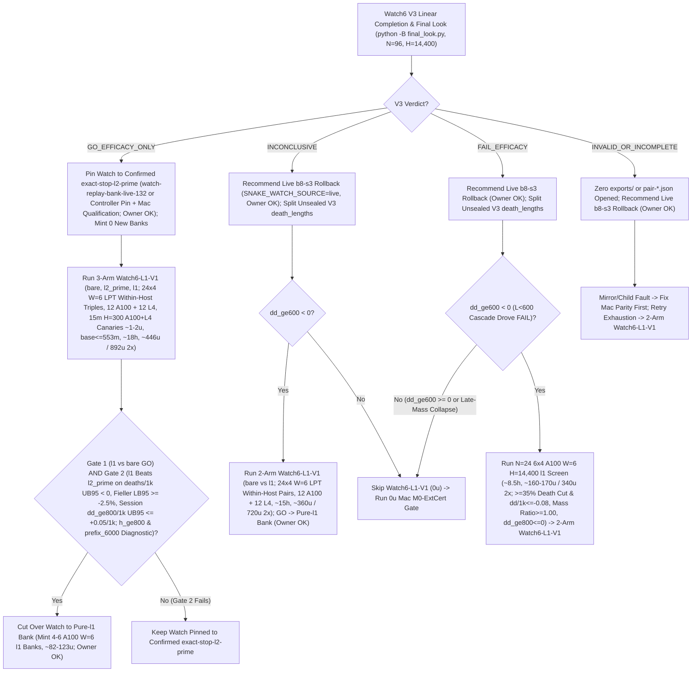

# T34 ExIt-B8 Research Roadmap (Round-09 Synthesis — Advice, Not Decisions)

Start: [project index](../INDEX.md) · [current status & authority](../STATUS.md) · [research record index](INDEX.md) · [study packages](../../research/INDEX.md) · [campaign log](final_run_20261019/CAMPAIGN_LOG.md).

> [!IMPORTANT]
> **Status: Research advice, NOT ratified decisions or release authorization.**
> Every current-round and later-round plan on this page is synthesized advisor guidance from Round 09 (2026-11-01 PT; primary synthesis artifact: `snake-dqn-artifacts/big-lever/exp/argon-rounds/round-09/synthesis/answer.md`, superseding Rounds 01–08). Nothing here amends a pre-registration, ratifies a confirmation gate, or changes served defaults. Binding campaign authority remains [`SUCCESS_CONTRACT.md`](final_run_20261019/SUCCESS_CONTRACT.md), [`DESIGN_V2_SHADOW.md`](final_run_20261019/DESIGN_V2_SHADOW.md) (+ Amendment 1), [`P7_STATISTICS.md`](final_run_20261019/P7_STATISTICS.md), unsuperseded parts of [`FINAL_PLAN.md`](final_run_20261019/FINAL_PLAN.md), and [`STATUS.md`](../STATUS.md); any serving or release change requires confirmation-lane evidence, Mac serving qualification, and the owner's explicit OK.

---

## 1. Snapshot Context & Code-Verified Round-09 Corrections (Oct 29 – Nov 1)

### 1.1 Nov 1 exploration, bank-minting, parity & Watch6 V3 linear-retry guard

- **All-length exact-stop screen — `ADOPT` for new replay banks** ([`watch6_alllen_screen`](../../research/watch6_alllen_screen/README.md), `t34-sol/argon-alllen-a100/analysis.json`, `N = 48` paired `H = 6,000` Watch6-v2 sessions uniting `12` L4 `W = 4` units `0..11` at `568b09e4` with `36` A100 `W = 6` units `12..47` across three `12`-unit shards at `73c26ccc` on `origin/argon-alllen-a100-1031`):
  - `bare` (`b8-s3`): **`351.07` mass** (`CI95 [320.22, 381.91]`), **`0.2882` `deaths/1k`** (`CI95 [0.2427, 0.3337]`; `83` deaths: `53` at `L < 600`, `30` at `L >= 600`, `21` at `L >= 800`), `mean_max_length = 794.3`.
  - `l2_prime_600` (served `L >= 600`): **`461.16` mass** (`CI95 [414.30, 508.02]`; `+110.09` vs `bare`, `CI95 [+72.06, +148.13]`), **`0.1597` `deaths/1k`** (`CI95 [0.1060, 0.2134]`; `-44.6%` vs `bare`; `46` deaths: `34` at `L < 600`, `12` at `L >= 600`, `11` at `L >= 800`), `449.6` mean branches/session (`403.7` roots, `mean_max_length = 943.4`).
  - **`exact_stop_alllen` (`L >= 1`, `interval = 5`, `H = 300`):** **`559.43` mass** (`CI95 [533.59, 585.27]`; **`+208.37` / `+59.35%` vs `bare`**, `CI95 [+170.07, +246.66]`; **`+98.27` / `+21.31%` vs `L >= 600`**, `CI95 [+50.57, +145.98]`, clearing `>= +15.0`) and **`0.0521` `deaths/1k`** (`CI95 [0.0294, 0.0748]`; **`-81.9%` / `-0.2361/1k` vs `bare`**, `CI95 [-0.2828, -0.1895]`; **`-67.4%` / `-0.1076/1k` vs `L >= 600`**, `CI95 [-0.1609, -0.0544]`, clearing `<= 0.0`), cutting `L < 600` deaths **`53 (bare) / 34 (L >= 600) -> 1`** (`0.142%` `L < 600` overrides, `mean_max_length = 1,096.0`) at **`2.821×` branches** (`1,268.5` vs `449.6`, `1,200.1` roots = `1.057` branches/root, with `53.6%` cheap `L < 600` roots in frames `0..6,000`). **`14/15` remaining deaths occur at `L >= 600` (`13/15` at `L >= 800`).**
  - *Exposure & per-world notes:* Eliminating `34 -> 1` early deaths gives `exact_stop_alllen` **`1.379×` more `L >= 600` living exposure** (`403.7 -> 556.6` roots/session), so `11 -> 13` raw `L >= 800` deaths reflects **`-14.2%` lower per-frame `L >= 800` hazard** despite raw session-normalized `Δd_ge800 = +0.0069/1k`. Across paired worlds, `exact_stop_alllen` regressed deaths vs `L >= 600` on `3/48` seeds (`3075941873`, `3394546952`, `121131908`) and mass on `14/48` seeds.
- **All-length Watch banks `14l1–16l1` completed `36/36` on active Cap-6 `36285bc6` (freeing all `3` A100 slots):**
  - Verified receipts (`t34-sol/argon-banks-l1/packet-bank{14l1,15l1,16l1}-a100/output-main/receipt.json`, `SUMMARY.md`) confirm Cap-6 (`36285bc6`) ran `6/6` concurrent runtimes (`3 A100 @ 6.73 u/h + 3 L4 @ 1.94 u/h = 26.01 u/h`), finishing all `3 × 12` `exact-stop-l1` sessions (`W = 6`, `H = 6,000`) in **`3.03–3.07 h/bank`** (**`~20.36–20.67 u/bank` = `~61.5 A100 u` observed total** vs `~227 u` forecast; balance **`~2,154.66 u`**, leaving `3` A100 slots immediately available). Because survived trajectories spend frames `6,000..14,400` almost entirely at `L >= 800`, `exact-stop-l1` compute scales **superlinearly (`~2.8–3.2×`)** from `H = 6,000` to `H = 14,400` (`argon-banks-l1/SUMMARY.md:38-40`).
  - Commit `395eacbb` switched `.claude/launch.json` to **`watch-replay-bank-live-168`** (`132` `exact-stop-l2-prime` banks `01–08, 10–12` + `36` unconfirmed `exact-stop-l1` banks `14l1–16l1`, [`web/serve.py`](../../web/serve.py) restarted on `b5b63cd1`, keeping `watch-replay-bank-live-132` intact for rollback). Confirming `exact-stop-l1` at `H = 14,400` still requires prospective confirmation (`Watch6-L1-V1`), Mac serving qualification, and owner OK; defer minting new banks until Watch6 V3's verdict lands.
- **GPU `DeviceSim` v2 parity — `PASS` on A100** ([`devicesim_v2_parity`](../../research/devicesim_v2_parity/README.md), `t34-sol/argon-devicesim-v2/packet-a100-v2-parity-01/main-run-01/receipt.json`): **`0` mismatches** across **`1,536,000` snake-ticks** (`E = 256 × 1,000` Watch6-v2 ticks in `3,505.6 s` = `1,434.6` steps/s under 5-opponent CUDA flood launches, commit `b500d111`), using `DeviceSim`'s SplitMix64 RNG and `<= 1e-4` CUDA FP32 near-tie Q re-decision tolerances.
- **Active confirmation — Watch6 V3 (`05:01 PT` snapshot, `web/backend/` hash-coupling & linear-retry lineage guard)** ([`REGISTRATION_V3.md`](../../research/watch6_search_efficacy_v3/REGISTRATION_V3.md)): `24 × 4` L4 `W = 4` shards (`96` fresh paired `H = 14,400` Watch6-v2 sessions) confirming **`exact-stop-l2-prime` (`L >= 600`) only**. At `05:01 PT`, **`14/24` shards are `PASS`** (`01..08, 10, 11, 13..16`), **`6/24` are active** (`3/24` running `17, 18, 20` + `3/24` queued `21..23`), and **`4/24` are V6.1-accepted mechanical failures** (`00` `412` unallocated, `09` `UPLOAD_CAP`, `12` renewal-WS drop, `19` warmup `GuardError`; `75471246`, `0` new rulings):
  - [`final_look.py:_verify_shard_lineage`](../../tools/watch6_v3_accounting/final_look.py) (`lines 380–386`) fails closed (`"forked/concurrent attempt lineage detected"`) whenever two attempts share a parent receipt, and [`watch6_search_efficacy_v3/protocol.py`](../../research/watch6_search_efficacy_v3/protocol.py) (`lines 59–120`) hashes `web/backend/` into `identity()`. Keep all V3 worktrees untouched; dispatch **only** staged `ops/auto-retry` children on shards **`09` and `19`** (**do NOT run [`recover.py`](../../tools/watch6_v3_accounting/recover.py)** on `09, 19`); run `recovery-shard-{00,12}-01` via `python -B -m tools.watch6_v3_accounting.dispatch`; and invoke [`final_look.py`](../../tools/watch6_v3_accounting/final_look.py) under **`python -B`** from clean `snake-dqn-argon-v3-accounting` ([`_forbid_pycache_directory`](../../tools/watch6_v3_accounting/__init__.py) `lines 747–777`).
- **Completed Oct-30 Claim-A GPU receipts awaiting `0 u` Mac readout (`< 3 min`):** `b8-head-closedloop` (`t34-sol/b8-head-closedloop/main-01/output/terminal.json`, `rc = 0`) and `spatial-qbytes-01` (`t34-sol/spatial-qbytes-fix/t34-spatial-qbytes-01/ruler-output-a100-fallback/terminal.json`, `rc = 0`) completed cleanly on A100, while `T4 Gate-1` (`0/8` bars, `KILL_T4`) cancels the `40–48 A100 u` `spatial-student-pilot` fit (retaining compiled `.so` caches).

### 1.2 Closed single-pass critics, distillations, RL, and standalone macro fallbacks

Between 2026-10-29 and 2026-11-01, every single-pass learned-policy, critic, distillation, and standalone macro-fallback track closed below its promotion or selectivity bars:

| Track | Scope & primary artifact | Measured outcome | Disposition |
| --- | --- | --- | --- |
| **TRAIN-01** ([`sandbox_a_resident`](../../research/sandbox_a_resident/README.md)) | `100.7M`-row (`384`-update) GPU-resident PPO from `b8-s3` (`t34-sol/train01-closeout/SUMMARY.md`) | H5000 equal-mix paired mass **`+8.09`** (`CI95 [-18.66, +34.85]`; scripted `+26.32`, frozen `+2.85`, mixed `-4.90`; update-320 peak `+14.23` `[-11.86, +40.32]`) vs bar `>= +40` | **Closed** (no strict-gate nomination) |
| **C/T Stage-2 distillation** | Continuation-teacher causal-root distillation (`t34-sol/ct-stage2-verdict/SUMMARY.md`) | Teacher rescued **`22/32` (`68.75%`)** deaths (`22/32 <= 65` ticks; indep-suffix H300 `+66.77`, `LB90 +51.61`), but student retention was **`46.9–50.0%`** (`0 pp` over `frozen_phi` vs `>= +15 pp`; topology AUC `0.5752 < 0.83`), ordinary flips **`44.4–64.5%`** (bar `<= 1%`), and lethal ordinary flips **`3–5`** (bar `<= 1`) | **`FAIL_DISTILLATION_RETENTION_OR_SAFETY`** |
| **Doom U-Net & `spatial-student-pilot`** | `83 × 145` spatial U-Net vs 33.7k B8-feature head (`t34-sol/doom-result-01/result.json`; `t34-sol/student-direction/{astra,fable}.md`) | Spatial U-Net lost late per-action doom ROC-AUC to frozen B8 features (**`0.753` vs `0.810`**, `Δ = -0.056`, `CI95 [-0.091, -0.023]`; all-strata death-lookback `0.7626` vs `0.8226`; ordinary late `0.690` vs `0.706`) | **`GRAY` / `40–48 A100 u` pilot fit canceled (`0 u`; retain `.so` caches)** |
| **B8 advantage head (offline OOF)** | `256 -> 128 -> 6` ReLU head on frozen B8 features (`t34-sol/b8-head-test/RESULT.md`) | Mass rule `GO` (late H300 `+30.09`, `LB90 +23.96`), Fable selectivity **`FAIL`**: **`26.42%`** late rescue (bar `>= 35%`) at **`97.60%`** non-death flips (bar `<= 15%`) | **Selectivity `FAIL`** (192-world closed-loop A100 `rc = 0`, awaiting Mac readout) |
| **T4 Gate-1 factored critic** ([`t4_gate1`](../../research/t4_gate1/README.md)) | Clean-slate privileged `83 × 145` (`H = 320` 7-source BFS) hazard + foraging mass-flux critic on `384` disjoint Watch6-v2 worlds (`t34-sol/argon-t4-gate1-fix2/queue-03/READOUT.json`) | **`0/8` bars passed**: `L >= 600` residual EV **`+0.0266`** (`[-0.0280, +0.0869]` vs `>= 0.25`), death-root H300 rescue **`+19.99`** (vs `>= +40`), mature doom AUC **`0.5617`** (vs `>= 0.80`), ordinary H300 mass **`-22.21`** (vs `>= -15.0`), lethal flips **`3.13%`** (vs `<= 3.0%`) | **`KILL_T4`** (proves even privileged `83 × 145` critic lacks late value signal) |
| **R6 `L < 600` harvest census** ([`r6_l600_census`](../../research/r6_l600_census/README.md)) | `64`-world (`384`-root) Watch6-v2 early-game counterfactual + 5-fold OOF corpse/trail plane probes (`t34-sol/argon-mac-checks/r6-census/RESULT.json`) | **`34.90%` (`134/384`)** oracle-harvestable roots (`>= +5` H500 mass), **`7.69%`** non-bare H500 lethal flips, OOF ROC-AUC **`0.474–0.521`** (`0` passing threshold points); superseded operationally by `exact-stop-l1` | **`KILL`** |
| **R7 macro-option fallback** ([`r7_macro_fallback`](../../research/r7_macro_fallback/README.md)) | Pruned depth-2 (`2K = 30` ticks) spatial macro-options `{O_0..O_5}` on C/T train `1-step-all-die` roots (`t34-sol/argon-r7-repack/R7_READOUT.json`) | `3/5` bars passed (`0.316 ms` Mac 1-thread p95; **`33.0%` vs `9.0%`** `L >= 800` `all_die_sel0` rescue on `25/129` roots — `9/25` `macro_triggered` at `+66.7 pp` rescue vs `16/25` tick-`30` B8 re-traps, while `104/129` `80.6%` survived `H = 300`), but total `L >= 600` lift **`+3.85 pp`** (`< +10.0 pp`) and **`2 > 0`** ordinary lethal flips (`0` assessment roots opened) | **`KILL`** as standalone `30`-tick fallback |

### 1.3 Code-verified Round-09 corrections over Round 08

1. **`Watch6-L1-V1` `W = 6` LPT within-host triple commits, calibrated session-denominator Gate-2 & `open_watch` AST closure:**
   - *Core waste & serial-triple `> 426.7 m` breach:* Both L4 ([`REGISTRATION_V3.md`](../../research/watch6_search_efficacy_v3/REGISTRATION_V3.md) `lines 100–105`) and A100 (`argon-alllen-a100/SUMMARY.md`) expose `12` vCPUs (`6` physical cores, `+3.1%` contention at `W = 6`). Round 08's `24 × 3` A100 `W = 3` + `24 × 1` L4 `W = 1` idled `50–83%` of cores (`~655 u`, `~28 h`), while serial 3-arm execution (`T_bare + T_l2 + T_l1 ≈ 445–475 m p95`) breaches [`costs.py`](../../research/watch6_search_efficacy_v3/costs.py) (`lines 209–211`, `ceil(20 + 1.5 * waves * pair_seconds / 60) <= 660` $\Rightarrow$ **`426.7 m` 1-wave `p95` cap**), and split per-arm exports across retries risk cross-VM x86 tie drift (`t34-sol/watch6-v3-a100-q/ANSWER.md:9-16`). Scheduling **`4` triples (`12` arm-tasks) per shard at `W = 6` LPT** (`4` cores on `4 × l1` at `~305–355 m p95`; `2` cores each on `2 × (bare + l2_prime)` in `~214 m` central / `~260 m p95`, finishing `~90 m` early) and committing atomic `pair-{i:02d}.json` + outcome-free `.meta.json` **only when all 3 arms finish on the same host** preserves exact within-host pairing at `0` retry wall-minute penalty (`shard p95 = T_l1 <= 355 m`, `base <= 553 m <= 660 m` up to `T_l1 = 426.6 m`; **`~18 h` wall, `~446 u` expected / `892 u` 2×** across `12` A100 + `12` L4 shards).
   - *Gate-2 `~63%` null false-fail:* At `N = 96, H = 14,400` (`~450k` `L >= 800` frames), exposure-denominator `Δh_ge800 UB95 <= +0.05/1k` has `1.985 * SE ≈ ±0.060 > 0.05` (**`~63%` null false-fail** + `0/0` zero-exposure sessions). Session-denominator **`Δd_ge800/1k UB95 <= +0.05/1k`** has `±0.022` half-width (`> 98%` null pass) alongside Fieller mass **`LB95 >= -0.025`** (`-2.5%`), keeping pooled `h_ge800` and `prefix_6000` diagnostic.
   - *`open_watch` AST-closure hashing:* Dropping `web/backend/` directly from `protocol.source_paths()` breaks [`open_watch`](../../research/watch6_search_efficacy/product.py) (`lines 16–52`, which constructs [`GameSession`](../../web/backend/session.py) via `served_checkpoint.py`), and `watch6_search_efficacy/product.py:41` omitted `"SNAKE_WATCH_SOURCE": "live"` (already patched in [`watch_replay/product.py`](../../research/watch_replay/product.py) `line 43`). Move shared search helpers to `src/`, patch `"SNAKE_WATCH_SOURCE": "live"` in `open_watch`, and hash `open_watch`'s exact AST import closure so [`watch_replay.py`](../../web/backend/watch_replay.py) and [`app.py`](../../web/backend/app.py) stay decoupled from confirmation identity hashes.
2. **Seven remaining `colab_cli` / `tools/ops` traps in Round 08's v2 transport proposal:**
   - *(a) Existing [`PUBLIC_INPUTS.json`](../../research/t34_exit_b8/PUBLIC_INPUTS.json) URLs & immutable `"url"` across retries:* `PUBLIC_INPUTS.json` (`lines 5–15`) already hosts SHA-pinned `B8_s3_final.pth` (`6.56 MB`) and `league.tar.gz` (`21.36 MB`, containing `6.91 MB` `frp3_m3_s12`) — no new GitHub release needed. Because [`supervisor.py`](../../research/colab_cli/supervisor.py) (`lines 238–240`) forbids `"url"` + `"path"` together and switching retries to `"path"` breaks [`canary.check`](../../research/colab_cli/canary.py) (`line 317`, `transport` mismatch), keep `"url"` immutable across retries (`0` Mac upload bytes), guard `if "path" in item` in study [`admission.py`](../../research/watch6_search_efficacy/admission.py) (`lines 61–63`), and cache verified blobs in `~/.config/colab-cli/snake/public-cache/<sha256>` (`+ 10 s` `Range: bytes=0-0` probe in [`inputs.py`](../../research/colab_cli/inputs.py) `lines 114–148`).
   - *(b) `404` `terminal.json` polls & `.next.json` partial-write race:* Polling `terminal.json` before job exit logs failed `download` calls in [`CLI._call_once`](../../research/colab_cli/supervisor.py) (`lines 566–583`, tripping V3 `_has_failed_transport_record`), and reading `release-credential.next.json` without stat-fencing `(st_mtime_ns, st_size)` races chunked Contents PUTs ([`runtime.py`](../../research/colab_cli/runtime.py) `lines 616–725`). Embed `terminal_present` and `4 KiB` `job_log_tail`/`supervisor_log_tail` in VM `state.json` (`runtime.py:375-392, 634-697`) and stat-fence `.next.json` before `0o600` promotion.
   - *(c) `allow_rpc=False` in `collect_exports` & `Broker.renew_retained`:* Even `1` completed unit emits `>= 2` files, routing [`collect_exports`](../../research/colab_cli/supervisor.py) (`lines 975–981`) into WS `export_batch`, while [`Broker.renew_retained`](../../research/colab_cli/supervisor.py) (`lines 2071–2088`) uses `poll_rpc`; force Contents `export_file(..., allow_rpc=False)` (`<= 8 MiB`) and Contents PUTs when `observer is None`.
   - *(d) Pre-stop salvage alignment:* [`Broker.execute`](../../research/colab_cli/supervisor.py) (`line 1617`, `deadline - 25`) kills the VM `80–115 s` before a `90 s` salvage finishes, and `Broker.run` (`lines 1281–1339`) lacked a pre-stop salvage pass; set VM `timeout_seconds = max(60, cli.deadline - now + 15)` + `salvage_grace_seconds = 150` (`runtime.py:701-702`) and run a `120 s` Contents-only salvage pass before `stop_verified`.
   - *(e) Three accounting/queue freezes:* `Broker.run` holds `account.lock` for `300–1,030 s` across warmup + `calibrate_rate` (`supervisor.py:1277, 1555-1574`), raises `"account-wide assignment cap exceeded during job"` (`supervisor.py:1973`) instead of [`POLLING_ASSIGNMENT_CAP_ERROR`](../../research/colab_cli/accounting.py) (`line 34`, breaking `auto_retry.py`), and leaves `pending-<session>.json` behind on `412`/`503` `colab new` refusal (`supervisor.py:1300-1314`).
3. **R7's `104/129` (`80.6%`) `H = 300`-surviving traps, `options.py` vacuous `t_cert = 1` bug & `L* >= 72`-tick (`3.0 s`) live async lag motivating `ExtCert-v9` + rolling Watch generation:**
   - *R7 primary-readout correction (`R7_READOUT.json:130-165`):* Round 08 misread `"macro_triggered": 9, "n": 129` as `all_die_sel0` firing on `9/129` (`7.0%`) of `L >= 800` death roots. In fact, out of `129` `L >= 800` death-lookback roots, **`104/129` (`80.6%`) survive `H = 300`** (`93.75%` `exact_stop` survival across suffixes `4..7`) and **`25/129` (`19.4%`) are `all_die_sel0`** (`exact_stop` `0.09` $\rightarrow$ R7 `0.33`, `+24.0 pp`), of which **`9/25` (`36.0%`, `7.0%` of `129`)** had `macro_triggered` (`sel0` `t = 300` survival in [`search.py`](../../research/r7_macro_fallback/search.py) `line 613`, **`+66.7 pp`** rescue when triggered) and **`16/25` (`64.0%`)** re-trapped after tick-`30` greedy-B8 handback (`search.py:539-543`).
   - *Vacuous `t_cert = 1` bug in [`options.py`](../../research/r7_macro_fallback/options.py) (`lines 463–496, 700–711`):* `g_star_u` picks `min(tau_own[u])` over `owner_grid[u] == 0` cells touching `hero_cid` without requiring `ext_gain > 0` (`vcid != hero_cid`) or checking `owner_grid[u] > 0` (`tau_opp`) enemy seals, vacuously certifying (`t_cert[a] = 1`) internal penultimate tail cells (`tau_own == 2`, `ext_gain == 0`) inside sealed traps.
   - *`L* >= 72`-tick (`3.0 s`) live async lag:* Live `24 fps` async search suffers `L* >= 72`-tick (`3.0 s`) commitment lag (`PLAN_v3.md:33-35`) whereas Watch takes zero human input — making a **`15–30 s` rolling ahead-of-playback `GridBatchSim` Watch worker** (`0` commitment lag, backed by `watch-replay-bank-live`) plus **inline Play `b8-s3 + ExtShield-0`** (`< 5.5 ms/tick`, `0` lag) strictly cleaner than `35`-tick async body-relative leases.

---

## 2. Current-Round Plan (Advice, Not Decisions)

### 2.1 `0 u` Mac gates (`< 3 min`): Claim-A readout/closure & Watch replay patch (V3 untouched)

1. **Read completed Claim-A receipts & enforce closure bar (`0 u`, `< 3 min` Mac):**
   - Run `closedloop_readout.py` (`origin/astra-doom-auc-smoke` @ `591d94c3`) on completed `b8-head-closedloop` (`N = 192` v1 `H = 5,000` worlds, `m in {0, 10, 25, 50}`) and audit completed `spatial-qbytes-01` (`mapped-parity.json`); keep `spatial-student-pilot` (`40–48 A100 u`) canceled (`0 u`, retaining `.so` caches).
   - **Recommended Claim-A kill rule:** Recommend **closing Claim A permanently (`0 u`)** unless some `m in {0, 10, 25, 50}` clears `ci95[0] > 0` (`== LB97.5`, exact 4-arm `alpha = 0.10/4` Bonferroni), `H = 5,000` pooled mass `>= +40`, scripted no-death `>= +0.03` (no mix loss), [`P7_STATISTICS.md`](final_run_20261019/P7_STATISTICS.md) Guard A (`Δalive >= -0.05` pooled, `>= -0.075`/mix), and `<= 15%` living-decision overrides — followed by a `0 u`, `10 min` v2 boost `[0.5%, 10%]` check before nominating any Mac strict gate.
2. **Fix & Mac-qualify Watch replay serving on `main` & decouple `open_watch` AST closure (`0 u`, V3 untouched):**
   - Keep all V3 worktrees untouched (since [`watch6_search_efficacy_v3/protocol.py`](../../research/watch6_search_efficacy_v3/protocol.py) hashes `web/backend/`), move shared search helpers to [`src/`](../../src/), patch `"SNAKE_WATCH_SOURCE": "live"` in [`watch6_search_efficacy/product.py:open_watch`](../../research/watch6_search_efficacy/product.py) (`lines 16–52`, matching [`watch_replay/product.py`](../../research/watch_replay/product.py) `line 43`), and hash `open_watch`'s exact AST import closure (`session.py` + `served_checkpoint.py`, excluding `watch_replay.py` and `app.py`) before freezing `Watch6-L1-V1`:
     - Add injectable `shuffle_discovery: bool = True` to [`ReplayBank`](../../web/backend/watch_replay.py) (shuffling cycle 1 with cross-cycle boundary holdback while keeping deterministic test injection); replace per-frame `stop.wait(0.001)` in [`verify_payload`](../../web/backend/watch_replay.py) with a **`64`-frame cooperative yield** (`if count % 64 == 0 and stop.wait(0.0005): return None` -> `< 0.35 s` cold load without `24 fps` GIL stalls); shallow-copy `dict(self.frame)` + `dict(session)` in [`Recording.snapshot`](../../web/backend/watch_replay.py); and add `SNAKE_WATCH_REPLAY_CONTROLLER` (`all | exact-stop-l2-prime | exact-stop-l1`).
     - Set `_replay_opted_out = True` **only** inside [`set_epsilon`](../../web/backend/session.py) (`lines 1154–1160`) and [`set_food`](../../web/backend/session.py) (`lines 1173–1200`) — **never** inside `_leave_watch_replay()`, keeping `Play -> Watch` via `set_mode("watch")` intact — and clear `_replay_opted_out = False` in [`_build`](../../web/backend/session.py) (`lines 714–738`) plus a split `"new_game"` control handler in [`app.py`](../../web/backend/app.py) (`lines 310–311`, preserving live opt-outs across `reset_game` while [`load_checkpoint`](../../web/backend/session.py) `lines 1541–1544` already exits replay); gate `__init__`, `reset_game`, and `set_mode` strictly on clean mixed-Watch6 `b8-s3` (`served_checkpoint["name"] == "b8-s3"`, `watch_roster == "mixed"`, `watch_roster_reason is None`, `len(snakes) == 6`, `not _replay_opted_out`).
   - Pass `1,500` unpaced + `120` paced-`24 fps` qualification ticks (`p95 <= 11.688 ms`, `0/120` overruns per [`t15_mixed_roster_qualification_2026-10-17.md`](t15_mixed_roster_qualification_2026-10-17.md), `< 1.0 s` cold readiness) while cold `.watch.gz` verification runs concurrently across `L >= 1,000` bodies, `6,000 -> 1` rotation, `Play -> Watch`, and live-B8 fallback.

### 2.2 Finish Watch6 V3 linearly & qualify the 7-fix Contents-only v2 transport (`~1.6 u`)

1. **Finish Watch6 V3 linearly (`N = 96`, `exact-stop-l2-prime` `L >= 600` only):**
   - Dispatch **only** the already-staged `ops/auto-retry` packets on shards **`09` and `19`** (**do NOT run `recover.py`** on `09, 19`); dispatch `recovery-shard-{00,12}-01` on shards **`00` and `12`** via `python -B -m tools.watch6_v3_accounting.dispatch --evidence-dir .../argon-v3-accounting-v6`; publish V6.1 sidecars via `proof.py:publish_renewal_ws_transport_evidence` (`0 u`, `0` rulings) on any zero-export renewal-WS drop on `17..23` (`<= 2` compute completions); and invoke [`final_look.py`](../../tools/watch6_v3_accounting/final_look.py) with **`python -B`** from clean `snake-dqn-argon-v3-accounting` (never opening `exports/` or `pair-*.json` on `INVALID_OR_INCOMPLETE`).
2. **Seven code-verified fixes in additive v2 transport (`qualification.py add`, `~1.6 u` total) & `confirm_audit.py`:**
   - *(1) Existing [`PUBLIC_INPUTS.json`](../../research/t34_exit_b8/PUBLIC_INPUTS.json) HTTPS URLs + Mac `public-cache/` (`< 0.3 s` preflight, `< 40 KiB` upload):* Bind SHA-pinned `B8_s3_final.pth` (`6.56 MB`) and `league.tar.gz` (`21.36 MB`, extracting `frp3_m3_s12`, `6.91 MB`) via immutable `"url"` entries across original + retry manifests (`0` Mac checkpoint upload bytes, preserving [`canary.check`](../../research/colab_cli/canary.py) `line 317` `transport` identity), guard `if "path" in item` in [`watch6_search_efficacy/admission.py`](../../research/watch6_search_efficacy/admission.py) (`lines 61–63`), and cache verified blobs in `~/.config/colab-cli/snake/public-cache/<sha256>` (`+ 10 s` `Range: bytes=0-0` reachability probe in [`inputs.py`](../../research/colab_cli/inputs.py) `lines 114–148`).
   - *(2) Externalize `<= 64 KiB` `read_ledger` triple & `3`-RPC `"staged" -> "verified"` staging:* Keep `input-metadata.tar.gz` immutable (`< 32 KiB`), upload standalone `inputs/verified-ledger.json{,.sha256,.complete}` (`4` PUTs `< 40 KiB` in `< 6 s`), exempt only that [`read_ledger`](../../tools/ops/package_spec.py)-validated (`lines 148–188`) triple in [`canary.check`](../../research/colab_cli/canary.py) (`lines 312–321`) for 1-canary resume reuse, and record `"staged"` under `defer_verify=True` ([`transfers.py`](../../research/colab_cli/transfers.py) `lines 110–113`) promoted to `"verified"` upon `ready.json` (**`3`-RPC** staging floor: `initial`+`mkdir`, `deliver_source`, `ready.json`).
   - *(3) Self-contained VM `state.json` tails & stat-fenced `.next.json` (`0` `404` polls, `0` partial-write `runtime_error`s):* Embed `terminal_present` and `4 KiB` `job_log_tail`/`supervisor_log_tail` in VM `state.json` ([`runtime.py`](../../research/colab_cli/runtime.py) `lines 375–392, 634–697`, eliminating `404` `terminal.json` polls in `CLI._call_once`), keep Mac heartbeats on `lease-heartbeat.json` (`runtime.py:458-462`), and stat-fence `(st_mtime_ns, st_size)` before `0o600` promotion of `release-credential.next.json` in **both** `runtime.py:_supervise` loops (`lines 616–725`).
   - *(4) `allow_rpc=False` exports & renewals (`0` post-`ready.json` WS RPCs):* When `observer is None` (preserving [`AcceptanceObserver`](../../research/colab_cli/acceptance_faults.py) and `lease_seconds = 180` / `900 s` OAuth floor), force Contents `export_file(..., allow_rpc=False)` (`<= 8 MiB`) in [`collect_exports`](../../research/colab_cli/supervisor.py) (`lines 975–981`) and Contents PUTs in [`Broker.renew_retained`](../../research/colab_cli/supervisor.py) (`lines 2071–2088`).
   - *(5) Pre-stop salvage alignment (`timeout = cli.deadline - now + 15`, `150 s` VM grace, `120 s` Mac salvage):* Set VM `timeout_seconds = max(60, cli.deadline - now + 15)` + `salvage_grace_seconds = 150` (`supervisor.py:1617`, `runtime.py:701-702`), run a `120 s` Contents-only salvage pass before `stop_verified` in `Broker.run` (`supervisor.py:1281-1339`), and persist untruncated `output/last_cli_error.txt` + `failure_origin`.
   - *(6) Close three accounting/queue freezes (`< 15 s` `account.lock`, `POLLING_ASSIGNMENT_CAP_ERROR`, `NEVER_ASSIGNED` unlink):* Release `account.lock` immediately after writing `active-<session>.json` (`supervisor.py:1277`, `< 15 s` hold vs `300–1,030 s`, making `calibrate_rate` `1555-1574` warn-only `<= 30 s`); raise [`POLLING_ASSIGNMENT_CAP_ERROR`](../../research/colab_cli/accounting.py) (`line 34`, `2` consecutive `> 6` polls) at `supervisor.py:1973` so `auto_retry.py` classifies it; on `412`/`503` `colab new` refusal (`supervisor.py:1300-1314`), prove `NEVER_ASSIGNED` in-process and unlink `pending-<session>.json`; mark `KERNEL_CREATION_GUARD_ERROR` transient in [`policy.py`](../../research/colab_cli/policy.py) and keep `kernel_idle` boolean via separate dict-returning `kernel_idle_probe` in [`cli_guard.py`](../../research/colab_cli/cli_guard.py).
   - *(7) Locked `L4 < 3` / `total < 6` in `dispatch.py`, `ops-ledger-retry/v2` & `confirm_audit.py`:* Enforce `total < 6` and `L4 < 3` under `ops/alloc.lock` in [`tools/ops/dispatch.py`](../../tools/ops/dispatch.py) (retiring `-retry-1` and study `recover.py`); rebuild `verified-ledger.json` strictly from `.meta.json` + raw `size`/`.sha256`/`.complete` (**`0` `pair-*.json`/`unit-*.json` reads**, `elapsed < timeout_minutes * 60 - 180`, resetting `zero_progress_stalls = 0` when `|ledger_next| > |ledger_prev|`, `<= 2` consecutive stalls on the same x86 GPU tier, `<= 8` pre-start `0`-compute retries, `0` retries on child/mirror/integrity/wall-timeout); and audit via `python -B -m tools.ops.confirm_audit` (`audit-pass.json`, `0` judge rounds).
   - *Qualification (`~1.6 u` total, keeping `research/colab_cli/` untouched on `36285bc6` until dedicated requalification checkout):* `0 u` Mac [`fake_colab.py`](../../tests/fixtures/fake_colab.py) fault matrix + `~1.2 u` additive [`tools/ops/requalify.sh`](../../tools/ops/requalify.sh) (verifying all **`11/11` required `final-only` gates** in [`colab_cli/admission.py`](../../research/colab_cli/admission.py) `lines 56–73` / [`acceptance.py`](../../research/colab_cli/acceptance.py) `lines 384–410`) + `~0.4 u` 2-unit L4 WS-blackout canary.

### 2.3 Route `Watch6-L1-V1` (`N = 96, H = 14,400`) via `24 × 4` `W = 6` LPT within-host triples & calibrated Gate 2

Run **`24` shards × `4` triples (`12` arm-tasks) at `W = 6` LPT** (`12` A100 + `12` L4 shards across `3 A100 + 3 L4` in `4` waves: `4` cores on `4 × l1` at `~305–355 m p95`; `2` cores each on `2 × (bare + l2_prime)` in `~214 m` central / `~260 m p95`), committing atomic `pair-{i:02d}.json` + outcome-free `.meta.json` **only when all 3 arms finish on the same host** (`shard p95 = T_l1 <= 355 m`, `base <= 553 m <= 660 m` up to `T_l1 = 426.6 m`), preceded by **`15 m` `H = 300` A100 + L4 family canaries (`~1–2 u` total)** per [`canary.py`](../../research/colab_cli/canary.py) (`lines 302–311`).

- **On `GO_EFFICACY_ONLY` (`deaths/1k UB95 < 0` and Fieller mass `LB95 >= -0.05`):**
  1. *Mac (`0 u`):* Land §2.1's replay patch + `1,500`-unpaced / `120`-paced-`24 fps` qualification on `main`, and pin Watch serving to confirmed `exact-stop-l2-prime` (`watch-replay-bank-live-132` or `SNAKE_WATCH_REPLAY_CONTROLLER=exact-stop-l2-prime`, **owner OK**). Mint **0** new banks until `Watch6-L1-V1` finishes.
  2. *Colab (`24 × 4` `W = 6` LPT within-host triples across `12` A100 + `12` L4 shards on `3 A100 + 3 L4` in `4` waves, `base <= 553 m <= 660 m`, `~18 h` wall, `~446 u` expected / `892 u` 2× + `~1–2 u` `15 m` `H = 300` A100 & L4 canaries):* Run fixed-sequence **3-arm `Watch6-L1-V1`** (`{bare, l2_prime, l1}`; `N = 96, H = 14,400`):
     - *Gate 1:* `l1` vs `bare` clears `deaths/1k UB95 < 0` and Fieller mass `LB95 >= -0.05` (`-5%`).
     - *Gate 2 (cutting over to pure-`l1`):* `l1` vs `l2_prime` clears `deaths/1k UB95 < 0`, `H = 14,400` Fieller mass **`LB95 >= -0.025`** (`-2.5%`), and **session-denominator `Δd_ge800/1k UB95 <= +0.05 / 1k`** (`±0.022` half-width, `> 98%` null pass; pooled `h_ge800` and `prefix_6000` reported diagnostically) $\rightarrow$ cut over Watch to a pure-`l1` bank (`4–6` A100 `W = 6` `l1` banks, `~82–123 A100 u`, **owner OK**; if Gate 1 passes and Gate 2 fails, stay pinned to confirmed `exact-stop-l2-prime`).
- **On `INCONCLUSIVE`, `FAIL_EFFICACY`, or `INVALID_OR_INCOMPLETE`:**
  - Recommend rolling Watch back to live bare `b8-s3` (`SNAKE_WATCH_SOURCE=live`, **owner OK**); compute `Δd_ge600 = d_ge600(l2_prime) - d_ge600(bare)` from unsealed `death_lengths` (never opening `exports/` or `pair-*.json` on `INVALID_OR_INCOMPLETE`).
  - Run **2-arm `{bare, l1}` `Watch6-L1-V1`** (`24 × 4` `W = 6` LPT within-host pairs across `12` A100 + `12` L4 shards, `~15 h`, `~360 u` expected / `720 u` 2×; `GO` clears `deaths/1k UB95 < 0`, Fieller `LB95 >= -0.05`, and session `Δd_ge800/1k UB95 <= +0.05/1k` $\rightarrow$ pure-`l1` bank, **owner OK**) on `INCONCLUSIVE` when `Δd_ge600 < 0`, on `INVALID_OR_INCOMPLETE` retry exhaustion (fix Mac parity first on mirror/child fault), or on `Δd_ge600 < 0` `FAIL_EFFICACY` after an **`N = 24` (`6 × 4` A100 `W = 6`, `~8.5 h`, `~160–170 u` / `340 u` 2×)** `H = 14,400` screen clears `>= 35%` death cut (`Δdeaths/1k <= -0.08`), mass ratio `>= 1.00`, and `Δd_ge800 <= 0`. Otherwise (`0 u`), pivot directly to §3's `0 u` Mac `M0-ExtCert` gate.

---

## 3. Later-Round Plan: `ExtCert-v9` Terminal Exterior Certificate & Rolling Ahead-of-Playback Watch Worker (Advice, Not Decisions)

### 3.1 Code-verified root causes of `13/15` `L >= 800` deaths & `ExtCert-v9` specification

1. **Why `exact-stop-l1` and R7 still lose `L >= 800` traps (`104/129` `H = 300` false-safe coils + `options.py` vacuous `t_cert = 1`):**
   - Out of `129` `L >= 800` death-lookback roots (`R7_READOUT.json` `lines 130–165`), **`104/129` (`80.6%`) survive `H = 300`** (`93.75%` `exact_stop` survival across suffixes `4..7`) because an `L = 900` snake coils alive inside a sealed `450`-cell pocket past tick `300` before running out of volume at ticks `310..550`, while [`exact_stop.run`](../../research/bl_served_search/exact_stop.py) (`lines 48–55`) stops immediately on uncertified `bare` `alive(300)`.
   - On the remaining **`25/129` (`19.4%`) `all_die_sel0` roots**, R7's `macro_triggered` (`sel0` `t = 300` survival, [`search.py`](../../research/r7_macro_fallback/search.py) `line 613`) rescued **`+66.7 pp`** when triggered (`9/25`, `36.0%`), whereas **`16/25` (`64.0%`)** re-trapped after tick-`30` greedy-B8 handback (`search.py:539-543`). Meanwhile, [`options.py`](../../research/r7_macro_fallback/options.py) (`lines 463–496, 700–711`) selects `g_star_u` via `min(tau_own[u])` over `owner_grid[u] == 0` cells touching `hero_cid` without requiring `ext_gain > 0` (`vcid != hero_cid`) or checking `owner_grid[u] > 0` (`tau_opp`) enemy seals — vacuously setting `t_cert[a] = 1` on internal penultimate tail cells (`tau_own == 2`, `ext_gain == 0`) inside sealed traps.
2. **`ExtCert-v9` terminal exterior certificate (`~0.35 ms` Numba `O(|V|)`):**
   - Require positive exterior escape (`ext_gain > 0`, `vcid != hero_cid`) into a merged dynamic `2`-core component satisfying **`V2_merged >= 1.15 * L`** under `tau(v) <= d_hero(v) < d_opp_2x(v)` — combining own-body release `tau_own` and enemy-body release `tau_opp` with `2`-cell/tick enemy boost arrival `d_opp_2x` (`min_boost_length = 10`) — plus two-regime [`SafetyVetoV8`](../../src/evaluation/safety_veto_v8.py) gate dominance ([`safety_veto_v6.py`](../../src/evaluation/safety_veto_v6.py) `lines 171, 224`; `safety_veto_v8.py` `lines 326–357`): unconditional hero head-on win when $L_{\text{hero}} \ge 1.15(L_{\text{opp}} + 1)$, and deterministic non-cornered `v8` retreat on $(0.87, 1.15) L_{\text{hero}}$ whenever opponent `spacious_directions` has an eligible alternative.
   - **Risk-gated terminal ranking (`~1.28` branches/root), `HoldUntilExterior` & every-tick `ExtShield-0`:** Stop on `bare` **iff** `alive(300) ∧ ExtCert(S_{t+300}) == 1 ∧ V2_dyn(S_{t+300}) >= 1.25 * L`; otherwise expand safe-masked actions and rank `H = 300` survivors lexicographically by `(ExtCert(S_{t+300}), V2_dyn - L, gate_margin, Q)`. Hold `{O0_delay_coil, O1_gate_breach, O2_open_voronoi, O4_boost_evac}` (dropping aggressive `O3`/`O5`) while `!ExtCert(S_tau)` instead of handing back to greedy B8 at tick `30`, and run `0.35 ms` `ExtShield-0` every tick on inter-root ticks (and inline in Play) to veto `ExtCert: 1 -> 0` self-pinches.

### 3.2 Rolling ahead-of-playback Watch worker, `0 u` Mac `M0-ExtCert` gate & 6-slot `N = 48` screen (`~290 u`)

- **Serving architecture (decoupling `0`-input Watch from `0`-lag Play):**
  1. **Watch — `15–30 s` rolling ahead-of-playback `GridBatchSim` worker (`0` commitment lag):** Because `24 fps` live async search incurs `L* >= 72`-tick (`3.0 s`) commitment lag (`PLAN_v3.md:33-35`) while Watch takes zero human input, generate fresh episodes continuously `15–30 s` ahead of `24 fps` playback in a background `GridBatchSim` worker (`0` commitment lag, infinite fresh episodes, backed by `watch-replay-bank-live` for instant cold start and underrun protection), combined with `O(1)` `_food_by_cell` + corpse `deque` in [`FoodManager`](../../src/game/food_manager.py), Claim-B [`dto_split.py`](../../research/bl_served_search/dto_split.py), and post-warmup `gc.freeze()` (`0` [`bl_k1/m1.py`](../../research/bl_k1/m1.py) `line 120` paced overruns).
  2. **Play — inline `b8-s3 + ExtShield-0` (`< 5.5 ms/tick`, `0` lag):** Keep human Play synchronous and zero-lag (`b8-s3 + ExtShield-0` at `< 5.5 ms/tick`, visibly labelled if assisted or exposed as an opt-in Challenge mode isolated from `scores.db`, subject to owner OK).
- **Mandatory `0 u` Mac `M0-ExtCert` gate before any GPU spend:**
  - Evaluate `ExtCert-v9` + `ExtShield-0` on all `129` `L >= 800` C/T `train` death-lookback roots (`104` `H = 300`-surviving + `25` `all_die_sel0`) and `1,024` ordinary `train` roots across independent suffixes `4..7` (`assessment_roots_used == 0`, `0` `exports/` opened), plus a Mac paced `m1.py` probe.
  - **Kill rule (`0 u`):** Block Colab spend unless 1-thread `ExtCert-v9` `p99 <= 0.50 ms`, `H = 600` survival lift is **`>= +15 pp`** on the `104` `H = 300`-surviving `L >= 800` traps and **`>= 40%`** on the `25` `all_die_sel0` roots (vs R7's `33%`), newly caused ordinary lethal flips **`== 0 / 1,024`**, and Mac paced overruns / `FoodManager` drift **`== 0`**.
- **Conditional 6-slot pure-CPU Colab screen (`3 A100 + 3 L4` at `W = 6` LPT, `N = 48` fresh `H = 14,400` paired Watch6-v2 worlds, `~290 u` expected, queued after `Watch6-L1-V1` and `M0-ExtCert`):**
  - Advance `ExtCert-v9` to `N = 96` confirmation, Mac `24 fps` serving qualification (`0` overruns, `update p95 <= 11.688 ms`), and owner release review iff `ExtCert-v9` cuts `deaths/1k` vs `exact-stop-l1` (`UB95 < 0`, `>= 25%` reduction) with session `Δd_ge800/1k UB95 <= 0` and Fieller mass `LB95 >= -0.025`.
- **Do not fund (`0 u`):** New bare-network PPO (`TRAIN-01`), single-pass distillation (`C/T Stage-2`, `spatial-student-pilot`), spatial/privileged value critics (`Doom U-Net`, `T4 Gate-1`), `L < 600` harvest rules (`R6`), standalone `30`-tick / aggressive `O3`/`O5` macro options (`R7`), `35`-tick live async body-relative leases, or GPU `DeviceSim` branch-proposal bank minting.

---

## 4. Settled Round-09 Disagreements & Primary Code/Artifact Citations

1. **`24 × 4` `W = 6` LPT within-host triple commits (`~18 h`, `~446 u`), `15 m` `H = 300` A100 + L4 canaries, session-denominator Gate-2 (`Δd_ge800/1k UB95 <= +0.05/1k`, Fieller `LB95 >= -2.5%`) & `open_watch` AST closure vs. Round-08's `24 × 3` `W = 3` + `24 × 1` `W = 1` (`~28 h`, `~655 u`), per-arm file splits & exposure `Δh_ge800` (`63%` null false-fail):**
   Settled by [`REGISTRATION_V3.md`](../../research/watch6_search_efficacy_v3/REGISTRATION_V3.md) (`lines 100–105`), `argon-alllen-a100/SUMMARY.md`, [`costs.py`](../../research/watch6_search_efficacy_v3/costs.py) (`lines 209–211`), `t34-sol/watch6-v3-a100-q/ANSWER.md` (`lines 9–16`), and [`watch6_search_efficacy/product.py`](../../research/watch6_search_efficacy/product.py) (`lines 16–52`): both L4 and A100 expose `12` vCPUs (`6` physical cores), `W = 6` LPT (`4 × l1` + `2 × [bare + l2_prime]`) keeps `shard p95 = T_l1 <= 355 m < 426.7 m` (`base <= 553 m <= 660 m`) while preserving atomic within-host 3-arm pairing at `0` retry wall-minute cost, exposure `Δh_ge800` has `1.985 * SE ≈ ±0.060 > 0.05` (`~63%` null false-fail vs `±0.022` for session `Δd_ge800/1k`), and `open_watch` requires AST-closure hashing + `"SNAKE_WATCH_SOURCE": "live"`.
2. **Existing [`PUBLIC_INPUTS.json`](../../research/t34_exit_b8/PUBLIC_INPUTS.json) immutable `"url"`s + Mac `public-cache/`, self-contained VM `state.json` tails + stat-fenced `.next.json`, `allow_rpc=False` exports/renewals, `timeout = cli.deadline - now + 15` (`150 s`/`120 s` pre-stop salvage), and `< 15 s` `account.lock` / `POLLING_ASSIGNMENT_CAP_ERROR` / `NEVER_ASSIGNED` unlink vs. Round-08's new GitHub release, `404` `terminal.json` polls & `deadline - 25` pre-salvage kill:**
   Settled by [`PUBLIC_INPUTS.json`](../../research/t34_exit_b8/PUBLIC_INPUTS.json) (`lines 5–15`), [`supervisor.py`](../../research/colab_cli/supervisor.py) (`lines 238–240, 566–583, 975–981, 1277–1339, 1555–1617, 1973, 2071–2088`), [`runtime.py`](../../research/colab_cli/runtime.py) (`lines 375–392, 616–725`), [`canary.py`](../../research/colab_cli/canary.py) (`lines 312–321`), [`accounting.py`](../../research/colab_cli/accounting.py) (`line 34`), and [`admission.py`](../../research/colab_cli/admission.py) (`lines 56–73`, verifying all `11/11` required `final-only` gates in `requalify.sh` without touching `HEAD:research/colab_cli` `36285bc6` in place).
3. **R7's `104/129` (`80.6%`) `H = 300`-surviving `L >= 800` traps vs. `25/129` (`19.4%`) `all_die_sel0` (`9/25` `macro_triggered`, `16/25` tick-`30` re-traps) and `options.py`'s vacuous `t_cert = 1` internal-tail certification (`ExtCert-v9`) vs. Round-08's `"all_die_sel0 fired on 9/129"` misread:**
   Settled by `t34-sol/argon-r7-repack/R7_READOUT.json` (`lines 130–165`), [`r7_macro_fallback/search.py`](../../research/r7_macro_fallback/search.py) (`lines 539–543, 613`), and [`r7_macro_fallback/options.py`](../../research/r7_macro_fallback/options.py) (`lines 463–496, 700–711`): `9/129` is `macro_triggered` (`sel0` `t = 300` survival on `9/25` `all_die_sel0` roots), `104/129` (`80.6%`) survive `H = 300` inside uncertified coils, and `g_star_u` must require `ext_gain > 0` (`vcid != hero_cid`), merged `tau_own` + `tau_opp` dynamic `2`-core volume `V2_merged >= 1.15 * L` under `d_opp_2x`, and two-regime `SafetyVetoV8` yield.
4. **Watch `15–30 s` rolling ahead-of-playback `GridBatchSim` worker (`0` lag) + Play inline `b8-s3 + ExtShield-0` (`< 5.5 ms/tick`, `0` lag) vs. Round-08's live `24 fps` async `W = 3` body-relative gate leases (`L* >= 72`-tick / `3.0 s` commitment lag):**
   Settled by `PLAN_v3.md` (`lines 33–35`), [`bl_k1/m1.py`](../../research/bl_k1/m1.py) (`line 120`), and [`SUCCESS_CONTRACT.md`](final_run_20261019/SUCCESS_CONTRACT.md) §3–§4: Watch has zero human input, so rolling ahead-of-playback `GridBatchSim` generation eliminates `3.0 s` async commitment lag and main-loop search contention while delivering infinite fresh sessions backed by `watch-replay-bank-live`.
