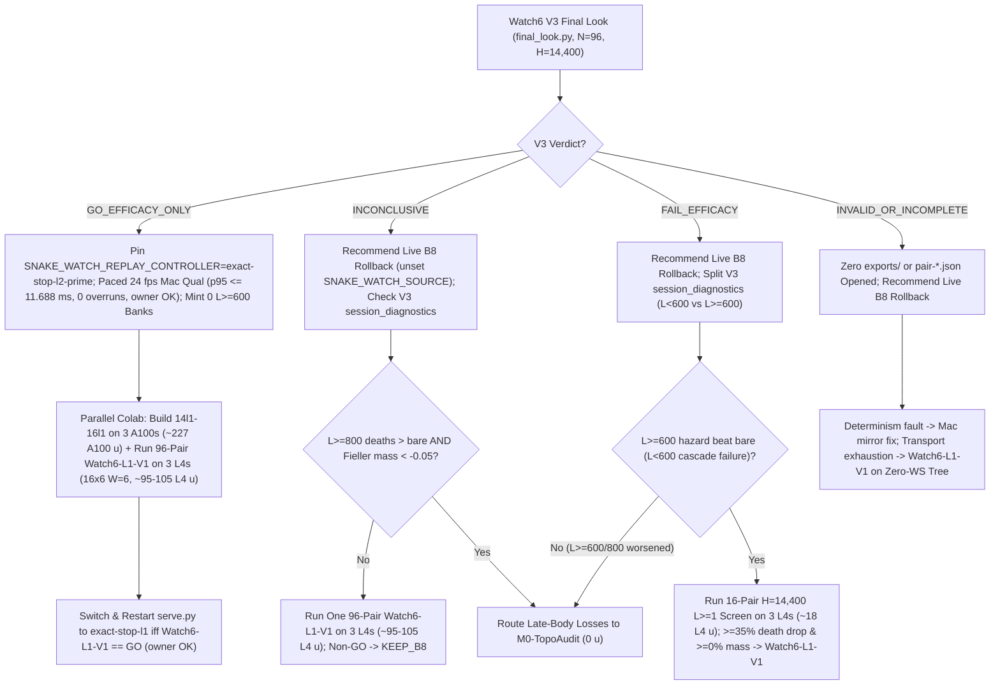

# T34 ExIt-B8 Research Roadmap (Round-03 Synthesis — Advice, Not Decisions)

Start: [project index](../INDEX.md) · [current status & authority](../STATUS.md) · [research record index](INDEX.md) · [study packages](../../research/INDEX.md) · [campaign log](final_run_20261019/CAMPAIGN_LOG.md).

> [!IMPORTANT]
> **Status: Research advice, NOT ratified decisions or release authorization.**
> Every current-round and later-round plan on this page is synthesized advisor guidance from Round 03 (2026-11-01 PT; primary synthesis artifact: `snake-dqn-artifacts/big-lever/exp/argon-rounds/round-03/synthesis/answer.md`, building on Rounds 01–02). Nothing here amends a pre-registration, ratifies a confirmation gate, or changes served defaults. Binding campaign authority remains [`SUCCESS_CONTRACT.md`](final_run_20261019/SUCCESS_CONTRACT.md), [`DESIGN_V2_SHADOW.md`](final_run_20261019/DESIGN_V2_SHADOW.md) (+ Amendment 1), [`P7_STATISTICS.md`](final_run_20261019/P7_STATISTICS.md), unsuperseded parts of [`FINAL_PLAN.md`](final_run_20261019/FINAL_PLAN.md), and [`STATUS.md`](../STATUS.md); any serving or release change requires confirmation-lane evidence, Mac serving qualification, and the owner's explicit OK.

---

## 1. Snapshot Context: What Landed vs. What Closed (Oct 29 – Nov 1)

### 1.1 Nov 1 exploration & parity milestones

- **All-length exact-stop screen — `ADOPT` for new replay banks** ([`watch6_alllen_screen`](../../research/watch6_alllen_screen/README.md), `t34-sol/argon-alllen-a100/analysis.json`, `N = 48` paired `H = 6,000` Watch6-v2 sessions):
  - `bare` (`b8-s3`): **`351.07` mass** (`CI95 [320.22, 381.91]`), **`0.2882` `deaths/1k`** (`83` deaths: `53` at `L < 600`, `30` at `L >= 600`, `21` at `L >= 800`), `mean_max_length = 794.3`.
  - `l2_prime_600` (served `L >= 600`): **`461.16` mass** (`+110.09` vs `bare`, `CI95 [+72.06, +148.13]`), **`0.1597` `deaths/1k`** (`-44.6%` vs `bare`; `46` deaths: `34` at `L < 600`, `12` at `L >= 600`, `11` at `L >= 800`), `449.6` mean branches/session.
  - **`exact_stop_alllen` (`L >= 1`, `interval = 5`, `H = 300`):** **`559.43` mass** (**`+208.37` vs `bare`**, `CI95 [+170.07, +246.66]`; **`+98.27` vs `L >= 600`**, `CI95 [+50.57, +145.98]`, clearing `>= +15.0`) and **`0.0521` `deaths/1k`** (**`-81.9%` vs `bare`**; **`-67.4%` / `-0.1076/1k` vs `L >= 600`**, `CI95 [-0.1609, -0.0544]`, clearing `<= 0.0`), cutting `L < 600` deaths **`53 (bare) / 34 (L >= 600) -> 1`** (`0.142%` `L < 600` overrides, `mean_max_length = 1,096.0`) at **`2.821×` branches** (`1,268.5` vs `449.6`). **`14/15` remaining deaths occur at `L >= 600` (`13/15` at `L >= 800`).**
  - Commit `73974411` landed controller `"exact-stop-l1"` ([`web/backend/watch_replay.py`](../../web/backend/watch_replay.py), [`research/watch_replay/prepare.py`](../../research/watch_replay/prepare.py)) and prepared A100 `W = 6` bank packets `14l1–16l1` (`3 × 12` disjoint seeds, `t34-sol/argon-banks-l1/SUMMARY.md`; serving `exact-stop-l1` as a confirmed Claim-B release still requires prospective confirmation, `git pull` + [`web/serve.py`](../../web/serve.py) restart, Mac serving qualification, and owner OK).
- **GPU `DeviceSim` v2 parity — `PASS` on A100** ([`devicesim_v2_parity`](../../research/devicesim_v2_parity/README.md), `t34-sol/argon-devicesim-v2/packet-a100-v2-parity-01/main-run-01/receipt.json`): **`0` mismatches** across **`1,536,000` snake-ticks** (`E = 256 × 1,000` Watch6-v2 ticks, commit `b500d111`), relying on `<= 1e-4` CUDA FP32 near-tie Q re-decision tolerances.
- **Active confirmation — Watch6 V3** ([`REGISTRATION_V3.md`](../../research/watch6_search_efficacy_v3/REGISTRATION_V3.md)): `24 × 4` L4 `W = 4` shards (`96` fresh paired `H = 14,400` Watch6-v2 sessions, `exact-stop-l2-prime` vs `bare`). Accounting adapter **V6.1** ratified (`75471246`, shard-00 never-allocated + shard-12 WebSocket renewal drop); sole final look runs via [`tools/watch6_v3_accounting/final_look.py`](../../tools/watch6_v3_accounting/final_look.py).

### 1.2 Closed single-pass critics, distillations, RL, and standalone macro fallbacks

Between 2026-10-29 and 2026-11-01, every single-pass learned-policy, critic, distillation, and standalone macro-fallback track closed below its promotion or selectivity bars:

| Track | Scope & primary artifact | Measured outcome | Disposition |
| --- | --- | --- | --- |
| **TRAIN-01** ([`sandbox_a_resident`](../../research/sandbox_a_resident/README.md)) | `100.7M`-row (`384`-update) GPU-resident PPO from `b8-s3` (`t34-sol/train01-closeout/SUMMARY.md`) | H5000 equal-mix paired mass **`+8.09`** (`CI95 [-18.66, +34.85]`; scripted `+26.32`, frozen `+2.85`, mixed `-4.90`; update-320 peak `+14.23` `[-11.86, +40.32]`) vs bar `>= +40` | **Closed** (no strict-gate nomination) |
| **C/T Stage-2 distillation** | Continuation-teacher causal-root distillation (`t34-sol/ct-stage2-verdict/SUMMARY.md`) | Teacher rescued **`22/32` (`68.75%`)** deaths (`22/32 <= 65` ticks; indep-suffix H300 `+66.77`, `LB90 +51.61`), but student retention was **`46.9–50.0%`** (`0 pp` over `frozen_phi` vs `>= +15 pp`; topology AUC `0.5752 < 0.83`), ordinary flips **`44.4–64.5%`** (bar `<= 1%`), and lethal ordinary flips **`3–5`** (bar `<= 1`) | **`FAIL_DISTILLATION_RETENTION_OR_SAFETY`** |
| **Doom U-Net & `spatial-student-pilot`** | `83 × 145` spatial U-Net vs 33.7k B8-feature head (`t34-sol/doom-result-01/result.json`; `t34-sol/student-direction/{astra,fable}.md`) | Spatial U-Net lost late per-action doom ROC-AUC to frozen B8 features (**`0.753` vs `0.810`**, `Δ = -0.056`, `CI95 [-0.091, -0.023]`; all-strata death-lookback `0.7626` vs `0.8226`; ordinary late `0.690` vs `0.706`) | **`GRAY` / pilot spend halted (`0 u` cancel advice after T4 Gate-1)** |
| **B8 advantage head (offline OOF)** | `256 -> 128 -> 6` ReLU head on frozen B8 features (`t34-sol/b8-head-test/RESULT.md`) | Mass rule `GO` (late H300 `+30.09`, `LB90 +23.96`), Fable selectivity **`FAIL`**: **`26.42%`** late rescue (bar `>= 35%`) at **`97.60%`** non-death flips (bar `<= 15%`) | **Selectivity `FAIL`** (192-world closed-loop A100 receipt `PASS`, awaiting Mac readout) |
| **T4 Gate-1 factored critic** ([`t4_gate1`](../../research/t4_gate1/README.md)) | Clean-slate privileged `83 × 145` (`H = 320` 7-source BFS) hazard + foraging mass-flux critic on `384` disjoint Watch6-v2 worlds (`t34-sol/argon-t4-gate1-fix2/queue-03/READOUT.json`) | **`0/8` bars passed**: `L >= 600` residual EV **`+0.0266`** (`[-0.0280, +0.0869]` vs `>= 0.25`), death-root H300 rescue **`+19.99`** (vs `>= +40`), mature doom AUC **`0.5617`** (vs `>= 0.80`), ordinary H300 mass **`-22.21`** (vs `>= -15.0`), lethal flips **`3.13%`** (vs `<= 3.0%`) | **`KILL_T4`** (proves even privileged `83 × 145` critic lacks late value signal) |
| **R6 `L < 600` harvest census** ([`r6_l600_census`](../../research/r6_l600_census/README.md)) | `64`-world (`384`-root) Watch6-v2 early-game counterfactual + 5-fold OOF corpse/trail plane probes (`t34-sol/argon-mac-checks/r6-census/RESULT.json`) | **`34.90%` (`134/384`)** oracle-harvestable roots (`>= +5` H500 mass), **`7.69%`** non-bare H500 lethal flips, OOF ROC-AUC **`0.474–0.521`** (`0` passing threshold points); superseded operationally by `exact-stop-l1` | **`KILL`** |
| **R7 macro-option fallback** ([`r7_macro_fallback`](../../research/r7_macro_fallback/README.md)) | Pruned depth-2 (`K = 15` ticks) spatial macro-options `{O_0..O_5}` on C/T train `1-step-all-die` roots (`t34-sol/argon-r7-repack/R7_READOUT.json`) | `3/5` bars passed (`0.316 ms` Mac 1-thread p95; **`33.0%` vs `9.0%`** `L >= 800` `all-die` rescue), but total `L >= 600` lift **`+3.85 pp`** (`< +10.0 pp`) and **`2 > 0`** newly caused ordinary lethal flips from aggressive `O3`/`O5` (`0` assessment roots opened) | **`KILL`** as standalone fallback |

### 1.3 Open replay & ops gaps audited in Round 03

- **Watch replay serving gaps:**
  1. [`ReplayBank._prefetch`](../../web/backend/watch_replay.py) loads any valid file matching [`CONTROLLERS`](../../web/backend/watch_replay.py) (`"exact-stop-l2-prime"`, `"exact-stop-l1"`, `"bare-b8"`) without controller pinning, risking mixed-controller playback if a directory ever combines banks.
  2. [`research/watch_replay/smoke.py`](../../research/watch_replay/smoke.py) steps only `12` unpaced frames and does not exercise [`verify_payload`](../../web/backend/watch_replay.py)'s `6.0 s` startup sleep, [`Recording.snapshot`](../../web/backend/watch_replay.py) `copy.deepcopy` at `L >= 1,000`, `6,000 -> 1` session rotation, or live-B8 fallback at paced `24 fps`.
- **Six remaining Colab ops failure modes:**
  1. *Canary ledger lock:* [`canary.check`](../../research/colab_cli/canary.py) enforces exact `sha256` and `size >= row["size"]` on every `inputs` entry, blocking standalone resume-ledger updates without burning a new canary.
  2. *`watch6-alllen-a100-s2-01` 3-link crash chain* (`t34-sol/argon-alllen-s2-retry/SUMMARY.md`): [`classify_exception`](../../research/colab_cli/failures.py) classifies WebSocket drops as `SUPERVISOR` (refused by [`auto_retry.eligible`](../../tools/ops/auto_retry.py)); startup `units/contract.json` trips `exports != []` at `0` completed units; and [`auto_retry.prepare`](../../tools/ops/auto_retry.py) increments `completion_attempt` even when `unallocated=True`.
  3. *Timeout outcome-blindness leak:* [`_supervise`](../../research/colab_cli/runtime.py) immediately self-unassigns on `reason == "timeout"`; if a high-mass (`L > 1,500`) shard times out during a Mac transport blip, Mac `finally:` sees the VM already gone (`404` on pre-stop drains, `stop_verified=True`), spoofing a mechanical mid-compute drop.
  4. *Zero-WS & forensic-drain traps:* [`CLI._call_once`](../../research/colab_cli/supervisor.py) blocks `"download"` after `self.deadline`; [`download_file`](../../research/colab_cli/transfers.py) requires pre-known `(size, expected_sha256)`; multi-unit wave completions (`W = 4` / `W = 6`) invoke WebSocket [`export_batch`](../../research/colab_cli/supervisor.py); and partial Contents PUTs on `release-credential.next.json` lack a `try/except` guard.
  5. *Unpublished Cap-6 entry & standalone `dispatch.py` L4 fence:* Prepared Cap-6 entry `36285bc6` (`t34-sol/argon-qual-cap6/SUMMARY.md`) is not yet published into `ops/colab-cli-qualified.json`, and non-`prefer` [`dispatch`](../../tools/ops/dispatch.py) lacks [`ready_queue.py`](../../tools/ops/ready_queue.py)'s `L4 <= 3` check and `reconcile_unavailable`.
  6. *Retry-chain readouts:* Multi-attempt analyzers must walk full `retry_id` + `-retry-1` trees (`73c26ccc` unmerged on `main`).

---

## 2. Current-Round Plan (Advice, Not Decisions)

### 2.1 Settle Claim A on Mac (`0 u`, `< 2 min`) & cancel `spatial-student-pilot` (`0 u`)

- **Cancel `spatial-student-pilot` (`0 u`):** Because the `83 × 145` U-Net already lost late doom AUC to a 33.7k frozen-B8 head (`0.753` vs `0.810`, `Δ = -0.056`) and `T4 Gate-1` (`0/8` bars, `L >= 600` EV `+0.0266`, doom AUC `0.5617`, ordinary mass `-22.21`) showed that even a *privileged* `83 × 145` (`H = 320` BFS) critic lacks late value signal, skip both Round-02's 15-min MPS latency probe (`t34-sol/spatial-latency-ruling/RULING.md`) and the `40–48 A100 u` pilot fit.
- **Read completed Oct-30 Claim-A receipts (`0 u`, `< 2 min` Mac):** Run `closedloop_readout.py` (`origin/astra-doom-auc-smoke` @ `591d94c3`) on completed `b8-head-closedloop` (`N = 192` v1 `H = 5,000` worlds, `m in {0, 10, 25, 50}`, `t34-sol/b8-head-closedloop/main-01/output/receipt.json`) and audit completed `spatial-qbytes-01` (`mapped-parity.json`, `t34-sol/spatial-qbytes-fix/t34-spatial-qbytes-01/ruler-output-a100-fallback/receipt.json`).
- **Recommended Claim-A kill rule:** Recommend **closing Claim A permanently (`0 u`)** unless at least one margin `m in {0, 10, 25, 50}` clears Holm-Bonferroni (`4` arms) `H = 5,000` mass `>= +40` (`LB90 > 0`), scripted no-death `>= +0.03`, boost `[0.5%, 10%]` ([`SUCCESS_CONTRACT.md`](final_run_20261019/SUCCESS_CONTRACT.md)), and `<= 15%` living-decision overrides (any surviving arm still requires a `48`-pair `H = 6,000` Watch6-v2 gate, `~12 A100 u`).

### 2.2 Publish unified Cap-6 + zero-WS transport & `confirm_audit.py` (`0 u` 12-fixture pytest + `~0.25 L4 u` canary)

Before launching any post-V3 confirmation package, qualify one additive successor transport tree via [`tools/ops/qualification.py`](../../tools/ops/qualification.py) (`publish` / `add`, leaving in-flight trees active):

1. **REST-only post-`hardware.json` polling & exports (`0` post-start WebSocket RPCs):** Poll `state.json` (and terminal `terminal.json` with embedded `4 KB` `job_log_tail`) via REST [`_contents_call`](../../research/colab_cli/transfers.py) inside a `1,200 s` recovery window, route `<= 8 MiB` exports (`len(pending) <= 16`) through REST [`export_file`](../../research/colab_cli/supervisor.py), and validate `release-credential.next.json` inside `try/except` before `os.replace`.
2. **Deadline-safe pre-stop drain, timeout hold & WS/SSL/EOF matchers:** Exempt `cleanup_mode` downloads (`15 s` cap) in [`CLI._call_once`](../../research/colab_cli/supervisor.py) to pull `prestop-{terminal,state}.json` before `stop_lease()`; hold `reason == "timeout"` inside [`_supervise`](../../research/colab_cli/runtime.py)'s lease-fenced `<= 120 s` `post_terminal_timeout` window instead of immediate self-unassign; and add `"websocket"`, `"socket is already closed"`, `"ssl"`, `"eof"` to [`policy.py`](../../research/colab_cli/policy.py), [`cli_guard.py`](../../research/colab_cli/cli_guard.py), and [`failures.py`](../../research/colab_cli/failures.py).
3. **Monotonic-superset ledger exemption (`<= 5` PUTs, `0` re-canaries):** Keep exact SHA/size checks on static `inputs/input-metadata.tar.gz` + HTTPS checkpoints in [`canary.check`](../../research/colab_cli/canary.py), exempting *only* `inputs/verified-ledger.tar.gz` (`<= 64 KiB`) on `completion_attempt in {1, 2}` when [`read_ledger`](../../tools/ops/package_spec.py) proves matching `(schema, namespace, allocation, identity)` and a strict unit superset.
4. **Two-counter retries, `dispatch.py` L4 fence & positive-conjunction `tools/ops/confirm_audit.py`:** Enforce `L4 <= 3` / `total <= 6` + `reconcile_unavailable` in [`tools/ops/dispatch.py`](../../tools/ops/dispatch.py); split `prestart_attempt` (`0..20`, `hardware.json` absent) from sidecar-only `completion_attempt` (`0..2`, ignoring `contract.json`, `0` payload reads) in [`tools/ops/auto_retry.py`](../../tools/ops/auto_retry.py); and freeze `tools/ops/confirm_audit.py` requiring positive conjunction across `PRESTART_TRANSPORT`, `MIDCOMPUTE_TRANSPORT` (`prestop-state.json` running *or* bounded non-timeout elapsed window with failed REST renewals), and `PASS` (`96/96` `.complete` digests).
5. **Verification & kill rule:** Pass a 12-fixture [`tests/fixtures/fake_colab.py`](../../tests/fixtures/fake_colab.py) offline matrix (`0 u`: 6 recoveries + 6 traps) and one 4-unit fault-injected live L4 canary (`~0.25 L4 u`); block `Watch6-L1-V1` registration if offline errors `> 0/12`, live post-`hardware.json` `colab exec` RPCs `> 0`, staging `> 5` PUTs / `> 30 s`, or unattended 1-retry `confirm_audit.py == PASS` fails.

### 2.3 Route Watch6 V3 (`final_look.py`) & confirm `exact-stop-l1` (`Watch6-L1-V1`)

Watch6 V3 governs `exact-stop-l2-prime` (`L >= 600`) only ([`REGISTRATION_V3.md`](../../research/watch6_search_efficacy_v3/REGISTRATION_V3.md)). Never top up V3, and never open `exports/` or `pair-*.json` on `INVALID_OR_INCOMPLETE`.

- **On `GO_EFFICACY_ONLY` (`deaths/1k` `UB95 < 0` and Fieller mass `LB95 >= -0.05`):**
  1. *Mac (`0 u`, `~1.5 h`):* Pin `SNAKE_WATCH_REPLAY_CONTROLLER=exact-stop-l2-prime` in [`ReplayBank`](../../web/backend/watch_replay.py), pass a paced `24 fps` playback qualification probe (`p95 <= 11.688 ms`, `0` overruns across `6.0 s` startup verification, `L >= 1,000` `copy.deepcopy`, `6,000 -> 1` rotation, and live-B8 fallback) on `watch-replay-bank-live-132`, cross-audit, and request **owner release sign-off**. Mint **0** additional `L >= 600` banks.
  2. *Colab (`3 L4 + 3 A100`):* Generate `14l1–16l1` into a separate `watch-replay-bank-live-l1` directory on `3` A100s (`~227 A100 u` / `453.6 u` 2× cap) while running 96-pair `H = 14,400` **`Watch6-L1-V1`** (`exact-stop-l1` vs `bare`) on `3` homogeneous L4s (`16 × 6` pairs, `W = 6`, `~95–105 L4 u` observed / `~312 L4 u` 2× cap). Switch and restart [`web/serve.py`](../../web/serve.py) to `exact-stop-l1` (with owner OK) **iff** `Watch6-L1-V1` hits `GO_EFFICACY_ONLY` without `L >= 1,000` regression; otherwise retain `exact-stop-l2-prime`.
- **On `INCONCLUSIVE`, `FAIL_EFFICACY`, or `INVALID_OR_INCOMPLETE`:**
  - Recommend rolling Watch back to live bare `b8-s3` (`unset SNAKE_WATCH_SOURCE`), pause bank swaps, and never top up V3.
  - On `INCONCLUSIVE` or `FAIL_EFFICACY`, inspect already-unsealed V3 `session_diagnostics` ([`research/watch6_search_efficacy/analyze.py`](../../research/watch6_search_efficacy/analyze.py)) to separate `L < 600` respawn-cascade deaths (`73.9%` = `34/46` of `L >= 600` deaths in `watch6_alllen_screen`, cut `34 -> 1` by `exact-stop-l1`) from `L >= 800` coffin traps: run `Watch6-L1-V1` directly on `INCONCLUSIVE` (unless `L >= 800` deaths exceeded `bare` and Fieller mass `< -0.05`), gate `Watch6-L1-V1` on a `16`-pair `H = 14,400` L4 screen (`~18 L4 u`; kill if death drop `< 35%` or mass `< 0%`) on `L < 600`-driven `FAIL_EFFICACY`, and route `L >= 800` search losses to `M0-TopoAudit` (§3.2).
  - On `INVALID_OR_INCOMPLETE` (zero `exports/` or `pair-*.json` opened), fix Mac live/`GridBatchSim` parity if a mirror fault tripped, or run `Watch6-L1-V1` on the zero-WS/split-ledger transport tree if transport retries exhausted.

---

## 3. Later-Round Plan: `TopoStop-v3` (Replacing `CertStop-v2`) & Watch UX (Advice, Not Decisions)

### 3.1 Four code-verified flaws in Round-02's `CertStop-v2`

Round 02 replaced Round 01's `LexSearch-v2` early-harvest proposal with zero-harvest `CertStop-v2` (`alive(300) & t_cert(300) == 1`) after `exact-stop-l1` eliminated `52/53` `L < 600` deaths without harvest rules. Round-03 code audit identified four flaws in `CertStop-v2` that **`TopoStop-v3`** resolves:

1. **1-step B8 "corpse snap-back" (`all-uncertified` vs `all-die`):** Eliminating early deaths lifts `mean_max_length` to `1,096.0` (`+37.9%` `L >= 600` roots), producing `3/48` more-death losses vs `L >= 600` (`t34-sol/argon-alllen-a100/analysis.json`). Near a `400..700`-cell corpse bay (`< L`), all 6 single-step branches + `299` greedy B8 ticks U-turn back into the bay at `t = 2` (`alive(300) == 1, t_cert(300) == 0`), so gating macro options on `alive(300) == 0` never fires — while aggressive harvest options `O3`/`O5` caused R7's `2` ordinary lethal flips (`t34-sol/argon-r7-repack/R7_READOUT.json`).
2. **Three bugs in raw `t_cert`** ([`_evaluate_options_nb`](../../research/r7_macro_fallback/options.py)): escape-gate selection accepts `ext_gain == 0` dead-end pores; `raw_wait` ignores forced `c2` coil food extending `tau_own[g*]`; and `d_opp` floods opponents at `1` cell/tick, missing **`2`-cell/tick boost cutoffs** (`length >= 5`).
3. **Contract §4 hindsight RNG leak & `E = 1` bottleneck:** [`dense_batch`](../../research/watch_replay/engine.py) clones `world.sim._rngs` (peeking future food/respawn draws against [`SUCCESS_CONTRACT.md`](final_run_20261019/SUCCESS_CONTRACT.md) §4) and steps branches sequentially at `E = 1`.
4. **Live-Mac `frame + 1` deadline miss:** `H = 48` (`~275 ms`) misses [`ServingAssistance.after_step`](../../web/backend/pathb.py)'s `frame + 1` (`41.7–83.3 ms`) deadline (`68/72` fallbacks in `t34-sol/astra-served-panel/SUMMARY.md`).

### 3.2 `TopoStop-v3` architecture & `M0-TopoAudit` (`0 u`, `~16 min` Mac) -> `W6-TopoStop-v3` (`~49–57 u`)

- **`TopoStop-v3` design (later rounds):**
  1. **`GateCert(H)` topological survival certificate:** Require `v2_surv >= L_eff` (`max(L_end, seg_count) + forced_c2_food`) **or** an escape gate `g` with `v2_surv + ext_c2(g) >= L_eff`, `cap_coil >= raw_wait(g)`, and **`max(d_g(ue), tau_own[g]) + 2 <= d_opp_sprint[g]`** (`2`-cell/tick opponent boost flood).
  2. **Survival-only `{O0, O1, O2, O4}` escalation on `all-uncertified` roots:** Drop aggressive `O3`/`O5`; run `{O0, O1, O2, O4}` (`15` macro + `285` B8 ticks) whenever **all `1`-step branches fail `2/2` `alive(300) & GateCert(300)`**, and add `L >= 500` topological edge-triggers (`GateCert(0): 1 -> 0`, `v2_surv < 1.25 L`, or `d_opp_sprint[g*] <= 10`) on skipped `interval = 5` ticks.
  3. **`K = 2` SplitMix64 private branch RNG & `E = 2..10` CPU batching:** Seed branch RNGs via `SplitMix64(sha256(public_root_bytes), k)` (`k in {0, 1}`, `min_k` survival) and batch `E = 2..10` branches in one [`GridBatchSim`](../../src/simd_env/grid_sim.py) (`~2.6×` faster, exact CPU FP32 parity).
  4. **Watch UX levers (frozen Watch6-v2 game rules):** Add [`Recording`](../../web/backend/watch_replay.py) timeline chapter jumps (`replay_search_override`, `L >= 1,000`) and an Inspector **"Doomed Ghost"** overlay (`< 120 B`/override showing `bare`'s avoided coffin).
- **Mandatory `0 u` Mac gate (`M0-TopoAudit`, `~16 min` on 4 Mac cores):** Batch-step the `48` `watch6_alllen_screen` seeds under `bare` (`E = 16`, zero `exports/` opened) to extract all `21` `L >= 800` death windows (`[t_death - 360, t_death]`) and `256` surviving `L >= 800` controls; score `TopoStop-v3` on the `~12` windows unrescued by `exact-stop-l1` over `4` independent `H = 600` SplitMix suffixes.
  - **Kill rule (`0 u`):** Kill `TopoStop-v3` before any GPU spend if **`< 35%`** of unrescued `L >= 800` deaths survive `>= 3/4` `H = 600` suffixes, **or** `GateCert(300)` false-vetoes **`> 1.5%` (`> 4/256`)** of surviving `L >= 800` controls (`> 0` new lethal flips).
- **Conditional 6-slot Colab experiment (`W6-TopoStop-v3`, `~3.2 h` wall, `~49–57 u` observed / `102 u` 2× cap + `5.5 u` canaries, queued after `Watch6-L1-V1` + `14l1–16l1` and `M0-TopoAudit` PASS):**
  - *`3 × A100/H100` (`N = 96, H = 14,400` on [`DeviceSim`](../../research/gpu_sim_spike/device_sim.py) + leaf `GateCert`, `~34–42 u` observed / `72 u` 2× cap):* 4 paired `K = 2` arms (`A0` `exact-stop-l1`, `A1` `+GateCert`, `A2` `+{O0, O1, O2, O4}` on `all-uncertified`, `A3` `+L >= 500` edge-sentinel).
  - *`3 × L4` (`N = 36, H = 6,000` on authoritative CPU `GridBatchSim`, `E = 2..10, W = 6`, `~15 u` observed / `30 u` 2× cap):* Paired `C0` (`exact-stop-l1` `K = 1`), `C1` (`TopoStop-v3` `K = 2`, emitting `36` `.watch.gz` replays), and optional `C2` (`LiveMac-Trunk64`, gated on §4 item 2).
  - **Kill rule:** Keep `exact-stop-l1` unless `A3` vs `A0` cuts `L >= 800` `deaths/1k` **`>= 40%`** (total `>= 30%`, `CI95_upper < 0`) with **`>= +45` mass** (`Fieller LB95 >= 0`), **and** CPU `C1` vs `C0` confirms non-inferior `deaths/1k`, **`>= +25` mass**, `<= 1` `L < 600` death, `[0.5%, 10%]` boost, and `<= 1.75×` branches.

---

## 4. Settled Round-03 Disagreements & Supporting Evidence

1. **`Watch6-L1-V1` shard sizing (`16 × 6` `W = 6` on `3` homogeneous L4s vs. `48 × 2` `W = 4` on `3` A100/L4):**
   Settled by `t34-sol/argon-alllen-a100/SUMMARY.md`, [`REGISTRATION_V3.md`](../../research/watch6_search_efficacy_v3/REGISTRATION_V3.md), and [`performance.py`](../../research/watch6_search_efficacy/performance.py): Colab L4 and A100 VMs share the same `12` vCPUs (`6` physical cores) on CPU-only exact-stop search (`1.54` vs `8.0 u/h`). `48 × 2` (`W = 4`) leaves `4/6` physical cores idle, triples staging overhead, and under-forecasts the `1.5×` `H = 14,400` late-body tail (`~3,044` branches -> `~367–375 min` base, `750 < 1,320 min` 2× cap). **`16 × 6` `W = 6` (`+3.1%` contention, `1.45×` VM throughput vs `W = 4`) on `3` homogeneous L4s (`~95–105 L4 u`)** is `5.2×` cheaper than A100, preserves single-CPU-family FP32 tie parity, and frees all `3` A100 slots for `14l1–16l1`.
2. **`LiveMac-Trunk64` (`W = 4` speculative workers + `gc.freeze()`) vs. `SUCCESS_CONTRACT.md` §4:**
   Settled by [`SUCCESS_CONTRACT.md`](final_run_20261019/SUCCESS_CONTRACT.md) §4, `big-lever/exp/JUDGMENT_D1.md`, and `t34-sol/astra-served-panel/SUMMARY.md`: Contract §4 caps live Path B serving assistance at **`1` extra CPU thread and `<= 1` outstanding request** unless owner-amended. Run D1's quiet-host paired `W0`/`W1K1` pause-disclosure probe (`gc_pause_ms`, `O(1)` food-grid lookup) first before proposing any multi-worker live-Mac serving design or owner contract amendment.
3. **6-slot Colab priority & GPU `DeviceSim` (`W6-TopoStop-v3` later vs. current round):**
   Settled by `t34-sol/argon-devicesim-v2/SUMMARY.md`: `devicesim_v2_parity` relies on `<= 1e-4` CUDA FP32 Q-tie tolerances and has no GPU `GateCert` kernel yet. Dedicate the current 6-slot envelope to **`3 L4` (`Watch6-L1-V1`) + `3 A100` (`14l1–16l1`)** first, queuing `W6-TopoStop-v3` only after `M0-TopoAudit` passes on the Mac.
