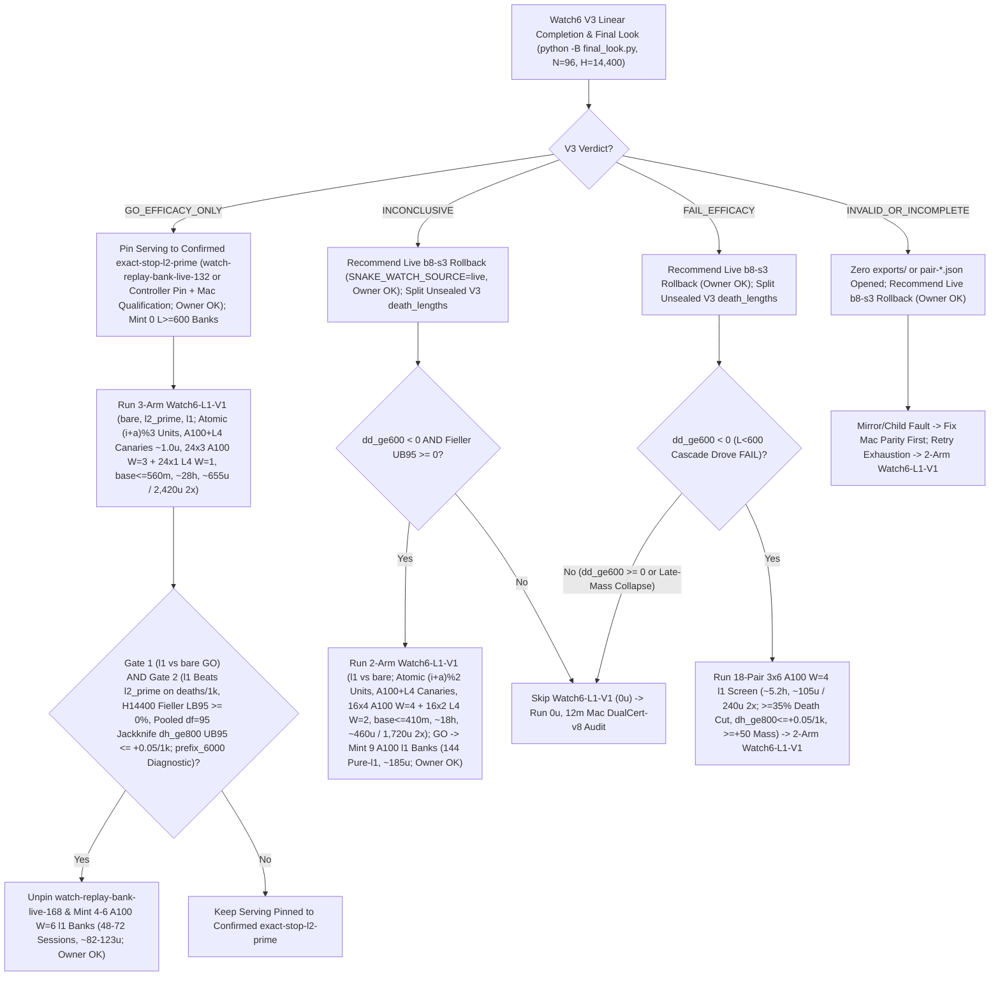

# T34 ExIt-B8 Research Roadmap (Round-08 Synthesis — Advice, Not Decisions)

Start: [project index](../INDEX.md) · [current status & authority](../STATUS.md) · [research record index](INDEX.md) · [study packages](../../research/INDEX.md) · [campaign log](final_run_20261019/CAMPAIGN_LOG.md).

> [!IMPORTANT]
> **Status: Research advice, NOT ratified decisions or release authorization.**
> Every current-round and later-round plan on this page is synthesized advisor guidance from Round 08 (2026-11-01 PT; primary synthesis artifact: `snake-dqn-artifacts/big-lever/exp/argon-rounds/round-08/synthesis/answer.md`, superseding Rounds 01–07). Nothing here amends a pre-registration, ratifies a confirmation gate, or changes served defaults. Binding campaign authority remains [`SUCCESS_CONTRACT.md`](final_run_20261019/SUCCESS_CONTRACT.md), [`DESIGN_V2_SHADOW.md`](final_run_20261019/DESIGN_V2_SHADOW.md) (+ Amendment 1), [`P7_STATISTICS.md`](final_run_20261019/P7_STATISTICS.md), unsuperseded parts of [`FINAL_PLAN.md`](final_run_20261019/FINAL_PLAN.md), and [`STATUS.md`](../STATUS.md); any serving or release change requires confirmation-lane evidence, Mac serving qualification, and the owner's explicit OK.

---

## 1. Snapshot Context & Code-Verified Round-08 Corrections (Oct 29 – Nov 1)

### 1.1 Nov 1 exploration, bank-minting, parity & Watch6 V3 linear-retry guard

- **All-length exact-stop screen — `ADOPT` for new replay banks** ([`watch6_alllen_screen`](../../research/watch6_alllen_screen/README.md), `t34-sol/argon-alllen-a100/analysis.json`, `N = 48` paired `H = 6,000` Watch6-v2 sessions uniting `12` L4 `W = 4` units `0..11` at `568b09e4` with `36` A100 `W = 6` units `12..47` across three `12`-unit shards at `73c26ccc` on `origin/argon-alllen-a100-1031`):
  - `bare` (`b8-s3`): **`351.07` mass** (`CI95 [320.22, 381.91]`), **`0.2882` `deaths/1k`** (`CI95 [0.2427, 0.3337]`; `83` deaths: `53` at `L < 600`, `30` at `L >= 600`, `21` at `L >= 800`), `mean_max_length = 794.3`.
  - `l2_prime_600` (served `L >= 600`): **`461.16` mass** (`CI95 [414.30, 508.02]`; `+110.09` vs `bare`, `CI95 [+72.06, +148.13]`), **`0.1597` `deaths/1k`** (`CI95 [0.1060, 0.2134]`; `-44.6%` vs `bare`; `46` deaths: `34` at `L < 600`, `12` at `L >= 600`, `11` at `L >= 800`), `449.6` mean branches/session (`403.7` roots, `mean_max_length = 943.4`).
  - **`exact_stop_alllen` (`L >= 1`, `interval = 5`, `H = 300`):** **`559.43` mass** (`CI95 [533.59, 585.27]`; **`+208.37` / `+59.35%` vs `bare`**, `CI95 [+170.07, +246.66]`; **`+98.27` / `+21.31%` vs `L >= 600`**, `CI95 [+50.57, +145.98]`, clearing `>= +15.0`) and **`0.0521` `deaths/1k`** (`CI95 [0.0294, 0.0748]`; **`-81.9%` / `-0.2361/1k` vs `bare`**, `CI95 [-0.2828, -0.1895]`; **`-67.4%` / `-0.1076/1k` vs `L >= 600`**, `CI95 [-0.1609, -0.0544]`, clearing `<= 0.0`), cutting `L < 600` deaths **`53 (bare) / 34 (L >= 600) -> 1`** (`0.142%` `L < 600` overrides, `mean_max_length = 1,096.0`) at **`2.821×` branches** (`1,268.5` vs `449.6`, `1,200.1` roots = `1.057` branches/root, with `53.6%` cheap `L < 600` roots in frames `0..6,000`). **`14/15` remaining deaths occur at `L >= 600` (`13/15` at `L >= 800`).**
  - *Exposure & per-world notes:* Eliminating `34 -> 1` early deaths gives `exact_stop_alllen` **`1.379×` more `L >= 600` living exposure** (`403.7 -> 556.6` roots/session), so `11 -> 13` raw `L >= 800` deaths reflects **`-14.2%` lower per-frame `L >= 800` hazard** despite raw session-normalized `Δd_ge800 = +0.0069/1k`. Across paired worlds, `exact_stop_alllen` regressed deaths vs `L >= 600` on `3/48` seeds (`3075941873`, `3394546952`, `121131908`) and mass on `14/48` seeds.
- **All-length Watch banks `14l1–16l1` completed `36/36` on active Cap-6 `36285bc6` (freeing all `3` A100 slots):**
  - Verified receipts (`t34-sol/argon-banks-l1/packet-bank{14l1,15l1,16l1}-a100/output-main/receipt.json`, `SUMMARY.md`) confirm Cap-6 (`36285bc6`) ran `6/6` concurrent runtimes (`3 A100 @ 6.73 u/h + 3 L4 @ 1.94 u/h = 26.01 u/h`), finishing all `3 × 12` `exact-stop-l1` sessions (`W = 6`, `H = 6,000`) in **`3.03–3.07 h/bank`** (**`~20.36–20.67 u/bank` = `~61.5 A100 u` observed total** vs `~227 u` forecast; balance **`~2,154.66 u`**, leaving `3` A100 slots immediately available). Because survived trajectories spend frames `6,000..14,400` almost entirely at `L >= 800`, `exact-stop-l1` compute scales **superlinearly (`~2.8–3.2×`)** from `H = 6,000` to `H = 14,400` (`argon-banks-l1/SUMMARY.md:38-40`).
  - Commit `395eacbb` switched `.claude/launch.json` to **`watch-replay-bank-live-168`** (`132` `exact-stop-l2-prime` banks `01–08, 10–12` + `36` unconfirmed `exact-stop-l1` banks `14l1–16l1`, [`web/serve.py`](../../web/serve.py) restarted on `b5b63cd1`, keeping `watch-replay-bank-live-132` intact for rollback). Confirming `exact-stop-l1` at `H = 14,400` still requires prospective confirmation (`Watch6-L1-V1`), Mac serving qualification, and owner OK.
- **GPU `DeviceSim` v2 parity — `PASS` on A100** ([`devicesim_v2_parity`](../../research/devicesim_v2_parity/README.md), `t34-sol/argon-devicesim-v2/packet-a100-v2-parity-01/main-run-01/receipt.json`): **`0` mismatches** across **`1,536,000` snake-ticks** (`E = 256 × 1,000` Watch6-v2 ticks in `3,505.6 s` = `1,434.6` steps/s under 5-opponent CUDA flood launches, commit `b500d111`), using `DeviceSim`'s SplitMix64 RNG and `<= 1e-4` CUDA FP32 near-tie Q re-decision tolerances.
- **Active confirmation — Watch6 V3 (`05:01 PT` snapshot, `web/backend/` hash-coupling & linear-retry lineage guard)** ([`REGISTRATION_V3.md`](../../research/watch6_search_efficacy_v3/REGISTRATION_V3.md)): `24 × 4` L4 `W = 4` shards (`96` fresh paired `H = 14,400` Watch6-v2 sessions) confirming **`exact-stop-l2-prime` (`L >= 600`) only**. At `05:01 PT`, **`14/24` shards are `PASS`** (`01..08, 10, 11, 13..16`), **`6/24` are active** (`3/24` running `17, 18, 20` + `3/24` queued `21..23`), and **`4/24` are V6.1-accepted mechanical failures** (`00` `412` unallocated, `09` `UPLOAD_CAP`, `12` renewal-WS drop, `19` warmup `GuardError`; `75471246`, `0` new rulings):
  - [`final_look.py:_verify_shard_lineage`](../../tools/watch6_v3_accounting/final_look.py) (`lines 380–386`) fails closed (`"forked/concurrent attempt lineage detected"`) whenever two attempts share a parent receipt, and [`watch6_search_efficacy_v3/protocol.py`](../../research/watch6_search_efficacy_v3/protocol.py) (`lines 59–120`) hashes `web/backend/` into `identity()`. Keep all V3 worktrees untouched; dispatch **only** staged `ops/auto-retry` children on shards **`09` and `19`** (**do NOT run [`recover.py`](../../tools/watch6_v3_accounting/recover.py)** on `09, 19`); run `recovery-shard-{00,12}-01` via `python -B -m tools.watch6_v3_accounting.dispatch`; and invoke [`final_look.py`](../../tools/watch6_v3_accounting/final_look.py) under **`python -B`** from clean `snake-dqn-argon-v3-accounting` ([`_forbid_pycache_directory`](../../tools/watch6_v3_accounting/__init__.py) `lines 747–777`).
- **Completed Oct-30 Claim-A GPU receipts awaiting `0 u` Mac readout (`< 3 min`):** `b8-head-closedloop` (`t34-sol/b8-head-closedloop/main-01/output/terminal.json`, `rc = 0`) and `spatial-qbytes-01` (`t34-sol/spatial-qbytes-fix/t34-spatial-qbytes-01/ruler-output-a100-fallback/terminal.json`, `rc = 0`) completed cleanly on A100, while `T4 Gate-1` (`0/8` bars, `KILL_T4`) cancels the `40–48 A100 u` `spatial-student-pilot` fit (retaining compiled `.so` caches).

### 1.2 Closed single-pass critics, distillations, RL, and standalone macro fallbacks

Between 2026-10-29 and 2026-11-01, every single-pass learned-policy, critic, distillation, and standalone macro-fallback track closed below its promotion or selectivity bars:

| Track | Scope & primary artifact | Measured outcome | Disposition |
| --- | --- | --- | --- |
| **TRAIN-01** ([`sandbox_a_resident`](../../research/sandbox_a_resident/README.md)) | `100.7M`-row (`384`-update) GPU-resident PPO from `b8-s3` (`t34-sol/train01-closeout/SUMMARY.md`) | H5000 equal-mix paired mass **`+8.09`** (`CI95 [-18.66, +34.85]`; scripted `+26.32`, frozen `+2.85`, mixed `-4.90`; update-320 peak `+14.23` `[-11.86, +40.32]`) vs bar `>= +40` | **Closed** (no strict-gate nomination) |
| **C/T Stage-2 distillation** | Continuation-teacher causal-root distillation (`t34-sol/ct-stage2-verdict/SUMMARY.md`) | Teacher rescued **`22/32` (`68.75%`)** deaths (`22/32 <= 65` ticks; indep-suffix H300 `+66.77`, `LB90 +51.61`), but student retention was **`46.9–50.0%`** (`0 pp` over `frozen_phi` vs `>= +15 pp`; topology AUC `0.5752 < 0.83`), ordinary flips **`44.4–64.5%`** (bar `<= 1%`), and lethal ordinary flips **`3–5`** (bar `<= 1`) | **`FAIL_DISTILLATION_RETENTION_OR_SAFETY`** |
| **Doom U-Net & `spatial-student-pilot`** | `83 × 145` spatial U-Net vs 33.7k B8-feature head (`t34-sol/doom-result-01/result.json`; `t34-sol/student-direction/{astra,fable}.md`) | Spatial U-Net lost late per-action doom ROC-AUC to frozen B8 features (**`0.753` vs `0.810`**, `Δ = -0.056`, `CI95 [-0.091, -0.023]`; all-strata death-lookback `0.7626` vs `0.8226`; ordinary late `0.690` vs `0.706`) | **`GRAY` / `40–48 A100 u` pilot fit canceled (`0 u`; retain `.so` caches)** |
| **B8 advantage head (offline OOF)** | `256 -> 128 -> 6` ReLU head on frozen B8 features (`t34-sol/b8-head-test/RESULT.md`) | Mass rule `GO` (late H300 `+30.09`, `LB90 +23.96`), Fable selectivity **`FAIL`**: **`26.42%`** late rescue (bar `>= 35%`) at **`97.60%`** non-death flips (bar `<= 15%`) | **Selectivity `FAIL`** (192-world closed-loop A100 `rc = 0`, awaiting Mac readout) |
| **T4 Gate-1 factored critic** ([`t4_gate1`](../../research/t4_gate1/README.md)) | Clean-slate privileged `83 × 145` (`H = 320` 7-source BFS) hazard + foraging mass-flux critic on `384` disjoint Watch6-v2 worlds (`t34-sol/argon-t4-gate1-fix2/queue-03/READOUT.json`) | **`0/8` bars passed**: `L >= 600` residual EV **`+0.0266`** (`[-0.0280, +0.0869]` vs `>= 0.25`), death-root H300 rescue **`+19.99`** (vs `>= +40`), mature doom AUC **`0.5617`** (vs `>= 0.80`), ordinary H300 mass **`-22.21`** (vs `>= -15.0`), lethal flips **`3.13%`** (vs `<= 3.0%`) | **`KILL_T4`** (proves even privileged `83 × 145` critic lacks late value signal) |
| **R6 `L < 600` harvest census** ([`r6_l600_census`](../../research/r6_l600_census/README.md)) | `64`-world (`384`-root) Watch6-v2 early-game counterfactual + 5-fold OOF corpse/trail plane probes (`t34-sol/argon-mac-checks/r6-census/RESULT.json`) | **`34.90%` (`134/384`)** oracle-harvestable roots (`>= +5` H500 mass), **`7.69%`** non-bare H500 lethal flips, OOF ROC-AUC **`0.474–0.521`** (`0` passing threshold points); superseded operationally by `exact-stop-l1` | **`KILL`** |
| **R7 macro-option fallback** ([`r7_macro_fallback`](../../research/r7_macro_fallback/README.md)) | Pruned depth-2 (`2K = 30` ticks) spatial macro-options `{O_0..O_5}` on C/T train `1-step-all-die` roots (`t34-sol/argon-r7-repack/R7_READOUT.json`) | `3/5` bars passed (`0.316 ms` Mac 1-thread p95; **`33.0%` vs `9.0%`** `L >= 800` `all-die` rescue — `+66.7 pp` among `t = 300` survivors before tick-`30` B8 re-entry trapped `16/25`), but total `L >= 600` lift **`+3.85 pp`** (`< +10.0 pp`) and **`2 > 0`** ordinary lethal flips (`0` assessment roots opened) | **`KILL`** as standalone `30`-tick fallback |

### 1.3 Code-verified Round-08 corrections over Round 07

1. **`Watch6-L1-V1` `426.7 m` 1-wave `p95` cap, atomic per-arm exports, mixed-tier canaries & Gate-2 power:**
   - [`watch6_search_efficacy_v3/costs.py`](../../research/watch6_search_efficacy_v3/costs.py) (`lines 196–211`, `ceil(20 + 1.5 * waves * pair_seconds / 60) <= 660` via `MAX_BASE_MINUTES = 660` in [`watch6_search_efficacy/performance.py`](../../research/watch6_search_efficacy/performance.py) `line 21`) caps 1-wave `p95` runtime at **`426.7 m`**. Because `exact_stop_alllen` (`53.6%` cheap `L < 600` roots in `0..6,000`) scales superlinearly (`~2.8–3.2×`) across `6,000..14,400` (`argon-banks-l1/SUMMARY.md:38-40`), Round 07's `12 × 6` A100 `W = 6` + `12 × 2` L4 `W = 2` monolithic 3-arm layout breaches `660 m` (`~684–774 m` base on A100, `~765–840 m` on L4).
   - Monolithic [`watch6_search_efficacy/run.py:pair`](../../research/watch6_search_efficacy/run.py) (`lines 58–95`) loses already-finished arms on mid-compute WS drops; [`run.py:metrics`](../../research/watch6_search_efficacy/run.py) (`lines 40–55`) omits `alive_frames_ge600` (so V3 post-verdict splits use unsealed `death_lengths`: `Δd_ge600 = d_ge600(l2_prime) - d_ge600(bare)`); [`colab_cli/canary.py`](../../research/colab_cli/canary.py) (`lines 302–311`) requires **both** A100 and L4 family canaries (`~1.0 u`) on mixed `A100 + L4` studies (not 1 A100 canary); and double-gating Gate-2 Fieller `LB95 >= 0%` at `prefix_6000` alongside `H = 14,400` costs `~18–25%` power (`prefix_6000` stays diagnostic).
2. **Eight remaining `colab_cli` / `tools/ops` traps in Round 07's 7-fix v2 transport proposal:**
   - *(a) Pre-salvage VM timeout & clipped CLI stderr:* `Broker.execute` ([`supervisor.py`](../../research/colab_cli/supervisor.py) `line 1617`) sets VM `timeout_seconds` `25–120 s` before Mac's wall deadline (`line 1136`), so [`runtime.py:_supervise`](../../research/colab_cli/runtime.py) (`lines 628–702`) unassigns pre-salvage while [`CLI._call_once`](../../research/colab_cli/supervisor.py) (`lines 509–586`) refuses post-deadline `download` and clips `[-2000:]` stderr.
   - *(b) `3`-RPC staging floor (not `2`) & premature `"verified"` transfers:* [`deliver_source`](../../research/colab_cli/supervisor.py) (`lines 1799–1821`) is required by [`staging_measurement`](../../research/colab_cli/canary.py) (`lines 346–375`), making the pre-`ready.json` floor **`3` WS RPCs** (`initial`+`mkdir`, `source-fetch`, `ready.json`), while [`_observed_transfer`](../../research/colab_cli/transfers.py) (`lines 110–113`) recorded `"verified"` before `ready.json`; meanwhile `frp3_m3_s12_u60000_20261005.pth` in [`PUBLIC_INPUTS.json`](../../research/t34_exit_b8/PUBLIC_INPUTS.json) (`line 14`) is **`6.91 MB` raw** (`~1.66 MB` gzipped) inside `21.36 MB` `league.tar.gz`.
   - *(c) Post-terminal `.next.json` omission:* [`runtime.py:_supervise`](../../research/colab_cli/runtime.py) (`lines 709–725`) checks `_release_credential_expiring` post-terminal without promoting `release-credential.next.json`.
   - *(d) `canary.check` (`canary.py:312-321`) rejects non-empty retry ledgers:* Exempt the `<= 64 KiB` 3-file [`read_ledger`](../../tools/ops/package_spec.py) (`lines 152–177`) triple (`verified-ledger.json{,.sha256,.complete}`) from `size`/`sha256` equality.
   - *(e) `AcceptanceObserver` requires boolean `kernel_idle`:* [`AcceptanceObserver`](../../research/colab_cli/acceptance_faults.py) (`lines 219–228`) asserts [`kernel_idle`](../../research/colab_cli/cli_guard.py) (`lines 424–480`) returns `bool`, requiring a separate dict-returning `kernel_idle_probe`.
   - *(f) `auto_retry.py` `exports != []` & `base_minutes` false-reject:* [`auto_retry.py:evaluate_attempt`](../../tools/ops/auto_retry.py) (`lines 265–270`) rejects partial exports, and `elapsed < base_minutes * 60` false-rejects late WS drops after `20 m` recovery (`elapsed < timeout_minutes * 60 - 180` is required).
   - *(g) `web/backend/` hash-coupling & `load_checkpoint`:* [`GameSession.load_checkpoint`](../../web/backend/session.py) (`lines 1541–1544`) already exits replay and closes `_replay_bank`; moving shared search helpers from `web/backend/` to `src/` decouples future confirmation `protocol.source_paths()` from FastAPI serving code.
   - *(h) Direct `dispatch.py` bypassed `L4 <= 3` & lineage forks:* Enforce locked `L4 <= 3` + `total <= 6` + `reconcile_unavailable` in [`tools/ops/dispatch.py`](../../tools/ops/dispatch.py) (`lines 2043–2090, 2871–2983`), retiring `-retry-1` and `recover.py`.
3. **Five `CertHold-v7` flaws motivating `DualCert-v8`:**
   - *(a) `K = 2` SplitMix64 & A100 `W = 8` SMT contention:* CPU [`EnvRng`](../../research/bl_served_search/ruler_operator.py) (`line 80`) uses CPython `random.Random` MT19937 (not SplitMix64); `K = 2` doubles Mac root latency (`1.46 -> 2.9 s`, `JUDGMENT_D1.md:47-48`); and `W = 8` on 12-vCPU A100 adds `+33.9%` SMT contention (`5.380 s` vs `4.144 s` at `W = 6`, `argon-alllen-a100/SUMMARY.md:19-23`), pushing `N = 72` past `660 m` (`~16 h`, not `4.2 h`).
   - *(b) `all_die_sel0` misses `93%` of `L >= 800` traps:* `all_die_sel0` ([`r7_macro_fallback/search.py`](../../research/r7_macro_fallback/search.py) `lines 154–158`) fires on only `9/129` (`7.0%`) `L >= 800` death roots (`R7_READOUT.json:130-137`) because greedy B8 coils alive inside shrinking pockets to tick `300` before dying at `305..450` (`!DomCert(S_{t+300})` is the true trigger).
   - *(c) Static `(pocket_hash, g_star_u)` expires under tail motion:* [`options.py`](../../research/r7_macro_fallback/options.py) (`lines 458–497`) binds `g_star_u` to a fixed cell that drifts `35–70` cells in `35` ticks (requiring body-relative `(life_id, sealer_id, L_0 - offset_grid[g_star_u], mode)` leases).
   - *(d) Missing `2`-cell/tick enemy boost floods, dynamic `2`-cores & `[0.87, 1.15] * L_hero` `v8` yield:* `_evaluate_options_nb` (`options.py:328-718`) uses `1`-cell/tick enemy steps and static `in_c2`, and Round 07 inverted `L_hero`/`L_opp` — non-cornered `v8` opponents of length **`[0.87, 1.15] * L_hero`** ([`safety_veto_v6.py`](../../src/evaluation/safety_veto_v6.py) `lines 171, 224`; [`safety_veto_v8.py`](../../src/evaluation/safety_veto_v8.py) `lines 289–351`) yield contested gates.
   - *(e) `5/39` `snapshot` / `_enforce_food_target` stalls:* Alongside `34/39` `game.update` stalls (`JUDGMENT_D1`), `5/39` stalls occur in `snapshot` / `_enforce_food_target` ([`FoodManager`](../../src/game/food_manager.py) `lines 96–307`), requiring an `O(1)` `_food_by_cell` dict alongside the corpse `deque`.

---

## 2. Current-Round Plan (Advice, Not Decisions)

### 2.1 `0 u` Mac gates (`< 3 min`): Claim-A readout/closure & Watch replay patch (V3 untouched)

1. **Read completed Claim-A receipts & enforce closure bar (`0 u`, `< 3 min` Mac):**
   - Run `closedloop_readout.py` (`origin/astra-doom-auc-smoke` @ `591d94c3`) on completed `b8-head-closedloop` (`N = 192` v1 `H = 5,000` worlds, `m in {0, 10, 25, 50}`) and audit completed `spatial-qbytes-01` (`mapped-parity.json`); keep `spatial-student-pilot` (`40–48 A100 u`) canceled (`0 u`, retaining `.so` caches).
   - **Recommended Claim-A kill rule:** Recommend **closing Claim A permanently (`0 u`)** unless some `m in {0, 10, 25, 50}` clears `ci95[0] > 0` (`== LB97.5`, exact 4-arm `alpha = 0.10/4` Bonferroni), `H = 5,000` pooled mass `>= +40`, scripted no-death `>= +0.03` (no mix loss), [`P7_STATISTICS.md`](final_run_20261019/P7_STATISTICS.md) Guard A (`Δalive >= -0.05` pooled, `>= -0.075`/mix), and `<= 15%` living-decision overrides — followed by a `0 u`, `10 min` v2 boost `[0.5%, 10%]` check before nominating any Mac strict gate.
2. **Fix & Mac-qualify Watch replay serving on `main` (`0 u`, leaving V3 worktrees untouched):**
   - Keep all V3 worktrees untouched (since [`watch6_search_efficacy_v3/protocol.py`](../../research/watch6_search_efficacy_v3/protocol.py) hashes `web/backend/`), move shared search helpers out of [`web/backend/`](../../web/backend/) into [`src/`](../../src/) so future confirmation `protocol.source_paths()` decouples from FastAPI serving code, and land the replay patch on `main` **before** freezing `Watch6-L1-V1`:
     - Add injectable `shuffle_discovery: bool = True` to [`ReplayBank`](../../web/backend/watch_replay.py) (shuffling cycle 1 with cross-cycle boundary holdback while keeping deterministic test injection); replace per-frame `stop.wait(0.001)` in [`verify_payload`](../../web/backend/watch_replay.py) with a **`64`-frame cooperative yield** (`if count % 64 == 0 and stop.wait(0.0005): return None` -> `< 0.35 s` cold load without `24 fps` GIL stalls); shallow-copy `dict(self.frame)` + `dict(session)` in [`Recording.snapshot`](../../web/backend/watch_replay.py); and add `SNAKE_WATCH_REPLAY_CONTROLLER` (`all | exact-stop-l2-prime | exact-stop-l1`).
     - Set `_replay_opted_out = True` **only** inside [`set_epsilon`](../../web/backend/session.py) (`lines 1154–1160`) and [`set_food`](../../web/backend/session.py) (`lines 1173–1200`) — **never** inside `_leave_watch_replay()`, keeping `Play -> Watch` via `set_mode("watch")` intact — and clear `_replay_opted_out = False` in [`_build`](../../web/backend/session.py) (`lines 714–738`) plus a split `"new_game"` control handler in [`app.py`](../../web/backend/app.py) (`lines 310–311`, preserving live opt-outs across `reset_game` while [`load_checkpoint`](../../web/backend/session.py) `lines 1541–1544` already exits replay); gate `__init__`, `reset_game`, and `set_mode` strictly on clean mixed-Watch6 `b8-s3` (`served_checkpoint["name"] == "b8-s3"`, `watch_roster == "mixed"`, `watch_roster_reason is None`, `len(snakes) == 6`, `not _replay_opted_out`).
   - Pass `1,500` unpaced + `120` paced-`24 fps` qualification ticks (`p95 <= 11.688 ms`, `0/120` overruns per [`t15_mixed_roster_qualification_2026-10-17.md`](t15_mixed_roster_qualification_2026-10-17.md), `< 1.0 s` cold readiness) while cold `.watch.gz` verification runs concurrently across `L >= 1,000` bodies, `6,000 -> 1` rotation, `Play -> Watch`, and live-B8 fallback.

### 2.2 Finish Watch6 V3 linearly & qualify the 8-fix Contents-only v2 transport (`~1.6 u`)

1. **Finish Watch6 V3 linearly (`N = 96`, `exact-stop-l2-prime` `L >= 600` only):**
   - Dispatch **only** the already-staged `ops/auto-retry` packets on shards **`09` and `19`** (**do NOT run `recover.py`** on `09, 19`); dispatch `recovery-shard-{00,12}-01` on shards **`00` and `12`** via `python -B -m tools.watch6_v3_accounting.dispatch --evidence-dir .../argon-v3-accounting-v6`; publish V6.1 sidecars via `proof.py:publish_renewal_ws_transport_evidence` (`0 u`, `0` rulings) on any zero-export renewal-WS drop on `17..23` (`<= 2` compute completions); and invoke [`final_look.py`](../../tools/watch6_v3_accounting/final_look.py) with **`python -B`** from clean `snake-dqn-argon-v3-accounting` (never opening `exports/` or `pair-*.json` on `INVALID_OR_INCOMPLETE`).
2. **Eight code-verified fixes in additive v2 transport (`qualification.py add`, `~1.6 u` total) & `confirm_audit.py`:**
   - *(1) Standalone `6.91 MB` `frp3-s12` HTTPS URL & Mac `url-cache/`:* Publish standalone `frp3_m3_s12_u60000_20261005.pth` (`6.91 MB` raw, `~1.66 MB` gzipped) on GitHub Release `s1-inputs-20261019`, cache [`inputs.py:input_preflight`](../../research/colab_cli/inputs.py) URL downloads by `(sha256, size_bytes)` under `ACCOUNT_ROOT/url-cache/`, and admit [`validate_public_input`](../../research/colab_cli/inputs.py) `"url"` entries in [`watch6_search_efficacy/admission.py`](../../research/watch6_search_efficacy/admission.py).
   - *(2) Exempt `<= 64 KiB` `read_ledger` triple in `canary.check`:* Unbundle `inputs/verified-ledger.json{,.sha256,.complete}` from `input-metadata.tar.gz` ([`uploads.py`](../../research/watch6_search_efficacy/uploads.py) `lines 55–76`) and exempt that `<= 64 KiB` 3-file [`read_ledger`](../../tools/ops/package_spec.py) triple from `size`/`sha256` equality in [`canary.check`](../../research/colab_cli/canary.py) (`lines 312–321`).
   - *(3) `3`-RPC staging (`< 25 s`) with `"staged" -> "verified"` promotion:* Pass `defer_verify=True` during staging ([`transfers.py`](../../research/colab_cli/transfers.py) `lines 110–113, 374–385`), recording `"staged"` in `_observed_transfer` and promoting `"staged" -> "verified"` upon `ready.json` so pre-`ready.json` WS RPCs drop from `14+` to the **`3`-RPC** floor (`initial`+`mkdir`, `deliver_source`, `ready.json`).
   - *(4) `observer is None` Contents-only supervision & dual-loop `.next.json` `0o600` rotation:* When `observer is None` (preserving [`AcceptanceObserver`](../../research/colab_cli/acceptance_faults.py) and `lease_seconds = 180` / `900 s` OAuth floor), poll `state.json` via `60 s` Contents GET (`20`-miss budget), fetch `root/terminal.json` (`+ job.log` tail on error) via Contents GET (`0` post-`ready.json` WS RPCs), and stage refreshed OAuth tokens via Contents PUT to `release-credential.next.json` with `_atomic_private_json` (`0o600`) promotion in **both** the running and post-terminal loops of [`runtime.py:_supervise`](../../research/colab_cli/runtime.py) (`lines 660–725`).
   - *(5) Contents-only `<= 8 MiB` exports, `90 s` salvage/`cli.deadline` hold & untruncated `last_cli_error.txt`:* Use `contents_only=True` in [`collect_exports`](../../research/colab_cli/supervisor.py) (`lines 975–977`) for exports `<= 8 MiB` (`0` `export_batch` WS RPCs), add `salvage_grace_seconds = 90` before VM self-unassign in `runtime.py:_supervise` alongside `cli.deadline = max(cli.deadline or 0, now + 90)` so `Broker.run` `finally:` salvages completed units before `stop_verified`, emit outcome-free `pair-XXXX.meta.json` + post-loop `operational.json`/`contract.json`, and persist untruncated `output/last_cli_error.txt` + `failure_origin`.
   - *(6) Transient `KERNEL_CREATION_GUARD_ERROR` & boolean-preserving `kernel_idle_probe`:* Mark `KERNEL_CREATION_GUARD_ERROR` transient in [`policy.py`](../../research/colab_cli/policy.py) (`lines 56–61`) and add a separate dict-returning `kernel_idle_probe` in [`cli_guard.py`](../../research/colab_cli/cli_guard.py) (`2` consecutive `empty_inventory` probes `>= 10 s` apart post-`runtime_ready` $\rightarrow$ `idle = True`, keeping `kernel_idle` boolean for `AcceptanceObserver`).
   - *(7) Locked `L4 <= 3` / `total <= 6` in `dispatch.py` & single linear retry owner:* Enforce `L4 <= 3` + `total <= 6` + `reconcile_unavailable` inside [`tools/ops/dispatch.py`](../../tools/ops/dispatch.py) under `ops/alloc.lock`, retiring `dispatch.py`'s `-retry-1` and `recover.py` so `ready_queue.py` + `auto_retry.py` own one linear `RETRY.json` chain.
   - *(8) `ops-ledger-retry/v2` (`elapsed < timeout * 60 - 180`, `0` `pair-*.json` reads) & `confirm_audit.py`:* Keep `max_outcome_blind_retries: 2` as the **consecutive zero-progress stall cap** on the **same x86 GPU family**: uncapped pre-start `0`-compute (`unavailable.json` or no `hardware.json` + `stop_verified = True`); exogenous mid-compute WS drops with `elapsed < timeout_minutes * 60 - 180` rebuild `verified-ledger.json` from `.meta.json` + raw `pair-*.json` `size`/SHA256/`.complete` (**`0` `pair-*.json` reads**) and reset `zero_progress_stalls = 0` whenever `|ledger_next| > |ledger_prev|` (`<= 2` stalls/unit); child/mirror/wall-timeout faults get `0` retries (`INVALID_OR_INCOMPLETE`). Audit structurally via `python -B -m tools.ops.confirm_audit` (`/tmp` cache isolation, `0..N-1` bijection $\rightarrow$ `audit-pass.json`, `0` judge rounds).
   - *Qualification (`~1.6 u` total, never disturbing active V3 jobs on `40985ca4` / `36285bc6`):* `0 u` Mac [`fake_colab.py`](../../tests/fixtures/fake_colab.py) fault matrix + `~1.2 u` additive `11/11` `requalify.sh` + `~0.4 u` 2-unit L4 WS-blackout chaos canary.

### 2.3 Route `Watch6-L1-V1` (`N = 96, H = 14,400`) via atomic per-arm exports & A100 + L4 canaries (`~1.0 u`)

To satisfy [`costs.py`](../../research/watch6_search_efficacy_v3/costs.py) (`lines 196–211`, `base_minutes <= 660` $\Rightarrow$ 1-wave `p95 <= 426.7 m`) under superlinear late-game `l1` compute and eliminate mid-pair WS loss, export atomic per-arm `unit-{i:02d}-{arm}.json` + `.meta.json`/`.sha256`/`.complete` in Latin-square order `(i + a) % A` on the same shard/GPU tier (logging `alive_frames_ge{600,800}` and diagnostic `prefix_6000_{mass_sum,deaths}`), and run **both** A100 and L4 family canaries (`~1.0 u` per [`canary.py`](../../research/colab_cli/canary.py) `lines 302–311`, starting the A100 canary immediately on free `36285bc6` A100 slots).

- **On `GO_EFFICACY_ONLY` (`deaths/1k UB95 < 0` and Fieller mass `LB95 >= -0.05`):**
  1. *Mac (`0 u`):* Land §2.1's replay patch + `1,500`-unpaced / `120`-paced-`24 fps` qualification on `main`, and pin Watch serving to confirmed `exact-stop-l2-prime` (`watch-replay-bank-live-132` or `SNAKE_WATCH_REPLAY_CONTROLLER=exact-stop-l2-prime`, **owner OK**). Mint **0** additional `L >= 600` banks.
  2. *Colab (`24 × 3` A100 `W = 3` (`72` pairs, `base ~460–510 m <= 660 m`) + `24 × 1` uncontended L4 `W = 1` (`24` pairs, `base ~510–560 m <= 660 m`) across `3 A100 + 3 L4`, `~28 h` wall, `~655 u` expected + `1.0 u` canaries / `1,210 u` base / `2,420 u` 2×):* Run fixed-sequence **3-arm `Watch6-L1-V1`** (`bare`, `l2_prime`, `l1`; `N = 96, H = 14,400`, atomic `(i + a) % 3` arm exports):
     - *Gate 1:* `l1` vs `bare` clears `deaths/1k UB95 < 0` and Fieller mass `LB95 >= -5%`.
     - *Gate 2 (unpinning `watch-replay-bank-live-168`):* `l1` vs `l2_prime` clears `deaths/1k UB95 < 0`, `H = 14,400` Fieller mass `LB95 >= 0%` (keeping `prefix_6000` diagnostic rather than a power-diluting double gate), and **pooled cluster-ratio `Δh_ge800` `df = 95` leave-one-pair-out session jackknife `UB95 <= +0.05 / 1k`** $\rightarrow$ unpin `watch-replay-bank-live-168` and mint `4–6` A100 `W = 6` `l1` banks (`48–72` sessions, `~82–123 A100 u`, **owner OK**; otherwise stay pinned to `exact-stop-l2-prime`).
- **On `INCONCLUSIVE`, `FAIL_EFFICACY`, or `INVALID_OR_INCOMPLETE`:**
  - Recommend rolling Watch back to live bare `b8-s3` (`SNAKE_WATCH_SOURCE=live`, **owner OK**); compute `Δd_ge600 = d_ge600(l2_prime) - d_ge600(bare)` from unsealed `death_lengths` (never opening `exports/` on `INVALID_OR_INCOMPLETE`).
  - Run **2-arm `Watch6-L1-V1`** (`l1` vs `bare`, atomic `(i + a) % 2` exports across **`16 × 4` A100 `W = 4` (`64` pairs) + `16 × 2` L4 `W = 2` (`32` pairs)**, `base <= 410 m`, `~18 h`, `~460 u` expected + `1.0 u` canaries / `860 u` base / `1,720 u` 2×; on `GO` with `deaths/1k UB95 < 0`, Fieller `LB95 >= -5%`, and pooled `Δh_ge800 UB95 <= +0.05/1k` $\rightarrow$ mint `9` A100 `W = 6` `l1` banks for `108 + 36 = 144` pure-`l1` sessions, `~185 A100 u`, **owner OK**) on `INCONCLUSIVE` when `Δd_ge600 < 0` and Fieller `UB95 >= 0`, on `INVALID_OR_INCOMPLETE` retry exhaustion (fix Mac parity first on mirror/child fault), or on `Δd_ge600 < 0` `FAIL_EFFICACY` after an `18`-pair `3 × 6` A100 `W = 4` pre-screen (`~5.2 h`, `~105 A100 u` / `240 u` 2×) clears `>= 35%` death cut, pooled `Δh_ge800 <= +0.05/1k`, and `>= +50` mass. Otherwise (`0 u`), pivot directly to §3's `0 u`, `12 min` Mac `DualCert-v8` audit.

---

## 3. Later-Round Plan: `DualCert-v8` Dual-Horizon Certified Escape & Live Mac Claim-B Serving (Advice, Not Decisions)

### 3.1 Code-verified root causes of `13/15` `L >= 800` deaths & Round-07 `CertHold-v7` corrections

1. **R7's tick-`30` B8 re-entry (`16/25` `L >= 800` re-traps), `all_die_sel0` (`7.0%`) blindness & uncertified `alive(300)`:** R7 stalled at `+3.85 pp` total `L >= 600` lift because [`evaluate_macro_candidates_batched`](../../research/r7_macro_fallback/search.py) (`lines 294–300`) ran `(o_1, o_2)` for only `2K = 30` ticks before returning ticks `30..299` to greedy B8 while `L >= 800` gate release `g_star_tau` (`options.py:489-493`) takes `100–1,100` ticks — re-trapping **`16/25`** `L >= 800` `all-die` roots (`R7_READOUT.json` `lines 157–165`, vs **`+66.7 pp`** among `t = 300` survivors). Furthermore, `all_die_sel0` (`search.py:154-158`) fires on only **`9/129` (`7.0%`)** `L >= 800` death roots (`R7_READOUT.json:130-137`) because greedy B8 coils alive inside shrinking pockets to tick `300` before dying at `305..450`, while [`exact_stop.run`](../../research/bl_served_search/exact_stop.py) (`lines 48–55`) accepts bare `alive(300)` without certifying `S_{t+300}`, and [`watch_replay/engine.py:_clone_root`](../../research/watch_replay/engine.py) (`lines 40–50`) peeks private `EnvRng._rng` (forbidden live per [`SUCCESS_CONTRACT.md`](final_run_20261019/SUCCESS_CONTRACT.md) `lines 51–53`).
2. **`2`-cell/tick enemy boost floods, dynamic `2`-cores & `[0.87, 1.15] * L_hero` non-cornered `v8` yield:** [`_evaluate_options_nb`](../../research/r7_macro_fallback/options.py) (`lines 328–718`, `0.3158 ms` Mac 1-thread p95) uses `1`-cell/tick enemy distances and static step-1 `in_c2`, missing `2`-cell/tick boost cutoffs (`min_boost_length = 10`) and dynamic tail-chase `2`-cores (`d(u) >= tau_own[u]`). Meanwhile, in [`hero_wins_head_on`](../../src/evaluation/safety_veto_v6.py) (`lines 171, 224`), non-cornered `v8` opponents of length **`[0.87, 1.15] * L_hero`** mutually veto contested gates unless cornered (`OUTCOME_NO_SPACIOUS` / `head_risky_kept_no_alternative` in [`safety_veto_v8.py`](../../src/evaluation/safety_veto_v8.py) `lines 289–351`).
3. **Pure-CPU `K = 1+verify` public MT19937 (`W <= 6`) vs. `K = 2` SplitMix64, `W = 8` contention & `DeviceSim`:** CPU [`EnvRng`](../../research/bl_served_search/ruler_operator.py) (`line 80`) uses CPython `random.Random` MT19937 (whereas [`DeviceSim`](../../research/gpu_sim_spike/device_sim.py) uses SplitMix64 at `1,434.6` steps/s with `300`-tick CUDA FP32 Q-tie divergence), unconditional `K = 2` doubles Mac root latency (`1.46 -> 2.9 s`), and `W = 8` on 12-vCPU A100 adds `+33.9%` SMT contention (`5.380 s` vs `4.144 s` at `W = 6`).
4. **Body-relative gate leases & `O(1)` `FoodManager` (`34/39` `game.update` + `5/39` `snapshot` stalls):** Over `35` ticks (`1.46 s`), tails move `35–70` cells, invalidating static `(pocket_hash, g_star_u)` cells (`options.py:458-497`). In live `GameState`, [`FoodManager`](../../src/game/food_manager.py) (`lines 96–307`) and [`evict_oldest_corpse`](../../src/core/mechanics_constants.py) (`lines 67–90`) drive both `34/39` `game.update` stalls and `5/39` `snapshot` / `_enforce_food_target` stalls (`JUDGMENT_D1`), [`dto_split.py`](../../research/bl_served_search/dto_split.py) (`lines 60–65`) blocks `pathb`, and [`bl_k1/m1.py`](../../research/bl_k1/m1.py) (`lines 170–173`) requires **`0`** Mac paced overruns.

### 3.2 `DualCert-v8` architecture, `0 u` Mac gate (`12 min`) & `N = 36` pure-CPU Colab screen (`~224 u`)

- **Architecture (later rounds):**
  1. **`0.32 ms` inline `CertShield-0` + `DualCert-v8` (`alive(300) ∧ DomCert(S_{t+300})`) on `K = 1+verify` public MT19937:** Run every-tick `CertShield-0` (`2`-cell/tick enemy boost flood `d_opp_2x` + dynamic tail-chase `2`-core `d(u) >= tau_own[u]` + `[0.87, 1.15] * L_hero` non-cornered `v8` yield, vetoing trap-entry moves before `t = 0`), paired with `H = 300` public-MT19937 search (`seed = hash64(public_dto, tick)`, `2nd` verify stream only when survival `margin < 25` ticks $\rightarrow$ `~1.25×` cost; `< 100`-tick bare-death gate at `L < 600`). Require **`alive(300) ∧ DomCert(S_{t+300})`** (`V2_dom_boost >= 1.05 * L_hero` or `g_star_tau <= g_star_dist + 10`), triggering **`HoldUntilSpacious`** across `{O0_delay_coil, O1_gate_breach, O2_open_voronoi, O4_boost_evac}` (dropping aggressive `O3`/`O5`) whenever **`!DomCert(S_{t+300})`** so greedy B8 never re-enters a sealed pocket at tick `30`.
  2. **Live Mac `24 fps` Claim-B serving (`0` overruns, `W = 4` total per Contract §4):** Add `O(1)` `_food_by_cell` + corpse `deque` in [`FoodManager`](../../src/game/food_manager.py) (`0`-byte food-list/RNG drift across both `game.update` and `_enforce_food_target`), `pathb`-enabled [`dto_split.py`](../../research/bl_served_search/dto_split.py) (`1` DTO worker), post-warmup `gc.freeze()` + manual `gc.collect(0)` when tick headroom `> 20 ms`, inline `CertShield-0`, and `W = 3` persistent 1-thread workers returning **body-relative `(life_id, sealer_id, L_0 - offset_grid[g_star_u], mode)` + veto-mask leases** re-grounded every tick (`42 ms`), plus an Inspector **"Pocket `V2/L` & Gate `g*`"** HUD, `14,400`-frame cold-start fallback bank, and an opt-in separate-board Play **"Challenge Arena (`b8-s3 + CertShield-0`)"** (`5 × 0.32 ≈ 1.6 ms/tick`, `0` workers, isolated from `scores.db`).
- **Mandatory `0 u`, `12 min` Mac gate before any GPU spend:**
  - Audit `DualCert-v8` on R7's `129` `L >= 800` death-lookback roots, `270` `L >= 600` (`25` `L >= 800`) `train` `all-die` roots, and `1,024` ordinary `train` roots (`assessment_roots_used == 0`, `0` `exports/` opened) across independent suffixes `4..7` (`K = 1+verify` public MT19937), plus a `2,400`-tick Mac paced `m1.py` probe.
  - **Kill rule (`0 u`):** Block Colab spend unless `L >= 800` death-lookback rescue **`>= +15 pp`** over `exact_stop` (and `all-die` **`>= 55%`** vs R7's `33%`), newly caused ordinary deaths **`== 0 / 1,024`**, 1-thread `CertShield-0` `p99 <= 0.50 ms`, and `m1.py` paced overruns / `FoodManager` drift **`== 0`**.
- **Conditional 6-slot pure-CPU Colab screen (`3 × L4` `W = 6`, `3 × 4` pairs + `3 × A100` `W = 6`, `3 × 8` pairs; `N = 36` fresh `H = 14,400` worlds, `base <= 590 m <= 660 m`, `~8.6 h` wall, `~224 u` expected + A100 & L4 canaries / `470 u` 2× guard, queued after `Watch6-L1-V1` and the `0 u` Mac gate):**
  - 4-arm paired Watch6 screen (`exact_stop_alllen`, `CertShield-0`, `DualCert-v8-Sync`, `DualCert-v8-AsyncSim-W3`), advancing to `N = 96` confirmation + Mac `JUDGMENT_D1` live `24 fps` qualification (`0` overruns, `update p95 <= 11.688 ms`) and owner release review iff `DualCert-v8-Sync` cuts `deaths/1k` by **`>= 25%` (`UB95 < 0`)** vs `exact_stop_alllen` with pooled **`Δh_ge800 UB95 <= 0`** and Fieller mass **`LB95 >= 0%`**, and `DualCert-v8-AsyncSim-W3` retains **`>= 60%`** of Sync's death reduction over `CertShield-0`.
- **Do not fund (`0 u`):** New bare-network PPO (`TRAIN-01`), single-pass distillation (`C/T Stage-2`, `spatial-student-pilot`), spatial/privileged value critics (`Doom U-Net`, `T4 Gate-1`), `L < 600` harvest rules (`R6`), standalone `30`-tick / aggressive `O3`/`O5` macro options (`R7`), or GPU `DeviceSim` branch-proposal bank minting.

---

## 4. Settled Round-08 Disagreements & Supporting Evidence

1. **Atomic `(i + a) % A` `24 × 3` A100 `W = 3` + `24 × 1` L4 `W = 1` (`<= 560 m`), A100 + L4 canaries & diagnostic `prefix_6000` vs. Round-07's monolithic `12 × 6` A100 `W = 6` + `12 × 2` L4 `W = 2` (`> 660 m`) & 1-tier canary:**
   Settled by [`watch6_search_efficacy_v3/costs.py`](../../research/watch6_search_efficacy_v3/costs.py) (`lines 196–211`, `ceil(20 + 1.5 * waves * pair_seconds / 60) <= 660` $\Rightarrow$ 1-wave `p95 <= 426.7 m`), `argon-banks-l1/SUMMARY.md` (`lines 38–40`, `~2.8–3.2×` superlinear late-game `l1` scaling), [`watch6_search_efficacy/run.py`](../../research/watch6_search_efficacy/run.py) (`lines 58–95`), and [`colab_cli/canary.py`](../../research/colab_cli/canary.py) (`lines 302–311`): `6` `H = 14,400` 3-arm `l1` pairs at `W = 6` breach `660 m`, monolithic `pair()` loses finished arms on WS drops, mixed `A100 + L4` packages require both family canaries (`~1.0 u`), and keeping `prefix_6000` diagnostic preserves `~18–25%` Gate-2 power.
2. **8-fix v2 transport (`3`-RPC `"staged" -> "verified"` staging, `90 s` salvage/`cli.deadline` hold, dual-loop `.next.json`, `read_ledger` exemption, boolean-preserving `kernel_idle_probe`, `elapsed < timeout * 60 - 180` `.meta.json` retries) vs. Round-07's `2`-RPC / `base_minutes` / pre-salvage timeout gaps:**
   Settled by [`supervisor.py`](../../research/colab_cli/supervisor.py) (`lines 509–586, 1136, 1617, 1799–1821`), [`runtime.py`](../../research/colab_cli/runtime.py) (`lines 628–725`), [`transfers.py`](../../research/colab_cli/transfers.py) (`lines 110–113`), [`canary.py`](../../research/colab_cli/canary.py) (`lines 312–321, 346–375`), [`acceptance_faults.py`](../../research/colab_cli/acceptance_faults.py) (`lines 219–228`), and [`auto_retry.py`](../../tools/ops/auto_retry.py) (`lines 265–270`): `deliver_source` makes `3` WS RPCs the staging floor, VM `timeout_seconds` killed runtimes `25–120 s` before `finally:` salvage while `cli.deadline` blocked post-deadline downloads, post-terminal loops skipped `.next.json` promotion, `AcceptanceObserver` requires boolean `kernel_idle`, and `elapsed < base_minutes * 60` false-rejected late WS drops after `20 m` recovery.
3. **Decoupling shared search helpers from `web/backend/` to `src/` (with V3 untouched & `load_checkpoint` already exiting replay) + `death_lengths` V3 diagnostic split vs. Round-07's `alive_frames_ge600` assumption:**
   Settled by [`watch6_search_efficacy_v3/protocol.py`](../../research/watch6_search_efficacy_v3/protocol.py) (`lines 59–102`), [`web/backend/session.py`](../../web/backend/session.py) (`lines 1541–1544`), and [`watch6_search_efficacy/run.py`](../../research/watch6_search_efficacy/run.py) (`lines 40–55`): moving shared search helpers to `src/` prevents FastAPI serving edits from invalidating future confirmation hashes, `load_checkpoint` already exits replay, and V3 `metrics()` omits `alive_frames_ge600` so post-verdict splits use unsealed `death_lengths`.
4. **`DualCert-v8` (`!DomCert(S_{t+300})` trigger, `K = 1+verify` public MT19937, `2`-cell/tick enemy boost + dynamic `2`-core, `[0.87, 1.15] * L_hero` `v8` yield, body-relative gate leases, `_food_by_cell` + corpse `deque`, `W = 6` `N = 36` screen) vs. Round-07's `CertHold-v7`:**
   Settled by [`r7_macro_fallback/search.py`](../../research/r7_macro_fallback/search.py) (`lines 154–158`), `R7_READOUT.json` (`lines 130–137`), [`options.py`](../../research/r7_macro_fallback/options.py) (`lines 328–718`), [`safety_veto_v6.py`](../../src/evaluation/safety_veto_v6.py) (`lines 171, 224`), [`ruler_operator.py`](../../research/bl_served_search/ruler_operator.py) (`line 80`), `argon-alllen-a100/SUMMARY.md` (`lines 19–23`), and [`FoodManager`](../../src/game/food_manager.py) (`lines 96–307`): `all_die_sel0` hits only `7.0%` (`9/129`) of `L >= 800` deaths, Round 07 inverted `[0.87, 1.15] * L_hero`, static `g_star_u` cells expire under `35–70`-cell tail motion, `_enforce_food_target` needs `_food_by_cell`, and `K = 2` + A100 `W = 8` (`+33.9%` SMT contention) blew `N = 72` past `660 m` (`~16 h`).
