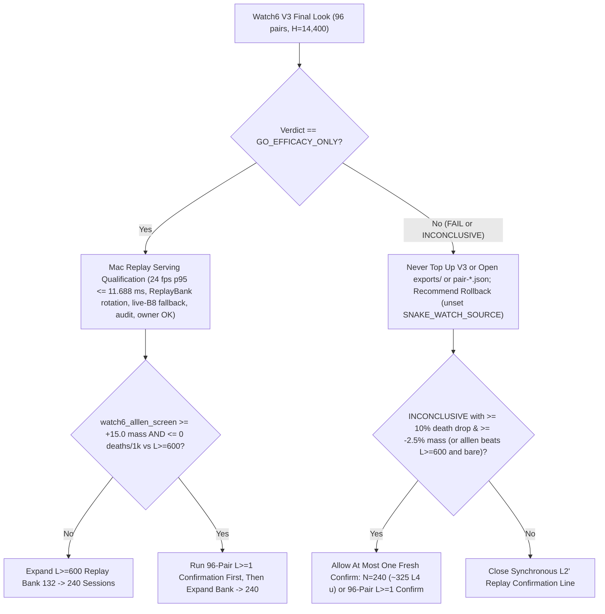

# T34 ExIt-B8 Research Roadmap (Round-01 Synthesis — Advice, Not Decisions)

Start: [project index](../INDEX.md) · [current status & authority](../STATUS.md) · [research record index](INDEX.md) · [study packages](../../research/INDEX.md) · [campaign log](final_run_20261019/CAMPAIGN_LOG.md).

> [!IMPORTANT]
> **Status: Research advice, NOT ratified decisions or release authorization.**
> Every current-round and later-round plan on this page is synthesized advisor guidance from Round 01 (2026-10-31 / 2026-11-01; primary synthesis artifact: `snake-dqn-artifacts/big-lever/exp/argon-rounds/round-01/synthesis/answer.md`). Nothing here amends a pre-registration, ratifies a confirmation gate, or changes served defaults. Binding campaign authority remains [`SUCCESS_CONTRACT.md`](final_run_20261019/SUCCESS_CONTRACT.md), [`DESIGN_V2_SHADOW.md`](final_run_20261019/DESIGN_V2_SHADOW.md), [`P7_STATISTICS.md`](final_run_20261019/P7_STATISTICS.md), and [`STATUS.md`](../STATUS.md); any serving or release change requires confirmation-lane evidence, Mac serving qualification, and the owner's explicit OK.

---

## 1. Snapshot Context: What Closed vs. What Is Running (Oct 27–31)

### Closed lines (single-pass critics, distillations, RL, and macro fallbacks)

Between 2026-10-29 and 2026-10-31, seven learned-policy, critic, and macro-fallback tracks closed below their promotion or selectivity bars:

| Track | Scope & primary artifact | Measured outcome | Disposition |
| --- | --- | --- | --- |
| **TRAIN-01** (`sandbox_a_resident`) | `100.7M`-row (`384`-update) GPU-resident PPO from `b8-s3` (`t34-sol/train01-closeout/SUMMARY.md`) | H5000 equal-mix paired mass **`+8.09`** (`CI95 [-18.66, +34.85]`; scripted `+26.32`, frozen `+2.85`, mixed `-4.90`; update-320 peak `+14.23` `[-11.86, +40.32]`) vs bar `>= +40` | **Closed** (no strict-gate nomination) |
| **C/T Stage-2 distillation** | Continuation-teacher causal-root distillation (`t34-sol/ct-stage2-verdict/SUMMARY.md`) | Teacher rescued **`22/32` (`68.75%`)** deaths (`22/32 <= 65` ticks; indep-suffix H300 mass `+66.77`, `LB90 +51.61`), but student retention was **`46.9–50.0%`** (`0 pp` over `frozen_phi` vs `>= +15 pp`; topology AUC `0.5752 < 0.83`), ordinary flips **`44.4–64.5%`** (bar `<= 1%`), and lethal ordinary flips **`3–5`** (bar `<= 1`) | **`FAIL_DISTILLATION_RETENTION_OR_SAFETY`** |
| **Doom U-Net** | Spatial U-Net per-action death-lookback doom probe (`t34-sol/doom-result-01/result.json`) | Per-action doom ROC-AUC **`0.7626`** vs bare B8 **`0.8226`** (`b8_action` `0.7593` vs `0.8077`) | **`GRAY` / no edge over B8** |
| **B8 advantage head (offline OOF)** | `256 -> 128 -> 6` ReLU head on frozen B8 features (`t34-sol/b8-head-test/RESULT.md`) | Mass rule `GO` (late H300 `+30.09`, `LB90 +23.96`), but Fable selectivity **`FAIL`**: **`26.42%`** late rescue (bar `>= 35%`) at **`97.60%`** non-death flips (bar `<= 15%`) | **Selectivity `FAIL`** (192-world margin-gated closed-loop screen queued) |
| **T4 Gate-1 factored critic** ([`t4_gate1`](../../research/t4_gate1/README.md)) | Clean-slate privileged full-arena hazard + foraging mass-flux critic on `384` disjoint Watch6-v2 worlds (`t34-sol/argon-t4-gate1-fix2/queue-03/READOUT.json`) | **`0/8` bars passed**: `L >= 600` residual EV **`+0.0266`** (`[-0.0280, +0.0869]` vs `>= 0.25`), death-root H300 rescue **`+19.99`** (vs `>= +40`), mature doom AUC **`0.5617`** (vs `>= 0.80`), ordinary H300 mass **`-22.21`** (vs `>= -15.0`), lethal flips **`3.13%`** (vs `<= 3.0%`) | **`KILL_T4`** |
| **R6 `L < 600` harvest census** ([`r6_l600_census`](../../research/r6_l600_census/README.md)) | `64`-world (`384`-root) Watch6-v2 early-game counterfactual + 5-fold OOF corpse/trail plane probes (`t34-sol/argon-mac-checks/r6-census/RESULT.json`) | **`34.90%` (`134/384`)** oracle-harvestable roots (`>= +5` H500 mass), but **`7.69%`** non-bare H500 lethal flips and OOF ROC-AUC **`0.474–0.521`** (`0` passing threshold points) | **`KILL`** (oracle signal exists; learned OOF probes fail) |
| **R7 macro-option fallback** ([`r7_macro_fallback`](../../research/r7_macro_fallback/README.md)) | Pruned depth-2 (`K = 15` ticks) spatial macro-options `{O_0..O_5}` on C/T training `1-step-all-die` roots (`t34-sol/argon-r7-repack/R7_READOUT.json`) | `3/5` bars passed (`0.316 ms` Mac 1-thread p95; **`33.0%` vs `9.0%`** `L >= 800` `all-die` rescue), but total `L >= 600` death-root lift **`+3.85 pp`** (`< +10.0 pp` bar) and **`2 > 0`** newly caused ordinary lethal flips (`0` assessment roots opened) | **`KILL`** as standalone fallback |

### Active serving, confirmation, and queued exploration flights

- **Served Watch replay bank:** Watch serves **132 precomputed `exact-stop-l2-prime` sessions** (`watch-replay-bank-live-132`, banks `01–08` and `10–12`; [`watch_replay`](../../research/watch_replay/README.md), [`STATUS.md`](../STATUS.md)). Product H14400 efficacy remains unconfirmed after Watch6 V2 closed `INVALID_OR_INCOMPLETE` at `88/96` on zero-compute pre-start transport failures (outcomes sealed).
- **Watch6 V3 confirmation (running):** [`REGISTRATION_V3.md`](../../research/watch6_search_efficacy_v3/REGISTRATION_V3.md) — `24 × 4` L4 `W = 4` shards (`96` fresh paired `H = 14,400` Watch6-v2 sessions).
- **Watch6 all-length screen (running, exploration):** [`watch6_alllen_screen`](../../research/watch6_alllen_screen/README.md) — `N = 48`, `H = 6,000` paired Watch6-v2 sessions comparing `bare` vs served `L >= 600` (`L2'`) vs `L >= 1` (`exact_stop_alllen`).
- **GPU `DeviceSim` v2 parity (CPU preflight PASS; A100 main queued):** [`devicesim_v2_parity`](../../research/devicesim_v2_parity/README.md) (`t34-sol/argon-devicesim-v2/SUMMARY.md`) — local `E = 4 × 8` CPU preflight passed (`0` mismatches); A100 `E = 64 × 32` canary and `E = 256 × 1,000` main parity packet queued.
- **Queued Claim-A tails (branch-only exploration):**
  - `b8-head-closedloop` (`origin/astra-doom-auc-smoke`; `t34-sol/b8-head-closedloop/SUMMARY.md`) — 192-world v1 H5000 closed-loop screen of margin-gated B8 head (`m in {0, 10, 25, 50}`).
  - `spatial-qbytes-ruler-01` -> `spatial-student-pilot` (`origin/astra-spatial-student-pilot`; `t34-sol/spatial-qbytes-fix/SUMMARY.md`) — A100 exact Q-byte throughput ruler gating the spatial student pilot.
- **Colab concurrency:** Measured account caps are **`6` total assignments** (`ACCOUNT_ASSIGNMENT_CAP = 6`) and **`3` concurrent L4 runtimes** (`ACCOUNT_L4_CAP = 3` in [`tools/ops/ready_queue.py`](../../tools/ops/ready_queue.py)).

---

## 2. Current-Round Plan (Advice, Not Decisions)

### 2.1 Halt new single-pass doom/critic launches & evaluate Claim-A closure

- **Recommendation:** Do **not** launch new single-pass doom probes, privileged critics, or offline distillations while Watch6 V3, `watch6_alllen_screen`, `devicesim_v2_parity`, and the two already-queued Claim-A tails (`b8-head-closedloop` and `spatial-student-pilot`) finish.
- **Claim-A closure criterion (advice):** Recommend closing **Claim A** (unassisted single bare network; [`SUCCESS_CONTRACT.md`](final_run_20261019/SUCCESS_CONTRACT.md)) if both remaining Claim-A tails miss `+40` H5000 mass / `LB90 > 0`, concentrating remaining effort on **Claim B** (visibly labelled assisted/search hero).

### 2.2 Route Watch6 serving & confirmation strictly by V3 (`run_final_look`)

All Watch6 routing advice keys off the single registered V3 reducer ([`tools/watch6_v3_accounting/final_look.py`](../../tools/watch6_v3_accounting/final_look.py), `run_final_look`):

- **On `GO_EFFICACY_ONLY` (advice):**
  1. Run Mac replay serving qualification (`24 fps` tick `p95 <= 11.688 ms`, [`ReplayBank`](../../web/backend/watch_replay.py) verified rotation, live bare-`b8-s3` fallback, audit) and present to the owner for explicit release OK.
  2. Expand the served replay bank from **132 to 240 sessions** using `L >= 600` (`exact-stop-l2-prime`) — **unless** `watch6_alllen_screen` clears its adoption rule (`>= +15.0` incremental mass and `<= 0.0` `deaths/1k` vs `L >= 600`), in which case run a fresh 96-pair `L >= 1` confirmation before generating the remaining bank sessions.
- **On `FAIL` or `INCONCLUSIVE` (advice):**
  1. Never top up V3 and never inspect `exports/` or `pair-*.json`.
  2. Recommend rolling Watch back to live bare `b8-s3` (`unset SNAKE_WATCH_SOURCE`).
  3. Permit at most **one** follow-up confirmation study: either a fresh `N = 240` confirmation (`~325 L4 u`) **only** when V3 is `INCONCLUSIVE` with `>= 10%` point-estimate death reduction and `>= -2.5%` relative mass, or a fresh 96-pair `L >= 1` confirmation if `watch6_alllen_screen` beats both `L >= 600` and `bare`.

### 2.3 Harden Colab ops before any next confirmation (`0 u` pytest + `~0.25 u` L4 canary)

Before launching any post-V3 confirmation package, the Round-01 synthesis recommends four bounded operations repairs verified by an 8-fixture offline pytest suite (`0 u`) and one `~0.25 u` L4 `SIGKILL` canary:

1. **Single-archive + HTTPS public-input staging (`<= 6` PUTs, `<= 45 s`):** Combine small metadata/contract files into one deterministic archive alongside HTTPS [`_fetch_public_inputs`](../../research/colab_cli/runtime.py) checkpoint retrieval so staging stays far below the 300 s window.
2. **Dispatcher-level sub-caps & reconciliation:** Mirror `L4 <= 3` / `total <= 6` and `reconcile_unavailable` directly inside [`tools/ops/dispatch.py`](../../tools/ops/dispatch.py) so standalone dispatches enforce the same L4 sub-cap and pre-start reconciliation as [`ready_queue.py`](../../tools/ops/ready_queue.py).
3. **Two-counter ledger-advancing auto-retry:** Update [`eligible()`](../../tools/ops/auto_retry.py) in `tools/ops/auto_retry.py` so pre-`hardware.json` (zero-compute) failures charge `0` against the package's outcome-blind completion counter, and verified `.complete` unit exports advance the resume ledger cleanly when `terminal.json` is absent.
4. **Reusable confirmation audit (`tools/ops/confirm_audit.py`):** Key mechanical vs. terminal audit checks off [`_supervise`](../../research/colab_cli/runtime.py)'s `terminal.json` invariant. *(Contingency only if the L4 canary fails on WebSocket drops: add ~40-LOC REST polling in [`supervisor.py`](../../research/colab_cli/supervisor.py) and `"websocket"` to [`transient_error`](../../research/colab_cli/policy.py), then requalify a new `research/colab_cli` tree in `ops/colab-cli-qualified.json` without touching active trees.)*

---

## 3. Later-Round Plan: Non-Learned `LexSearch-v2` & Watch UX (Advice, Not Decisions)

Because [`REGISTRATION_V2.md`](../../research/watch6_search_efficacy/REGISTRATION_V2.md) and [`REGISTRATION_V3.md`](../../research/watch6_search_efficacy_v3/REGISTRATION_V3.md) restrict current replay confirmation to byte-identical `exact-stop-l2-prime`, search-rule upgrades belong strictly to **later rounds** after `devicesim_v2_parity` passes on A100.

### 3.1 Screen `LexSearch-v2` on 256 fresh Watch6-v2 roots (`~2.2 A100 u`)

Once `devicesim_v2_parity` passes, screen a purely non-learned **`LexSearch-v2`** operator combining four targeted fixes motivated by C/T Stage-2, R6, and R7 diagnostics:

1. **`K = 2` search-private opponent RNG rollouts:** Replace [`_clone_root`](../../research/bl_served_search/ruler_operator.py)'s live `sim._rngs` copy so search branches cannot exploit future opponent respawn/randomness draws.
2. **Terminal 2-core survival certificate (`V_{2,surv}(H) >= L_end`):** Reuse the spatial reachability primitives from [`research/r7_macro_fallback/options.py`](../../research/r7_macro_fallback/options.py) at horizon `H` so branches that survive `H` ticks inside a closing self/enemy pocket are rejected before step `H + 1`.
3. **Event-gated safe harvest (`ΔA_H >= +12.0`):** Harvest corpse/food upside among surviving certified branches only when net H-horizon mass gain clears `+12.0` (capturing R6's `34.9%` oracle-harvestable early roots without noisy learned OOF classifiers).
4. **`1-step-all-die`-only macro fallback (`{O_0..O_5}`):** Trigger R7's `K = 15` depth-2 spatial macro-options **exclusively** when all 6 primitive 1-step rollouts die (retaining R7's `33.0%` vs `9.0%` `L >= 800` `all-die` rescue while eliminating ordinary-state lethal flips).

**Recommended screen kill bars (256 fresh Watch6-v2 roots):**
- **KILL** if ordinary H500 lethal flips exceed **`0.5%`**, **or**
- **KILL** if paired H500 mass/rescue lift is **`< +15`** at `L >= 600` **and** **`< +6`** at `L < 600`.

### 3.2 Conditional 96-world 4-arm Watch6 study & UI chapter jumper

- **4-arm Watch6 study (`~33–48 u`, conditional on 3.1 PASS):** Compare `bare`, `exact-stop-l2-prime`, `LexSearch-v2 (L >= 600)`, and `LexSearch-v2 (all-length)` across 96 fresh Watch6-v2 worlds. Any candidate selected to replace served replays still requires a separate confirmation-lane study, Mac serving qualification, and owner OK.
- **Live Mac async search (`h64`) gate (`0 u` Mac ruler prerequisite):** Do **not** fund GPU tuning or confirmation for live `H = 64` served search unless a `0 u` Mac ruler first proves isolated async-worker latency **`p95 <= 35 ms`** (`W <= 4, K <= 8`) under qualified desktop host guards.
- **Watch rescue-chapter UI jumper (product UX advice):** Add a lightweight timeline chapter jumper in the Watch replay UI allowing viewers to jump directly to recorded `"Move from search"` rescue overrides already flagged in `snake-watch-replay/v1` frames.

---

## 4. Settled Panel Disagreements & Supporting Evidence

1. **No pre-dispatch `4.0 ms` Mac latency kill on `spatial-student-pilot`:**
   One Round-01 proposal suggested cancelling `spatial-student-pilot` main GPU spend if `latency.py` exceeded `p95 = 4.0 ms` on the Mac. Branch evidence on `origin/astra-spatial-student-pilot` (`REGISTRATION_AMENDMENT_04.md`, `latency.py:70`) shows random-weight MPS `p95 = 6.533 ms` was already measured and the owner's `2026-10-30` `"skip mac"` ruling removed `4.0 ms` as a pre-dispatch/scientific KILL (deferring Watch6 `11.688 ms` serving timing until post-GO). Main GPU spend is gated instead on `spatial-qbytes-ruler-01` (`<= 6.0 h`, mature `L >= 600` support, exact Q-bytes) plus independent review.
2. **Why `LexSearch-v2` is later-round and why "`15–25 ms` Mac MPS `H = 64`" is rejected:**
   [`REGISTRATION_V2.md`](../../research/watch6_search_efficacy/REGISTRATION_V2.md) restricts replay qualification to byte-identical `exact-stop-l2-prime`, keeping V3 authoritative for current served replays and `LexSearch-v2` in later rounds. The unmeasured "`15–25 ms`" Mac MPS `DeviceSim` `H = 64` estimate is contradicted by three measurements: (a) `L1'` measured MPS slower than CPU (`32–41 s` vs `22.9–27.2 s`, [`CAMPAIGN_LOG.md`](final_run_20261019/CAMPAIGN_LOG.md)), (b) `DeviceSim`'s native `.so` extensions are CUDA-only (`t34-sol/spatial-qbytes-fix/SUMMARY.md`), and (c) macOS background services (`FileProvider`, `StorageManagementService`) reached `317.9%` CPU during desktop observation (`t34-sol/astra-served-panel/SUMMARY.md`). Hence the mandatory `0 u` Mac async-worker ruler (`p95 <= 35 ms`) before any `h64` spend.
3. **`48 × 2` vs. `24 × 4` L4 shard wall time & Mac CPU fallback:**
   [`empirical_forecast`](../../research/watch6_search_efficacy_v3/costs.py) sizes L4 `W = 4` shards by `waves = ceil(pairs / 4)` around a single-pair `H = 14,400` `p95 = 7,558 s` (`126 min`). Consequently, `4`, `2`, and `1` pairs/shard are all **1-wave jobs (`209 min` base)** — splitting `24 × 4 -> 48 × 2` halves per-shard blast radius and 4-draw max stragglers rather than cutting base wall time to `45–115 min`. Ledger-advancing [`auto_retry.py`](../../tools/ops/auto_retry.py) + REST polling is therefore the primary reliability lever, rather than a `~40 h` host-fragile Mac CPU fallback.
