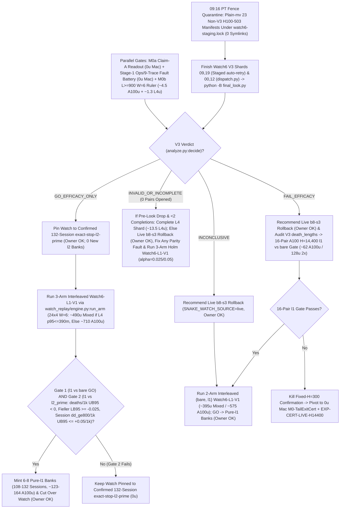

# T34 ExIt-B8 Research Roadmap (Round-11 Synthesis — Advice, Not Decisions)

Start: [project index](../INDEX.md) · [current status & authority](../STATUS.md) · [research record index](INDEX.md) · [study packages](../../research/INDEX.md) · [campaign log](final_run_20261019/CAMPAIGN_LOG.md).

> [!IMPORTANT]
> **Status: Research advice, NOT ratified decisions or release authorization.**
> Every current-round and later-round plan on this page is synthesized advisor guidance from Round 11 (2026-11-01 PT; primary synthesis artifact: `snake-dqn-artifacts/big-lever/exp/argon-rounds/round-11/synthesis/answer.md`, superseding Rounds 01–10). Nothing here amends a pre-registration, ratifies a confirmation gate, or changes served defaults. Binding campaign authority remains [`SUCCESS_CONTRACT.md`](final_run_20261019/SUCCESS_CONTRACT.md), [`DESIGN_V2_SHADOW.md`](final_run_20261019/DESIGN_V2_SHADOW.md) (+ Amendment 1), [`P7_STATISTICS.md`](final_run_20261019/P7_STATISTICS.md), unsuperseded parts of [`FINAL_PLAN.md`](final_run_20261019/FINAL_PLAN.md), and [`STATUS.md`](../STATUS.md); any serving or release change requires confirmation-lane evidence, Mac serving qualification, and the owner's explicit OK.

---

## 1. Snapshot Context & Code-Verified Round-11 Corrections (Oct 29 – Nov 1)

### 1.1 Nov 1 exploration, bank-minting, parity & Watch6 V3 fence quarantine ruling

- **All-length exact-stop screen — `ADOPT` for new replay banks** ([`watch6_alllen_screen`](../../research/watch6_alllen_screen/README.md), `t34-sol/argon-alllen-a100/analysis.json`, `N = 48` paired `H = 6,000` Watch6-v2 sessions uniting `12` L4 `W = 4` units `0..11` at `568b09e4` with `36` A100 `W = 6` units `12..47` across three `12`-unit shards at `73c26ccc` on `origin/argon-alllen-a100-1031`):
  - `bare` (`b8-s3`): **`351.07` mass** (`CI95 [320.22, 381.91]`), **`0.2882` `deaths/1k`** (`CI95 [0.2427, 0.3337]`; `83` deaths: `53` at `L < 600`, `30` at `L >= 600`, `21` at `L >= 800`), `mean_max_length = 794.3`.
  - `l2_prime_600` (served `L >= 600`): **`461.16` mass** (`CI95 [414.30, 508.02]`; `+110.09` vs `bare`, `CI95 [+72.06, +148.13]`), **`0.1597` `deaths/1k`** (`CI95 [0.1060, 0.2134]`; `-44.6%` vs `bare`; `46` deaths: `34` at `L < 600`, `12` at `L >= 600`, `11` at `L >= 800`), `449.6` mean branches/session (`403.7` roots, `mean_max_length = 943.4`).
  - **`exact_stop_alllen` (`L >= 1`, `interval = 5`, `H = 300`):** **`559.43` mass** (`CI95 [533.59, 585.27]`; **`+208.37` / `+59.35%` vs `bare`**, `CI95 [+170.07, +246.66]`; **`+98.27` / `+21.31%` vs `L >= 600`**, `CI95 [+50.57, +145.98]`, clearing `>= +15.0`) and **`0.0521` `deaths/1k`** (`CI95 [0.0294, 0.0748]`; **`-81.9%` / `-0.2361/1k` vs `bare`**, `CI95 [-0.2828, -0.1895]`; **`-67.4%` / `-0.1076/1k` vs `L >= 600`**, `CI95 [-0.1609, -0.0544]`, clearing `<= 0.0`), cutting `L < 600` deaths **`53 (bare) / 34 (L >= 600) -> 1`** (`0.142%` `L < 600` overrides, `mean_max_length = 1,096.0`) at **`2.821×` branches** (`1,268.5` vs `449.6`, `1,200.1` roots = **`1.057` branches/root**, with `53.6%` cheap `L < 600` roots in frames `0..6,000`). **`14/15` remaining deaths occur at `L >= 600` (`13/15` at `L >= 800`).**
  - *Exposure & per-world notes:* Eliminating `34 -> 1` early deaths gives `exact_stop_alllen` **`1.379×` more `L >= 600` living exposure** (`403.7 -> 556.6` roots/session), so `11 -> 13` raw `L >= 800` deaths reflects **`-14.2%` lower per-frame `L >= 800` hazard** despite raw session-normalized `Δd_ge800 = +0.0069/1k`. Across paired worlds, `exact_stop_alllen` regressed deaths vs `L >= 600` on `3/48` seeds (`3075941873`, `3394546952`, `121131908`) and mass on `14/48` seeds.
- **All-length Watch banks `14l1–16l1` completed `36/36` on active Cap-6 `36285bc6` (freeing all `3` A100 slots):**
  - Verified receipts (`t34-sol/argon-banks-l1/packet-bank{14l1,15l1,16l1}-a100/output-main/receipt.json`, `SUMMARY.md`) confirm Cap-6 (`36285bc6`) ran `6/6` concurrent runtimes (`3 A100 @ 6.73 u/h + 3 L4 @ 1.94 u/h = 26.01 u/h`), finishing all `3 × 12` `exact-stop-l1` sessions (`W = 6`, `H = 6,000`) in **`3.03–3.07 h/bank`** (**`~20.36–20.67 u/bank` = `~61.5 A100 u` observed total** vs `~227 u` forecast; balance **`~2,154.66 u`**, leaving `3` A100 slots immediately available). Because survived trajectories spend frames `6,000..14,400` almost entirely at `L >= 800`, `exact-stop-l1` compute scales **superlinearly (`~2.9–3.3×`)** from `H = 6,000` to `H = 14,400` (`argon-banks-l1/SUMMARY.md:38-40`).
  - Commit `395eacbb` switched `.claude/launch.json` to **`watch-replay-bank-live-168`** (`132` `exact-stop-l2-prime` banks `01–08, 10–12` + `36` unconfirmed `exact-stop-l1` banks `14l1–16l1`, [`web/serve.py`](../../web/serve.py) restarted on `b5b63cd1`, keeping `watch-replay-bank-live-132` intact for rollback). Confirming `exact-stop-l1` at `H = 14,400` still requires prospective confirmation (`Watch6-L1-V1`), Mac serving qualification, and owner OK; defer minting new banks until Watch6 V3's verdict lands.
- **GPU `DeviceSim` v2 parity — `PASS` on A100** ([`devicesim_v2_parity`](../../research/devicesim_v2_parity/README.md), `t34-sol/argon-devicesim-v2/packet-a100-v2-parity-01/main-run-01/receipt.json`): **`0` mismatches** across **`1,536,000` snake-ticks** (`E = 256 × 1,000` Watch6-v2 ticks in `3,505.6 s` = `1,434.6` steps/s under 5-opponent CUDA flood launches, commit `b500d111`), using `DeviceSim`'s SplitMix64 RNG and `<= 1e-4` CUDA FP32 near-tie Q re-decision tolerances.
- **Active confirmation — Watch6 V3 (`09:16 PT` staging-fence quarantine ruling, identity closure & linear-retry lineage guard)** ([`REGISTRATION_V3.md`](../../research/watch6_search_efficacy_v3/REGISTRATION_V3.md)): `24 × 4` L4 `W = 4` shards (`96` fresh paired `H = 14,400` Watch6-v2 sessions) confirming **`exact-stop-l2-prime` (`L >= 600`) only**. At `05:01 PT`, **`14/24` shards were `PASS`** (`01..08, 10, 11, 13..16`), **`6/24` active** (`17, 18, 20..23`), and **`4/24` V6.1-accepted mechanical failures** (`00` `412` unallocated, `09` `UPLOAD_CAP`, `12` renewal-WS drop, `19` warmup `GuardError`; `75471246`):
  - *`09:16 PT` V6.1 staging-fence quarantine ruling (`APPROVE_WITH_CONDITIONS`, `t34-sol/v61-fence-ruling-20261101.md`, `t34-sol/v61-fence-evidence-20261101.json`):* `23` historical non-V3 H100-503 pre-fallback manifests in `ops/manifests/` return `_attempt_state == "FENCE"`, blocking [`tools/watch6_v3_accounting/dispatch.py:wait_other_jobs_staged`](../../tools/watch6_v3_accounting/dispatch.py) (`lines 219–245`) for V3 recovery shards `00` and `12`. The Fable stand-in judge approved plain-`mv` quarantine of **only** those `23` manifests + `.live.json` siblings to `ops/manifests-archive-20261101/` under `flock` on `ops/watch6-staging.lock` (**`0` symlinks**, because [`final_look.py`](../../tools/watch6_v3_accounting/final_look.py) `lines 473–483` fails closed on `is_symlink()` before namespace filtering).
  - *Identity closure & linear lineage:* [`watch6_search_efficacy_v3/protocol.py`](../../research/watch6_search_efficacy_v3/protocol.py) hashes both [`tools/ops/package_spec.py`](../../tools/ops/package_spec.py) (`line 94`) and `web/backend/` (`line 96`) into `identity()`, and [`final_look.py:_verify_shard_lineage`](../../tools/watch6_v3_accounting/final_look.py) (`lines 380–386`) fails closed on forked attempt trees sharing a parent receipt. Keep all V3 worktrees untouched; dispatch **only** staged `ops/auto-retry` children on shards **`09` and `19`** (**do NOT run [`recover.py`](../../tools/watch6_v3_accounting/recover.py)** on `09, 19`); run `recovery-shard-{00,12}-01` via `python -B -m tools.watch6_v3_accounting.dispatch`; and invoke [`final_look.py`](../../tools/watch6_v3_accounting/final_look.py) under **`python -B`** from clean `snake-dqn-argon-v3-accounting` ([`_forbid_pycache_directory`](../../tools/watch6_v3_accounting/__init__.py) `lines 747–777`).
- **Completed Oct-30 Claim-A GPU receipts awaiting `0 u` Mac readout (`< 3 min`):** `b8-head-closedloop` (`t34-sol/b8-head-closedloop/main-01/output/receipt.json`, `rc = 0`) and `spatial-qbytes-01` (`t34-sol/spatial-qbytes-fix/t34-spatial-qbytes-01/ruler-output-a100-fallback/receipt.json`, `rc = 0`) completed cleanly on A100, while `T4 Gate-1` (`0/8` bars, `KILL_T4`) cancels the `40–48 A100 u` `spatial-student-pilot` fit (retaining compiled `.so` caches).

### 1.2 Closed single-pass critics, distillations, RL, and standalone macro fallbacks

Between 2026-10-29 and 2026-11-01, every single-pass learned-policy, critic, distillation, and standalone macro-fallback track closed below its promotion or selectivity bars:

| Track | Scope & primary artifact | Measured outcome | Disposition |
| --- | --- | --- | --- |
| **TRAIN-01** ([`sandbox_a_resident`](../../research/sandbox_a_resident/README.md)) | `100.7M`-row (`384`-update) GPU-resident PPO from `b8-s3` (`t34-sol/train01-closeout/SUMMARY.md`) | H5000 equal-mix paired mass **`+8.09`** (`CI95 [-18.66, +34.85]`; scripted `+26.32`, frozen `+2.85`, mixed `-4.90`; update-320 peak `+14.23` `[-11.86, +40.32]`) vs bar `>= +40` | **Closed** (no strict-gate nomination) |
| **C/T Stage-2 distillation** | Continuation-teacher causal-root distillation (`t34-sol/ct-stage2-verdict/SUMMARY.md`) | Teacher rescued **`22/32` (`68.75%`)** deaths (`22/32 <= 65` ticks; indep-suffix H300 `+66.77`, `LB90 +51.61`), but student retention was **`46.9–50.0%`** (`0 pp` over `frozen_phi` vs `>= +15 pp`; topology AUC `0.5752 < 0.83`), ordinary flips **`44.4–64.5%`** (bar `<= 1%`), and lethal ordinary flips **`3–5`** (bar `<= 1`) | **`FAIL_DISTILLATION_RETENTION_OR_SAFETY`** |
| **Doom U-Net & `spatial-student-pilot`** | `83 × 145` spatial U-Net vs 33.7k B8-feature head (`t34-sol/doom-result-01/result.json`; `t34-sol/student-direction/{astra,fable}.md`) | Spatial U-Net lost late per-action doom ROC-AUC to frozen B8 features (**`0.753` vs `0.810`**, `Δ = -0.056`, `CI95 [-0.091, -0.023]`; all-strata death-lookback `0.7626` vs `0.8226`; ordinary late `0.690` vs `0.706`) | **`GRAY` / `40–48 A100 u` pilot fit canceled (`0 u`; retain `.so` caches)** |
| **B8 advantage head (offline OOF)** | `256 -> 128 -> 6` ReLU head on frozen B8 features (`t34-sol/b8-head-test/RESULT.md`) | Mass rule `GO` (late H300 `+30.09`, `LB90 +23.96`), Fable selectivity **`FAIL`**: **`26.42%`** late rescue (bar `>= 35%`) at **`97.60%`** non-death flips (bar `<= 15%`) | **Selectivity `FAIL`** (192-world closed-loop A100 `rc = 0`, awaiting Mac readout) |
| **T4 Gate-1 factored critic** ([`t4_gate1`](../../research/t4_gate1/README.md)) | Clean-slate privileged `83 × 145` (`H = 320` 7-source BFS) hazard + foraging mass-flux critic on `384` disjoint Watch6-v2 worlds (`t34-sol/argon-t4-gate1-fix2/queue-03/READOUT.json`) | **`0/8` bars passed**: `L >= 600` residual EV **`+0.0266`** (`[-0.0280, +0.0869]` vs `>= 0.25`), death-root H300 rescue **`+19.99`** (vs `>= +40`), mature doom AUC **`0.5617`** (vs `>= 0.80`), ordinary H300 mass **`-22.21`** (vs `>= -15.0`), lethal flips **`3.13%`** (vs `<= 3.0%`) | **`KILL_T4`** (proves even privileged `83 × 145` critic lacks late value signal) |
| **R6 `L < 600` harvest census** ([`r6_l600_census`](../../research/r6_l600_census/README.md)) | `64`-world (`384`-root) Watch6-v2 early-game counterfactual + 5-fold OOF corpse/trail plane probes (`t34-sol/argon-mac-checks/r6-census/RESULT.json`) | **`34.90%` (`134/384`)** oracle-harvestable roots (`>= +5` H500 mass), **`7.69%`** non-bare H500 lethal flips, OOF ROC-AUC **`0.474–0.521`** (`0` passing threshold points); superseded operationally by `exact-stop-l1` | **`KILL`** |
| **R7 macro-option fallback** ([`r7_macro_fallback`](../../research/r7_macro_fallback/README.md)) | Pruned depth-2 (`2K = 30` ticks) spatial macro-options `{O_0..O_5}` on C/T train `1-step-all-die` roots (`t34-sol/argon-r7-repack/R7_READOUT.json`) | `3/5` bars passed (`0.316 ms` Mac 1-thread p95; **`33.0%` vs `9.0%`** `L >= 800` `all_die_sel0` rescue on `25/129` roots — `9/25` `macro_triggered` at `+66.7 pp` rescue vs `16/25` tick-`30` B8 re-traps, while `104/129` `80.6%` survived `H = 300`), but total `L >= 600` lift **`+3.85 pp`** (`< +10.0 pp`) and **`2 > 0`** ordinary lethal flips (`0` assessment roots opened) | **`KILL`** as standalone `30`-tick fallback |

### 1.3 Code-verified Round-11 corrections over Round 10

1. **Watch serving & `Watch6-L1-V1` flaws (2-wave `126 m/pair` breach, missing `snapshot()`, `set_mode("train")` replay drop, & `package_spec.py` hash coupling):**
   - *Round-10 `24 × 4` `W = 6` LPT 2-wave cap breach & delayed triple commits:* [`REGISTRATION_V3.md`](../../research/watch6_search_efficacy_v3/REGISTRATION_V3.md) (`line 102`) records `7,557.99 s` (**`126 m` `p95` per single `[bare + l2_prime]` pair**). Running `4` `[bare + l2_prime]` pairs across `2` cores requires **2 sequential waves (`~252 m` pre-contention $\Rightarrow$ `~436–455 m` base)**, exceeding [`MAX_BASE_MINUTES = 660`](../../research/watch6_search_efficacy/performance.py) (`line 21`, `426.7 m` `p95` ceiling), while running `4 × l1` upfront commits `0/4` triples for `~260–320 m` and confounds host CPU contention. Replace upfront LPT with **interleaved `24 × 4` `W = 6` task order** `[l1_0, l1_1, l1_2, bare_0, l2_0, l2_1, l1_3, bare_1, l2_2, l2_3, bare_2, bare_3]` (2-arm `{bare, l1}`: `[l1_0..3, bare_0..3]`), gated by `M0b`.
   - *Missing `session.live.snapshot()` in `watch6_alllen_screen`:* [`watch6_alllen_screen/engine.py`](../../research/watch6_alllen_screen/engine.py) (`lines 187–226`) omits `session.live.snapshot()`, whereas [`watch_replay/engine.py:run_arm`](../../research/watch_replay/engine.py) (`lines 85–265`, `line 216`) runs the full product mirror **and** `session.live.snapshot()` (`record=None, horizon=14400`).
   - *`set_mode("train")` drops active Watch replay & `package_spec.py` closure coupling:* [`GameSession.set_mode`](../../web/backend/session.py) (`lines 1445–1462`) calls `self._leave_watch_replay()` *before* refusing `MODE_TRAIN` on `EGO2S_OBS_SPECS` / `RASTER31V2`, dropping Watch replay to live `b8-s3` on rejected train toggles. Also [`watch6_search_efficacy_v3/protocol.py`](../../research/watch6_search_efficacy_v3/protocol.py) (`line 94`) hashes [`tools/ops/package_spec.py`](../../tools/ops/package_spec.py) alongside `web/backend/` (`line 96`) — exclude `package_spec.py`, [`watch_replay.py`](../../web/backend/watch_replay.py), and [`app.py`](../../web/backend/app.py) from `Watch6-L1-V1`'s closure.
2. **Five Round-10 transport bugs (`.meta.json` survival leak, `24`-canary per-shard SHA / `27.92 MB` re-stream, unlocked `calibrate_rate` crash, WS `export_batch`, & `plan_retry` / single-GPU `reconcile_unavailable` gaps):**
   - *(1) `.meta.json` `elapsed_seconds` leaks survival:* `exact-stop-l1` runs `64.4` ticks/frame alive vs `0` dead, so per-unit `elapsed_seconds` reveals trajectory survival. Emit **survival-blind `unit-{w:03d}.meta.json`** (`{namespace, study_sha256, unit_id, world_index, payload_size_bytes, payload_sha256}`, **`0` timing or gameplay fields**) alongside sealed `unit-{w:03d}.payload.json` and outer-trap `slot-fault.json`.
   - *(2) Per-shard contracts force `24` canaries & `inputs.preflight` re-streams `27.92 MB`/dispatch:* Changing `study-contract.tar.gz` per shard trips [`canary.check`](../../research/colab_cli/canary.py) (`line 318`), while [`inputs.preflight`](../../research/colab_cli/inputs.py) (`lines 118–147`) re-downloads `21.36 MB` `league.tar.gz` + `6.56 MB` `B8_s3` (`27.92 MB` in [`PUBLIC_INPUTS.json`](../../research/t34_exit_b8/PUBLIC_INPUTS.json) = `670 MB` across `24` shards). Build one **shard-invariant `< 24 KiB` `study-contract.tar.gz`** (`N = 96` table) + `< 4 KiB` `verified-ledger.tar`, pass shard index via `env["CONFIRM_SHARD"]` (ignored by [`canary.family`](../../research/colab_cli/canary.py) `lines 55–62` $\Rightarrow$ **`1` canary covers all `24` shards**), bind standalone `6.91 MB` `frp3_m3_s12` + `6.56 MB` `B8_s3` HTTPS URLs, and add Stage-2 `flock`-cached URL digests.
   - *(3) Unlocking `account.lock` before `calibrate_rate` crashes `calibration_read` & fails `rate-calibration`:* Releasing `account.lock` ahead of [`calibrate_rate`](../../research/colab_cli/supervisor.py) (`lines 1419–1488`) races concurrent `Broker.run` allocations in [`calibration_read`](../../research/colab_cli/accounting.py) (`lines 263–266`), while priced-rate fallback fails mandatory `rate-calibration` ([`admission.py`](../../research/colab_cli/admission.py) `lines 67–72`, [`acceptance.py`](../../research/colab_cli/acceptance.py) `lines 360–364`). Instead, run the real `14 s` `calibrate_rate` **under `account.lock` before [`wait_runtime_ready`](../../research/colab_cli/cli_guard.py) (`lines 440–470`)**, shrinking lock hold from `60–320 s` to **`~16–22 s`** while preserving `rate-calibration`.
   - *(4) `collect_exports` calls WS `export_batch` whenever `>= 2` files finish together:* [`collect_exports`](../../research/colab_cli/supervisor.py) (`lines 975–977`) invokes WS [`export_batch`](../../research/colab_cli/export_batches.py) (`line 312`) whenever `.meta.json` and `.payload.json` complete in the same poll. In Stage 2, route `<= 8 MiB` exports via Contents [`export_file`](../../research/colab_cli/supervisor.py) (`lines 988–1035`) + Contents `state.json` GET + `90 s` pre-stop Contents salvage whenever `self.observer is None` (**`0` post-`ready.json` WS RPCs**, keeping `AcceptanceObserver` intact for `12/12` [`requalify.sh`](../../tools/ops/requalify.sh)).
   - *(5) `plan_retry` burns `completion_attempt <= 2` pre-`hardware.json`, misses `public-input-fetch-failed.json`, & single-GPU `dispatch` omits `reconcile_unavailable`:* Split [`auto_retry.py:plan_retry`](../../tools/ops/auto_retry.py) (`line 407`) at `hardware.json` ([`supervisor.py`](../../research/colab_cli/supervisor.py) `line 1905`) into `prestart_attempt <= 8` (`0` extra canaries) vs `completion_attempt <= 2` (refusing `public-input-fetch-failed.json` at [`runtime.py`](../../research/colab_cli/runtime.py) `lines 652–654` and `slot-fault.json`), and call [`reconcile_unavailable`](../../tools/ops/dispatch.py) (`lines 2358–2490`) inside single-GPU [`dispatch`](../../tools/ops/dispatch.py) (`lines 2935–2970`).
3. **Two search/certificate flaws in Round 10 (`B = 4` `2.6×` CPU slowdown & Dial-flood body-conservation failure) & replacement by `B = 1` `TailExitCert` + `PredictiveSpinePool`:**
   - *(1) Eager `B = 4` slows 1-core CPU `2.6×` (`~168` vs `64.4` row-ticks/frame):* [`open_watch`](../../research/watch_replay/product.py) (`lines 62–73`) pins `forward="rowwise"` on `Ego2sSimdPolicy`/`Vector61SimdPolicy`, [`v8_nb.py:_bfs`](../../src/simd_env/v8_nb.py) (`lines 98–162`) runs `5` opponent floods/env/tick linearly in `B`, [`bank_engine.py:rollout_all`](../../research/t3_rollout_labels_20261015/bank_engine.py) (`lines 526–570`) loops `E = 1` `CapturedWorld.clone` on `mixed`, and [`exact_stop.run`](../../research/bl_served_search/exact_stop.py) (`lines 33–67`) averages **`1.057` branches/root** (`1,268.52 / 1,200.125` in `argon-alllen-a100/analysis.json`). Keep **`B = 1` bare-first verification at `H = 128`** (`2.34×` shorter horizon than `H = 300`).
   - *(2) Shortest-arrival Dial floods violate `L`-segment body conservation:* Dial floods double-count static free cells and vacated body segments in `< L` closed coils (**false-safe**), while rejecting tight `30`-cell tail-chases with `V_causal << 1.25L` (**false-doom**). Replace `CausalCert-v10` with **`~0.20 ms` Numba `TailExitCert(S_128) = ExitCert || TailCert`**, in-branch **`TailFollow`**, and **`W = 4` `PredictiveSpinePool`** live Mac serving.

---

## 2. Current-Round Plan (Advice, Not Decisions)

### 2.1 Unblock Watch6 V3 (`0 u`), run `M0a` Claim-A readout (`0 u`), & patch Watch replay on `main`

1. **Execute V3 `23`-manifest plain-`mv` quarantine & finish Watch6 V3 linearly (`0 u`, `N = 96`, `exact-stop-l2-prime` only):**
   - Under `flock` on `ops/watch6-staging.lock` per `t34-sol/v61-fence-ruling-20261101.md` and `t34-sol/v61-fence-evidence-20261101.json`, record `colab usage` + SHA256s in `ops/manifests-archive-20261101/MANIFEST.json`, plain-`mv` **only** the `23` historical non-V3 H100-503 `FENCE` manifests + `.live.json` siblings to `ops/manifests-archive-20261101/` (**`0` symlinks**), and verify `0` `FENCE` rows in [`wait_other_jobs_staged`](../../tools/watch6_v3_accounting/dispatch.py) (`lines 219–245`).
   - Dispatch **only** the staged `ops/auto-retry` packets on shards **`09` and `19`** (**do NOT run `recover.py`** on `09, 19`), complete shards **`00` and `12`** via `python -B -m tools.watch6_v3_accounting.dispatch`, and run `python -B` [`final_look.py`](../../tools/watch6_v3_accounting/final_look.py) from clean `snake-dqn-argon-v3-accounting` (never opening `exports/` or `pair-*.json` on `INVALID_OR_INCOMPLETE`).
2. **Run `M0a` Claim-A readout & enforce v1 `H = 5,000` closure bar (`0 u`, `< 3 min` Mac):**
   - Run `nice -n 15 ./venv/bin/python -m research.b8_head_test.closedloop_readout` (`origin/astra-doom-auc-smoke` @ `591d94c3`) on completed `b8-head-closedloop` (`N = 192` v1 `H = 5,000` worlds, `m in {0, 10, 25, 50}`) and audit completed `spatial-qbytes-01` (`mapped-parity.json`); keep `spatial-student-pilot` (`40–48 A100 u`) canceled (`0 u`, retaining `.so` caches).
   - **Recommended Claim-A kill rule:** Recommend **closing Claim A permanently (`0 u`)** unless some `m in {0, 10, 25, 50}` clears v1 `H = 5,000` bars (`>= +40` pooled mass per `b8-head-closedloop/SUMMARY.md:16,45` and [`SUCCESS_CONTRACT.md`](final_run_20261019/SUCCESS_CONTRACT.md) `lines 29–33`, Bonferroni `LB97.5 > 0`, scripted no-death `>= +0.03` with no mix loss, [`P7_STATISTICS.md`](final_run_20261019/P7_STATISTICS.md) Guard A `Δalive >= -0.05` pooled / `>= -0.075` per mix, and `<= 15%` living overrides), followed by a `0 u`, `10 min` v2 boost `[0.5%, 10%]` check before nominating any Mac strict gate.
3. **Patch & Mac-qualify Watch replay serving on `main` & decouple confirmation closures (`0 u`, V3 worktrees untouched):**
   - Leave all V3 worktrees untouched, set `"SNAKE_WATCH_SOURCE": "live"` in [`watch6_search_efficacy/product.py:open_watch`](../../research/watch6_search_efficacy/product.py) (`line 41`, matching [`watch_replay/product.py`](../../research/watch_replay/product.py) `line 43`), and explicitly exclude [`tools/ops/package_spec.py`](../../tools/ops/package_spec.py), [`watch_replay.py`](../../web/backend/watch_replay.py), and [`app.py`](../../web/backend/app.py) from `Watch6-L1-V1` source closures:
     - In [`GameSession.set_mode`](../../web/backend/session.py) (`lines 1441–1462`), refuse `MODE_TRAIN` on forward-only `EGO2S_OBS_SPECS` / `RASTER31V2` **before** calling `self._leave_watch_replay()`, preserving active Watch replay across rejected train-mode switches.
     - Replace per-frame `stop.wait(0.001)` in [`verify_payload`](../../web/backend/watch_replay.py) (`line 176`) with a **`64`-frame cooperative yield** (`< 0.35 s` cold load without `24 fps` GIL stalls); filter `SNAKE_WATCH_REPLAY_CONTROLLER` (`all | exact-stop-l2-prime | exact-stop-l1`) via line-1 `.watch.gz` header peeks; add injectable `shuffle_discovery: bool = True` for cycle 1 (with cross-cycle boundary holdback); shallow-copy `dict(self.frame)` + `dict(session)` in [`Recording.snapshot`](../../web/backend/watch_replay.py) (`lines 226–238`); and accept `horizon in {6000, 14400}` in [`validate_header`](../../web/backend/watch_replay.py) (`lines 48–65`).
     - Set `_replay_opted_out = True` **only** inside [`set_epsilon`](../../web/backend/session.py) (`lines 1154–1160`) and [`set_food`](../../web/backend/session.py) (`lines 1173–1200`) — **never** inside `_leave_watch_replay()`, keeping `Play -> Watch` via `set_mode("watch")` intact — and clear `_replay_opted_out = False` in [`_build`](../../web/backend/session.py) (`lines 714–738`) plus a split `"new_game"` control handler in [`app.py`](../../web/backend/app.py) (`lines 310–311`); gate `__init__`, `reset_game`, and `set_mode` strictly on clean mixed-Watch6 `b8-s3` (`served_checkpoint["name"] == "b8-s3"`, `watch_roster == "mixed"`, `watch_roster_reason is None`, `len(snakes) == 6`, `not _replay_opted_out`).
   - Pass `1,500` unpaced + `120` paced-`24 fps` Mac qualification ticks (`update p95 <= 11.688 ms`, `0/120` overruns per [`t15_mixed_roster_qualification_2026-10-17.md`](t15_mixed_roster_qualification_2026-10-17.md), `< 1.0 s` cold readiness) while cold `.watch.gz` verification runs concurrently across `L >= 1,000` bodies, `6,000 -> 1` rotation, `set_mode("train")` refusal, `Play -> Watch`, and live-B8 fallback.

### 2.2 Deploy Round-11 Two-Stage Transport (`0 u` Stage 1 + `~1.5 u` Stage 2)

1. **Stage 1 (`0 u` Colab, [`tools/ops/`](../../tools/ops/) on active Cap-6 `36285bc6`, zero `colab_cli` edits):**
   - **Shard-invariant `< 28 KiB` packaging (`tools/ops/confirm_package.py`):** Upload one **shard-invariant `< 24 KiB` `study-contract.tar.gz`** (`N = 96` frozen world table + closure SHA) and `< 4 KiB` `verified-ledger.tar`, passing shard index via `env["CONFIRM_SHARD"]` (ignored by [`canary.family`](../../research/colab_cli/canary.py) `lines 55–62` so **`1` canary covers all `24` shards**), and bind `6.56 MB` `B8_s3_final.pth` + standalone `6.91 MB` `frp3_m3_s12_u60000_20261005.pth` HTTPS release URLs ([`PUBLIC_INPUTS.json`](../../research/t34_exit_b8/PUBLIC_INPUTS.json), `0` Mac checkpoint upload bytes, avoiding `21.36 MB` `league.tar.gz`).
   - **Survival-blind `.meta.json` & outer fault marker:** Emit timing- and gameplay-free `unit-{w:03d}.meta.json` (`{namespace, study_sha256, unit_id, world_index, payload_size_bytes, payload_sha256}`) alongside sealed `unit-{w:03d}.payload.json` and outer-trap `exports/slot-fault.json`.
   - **Locked caps, single-GPU `reconcile_unavailable`, & `hardware.json`-split retries:** Enforce locked `total < 6` / `L4 < 3` in [`tools/ops/dispatch.py`](../../tools/ops/dispatch.py) with `--no-internal-retry` from [`ready_queue.py`](../../tools/ops/ready_queue.py) and invoke [`reconcile_unavailable`](../../tools/ops/dispatch.py) (`lines 2358–2490`) inside single-GPU `dispatch` (`lines 2935–2970`) so `412`/`503` refusals archive proof and unlink `pending-<session>.json`. Split [`auto_retry.py:plan_retry`](../../tools/ops/auto_retry.py) at `hardware.json` ([`supervisor.py`](../../research/colab_cli/supervisor.py) `line 1905`) into **`prestart_attempt <= 8`** (`hardware.json`/`terminal.json`/`exports/` absent; reuses empty `verified-ledger.tar` = **`0` extra Stage-1 canaries**) vs **`completion_attempt <= 2`** (`hardware.json` present, `INCOMPLETE`, `stop_verified=True`, `cleanup_error=None`, `terminal.json` / `public-input-fetch-failed.json` / `slot-fault.json` absent, all `0+` `poll-*.json` in `{"starting", "running"}`, `elapsed_seconds < timeout_minutes * 60 - 180`, **`0` payload bytes parsed**) + regex-free `tools/ops/confirm_audit.py`.
   - **9-trace offline fault-injection battery (`0 u`, `< 10 min` Mac):** Prove glitch immunity on [`tests/fixtures/fake_colab.py`](../../tests/fixtures/fake_colab.py) (`test_confirm_glitch_immunity.py`: `0` `*.payload.json` bytes read, `1` canary across `24` shards, `0` timeout/fault/duplicate admissions).
2. **Stage 2 (`~1.5 u` Colab, additive `colab_cli` via [`qualification.py`](../../tools/ops/qualification.py) `add`, live jobs on `36285bc6` untouched):**
   - Run real `14 s` [`calibrate_rate`](../../research/colab_cli/supervisor.py) (`lines 1419–1490`) **under `account.lock` ahead of [`wait_runtime_ready`](../../research/colab_cli/cli_guard.py) (`lines 440–470`)** (`~16–22 s` lock hold, preserving mandatory `rate-calibration` at [`admission.py`](../../research/colab_cli/admission.py) `lines 67–72`) and fail fast on `KERNEL_CREATION_GUARD_ERROR`.
   - Route `<= 8 MiB` exports via Contents [`export_file`](../../research/colab_cli/supervisor.py) (`lines 988–1035`) + Contents `state.json` GET + `90 s` pre-stop Contents salvage whenever `self.observer is None` (**`0` post-`ready.json` WS RPCs** vs [`export_batch`](../../research/colab_cli/export_batches.py) `line 312`, preserving `AcceptanceObserver`), exempt schema-bound `dest == "verified-ledger.tar"` (`<= 64 KiB`) in [`canary.check`](../../research/colab_cli/canary.py) (`lines 312–321`), `flock`-cache public URL digests in [`inputs.py`](../../research/colab_cli/inputs.py), and pass all **`12/12` gates** (`11` `final-only` + `d1024`) via [`tools/ops/requalify.sh`](../../tools/ops/requalify.sh).

### 2.3 `M0b` `L >= 900` `W = 6` tail ruler (`~4.5 A100 u` + `~1.3 L4 u`) & Watch6 V3 routing (serving switches need owner OK)

Before freezing `Watch6-L1-V1` manifests, run **`M0b` (`~4.5 A100 u` + `~1.3 L4 u` when free)**: `6` `L >= 900` fixtures × `1,200` frames at `W = 6` through [`watch_replay/engine.py:run_arm`](../../research/watch_replay/engine.py) (`lines 85–265`, `record=None, horizon=14400`, full live mirror + `session.live.snapshot()`). If **L4 `p95 > 390 m`**, kill L4 placement (`A100`-only); if **A100 `p95 > 380 m`**, switch pre-data from `24 × 4` to `32 × 3` A100 `W = 6`. Otherwise schedule **`24` shards × `4` interleaved triples at `W = 6`** (`[l1_0, l1_1, l1_2, bare_0, l2_0, l2_1, l1_3, bare_1, l2_2, l2_3, bare_2, bare_3]`; 2-arm `{bare, l1}`: `[l1_0..3, bare_0..3]`, committing survival-blind `.meta.json` + sealed `.payload.json` as each triple completes on the same host: **`~490 u`** mixed `12 A100 + 12 L4`, or **`~710 A100 u`** A100-only).

- **On `GO_EFFICACY_ONLY` ([`analyze.py:decide`](../../research/watch6_search_efficacy/analyze.py) `lines 73–91`: `deaths/1k UB95 < 0` and Fieller mass `LB95 >= -0.05`):**
  1. *Mac (`0 u`):* Land §2.1's replay patch + `1,500`-unpaced / `120`-paced-`24 fps` qualification on `main`, and pin Watch serving to confirmed `132`-session `exact-stop-l2-prime` (`watch-replay-bank-live-132` or `SNAKE_WATCH_REPLAY_CONTROLLER=exact-stop-l2-prime`, **owner OK**). Mint **0** new `l2` banks.
  2. *Colab (`~490 u` mixed if L4 `p95 <= 390 m`, else `~710 A100 u` A100-only; `1` `15 m` `H = 300` canary/platform via `CONFIRM_SHARD`):* Run fixed-sequence **3-arm interleaved `Watch6-L1-V1`** (`{bare, l2_prime, l1}`; `N = 96, H = 14,400`):
     - *Gate 1:* `l1` vs `bare` clears `deaths/1k UB95 < 0` and Fieller mass `LB95 >= -0.05` (`-5%`).
     - *Gate 2 (cutting over to pure-`l1`):* `l1` vs `l2_prime` clears `deaths/1k UB95 < 0`, `H = 14,400` Fieller mass **`LB95 >= -0.025`** (`-2.5%`), and **session-denominator `Δd_ge800/1k UB95 <= +0.05 / 1k`** (`±0.022` half-width, `> 98%` null pass; pooled `h_ge800` and `prefix_6000` reported diagnostically) $\rightarrow$ mint **`6–8` pure-`l1` banks** (`108–132` sessions on top of `14l1–16l1`, `~123–164 A100 u`) and cut over Watch (**owner OK**; if Gate 1 passes and Gate 2 fails, stay pinned to confirmed `132`-session `exact-stop-l2-prime`).
- **On non-`GO` (`INCONCLUSIVE`, `INVALID_OR_INCOMPLETE`, or `FAIL_EFFICACY`):**
  - *`INCONCLUSIVE`:* Recommend live bare `b8-s3` rollback (`SNAKE_WATCH_SOURCE=live`, **owner OK**) and run **2-arm interleaved `{bare, l1}` `Watch6-L1-V1`** (`~395 u` mixed / `~575 A100 u`; `GO` clears `deaths/1k UB95 < 0`, Fieller `LB95 >= -0.05`, and session `Δd_ge800/1k UB95 <= +0.05/1k` $\rightarrow$ pure-`l1` bank, **owner OK**).
  - *`INVALID_OR_INCOMPLETE` (`0` pairs opened):* If pre-look transport drop with `< 2` `MAX_COMPUTE_COMPLETIONS_PER_SHARD` remaining, complete the missing L4 shard (`~13.5 L4 u/shard`); on retry exhaustion or mirror/child fault, recommend live `b8-s3` rollback (**owner OK**), fix any Mac parity fault first, and run **3-arm Holm `Watch6-L1-V1`** (`α_1 = 0.025, α_2 = 0.05` over `{l1 vs bare, l2_prime vs bare}` + gated `l1 vs l2_prime`) so the `132` already-minted `l2-prime` sessions can still be confirmed if `l2_prime` clears and Gate 2 fails.
  - *`FAIL_EFFICACY`:* Recommend live `b8-s3` rollback (**owner OK**), audit V3's `death_lengths`, and run a **`16`-pair A100 `H = 14,400` `l1 vs bare` gate** (`3` shards `W = 6`, `~62 A100 u` / `128 u` 2×; requires `Δdeaths/1k <= -0.08`, Fieller `>= +0.10`, and `6,000..14,400` deaths `<= bare`); if it fails, kill fixed-`H = 300` confirmation and pivot to §3's `0 u` Mac `M0-TailExitCert` + `EXP-CERT-LIVE-H14400`.

---

## 3. Later-Round Plan: `B = 1` `TailExitCert` (`H = 128`), `TailFollow` & `W = 4` `PredictiveSpinePool` (Advice, Not Decisions)

### 3.1 `B = 1` bare-first `H = 128` search, `TailExitCert` (`~0.20 ms`), `TailFollow` & `v8`-corral tie-break

1. **Why `H = 300` `exact-stop-l1`, R7, and Round 10's Dial-flood `CausalCert-v10` + `B = 4` fail at `L >= 800`:**
   - Out of `129` `L >= 800` C/T `train` death-lookback roots (`R7_READOUT.json:130-165`), **`104/129` (`80.6%`) survive `H = 300`** inside `450`-cell closing coils (dying at ticks `310..550`), while `16/25` (`64.0%`) `all_die_sel0` roots re-trap right after tick-`30` greedy-B8 handback. Meanwhile, eager `B = 4` slows 1-core CPU **`2.6×`** (`1.057` branches/root under `forward="rowwise"` in [`product.py`](../../research/watch_replay/product.py) `lines 62–73` and linear-in-`B` `5`-opponent floods in [`v8_nb.py`](../../src/simd_env/v8_nb.py) `lines 98–162`), and shortest-arrival Dial floods violate `L`-segment body conservation (double-counting static + vacated cells in `< L` coils as false-safe, while false-dooming tight `30`-cell tail-chases).
2. **`TailExitCert(S_128) = ExitCert || TailCert` (`~0.20 ms` Numba kernel on `B = 1` bare-first `H = 128` leaves):**
   - **`ExitCert`:** Exists a block-cut path from `head` to an exterior component `|C_ext| >= 1.5L` through gate `g` whose **single-path additive** parity-bounded block capacity (`2 * min(black, white) - F_mandatory`, counting mandatory corridor food growth and consuming each traversed block once) satisfies `Cap_path(head -> g) >= tau(g) - d(head, g)` and `t_open(g) < d_opp_seal(g)` (under live [`min_boost_length = 5`](../../src/core/game_config.py) `line 46` `2`-cell/tick enemy boost arrival, `d_opp <= t_hero - 2` smaller-snake body-seals, and two-regime [`SafetyVetoV8`](../../src/evaluation/safety_veto_v8.py) `line 289` `OUTCOME_NO_SPACIOUS` non-yield).
   - **`TailCert`:** Vacating tail tip `s_{n-1}` (`tau = 1`) or boundary segment `s_k` (`tau = L - k <= Cap_path(head -> s_k)`) is reachable before opponent seal — certifying tight `30`-cell tail-chases while rejecting `< L` closed coils without an exit or reachable tail.
   - **In-branch `TailFollow` & `v8`-corral tie-break:** Whenever `TailExitCert` flips `1 -> 0` inside a candidate `H = 128` branch, switch the remainder of the branch from greedy B8 to shortest-path `TailFollow` toward `s_{n-1}` (directly targeting R7's `16/25` tick-`30` re-traps); rank `TailExitCert`-passing branches lexicographically by `(hero_len_gain, nearby_opp_v8_pocket_collapse)`.

### 3.2 `W = 4` `PredictiveSpinePool` live Mac Watch6 serving, unshielded Play & `M0-TailExitCert` gate

- **Live Mac serving & fallback architecture (within [`SUCCESS_CONTRACT.md`](final_run_20261019/SUCCESS_CONTRACT.md) `lines 119–123` `<= 4` helper processes):**
  1. **Watch (`W = 4` `PredictiveSpinePool` + [`dto_split.py`](../../research/bl_served_search/dto_split.py) + `O(1)` [`FoodManager`](../../src/game/food_manager.py)):** Worker `0` advances an exact `capture_world` bare spine `48` frames (`2.0 s`) ahead + `128`-tick native-`v8` + `TailExitCert` probe (`~51%` of 1 Mac core, `100%` `prepared_fingerprint` parity); Workers `1..3` evaluate the `<= 5` `H = 128` alternative branches **only** when the bare probe fails (`< 12%` of blocks, `~0.82 s << 2.0 s` lead), holding `24 fps` `update p95 <= 11.688 ms` (`0` overruns), with an `H = 14,400` `cert-stop-h128` `ReplayBank` ([`validate_header`](../../web/backend/watch_replay.py) `lines 48–65`) as `0`-CPU fallback.
  2. **Play — keep default bare `b8-s3` unshielded (`scores.db` clean):** Because [`_build_impl`](../../web/backend/session.py) (`lines 897–904`) places `HumanSnake` in slot `0` and `b8-s3` in opponent slots `1..11`, keep default Play **bare `b8-s3`** per [`SUCCESS_CONTRACT.md`](final_run_20261019/SUCCESS_CONTRACT.md) (`lines 44–45`); any `TailExitCert`-assisted Challenge AI stays opt-in, visibly badged, and isolated from `scores.db` (**owner OK**).
- **Mandatory `0 u` Mac `M0-TailExitCert` gate (`~12 min`, `0` held-out/V3 touches) before any Colab spend:**
  - Audit `TailExitCert` (`H = 128`) + `TailFollow` on R7's `129` `L >= 800` C/T `train` death roots + `1,024` ordinary `train` roots: require **`<= 3.0%` false-safe rate** in ticks `128..450`, **`>= 70%` recall** on the `104` `H = 300`-surviving traps **or `>= 45%` rescue** on the `25` `all_die_sel0` roots, **`0/1,024` newly caused ordinary lethal flips**, and `W = 4` `PredictiveSpinePool` Mac **`update p95 <= 11.688 ms` with `0` overruns**.
- **Conditional `N = 72, H = 14,400` 4-arm tournament `EXP-CERT-LIVE-H14400` (`3 L4 + 3 A100/H100` `W = 6`, `~127–182 u`, `~5.0 h`, queued after `M0-TailExitCert`):**
  - Compare `{A0: exact-stop-l1 (H=300), A1: cert-stop-h128, A2: cert-stop-h128-corral, A3: cert-spine-w4-sim}` on `72` fresh paired `H = 14,400` Watch6-v2 worlds; nominate the winning arm to `N = 96` confirmation, Mac `24 fps` serving qualification (`p95 <= 11.688 ms`, `0` overruns), and owner release review iff it cuts `H = 14,400` `deaths/1k` **`>= 30%`** (`UB95 < 0`) with session `Δd_ge800/1k UB95 <= 0` and Fieller mass `LB95 >= -0.025` vs `A0` (and `A3` retains `>= 85%` of `A1/A2`'s death reduction for live `PredictiveSpinePool` serving; otherwise serve via `H = 14,400` `cert-stop-h128` `ReplayBank`).
- **Do not fund (`0 u`):** Eager `B = 4` branch batching, shortest-arrival Dial-flood `CausalCert-v10`, new bare-network PPO (`TRAIN-01`), single-pass distillation (`C/T Stage-2`, `spatial-student-pilot`), spatial/privileged value critics (`Doom U-Net`, `T4 Gate-1`), `L < 600` harvest rules (`R6`), standalone `30`-tick / aggressive `O3`/`O5` macro options (`R7`), unbatched `64.4`-tick/frame live rolling `exact-stop-l1`, inline Play opponent shields on `scores.db`, or GPU `DeviceSim` branch-proposal bank minting.

---

## 4. Settled Round-11 Disagreements & Primary Code/Artifact Citations

1. **`Watch6-L1-V1` schedule & engine (Round-10 upfront LPT vs. `current` interleaved `run_arm`):**
   Settled by [`REGISTRATION_V3.md`](../../research/watch6_search_efficacy_v3/REGISTRATION_V3.md) (`line 102`, `7,558 s = 126 m/pair`, meaning `4` `[bare + l2_prime]` pairs on `2` cores take `2` waves `> 426.7 m` ceiling at [`MAX_BASE_MINUTES = 660`](../../research/watch6_search_efficacy/performance.py) `line 21`) and [`watch_replay/engine.py:run_arm`](../../research/watch_replay/engine.py) (`line 216`, running `session.live.snapshot()` unlike [`watch6_alllen_screen/engine.py`](../../research/watch6_alllen_screen/engine.py) `lines 187–226`): use interleaved `[l1_0..2, bare_0, l2_0..1, l1_3, bare_1, l2_2..3, bare_2..3]` via `watch_replay/engine.py:run_arm`, gated by `M0b`.
2. **Certificate & branch batching (Round-10 / `current` `CausalCert-v10` + `B = 4` vs. `later` `TailExitCert` + `B = 1`):**
   Settled by [`watch_replay/product.py`](../../research/watch_replay/product.py) (`lines 62–73`, `forward="rowwise"`), [`v8_nb.py`](../../src/simd_env/v8_nb.py) (`lines 98–162`), [`bank_engine.py`](../../research/t3_rollout_labels_20261015/bank_engine.py) (`line 542`, `E = 1` loop on `mixed`), and `t34-sol/argon-alllen-a100/analysis.json` (`1.057` branches/root $\Rightarrow$ `B = 4` is `2.6×` slower on 1 CPU core), plus `L`-segment body conservation in `< L` coils and `30`-cell tail-chases — settling `B = 1` bare-first `H = 128` `TailExitCert = ExitCert || TailCert` + `TailFollow`.
3. **Serving path & `EXP-CERT-LIVE-H14400` timing (`current` `ReplayBank` vs. `later` `W = 4` `PredictiveSpinePool`):**
   Settled by [`SUCCESS_CONTRACT.md`](final_run_20261019/SUCCESS_CONTRACT.md) (`lines 119–123`, permitting `W <= 4` helper processes) and [`STATUS.md`](../STATUS.md) (`lines 106–139`): confirm `exact-stop-l1` (`Watch6-L1-V1` + `6–8` pure-`l1` `H = 6,000` `ReplayBank`s) without preempting V3, while `0 u` Mac `M0-TailExitCert` gates `EXP-CERT-LIVE-H14400` (`N = 72`) and `W = 4` `PredictiveSpinePool` (with `H = 14,400` `cert-stop-h128` `ReplayBank` fallback).
4. **Transport locking, survival-blind `.meta.json`, & shard-invariant canaries (Round-10 vs. `process`):**
   Settled by [`canary.py`](../../research/colab_cli/canary.py) (`lines 55–62, 318`), [`accounting.py`](../../research/colab_cli/accounting.py) (`lines 263–266`), [`admission.py`](../../research/colab_cli/admission.py) (`lines 67–72`), [`supervisor.py`](../../research/colab_cli/supervisor.py) (`lines 975–977, 1905`), [`runtime.py`](../../research/colab_cli/runtime.py) (`lines 652–654`), and [`dispatch.py`](../../tools/ops/dispatch.py) (`lines 2358–2490, 2935–2970`): emit timing-free `.meta.json`, pass `env["CONFIRM_SHARD"]` over a `< 24 KiB` shard-invariant `study-contract.tar.gz` (`1` canary/24 shards), split `prestart_attempt <= 8` (`0` extra canaries) vs `completion_attempt <= 2` at `hardware.json`, run `reconcile_unavailable` on single-GPU refusals, keep `14 s` `calibrate_rate` under `account.lock` (`~16–22 s`), and route Stage-2 `<= 8 MiB` exports + `90 s` salvage via `0`-WS Contents HTTP.
5. **Claim-A closure bar (`b8-head-closedloop` `M0a` readout):**
   Settled by `t34-sol/b8-head-closedloop/SUMMARY.md` (`lines 16, 45`) and [`SUCCESS_CONTRACT.md`](final_run_20261019/SUCCESS_CONTRACT.md) (`lines 29–33`): Claim-A nomination requires clearing the v1 `H = 5,000` bar (**`>= +40` pooled mass**) plus survival and `<= 15%` living-override bars.
