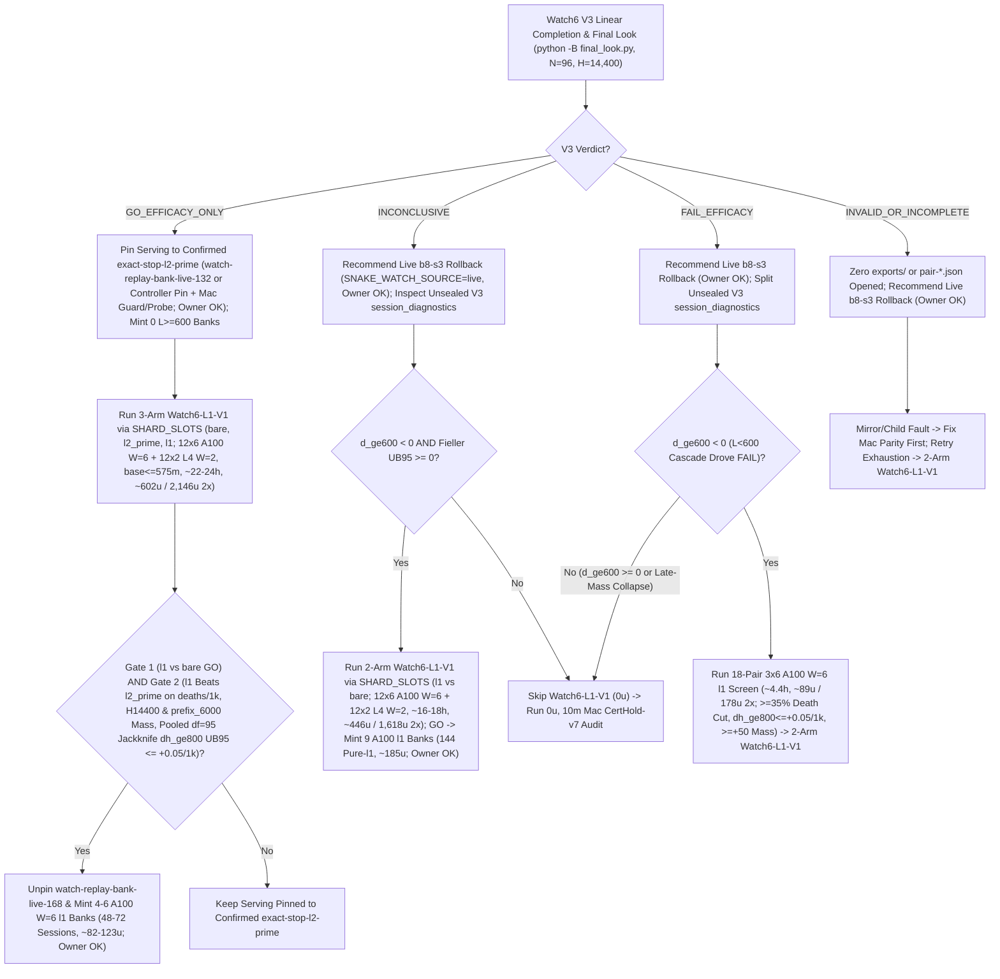

# T34 ExIt-B8 Research Roadmap (Round-07 Synthesis — Advice, Not Decisions)

Start: [project index](../INDEX.md) · [current status & authority](../STATUS.md) · [research record index](INDEX.md) · [study packages](../../research/INDEX.md) · [campaign log](final_run_20261019/CAMPAIGN_LOG.md).

> [!IMPORTANT]
> **Status: Research advice, NOT ratified decisions or release authorization.**
> Every current-round and later-round plan on this page is synthesized advisor guidance from Round 07 (2026-11-01 PT; primary synthesis artifact: `snake-dqn-artifacts/big-lever/exp/argon-rounds/round-07/synthesis/answer.md`, superseding Rounds 01–06). Nothing here amends a pre-registration, ratifies a confirmation gate, or changes served defaults. Binding campaign authority remains [`SUCCESS_CONTRACT.md`](final_run_20261019/SUCCESS_CONTRACT.md), [`DESIGN_V2_SHADOW.md`](final_run_20261019/DESIGN_V2_SHADOW.md) (+ Amendment 1), [`P7_STATISTICS.md`](final_run_20261019/P7_STATISTICS.md), unsuperseded parts of [`FINAL_PLAN.md`](final_run_20261019/FINAL_PLAN.md), and [`STATUS.md`](../STATUS.md); any serving or release change requires confirmation-lane evidence, Mac serving qualification, and the owner's explicit OK.

---

## 1. Snapshot Context & Newly Audited Gaps (Oct 29 – Nov 1)

### 1.1 Nov 1 exploration, bank-minting, parity & Watch6 V3 linear-retry guard

- **All-length exact-stop screen — `ADOPT` for new replay banks** ([`watch6_alllen_screen`](../../research/watch6_alllen_screen/README.md), `t34-sol/argon-alllen-a100/analysis.json`, `N = 48` paired `H = 6,000` Watch6-v2 sessions uniting `12` L4 `W = 4` units `0..11` at `568b09e4` with `36` A100 `W = 6` units `12..47` across three `12`-unit shards at `73c26ccc` on `origin/argon-alllen-a100-1031`):
  - `bare` (`b8-s3`): **`351.07` mass** (`CI95 [320.22, 381.91]`), **`0.2882` `deaths/1k`** (`CI95 [0.2427, 0.3337]`; `83` deaths: `53` at `L < 600`, `30` at `L >= 600`, `21` at `L >= 800`), `mean_max_length = 794.3`.
  - `l2_prime_600` (served `L >= 600`): **`461.16` mass** (`CI95 [414.30, 508.02]`; `+110.09` vs `bare`, `CI95 [+72.06, +148.13]`), **`0.1597` `deaths/1k`** (`CI95 [0.1060, 0.2134]`; `-44.6%` vs `bare`; `46` deaths: `34` at `L < 600`, `12` at `L >= 600`, `11` at `L >= 800`), `449.6` mean branches/session (`403.7` roots, `mean_max_length = 943.4`).
  - **`exact_stop_alllen` (`L >= 1`, `interval = 5`, `H = 300`):** **`559.43` mass** (`CI95 [533.59, 585.27]`; **`+208.37` / `+59.35%` vs `bare`**, `CI95 [+170.07, +246.66]`; **`+98.27` / `+21.31%` vs `L >= 600`**, `CI95 [+50.57, +145.98]`, clearing `>= +15.0`) and **`0.0521` `deaths/1k`** (`CI95 [0.0294, 0.0748]`; **`-81.9%` / `-0.2361/1k` vs `bare`**, `CI95 [-0.2828, -0.1895]`; **`-67.4%` / `-0.1076/1k` vs `L >= 600`**, `CI95 [-0.1609, -0.0544]`, clearing `<= 0.0`), cutting `L < 600` deaths **`53 (bare) / 34 (L >= 600) -> 1`** (`0.142%` `L < 600` overrides, `mean_max_length = 1,096.0`) at **`2.821×` branches** (`1,268.5` vs `449.6`, `1,200.1` roots = `1.057` branches/root). **`14/15` remaining deaths occur at `L >= 600` (`13/15` at `L >= 800`).**
  - *Exposure & per-world notes:* Eliminating `34 -> 1` early deaths gives `exact_stop_alllen` **`1.379×` more `L >= 600` living exposure** (`403.7 -> 556.6` roots/session), so `11 -> 13` raw `L >= 800` deaths reflects **`-14.2%` lower per-frame `L >= 800` hazard** despite raw session-normalized `Δd_ge800 = +0.0069/1k`. Across paired worlds, `exact_stop_alllen` regressed deaths vs `L >= 600` on `3/48` seeds (`3075941873`, `3394546952`, `121131908`) and mass on `14/48` seeds.
- **All-length Watch banks `14l1–16l1` completed `36/36` on active Cap-6 `36285bc6` (freeing all `3` A100 slots):**
  - Verified receipts (`t34-sol/argon-banks-l1/packet-bank{14l1,15l1,16l1}-a100/output-main/receipt.json`, `SUMMARY.md`) confirm Cap-6 (`36285bc6`) ran `6/6` concurrent runtimes (`3 A100 @ 6.73 u/h + 3 L4 @ 1.94 u/h = 26.01 u/h`), finishing all `3 × 12` `exact-stop-l1` sessions (`W = 6`, `H = 6,000`) in **`3.03–3.07 h/bank`** (**`~20.36–20.67 u/bank` = `~61.5 A100 u` observed total** vs `~227 u` forecast; balance **`~2,154.66 u`**, leaving `3` A100 slots immediately available).
  - Commit `395eacbb` switched `.claude/launch.json` to **`watch-replay-bank-live-168`** (`132` `exact-stop-l2-prime` banks `01–08, 10–12` + `36` unconfirmed `exact-stop-l1` banks `14l1–16l1`, [`web/serve.py`](../../web/serve.py) restarted on `b5b63cd1`, leaving `watch-replay-bank-live-132` intact). Confirming `exact-stop-l1` at `H = 14,400` still requires prospective confirmation (`Watch6-L1-V1`), Mac serving qualification, and owner OK.
- **GPU `DeviceSim` v2 parity — `PASS` on A100** ([`devicesim_v2_parity`](../../research/devicesim_v2_parity/README.md), `t34-sol/argon-devicesim-v2/packet-a100-v2-parity-01/main-run-01/receipt.json`): **`0` mismatches** across **`1,536,000` snake-ticks** (`E = 256 × 1,000` Watch6-v2 ticks in `3,505.6 s` = `1,434.6` steps/s under 5-opponent CUDA flood launches, commit `b500d111`), using `DeviceSim`'s SplitMix64 RNG and `<= 1e-4` CUDA FP32 near-tie Q re-decision tolerances.
- **Active confirmation — Watch6 V3 (`05:01 PT` snapshot, `web/backend/` hash-coupling & linear-retry lineage guard)** ([`REGISTRATION_V3.md`](../../research/watch6_search_efficacy_v3/REGISTRATION_V3.md)): `24 × 4` L4 `W = 4` shards (`96` fresh paired `H = 14,400` Watch6-v2 sessions) confirming **`exact-stop-l2-prime` (`L >= 600`) only**. At `05:01 PT`, **`14/24` shards are `PASS`** (`01..08, 10, 11, 13..16`), **`6/24` are active** (`3/24` running `17, 18, 20` + `3/24` queued `21..23`), and **`4/24` are V6.1-accepted mechanical failures** (`00` `412` unallocated, `09` `UPLOAD_CAP`, `12` renewal-WS drop, `19` warmup `GuardError`; `75471246`, `0` new rulings):
  - [`final_look.py:_verify_shard_lineage`](../../tools/watch6_v3_accounting/final_look.py) (`lines 380–386`) fails closed (`"forked/concurrent attempt lineage detected"`) whenever two attempts share a parent receipt, and [`watch6_search_efficacy_v3/protocol.py`](../../research/watch6_search_efficacy_v3/protocol.py) (`lines 59–120`) hashes `web/backend/` into `identity()`. Keep all V3 worktrees untouched; dispatch **only** staged `ops/auto-retry` children on shards **`09` and `19`** (**do NOT run [`recover.py`](../../tools/watch6_v3_accounting/recover.py)** on `09, 19`); run `recovery-shard-{00,12}-01` via `python -B -m tools.watch6_v3_accounting.dispatch`; and invoke [`final_look.py`](../../tools/watch6_v3_accounting/final_look.py) under **`python -B`** from clean `snake-dqn-argon-v3-accounting` ([`_forbid_pycache_directory`](../../tools/watch6_v3_accounting/__init__.py) `lines 747–777`).
- **Completed Oct-30 Claim-A GPU receipts awaiting `0 u` Mac readout (`< 3 min`):** `b8-head-closedloop` (`t34-sol/b8-head-closedloop/main-01/output/terminal.json`, `rc = 0`) and `spatial-qbytes-01` (`t34-sol/spatial-qbytes-fix/t34-spatial-qbytes-01/ruler-output-a100-fallback/terminal.json`, `rc = 0`) completed cleanly on A100, while `T4 Gate-1` (`0/8` bars, `KILL_T4`) cancels the `40–48 A100 u` `spatial-student-pilot` fit (retaining compiled `.so` caches).

### 1.2 Closed single-pass critics, distillations, RL, and standalone macro fallbacks

Between 2026-10-29 and 2026-11-01, every single-pass learned-policy, critic, distillation, and standalone macro-fallback track closed below its promotion or selectivity bars:

| Track | Scope & primary artifact | Measured outcome | Disposition |
| --- | --- | --- | --- |
| **TRAIN-01** ([`sandbox_a_resident`](../../research/sandbox_a_resident/README.md)) | `100.7M`-row (`384`-update) GPU-resident PPO from `b8-s3` (`t34-sol/train01-closeout/SUMMARY.md`) | H5000 equal-mix paired mass **`+8.09`** (`CI95 [-18.66, +34.85]`; scripted `+26.32`, frozen `+2.85`, mixed `-4.90`; update-320 peak `+14.23` `[-11.86, +40.32]`) vs bar `>= +40` | **Closed** (no strict-gate nomination) |
| **C/T Stage-2 distillation** | Continuation-teacher causal-root distillation (`t34-sol/ct-stage2-verdict/SUMMARY.md`) | Teacher rescued **`22/32` (`68.75%`)** deaths (`22/32 <= 65` ticks; indep-suffix H300 `+66.77`, `LB90 +51.61`), but student retention was **`46.9–50.0%`** (`0 pp` over `frozen_phi` vs `>= +15 pp`; topology AUC `0.5752 < 0.83`), ordinary flips **`44.4–64.5%`** (bar `<= 1%`), and lethal ordinary flips **`3–5`** (bar `<= 1`) | **`FAIL_DISTILLATION_RETENTION_OR_SAFETY`** |
| **Doom U-Net & `spatial-student-pilot`** | `83 × 145` spatial U-Net vs 33.7k B8-feature head (`t34-sol/doom-result-01/result.json`; `t34-sol/student-direction/{astra,fable}.md`) | Spatial U-Net lost late per-action doom ROC-AUC to frozen B8 features (**`0.753` vs `0.810`**, `Δ = -0.056`, `CI95 [-0.091, -0.023]`; all-strata death-lookback `0.7626` vs `0.8226`; ordinary late `0.690` vs `0.706`) | **`GRAY` / `40–48 A100 u` pilot fit canceled (`0 u`; retain `.so` caches)** |
| **B8 advantage head (offline OOF)** | `256 -> 128 -> 6` ReLU head on frozen B8 features (`t34-sol/b8-head-test/RESULT.md`) | Mass rule `GO` (late H300 `+30.09`, `LB90 +23.96`), Fable selectivity **`FAIL`**: **`26.42%`** late rescue (bar `>= 35%`) at **`97.60%`** non-death flips (bar `<= 15%`) | **Selectivity `FAIL`** (192-world closed-loop A100 `rc = 0`, awaiting Mac readout) |
| **T4 Gate-1 factored critic** ([`t4_gate1`](../../research/t4_gate1/README.md)) | Clean-slate privileged `83 × 145` (`H = 320` 7-source BFS) hazard + foraging mass-flux critic on `384` disjoint Watch6-v2 worlds (`t34-sol/argon-t4-gate1-fix2/queue-03/READOUT.json`) | **`0/8` bars passed**: `L >= 600` residual EV **`+0.0266`** (`[-0.0280, +0.0869]` vs `>= 0.25`), death-root H300 rescue **`+19.99`** (vs `>= +40`), mature doom AUC **`0.5617`** (vs `>= 0.80`), ordinary H300 mass **`-22.21`** (vs `>= -15.0`), lethal flips **`3.13%`** (vs `<= 3.0%`) | **`KILL_T4`** (proves even privileged `83 × 145` critic lacks late value signal) |
| **R6 `L < 600` harvest census** ([`r6_l600_census`](../../research/r6_l600_census/README.md)) | `64`-world (`384`-root) Watch6-v2 early-game counterfactual + 5-fold OOF corpse/trail plane probes (`t34-sol/argon-mac-checks/r6-census/RESULT.json`) | **`34.90%` (`134/384`)** oracle-harvestable roots (`>= +5` H500 mass), **`7.69%`** non-bare H500 lethal flips, OOF ROC-AUC **`0.474–0.521`** (`0` passing threshold points); superseded operationally by `exact-stop-l1` | **`KILL`** |
| **R7 macro-option fallback** ([`r7_macro_fallback`](../../research/r7_macro_fallback/README.md)) | Pruned depth-2 (`2K = 30` ticks) spatial macro-options `{O_0..O_5}` on C/T train `1-step-all-die` roots (`t34-sol/argon-r7-repack/R7_READOUT.json`) | `3/5` bars passed (`0.316 ms` Mac 1-thread p95; **`33.0%` vs `9.0%`** `L >= 800` `all-die` rescue — `+66.7 pp` among `t = 300` survivors before tick-`30` B8 re-entry trapped `16/25`), but total `L >= 600` lift **`+3.85 pp`** (`< +10.0 pp`) and **`2 > 0`** ordinary lethal flips (`0` assessment roots opened) | **`KILL`** as standalone `30`-tick fallback |

### 1.3 Newly audited Round-06 shard-cap, serving, statistical, and transport gaps

1. **`Watch6-L1-V1` L4 `W = 6` admission breach & modulo-slicing constraint:**
   - Round 6's `8 × L4 + 8 × A100` `W = 6` shard layout fails two code invariants: (a) a 6-pair `H = 14,400` `l1` shard (`2.821×` branches) on L4 `W = 6` requires `~770–885 m` base, breaching [`watch6_search_efficacy/admission.py`](../../research/watch6_search_efficacy/admission.py) (`lines 40–43`, `base_minutes <= 660`; V3's L4 `W = 4` `bare + l2_prime` wave takes `7,558 s = 126 m` vs `~91.5 m/wave` for `l1` on A100 `W = 6`), and (b) [`watch6_search_efficacy/run.py`](../../research/watch6_search_efficacy/run.py) (`lines 128–131`) slices units via `r["index"] % args.shards == args.shard` (equal shard sizes only). Replace modulo slicing with explicit `SHARD_SLOTS`: **`12 × 6` A100 `W = 6` (`72` pairs) + `12 × 2` uncontended L4 `W = 2` (`24` pairs)** (`1` wave/shard, `base <= 575 m`, `4` synchronized waves across `3 A100 + 3 L4`).
2. **Watch replay `_leave_watch_replay` `Play -> Watch` regression & `"new_game"` alias:**
   - Alongside cycle-1 sorted `l2-prime` starvation ([`ReplayBank._prefetch`](../../web/backend/watch_replay.py) `lines 314–343`), `~8–10 s` per-frame `stop.wait(0.001)` cold sleep ([`verify_payload`](../../web/backend/watch_replay.py) `line 176`), `24 Hz` `copy.deepcopy` ([`Recording.snapshot`](../../web/backend/watch_replay.py) `lines 226–238`), and [`reset_game`](../../web/backend/session.py) (`lines 1201–1206`) wiping `set_epsilon`/`set_food` live opt-outs, Round 6's proposal to set `_replay_opted_out = True` inside [`_leave_watch_replay`](../../web/backend/session.py) (`lines 1128–1133`) **breaks `Play -> Watch`** because [`GameSession.set_mode`](../../web/backend/session.py) (`line 1445`) calls `self._leave_watch_replay()` before entering Watch — and [`app.py`](../../web/backend/app.py) (`lines 310–311`) aliases `"new_game"` directly to `"reset"` (`s.reset_game()`).
3. **Claim-A v1/boost gap & per-session `Δh_ge800` `E_i = 0` zero-division:**
   - `b8-head-closedloop` (`origin/astra-doom-auc-smoke`) ran `mechanics_version = 1` without `boost_decisions`, requiring a `0 u`, `10 min` v2 boost `[0.5%, 10%]` check if any arm survives.
   - Sessions that never reach `L >= 800` have `E_i = 0` (`alive_frames_ge800 == 0`), so per-session `D_i / E_i` divides by zero (while Fieller's `L >= 800` hazard ratio `UB95 <= 1.10` had `~90%` false-kill at `~26–31` deaths/arm). Gate 2 must test the **pooled cluster-ratio difference** `(Σ D_i^c / Σ E_i^c) - (Σ D_i^b / Σ E_i^b)` with `df = 95` leave-one-pair-out session jackknife `UB95 <= +0.05 / 1k`.
4. **Seven remaining `colab_cli` / `tools/ops` gaps in Round-06's v2 transport proposal:**
   1. *Post-`ready.json` & staging WS RPCs still fired:* Two `.complete` exports per unit (`pair-XX.{json,meta.json}`) made `len(pending) > 1` in [`collect_exports`](../../research/colab_cli/supervisor.py) (`lines 975–977`), invoking [`export_batch`](../../research/colab_cli/export_batches.py) (`lines 287–312`, `colab exec` WS RPC), while [`upload_file`](../../research/colab_cli/transfers.py) (`lines 374–385`) ran per-file `_verify_remote_file` WS RPCs before `ready.json` re-hashed everything.
   2. *`state.json`-only GET lacked `terminal` & broke `AcceptanceObserver`:* [`runtime.py:_write_state`](../../research/colab_cli/runtime.py) (`lines 634–641`) omits `terminal` (required by `Broker.execute` at [`supervisor.py`](../../research/colab_cli/supervisor.py) `line 1998` and `canary.evidence`), and unconditional Contents renewal broke L4 `mac-loss-watchdog-unassign` ([`AcceptanceObserver`](../../research/colab_cli/acceptance_faults.py) `lines 109–116`).
   3. *Stateless `cli_guard.py` lost `body == []` counts:* [`kernel_idle`](../../research/colab_cli/cli_guard.py) (`lines 311–329`) runs in a fresh subprocess per probe (`set(result) == {"idle"}`), losing consecutive `body == []` state.
   4. *HTTPS input traps:* Round 6 cited nonexistent `normalize_public_url_input` (actual: [`inputs.py:validate_public_input`](../../research/colab_cli/inputs.py)); `frp3_m3_s12_u60000_20261005.pth` (`6.91 MB`) lacks a standalone asset URL in [`t34_exit_b8/PUBLIC_INPUTS.json`](../../research/t34_exit_b8/PUBLIC_INPUTS.json) (pointing to `21.36 MB` `league.tar.gz`); and [`input_preflight`](../../research/colab_cli/inputs.py) (`lines 71–118`) re-downloads `"url"` inputs on Mac for every shard (`~670 MB / 24` shards).
   5. *Direct `dispatch.py` bypassed `L4 <= 3`:* `ACCOUNT_L4_CAP = 3` lived only in [`ready_queue.py`](../../tools/ops/ready_queue.py) (`line 40`), not inside [`tools/ops/dispatch.py`](../../tools/ops/dispatch.py) under `ops/alloc.lock`.
   6. *Lineage forks & hardcoded incident SHAs:* `dispatch.py`'s `-retry-1` and `recover.py` (plus hardcoded `SHARD00_*`/`SHARD12_*` incident hashes) risked forked attempt trees.
   7. *Flat `<= 2` mid-compute cap killed advancing shards:* A shard completing `1` unit before each exogenous WS drop failed after `2` drops despite steady unit progress.

---

## 2. Current-Round Plan (Advice, Not Decisions)

### 2.1 `0 u` Mac gates (`< 3 min`): Claim-A readout/closure & Watch replay patch

1. **Read completed Claim-A receipts & enforce closure bar (`0 u`, `< 3 min` Mac):**
   - Run `closedloop_readout.py` (`origin/astra-doom-auc-smoke` @ `591d94c3`) on completed `b8-head-closedloop` (`N = 192` v1 `H = 5,000` worlds, `m in {0, 10, 25, 50}`) and audit completed `spatial-qbytes-01` (`mapped-parity.json`); keep `spatial-student-pilot` (`40–48 A100 u`) canceled (`0 u`, retaining `.so` caches).
   - **Recommended Claim-A kill rule:** Recommend **closing Claim A permanently (`0 u`)** unless some `m in {0, 10, 25, 50}` clears `ci95[0] > 0` (`== LB97.5`, exact 4-arm `alpha = 0.10/4` Bonferroni), `H = 5,000` pooled mass `>= +40`, scripted no-death `>= +0.03` (no mix loss), [`P7_STATISTICS.md`](final_run_20261019/P7_STATISTICS.md) Guard A (`Δalive >= -0.05` pooled, `>= -0.075`/mix), and `<= 15%` living-decision overrides — followed by a `0 u`, `10 min` v2 boost `[0.5%, 10%]` check before nominating any Mac strict gate.
2. **Fix & Mac-qualify Watch replay serving on `main` (`0 u`, leaving V3 worktrees untouched):**
   - Because [`watch6_search_efficacy_v3/protocol.py`](../../research/watch6_search_efficacy_v3/protocol.py) hashes `web/backend/`, keep all V3 worktrees untouched and merge the [`web/backend/`](../../web/backend/) patch on `main` **before** freezing `Watch6-L1-V1`:
     - Add injectable `shuffle_discovery: bool = True` to [`ReplayBank`](../../web/backend/watch_replay.py) (shuffling cycle 1 with cross-cycle boundary holdback while keeping deterministic test injection); replace per-frame `stop.wait(0.001)` in [`verify_payload`](../../web/backend/watch_replay.py) with a **`64`-frame cooperative yield** (`if count % 64 == 0 and stop.wait(0.0005): return None` -> `< 0.35 s` cold load without `24 fps` GIL stalls); shallow-copy `dict(self.frame)` + `dict(session)` in [`Recording.snapshot`](../../web/backend/watch_replay.py); and add `SNAKE_WATCH_REPLAY_CONTROLLER` (`all | exact-stop-l2-prime | exact-stop-l1`).
     - Set `_replay_opted_out = True` **only** inside [`set_epsilon`](../../web/backend/session.py) (`lines 1154–1160`) and [`set_food`](../../web/backend/session.py) (`lines 1173–1200`) — **never** inside `_leave_watch_replay()`, so `Play -> Watch` via `set_mode("watch")` continues to enter replay — and clear `_replay_opted_out = False` in [`_build`](../../web/backend/session.py) (`lines 714–738`) plus a split `"new_game"` control handler in [`app.py`](../../web/backend/app.py) (`lines 310–311`, preserving live opt-outs across `reset_game` while letting `"new_game"` explicitly restore defaults); gate `__init__`, `reset_game`, and `set_mode` strictly on clean mixed-Watch6 `b8-s3` (`served_checkpoint["name"] == "b8-s3"`, `watch_roster == "mixed"`, `watch_roster_reason is None`, `len(snakes) == 6`, `not _replay_opted_out`).
   - Pass `1,500` unpaced + `120` paced-`24 fps` qualification ticks (`p95 <= 11.688 ms`, `0/120` overruns per [`t15_mixed_roster_qualification_2026-10-17.md`](t15_mixed_roster_qualification_2026-10-17.md), `< 1.0 s` cold readiness) while cold `.watch.gz` verification runs concurrently across `L >= 1,000` bodies, `6,000 -> 1` rotation, `Play -> Watch`, and live-B8 fallback.

### 2.2 Parallel A100 canary (`36285bc6`) & 7-fix Contents-only v2 transport (`~1.6 u`)

1. **Exploit idle A100 capacity immediately (Fast-process Rule #5):** With all `3` A100 slots free on active Cap-6 `36285bc6` while `3` L4 slots finish V3, prepare and canary `Watch6-L1-V1` (`SHARD_SLOTS`: `12 × 6` A100 `W = 6` + `12 × 2` L4 `W = 2`) **now** on `1` idle A100 (`36285bc6`) in parallel with qualifying the additive v2 transport (`qualification.py add`, never disturbing active V3 jobs on `40985ca4` / `36285bc6`).
2. **Seven code-verified fixes in additive v2 transport (`lease_seconds = 180`, `900 s` OAuth floor) & `confirm_audit.py`:**
   - *Cached HTTPS checkpoints & `2`-RPC staging (`< 25 s` total):* Publish standalone `frp3_m3_s12_u60000_20261005.pth` (`6.91 MB`) on GitHub Release `s1-inputs-20261019`; cache [`inputs.py:input_preflight`](../../research/colab_cli/inputs.py) URL downloads by `(sha256, size_bytes)` under `ACCOUNT_ROOT/url-cache/`; admit [`validate_public_input`](../../research/colab_cli/inputs.py) `"url"` entries in [`watch6_search_efficacy/admission.py`](../../research/watch6_search_efficacy/admission.py); unbundle monotonic `inputs/verified-ledger.json` from `input-metadata.tar.gz` ([`uploads.py`](../../research/watch6_search_efficacy/uploads.py) `lines 55–76`, exempted as a monotonic superset in [`canary.check`](../../research/colab_cli/canary.py) `lines 312–321`); and pass `defer_verify=True` during staging ([`transfers.py`](../../research/colab_cli/transfers.py) `lines 374–385`) so staging drops from `14+` WS RPCs to **`2`** (`initial` + `ready.json`).
   - *`observer is None` Contents-only polling, `terminal.json` GET & private `.next.json` `0o600` rotation:* Gate Contents-only polling/renewal on `observer is None` (preserving [`AcceptanceObserver`](../../research/colab_cli/acceptance_faults.py) and all `11/11` `requalify.sh` gates); poll `state.json` via `60 s` Contents GET (`20`-miss budget) and fetch `root/terminal.json` (`+ job.log` tail on error) via Contents GET once terminal; stage refreshed OAuth tokens via Contents PUT to `release-credential.next.json` for in-VM validation, `chmod(0o600)`, and atomic `os.replace` in [`runtime.py:_supervise`](../../research/colab_cli/runtime.py) (satisfying [`load_release_credential`](../../research/colab_cli/release.py) `mode & 0o077 == 0`); and keep `lease_seconds = 180` (`1,800 s` L4 acceptance budget intact) with decoupled `_credential_min_valid_seconds = 900 s`.
   - *Contents-only `<= 8 MiB` exports, `<= 90 s` `finally:` salvage & warmup recovery:* Use `contents_only=True` in [`collect_exports`](../../research/colab_cli/supervisor.py) (`lines 975–977`) for exports `<= 8 MiB` (direct `export_file` Contents GETs, **`0` `export_batch` WS RPCs**) plus a `<= 90 s` `contents_only=True` `finally:` salvage in `Broker.run` before `stop_verified`, emitting outcome-free `pair-XXXX.meta.json` and post-loop-only `operational.json` / `contract.json`; mark `KERNEL_CREATION_GUARD_ERROR` transient in [`policy.py`](../../research/colab_cli/policy.py) (`lines 56–61`) and emit `{"idle": False, "empty_inventory": True}` from [`cli_guard.py:_kernel_idle_once`](../../research/colab_cli/cli_guard.py) so `CLI.wait_runtime_ready` treats `2` consecutive `empty_inventory` probes (`>= 10 s` apart post-`runtime_ready`) as `idle = True`.
   - *Locked `L4 <= 3` in `dispatch.py`, progress-resetting retries & zero-judge `confirm_audit.py`:* Enforce `L4 <= 3` + `total <= 6` + automatic `reconcile_unavailable` inside [`tools/ops/dispatch.py`](../../tools/ops/dispatch.py) under `ops/alloc.lock`, retiring `dispatch.py`'s `-retry-1` and `recover.py` so `ready_queue.py` + `auto_retry.py` own one linear `RETRY.json` chain. Keep `max_outcome_blind_retries: 2` as the **consecutive zero-progress stall cap**: (i) pre-start `0`-compute (`unavailable.json` or no `hardware.json` + `stop_verified = True`) uncapped; (ii) exogenous mid-compute drop rebuilds the ledger from `.meta.json`/`.complete` (`0` `pair-*.json` reads) on the **same x86 GPU family** (avoiding ARM64↔x86 float32 Q-tie drift) and **resets `zero_progress_stalls = 0` whenever `|ledger_next| > |ledger_prev|`** (`<= K - 1` progress resets/shard, `<= 2` stalls/unit); and (iii) child/mirror/wall-timeout fault $\rightarrow$ `0` retries (`INVALID_OR_INCOMPLETE`, `0` outcome reads). Audit structurally via `python -B -m tools.ops.confirm_audit` (isolated `/tmp` `PYTHONPYCACHEPREFIX` + `NUMBA_CACHE_DIR`, `0..N-1` `.meta.json`/`.complete` bijection -> `audit-pass.json`, `0` judge rounds).
   - *Qualification (`~1.6 u` total):* `0 u` Mac [`fake_colab.py`](../../tests/fixtures/fake_colab.py) fault matrix + `~1.2 u` additive `11/11` `requalify.sh` + `~0.4 u` 2-unit L4 live WS-cut canary.

### 2.3 Finish Watch6 V3 linearly (`python -B final_look.py`, `N = 96`) & route `Watch6-L1-V1`

Watch6 V3 confirms `exact-stop-l2-prime` (`L >= 600`) only ([`REGISTRATION_V3.md`](../../research/watch6_search_efficacy_v3/REGISTRATION_V3.md)). Keep V3 attempt lineage strictly linear (§1.1):
- Dispatch **only** the already-staged `ops/auto-retry` packets on shards **`09` and `19`** (**do NOT run `recover.py`** on `09, 19`); dispatch `recovery-shard-{00,12}-01` on shards **`00` and `12`** via `python -B -m tools.watch6_v3_accounting.dispatch --evidence-dir .../argon-v3-accounting-v6`; publish V6.1 sidecars via `proof.py:publish_renewal_ws_transport_evidence` (`0 u`, `0` rulings) on any zero-export renewal-WS drop on `17..23` (`<= 2` compute completions); and invoke [`final_look.py`](../../tools/watch6_v3_accounting/final_look.py) with **`python -B`** from clean `snake-dqn-argon-v3-accounting` (never opening `exports/` or `pair-*.json` on `INVALID_OR_INCOMPLETE`).

- **On `GO_EFFICACY_ONLY` (`deaths/1k UB95 < 0` and Fieller mass `LB95 >= -0.05`):**
  1. *Mac (`0 u`):* Apply §2.1's `web/backend/` replay patch + `1,500`-unpaced / `120`-paced-`24 fps` qualification on `main`, and pin Watch serving to confirmed `exact-stop-l2-prime` (`watch-replay-bank-live-132` or `SNAKE_WATCH_REPLAY_CONTROLLER=exact-stop-l2-prime`, **owner OK**). Mint **0** additional `L >= 600` banks.
  2. *Colab (`SHARD_SLOTS`: `12 × 6` A100 `W = 6` (`72` pairs) + `12 × 2` uncontended L4 `W = 2` (`24` pairs) across `4` waves on `3 A100 + 3 L4`, `1` wave/shard, `base <= 575 m <= 660 m`, `~22–24 h` wall, `~602 u` expected / `1,073 u` base / `2,146 u` 2×):* Run fixed-sequence **3-arm `Watch6-L1-V1`** (`bare`, `l2_prime`, `l1`; `N = 96, H = 14,400`, logging `alive_frames_ge{600,800}` and `prefix_6000_{mass_sum,deaths}` in [`run.py:metrics`](../../research/watch6_search_efficacy/run.py) `lines 40–55`):
     - *Gate 1:* `l1` vs `bare` clears `deaths/1k UB95 < 0` and Fieller mass `LB95 >= -5%`.
     - *Gate 2 (unpinning `watch-replay-bank-live-168`):* `l1` vs `l2_prime` clears `deaths/1k UB95 < 0`, Fieller mass `LB95 >= 0%` at both `H = 14,400` and `prefix_6000`, and **pooled cluster-ratio `Δh_ge800` `df = 95` leave-one-pair-out session jackknife `UB95 <= +0.05 / 1k`** $\rightarrow$ unpin `watch-replay-bank-live-168` and mint `4–6` A100 `W = 6` `l1` banks (`48–72` sessions, `~82–123 A100 u`, **owner OK**; otherwise stay pinned to `exact-stop-l2-prime`).
- **On `INCONCLUSIVE`, `FAIL_EFFICACY`, or `INVALID_OR_INCOMPLETE`:**
  - Recommend rolling Watch back to live bare `b8-s3` (`SNAKE_WATCH_SOURCE=live`, **owner OK**).
  - Run **2-arm `Watch6-L1-V1`** (`l1` vs `bare` via `SHARD_SLOTS` `12 × 6` A100 `W = 6` + `12 × 2` L4 `W = 2`, `~16–18 h`, `~446 u` expected / `809 u` base / `1,618 u` 2×; on `GO` with `deaths/1k UB95 < 0`, Fieller `LB95 >= -5%`, and pooled `Δh_ge800 UB95 <= +0.05/1k` $\rightarrow$ mint `9` A100 `W = 6` `l1` banks for `108 + 36 = 144` pure-`l1` sessions, `~185 A100 u`, **owner OK**) on `INCONCLUSIVE` when `Δd_ge600 < 0` and Fieller `UB95 >= 0`, on `INVALID_OR_INCOMPLETE` retry exhaustion (fix Mac parity first on mirror/child fault), or on `Δd_ge600 < 0` `FAIL_EFFICACY` after an `18`-pair `3 × 6` A100 `W = 6` screen (`~4.4 h`, `~89 A100 u` / `178 u` 2×) clears `>= 35%` death cut, pooled `Δh_ge800 <= +0.05/1k`, and `>= +50` mass. Otherwise (`Δd_ge600 >= 0` or Fieller `UB95 < 0` on `INCONCLUSIVE`, or `Δd_ge600 >= 0` / late-mass collapse on `FAIL_EFFICACY`), skip `Watch6-L1-V1` (`0 u`) and run §3's `0 u`, `10 min` Mac `CertHold-v7` audit.

---

## 3. Later-Round Plan: `CertHold-v7` Certified Hold & Live Mac Mode-Lease Serving (Advice, Not Decisions)

### 3.1 Code-verified root causes of `13/15` `L >= 800` deaths, R7's `+3.85 pp` stall & Round-06 corrections

1. **R7's tick-`30` B8 re-entry (`16/25` `L >= 800` re-traps) & uncertified `alive(300)` stop:** [`_evaluate_options_nb`](../../research/r7_macro_fallback/options.py) (`lines 538–612`, `0.3158 ms` Mac 1-thread p95) *already* computes release-time `d_opp`/`d_nw` (only `omega1`/`in_c2` at `lines 355–456` are step-1 static). R7 stalled at `+3.85 pp` total `L >= 600` lift because [`evaluate_macro_candidates_batched`](../../research/r7_macro_fallback/search.py) (`lines 294–300`) executed `(o_1, o_2)` for only `2K = 30` ticks before returning ticks `30..299` to greedy B8 while `L >= 800` gate release `g_star_tau` (`options.py:489-493`) takes `100–1,100` ticks — greedy B8 re-trapped **`16/25`** `L >= 800` `all-die` roots (`R7_READOUT.json` `lines 157–165`, whereas the `9/25` `t = 300` survivors gained **`+66.7 pp`**, `0.09 -> 0.33`). Meanwhile [`exact_stop.run`](../../research/bl_served_search/exact_stop.py) (`lines 48–55`) stops on bare `alive(300)` (`1.057` branches/root) without certifying `S_{t+300}`, and [`watch_replay/engine.py:_clone_root`](../../research/watch_replay/engine.py) (`lines 40–50`) peeks private `EnvRng._rng` (forbidden live per [`SUCCESS_CONTRACT.md`](final_run_20261019/SUCCESS_CONTRACT.md) `lines 51–53`).
2. **Exact `v8` `[0.87, 1.15] * L_opp` non-cornered opponent yield band:** In [`hero_wins_head_on`](../../src/evaluation/safety_veto_v6.py) (`lines 163–230`), `v8` opponents test `L_opp_post >= 1.15 * (L_hero + 1)` — yielding head-on cells down to **`L_hero > (L_opp_post / 1.15) - 1 ≈ 0.87 * L_opp`**, *except* when cornered (`OUTCOME_NO_SPACIOUS` or `head_risky_kept_no_alternative` in [`safety_veto_v8.py`](../../src/evaluation/safety_veto_v8.py) `lines 289–351`, which charges head-on even below `0.87 * L_hero`).
3. **Why GPU `DeviceSim` branch-proposal & static `TTL = 48` `(x, y)` blacklists are dropped:** [`DeviceSim`](../../research/gpu_sim_spike/device_sim.py) uses SplitMix64 (live `GameState` uses CPython MT19937), ran `1,434.6` steps/s (`3,505.6 s` in `argon-devicesim-v2`) under 5-opponent CUDA flood launches, and `<= 1e-4` CUDA FP32 Q-ties diverge over `300` ticks — whereas pure-CPU [`bl_k1`](../../research/bl_k1/README.md) on A100 mints `12 × 6,000`-frame banks in `3.05 h` (`~20.5 u`) with zero tie drift. Similarly, `6` snakes move `35–96` cells in `35–48` ticks, invalidating fixed `(x, y)` cell blacklists.
4. **Live-Mac `FoodManager` `> 1.3M`-op linear scans, GC pauses & `dto_split` `pathb` block:** [`FoodManager.add_food`](../../src/game/food_manager.py) (`lines 130–160`) and [`evict_oldest_corpse`](../../src/core/mechanics_constants.py) (`lines 67–90`) execute `> 1.3M` linear scan ops on `L = 1,200` v2 corpse drops (`34/39` post-`20 s` `game.update` stalls in `big-lever/exp/JUDGMENT_D1.md`), [`dto_split.py`](../../research/bl_served_search/dto_split.py) (`line 61`) rejects `pathb` sessions, and [`bl_k1/m1.py`](../../research/bl_k1/m1.py) (`lines 170–173`, `refuse_branch_b`) requires **`0`** Mac paced overruns.

### 3.2 `CertHold-v7` certified hold, live Mac `(pocket_hash, g_star_u)` mode leases & Play Master Arena

- **Architecture (later rounds):**
  1. **`CertHold-v7` (`alive(300) ∧ DomCert(S_{t+300})`) + `HoldUntilSpacious` on `K = 2` public SplitMix64 CRN:** Upgrade [`exact_stop_evaluate`](../../research/bl_served_search/exact_stop.py) (`lines 75–160`) on `K = 2` public-state-seeded SplitMix64 CRN streams (zero `_clone_root` private-RNG peeking) with release-time `omega1`/`in_c2`, exact `[0.87, 1.15] * L_opp` non-cornered `v8` yield cones, `< 100`-tick bare-death gating at `L < 600`, and terminal `DomCert(S_{t+300})` (`V2_dom >= 1.05 * L_hero` or `g_star_tau <= g_star_dist + 12`), sustaining **`HoldUntilSpacious`** across `{O0_delay_coil, O1_gate_breach, O2_open_voronoi, O4_boost_evac}` (dropping aggressive `O3`/`O5`) until `t >= g_star_tau` or `V2_dom >= 1.10 * L_hero` (`<= 300` ticks) so greedy B8 never re-enters a sealed pocket at tick `30`.
  2. **Live Mac Claim-B serving (`0` overruns, `W = 4` total per Contract §4):** Apply post-warmup `gc.freeze()` + `gc.disable()` (manual `gc.collect(0)` when tick headroom `> 20 ms`), an `O(1)` `_food_set` + `deque` corpse FIFO in [`FoodManager`](../../src/game/food_manager.py) (`0`-byte food-list/RNG drift), `pathb`-enabled [`dto_split.py`](../../research/bl_served_search/dto_split.py) (`1` DTO worker), an every-tick **`0.35 ms` inline `CertHold-0`** shield, and `W = 3` persistent 1-thread `bl_k1` workers returning **topological `(pocket_hash, g_star_u)` mode leases** `m in {B8, O0, O1, O2, O4}` re-grounded to current kinematics every tick (`42 ms`), plus an Inspector **"Pocket V2/L & Gate `g*`"** HUD, `14,400`-frame pure-CPU cold-start fallback banks, and an opt-in separate-board Play **"Master Arena (`B8 + CertHold-0`)"** (`5 × 0.35 = 1.75 ms/tick`, `0` workers, isolated from `scores.db`).
- **Mandatory `0 u`, `~10 min` Mac gate before any GPU spend:**
  - Audit `CertHold-v7` on R7's `270` `L >= 600` (`25` `L >= 800`) `train` `all-die` roots, `928` death-lookback roots, and `1,024` ordinary `train` roots (`assessment_roots_used == 0`, `0` `exports/` opened) across independent suffixes `4..7` (`K = 2` public SplitMix64), plus a `2,400`-tick `W0` Mac paced probe.
  - **Kill rule (`0 u`):** Block Colab spend if `L >= 800` `all-die` rescue **`< 55%`** (vs R7's `33%`), `L >= 600` lift **`< +12 pp`**, newly caused ordinary deaths **`> 0 / 1,024`**, 1-thread `CertHold-0` `p99 > 0.50 ms`, or `W0` paced overruns / `FoodManager` drift **`> 0`**.
- **Conditional pure-CPU 6-slot Colab screen (`3 × A100` `W = 8`, `54` worlds + `3 × L4` `W = 4`, `18` worlds; `N = 72` fresh `H = 14,400` worlds, `~4.2 h` wall, `~109 u` expected + `2.5 u` canaries / `224 u` 2× guard, queued after `Watch6-L1-V1` and the `0 u` Mac gate):**
  - 4-arm paired Watch6 screen (`exact-stop-l1` oracle, `CertHold-0`, `CertHold-v7-Sync`, `CertHold-v7-LiveSim-W3`), advancing to Mac `JUDGMENT_D1` live `24 fps` qualification (`0` overruns, `update p95 <= 11.688 ms`) and owner release review iff `CertHold-v7-Sync` beats oracle `exact-stop-l1` by **`>= 30%` fewer `deaths/1k` (`UB95 < 0`)**, pooled **`Δh_ge800 UB95 < 0`**, and Fieller mass **`LB95 >= 0`**, and `CertHold-v7-LiveSim-W3` retains **`>= 75%`** of Sync's death reduction over `CertHold-0`.
- **Do not fund (`0 u`):** New bare-network PPO (`TRAIN-01`), single-pass distillation (`C/T Stage-2`, `spatial-student-pilot`), spatial/privileged value critics (`Doom U-Net`, `T4 Gate-1`), `L < 600` harvest rules (`R6`), standalone `30`-tick / aggressive `O3`/`O5` macro options (`R7`), or GPU `DeviceSim` branch-proposal bank minting.

---

## 4. Settled Round-07 Disagreements & Supporting Evidence

1. **`SHARD_SLOTS` (`12 × 6` A100 `W = 6` + `12 × 2` L4 `W = 2`) & immediate A100 canary vs. Round-06's `8 × L4 + 8 × A100` `W = 6`:**
   Settled by [`watch6_search_efficacy/admission.py`](../../research/watch6_search_efficacy/admission.py) (`lines 40–43`, `base_minutes <= 660`), [`run.py`](../../research/watch6_search_efficacy/run.py) (`lines 128–131`, modulo slicing), V3 L4 `W = 4` receipts (`7,558 s = 126 m/wave`), and `14l1–16l1` A100 `W = 6` receipts (`91.5 m/wave`, `3` A100 slots now free): `6` `H = 14,400` `l1` pairs (`2.821×` branches) on L4 `W = 6` require `770–885 m` base (`> 660 m`), whereas `12 × 6` A100 `W = 6` + `12 × 2` uncontended L4 `W = 2` keeps every shard `<= 575 m` (`1` wave/shard) and lets `Watch6-L1-V1` canary immediately on `1` idle A100 (`36285bc6`).
2. **7-fix Contents-only v2 transport (`observer is None`, `terminal.json`, `contents_only=True` exports, `defer_verify=True`, `url-cache/`) & progress-resetting retries vs. Round-06's `state.json`-only / `export_batch` / flat-`2` cap:**
   Settled by [`runtime.py`](../../research/colab_cli/runtime.py) (`lines 634–641`), [`supervisor.py`](../../research/colab_cli/supervisor.py) (`lines 668–730, 975–977, 1998`), [`acceptance_faults.py`](../../research/colab_cli/acceptance_faults.py) (`lines 109–116`), [`transfers.py`](../../research/colab_cli/transfers.py) (`lines 374–385`), [`cli_guard.py`](../../research/colab_cli/cli_guard.py) (`lines 311–329`), and [`inputs.py`](../../research/colab_cli/inputs.py) (`lines 71–118`): `state.json` lacks `terminal`, `collect_exports` fell back to `export_batch` WS RPCs when `len(pending) > 1`, `cli_guard` subprocesses were stateless, `frp3-s12` lacked a standalone URL, and resetting `zero_progress_stalls = 0` on verified `.meta.json` unit progress (`<= 2` stalls/unit on the same x86 GPU family) prevents WS drops from killing advancing shards while preserving `lease_seconds = 180` and all `11/11` `requalify.sh` gates.
3. **`_replay_opted_out` only in `set_epsilon`/`set_food` (split `"new_game"`, V3 untouched) & pooled `df = 95` jackknife `Δh_ge800` vs. Round-06's `_leave_watch_replay` & per-session hazard:**
   Settled by [`session.py`](../../web/backend/session.py) (`lines 1128–1133, 1154–1206, 1445`), [`app.py`](../../web/backend/app.py) (`lines 310–311`), and [`watch6_search_efficacy_v3/protocol.py`](../../research/watch6_search_efficacy_v3/protocol.py) (`lines 59–120`): `set_mode("watch")` calls `_leave_watch_replay()` first (so setting `_replay_opted_out` there broke `Play -> Watch`), `protocol.py` hashes `web/backend/` into V3's `identity()`, and pooled cluster-ratio `(Σ D_i^c / Σ E_i^c) - (Σ D_i^b / Σ E_i^b)` with `df = 95` leave-one-pair-out jackknife avoids both `E_i = 0` zero-division and Fieller's `~90%` small-count ratio false-kill.
4. **`CertHold-v7` (`HoldUntilSpacious` + `(pocket_hash, g_star_u)` mode leases + pure-CPU `bl_k1`) vs. Round-06's `20`-step options + `TTL = 48` `(x, y)` cells + GPU `DeviceSim` branch-proposal:**
   Settled by [`r7_macro_fallback/options.py`](../../research/r7_macro_fallback/options.py) (`lines 355–612`), [`search.py`](../../research/r7_macro_fallback/search.py) (`lines 294–300`), `R7_READOUT.json` (`lines 157–165`), `argon-devicesim-v2` `receipt.json` (`line 71`), and [`bl_k1/m1.py`](../../research/bl_k1/m1.py) (`lines 170–173`): `_evaluate_options_nb` already had release-time `d_opp`/`d_nw`, R7 failed because greedy B8 re-entered at tick `30` (`16/25` `L >= 800` re-traps vs `+66.7 pp` among `t = 300` survivors), moving bodies invalidate static `(x, y)` blacklists in `35–48` ticks, and pure-CPU `bl_k1` beats `1,434.6` steps/s SplitMix64 `DeviceSim` without `300`-tick CUDA FP32 tie drift.
