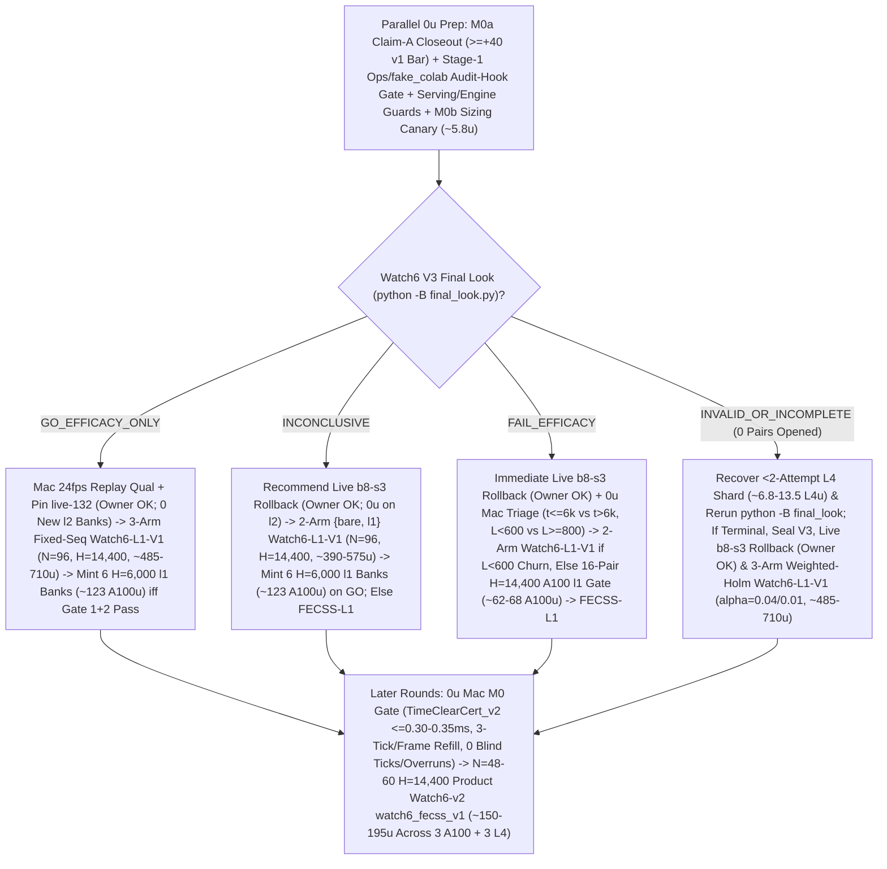

# T34 ExIt-B8 Research Roadmap (Round-14 Synthesis — Advice, Not Decisions)

Start: [project index](../INDEX.md) · [current status & authority](../STATUS.md) · [research record index](INDEX.md) · [study packages](../../research/INDEX.md) · [campaign log](final_run_20261019/CAMPAIGN_LOG.md).

> [!IMPORTANT]
> **Status: Research advice, NOT ratified decisions or release authorization.**
> Every current-round and later-round plan on this page is synthesized advisor guidance from Round 14 (2026-11-01 PT; primary synthesis artifact: `snake-dqn-artifacts/big-lever/exp/argon-rounds/round-14/synthesis/answer.md`, reconciling `round-14/{current,later,process}/answer.md` against `HEAD` `2130a023` and superseding Rounds 01–13). Nothing here amends a pre-registration, ratifies a confirmation gate, or changes served defaults. Binding campaign authority remains [`SUCCESS_CONTRACT.md`](final_run_20261019/SUCCESS_CONTRACT.md), [`DESIGN_V2_SHADOW.md`](final_run_20261019/DESIGN_V2_SHADOW.md) (+ Amendment 1), [`P7_STATISTICS.md`](final_run_20261019/P7_STATISTICS.md), unsuperseded parts of [`FINAL_PLAN.md`](final_run_20261019/FINAL_PLAN.md), and [`STATUS.md`](../STATUS.md); any serving or release change requires confirmation-lane evidence, Mac serving qualification, and the owner's explicit OK.

---

## 1. Snapshot Context & Code-Verified Round-14 Corrections (Oct 29 – Nov 1)

### 1.1 Nov 1 exploration, bank-minting, parity & Watch6 V3 fence quarantine ruling

- **All-length exact-stop screen — `ADOPT` for new replay banks** ([`watch6_alllen_screen`](../../research/watch6_alllen_screen/README.md), `t34-sol/argon-alllen-a100/analysis.json`, `N = 48` paired `H = 6,000` Watch6-v2 sessions uniting `12` L4 `W = 4` units `0..11` at `568b09e4` with `36` A100 `W = 6` units `12..47` across three `12`-unit shards at `73c26ccc` on `origin/argon-alllen-a100-1031`):
  - `bare` (`b8-s3`): **`351.07` mass** (`CI95 [320.22, 381.91]`), **`0.2882` `deaths/1k`** (`CI95 [0.2427, 0.3337]`; `83` deaths: `53` at `L < 600`, `30` at `L >= 600`, `21` at `L >= 800`), `mean_max_length = 794.3`.
  - `l2_prime_600` (served `L >= 600`): **`461.16` mass** (`CI95 [414.30, 508.02]`; `+110.09` vs `bare`, `CI95 [+72.06, +148.13]`), **`0.1597` `deaths/1k`** (`CI95 [0.1060, 0.2134]`; `-44.6%` vs `bare`; `46` deaths: `34` at `L < 600`, `12` at `L >= 600`, `11` at `L >= 800`), `449.6` mean branches/session (`403.7` roots, `mean_max_length = 943.4`).
  - **`exact_stop_alllen` (`L >= 1`, `interval = 5`, `H = 300`):** **`559.43` mass** (`CI95 [533.59, 585.27]`; **`+208.37` / `+59.35%` vs `bare`**, `CI95 [+170.07, +246.66]`; **`+98.27` / `+21.31%` vs `L >= 600`**, `CI95 [+50.57, +145.98]`, clearing `>= +15.0`) and **`0.0521` `deaths/1k`** (`CI95 [0.0294, 0.0748]`; **`-81.9%` / `-0.2361/1k` vs `bare`**, `CI95 [-0.2828, -0.1895]`; **`-67.4%` / `-0.1076/1k` vs `L >= 600`**, `CI95 [-0.1609, -0.0544]`, clearing `<= 0.0`), cutting `L < 600` deaths **`53 (bare) / 34 (L >= 600) -> 1`** (`0.142%` `L < 600` overrides, `mean_max_length = 1,096.0`) at **`2.821×` branches** (`1,268.5` vs `449.6`, `1,200.1` roots = **`1.057` branches/root**, stopping on `bare` at **`94.3%`** of roots, with `53.6%` cheap `L < 600` roots in frames `0..6,000`). **`14/15` remaining deaths occur at `L >= 600` (`13/15` at `L >= 800`).**
  - *Exposure & per-world notes:* Eliminating `34 -> 1` early deaths gives `exact_stop_alllen` **`1.379×` more `L >= 600` living exposure** (`403.7 -> 556.6` roots/session), so `11 -> 13` raw `L >= 800` deaths reflects **`-14.2%` lower per-frame `L >= 800` hazard** despite raw session-normalized `Δd_ge800 = +0.0069/1k`. Across paired worlds, `exact_stop_alllen` regressed deaths vs `L >= 600` on `3/48` seeds (`3075941873`, `3394546952`, `121131908`) and mass on `14/48` seeds.
- **All-length Watch banks `14l1–16l1` completed `36/36` on active Cap-6 `36285bc6` (freeing all `3` A100 slots):**
  - Verified receipts (`t34-sol/argon-banks-l1/packet-bank{14l1,15l1,16l1}-a100/output-main/receipt.json`, `SUMMARY.md:38-40`) confirm Cap-6 (`36285bc6`) ran `6/6` concurrent runtimes (`3 A100 @ 6.73 u/h + 3 L4 @ 1.94 u/h = 26.01 u/h`), finishing all `3 × 12` `exact-stop-l1` sessions (`W = 6`, `H = 6,000`) in **`3.03–3.07 h/bank`** (**`~20.36–20.67 u/bank` = `~61.5 A100 u` observed total** vs `75.6 u/bank` base / `151.2 u/bank` 2× forecast calibrated to the `2.821×` `L >= 1` branch ratio; balance **`~2,154.66 u`**, leaving `3` A100 slots immediately available). At `20.36 A100 u` per `12` `H = 6,000` sessions (`~164 A100 u` for `96` sessions at `H = 6,000`), survived trajectories spend frames `6,000..14,400` almost entirely at `L >= 800`, so `H = 14,400` `exact-stop-l1` compute scales **superlinearly (`>= 2.4×`, projected `~2.4–3.1×`)** over `H = 6,000`.
  - Commit `395eacbb` switched `.claude/launch.json` to **`watch-replay-bank-live-168`** (`132` `exact-stop-l2-prime` banks `01–08, 10–12` + `36` unconfirmed `exact-stop-l1` banks `14l1–16l1`, [`web/serve.py`](../../web/serve.py) restarted on `b5b63cd1`, keeping `watch-replay-bank-live-132` intact for rollback). Confirming `exact-stop-l1` at `H = 14,400` still requires prospective confirmation (`Watch6-L1-V1`), Mac serving qualification, and owner OK; defer minting new banks until Watch6 V3's verdict lands.
- **GPU `DeviceSim` v2 parity — `PASS` on A100** ([`devicesim_v2_parity`](../../research/devicesim_v2_parity/README.md), `t34-sol/argon-devicesim-v2/packet-a100-v2-parity-01/main-run-01/receipt.json`): **`0` mismatches** across **`1,536,000` snake-ticks** (`E = 256 × 1,000` Watch6-v2 ticks in `3,505.6 s` = `1,434.6` steps/s under 5-opponent CUDA flood launches, commit `b500d111`), using `DeviceSim`'s SplitMix64 RNG and `<= 1e-4` CUDA FP32 near-tie Q re-decision tolerances (SplitMix64 cannot mint MT19937 live Watch replay banks).
- **Active confirmation — Watch6 V3 (`09:16 PT` staging-fence quarantine ruling, `--reconcile-staging`, identity closure & linear-retry lineage guard)** ([`REGISTRATION_V3.md`](../../research/watch6_search_efficacy_v3/REGISTRATION_V3.md)): `24 × 4` L4 `W = 4` shards (`96` fresh paired `H = 14,400` Watch6-v2 sessions) confirming **`exact-stop-l2-prime` (`L >= 600`) only**. At `05:01 PT`, **`14/24` shards were `PASS`** (`01..08, 10, 11, 13..16`), **`6/24` active** (`17, 18, 20..23`), and **`4/24` V6.1-accepted mechanical failures** (`00` `412` unallocated, `09` `UPLOAD_CAP`, `12` renewal-WS drop, `19` warmup `GuardError`; `75471246`):
  - *`09:16 PT` V6.1 staging-fence quarantine ruling (`APPROVE_WITH_CONDITIONS`, `t34-sol/v61-fence-ruling-20261101.md`, `t34-sol/v61-fence-evidence-20261101.json`):* `23` historical non-V3 H100-503 pre-fallback manifests in `ops/manifests/` return `_attempt_state == "FENCE"`, blocking [`tools/watch6_v3_accounting/dispatch.py:wait_other_jobs_staged`](../../tools/watch6_v3_accounting/dispatch.py) (`lines 219–245`) for V3 recovery shards `00` and `12`. The Fable stand-in judge approved plain-`mv` quarantine of **only** those `23` manifests + `.live.json` siblings to `ops/manifests-archive-20261101/` under `flock` on `ops/watch6-staging.lock` (**`0` symlinks**, because [`final_look.py`](../../tools/watch6_v3_accounting/final_look.py) `lines 473–483` fails closed on `is_symlink()` before namespace filtering; if `ops/watch6-staging-reconcile.json` was written, clear it via `--reconcile-staging` in [`dispatch.py`](../../tools/watch6_v3_accounting/dispatch.py) `lines 178–185, 316–354`).
  - *Identity closure & linear lineage:* [`watch6_search_efficacy_v3/protocol.py`](../../research/watch6_search_efficacy_v3/protocol.py) hashes both [`tools/ops/package_spec.py`](../../tools/ops/package_spec.py) (`line 94`) and `web/backend/` (`line 96`) into `identity()`, and [`final_look.py:_verify_shard_lineage`](../../tools/watch6_v3_accounting/final_look.py) (`lines 380–386`) fails closed on forked attempt trees sharing a parent receipt. Keep all V3 worktrees and `ops/` untouched during code preparation; dispatch **only** staged `ops/auto-retry` children on shards **`09` and `19`** (**do NOT run [`recover.py`](../../tools/watch6_v3_accounting/recover.py)** on `09, 19`); run `recovery-shard-{00,12}-01` via `python -B -m tools.watch6_v3_accounting.dispatch`; and invoke [`final_look.py`](../../tools/watch6_v3_accounting/final_look.py) under **`python -B`** from clean `snake-dqn-argon-v3-accounting` ([`_forbid_pycache_directory`](../../tools/watch6_v3_accounting/__init__.py) `lines 747–777`).
- **Completed Oct-30 Claim-A GPU receipts awaiting `0 u` Mac readout (`< 3 min`):** `b8-head-closedloop` (`t34-sol/b8-head-closedloop/main-01/output/receipt.json`, `rc = 0`) and `spatial-qbytes-01` (`t34-sol/spatial-qbytes-fix/t34-spatial-qbytes-01/ruler-output-a100-fallback/receipt.json`, `rc = 0`) completed cleanly on A100, while `T4 Gate-1` (`0/8` bars, `KILL_T4`) cancels the `40–48 A100 u` `spatial-student-pilot` fit (retaining compiled `.so` caches).

### 1.2 Closed single-pass critics, distillations, RL, and standalone macro fallbacks

Between 2026-10-29 and 2026-11-01, every single-pass learned-policy, critic, distillation, and standalone macro-fallback track closed below its promotion or selectivity bars:

| Track | Scope & primary artifact | Measured outcome | Disposition |
| --- | --- | --- | --- |
| **TRAIN-01** ([`sandbox_a_resident`](../../research/sandbox_a_resident/README.md)) | `100.7M`-row (`384`-update) GPU-resident PPO from `b8-s3` (`t34-sol/train01-closeout/SUMMARY.md`) | H5000 equal-mix paired mass **`+8.09`** (`CI95 [-18.66, +34.85]`; scripted `+26.32`, frozen `+2.85`, mixed `-4.90`; update-320 peak `+14.23` `[-11.86, +40.32]`) vs bar `>= +40` | **Closed** (no strict-gate nomination) |
| **C/T Stage-2 distillation** | Continuation-teacher causal-root distillation (`t34-sol/ct-stage2-verdict/SUMMARY.md`) | Teacher rescued **`22/32` (`68.75%`)** deaths (`22/32 <= 65` ticks; indep-suffix H300 `+66.77`, `LB90 +51.61`), but student retention was **`46.9–50.0%`** (`0 pp` over `frozen_phi` vs `>= +15 pp`; topology AUC `0.5752 < 0.83`), ordinary flips **`44.4–64.5%`** (bar `<= 1%`), and lethal ordinary flips **`3–5`** (bar `<= 1`) | **`FAIL_DISTILLATION_RETENTION_OR_SAFETY`** |
| **Doom U-Net & `spatial-student-pilot`** | `83 × 145` spatial U-Net vs 33.7k B8-feature head (`t34-sol/doom-result-01/result.json`; `t34-sol/student-direction/{astra,fable}.md`) | Spatial U-Net lost late per-action doom ROC-AUC to frozen B8 features (**`0.753` vs `0.810`**, `Δ = -0.056`, `CI95 [-0.091, -0.023]`; all-strata death-lookback `0.7626` vs `0.8226`; ordinary late `0.690` vs `0.706`) | **`GRAY` / `40–48 A100 u` pilot fit canceled (`0 u`; retain `.so` caches)** |
| **B8 advantage head (offline OOF)** | `256 -> 128 -> 6` ReLU head on frozen B8 features (`t34-sol/b8-head-test/RESULT.md`) | Mass rule `GO` (late H300 `+30.09`, `LB90 +23.96`), Fable selectivity **`FAIL`**: **`26.42%`** late rescue (bar `>= 35%`) at **`97.60%`** non-death flips (bar `<= 15%`) | **Selectivity `FAIL`** (192-world closed-loop A100 `rc = 0`, awaiting Mac readout) |
| **T4 Gate-1 factored critic** ([`t4_gate1`](../../research/t4_gate1/README.md)) | Clean-slate privileged `83 × 145` (`H = 320` 7-source BFS) hazard + foraging mass-flux critic on `384` disjoint Watch6-v2 worlds (`t34-sol/argon-t4-gate1-fix2/queue-03/READOUT.json`) | **`0/8` bars passed**: `L >= 600` residual EV **`+0.0266`** (`[-0.0280, +0.0869]` vs `>= 0.25`), death-root H300 rescue **`+19.99`** (vs `>= +40`), mature doom AUC **`0.5617`** (vs `>= 0.80`), ordinary H300 mass **`-22.21`** (vs `>= -15.0`), lethal flips **`3.13%`** (vs `<= 3.0%`) | **`KILL_T4`** (proves even privileged `83 × 145` critic lacks late value signal) |
| **R6 `L < 600` harvest census** ([`r6_l600_census`](../../research/r6_l600_census/README.md)) | `64`-world (`384`-root) Watch6-v2 early-game counterfactual + 5-fold OOF corpse/trail plane probes (`t34-sol/argon-mac-checks/r6-census/RESULT.json`) | **`34.90%` (`134/384`)** oracle-harvestable roots (`>= +5` H500 mass), **`7.69%`** non-bare H500 lethal flips, OOF ROC-AUC **`0.474–0.521`** (`0` passing threshold points); superseded operationally by `exact-stop-l1` | **`KILL`** |
| **R7 macro-option fallback** ([`r7_macro_fallback`](../../research/r7_macro_fallback/README.md)) | Pruned depth-2 (`2K = 30` ticks) spatial macro-options `{O_0..O_5}` on C/T train `1-step-all-die` roots (`t34-sol/argon-r7-repack/R7_READOUT.json`) | `3/5` bars passed (`0.316 ms` Mac 1-thread p95; **`33.0%` vs `9.0%`** `L >= 800` `all_die_sel0` rescue on `25/129` roots — `9/25` `macro_triggered` at `+66.7 pp` rescue vs `16/25` tick-`30` B8 re-traps, while `104/129` `80.6%` survived `H = 300`), but total `L >= 600` lift **`+3.85 pp`** (`< +10.0 pp`) and **`2 > 0`** ordinary lethal flips (`0` assessment roots opened) | **`KILL`** as standalone `30`-tick fallback |

### 1.3 Code-verified Round-14 corrections over Round 13

Auditing `HEAD` (`2130a023`) against Round 13's roadmap exposes **four code-verified bug clusters** across Stage-1 packaging/accounting, Stage-2 `colab_cli`, and later-round search/spine serving:

1. **Stage-1 `"required_exports": ["shard-complete.json"]`, single-file `unit-{id:04d}.json` streaming (`0` `exports/` opens), `2 MiB` `UPLOAD_CHUNK_BYTES` & exact `FailureClass` (`0 u` on `36285bc6`):**
   - *Non-empty `required_exports` (`"shard-complete.json"`):* [`schema.py:required_export_paths`](../../research/colab_cli/schema.py) (`lines 39–43`) and [`canary.py:_exports`](../../research/colab_cli/canary.py) (`lines 106–110`) reject Round 13's `"required_exports": []` with `SchemaError`/`CanaryError`. Set `"required_exports": ["shard-complete.json"]`: mid-run [`supervisor.py:collect_exports`](../../research/colab_cli/supervisor.py) (`line 953`) validates against `{}` every `15 s`, streaming `exports/units/unit-{id:04d}.json` into [`receipt["exports"]`](../../research/colab_cli/supervisor.py) (`line 1371`) before terminal `shard-complete.json`.
   - *Single-file unit streaming & `2 MiB` `UPLOAD_CHUNK_BYTES`:* [`transfers.py`](../../research/colab_cli/transfers.py) (`line 30`) sets `UPLOAD_CHUNK_BYTES = 2 * 1024 * 1024` (`2 MiB`, while `8 MiB` in [`transfer_policy.py`](../../research/colab_cli/transfer_policy.py) is the private upload cap — `UPLOAD_SPLIT_THRESHOLD_BYTES` does not exist); the 3-way `inputs[]` (`public_inputs` HTTPS weights, `<= 1.5 MiB` `inputs/study-static.tar`, canonical `65,536 B`-padded `inputs/verified-ledger.json`) totals `< 1.6 MiB < 2 MiB` (`0` chunk-assemble WS RPCs). Moreover, Round 13's side-by-side `.meta.json` unit exports violate `"never open exports/"` **and** force `len(batch) >= 2` in [`supervisor.py`](../../research/colab_cli/supervisor.py) (`lines 975–981`), falling back to WebSocket `export_batch` RPCs. Emit **one** `exports/units/unit-{id:04d}.json` (+ `.sha256` + `.complete`) per world (`~8–12 min` apart $\Rightarrow$ `len(batch) == 1` Contents HTTP [`export_file`](../../research/colab_cli/supervisor.py) `lines 988–1035`) and rebuild `verified-ledger.json` strictly from `receipt["exports"]` + `os.lstat` (`.complete`) (**`0` `exports/` opens**, enforced offline in [`fake_colab.py`](../../tests/fixtures/fake_colab.py) via `sys.addaudithook`).
   - *`FailureClass` & shared Stage-1 `pending_canary`:* [`failures.py`](../../research/colab_cli/failures.py) (`lines 10–18`) emits `"RPC_EXEC_POLL_TIMEOUT"` and `"SUPERVISOR"` (not `"TRANSPORT"`). On unmodified `36285bc6`, Tier-1 retries share **one** `1-unit` `pending_canary` (`~0.16–0.4 u` L4) across concurrent shards (`0` on Stage 2 via [`canary.py`](../../research/colab_cli/canary.py) `line 318` `64 KiB` `resume.ledger_path` SHA exemption).
2. **Stage-2 `KERNEL_CREATION_GUARD_ERROR` adoption, single-window `~15–25 s` `account.lock` & dual-loop `0o600` Contents OAuth rotation (`~1.5 u` additive `colab_cli`):**
   - *Cold-boot kernel adoption (`exec_uncertain = True`):* [`cli_guard.py:guarded_session_request`](../../research/colab_cli/cli_guard.py) (`lines 118–122`) and [`policy.py:transient_error`](../../research/colab_cli/policy.py) (`lines 52–55`) *already* abort on probe #1 when `colab-cli 0.7.4` internally retries `POST /api/kernels`, so Round 13's `2`-probe fast-abort burns retries on healthy cold-boot VMs. Catch `KERNEL_CREATION_GUARD_ERROR` in [`supervisor.py:wait_runtime_ready`](../../research/colab_cli/supervisor.py) (`lines 721–726`) with `self.exec_uncertain = True` so GET-only [`_kernel_idle_once`](../../research/colab_cli/cli_guard.py) (`lines 440–476`) discovers and adopts the created kernel.
   - *Single-window `account.lock` (`~15–25 s`):* Splitting `account.lock` across warmup leaves `pending-*.json` live from [`supervisor.py:1156`](../../research/colab_cli/supervisor.py) until [`calibrate_rate:1482`](../../research/colab_cli/supervisor.py) (deadlocking concurrent allocations) and conflates concurrent [`calibration_read`](../../research/colab_cli/accounting.py) (`lines 262–272`) rate deltas. Keep **single-window `account.lock`**, mint `release_credential` + `version` pre-lock, use `2.0 s` warmup/calibration polls, and drop `account_locked` around read-only `poll % 4` [`spend`](../../research/colab_cli/supervisor.py) (`line 1934`).
   - *Dual-loop `0o600` Contents OAuth rotation:* [`runtime.py`](../../research/colab_cli/runtime.py) checks `_release_credential_expiring` in **both** the running loop (`line 626`) and post-terminal wait loop (`line 712`), and [`load_release_credential`](../../research/colab_cli/release.py) (`lines 181–184`) enforces `0o600`. Poll Contents-uploaded `release-credential.next.json` in **both** `L626` and `L712` loops via [`write_release_credential`](../../research/colab_cli/release.py) (`lines 167–173`, `mkstemp` `0o600` + `fsync` + `os.replace`) alongside Contents `state.json` GET and `<= 4`-file `export_file` loops (**`0` post-`ready.json` WS RPCs** across 6-hour runs).
3. **Food-exact `TimeClearCert_v2` (`FECSS-L1`), pre-pocket `TimeClearCert_v2 == 0` trigger & `OUTCOME_NO_SPACIOUS` 1-step head-on mask:**
   - [`BatchSim._push_head`](../../src/simd_env/batch_sim.py) (`lines 784–794`) and [`_settle_tails`](../../src/simd_env/batch_sim.py) (`lines 795–816`) pop tails *before* [`_consume_food`](../../src/simd_env/batch_sim.py) (`lines 860–901`) increments `length += 1`, so eating corpse/trail pellets ([`CORPSE_DROP_FRACTION_V2 = 1.0`](../../src/core/mechanics_constants.py) `line 28`, [`BOOST_DROPS_TRAIL_V2 = True`](../../src/core/mechanics_constants.py) `line 95`) delays every subsequent tail release by `+1` tick/pellet (invalidating Round 13's food-naive $\tau_{\text{own}} - \text{burn}(t)$).
   - [`PathBSearchEngine.advance_one`](../../research/t34_pathb/engine_v2.py) (`lines 589–595`) currently queues rescue only on shadow death, missing $> 300$-tick coils (`104/129` `L >= 800` roots in `R7_READOUT.json`); firing at the **first shadow tick $\le D = 384$ where `TimeClearCert_v2 == 0`** extends foresight to $D + L_0 \approx 1,184\text{--}1,584$ ticks.
   - [`SpaceAndHeadVeto.decide`](../../src/evaluation/safety_veto_v8.py) (`lines 289–296`) **skips `_head_layer`** when `v7_outcome == OUTCOME_NO_SPACIOUS`, leaving tight-corridor actions exposed to 1-step opponent head-ons unless masked explicitly whenever $L_{0,\text{post}} < 1.15(L_j + 1)$ ([`HEADON_SIZE_RATIO = 1.15`](../../src/core/mechanics_constants.py) `line 22`).
4. **Incremental `3`-tick/frame post-graft P2 refill & causal shadow digests unlocking `20.13×` `v8_nb`:**
   - Grafting an `H = 128` worker branch onto P2 (`D = 384`) leaves lead `128`; Round 13's unmodified synchronous `256`-tick refill inside [`PathBSearchEngine.maintain`](../../research/t34_pathb/engine_v2.py) (`lines 517–520`) blocks `590–1,470 ms` (`14–35` dropped `24 fps` frames in [`PathBControllerV2.after_step`](../../research/t34_pathb/controller_v2.py) `lines 213–216`). Cap P2 catch-up at **`3` shadow ticks/frame (`+2` net lead/frame)** for `0` frame drops and `0` blind ticks, and drop non-causal `_veto` telemetry counters ([`identity.py`](../../research/t34_shadow/identity.py) `lines 209–211`) from shadow causal digests to unlock `20.13×` Numba [`v8_decide`](../../src/simd_env/v8_nb.py) (`lines 42–65`) across P2–P4.

---

## 2. Current-Round Plan (Advice, Not Decisions)

### 2.1 Finish Watch6 V3 (`0 u`), run `M0a` Claim-A closeout (`0 u`), & patch Watch serving/confirmation engine

1. **Finish Watch6 V3 cleanly under `python -B final_look.py` (`N = 96`, `exact-stop-l2-prime` only; V3 worktrees & `ops/` untouched during code prep):**
   - If not yet executed, complete the ratified `23`-manifest plain-`mv` quarantine (`0` symlinks) + `--reconcile-staging` if fenced under `ops/watch6-staging.lock` per `t34-sol/v61-fence-ruling-20261101.md`, dispatch **only** staged `ops/auto-retry` children on **`09, 19`** (**do NOT run `recover.py`** on `09, 19`) and `python -B -m tools.watch6_v3_accounting.dispatch` on **`00, 12`**, and invoke `python -B` [`final_look.py`](../../tools/watch6_v3_accounting/final_look.py) (`lines 653–692`) from clean `snake-dqn-argon-v3-accounting` (never opening `exports/` or `pair-*.json`).
2. **Run `M0a` Claim-A readout & enforce binding v1 `H = 5,000` `>= +40` closure bar (`0 u`, `< 3 min` Mac):**
   - Run `nice -n 15 ./venv/bin/python -m research.b8_head_test.closedloop_readout` (`origin/astra-doom-auc-smoke` @ `591d94c3`) on completed `b8-head-closedloop` (`N = 192` v1 `H = 5,000` worlds, `m in {0, 10, 25, 50}`) and audit completed `spatial-qbytes-01` (`mapped-parity.json`); keep `spatial-student-pilot` (`40–48 A100 u`) canceled (`0 u`, retaining `.so` caches).
   - **Recommended Claim-A kill rule:** Recommend **closing Claim A permanently (`0 u`)** unless some `m in {0, 10, 25, 50}` clears binding v1 `H = 5,000` [`SUCCESS_CONTRACT.md`](final_run_20261019/SUCCESS_CONTRACT.md) §2 (`lines 29–33`) and `b8-head-closedloop/SUMMARY.md:16,45` bars (**`>= +40` pooled mass**, `LB90 > 0` / Bonferroni `LB97.5 > 0`, scripted no-death `>= +0.03` with no mix loss, survival band v2 / [`P7_STATISTICS.md`](final_run_20261019/P7_STATISTICS.md) Guard A `Δalive >= -0.05` pooled / `>= -0.075` per mix, and `<= 15%` living overrides), followed by a `0 u`, `10 min` v2 boost `[0.5%, 10%]` check before nominating any Mac strict gate.
3. **Patch Watch replay serving & task-pooled `H = 14,400` `record=None` confirmation engine (`0 u`, fresh worktree; V3 untouched):**
   - Set `"SNAKE_WATCH_SOURCE": "live"` in [`watch6_search_efficacy/product.py:open_watch`](../../research/watch6_search_efficacy/product.py) (`line 41`) and bind confirmation science `identity()` via `git ls-tree -r <manifest.commit> -- src research/<study> configs/<study>.yaml` (isolating science identity from `tools/ops/*`, `web/backend/*`, and `__pycache__`):
     - **Serving guards ([`session.py`](../../web/backend/session.py), [`watch_replay.py`](../../web/backend/watch_replay.py), [`app.py`](../../web/backend/app.py)):** Refuse `MODE_TRAIN` on forward-only `EGO2S_OBS_SPECS` / `RASTER31V2` **before** calling [`_leave_watch_replay()`](../../web/backend/session.py) (`lines 1443–1462`); scope `_replay_opted_out = True` strictly to `set_epsilon` (`lines 1154–1160`) and `set_food` (`lines 1173–1200`) — **never** inside `_leave_watch_replay()`, preserving `Play -> Watch` — and clear `_replay_opted_out = False` in `_build` (`lines 714–738`) + split `"new_game"` in [`app.py`](../../web/backend/app.py) (`lines 310–311`), gating `__init__`/`reset_game`/`set_mode` on clean mixed-Watch6 `b8-s3`; add line-1 `.watch.gz` `SNAKE_WATCH_REPLAY_CONTROLLER` (`all | exact-stop-l2-prime | exact-stop-l1`) filtering, `64`-frame cooperative yield (`< 0.35 s` cold load) in `verify_payload` (`line 176`), shallow `Recording.snapshot` (`lines 226–238`), and injectable `shuffle_discovery: bool = True` for cycle 1 in [`ReplayBank`](../../web/backend/watch_replay.py) (`lines 238–295`).
     - **Confirmation engine ([`watch_replay/engine.py`](../../research/watch_replay/engine.py) & `watch6_l1_confirm`):** Guard side-effect-free `if record is not None: snapshot = session.live.snapshot()` in [`run_arm`](../../research/watch_replay/engine.py) (`lines 216–229`), enforce full `14,400`-frame live mirror + `timing` (`main_seconds`, `search_seconds`) + `respawns_per_slot` parity ([`performance.py`](../../research/watch6_search_efficacy/performance.py) `line 81`) with [`watch6_search_efficacy/run.py`](../../research/watch6_search_efficacy/run.py)'s `on_frame` `900 s` `faulthandler` watchdog (`lines 66–86`) across task-pooled `(world_idx, arm)` jobs, parameterize `alpha: float = 0.05` (`t.ppf(1.0 - alpha / 2.0, df)`) in `Watch6-L1-V1`'s new analyzer (leaving sealed V2/V3 untouched), and keep **recorded `.watch.gz` v2 banks at `H = 6,000`** (`< 512 MiB` [`MAX_DECODED`](../../web/backend/watch_replay.py) `line 24`) while running `record=None` confirmation at **`H = 14,400`**.
   - Pass `1,500` unpaced + `120` paced-`24 fps` Mac qualification ticks (`update p95 <= 11.688 ms`, `step p99 <= 41.67 ms`, `0/120` overruns per [`t15_mixed_roster_qualification_2026-10-17.md`](t15_mixed_roster_qualification_2026-10-17.md), `< 1.0 s` cold readiness) while cold `.watch.gz` verification runs concurrently.

### 2.2 Deploy Round-14 Code-Verified Two-Stage Transport (`0 u` Stage 1 + `~1.5 u` Stage 2)

1. **Stage 1 (`0 u` Colab, [`tools/ops/`](../../tools/ops/) on active Cap-6 `36285bc6`, zero `research/colab_cli/` edits):**
   - **Three-way `inputs[]` (`< 1.6 MiB < 2 MiB` [`UPLOAD_CHUNK_BYTES`](../../research/colab_cli/transfers.py) `line 30`, `0` WS `UPLOAD_ASSEMBLE`) & single-file unit streaming (`tools/ops/study_package.py`):**
     1. `public_inputs` HTTPS fetch for `B8_s3_final.pth` (`6.56 MB`) + `league.tar.gz` (`21.36 MB`) from [`PUBLIC_INPUTS.json`](../../research/t34_exit_b8/PUBLIC_INPUTS.json) (`lines 4–15`, `0` Mac checkpoint uploads; VM verifies extracted `frp3_m3_s12` against [`served_checkpoint_pins.json`](../../web/backend/served_checkpoint_pins.json)).
     2. Frozen `inputs/study-static.tar` (`<= 1.5 MiB`, fixed SHA before data across all retries, `env["CONFIRM_SHARD"]` $\Rightarrow$ **`1` initial canary/24 shards** under [`canary.family`](../../research/colab_cli/canary.py) `lines 55–62`).
     3. Canonical `65,536 B`-padded `inputs/verified-ledger.json`.
     4. `"required_exports": ["shard-complete.json"]`: emit `exports/workload-started.json` pre-tick-0, **one** `exports/units/unit-{id:04d}.json` (+ `.sha256` + `.complete`, no `.meta.json` pair) per completed world (`~8–12 min` apart $\Rightarrow$ `len(batch) == 1` Contents HTTP [`export_file`](../../research/colab_cli/supervisor.py) `lines 988–1035` recorded in [`receipt["exports"]`](../../research/colab_cli/supervisor.py) `line 1371`), and `shard-complete.json` last.
   - **Locked caps, single-GPU `reconcile_unavailable`, `qualification.py review`, & `ops-outcome-blind-retry/v2` (`r34-confirm-accounting/v2`):**
     - Enforce `total < 6`, `L4 < 3`, a `15 s` departing-`active-*.json` drain, `--no-internal-retry`, and single-GPU `412`/`503` [`reconcile_unavailable`](../../tools/ops/dispatch.py) (`unavailable.json` + unlinking `account/pending-<session>.json`) under `ops/alloc.lock` in [`dispatch`](../../tools/ops/dispatch.py) (`lines 2871–2948`); add `qualification.py review --tree <sha> --status ACCEPT` ([`qualification.py`](../../tools/ops/qualification.py) `lines 79–83, 153`).
     - Keep operational slot manifests in `ops/manifests/` while recording linear study-scoped confirmation lineage in `ops/studies/<namespace>/attempts/` via [`auto_retry.py:eligible`](../../tools/ops/auto_retry.py) (`lines 235–313`):
       - **Tier-0 Pre-Workload (`prestart_attempt <= 8`, `0` completions burned, `0` extra canaries):** Verified `unavailable.json`, or `stop_verified is True` with `"workload-started.json"` and `units/*` absent from `receipt["exports"]` (`412`/`503`, `UPLOAD_CAP`, `GuardError`, `rc = 74` `public_input_fetch_failed`, or bootstrap wheel `503`).
       - **Tier-1 Mid-Workload (`completion_attempt <= 2`):** `stop_verified is True`, `cleanup_error is None`, `failure_class in {"RPC_EXEC_POLL_TIMEOUT", "SUPERVISOR"}` ([`FailureClass`](../../research/colab_cli/failures.py) `lines 10–18`), **`terminal.reason != "timeout"`**, and **`outage_onset_elapsed < timeout_minutes * 60 - 300`** from `receipt["cli_calls"]` (immune to [`EXEC_POLL_RECOVERY_SECONDS = 1200.0`](../../research/colab_cli/policy.py) `line 30`). Rebuilds `64 KiB` `verified-ledger.json` strictly from `receipt["exports"]` + `os.lstat` (`.complete`) (**`0` `exports/` opens**) and shares **one** `1-unit` `pending_canary` (`~0.16–0.4 u` L4) across concurrent shards on `36285bc6`.
     - Audit via `python -B -m tools.ops.confirm_audit` (`study-contract.json`, linear attempt chains, and `0..N-1` `unit_id` bijection from `receipt["exports"]` + `os.lstat`; **`0` payload reads, `0` post-data judge rounds**), proven offline on [`fake_colab.py`](../../tests/fixtures/fake_colab.py) (`lines 113–180`) with `sys.addaudithook` trapping any `open("*/exports/*")`.
2. **Stage 2 (`~1.5 u` Colab, additive `colab_cli` via [`requalify.sh`](../../tools/ops/requalify.sh) + `qualification.py review --status ACCEPT`, live `36285bc6` jobs untouched):**
   - **Cold-boot `KERNEL_CREATION_GUARD_ERROR` adoption:** Catch `KERNEL_CREATION_GUARD_ERROR` in [`supervisor.py:wait_runtime_ready`](../../research/colab_cli/supervisor.py) (`lines 721–726`) with `self.exec_uncertain = True` so GET-only [`_kernel_idle_once`](../../research/colab_cli/cli_guard.py) (`lines 440–476`) discovers and adopts the kernel created by `colab-cli 0.7.4`'s internal retry.
   - **Single-window `~15–25 s` `account.lock` & unlocked `poll % 4` `spend`:** Preserve single-window `account.lock` (preserving `pending-*.json` invariants at [`supervisor.py:1156,1482`](../../research/colab_cli/supervisor.py) and clean [`calibration_read`](../../research/colab_cli/accounting.py) `lines 262–272` deltas), mint `release_credential` + `version` pre-lock, use `2.0 s` warmup/calibration polls, and drop `account_locked` around read-only `poll % 4` [`spend`](../../research/colab_cli/supervisor.py) (`line 1934`).
   - **Dual-loop `0o600` Contents OAuth rotation, `0` post-`ready.json` WS RPCs & `64 KiB` ledger canary exemption:** Replace [`supervisor.py:renew`](../../research/colab_cli/supervisor.py) (`lines 1692–1710`)'s WS `recoverable_rpc` with Contents PUT `release-credential.next.json` polled in **both** [`runtime.py`](../../research/colab_cli/runtime.py) running (`line 626`) and post-terminal (`line 712`) loops via `0o600` [`write_release_credential`](../../research/colab_cli/release.py) (`lines 167–184`); poll `state.json` + `<= 4`-file `export_file` over Contents HTTP when `observer is None` (**`0` post-`ready.json` WS RPCs** across 6-hour runs); exempt schema-verified `64 KiB` `resume.ledger_path` SHA in [`canary.check`](../../research/colab_cli/canary.py) (`line 318`, **`0` Tier-1 retry canaries**); pass **`12/12` gates** (`11` `final-only` + `d1024`) + `35 min` WS-blackout OAuth-rotation L4 canary, and record independent reviewer `"ACCEPT"`.

### 2.3 `M0b` `L >= 900` `W = 6` sizing canary (`~5.8 u`) & Watch6 V3 verdict routing (serving switches need owner OK)

Before freezing `Watch6-L1-V1` manifests, run **`M0b` (`~4.5 A100 u` + `~1.3 L4 u`, `~40–50 min` on 1 free A100 + first free L4; 2× cap `12 u` / `90 m`)**: `6` `L >= 900` fixtures × `1,200` frames at `W = 6` through patched `record=None, horizon=14400` confirmation (`snapshot()` skipped, full `14,400`-frame live mirror). Size A100 (`W = 6`) and L4 (`W = 4` or `W = 6` task-pooled `(world_idx, arm)` jobs) strictly from `M0b`'s measured `p95` (`~485–710 u` for 3-arm `{bare, l2_prime, l1}`, `~390–575 u` for 2-arm `{bare, l1}`, anchored to `bank14l1` `20.36 A100 u / 12` `H = 6,000` sessions × `2.4–3.1×` `H = 14,400` late-body scaling against `~2,154.66 u` available balance).

- **On `GO_EFFICACY_ONLY` ([`REGISTRATION_V3.md`](../../research/watch6_search_efficacy_v3/REGISTRATION_V3.md) `lines 53–68`, [`analyze.py:decide`](../../research/watch6_search_efficacy/analyze.py) `lines 67–82`: `deaths/1k UB95 < 0` and Fieller mass `LB95 >= -0.05`):**
  1. *Mac (`0 u`):* Land §2.1's replay/engine patch + `1,500`-unpaced / `120`-paced-`24 fps` qualification on `main`, and pin Watch serving to confirmed `132`-session `exact-stop-l2-prime` (`watch-replay-bank-live-132` or `SNAKE_WATCH_REPLAY_CONTROLLER=exact-stop-l2-prime`, **owner OK**). Mint **0** new `l2` banks.
  2. *Colab (`~485–710 u`, 3-arm fixed-sequence `{bare, l2_prime, l1}`, `N = 96, H = 14,400`, `record=None` on `r34-confirm-accounting/v2`):* Gate 1 requires `l1` vs `bare` `deaths/1k UB95 < 0` and Fieller mass `LB95 >= -0.05`; Gate 2 requires `l1` vs `l2_prime` `deaths/1k UB95 < 0`, Fieller mass `LB95 >= -0.025`, and session-denominator `Δd_ge800/1k UB95 <= +0.05/1k`. Mint **`6` (`6–8`) pure-`l1` `H = 6,000` recorded banks** (`72–96` sessions $\rightarrow$ `108–132` total on top of `14l1–16l1`, **`~123–165 A100 u`**) and cut over Watch (**owner OK**) iff Gate 1 + Gate 2 pass; else retain confirmed `live-132`.
- **On non-`GO` (`INCONCLUSIVE`, `FAIL_EFFICACY`, or `INVALID_OR_INCOMPLETE`):**
  - *`INCONCLUSIVE`:* Spend `0 u` topping up `l2-prime` (`34` pre-`L = 600` deaths dilute `l2-prime`, whereas `l1` cuts them `34 -> 1`), recommend live bare `b8-s3` rollback (`SNAKE_WATCH_SOURCE=live`, **owner OK**), and run **2-arm `{bare, l1}` `Watch6-L1-V1`** (`~390–575 u`; mint `6` `H = 6,000` `l1` banks `~123 A100 u` only after `GO`, else pivot to §3's `FECSS-L1`).
  - *`FAIL_EFFICACY`:* Recommend immediate live `b8-s3` rollback (**owner OK**) and run a **`0 u`, `15 min` Mac triage** of V3 by `t <= 6,000` vs `t > 6,000` and `L < 600` vs `L >= 800`: if failure was `L < 600` churn while `600 <= L < 800` improved, run **2-arm `{bare, l1}` `Watch6-L1-V1`** (`~390–575 u`); if late-horizon (`t > 6,000, L >= 800`) coil-trap reversal occurred, run a **`16`-pair A100 `H = 14,400` `l1 vs bare` gate** (`3` shards `W = 6`, **`~62–68 A100 u`** / `136 u` 2×; requires `Δdeaths/1k <= -0.08`, Fieller `>= +0.10`, and `t > 6,000` deaths `<= bare`), pivoting directly to §3's `FECSS-L1` if it fails.
  - *`INVALID_OR_INCOMPLETE` (`0` pairs opened):* If pre-look mechanical transport drop with `< 2` `MAX_COMPUTE_COMPLETIONS_PER_SHARD` remaining, complete the missing L4 shard (`~6.8–13.5 L4 u`) and rerun `python -B final_look.py`; if terminal, seal V3 (`0` pairs reused), recommend live `b8-s3` rollback (**owner OK**), prove the fix in `fake_colab.py`, and run **3-arm weighted-Holm `Watch6-L1-V1`** (`{bare, l2_prime, l1}`, `N = 96, H = 14,400`, parameterized `alpha_1 = 0.04` on `l1 vs bare` and `alpha_2 = 0.01` on `l2_prime vs bare`, recycling to `0.05`, **`~485–710 u`**) so `live-132` is still rescued if only `l2_prime` clears.

---

## 3. Later-Round Plan: Food-Exact Constructive Shadow-Search (`FECSS-L1`) & Incremental-Refill `W = 4` `D = 384` `ShadowSpine` (Advice, Not Decisions)

### 3.1 Food-exact `TimeClearCert_v2` (`interval = 1`), `D + L_0` pre-pocket trigger, `OUTCOME_NO_SPACIOUS` head-on mask & `K = 3` harvest tie-break (`FECSS-L1`)

1. **Food-exact `TimeClearCert_v2` (`~0.06–0.22 ms` Numba, `interval = 1` online and on `H = 128` rollouts):**
   - Accounts for [`BatchSim._push_head`](../../src/simd_env/batch_sim.py) (`lines 784–794`) / [`_settle_tails`](../../src/simd_env/batch_sim.py) (`lines 795–816`) popping tails *before* [`_consume_food`](../../src/simd_env/batch_sim.py) (`lines 860–901`) increments `length += 1` under [`CORPSE_DROP_FRACTION_V2 = 1.0`](../../src/core/mechanics_constants.py) (`line 28`, `<= 150` corpse pellets) and [`BOOST_DROPS_TRAIL_V2 = True`](../../src/core/mechanics_constants.py) (`line 95`):
     $$\tau_{\text{own}}^{\text{eff}}(u, p_r) = (L_0 - k_{\min}(u)) + g_{\text{food}}(p_{r-1}) - b_{\text{burn}}(p_r)$$
   - Combines **`OpenEscapeCert_v2`** (food/burn-adjusted dynamic-release BFS reaching unsealable $|C_{\text{open}}| \ge \max(1.25 L_0, 250)$ with $\ge 2$ disjoint exits before $2$-cell/tick enemy boost arrival $d_{\text{opp}}^{\text{boost}}(u)$ for $L_j \ge 5$) and **`ConstructiveCoilCert_v2`** (wall-hugging $\max \tau_{\text{adj}}$ zero-bisection self-avoiding walk for $\le L_0$ ticks exiting a gate $g$ before enemy seal or closing a constructive **Tail-Loop** on vacating $s_{L_0-1}$).
2. **Pre-pocket shadow trigger ($D + L_0$ foresight):**
   - [`PathBSearchEngine.advance_one`](../../research/t34_pathb/engine_v2.py) (`lines 589–595`) fires rescue at the **first shadow tick $\le D = 384$ where `TimeClearCert_v2 == 0`** rather than waiting for shadow death, extending effective coil-trap foresight to $D + L_0 \approx 1,184\text{--}1,584$ ticks (`104/129` = `80.6%` of `L >= 800` death-lookback roots in `R7_READOUT.json` survive past `H = 300`).
3. **`OUTCOME_NO_SPACIOUS` 1-step head-on mask & `K = 3` certified harvest tie-break:**
   - Because [`SpaceAndHeadVeto.decide`](../../src/evaluation/safety_veto_v8.py) (`lines 289–296`) **skips `_head_layer`** when `v7_outcome == OUTCOME_NO_SPACIOUS` (and `_head_layer` keeps spacious turns under `REASON_HEAD_KEPT`, `line 134`), hard-mask 1-step opponent head reach within `Chebyshev <= 4` whenever post-burn $L_{0,\text{post}} < 1.15(L_j + 1)$ ([`HEADON_SIZE_RATIO = 1.15`](../../src/core/mechanics_constants.py) `line 22`).
   - Within `Chebyshev(head_0, head_j) <= 10–14` (`L_0 >= 120`), run `H = 48–64` Numba [`v8_decide`](../../src/simd_env/v8_nb.py) rollouts on the top `K = 3` certified actions, requiring `TimeClearCert_v2 == 1` at the leaf and `>= +12` mass gain before overriding `b8-s3`.

### 3.2 Incremental-Refill (`3` Ticks/Frame) `W = 4` `D = 384` `ShadowSpine`, Native `v8_nb`, Unshielded Play & Product Watch6-v2 `watch6_fecss_v1`

- **Live Mac serving & fallback architecture (within [`SUCCESS_CONTRACT.md`](final_run_20261019/SUCCESS_CONTRACT.md) `lines 119–123` `<= 4` helper processes):**
  1. **Watch (`0`-ms Branch-Grafted, `3`-Tick/Frame Incremental-Refill `W = 4` `D = 384` `ShadowSpine` + Native `20.13×` `v8_nb`):** Isolate `session._watch_rng` around [`GameSession.step`](../../web/backend/session.py) (`lines 941–1024`, `< 0.05 ms/tick` causal digest confirm; `< 0.40 ms` `sync_grid_from_live` on cold start or UI `_enforce_food_target` mutations), drop non-causal `_veto` telemetry counters ([`identity.py`](../../research/t34_shadow/identity.py) `lines 209–211`) from shadow causal digests to unlock `20.13×` Numba [`v8_decide`](../../src/simd_env/v8_nb.py) (`lines 42–65`) across P2–P4, and serialize immutable `pathb` status in [`dto_split.py`](../../research/bl_served_search/dto_split.py) (`lines 61–62`). Run **P1** `Renderer` (`dto_split.py`), **P2** `D = 384` (`16.0 s`) [`ShadowEngineV2`](../../research/t34_pathb/engine_v2.py), and **P3–P4** [`evaluate_decisions`](../../research/t34_pathb/batch_v2.py) rescue workers retaining `(digests[1..128], W_{t*+128})` so **P2 branch-grafts overrides in `0.0 ms`** (replacing `self._fence("intervention_executed")` in [`controller_v2.py`](../../research/t34_pathb/controller_v2.py) `lines 170–171`) and caps post-graft [`maintain`](../../research/t34_pathb/engine_v2.py) (`lines 517–520`) catch-up at **`3` shadow ticks/frame (`+2` net lead/frame, `0` dropped frames, `0` blind ticks)** — backed by inline `0.20 ms` `TimeClearCert_v2` and **`H = 6,000` `ReplayBank`** (`< 512 MiB` `MAX_DECODED`; consider `< 360 MiB` 24-frame keyframe+delta `H = 14,400` `.watch.gz` v3 **only** if live `ShadowSpine` fails Mac `24 fps` qualification).
  2. **Play — keep default `5×` bare `b8-s3` unshielded (`scores.db` clean) & physics frozen:** Keep default Play (`HumanSnake` in slot `0`, bare `b8-s3` in opponent slots `1..11`, [`session.py`](../../web/backend/session.py) `lines 897–905`) unshielded per [`SUCCESS_CONTRACT.md`](final_run_20261019/SUCCESS_CONTRACT.md) (`lines 44–45`) and keep [`CORPSE_FOOD_CAP_MULTIPLE_V2 = 0.5`](../../src/core/mechanics_constants.py) (`line 53`) frozen.
- **Mandatory `0 u` Mac `M0` gate (`~15 min`, `0` `exports/` or `pair-*.json` opened) before any Colab spend:**
  - Verify `TimeClearCert_v2` **`p99 <= 0.30–0.35 ms`** at `L in {600, 900, 1200}`, **`<= 2.0%` false-safe within $L_0$** under corpse-food ingestion, and **`>= 55%` `L >= 800` escape exposure** on `24` fresh disjoint seeds; plus `24 Hz` `W = 4` `ShadowSpine` **`update p95 <= 11.688 ms`**, **`step p99 <= 41.67 ms`**, and **`0` overruns / `0` blind ticks / `0` causal digest mismatches** across `500` mutated/overridden frames (`20` branch grafts with `3`-tick/frame refill).
- **Conditional `N = 48–60, H = 14,400` product Watch6-v2 screen `watch6_fecss_v1` (`3 A100 + 3 L4`, `~150–195 u`, `390 u` 2× cap, queued after `M0`):**
  - Compare paired `{bare, exact-stop-l1, fecss-l1}` (`record=None, horizon=14400`) on **`48–60` fresh disjoint 100% product Watch6-v2 worlds** (`5× frp3-s12 + v8` continuous respawn per [`watch_replay/product.py`](../../research/watch_replay/product.py) `lines 46–65`, **not** v1 `MIX_CYCLE` in [`bank_engine.py`](../../research/t3_rollout_labels_20261015/bank_engine.py) `line 27`). Advance `fecss-l1` to `N = 96` confirmation (`r34-confirm-accounting/v2`), Mac `24 fps` `W = 4` `ShadowSpine` qualification (`update p95 <= 11.688 ms`, `0` overruns), and owner release review iff it clears pre-stated paired mass and `deaths/1k` bars over `exact-stop-l1` (else serve confirmed `exact-stop-l1` live on the `3`-tick/frame Branch-Grafted `W = 4` `ShadowSpine`).
- **Do not fund (`0 u`):** Food-naive `TimeClearCert` (`TCC-L1`), synchronous `256`-tick post-graft `maintain` refills, static `2 * min(B, W)` parity-capacity certificates (`TailExitCert_v8`), bisecting shortest-path `TailFollow`, fenced `_fence("intervention_executed")` cold-rebuild spines, `> 512 MiB` full-DTO `H = 14,400` `.watch.gz` recordings, v1 `MIX_CYCLE` (`27`-scripted) evaluation for Watch6 Claim-B gates, new bare-network PPO (`TRAIN-01`), single-pass distillation (`C/T Stage-2`, `spatial-student-pilot`), spatial/privileged value critics (`Doom U-Net`, `T4 Gate-1`), `L < 600` harvest rules (`R6`), standalone `30`-tick / aggressive `O3`/`O5` macro options (`R7`), inline Play opponent shields on `scores.db`, or SplitMix64 GPU `DeviceSim` live-bank minting.

---

## 4. Settled Round-14 Disagreements & Primary Code/Artifact Citations

1. **Single-file `unit-{id:04d}.json` + `receipt["exports"]` ledger rebuild (`0` `exports/` opens), `"shard-complete.json"`, & `FailureClass` (`current` / Round 13 vs. `process`):**
   Settled by [`schema.py`](../../research/colab_cli/schema.py) (`lines 39–43`), [`canary.py`](../../research/colab_cli/canary.py) (`lines 106–110, 318`), [`supervisor.py`](../../research/colab_cli/supervisor.py) (`lines 953, 975–981, 1371`), [`transfers.py`](../../research/colab_cli/transfers.py) (`line 30`, `UPLOAD_CHUNK_BYTES = 2 MiB`), [`qualification.py`](../../tools/ops/qualification.py) (`lines 106–126`), and [`failures.py`](../../research/colab_cli/failures.py) (`lines 10–18`): require `"required_exports": ["shard-complete.json"]`, emit one `exports/units/unit-{id:04d}.json`/world (`len(batch) == 1` Contents `export_file`, no `.meta.json` pairs), rebuild ledgers from `receipt["exports"]` + `os.lstat` (`0` `exports/` opens), match `{"RPC_EXEC_POLL_TIMEOUT", "SUPERVISOR"}`, and share 1 Stage-1 `pending_canary` (`0` on Stage 2).
2. **Single-window `account.lock`, `exec_uncertain = True` `GuardError` adoption, & dual-loop `0o600` Contents OAuth rotation (Round 13 vs. `process`):**
   Settled by [`supervisor.py`](../../research/colab_cli/supervisor.py) (`lines 721–726, 1156, 1482, 1934`), [`accounting.py`](../../research/colab_cli/accounting.py) (`lines 262–272`), [`cli_guard.py`](../../research/colab_cli/cli_guard.py) (`lines 118–122, 440–476`), [`policy.py`](../../research/colab_cli/policy.py) (`lines 52–55`), [`runtime.py`](../../research/colab_cli/runtime.py) (`lines 626, 712`), and [`release.py`](../../research/colab_cli/release.py) (`lines 167–184`): preserve single-window `~15–25 s` `account.lock` (unlocked `poll % 4` `spend`), adopt cold-boot kernels via `exec_uncertain = True` + `_kernel_idle_once`, and poll `0o600` Contents-uploaded `release-credential.next.json` in both `runtime.py` `L626` and `L712` loops (`0` post-`ready.json` WS RPCs).
3. **Claim-A `M0a` pooled-mass bar (`current` `>= +15` vs. Round 13 `>= +40`):**
   Settled by `t34-sol/b8-head-closedloop/SUMMARY.md` (`lines 16, 45`) and [`SUCCESS_CONTRACT.md`](final_run_20261019/SUCCESS_CONTRACT.md) (`lines 29–33`): `b8-head-closedloop` is a v1 `H = 5,000` equal-mix screen, so binding Claim-A promotion requires **`>= +40` pooled mass** (`+15` applies only to v2 Watch6).
4. **Current-round `.watch.gz` bank horizon (`current` `H = 6,000` vs. `later` `H = 14,400` keyframes):**
   Settled by [`watch_replay.py`](../../web/backend/watch_replay.py) (`lines 24, 57–58`, `MAX_DECODED = 512 MiB`): keep current-round `.watch.gz` v2 banks at **`H = 6,000`** (`H = 14,400` `record=None` confirmation) and defer `< 360 MiB` 24-frame keyframe+delta `.watch.gz` v3 strictly to a later fallback if live `ShadowSpine` fails Mac `24 fps` qualification.
5. **Later-round `watch6_fecss_v1` opponent roster (`later` `MIX_CYCLE` vs. 100% product Watch6-v2):**
   Settled by [`bank_engine.py`](../../research/t3_rollout_labels_20261015/bank_engine.py) (`line 27`, `27` scripted worlds in v1 T3) vs. [`watch_replay/product.py`](../../research/watch_replay/product.py) (`lines 46–65`) and [`REGISTRATION_V3.md`](../../research/watch6_search_efficacy_v3/REGISTRATION_V3.md) (`lines 29–38`): evaluate `watch6_fecss_v1` on **100% product Watch6-v2** (`5× frp3-s12 + v8` continuous respawn).
