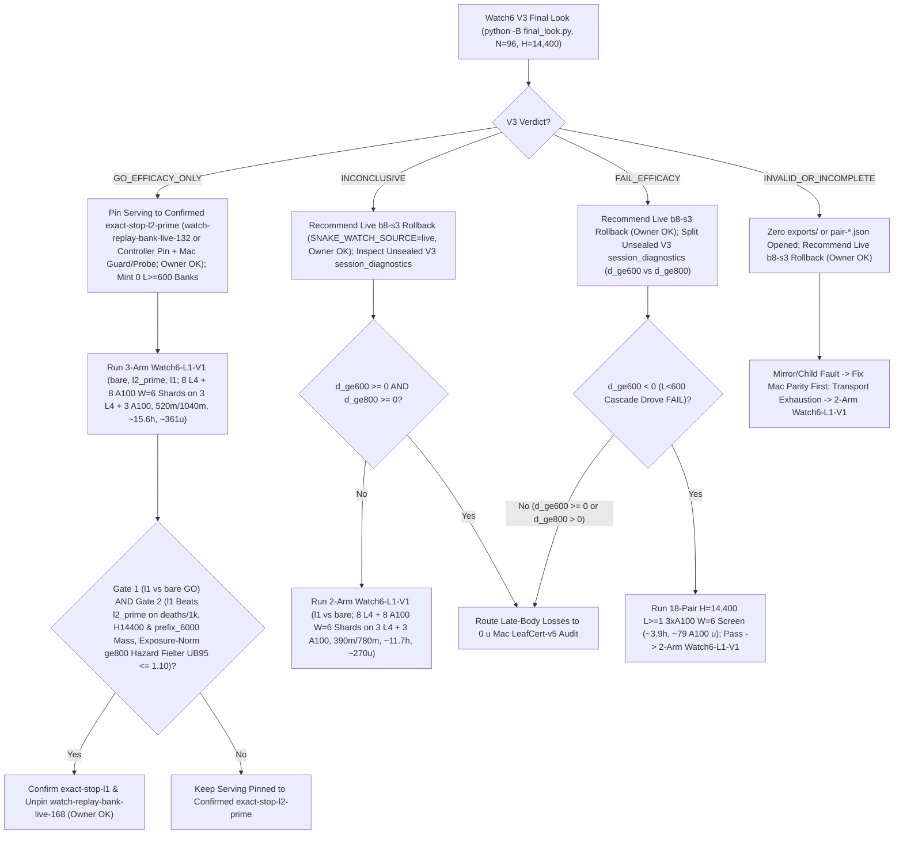

# T34 ExIt-B8 Research Roadmap (Round-05 Synthesis — Advice, Not Decisions)

Start: [project index](../INDEX.md) · [current status & authority](../STATUS.md) · [research record index](INDEX.md) · [study packages](../../research/INDEX.md) · [campaign log](final_run_20261019/CAMPAIGN_LOG.md).

> [!IMPORTANT]
> **Status: Research advice, NOT ratified decisions or release authorization.**
> Every current-round and later-round plan on this page is synthesized advisor guidance from Round 05 (2026-11-01 PT; primary synthesis artifact: `snake-dqn-artifacts/big-lever/exp/argon-rounds/round-05/synthesis/answer.md`, building on Rounds 01–04). Nothing here amends a pre-registration, ratifies a confirmation gate, or changes served defaults. Binding campaign authority remains [`SUCCESS_CONTRACT.md`](final_run_20261019/SUCCESS_CONTRACT.md), [`DESIGN_V2_SHADOW.md`](final_run_20261019/DESIGN_V2_SHADOW.md) (+ Amendment 1), [`P7_STATISTICS.md`](final_run_20261019/P7_STATISTICS.md), unsuperseded parts of [`FINAL_PLAN.md`](final_run_20261019/FINAL_PLAN.md), and [`STATUS.md`](../STATUS.md); any serving or release change requires confirmation-lane evidence, Mac serving qualification, and the owner's explicit OK.

---

## 1. Snapshot Context & Newly Audited Gaps (Oct 29 – Nov 1)

### 1.1 Nov 1 exploration, bank-minting, parity & active-run milestones

- **All-length exact-stop screen — `ADOPT` for new replay banks** ([`watch6_alllen_screen`](../../research/watch6_alllen_screen/README.md), `t34-sol/argon-alllen-a100/analysis.json`, `N = 48` paired `H = 6,000` Watch6-v2 sessions uniting `12` L4 `W = 4` units `0..11` at `568b09e4` with `36` A100 `W = 6` units `12..47` across three `12`-unit shards at `73c26ccc` on `origin/argon-alllen-a100-1031`):
  - `bare` (`b8-s3`): **`351.07` mass** (`CI95 [320.22, 381.91]`), **`0.2882` `deaths/1k`** (`CI95 [0.2427, 0.3337]`; `83` deaths: `53` at `L < 600`, `30` at `L >= 600`, `21` at `L >= 800`), `mean_max_length = 794.3`.
  - `l2_prime_600` (served `L >= 600`): **`461.16` mass** (`CI95 [414.30, 508.02]`; `+110.09` vs `bare`, `CI95 [+72.06, +148.13]`), **`0.1597` `deaths/1k`** (`CI95 [0.1060, 0.2134]`; `-44.6%` vs `bare`; `46` deaths: `34` at `L < 600`, `12` at `L >= 600`, `11` at `L >= 800`), `449.6` mean branches/session (`403.7` roots, `mean_max_length = 943.4`).
  - **`exact_stop_alllen` (`L >= 1`, `interval = 5`, `H = 300`):** **`559.43` mass** (`CI95 [533.59, 585.27]`; **`+208.37` / `+59.35%` vs `bare`**, `CI95 [+170.07, +246.66]`; **`+98.27` / `+21.31%` vs `L >= 600`**, `CI95 [+50.57, +145.98]`, clearing `>= +15.0`) and **`0.0521` `deaths/1k`** (`CI95 [0.0294, 0.0748]`; **`-81.9%` / `-0.2361/1k` vs `bare`**, `CI95 [-0.2828, -0.1895]`; **`-67.4%` / `-0.1076/1k` vs `L >= 600`**, `CI95 [-0.1609, -0.0544]`, clearing `<= 0.0`), cutting `L < 600` deaths **`53 (bare) / 34 (L >= 600) -> 1`** (`0.142%` `L < 600` overrides, `mean_max_length = 1,096.0`) at **`2.821×` branches** (`1,268.5` vs `449.6`, `1,200.1` roots = `1.057` branches/root). **`14/15` remaining deaths occur at `L >= 600` (`13/15` at `L >= 800`).**
  - *Exposure note:* Eliminating `34 -> 1` early deaths gives `exact_stop_alllen` **`1.379×` more `L >= 600` living exposure** (`403.7 -> 556.6` roots/session), so `11 -> 13` raw `L >= 800` deaths reflects **`-14.2%` lower per-frame `L >= 800` hazard** even though raw session-normalized `Δd_ge800` rises `+0.0069/1k`.
- **All-length Watch banks `14l1–16l1` completed `36/36` on active Cap-6 `36285bc6`:**
  - Verified receipts (`t34-sol/argon-banks-l1/packet-bank{14l1,15l1,16l1}-a100/output-main/receipt.json`, `SUMMARY.md`) confirm Cap-6 (`36285bc6`) ran `6/6` concurrent runtimes (`3 A100 @ 6.73 u/h + 3 L4 @ 1.94 u/h = 26.01 u/h`), finishing all `3 × 12` `exact-stop-l1` sessions (`W = 6`, `H = 6,000`) in **`3.03–3.07 h/bank`** (**`~20.36–20.67 u/bank` = `~61.5 A100 u` observed total** vs `~227 u` forecast; balance **`~2,154.66 u`**, freeing all `3` A100 slots).
  - Commit `395eacbb` switched `.claude/launch.json` to **`watch-replay-bank-live-168`** (`132` `exact-stop-l2-prime` banks `01–08, 10–12` + `36` unconfirmed `exact-stop-l1` banks `14l1–16l1`, [`web/serve.py`](../../web/serve.py) restarted on `b5b63cd1`, leaving `watch-replay-bank-live-132` intact). Confirming `exact-stop-l1` at `H = 14,400` still requires prospective confirmation (`Watch6-L1-V1`), Mac serving qualification, and owner OK.
- **GPU `DeviceSim` v2 parity — `PASS` on A100** ([`devicesim_v2_parity`](../../research/devicesim_v2_parity/README.md), `t34-sol/argon-devicesim-v2/packet-a100-v2-parity-01/main-run-01/receipt.json`): **`0` mismatches** across **`1,536,000` snake-ticks** (`E = 256 × 1,000` Watch6-v2 ticks, commit `b500d111`), relying on `<= 1e-4` CUDA FP32 near-tie Q re-decision tolerances.
- **Active confirmation — Watch6 V3** ([`REGISTRATION_V3.md`](../../research/watch6_search_efficacy_v3/REGISTRATION_V3.md)): `24 × 4` L4 `W = 4` shards (`96` fresh paired `H = 14,400` Watch6-v2 sessions) confirming **`exact-stop-l2-prime` (`L >= 600`) only** (not the `36` `exact-stop-l1` sessions in `watch-replay-bank-live-168`). Accounting adapter **V6.1** is ratified (`75471246`); the sole final look [`tools/watch6_v3_accounting/final_look.py`](../../tools/watch6_v3_accounting/final_look.py) **must run under `python -B`** because [`_forbid_pycache_directory`](../../tools/watch6_v3_accounting/__init__.py) (`lines 747–777`) fails closed on any `__pycache__`/`.pyc`/`.nbi` inside the V3 closure.
- **Completed Oct-30 Claim-A GPU receipts awaiting `0 u` Mac readout (`< 3 min`):** `b8-head-closedloop` (`t34-sol/b8-head-closedloop/main-01/output/terminal.json`, `rc = 0`) and `spatial-qbytes-01` (`t34-sol/spatial-qbytes-fix/t34-spatial-qbytes-01/ruler-output-a100-fallback/terminal.json`, `rc = 0`) completed cleanly on A100, while `T4 Gate-1` (`0/8` bars, `KILL_T4`) cancels the `40–48 A100 u` `spatial-student-pilot` fit (retaining compiled `.so` caches).

### 1.2 Closed single-pass critics, distillations, RL, and standalone macro fallbacks

Between 2026-10-29 and 2026-11-01, every single-pass learned-policy, critic, distillation, and standalone macro-fallback track closed below its promotion or selectivity bars:

| Track | Scope & primary artifact | Measured outcome | Disposition |
| --- | --- | --- | --- |
| **TRAIN-01** ([`sandbox_a_resident`](../../research/sandbox_a_resident/README.md)) | `100.7M`-row (`384`-update) GPU-resident PPO from `b8-s3` (`t34-sol/train01-closeout/SUMMARY.md`) | H5000 equal-mix paired mass **`+8.09`** (`CI95 [-18.66, +34.85]`; scripted `+26.32`, frozen `+2.85`, mixed `-4.90`; update-320 peak `+14.23` `[-11.86, +40.32]`) vs bar `>= +40` | **Closed** (no strict-gate nomination) |
| **C/T Stage-2 distillation** | Continuation-teacher causal-root distillation (`t34-sol/ct-stage2-verdict/SUMMARY.md`) | Teacher rescued **`22/32` (`68.75%`)** deaths (`22/32 <= 65` ticks; indep-suffix H300 `+66.77`, `LB90 +51.61`), but student retention was **`46.9–50.0%`** (`0 pp` over `frozen_phi` vs `>= +15 pp`; topology AUC `0.5752 < 0.83`), ordinary flips **`44.4–64.5%`** (bar `<= 1%`), and lethal ordinary flips **`3–5`** (bar `<= 1`) | **`FAIL_DISTILLATION_RETENTION_OR_SAFETY`** |
| **Doom U-Net & `spatial-student-pilot`** | `83 × 145` spatial U-Net vs 33.7k B8-feature head (`t34-sol/doom-result-01/result.json`; `t34-sol/student-direction/{astra,fable}.md`) | Spatial U-Net lost late per-action doom ROC-AUC to frozen B8 features (**`0.753` vs `0.810`**, `Δ = -0.056`, `CI95 [-0.091, -0.023]`; all-strata death-lookback `0.7626` vs `0.8226`; ordinary late `0.690` vs `0.706`) | **`GRAY` / `40–48 A100 u` pilot fit canceled (`0 u`; retain `.so` caches)** |
| **B8 advantage head (offline OOF)** | `256 -> 128 -> 6` ReLU head on frozen B8 features (`t34-sol/b8-head-test/RESULT.md`) | Mass rule `GO` (late H300 `+30.09`, `LB90 +23.96`), Fable selectivity **`FAIL`**: **`26.42%`** late rescue (bar `>= 35%`) at **`97.60%`** non-death flips (bar `<= 15%`) | **Selectivity `FAIL`** (192-world closed-loop A100 `rc = 0`, awaiting Mac readout) |
| **T4 Gate-1 factored critic** ([`t4_gate1`](../../research/t4_gate1/README.md)) | Clean-slate privileged `83 × 145` (`H = 320` 7-source BFS) hazard + foraging mass-flux critic on `384` disjoint Watch6-v2 worlds (`t34-sol/argon-t4-gate1-fix2/queue-03/READOUT.json`) | **`0/8` bars passed**: `L >= 600` residual EV **`+0.0266`** (`[-0.0280, +0.0869]` vs `>= 0.25`), death-root H300 rescue **`+19.99`** (vs `>= +40`), mature doom AUC **`0.5617`** (vs `>= 0.80`), ordinary H300 mass **`-22.21`** (vs `>= -15.0`), lethal flips **`3.13%`** (vs `<= 3.0%`) | **`KILL_T4`** (proves even privileged `83 × 145` critic lacks late value signal) |
| **R6 `L < 600` harvest census** ([`r6_l600_census`](../../research/r6_l600_census/README.md)) | `64`-world (`384`-root) Watch6-v2 early-game counterfactual + 5-fold OOF corpse/trail plane probes (`t34-sol/argon-mac-checks/r6-census/RESULT.json`) | **`34.90%` (`134/384`)** oracle-harvestable roots (`>= +5` H500 mass), **`7.69%`** non-bare H500 lethal flips, OOF ROC-AUC **`0.474–0.521`** (`0` passing threshold points); superseded operationally by `exact-stop-l1` | **`KILL`** |
| **R7 macro-option fallback** ([`r7_macro_fallback`](../../research/r7_macro_fallback/README.md)) | Pruned depth-2 (`K = 15` ticks) spatial macro-options `{O_0..O_5}` on C/T train `1-step-all-die` roots (`t34-sol/argon-r7-repack/R7_READOUT.json`) | `3/5` bars passed (`0.316 ms` Mac 1-thread p95; **`33.0%` vs `9.0%`** `L >= 800` `all-die` rescue), but total `L >= 600` lift **`+3.85 pp`** (`< +10.0 pp`) and **`2 > 0`** newly caused ordinary lethal flips from single-suffix `sel0` & aggressive `O3`/`O5` (`0` assessment roots opened) | **`KILL`** as standalone fallback |

### 1.3 Newly audited serving, Claim-A, Gate-2 & Round-04 transport gaps

- **Watch replay serving & cold-start bugs:**
  1. *Sorted first-cycle `9.17 h` `14l1–16l1` starvation & `~8–10 s` cold sleep:* [`ReplayBank._prefetch`](../../web/backend/watch_replay.py) (`lines 314–343`) walks `sorted(self.root.glob("*.watch.gz"))[:1024]` and enqueues every session in lexicographic order on cycle 1 before `SystemRandom().shuffle` runs on cycle 2 — deferring `bank14l1–16l1` behind `132 × 250 s = 9.17 h` of `l2-prime` after every restart — while [`verify_payload`](../../web/backend/watch_replay.py) (`line 176`) calls `stop.wait(0.001)` per frame (`~8–10 s` pure sleep per `6,000`-frame cold load).
  2. *Multi-entrypoint `ReplayBank` bypass, `24 Hz` `copy.deepcopy` & unpinned controller:* [`reset_game`](../../web/backend/session.py) (`lines 1203–1206`) and [`set_mode`](../../web/backend/session.py) (`lines 1486–1488`) re-select `_replay_bank` alongside [`__init__`](../../web/backend/session.py) (`lines 565–573`) whenever `SNAKE_WATCH_SOURCE == "replay"` and `checkpoint is None`, bypassing an `__init__`-only guard on `all_b8`, `frp3-s12`/`champion`, or `Watch8/12`; [`Recording.snapshot`](../../web/backend/watch_replay.py) (`lines 226–238`) runs `copy.deepcopy(self.frame)` at `24 Hz`; and `ReplayBank` lacks `SNAKE_WATCH_REPLAY_CONTROLLER` filtering.
- **Claim-A v1/boost & Gate-2 exposure-metric gaps:**
  1. *`b8-head-closedloop` ran v1 without `boost_decisions`:* `origin/astra-doom-auc-smoke:research/b8_head_test/closedloop.py` ran `mechanics_version = 1` without logging `boost_decisions`, so `closedloop_readout.py` alone cannot certify [`SUCCESS_CONTRACT.md`](final_run_20261019/SUCCESS_CONTRACT.md) §2's v2 `[0.5%, 10%]` boost band (or [`P7_STATISTICS.md`](final_run_20261019/P7_STATISTICS.md) Guard A `Δalive >= -0.05` pooled, `>= -0.075`/mix).
  2. *Raw `Δd_ge800` penalizes longer `L >= 600` survival & V3 drops frame timestamps:* [`run.metrics`](../../research/watch6_search_efficacy/run.py) (`lines 29–55`) drops `raw["frames"]`, and `l1`'s `1.379×` higher `L >= 600` living exposure biases raw session-frame `Δd_ge800 UB95 <= +0.02/1k` against longer-living heroes despite `-14.2%` lower per-frame `L >= 800` hazard.
- **Five code-verified flaws in Round-04's transport proposal:**
  1. *Residual post-`ready.json` WebSocket calls:* Round-04's `_put_lease` missed WS calls inside `15 s` `renew(force=True)` ([`Broker.execute`](../../research/colab_cli/supervisor.py) `line 1756` -> `CLI.poll_rpc`), multi-file [`collect_exports`](../../research/colab_cli/transfers.py) (`lines 516–533`, `pair-XX.json` + `.meta.json` forcing WS `export_batch`), and OAuth [`CLI.recoverable_rpc`](../../research/colab_cli/supervisor.py) (`lines 490–504`).
  2. *`lease_seconds = 1,800` breaks OAuth token margins & `< 300 s` Mac-loss release:* [`Broker.execute`](../../research/colab_cli/supervisor.py) (`lines 1695–1700`), [`runtime.py`](../../research/colab_cli/runtime.py) (`lines 412–426`), and [`ROBUSTNESS.md`](../../research/colab_cli/ROBUSTNESS.md) (`line 63`) require `min_valid_seconds = max(1800, 1200 + lease_seconds + 300)`; at `lease_seconds = 1,800`, `min_valid_seconds = 3,300 s` on `3,600 s` OAuth tokens trips `_release_credential_expiring` at `1,955 s` (`405 s` after launch) and stretches Mac-crash self-unassign past `30 min`.
  3. *`frp3-s12` lacks an HTTPS URL:* [`transfer_policy.py`](../../research/colab_cli/transfer_policy.py) (`lines 32–42`) publishes an HTTPS URL only for `b8-s3`; split `frp3-s12` parts trigger `11` WS [`_verify_remote_file`](../../research/colab_cli/transfers.py) (`line 384`) RPCs.
  4. *`auto_retry.py` burns `completion_attempt` on `unallocated` & blocks on `contract.json`:* [`prepare_retry`](../../tools/ops/auto_retry.py) (`lines 265–349`) increments `completion_attempt` (`<= 2`) even when `endpoint is None` (`unallocated`) and refuses retry when startup `units/contract.json` leaves `exports != []` at `0` completed units.
  5. *`KERNEL_CREATION_GUARD_ERROR` aborts despite saved `state.kernel_id`:* [`CLI.wait_runtime_ready`](../../research/colab_cli/supervisor.py) (`lines 914–966`) aborts on `POST /api/kernels` guard errors instead of polling `GET /api/kernels/<state.kernel_id>` when a prior attempt already saved `kernel_id`.

---

## 2. Current-Round Plan (Advice, Not Decisions)

### 2.1 `0 u` Mac gates (`< 3 min`): Claim-A readout/closure & Watch replay fixes

1. **Read completed Claim-A receipts & enforce closure bar (`0 u`, `< 3 min` Mac):**
   - Run `closedloop_readout.py` (`origin/astra-doom-auc-smoke` @ `591d94c3`) on completed `b8-head-closedloop` (`N = 192` v1 `H = 5,000` worlds, `m in {0, 10, 25, 50}`) and audit completed `spatial-qbytes-01` (`mapped-parity.json`); keep `spatial-student-pilot` (`40–48 A100 u`) canceled (`0 u`, retaining `.so` caches).
   - **Recommended Claim-A kill rule:** Recommend **closing Claim A permanently (`0 u`)** unless some `m in {0, 10, 25, 50}` clears `ci95[0] > 0` (`== LB97.5`, exact 4-arm `alpha = 0.10/4` Bonferroni), `H = 5,000` pooled mass `>= +40`, scripted no-death `>= +0.03` (no mix loss), [`P7_STATISTICS.md`](final_run_20261019/P7_STATISTICS.md) Guard A (`Δalive >= -0.05` pooled, `>= -0.075`/mix), and `<= 15%` living-decision overrides — followed by a `0 u`, `10 min` v2 boost `[0.5%, 10%]` check before nominating any Mac strict gate.
2. **Fix & Mac-qualify Watch replay serving (`0 u`):**
   - Shuffle discovered `.watch.gz` paths before cycle 1 in [`ReplayBank._prefetch`](../../web/backend/watch_replay.py) (holding back the last session across cycle boundaries to prevent back-to-back repeats), replace `stop.wait(0.001)` in [`verify_payload`](../../web/backend/watch_replay.py) with `stop.is_set()` (`< 1.0 s` cold readiness), shallow-copy top-level + `session` dict in [`Recording.snapshot`](../../web/backend/watch_replay.py), add `SNAKE_WATCH_REPLAY_CONTROLLER` (`all | exact-stop-l2-prime | exact-stop-l1`), and gate [`__init__`](../../web/backend/session.py), [`reset_game`](../../web/backend/session.py), and [`set_mode`](../../web/backend/session.py) strictly on clean mixed-Watch6 `b8-s3` (`served_checkpoint["name"] == "b8-s3"`, `watch_roster == "mixed"`, `watch_roster_reason is None`, `len(snakes) == 6`).
   - Pass `1,500` unpaced + `120` paced-`24 fps` qualification ticks (`p95 <= 11.688 ms`, `0/120` overruns per [`t15_mixed_roster_qualification_2026-10-17.md`](t15_mixed_roster_qualification_2026-10-17.md), `< 1.0 s` cold readiness) across `L >= 1,000` bodies, `6,000 -> 1` rotation, and live-B8 fallback.

### 2.2 Two-layer transport redesign & `tools/ops/confirm_audit.py`

Split transport hardening into an immediate **Layer A** (`0` `research/colab_cli/` edits, runnable today on active Cap-6 `36285bc6`) and an **additive v2 Layer B** (`qualification.py publish`, never blocking Layer-A jobs):

1. **Layer A (`0` `colab_cli` edits — `tools/ops/` & study packages):**
   - Enforce `L4 <= 3` and `total <= 6` (with `reconcile_unavailable`) under `ops/alloc.lock` inside [`tools/ops/dispatch.py`](../../tools/ops/dispatch.py); keep [`auto_retry.py`](../../tools/ops/auto_retry.py) `completion_attempt` frozen when `endpoint is None` (`unallocated`); build `.meta.json`-only resume ledgers (`0` `pair-*.json` reads); defer `units/contract.json` and `operational.json` until post-loop completion; and stage checkpoints via runtime HTTPS (`B8_URL` + pinned `frp3-s12` HTTPS release asset or `1` unsplit upload) alongside `input-metadata.tar.gz` and `verified-ledger.json`.
2. **Layer B (additive v2 `qualification.py publish` — explicit authority + `0 u` 50-seed `fake_colab.py` + `~0.4–0.7 L4 u` live canary per [`SOURCE_CONTROL_HICCUP_20261030.md`](../../research/colab_cli/SOURCE_CONTROL_HICCUP_20261030.md) `lines 75–76`):**
   - *`0` post-`ready.json` WebSocket calls:* Poll [`state.json`](../../research/colab_cli/runtime.py) via `30 s` Contents REST GET (embedding `16 KB` `job_log_tail` + inline `terminal` payload), push refreshed OAuth credentials via Contents PUT, pull per-unit exports `< 4 MiB` via Contents `export_file`, and skip WS `_verify_remote_file` after HTTP `200`/`201` PUTs.
   - *`lease_seconds = 600` + `KERNEL_CREATION_GUARD_ERROR` reconnect + `180 s` drain:* Set `lease_seconds = 600` (`min_valid_seconds = 2,100 s < 3,600 s` OAuth lifetime while surviving `540 s` Mac REST outages); reconnect via REST `GET /api/kernels/<state.kernel_id>` on `KERNEL_CREATION_GUARD_ERROR`; hold `timeout`/`runtime_error` inside a `180 s` pre-stop drain pulling `prestop-{terminal,state}.json` while keeping **immediate** self-unassign on `lease_expired` (`< 300 s` Mac-loss release); demote mid-run `AccountTracker.check` to warn-only (`<= 6`); allow monotonic-superset `verified-ledger` updates in `canary.check`; and widen `_call_once` stderr retention to `16 KB`.
3. **Reusable `tools/ops/confirm_audit.py` (pre-ratified `<= 250`-LOC positive conjunction):**
   - Run under `python -B` and an isolated temp `NUMBA_CACHE_DIR`, enforcing **Gate A** (immutable `.sha256` + `.complete` + `.meta.json` bijection `0..N-1`, `0` `pair-*.json` opens before PASS), **Gate B** (no active live session + terminal receipt or verified post-stop poll), and **Gate C** (namespace/commit/config match + `child_Started <= 1` per completed unit across attempts).

### 2.3 Route Watch6 V3 (`python -B final_look.py`, `N = 96`) & confirm `exact-stop-l1` (`Watch6-L1-V1`)

Watch6 V3 confirms `exact-stop-l2-prime` (`L >= 600`) only ([`REGISTRATION_V3.md`](../../research/watch6_search_efficacy_v3/REGISTRATION_V3.md)). Invoke [`final_look.py`](../../tools/watch6_v3_accounting/final_look.py) with **`python -B`**, never top up V3, and never open `exports/` or `pair-*.json` on `INVALID_OR_INCOMPLETE`.

- **On `GO_EFFICACY_ONLY` (`deaths/1k UB95 < 0` and Fieller mass `LB95 >= -0.05`):**
  1. *Mac (`0 u`):* Apply §2.1's `GameSession` guard across `__init__`/`reset_game`/`set_mode`, shuffle/cold-load/shallow-snapshot fixes, and `1,500`-unpaced / `120`-paced-`24 fps` qualification, and pin Watch serving to confirmed `exact-stop-l2-prime` (`watch-replay-bank-live-132` or `SNAKE_WATCH_REPLAY_CONTROLLER=exact-stop-l2-prime`, **owner OK**). Mint **0** additional `L >= 600` banks.
  2. *Colab (`3 L4 + 3 A100`, single-family `8 L4` + `8 A100` `W = 6` shards — adding `16` to [`run.py`](../../research/watch6_search_efficacy/run.py) `--shards` or using `24 × 4` / `32 × 3`, `520 m` base / `1,040 m` 2× wall `<= 660 m` `MAX_BASE_MINUTES`, `~15.6 h` wall, `~361 u` + `~4.8 u` canaries):* Run fixed-sequence **3-arm `Watch6-L1-V1`** (`bare`, `l2_prime`, `l1`; `N = 96, H = 14,400`, logging `death_frames`, `prefix_6000`, and `alive_frames_ge800`):
     - *Gate 1:* `l1` vs `bare` clears V3's `GO` bar (`deaths/1k UB95 < 0`, Fieller mass `LB95 >= -0.05`).
     - *Gate 2 (unpinning `exact-stop-l1` / `watch-replay-bank-live-168`):* `l1 - l2_prime` clears `deaths/1k UB95 < 0`, Fieller mass `LB95 >= 0` at both `H = 14,400` and `prefix_6000`, and exposure-normalized late hazard `deaths_ge800 / alive_frames_ge800` Fieller `UB95 <= 1.10` (**owner OK**; otherwise stay pinned to `exact-stop-l2-prime`).
- **On `INCONCLUSIVE`, `FAIL_EFFICACY`, or `INVALID_OR_INCOMPLETE`:**
  - Recommend rolling Watch back to live bare `b8-s3` (`SNAKE_WATCH_SOURCE=live`, **owner OK**).
  - Run **2-arm `Watch6-L1-V1`** (`l1` vs `bare`, `8 L4` + `8 A100` `W = 6` shards, `390 m` base / `780 m` 2× wall, `~11.7 h`, `~270 u` + `~4.8 u` canaries) on `INCONCLUSIVE` (unless `Δd_ge600 >= 0` and `Δd_ge800 >= 0`), `INVALID_OR_INCOMPLETE` transport exhaustion (fix Mac parity first on mirror/child fault), or `Δd_ge600 < 0` `FAIL_EFFICACY` (gated first on an `18`-pair `3 × A100` `W = 6` screen, `~3.9 h`, `~79 A100 u`); route `Δd_ge600 >= 0` / `Δd_ge800 > 0` late-body search losses to §3's `0 u` Mac leaf-cert audit.

---

## 3. Later-Round Plan: `LeafCert-v5` + `DTO-Split / PlanLatch` & UX (Advice, Not Decisions)

### 3.1 Root causes of the `13/15` remaining `L >= 800` deaths & live-Mac latency gaps

`watch6_alllen_screen` (`t34-sol/argon-alllen-a100/analysis.json`) proved `exact-stop-l1` eliminates `53 -> 1` `L < 600` deaths (`559.43` mass, `0.0521/1k`), concentrating **`13/15` remaining deaths at `L >= 800`**. Round-05 code audit isolated why:

1. **Horizon-300 coffin blindness (`1.057` branches/root):** [`exact_stop.run`](../../research/bl_served_search/exact_stop.py) (`lines 31–73`) stops immediately whenever bare B8's first rollout satisfies `alive(300)` (`1,268.5` branches / `1,200.1` roots = `1.057`). At `L >= 800`, entering a body bay or opponent corridor stays alive past `t + 300` before running out of volume at `t + 320..700`, so `exact_stop` accepts the trap without branching (`35–65` ticks before `1-step-all-die`), while `interval = 5` leaves `t+1..t+4` unguarded.
2. **Single-suffix RNG optimism & aggressive `O3`/`O5` options:** [`r7_macro_fallback`](../../research/r7_macro_fallback/README.md) evaluated `{O_0..O_5}` on a single future RNG stream (`sel0`) and included aggressive cut/harvest options `O3`/`O5`, causing `2 > 0` ordinary lethal flips (`R7_READOUT.json`).
3. **Existing `dto_split.py` & Contract §4 `W <= 4, K <= 8` eliminate raw IPC rebuilds:** [`SUCCESS_CONTRACT.md`](final_run_20261019/SUCCESS_CONTRACT.md) (`lines 114–123`) already permits `W <= 4` workers / `K <= 8` in-flight requests on Mac, and [`dto_split.py`](../../research/bl_served_search/dto_split.py) + `gc.freeze()` (`big-lever/exp/JUDGMENT_D1.md`) already avoid `cloudpickle` snapshots (`p99 = 9.01 ms`, `0` paced overruns), leaving `35`-tick search latency (`< L* = 72` ticks) and `O(F)` [`FoodManager._position_overlaps_food`](../../src/game/food_manager.py) scans as the true live-Mac bottlenecks.

### 3.2 `LeafCert-v5` + live Mac `DTO-Split / W = 3..4 PlanLatch`, `14,400`-frame UX & Play Boss

- **Architecture (later rounds):**
  1. **`alive(300) AND EscapeCert(S_{t+300})` (`< 0.32 ms` Numba time-expanded reachability) + `t+1..t+4` shield:** Upgrade [`exact_stop.run`](../../research/bl_served_search/exact_stop.py) so B8's rollout stops early only if `S_{t+300}` also passes a dynamic time-expanded reachability certificate (`tau >= release_time[cell]` own-tail release, handling `L >= 1,100` width-1 tail-chasing loops without static 2-core false vetoes, plus [`SpaceAndHeadVeto`](../../src/evaluation/safety_veto_v8.py) `L_hero >= 1.15 * L_opp` deterministic `v8` opponent yield cones rather than `2`-cell/tick worst-case boost flood), paired with an inline `EscapeCert(0)` shield on non-root ticks `t+1..t+4`.
  2. **Pessimistic `K = 3` `SplitMixEnvRngProxy` `{O0, O1, O2, O4}` `stride = 1` latch:** When all `6` `1`-step roots fail `alive(300) AND EscapeCert`, score survival-only `{O0, O1, O2, O4}` (dropping `O3`/`O5`) across `K = 3` public-state-seeded `SplitMixEnvRngProxy` streams (zero private-RNG peeking per Contract §4), require unanimous `min_k` survival + `EscapeCert`, and latch at `stride = 1` until `1`-step B8 re-certifies.
  3. **Live Mac `DTO-Split / W = 3..4 PlanLatch` (`0 u`):** Reuse [`dto_split.py`](../../research/bl_served_search/dto_split.py) + `gc.freeze()`, add an `O(1)` food occupancy bitset in [`FoodManager`](../../src/game/food_manager.py), and latch kinematics-guarded (`head/dir/len` + immediate danger cone, food-insensitive) `3–5`-step macro plans across `W = 3..4` workers (`35 < L* = 72` ticks) under `JUDGMENT_D1`'s paired `W0` `0`-overrun gate.
  4. **Watch `14,400`-frame chapters / coffin HUD & opt-in unscored Play Boss:** Mint `14,400`-frame (`10 min`) Watch replays via GPU proposal ([`DeviceSim`](../../research/gpu_sim_spike/device_sim.py) v2) + authoritative CPU commit ([`GridBatchSim`](../../src/simd_env/grid_sim.py) + live mirror, `~15×` faster) with `"Avoided Coffin"` HUD badges and chapter jumps (`L >= 800`, multi-branch rescues, close calls), plus an opt-in, visibly labelled, **unscored** Play **"Titan Boss"** toggle (`b8-s3 + inline EscapeCert(0)` + `4× frp3-s12 + v8`, isolated from `scores.db`).
- **Mandatory `0 u`, `15 min` Mac gate before any GPU spend:**
  - Benchmark `LeafCert-v5` on `20` freshly re-simulated `L >= 800` death trajectories (`t - 90..t`) and `200` surviving `L >= 800` controls (`0` `exports/` opened).
  - **Kill rule (`0 u`):** Block GPU spend unless `EscapeCert` `p99 <= 0.50 ms`, rescues **`>= 40%` (`>= 8/20`)** of `L >= 800` mouth states `35–65` ticks before `1-step-all-die`, and causes **`0`** ordinary lethal flips.
- **Conditional 6-slot Colab ablation (`3 L4 + 3 A100`, `48` fresh `H = 14,400` worlds, `~3.0 h` wall, `~61 u` expected / `125 u` 2× guard, queued after `Watch6-L1-V1` and the `0 u` Mac gate):**
  - 3-arm paired ablation (`exact-stop-l1`, `+EscapeCert(300) + shield`, `+K=3 {O0,O1,O2,O4} stride=1 latch`), adopting for `14,400`-frame banks and live-Mac qualification iff paired `deaths/1k` vs `exact-stop-l1` drops **`>= 25%` (`UB95 < 0`)** with Fieller mass **`LB95 >= 0`**.
- **Do not fund (`0 u`):** New bare-network PPO (`TRAIN-01`), single-pass distillation (`C/T Stage-2`, `spatial-student-pilot`), spatial/privileged value critics (`Doom U-Net`, `T4 Gate-1`), `L < 600` harvest rules (`R6`), or single-suffix / aggressive `O3`/`O5` macro options (`R7`).

---

## 4. Settled Round-05 Disagreements & Supporting Evidence

1. **`lease_seconds = 600` (`180 s` `timeout`/`runtime_error` drain; immediate `lease_expired` unassign) vs. Round-04's `1,800`:**
   Settled by [`Broker.execute`](../../research/colab_cli/supervisor.py) (`lines 1695–1700`), [`runtime.py`](../../research/colab_cli/runtime.py) (`lines 412–426`), and [`ROBUSTNESS.md`](../../research/colab_cli/ROBUSTNESS.md) (`line 63`): `min_valid_seconds = max(1800, 1200 + lease_seconds + 300)` hits `3,300 s` at `lease_seconds = 1,800` on `3,600 s` OAuth tokens (tripping `_release_credential_expiring` `405 s` into the run and violating `< 300 s` Mac-loss release). `lease_seconds = 600` (`min_valid_seconds = 2,100 s`) preserves OAuth headroom, rides out `540 s` Mac REST outages, and keeps `< 300 s` Mac-crash self-unassign when paired with immediate `lease_expired` exit.
2. **`Watch6-L1-V1` `390 m`/`780 m` (2-arm) & `520 m`/`1,040 m` (3-arm) shard timeouts vs. Round-04's `750 m`/`1,500 m`:**
   Settled by [`performance.py`](../../research/watch6_search_efficacy/performance.py) (`line 21`, `MAX_BASE_MINUTES = 660.0`), [`run.py`](../../research/watch6_search_efficacy/run.py) (`line 108`), and `t34-sol/argon-banks-l1/packet-bank14l1-a100/output-main/receipt.json`: `750 m` exceeds `MAX_BASE_MINUTES = 660.0`, whereas measured `W = 6` `exact-stop-l1` waves took `1.51 h` at `H = 6,000` (`~3.6–4.0 h` at `H = 14,400`), fitting comfortably inside `390 m`/`780 m` (2-arm) and `520 m`/`1,040 m` (3-arm) once `16` is added to `run.py --shards` (or `24 × 4` / `32 × 3` is used).
3. **Layer-B qualification authority (`SOURCE_CONTROL_HICCUP_20261030.md:75–76`):**
   Settled by [`SOURCE_CONTROL_HICCUP_20261030.md`](../../research/colab_cli/SOURCE_CONTROL_HICCUP_20261030.md) (`lines 75–76`): the 2026-10-29 offline requalification waiver cannot be silently extended to new transport code. Layer A ships with `0` `research/colab_cli/` edits; Layer B publishes an additive v2 tree only with explicit authority, a `50`-seed [`fake_colab.py`](../../tests/fixtures/fake_colab.py) suite, and one `~0.4–0.7 L4 u` live canary.
