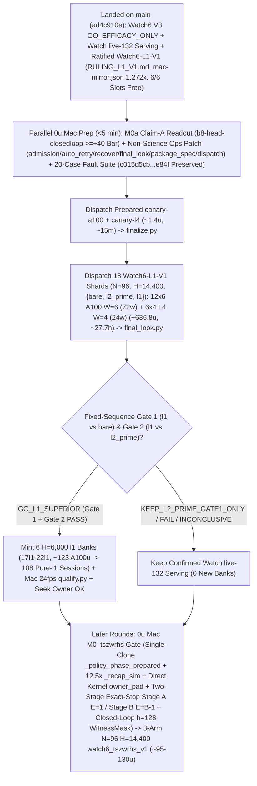

# T34 ExIt-B8 Research Roadmap (Round-21 Synthesis — Advice, Not Decisions)

Start: [project index](../INDEX.md) · [current status & authority](../STATUS.md) · [research record index](INDEX.md) · [study packages](../../research/INDEX.md) · [campaign log](final_run_20261019/CAMPAIGN_LOG.md).

> [!IMPORTANT]
> **Status: Research advice, NOT ratified decisions or release authorization.**
> Every current-round and later-round plan on this page is synthesized advisor guidance from Round 21 (2026-11-01 PT; primary synthesis artifact: `snake-dqn-artifacts/big-lever/exp/argon-rounds/round-21/synthesis/answer.md`, reconciling `round-21/{current,later,process}/answer.md` and `round-20/synthesis/answer.md` against `HEAD` `ad4c910e` and superseding Rounds 01–20). Nothing here amends a pre-registration, ratifies a confirmation gate, or changes served defaults. Binding campaign authority remains [`SUCCESS_CONTRACT.md`](final_run_20261019/SUCCESS_CONTRACT.md), [`DESIGN_V2_SHADOW.md`](final_run_20261019/DESIGN_V2_SHADOW.md) (+ Amendment 1), [`P7_STATISTICS.md`](final_run_20261019/P7_STATISTICS.md), unsuperseded parts of [`FINAL_PLAN.md`](final_run_20261019/FINAL_PLAN.md), and [`STATUS.md`](../STATUS.md); any serving or release change requires confirmation-lane evidence, Mac serving qualification, and the owner's explicit OK.

---

## 1. Snapshot Context & Code-Verified Round-21 State (`ad4c910e`, Nov 1)

### 1.1 Watch6 V3 `GO_EFFICACY_ONLY`, Watch `live-132` release, all-length screen, `DeviceSim` parity & ratified `Watch6-L1-V1`

- **Watch6 V3 confirmation finished — `GO_EFFICACY_ONLY` (`52135312`, 2026-11-01 14:40 PT)** ([`REGISTRATION_V3.md`](../../research/watch6_search_efficacy_v3/REGISTRATION_V3.md), `t34-sol/watch6-v3-final-look-20261101/final-look-01/final_look.json`):
  - Sole registered final look (`75471246` V6.1 adapter) over all **`96/96` primary `H = 14,400` (`10 min @ 24 fps`) Watch6-v2 pairs** (`0` reserves, `24/24` L4 `W = 4` shards in `28` attempts — shards `00, 09, 12, 19` passed on single retry after the `09:16 PT` Fable-ratified quarantine of `23` historical non-V3 H100-503 manifests; `2,764,800/2,764,800` live-mirror frames matched):
  - **`Δdeaths/1k = -0.125`** (`CI95 [-0.153, -0.097] < 0`; `0.1580` vs `0.2830`, **`-44.2%`**) and **Fieller pooled mean-mass ratio `+63.7%`** (`CI95 [+49.8%, +78.5%] >= -5%`; **`+214.12` mass**, `550.25` vs `336.13`), with boost `0.733%` vs `0.625%`, `mean_max_length = 1,073.4` (peak `L <= 2,296`) vs `780.9`, and **`2,549.4` mean branches/session** (`5.67×` `H = 6,000`'s `449.6`, confirming superlinear late-horizon branch growth) $\Rightarrow$ **`ELIGIBLE_FOR_REPLAY_QUALIFICATION` for `exact-stop-l2-prime` (`L >= 600`) only**.
  - **Operational unlock:** Frees all **`6/6` Colab slots (`3 A100 + 3 L4`, balance `~2,154.66 u`)**, lifts V3's closure-hash freeze on `main`, and closes V3 non-`GO` counterfactual branches.
- **Watch `live-132` serving guards, Mac `24 fps` qualification & release — ALREADY LANDED (`dc834ded`–`f5912f44`, ~16:00 PT):**
  - [`.claude/launch.json`](../../.claude/launch.json) (`lines 8–11`) serves confirmed **`watch-replay-bank-live-132`** (`132` `exact-stop-l2-prime` `H = 6,000` sessions from banks `01–08, 10–12`) with **`SNAKE_WATCH_REPLAY_CONTROLLER=exact-stop-l2-prime`** on `:8000` (retaining `watch-replay-bank-live-168` on disk while `exact-stop-l1` awaits `H = 14,400` confirmation).
  - [`GameSession`](../../web/backend/session.py) gates Watch replay on [`_is_clean_mixed_watch6_b8()`](../../web/backend/session.py) (`lines 722–753`) across `__init__` (`line 573`), `_build` (`line 769`), `reset_game` (`line 1261`), and `set_mode` (`lines 1520, 1563, 1576`); refuses `MODE_TRAIN` on forward-only `EGO2S_OBS_SPECS`, `(RASTER31V2, RASTER31V3)`, and un-overridden `_reward_contract_mismatch` **before** calling `_leave_watch_replay()` (`lines 1510–1550`, with replay recovery on Watch fallback); and scopes `_replay_opted_out = True` to `set_epsilon` (`line 1204`), live `set_hero` change (`line 1222`), and `set_food` (`line 1241`), cleared by `_build` (`line 763`) and [`new_game()`](../../web/backend/session.py) (`lines 1279–1284`, wired to `"new_game"` in [`app.py`](../../web/backend/app.py) `line 311`).
  - [`ReplayBank`](../../web/backend/watch_replay.py) (`lines 348–417`) implements `SNAKE_WATCH_REPLAY_CONTROLLER` (`all | exact-stop-l2-prime | exact-stop-l1`, failing closed to live B8 on invalid values), line-1 [`peek_header`](../../web/backend/watch_replay.py) (`lines 138–150`, `0` non-target `verify_payload` decodes), cycle-1 `shuffle_discovery: bool = True`, shallow [`Recording.snapshot`](../../web/backend/watch_replay.py) (`lines 315–330`), and **`0.25 ms`-slice / `64`-frame cooperative GIL yield (`max(1.0 ms, 4.0 * slice_elapsed)` = `<= 20%` GIL duty cycle)** in [`verify_payload`](../../web/backend/watch_replay.py) (`lines 30–33, 244–275`).
  - [`research/watch_replay/qualify.py`](../../research/watch_replay/qualify.py) (`t34-sol/argon-replay-qual/SUMMARY.md`, Fable review `APPROVE_WITH_CONDITIONS` with `C1–C3` resolved at `fec81656`) passed `132/132` inventory parity, cold session readiness **`0.349–0.435 s` (`< 0.45 s`)**, concurrent cold-verification live-B8 fallback **`update p95 = 8.78 ms <= 11.688 ms`**, **`0/120` paced-`24 fps` overruns** (`step p99 = 11.34 ms <= 41.67 ms`), and seamless recorded playback cutover after **`~18.5–23.1 s`** (`recorded update p95 = 0.002 ms`).
- **All-length exact-stop screen — `ADOPT` for new replay banks; `36` `l1` sessions staged for `Watch6-L1-V1`** ([`watch6_alllen_screen`](../../research/watch6_alllen_screen/README.md), `t34-sol/argon-alllen-a100/analysis.json`, `N = 48` paired `H = 6,000` Watch6-v2 sessions):
  - `exact_stop_alllen` (`L >= 1`, `interval = 5`, `H = 300`) reached **`559.43` mass** (`+208.37` / Fieller `+59.35%` vs `bare` `351.07`; **`+98.27` / Fieller `+21.31%` vs `l2_prime_600` `461.16`**, `CI95 [+50.57, +145.98]`) and **`0.0521` `deaths/1k`** (`-81.9%` vs `bare` `0.2882`; **`-67.4%` / `-0.1076/1k` vs `l2_prime_600` `0.1597`**, `CI95 [-0.1609, -0.0544]`), cutting `L < 600` deaths **`53 (bare) / 34 (L >= 600) -> 1`** (`mean_max_length = 1,096.0`) at **`2.821×` branches** (`1,268.5` vs `449.6`, `1,200.1` roots = **`1.057` branches/root**, stopping on `bare` at **`94.3%`** of roots). **`14/15` remaining deaths occur at `L >= 600` (`13/15` at `L >= 800`, `-14.2%` per-frame `L >= 800` hazard at `1.379×` living exposure).**
  - Three `12`-session A100 banks (`14l1–16l1`, `W = 6`, `H = 6,000`, `t34-sol/argon-banks-l1/SUMMARY.md:38-40`) completed `36/36` on Cap-6 `36285bc6` in **`3.03–3.07 h/bank`** (**`~61.5 A100 u` total**). They remain unserved on disk (`watch-replay-bank-live-168`) pending `H = 14,400` `Watch6-L1-V1` confirmation, Mac qualification, and owner OK.
- **GPU `DeviceSim` v2 parity — `PASS` on A100** ([`devicesim_v2_parity`](../../research/devicesim_v2_parity/README.md), commit `b500d111`): **`0` mismatches** across **`1,536,000` snake-ticks** (`E = 256 × 1,000` Watch6-v2 ticks, `1,434.6` steps/s under SplitMix64 RNG and `<= 1e-4` CUDA FP32 near-tie tolerances; SplitMix64 cannot mint MT19937 live Watch replay banks).
- **Pre-Data Ratified `Watch6-L1-V1` Package Merged (`cf07791b` / `ac250f05`), Full-`14,400`-Frame Mac Mirror Receipt & Receipts-Based `18`-Shard Forecast:**
  - [`research/watch6_l1_confirm/`](../../research/watch6_l1_confirm/) (`7,105` LOC; [`REGISTRATION_L1_V1.md`](../../research/watch6_l1_confirm/REGISTRATION_L1_V1.md) SHA-256 `8b46779ff52d0c9648ff8de00c1893f77beb9bd99eb4a4e51afbe0bdf36800a0`; bound science identity **`c015d5cb906066842c04202b66dac778eb04fb0b9b917882e1385a0e4474e84f`** on pinned commit `cf07791b`) is ratified pre-data by Fable (`APPROVE-WITH-CONDITIONS` in `t34-sol/argon-l1v1-pkg/RULING_L1_V1.md` / `ruling-l1-v1.json`, delta review in `t34-sol/argon-l1v1-pkg/fable-review.md`; per Fable Condition 1, never cite `argon-l1v1-pkg-fix1/SUMMARY.md` or non-existent `prepare-receipt.json`). Note: merging `cf07791b` into `main` at `ac250f05` brought in `dc834ded`/`fec81656`'s [`web/backend/session.py`](../../web/backend/session.py) edits (`protocol.identity() == 0ce4de66…` on `main`), so executing or patching non-science files under `RULING_L1_V1.md` Condition 3 (`cf07791b`, `c015d5cb…e84f`) must branch from `cf07791b` (`origin/argon-l1v1-pkg-1101`) or preserve `cf07791b`'s exact `science_paths()` bytes.
  - **Full-`14,400`-Frame Mac 3-Arm Mirror Replaced `M0b` (`t34-sol/argon-l1v1-pkg-fix1/mac-mirror.json`, SHA-256 `de43850bc67bc230d6803335a6ce4635ac12767cc22354f5b28b92bc0a83a476`):** On excluded fixture seed `34910101`, `{bare, l2_prime, l1}` passed **`43,200/43,200` mirrored frames (`0` mismatches)** (`bare`: `291.8 s`, `2` deaths; `l2_prime`: `1,343.5 s`, `1,811` branches, `2` deaths; `l1`: `2,079.7 s`, `3,108` branches across `2,880` batches, `1` death). Measured **`l1 / (bare + l2_prime)` wall ratio is `1.272×`** (`2,079.7 s` vs `1,635.3 s`; `l1 / l2_prime` search ratio `1.720×` / wall ratio `1.548×`), and the long-length serpentine probe ($L = 150 \to 1,500$, `2,950 -> 4,300` occupied board cells) measured a **`1.115×` step-cost ratio** (`1.997 -> 2.227 ms/step`).
  - **Prepared Canaries & `18` Single-Wave Shards (`t34-sol/argon-l1v1-pkg-fix1/staged-prep-check/forecast.json`, per Fable Condition 4):** Hardware-tier canaries (`canary-a100.json`, `canary-l4.json`, `~1.4 u` combined) and `18` single-wave primary shards (`00..11` A100 `W = 6`, `6` worlds/shard = `72` worlds `0..71`; `12..17` L4 `W = 4`, `4` worlds/shard = `24` worlds `72..95`; `0` reserve seeds) have a **receipts-based forecast of `~638.2 u` central** (`603.7–739.3 u` linear-to-p95 range; `558.6 A100 u + 78.1 L4 u + 1.4 canary u`, **`~27.7 h` calendar wall** across `3 A100 + 3 L4`, with `2×` timeouts `1,140 min` A100 / `1,080 min` L4 providing `>= 3.7×` headroom over the Mac-measured `1.272×` 3-arm ratio).
- **Still unrun / unshipped on `main` at `ad4c910e`:**
  1. `0 u` Mac `M0a` readout on completed `b8-head-closedloop` (`t34-sol/b8-head-closedloop/main-01/output/receipt.json`, `rc = 0`, `4.51 A100 u`; `readout-01` still absent; `spatial-qbytes-01` is strictly a GPU Q-byte/`.so` cache parity & throughput ruler, with the `40–48 A100 u` `spatial-student-pilot` fit canceled at `0 u`).
  2. Non-science operational patches to [`admission.py`](../../research/watch6_l1_confirm/admission.py), [`recover.py`](../../research/watch6_l1_confirm/recover.py), [`final_look.py`](../../research/watch6_l1_confirm/final_look.py), [`package_spec.py`](../../tools/ops/package_spec.py), [`auto_retry.py`](../../tools/ops/auto_retry.py), [`dispatch.py`](../../tools/ops/dispatch.py), and [`ready_queue.py`](../../tools/ops/ready_queue.py) (all outside [`protocol.science_paths()`](../../research/watch6_l1_confirm/protocol.py) `lines 73–82`), live `Watch6-L1-V1` Colab execution, and later-round `TS-ZWRHS-L1`.

### 1.2 Closed single-pass critics, distillations, RL, and standalone macro fallbacks

Between 2026-10-29 and 2026-11-01, every single-pass learned-policy, critic, distillation, and standalone macro-fallback track closed below its promotion or selectivity bars:

| Track | Scope & primary artifact | Measured outcome | Disposition |
| --- | --- | --- | --- |
| **TRAIN-01** ([`sandbox_a_resident`](../../research/sandbox_a_resident/README.md)) | `100.7M`-row (`384`-update) GPU-resident PPO from `b8-s3` (`t34-sol/train01-closeout/SUMMARY.md`) | H5000 equal-mix paired mass **`+8.09`** (`CI95 [-18.66, +34.85]`; scripted `+26.32`, frozen `+2.85`, mixed `-4.90`; update-320 peak `+14.23` `[-11.86, +40.32]`) vs bar `>= +40` | **Closed** (no strict-gate nomination) |
| **C/T Stage-2 distillation** | Continuation-teacher causal-root distillation (`t34-sol/ct-stage2-verdict/SUMMARY.md`) | Teacher rescued **`22/32` (`68.75%`)** deaths (`22/32 <= 65` ticks; indep-suffix H300 `+66.77`, `LB90 +51.61`), but student retention was **`46.9–50.0%`** (`0 pp` over `frozen_phi` vs `>= +15 pp`; topology AUC `0.5752 < 0.83`), ordinary flips **`44.4–64.5%`** (bar `<= 1%`), and lethal ordinary flips **`3–5`** (bar `<= 1`) | **`FAIL_DISTILLATION_RETENTION_OR_SAFETY`** |
| **Doom U-Net & `spatial-student-pilot`** | `83 × 145` spatial U-Net vs 33.7k B8-feature head (`t34-sol/doom-result-01/result.json`; `t34-sol/student-direction/{astra,fable}.md`) | Spatial U-Net lost late per-action doom ROC-AUC to frozen B8 features (**`0.753` vs `0.810`**, `Δ = -0.056`, `CI95 [-0.091, -0.023]`; all-strata death-lookback `0.7626` vs `0.8226`; ordinary late `0.690` vs `0.706`) | **`GRAY` / `40–48 A100 u` pilot fit canceled (`0 u`; retain `.so` caches)** |
| **B8 advantage head (offline OOF)** | `256 -> 128 -> 6` ReLU head on frozen B8 features (`t34-sol/b8-head-test/RESULT.md`) | Mass rule `GO` (late H300 `+30.09`, `LB90 +23.96`), Fable selectivity **`FAIL`**: **`26.42%`** late rescue (bar `>= 35%`) at **`97.60%`** non-death flips (bar `<= 15%`) | **Selectivity `FAIL`** (192-world closed-loop A100 `rc = 0`, awaiting Mac `M0a` readout) |
| **T4 Gate-1 factored critic** ([`t4_gate1`](../../research/t4_gate1/README.md)) | Clean-slate privileged `83 × 145` (`H = 320` 7-source BFS) hazard + foraging mass-flux critic on `384` disjoint Watch6-v2 worlds (`t34-sol/argon-t4-gate1-fix2/queue-03/READOUT.json`) | **`0/8` bars passed**: `L >= 600` residual EV **`+0.0266`** (`[-0.0280, +0.0869]` vs `>= 0.25`), death-root H300 rescue **`+19.99`** (vs `>= +40`), mature doom AUC **`0.5617`** (vs `>= 0.80`), ordinary H300 mass **`-22.21`** (vs `>= -15.0`), lethal flips **`3.13%`** (vs `<= 3.0%`) | **`KILL_T4`** (proves even privileged `83 × 145` critic lacks late value signal) |
| **R6 `L < 600` harvest census** ([`r6_l600_census`](../../research/r6_l600_census/README.md)) | `64`-world (`384`-root) Watch6-v2 early-game counterfactual + 5-fold OOF corpse/trail plane probes (`t34-sol/argon-mac-checks/r6-census/RESULT.json`) | **`34.90%` (`134/384`)** oracle-harvestable roots (`>= +5` H500 mass), **`7.69%`** non-bare H500 lethal flips, OOF ROC-AUC **`0.474–0.521`** (`0` passing threshold points); superseded operationally by `exact-stop-l1` | **`KILL`** |
| **R7 macro-option fallback** ([`r7_macro_fallback`](../../research/r7_macro_fallback/README.md)) | Pruned depth-2 (`2K = 30` ticks) spatial macro-options `{O_0..O_5}` on C/T train `1-step-all-die` roots (`t34-sol/argon-r7-repack/R7_READOUT.json`) | `3/5` bars passed (`0.316 ms` Mac 1-thread p95; **`33.0%` vs `9.0%`** `L >= 800` `all_die_sel0` rescue on `25/129` roots — `9/25` `macro_triggered` at `+66.7 pp` rescue vs `16/25` tick-`30` B8 re-traps, while `104/129` `80.6%` survived `H = 300` inside uncertified coils), but total `L >= 600` lift **`+3.85 pp`** (`< +10.0 pp`) and **`2 > 0`** ordinary lethal flips (`0` assessment roots opened) | **`KILL`** as standalone `30`-tick fallback |

### 1.3 Six Code-Verified Round-21 Advances Over Round 20 (`ad4c910e`)

1. **Pre-allocation refusal tree check in `watch6_l1_confirm` ([`supervisor.py`](../../research/colab_cli/supervisor.py) `lines 1068–1081, 1225`, [`admission.py`](../../research/watch6_l1_confirm/admission.py) `lines 55–66, 474–490`):**
   `Broker.run()` writes `staging/*`, `public-input-preflight.json`, and `accounting-baseline.json` into `output/` *before* `colab new` (`line 1242`). [`_prealloc_tree_clean()`](../../research/watch6_l1_confirm/admission.py) (`lines 474–490`) forbids subdirectories and `accounting-baseline.json`, making every `412`/`503` allocation refusal fail [`is_prestart_transport_failure()`](../../research/watch6_l1_confirm/admission.py) (`line 492`) and abort [`final_look.py`](../../research/watch6_l1_confirm/final_look.py) (`lines 278, 317`).
2. **Pre-start retry counter & lineage bugs ([`auto_retry.py`](../../tools/ops/auto_retry.py) `lines 265–415`, [`admission.py`](../../research/watch6_l1_confirm/admission.py) `lines 860–875`, [`final_look.py`](../../research/watch6_l1_confirm/final_look.py) `lines 388–460`):**
   `auto_retry.py` omits `watch6_l1_confirm.admission.admit` from `package_check()`, rejects `rc = 74` and 6 of 7 mechanical `ACCOUNTING` strings, increments top-level `completion_attempt` on `0`-world pre-start retries (burning `compute_attempt + top_completion <= 2` at `admission.py:871` despite [`REGISTRATION_L1_V1.md:161`](../../research/watch6_l1_confirm/REGISTRATION_L1_V1.md) authorizing unlimited pre-start retries), and creates 2 roots (`final_look.py:394, 459`) when an unallocated attempt precedes a retry.
3. **Fable Condition 2, CLI flags, startup exports & in-process paired `.complete` publishing ([`admission.py`](../../research/watch6_l1_confirm/admission.py) `lines 222–242`, [`recover.py`](../../research/watch6_l1_confirm/recover.py) `lines 120–143`, [`run.py`](../../research/watch6_l1_confirm/run.py) `lines 124–140, 196`, [`job.sh`](../../research/watch6_l1_confirm/job.sh) `line 39`, [`package_spec.py`](../../tools/ops/package_spec.py) `lines 68–82`):**
   [`is_inert_macos_metadata()`](../../research/watch6_l1_confirm/admission.py) (`lines 222–242`) matches `INERT_MACOS_METADATA_NAMES` at any depth; [`recover.py`](../../research/watch6_l1_confirm/recover.py) (`lines 120–143`) lacks `--canary-{a100,l4}-receipt` and `--no-pending-canary`; `job.sh:39` publishes `exports/performance.json` in a separate short-lived Python process before `exec ... run`; and [`_publish_world_unit()`](../../research/watch6_l1_confirm/run.py) (`lines 124–140`) calls `publish_json(world-XX.json)` synchronously before `publish_json(world-XX.meta.json)` (and resumed shards can have `rows == []`). Holding `performance.json.complete` until a `world-XX` finishes or reversing `.complete` order across polls inside `publish_immutable()` would deadlock or strand 0-row resumes; instead, mask `{SIGUSR1, SIGTERM}` and pair `world-XX.json.complete` with `.meta.json.complete` in-process in [`package_spec.py`](../../tools/ops/package_spec.py) while treating `exports <= {"performance.json", "workload-started.json"}` (`0` `world-*.json`) as pre-start in `admission.py` and `auto_retry.py`.
4. **Single-clone `_policy_phase_prepared` bug, `12.5×` ring recap & binary `full_digest` v3 ([`batch_sim.py`](../../src/simd_env/batch_sim.py) `lines 655–670`, [`ruler_operator.py`](../../research/bl_served_search/ruler_operator.py) `line 57`, [`bank_engine.py`](../../research/t3_rollout_labels_20261015/bank_engine.py) `lines 351, 468, 543`, [`product.py`](../../research/watch_replay/product.py) `line 58`, [`teacher.py`](../../research/t33_batched_teacher/teacher.py) `lines 69–147`, [`shadow.py`](../../research/t34_shadow/shadow.py) `lines 146–250`):**
   Inside `step_with_policy(choose)` (`batch_sim.py:655-670`), `frame += 1`, `_maintain_food()`, and `_respawn_dead()` run *before* `choose(self)`, while `_policy_phase_prepared = True` (`line 669`) is set *after* `choose(self)` returns; `_clone_root(world)` (`ruler_operator.py:57`) overwrote `clone.sim._policy_phase_prepared` to `False` (avoiding `RuntimeError` in `step_prepared` at `bank_engine.py:468` only because `rollout_all` at `line 543` cloned a third time). Setting `root.sim._policy_phase_prepared = True` at selector capture (matching [`engine_v2.py:217`](../../research/t34_pathb/engine_v2.py)) + `_recap_sim(sim, max_seg + H_sim + 2)` + `_clone_mutable` (`teacher.py:69-147`, shrinking `14,704`-cap `1.41 MiB` `bodies` rings **`12.5×` to `~115 KiB`**) + binary `full_digest` v3 (`shadow.py:146-250`, **`> 15×` faster** than dual JSON `.tolist()` `_root_bytes`) enables true single-clone rollouts.
5. **Two-Stage Exact-Stop (`Stage A: E = 1 bare`, `Stage B: E = B - 1 <= 5` lockstep) vs upfront `B`-way batching ([`exact_stop.py`](../../research/bl_served_search/exact_stop.py) `lines 48–55`, `t34-sol/argon-alllen-a100/analysis.json`):**
   Because `bare` survives at **`94.3%`** of roots (`1,268.52 / 1,200.125 = 1.057` branches/root in `analysis.json`), rolling out `bare` alone first (`E = 1`, $H_{\text{sim}} = 128$, `~15 ms`) and batching `B - 1 <= 5` branches (`GridBatchSim(E = B - 1)`, `~52 ms`) only on `< 5.7%` of roots avoids the **`~3.8×` compute waste** of upfront `B`-way batching.
6. **Direct `"kernel"`-mode `v8_decide(..., membership="owner_pad")`, `O(5)` `seg_count` sum & `OUTCOME_NO_SPACIOUS = 2` ([`bl_k1/native.py`](../../research/bl_k1/native.py) `line 93`, [`vector61_policy.py`](../../src/simd_env/vector61_policy.py) `line 816`, [`v8_nb.py`](../../src/simd_env/v8_nb.py) `lines 75, 1033–1086`):**
   `bl_k1/native.py:93` omitted `membership` (defaulting to `"painted"` at `v8_nb.py:1575` on 100% of opponent rollout ticks), and `_apply_veto` (`vector61_policy.py:816`) called `decision_free_space` (3 BFS floods/opponent) right before `_kernel_hook` called `v8_decide` (`v8_nb.py:1045-1086`, asserted at `native.py:101`). Routing `"kernel"` mode directly to `v8_decide(..., membership="owner_pad")` (with live-safe `hasattr(sim, "_owner_pad")` guard) and replacing the `1,045`-iteration `coarse_snake` loop in `_v8_rows` (`v8_nb.py:1033-1040`) with an `O(5)` `seg_count` sum eliminates **`6` BFS floods and `5` coarse re-rasterizations/tick** and exposes **`OUTCOME_NO_SPACIOUS = 2` (`v8_nb.py:75`)** at root step 0.

---

## 2. Current-Round Plan (Advice, Not Decisions)

### 2.1 `0 u` Mac `M0a` Claim-A closeout (`< 2 min`) & C4 telemetry

1. **Run `M0a` Claim-A readout (`< 2 min` Mac, `0 u`) & enforce binding v1 `H = 5,000` `>= +40` closure bar:**
   - Run [`closedloop_readout`](../../research/INDEX.md) (`t34-sol/b8-head-closedloop/SUMMARY.md:50-52`, `origin/astra-doom-auc-smoke` @ `591d94c3`) on completed `b8-head-closedloop` (`N = 192` v1 `H = 5,000` worlds, `m in {0, 10, 25, 50}`, `4.51 A100 u`). Audit `spatial-qbytes-01` (`t34-sol/spatial-qbytes-fix/SUMMARY.md:85-88`) strictly as a Q-byte/`.so` cache ruler (`40–48 A100 u` `spatial-student-pilot` fit stays canceled at `0 u`).
   - **Recommended Claim-A kill rule:** Permanently **close Claim A (`0 u`)** unless some fixed `m in {0, 10, 25, 50}` clears [`SUCCESS_CONTRACT.md`](final_run_20261019/SUCCESS_CONTRACT.md) §2 (`lines 29–33`) and [`P7_STATISTICS.md`](final_run_20261019/P7_STATISTICS.md) §§3–4 (`lines 33–48`): pooled mass **`>= +40.0`**, Bonferroni-4 `LB97.5 > 0`, scripted Guard B `>= +0.03` (`0` mix losses), Guard A `Δalive >= -0.05` pooled / `>= -0.075` single mix, and living overrides `<= 15%`, followed by a `0 u`, `10 min` `[0.5×bare, 10%]` v2 boost check before nominating any Mac strict gate.
2. **Monitor live `:8000` `watch-replay-bank-live-132` C4 telemetry (`0 u`):**
   - Keep `watch-replay-bank-live-132` (`exact-stop-l2-prime`) live on `:8000`, monitor `update_ms` / overrun telemetry (Fable C4), and mint **`0`** new `.watch.gz` banks before `Watch6-L1-V1`'s verdict lands.

### 2.2 `0 u` Non-Science Ops Patch & 20-Case Smoke (`< 5 min`, `0` Science-Hash Change)

All edits below are outside [`protocol.science_paths()`](../../research/watch6_l1_confirm/protocol.py) (`lines 73–82`), preserving bound science identity **`c015d5cb906066842c04202b66dac778eb04fb0b9b917882e1385a0e4474e84f`** (`cf07791b`) and active transport tree `36285bc6` (working in a fresh worktree with V3/`ops/`/`exports/`/`pair-*.json` untouched):

1. **`watch6_l1_confirm` non-science admission, recovery & final-look patches ([`admission.py`](../../research/watch6_l1_confirm/admission.py), [`recover.py`](../../research/watch6_l1_confirm/recover.py), [`final_look.py`](../../research/watch6_l1_confirm/final_look.py)):**
   - In [`_prealloc_tree_clean()`](../../research/watch6_l1_confirm/admission.py) (`lines 55–66, 474–490`), permit `staging/*`, `accounting-baseline.json`, and `public-input-preflight.json` written by `supervisor.py:1068-1081,1225` before `colab new`.
   - In [`is_inert_macos_metadata()`](../../research/watch6_l1_confirm/admission.py) (`lines 222–242`), restrict `.Trashes`, `.Spotlight-V100`, `.fseventsd`, and `.TemporaryItems` to the top level of `exports/` or `output_dir` and refuse any `WORLD_NAME_RE` (`world-XX.json`) or `.complete` file beneath them (resolving Fable Condition 2 in `RULING_L1_V1.md` §4).
   - Treat `exports <= {"performance.json", "workload-started.json"}` (`0` `world-*.json` files) as pre-start in [`admission.py`](../../research/watch6_l1_confirm/admission.py) and [`auto_retry.py`](../../tools/ops/auto_retry.py) so a VM drop before world 0 completes does not burn `MAX_COMPUTE_COMPLETIONS_PER_SHARD = 2`.
   - Add `--canary-a100-receipt`, `--canary-l4-receipt`, and `--no-pending-canary` to [`recover.py:main()`](../../research/watch6_l1_confirm/recover.py) (`lines 120–143`), unify unallocated + `RETRY.json` + `recover.py` parent lineage chains in [`final_look.py`](../../research/watch6_l1_confirm/final_look.py) (`lines 388–460`), and add a line-1 `python -B` (`/tmp` cache) self-reexec guard to `final_look.py` and `recover.py`.
2. **`tools/ops/` paired `.complete` signal shield, Tier-0/1 `auto_retry.py` & pre-`mkdir` `alloc.lock` settle ([`package_spec.py`](../../tools/ops/package_spec.py), [`auto_retry.py`](../../tools/ops/auto_retry.py), [`dispatch.py`](../../tools/ops/dispatch.py), [`ready_queue.py`](../../tools/ops/ready_queue.py)):**
   - In [`package_spec.py:publish_immutable()`](../../tools/ops/package_spec.py) (`lines 68–82`), mask `{SIGUSR1, SIGTERM}` via `signal.pthread_sigmask` during payload + `.sha256` writes and pair `world-XX.json.complete` with `world-XX.meta.json.complete` in-process so `SIGUSR1` (`run.py:212`) cannot split a world/meta pair without touching `run.py` or `job.sh`.
   - In [`auto_retry.py`](../../tools/ops/auto_retry.py) (`lines 265–415`), add `watch6_l1_confirm.admission.admit` to `package_check()`, check structured `receipt["terminal"]` before `line 284`, accept `rc = 74` and all **7** mechanical `ACCOUNTING` strings (`lines 296–302`), and on Tier-0 `0`-world pre-start retries keep `completion_attempt = 0` while incrementing `watch6_l1_v1["prestart_retries_used"]` and appending `prior_receipts` (`0` extra canaries).
   - In [`dispatch.py`](../../tools/ops/dispatch.py) (`line 2849`) and [`ready_queue.py`](../../tools/ops/ready_queue.py) (`lines 625–795`), pass `--no-internal-retry` and run side-effect-free `check_capacity_and_settle()` inside `ops/alloc.lock` (`total < 6`, `L4 < 3`, `0` `pending-*.json`, **`>= 20 s` start settle + `>= 30 s` post-stop settle** after any sibling `stop_verified`) **before** creating `ops/dispatch/<name>` or `ops/manifests/<name>.json` (keeping `ready_queue.py:capacity_refused` reachable with `REFUSE: account L4 assignment cap 3`, fixing `retire_unavailable()` at `line 435` to use `Path(row["argv"][1]).name`, and waiting for `^EXIT=\d+$` + `reconcile_unavailable()` on single-GPU receipts).
   - **Smoke & kill rule (`0 u`, `< 5 min`):** Verify `protocol.identity() == "c015d5cb906066842c04202b66dac778eb04fb0b9b917882e1385a0e4474e84f"` and pass `tests/test_watch6_l1_confirm.py` + the 20-case fault-injection suite on [`tests/fixtures/fake_colab.py`](../../tests/fixtures/fake_colab.py). Abort dispatch if `protocol.identity()` changes, if any `0`-world failure increments `compute_completion_attempt`, or if `world-XX.json` ever publishes without `.meta.json`. (Keep Stage-2 additive `colab_cli` via [`requalify.sh`](../../tools/ops/requalify.sh) metric-gated iff Stage 1 incurs `>= 2` WS timeouts or `> 2.0 u` in Tier-1 recovery canaries.)

### 2.3 Dispatch Ratified 3-Arm Fixed-Sequence `Watch6-L1-V1` (`N = 96, H = 14,400`, `~638.2 u` across `3 A100 + 3 L4`)

With `Watch6-L1-V1` ratified pre-data by Fable (`t34-sol/argon-l1v1-pkg/RULING_L1_V1.md`, bound commit `cf07791b`, `science = c015d5cb…e84f`), full-`14,400`-frame Mac 3-arm mirror verified (`t34-sol/argon-l1v1-pkg-fix1/mac-mirror.json`, `43,200/43,200` frames, `0` mismatches, `1.272×` wall ratio), and all `6/6` Colab slots free:

1. **Tier Canaries (`~1.4 u`, `~15 min`):** Dispatch prepared `canary-a100.json` (`15 min` base / `30 min` 2×, `4.0 u` 2× cap) and `canary-l4.json` (`15 min` base / `30 min` 2×, `1.25 u` 2× cap) from `t34-sol/argon-l1v1-pkg-fix1/staged-prep-check/`, then seal the 18 primary manifests via [`finalize.py`](../../research/watch6_l1_confirm/finalize.py).
2. **18 Primary Shards (`~636.8 u` central, `603.7–739.3 u` total incl. canaries, `~27.7 h` calendar wall across `3 A100 + 3 L4`):**
   - **Shards `00..11` (`12` A100 shards, `W = 6`, `6` worlds/shard = `72` worlds `0..71`):** `4` waves on `3` A100s (`~6.92 h`, `~46.55 u/shard` at `6.73 u/h` = `~558.6 A100 u`; `base_minutes = 570`, `2x timeout = 1,140 min`, `2x unit_cap = 152.0 u`).
   - **Shards `12..17` (`6` L4 shards, `W = 4`, `4` worlds/shard = `24` worlds `72..95`):** `2` waves on `3` L4s (`~6.71 h`, `~13.02 u/shard` at `1.94 u/h` = `~78.1 L4 u`; `base_minutes = 540`, `2x timeout = 1,080 min`, `2x unit_cap = 45.0 u`).
3. **Sole Final Look & Fixed-Sequence Decision Rules (`python -B -m research.watch6_l1_confirm.final_look`, $\alpha = 0.05$, `df = 95`):**
   - **Gate 1 (`l1` vs `bare`, $\alpha = 0.05$):** `UB95(Δdeaths/1k) < 0` (nondegenerate) AND paired Fieller pooled mass `LB95 >= -5.0%` (`-0.05`, bounded & connected).
   - **Gate 2 (`l1` vs `l2_prime`, tested ONLY IF Gate 1 passes, $\alpha = 0.05$):** `UB95(Δdeaths/1k) < 0` (nondegenerate) AND paired Fieller pooled mass `LB95 >= -2.5%` (`-0.025`, bounded & connected) AND session-denominator `Δd_ge800/1k UB95 <= +0.05/1k` (zero-variance `[0, 0]` passes).
   - **If `GO_L1_SUPERIOR` (Gate 1 PASS + Gate 2 PASS):** Mint **`6` `H = 6,000` `exact-stop-l1` `.watch.gz` banks** (`17l1–22l1`, `72` sessions, `~123 A100 u` in `~6.1 h` $\rightarrow$ **`108` pure-`l1` sessions** with `14l1–16l1`), pass Mac `24 fps` [`qualify.py`](../../research/watch_replay/qualify.py), and seek **owner OK** for Watch cutover.
   - **If `KEEP_L2_PRIME_GATE1_ONLY` / `FAIL_GATE1` / `INCONCLUSIVE_GATE1`:** Retain confirmed `watch-replay-bank-live-132` (`0` new banks) and advance to §3 (`TS-ZWRHS-L1`).

---

## 3. Later-Round Plan: Two-Stage Zero-Copy Witness & Root-Hoisted Horizon-Certified Search (`TS-ZWRHS-L1`) & Spawned `P1+3W` `ShadowSpine` (Advice, Not Decisions)

### 3.1 `TS-ZWRHS-L1`: Single-Clone `_policy_phase_prepared`, Direct `"kernel"` `owner_pad`, Two-Stage Exact-Stop, and Closed-Loop `h = 128` `WitnessMask`

1. **Single-clone `_policy_phase_prepared = True`, `12.5×` `_recap_sim` ring shrink & binary `full_digest` v3:**
   - Set `root.sim._policy_phase_prepared = True` at selector capture (fixing [`_clone_root`](../../research/bl_served_search/ruler_operator.py) `line 57`, which overwrote `_policy_phase_prepared` to `False` and forced [`rollout_all`](../../research/t3_rollout_labels_20261015/bank_engine.py) `line 543` to clone a third time before [`step_prepared`](../../research/t3_rollout_labels_20261015/bank_engine.py) `line 468`), pass `[]` for `hero_policies` in `step_prepared` (`line 471`), and reuse `selected["bare"]` in [`choose`](../../research/watch_replay/engine.py) (`line 165`).
   - Apply `_recap_sim(sim, max_seg + H_sim + 2)` + `_clone_mutable` ([`teacher.py`](../../research/t33_batched_teacher/teacher.py) `lines 69–147`) to shrink `14,704`-cap `1.41 MiB` `sim.bodies` rings ([`product.py`](../../research/watch_replay/product.py) `line 58`, where peak V3 length is `<= 2,296`) by **`12.5×` (`~115 KiB`)**, and replace dual JSON `.tolist()` `_root_bytes` ([`watch_replay/engine.py`](../../research/watch_replay/engine.py) `lines 41–63`) with binary `full_digest` v3 ([`shadow.py`](../../research/t34_shadow/shadow.py) `lines 146–250`, **`> 15×` faster** root-audit check).
2. **Direct `"kernel"`-mode `v8_decide(..., membership="owner_pad")`, `O(5)` `seg_count` sum & root-hoisted opponent `v8_decide`:**
   - In [`ego_raster_bv8.py`](../../src/simd_env/ego_raster_bv8.py) (`line 73`) and [`bl_k1/native.py`](../../research/bl_k1/native.py) (`line 93`), use `membership = "owner_pad" if hasattr(sim, "_owner_pad") else "painted"` (preserving live Watch compatibility with [`LiveV8Source`](../../src/simd_env/ego_live_bv8.py) `lines 51–92`) and cache `sim._last_v8_res = res`.
   - In `"kernel"` mode, route [`_apply_veto`](../../src/simd_env/vector61_policy.py) (`line 816`) directly to `v8_decide(..., membership="owner_pad")` without calling `decision_free_space` first (since `v8_decide` recomputes identical `res.counts`, `res.cap`, and `res.need` at [`v8_nb.py:1045-1086`](../../src/simd_env/v8_nb.py)), and replace the `1,045`-cell `coarse_snake` loop in `_v8_rows` (`v8_nb.py:1033-1040`) with an `O(5)` sum of `seg_count[e, o]` over alive opponents — eliminating **`6` BFS floods and `5` coarse re-rasterizations per rollout tick**.
   - Keep **5 separate [`Vector61SimdPolicy`](../../src/simd_env/vector61_policy.py) objects on the main/shadow spine** (so `live_vetoes[int(env)]` at `line 761` never collides across opponent slots `1..5`), and hoist step-0 root opponent `v8_decide` before branching to obtain both exact `opp_actions_t[j]` and **`res_opp.outcome[j] == 2` (`OUTCOME_NO_SPACIOUS = 2` at [`v8_nb.py:75`](../../src/simd_env/v8_nb.py))** at **`0` extra floods**.
3. **Two-Stage Exact-Stop ($H_{\text{sim}} = 128 \Rightarrow H_{\text{eff}} = 128 + L_0 \in [928, 2,424]$) & all four R7 bug fixes:**
   - **Closed-loop `WitnessMask` (`TailTrackWitness`) fixing all 4 R7 bugs ([`options.py:55,462-500,710`](../../research/r7_macro_fallback/options.py), `t34-sol/argon-r7-repack/R7_READOUT.json:98-174`):**
     - R7 failed because: (a) `104/129` (`80.6%`) `L >= 800` death roots survived $H = 300$ inside uncertified coils and never triggered R7; (b) `options.py:488,710` set `t_cert = 1` on internal gates with `ext_gain == 0`; (c) `2 * (rem_c2 // 2)` ignored width-1 bridges and handed back to greedy `B8` at tick 30 (`16/25` re-traps); and (d) `options.py:55` hardcoded `min_boost_length = 10` (vs product `5`).
     - `TS-ZWRHS-L1` enforces `ext_gain >= L_0` and runs a constructive wall-hugging `TailTrackWitness` walk (`min_boost_length = 5`, `2.33` boost tail pops/tick in [`grid_sim.py:481-554`](../../src/simd_env/grid_sim.py), `150`-pellet trail cap) inside rollout steps $h \in [0, 127]$ whenever `A_open < min(800, 0.70 * L)` (Tier-1 `O(1)` read of cached `sim._last_v8_res` on `> 93%` of steps; Tier-2 `~0.15 ms` on `< 7%` pocket ticks) **and** at leaf $h = 128$.
   - **Stage A (`94.3%` of roots, `E = 1` `bare`, `~15 ms`):** Roll out **only** `bare` (`E = 1`, $H_{\text{sim}} = 128$) with closed-loop `WitnessMask` + leaf certificate. If certified and no `PinchFunnel` ($L_{0,\text{post}} \ge 1.15(L_j + 1)$ and `<= 2` opponent `v5_eligible` moves within `Chebyshev <= 10`) or `CorpseSurge` (`>= 12` corpse pellets within `14` cells) trigger fires, return `a_bare` immediately (`0` cruising flips).
   - **Stage B (`< 5.7%` of roots, `E = B - 1 <= 5` lockstep `GridBatchSim`, `~52 ms`):** Pack the remaining `B - 1 <= 5` legal actions into one lockstep `GridBatchSim(E = B - 1)` batch ([`batch_v2.py:119-152`](../../research/t34_pathb/batch_v2.py)) with hoisted step-0 `opp_actions_t`, `rowwise` hero `forward_q`, batched `(5E, 2)` opponent `v8_decide`, defensive 1-step head-on masking against `OUTCOME_NO_SPACIOUS == 2` opponents when $L_{0,\text{post}} < 1.15(L_j + 1)$ ([`safety_veto_v6.py:163-198,224`](../../src/evaluation/safety_veto_v6.py)), and Pinch/Corpse tie-breaking ($\Delta L_{128} + 0.25\,\Delta\text{corpse}_{128} \ge +6.0$).

### 3.2 Spawned Mac `P1+3W` `ShadowSpine`, Unshielded Play, `0 u` Mac `M0_tszwrhs` & 3-Arm `watch6_tszwrhs_v1`

- **Live M5 Pro Mac `P1+3W` serving (`W = 4, K <= 8` per [`SUCCESS_CONTRACT.md`](final_run_20261019/SUCCESS_CONTRACT.md) `lines 119–123`, `spawn` + `gc.freeze()`):**
  1. **Watch (`P1` `D = 120–240` `ShadowSpine` + `P2–P4` workers & `.watch.gz` replay banks):** Skip [`dto_split.py`](../../research/bl_served_search/dto_split.py) (`0.843 ms` `build_frame` delta), dedicate **`P1`** (`multiprocessing.get_context("spawn")` + `gc.freeze()`) to a `D = 120–240` (`5–10 s`) `WitnessMask`-consistent `ShadowSpine` ([`adapter_v2.py:118-320`](../../research/t34_pathb/adapter_v2.py), `< 0.5 ms` graft, `~17.1 ms` mean / `208.3 ms` 5-tick budget at `24 fps`), and dedicate **`P2–P4`** to Stage-A/B rollouts ( while also minting `.watch.gz` replay banks `~3.8×` faster offline). Keep recorded `.watch.gz` v2 banks at **`H = 6,000`** (`< 512 MiB` [`MAX_DECODED`](../../web/backend/watch_replay.py) `line 24`); build `< 90–120 MiB` keyframe+delta `H = 14,400` `.watch.gz` v3 **only** if live `P1+3W` fails Mac `24 fps` qualification.
  2. **Play — bare `b8-s3` untouched (`0` boss toggles, `0` `WitnessMask` in Play):** Keep Play strictly live bare `b8-s3` (`~0.8 ms/tick`, `scores.db` clean) per [`SUCCESS_CONTRACT.md`](final_run_20261019/SUCCESS_CONTRACT.md) (`lines 44–45`) and [`STATUS.md`](../STATUS.md) (`lines 48, 69–74`), and keep [`CORPSE_FOOD_CAP_MULTIPLE_V2 = 0.5`](../../src/core/mechanics_constants.py) (`line 53`) frozen.
- **Mandatory `0 u` Mac `M0_tszwrhs` gate (`~12 min` CPU, `0` `exports/` or `pair-*.json` opened) before Colab spend:**
  1. **Bitwise parity & speed benchmark (`4` worlds × `300` ticks):** Verify `_policy_phase_prepared = True` + `_recap_sim` + `full_digest` v3 + direct `"kernel"` `v8_decide(..., membership="owner_pad")` + `O(5)` `seg_count` sum is **`100%` action-identical** to baseline `exact-stop-l2-prime` with `0` root mutations and achieves **`>= 2.5×` wall-clock speedup**.
  2. **Stored death-root diagnostic (`129` `L >= 800` roots in `t34-sol/argon-r7-repack/R7_READOUT.json:98-174`):** Run `TS-ZWRHS-L1` ($H_{\text{sim}} = 128$) on the `104` open-loop uncertified coils and `25` `all_die_sel0` roots (`0` assessment roots).
  3. **Kill rule (`M0_tszwrhs`):** Kill immediately (`0 u` spent) if action parity is `< 100%`, wall-clock speedup vs `exact-stop-l2-prime` ($H = 300$) is `< 2.5×`, or `< 50%` of the `104` uncertified `L >= 800` death roots are converted into certified `300`-tick survivors.
- **Conditional 3-Arm `N = 96, H = 14,400` Colab Experiment `watch6_tszwrhs_v1` (`3 A100/H100 + 3 L4` at once, `~1.6 h` wall, `~95–130 u` expected, `260 u` 2× cap):**
  - Compare **Arm 0** (`exact_stop_alllen`, $H = 300$ open-loop `b8-s3`) vs **Arm 1** (`tszwrhs_128_witness`: Two-Stage $H_{\text{sim}} = 128$ + kernel/clone fixes + closed-loop `WitnessMask` + leaf cert) vs **Arm 2** (`tszwrhs_128_full`: Arm 1 + white-box `PinchFunnelMask` + `CorpseSurgeScore`) across `N = 96` paired dev worlds (`3 × 24` worlds `0..71` on A100/H100 + `3 × 8` worlds `72..95` on L4).
  - **Kill rule (`watch6_tszwrhs_v1`):** Kill `TS-ZWRHS-L1` unless on `N = 96` paired worlds at $H = 14,400$ vs Arm 0: (1) `mean_deaths_per_session` drops by **`>= 0.25` deaths/world** (`>= 20%` relative reduction, paired bootstrap $p < 0.025$), (2) `frac_sessions_zero_deaths` rises by **`>= +8 pp`**, and (3) `mean_max_length` drops by **`<= 15` segments** with `p95` root latency **`<= 35 ms`**.
- **Do not fund (`0 u`):** cross-file `package_spec.py` `.complete` holding of `performance.json` across processes or `.complete` order reversal across polls (`job.sh:39`, `run.py:124-140`), reserve seed substitution in `Watch6-L1-V1` (`RULING_L1_V1.md:18,32`, `admission.py:792`), citing `argon-l1v1-pkg-fix1/SUMMARY.md` (`RULING_L1_V1.md` §4 Condition 1), upfront `B`-way batching on all roots (`analysis.json` `1.057` branches/root), editing `research/watch6_l1_confirm/` science paths before `Watch6-L1-V1` runs (`RULING_L1_V1.md` §4 Condition 3), unconditional `membership="owner_pad"` on `LiveV8Source` (`ego_live_bv8.py:51`), creating `ops/dispatch/<name>` before `refresh_assignments()` (`dispatch.py:2849-2878`), shared-instance `Vector61SimdPolicy(veto_slots=(1..5))` on the main/shadow spine (`vector61_policy.py:761`), single-inequality `TailReach_v2` without `TailTrackWitness`, `WitnessMask` or boss-mode toggles in Play (`SUCCESS_CONTRACT.md:44-45`), `COIL_HOLD` cruising overrides (`PCCS-L1`), `CertStop@16` truncation (`TCES-L1`), `dto_split.py` helper dedication, cross-host `(world_idx, arm)` splits, `> 512 MiB` full-DTO `H = 14,400` `.watch.gz` v2 files, new bare PPO (`TRAIN-01`), single-pass distillation (`C/T Stage-2`, `spatial-student-pilot`), spatial/privileged critics (`Doom U-Net`, `T4 Gate-1`), `R6` harvest rules, standalone `30`-tick `R7` macros, or SplitMix64 `DeviceSim` live-bank minting.

---

## 4. Settled Round-21 Disagreements & Primary Code/Artifact Citations

1. **Cross-file `package_spec.py` pacer vs. synchronous `_publish_world_unit()` (`process` vs. `current` / [`run.py:124-140`](../../research/watch6_l1_confirm/run.py), [`job.sh:32-43`](../../research/watch6_l1_confirm/job.sh)):**
   `job.sh:39` publishes `performance.json` in a separate short-lived Python process before `exec ... run`, and `_publish_world_unit()` (`run.py:124-140`) calls `publish_json(world-XX.json)` synchronously before `publish_json(world-XX.meta.json)` (and resumed shards can have `rows == []`). Holding `performance.json.complete` until a `world-XX` finishes or reversing `.complete` order across polls inside `publish_immutable()` would deadlock or strand 0-row resumes. Settled: mask `{SIGUSR1, SIGTERM}` and pair `world-XX.json.complete` with `.meta.json.complete` in-process in `package_spec.py`, while treating `exports <= {"performance.json", "workload-started.json"}` (`0` `world-*.json`) as pre-start in `admission.py` and `auto_retry.py`.
2. **V3 counterfactuals & reserve seeds (`current` §3 vs. `t34-sol/argon-l1v1-pkg/RULING_L1_V1.md:18,32`, [`admission.py:792-793`](../../research/watch6_l1_confirm/admission.py)):**
   Watch6 V3 is already closed (`GO_EFFICACY_ONLY`, `52135312`), and `Watch6-L1-V1` forbids reserve seed substitution (`admission.py:792-793`, `RULING_L1_V1.md` §2 item 2 & §3).
3. **Upfront `B`-way batching vs. Two-Stage `TS-ZWRHS-L1` (`later` vs. Round 20 / `t34-sol/argon-alllen-a100/analysis.json`):**
   `analysis.json` proves `bare` survives at `94.3%` of roots (`1.057` branches/root), settling Stage A (`E = 1` `bare`, `~15 ms`) + Stage B (`E = B - 1 <= 5` on `< 5.7%` of roots, `~52 ms`) over upfront `B`-way batching (`~3.8×` wasted compute).
