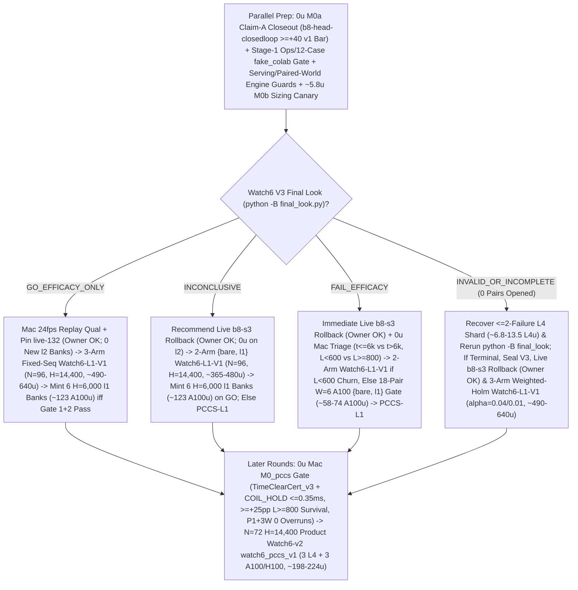

# T34 ExIt-B8 Research Roadmap (Round-15 Synthesis — Advice, Not Decisions)

Start: [project index](../INDEX.md) · [current status & authority](../STATUS.md) · [research record index](INDEX.md) · [study packages](../../research/INDEX.md) · [campaign log](final_run_20261019/CAMPAIGN_LOG.md).

> [!IMPORTANT]
> **Status: Research advice, NOT ratified decisions or release authorization.**
> Every current-round and later-round plan on this page is synthesized advisor guidance from Round 15 (2026-11-01 PT; primary synthesis artifact: `snake-dqn-artifacts/big-lever/exp/argon-rounds/round-15/synthesis/answer.md`, reconciling `round-15/{current,later,process}/answer.md` against `HEAD` `78f33318` and superseding Rounds 01–14). Nothing here amends a pre-registration, ratifies a confirmation gate, or changes served defaults. Binding campaign authority remains [`SUCCESS_CONTRACT.md`](final_run_20261019/SUCCESS_CONTRACT.md), [`DESIGN_V2_SHADOW.md`](final_run_20261019/DESIGN_V2_SHADOW.md) (+ Amendment 1), [`P7_STATISTICS.md`](final_run_20261019/P7_STATISTICS.md), unsuperseded parts of [`FINAL_PLAN.md`](final_run_20261019/FINAL_PLAN.md), and [`STATUS.md`](../STATUS.md); any serving or release change requires confirmation-lane evidence, Mac serving qualification, and the owner's explicit OK.

---

## 1. Snapshot Context & Code-Verified Round-15 Corrections (Oct 29 – Nov 1)

### 1.1 Nov 1 exploration, bank-minting, parity & Watch6 V3 fence quarantine ruling

- **All-length exact-stop screen — `ADOPT` for new replay banks** ([`watch6_alllen_screen`](../../research/watch6_alllen_screen/README.md), `t34-sol/argon-alllen-a100/analysis.json`, `N = 48` paired `H = 6,000` Watch6-v2 sessions uniting `12` L4 `W = 4` units `0..11` at `568b09e4` with `36` A100 `W = 6` units `12..47` across three `12`-unit shards at `73c26ccc` on `origin/argon-alllen-a100-1031`):
  - `bare` (`b8-s3`): **`351.07` mass** (`CI95 [320.22, 381.91]`), **`0.2882` `deaths/1k`** (`CI95 [0.2427, 0.3337]`; `83` deaths: `53` at `L < 600`, `30` at `L >= 600`, `21` at `L >= 800`), `mean_max_length = 794.3`.
  - `l2_prime_600` (served `L >= 600`): **`461.16` mass** (`CI95 [414.30, 508.02]`; `+110.09` vs `bare`, `CI95 [+72.06, +148.13]`), **`0.1597` `deaths/1k`** (`CI95 [0.1060, 0.2134]`; `-44.6%` vs `bare`; `46` deaths: `34` at `L < 600`, `12` at `L >= 600`, `11` at `L >= 800`), `449.6` mean branches/session (`403.7` roots, `mean_max_length = 943.4`).
  - **`exact_stop_alllen` (`L >= 1`, `interval = 5`, `H = 300`):** **`559.43` mass** (`CI95 [533.59, 585.27]`; **`+208.37` / Fieller `+59.35%` vs `bare`**, `CI95 [+170.07, +246.66]`; **`+98.27` / Fieller `+21.31%` vs `L >= 600`**, `CI95 [+50.57, +145.98]`, clearing `>= +15.0`) and **`0.0521` `deaths/1k`** (`CI95 [0.0294, 0.0748]`; **`-81.9%` / `-0.2361/1k` vs `bare`**, `CI95 [-0.2828, -0.1895]`; **`-67.4%` / `-0.1076/1k` vs `L >= 600`**, `CI95 [-0.1609, -0.0544]`, clearing `<= 0.0`), cutting `L < 600` deaths **`53 (bare) / 34 (L >= 600) -> 1`** (`0.142%` `L < 600` overrides, `mean_max_length = 1,096.0`) at **`2.821×` branches** (`1,268.5` vs `449.6`, `1,200.1` roots = **`1.057` branches/root**, stopping on `bare` at **`94.3%`** of roots). **`14/15` remaining deaths occur at `L >= 600` (`13/15` at `L >= 800`).**
  - *Exposure & per-world notes:* Eliminating `34 -> 1` early deaths gives `exact_stop_alllen` **`1.379×` more `L >= 600` living exposure** (`403.7 -> 556.6` roots/session), so `11 -> 13` raw `L >= 800` deaths reflects **`-14.2%` lower per-frame `L >= 800` hazard** despite raw session-normalized `Δd_ge800 = +0.0069/1k`. Across paired worlds, `exact_stop_alllen` regressed deaths vs `L >= 600` on `3/48` seeds (`3075941873`, `3394546952`, `121131908`) and mass on `14/48` seeds.
- **All-length Watch banks `14l1–16l1` completed `36/36` on active Cap-6 `36285bc6` (freeing all `3` A100 slots):**
  - Verified receipts (`t34-sol/argon-banks-l1/packet-bank{14l1,15l1,16l1}-a100/output-main/receipt.json`, `SUMMARY.md:38-40`) confirm Cap-6 (`36285bc6`, untouched by Round-14 docs commits `b47fa563`–`78f33318`) ran `6/6` concurrent runtimes (`3 A100 @ 6.73 u/h + 3 L4 @ 1.94 u/h = 26.01 u/h`), finishing all `3 × 12` `exact-stop-l1` sessions (`W = 6`, `H = 6,000`) in **`3.03–3.07 h/bank`** (**`20.36–20.67 u/bank` = `~61.5 A100 u` observed total** vs `75.6 u/bank` base / `151.2 u/bank` 2× forecast calibrated to the `2.821×` branch ratio; balance **`2,154.66 u`**, leaving `3` A100 slots free). Survived trajectories spend frames `6,000..14,400` almost entirely at `L >= 800`, so `H = 14,400` `exact-stop-l1` compute scales **superlinearly (`>= 2.4×`, projected `~2.4–3.1×`)** over `H = 6,000`.
  - Commit `395eacbb` switched `.claude/launch.json` to **`watch-replay-bank-live-168`** (`132` `exact-stop-l2-prime` banks `01–08, 10–12` + `36` unconfirmed `exact-stop-l1` banks `14l1–16l1`, [`web/serve.py`](../../web/serve.py) restarted on `b5b63cd1`, keeping `watch-replay-bank-live-132` intact for rollback). Confirming `exact-stop-l1` at `H = 14,400` still requires prospective confirmation (`Watch6-L1-V1`), Mac serving qualification, and owner OK; mint **`0`** new banks until Watch6 V3's verdict lands.
- **GPU `DeviceSim` v2 parity — `PASS` on A100** ([`devicesim_v2_parity`](../../research/devicesim_v2_parity/README.md), `t34-sol/argon-devicesim-v2/packet-a100-v2-parity-01/main-run-01/receipt.json`): **`0` mismatches** across **`1,536,000` snake-ticks** (`E = 256 × 1,000` Watch6-v2 ticks in `3,505.6 s` = `1,434.6` steps/s under 5-opponent CUDA flood launches, commit `b500d111`), using `DeviceSim`'s SplitMix64 RNG and `<= 1e-4` CUDA FP32 near-tie Q re-decision tolerances (SplitMix64 cannot mint MT19937 live Watch replay banks).
- **Active confirmation — Watch6 V3 (`09:16 PT` staging-fence quarantine ruling, `--reconcile-staging`, identity closure & linear-retry lineage guard)** ([`REGISTRATION_V3.md`](../../research/watch6_search_efficacy_v3/REGISTRATION_V3.md)): `24 × 4` L4 `W = 4` shards (`96` fresh paired `H = 14,400` Watch6-v2 sessions) confirming **`exact-stop-l2-prime` (`L >= 600`) only**. At `05:01 PT`, **`14/24` shards were `PASS`** (`01..08, 10, 11, 13..16`), **`6/24` active** (`17, 18, 20..23`), and **`4/24` V6.1-accepted mechanical failures** (`00` `412` unallocated, `09` `UPLOAD_CAP`, `12` renewal-WS drop, `19` warmup `GuardError`; `75471246`):
  - *`09:16 PT` V6.1 staging-fence quarantine ruling (`APPROVE_WITH_CONDITIONS`, `t34-sol/v61-fence-ruling-20261101.md`, `t34-sol/v61-fence-evidence-20261101.json`):* `23` historical non-V3 H100-503 pre-fallback manifests in `ops/manifests/` return `_attempt_state == "FENCE"`, blocking [`tools/watch6_v3_accounting/dispatch.py:wait_other_jobs_staged`](../../tools/watch6_v3_accounting/dispatch.py) (`lines 219–245`) for V3 recovery shards `00` and `12`. The Fable stand-in judge approved plain-`mv` quarantine of **only** those `23` manifests + `.live.json` siblings to `ops/manifests-archive-20261101/` under `flock` on `ops/watch6-staging.lock` (**`0` symlinks**, because [`final_look.py`](../../tools/watch6_v3_accounting/final_look.py) `lines 473–483` fails closed on `is_symlink()` before namespace filtering; if `ops/watch6-staging-reconcile.json` was written, clear it via `--reconcile-staging` in [`dispatch.py`](../../tools/watch6_v3_accounting/dispatch.py) `lines 178–185, 316–354`).
  - *Identity closure & linear lineage:* [`watch6_search_efficacy_v3/protocol.py`](../../research/watch6_search_efficacy_v3/protocol.py) hashes both [`tools/ops/package_spec.py`](../../tools/ops/package_spec.py) (`line 94`) and `web/backend/` (`line 96`) into `identity()`, and [`final_look.py:_verify_shard_lineage`](../../tools/watch6_v3_accounting/final_look.py) (`lines 380–386`) fails closed on forked attempt trees sharing a parent receipt. Keep all V3 worktrees and `ops/` untouched during code preparation; dispatch **only** staged `ops/auto-retry` children on shards **`09` and `19`** (**do NOT run [`recover.py`](../../tools/watch6_v3_accounting/recover.py)** on `09, 19`); run `recovery-shard-{00,12}-01` via `python -B -m tools.watch6_v3_accounting.dispatch`; and invoke [`final_look.py`](../../tools/watch6_v3_accounting/final_look.py) under **`python -B`** from clean `snake-dqn-argon-v3-accounting` ([`_forbid_pycache_directory`](../../tools/watch6_v3_accounting/__init__.py) `lines 747–777`).
- **Completed Oct-30 GPU receipts awaiting `0 u` Mac readout (`b8-head-closedloop` alone gates Claim A):** `b8-head-closedloop` (`t34-sol/b8-head-closedloop/main-01/output/receipt.json`, `rc = 0`, `4.51 A100 u`, `SUMMARY.md:50-52`) is the sole remaining Claim-A gameplay screen lacking Mac readout (`readout-01`). `spatial-qbytes-01` (`t34-sol/spatial-qbytes-fix/SUMMARY.md:85-88`, `ruler-output-a100-fallback/receipt.json`, `rc = 0`) is strictly a GPU Q-byte/`.so` cache parity and throughput ruler (`40–48 A100 u` `spatial-student-pilot` fit canceled at `0 u` per `t34-sol/student-direction/{astra,fable}.md` and `T4 Gate-1` `KILL_T4`).

### 1.2 Closed single-pass critics, distillations, RL, and standalone macro fallbacks

Between 2026-10-29 and 2026-11-01, every single-pass learned-policy, critic, distillation, and standalone macro-fallback track closed below its promotion or selectivity bars:

| Track | Scope & primary artifact | Measured outcome | Disposition |
| --- | --- | --- | --- |
| **TRAIN-01** ([`sandbox_a_resident`](../../research/sandbox_a_resident/README.md)) | `100.7M`-row (`384`-update) GPU-resident PPO from `b8-s3` (`t34-sol/train01-closeout/SUMMARY.md`) | H5000 equal-mix paired mass **`+8.09`** (`CI95 [-18.66, +34.85]`; scripted `+26.32`, frozen `+2.85`, mixed `-4.90`; update-320 peak `+14.23` `[-11.86, +40.32]`) vs bar `>= +40` | **Closed** (no strict-gate nomination) |
| **C/T Stage-2 distillation** | Continuation-teacher causal-root distillation (`t34-sol/ct-stage2-verdict/SUMMARY.md`) | Teacher rescued **`22/32` (`68.75%`)** deaths (`22/32 <= 65` ticks; indep-suffix H300 `+66.77`, `LB90 +51.61`), but student retention was **`46.9–50.0%`** (`0 pp` over `frozen_phi` vs `>= +15 pp`; topology AUC `0.5752 < 0.83`), ordinary flips **`44.4–64.5%`** (bar `<= 1%`), and lethal ordinary flips **`3–5`** (bar `<= 1`) | **`FAIL_DISTILLATION_RETENTION_OR_SAFETY`** |
| **Doom U-Net & `spatial-student-pilot`** | `83 × 145` spatial U-Net vs 33.7k B8-feature head (`t34-sol/doom-result-01/result.json`; `t34-sol/student-direction/{astra,fable}.md`) | Spatial U-Net lost late per-action doom ROC-AUC to frozen B8 features (**`0.753` vs `0.810`**, `Δ = -0.056`, `CI95 [-0.091, -0.023]`; all-strata death-lookback `0.7626` vs `0.8226`; ordinary late `0.690` vs `0.706`) | **`GRAY` / `40–48 A100 u` pilot fit canceled (`0 u`; retain `.so` caches)** |
| **B8 advantage head (offline OOF)** | `256 -> 128 -> 6` ReLU head on frozen B8 features (`t34-sol/b8-head-test/RESULT.md`) | Mass rule `GO` (late H300 `+30.09`, `LB90 +23.96`), Fable selectivity **`FAIL`**: **`26.42%`** late rescue (bar `>= 35%`) at **`97.60%`** non-death flips (bar `<= 15%`) | **Selectivity `FAIL`** (192-world closed-loop A100 `rc = 0`, awaiting Mac `M0a` readout) |
| **T4 Gate-1 factored critic** ([`t4_gate1`](../../research/t4_gate1/README.md)) | Clean-slate privileged `83 × 145` (`H = 320` 7-source BFS) hazard + foraging mass-flux critic on `384` disjoint Watch6-v2 worlds (`t34-sol/argon-t4-gate1-fix2/queue-03/READOUT.json`) | **`0/8` bars passed**: `L >= 600` residual EV **`+0.0266`** (`[-0.0280, +0.0869]` vs `>= 0.25`), death-root H300 rescue **`+19.99`** (vs `>= +40`), mature doom AUC **`0.5617`** (vs `>= 0.80`), ordinary H300 mass **`-22.21`** (vs `>= -15.0`), lethal flips **`3.13%`** (vs `<= 3.0%`) | **`KILL_T4`** (proves even privileged `83 × 145` critic lacks late value signal) |
| **R6 `L < 600` harvest census** ([`r6_l600_census`](../../research/r6_l600_census/README.md)) | `64`-world (`384`-root) Watch6-v2 early-game counterfactual + 5-fold OOF corpse/trail plane probes (`t34-sol/argon-mac-checks/r6-census/RESULT.json`) | **`34.90%` (`134/384`)** oracle-harvestable roots (`>= +5` H500 mass), **`7.69%`** non-bare H500 lethal flips, OOF ROC-AUC **`0.474–0.521`** (`0` passing threshold points); superseded operationally by `exact-stop-l1` | **`KILL`** |
| **R7 macro-option fallback** ([`r7_macro_fallback`](../../research/r7_macro_fallback/README.md)) | Pruned depth-2 (`2K = 30` ticks) spatial macro-options `{O_0..O_5}` on C/T train `1-step-all-die` roots (`t34-sol/argon-r7-repack/R7_READOUT.json`) | `3/5` bars passed (`0.316 ms` Mac 1-thread p95; **`33.0%` vs `9.0%`** `L >= 800` `all_die_sel0` rescue on `25/129` roots — `9/25` `macro_triggered` at `+66.7 pp` rescue vs `16/25` tick-`30` B8 re-traps, while `104/129` `80.6%` survived `H = 300`), but total `L >= 600` lift **`+3.85 pp`** (`< +10.0 pp`) and **`2 > 0`** ordinary lethal flips (`0` assessment roots opened) | **`KILL`** as standalone `30`-tick fallback |

### 1.3 Code-verified Round-15 corrections over Round 14

Zero Round-14 code changes have landed at `HEAD` (`78f33318`), and auditing Round 14's spec against live code exposes **three bug clusters** across Stage-1/Stage-2 transport, paired-world confirmation units, and later-round search/spine serving:

1. **Tar-packed `public-inputs.json` (`0` Mac `input_preflight` downloads), study-wide `64 KiB` union ledger, `"lease_seconds": 600`, `1` initial canary/target GPU & `>= 20 s` `.complete` spacer (`0 u` Stage 1 on `36285bc6`):**
   - *No manifest `"url"` `inputs[]`:* Declaring `"url"` entries in manifest `inputs[]` forces Mac [`supervisor.py:input_preflight`](../../research/colab_cli/supervisor.py) (`lines 280–291`) to stream `27.92 MB` (`B8_s3_final.pth` + `league.tar.gz`) on the Mac per shard **before** [`output.mkdir()`](../../research/colab_cli/supervisor.py) (`lines 1059–1065`); any GitHub blip leaves no `output_dir`/`receipt.json`, raising `FileNotFoundError` at [`auto_retry.py:eligible`](../../tools/ops/auto_retry.py) (`line 239`) and [`ready_queue.py`](../../tools/ops/ready_queue.py) (`line 395`). Pack `study-contract.json`, `public-inputs.json`, and `release-evidence.tar.gz` into `<= 1.5 MiB` `input-metadata.tar.gz` via [`metadata_archive.py:bundle_inputs`](../../research/metadata_archive.py) (`lines 93–187`, matching [`watch_replay/prepare.py`](../../research/watch_replay/prepare.py) `lines 184–192`) and materialize HTTPS checkpoints on the VM via [`materialize_watch_checkpoints`](../../research/watch_replay/uploads.py) (`lines 186–272`, exiting `rc = 74` on fetch failure), while setting `"lease_seconds": 600` (already valid on `36285bc6` via [`supervisor.py`](../../research/colab_cli/supervisor.py) `lines 261–264`, extending heartbeat survival `3.33×` from `180 s` to `600 s`).
   - *Study-wide `64 KiB` union ledger & `1` canary per target GPU:* [`canary.py:check`](../../research/colab_cli/canary.py) (`line 302`) enforces `manifest["requirements"]["gpu"] == proof["hardware"]` (**`1` initial canary per target GPU**, not `"1/24"` across A100 + L4) and requires exact `sha256` equality on every uploaded input (`lines 312–321`), so per-shard ledgers force $K$ recovery canaries when $K$ shards drop. Use **one `65,536 B`-padded study-wide union `verified-ledger.json`** of all verified `unit_id`s (`<= 1` shared `1-unit` L4 recovery canary/wave on `36285bc6`; `0` on Stage 2 via `canary.py:318` exemption).
   - *`"resume/verified-skip-proof.json"` & `>= 20 s`-spaced `.complete` markers:* Set `"required_exports": ["resume/verified-skip-proof.json", "shard-complete.json"]` (matching [`dispatch.py`](../../tools/ops/dispatch.py) `lines 1993–1998`) and space `.complete` markers by **`>= 20 s`** (flushing immediately on `SIGUSR1`) so `W = 4..6` parallel workers or final `unit-*.json` + `shard-complete.json` never coalesce into `len(batch) >= 2` WebSocket [`export_batch`](../../research/colab_cli/export_batches.py) (`lines 82–117`) at [`supervisor.py`](../../research/colab_cli/supervisor.py) (`lines 975–989`).
2. **Paired-world atomic units, `CHILD_NONZERO_EXIT` (`lease_expired`/`rc = 74`) + `ACCOUNTING` retry predicates, relative monotonic onset & observer-aware Stage-2 Contents polling:**
   - *Do NOT split `(world_idx, arm)` across hosts:* A100 and L4 host x86 CPUs can diverge on exact FP32 Q ties under `SNAKE_DQN_DEVICE=cpu`; keep [`watch6_alllen_screen/run.py:generate`](../../research/watch6_alllen_screen/run.py) (`lines 51–112`)'s **paired-world atomic unit** (all arms of world `index` run sequentially on one worker).
   - *Four missed retry predicates in [`auto_retry.py`](../../tools/ops/auto_retry.py) (`lines 235–345`):* (a) admit pre-`output.mkdir()` Mac exits (`not output.exists()` with `0` allocations in logs/`{pending,active}-*.json`) in Tier-0; (b) admit pre-`workload-started.json` `rc = 74` (`public_input_fetch_{failed,timeout}`, [`runtime.py`](../../research/colab_cli/runtime.py) `lines 261, 618–625`) in Tier-0; (c) [`failures.py:terminal_failure`](../../research/colab_cli/failures.py) (`lines 36–44`) checks `returncode != 0` *before* `reason`, classifying `lease_expired` and `release_credential_expiring` child stops ([`runtime.py`](../../research/colab_cli/runtime.py) `lines 618–632`) as `CHILD_NONZERO_EXIT` (rejected by Round 14!), while `poll % 4` `spend` lag ([`supervisor.py`](../../research/colab_cli/supervisor.py) `line 1934`) emits `"ACCOUNTING"` — Tier-1 must admit `(terminal is None and failure_class in {"RPC_EXEC_POLL_TIMEOUT", "SUPERVISOR", "ACCOUNTING"})` or `terminal.reason in {"lease_expired", "release_credential_expiring"}` (refusing `reason == "timeout"` or `reason is None and returncode != 0`); and (d) `cli_calls[i]["started_monotonic"]` ([`supervisor.py`](../../research/colab_cli/supervisor.py) `lines 497–498`) is raw host `time.monotonic()` since boot whereas `elapsed_seconds` (`line 1366`) is relative, so Tier-1 must compare `elapsed_seconds - (cli_calls[-1]["ended_monotonic"] - first_failed_tail["started_monotonic"]) < timeout_minutes * 60 - (lease_seconds + 60)`.
   - *Observer-aware Stage-2 Contents polling:* Gate Stage-2 Contents-only `runtime-poll.json` + `<= 16`-file `export_file` polling on `observer is None and not lease.contents_disabled` so [`admission.py`](../../research/colab_cli/admission.py) (`lines 56–155`) fault-injection acceptance gates pass unchanged.
3. **Closed-loop `PCCS-L1` (`TimeClearCert_v3` `2.33`-pop/tick boost advance + hysteretic `COIL_HOLD` `π_shield`) & `P1+3W` `ShadowSpine` (skipping `dto_split.py`):**
   - *Why `FECSS-L1` re-traps and undercounts boost clearance:* Round 14's `FECSS-L1` deviated only at `offset == 0` and handed `offset >= 1` back to unshielded greedy `b8-s3` (`16/25 = 64.0%` re-trapped on tick-`30` handback in [`r7_macro_fallback/README.md`](../../research/r7_macro_fallback/README.md) `line 5`; `0/26` in [`t35_two_deviation/RESULT_EXTEND.md`](../../research/t35_two_deviation/RESULT_EXTEND.md) `lines 8–11`), and undercounted boost tail release (`1.33` vs **`2.33` pops/tick**: [`BatchSim._move_all`](../../src/simd_env/batch_sim.py) `lines 723–785` calls `_push_head` **twice** per boost frame + 3-frame burn, popping up to `3` old tails in [`GridBatchSim._move_all`](../../src/simd_env/grid_sim.py) `lines 528–534`, [`_consume_food`](../../src/simd_env/batch_sim.py) `lines 881–901` `break`s after `<= 1` pellet/frame, and [`_drop_trail_pellets`](../../src/simd_env/grid_sim.py) `lines 509–518` writes `FOOD_CORPSE` onto burned tails on the `145 × 83` rectangular [`GameSettings`](../../src/core/game_config.py) `lines 35–48` arena). **`PCCS-L1`** pairs step-exact `TimeClearCert_v3` with hysteretic closed-loop `COIL_HOLD` `π_shield` (`~0.18 ms`) online *and* inside `H = 160` / `H = 64` rollouts.
   - *Why `P1+3W` beats `dto_split.py`:* Production [`web/backend/pathb.py`](../../web/backend/pathb.py) (`lines 13–48`) is still v1 [`live.py`](../../research/t34_pathb/live.py) (`depth = 40`), while [`dto_split.py`](../../research/bl_served_search/dto_split.py) (`lines 61–62`) rejects `pathb` and wastes `1/4` of `W = 4` helper processes on a `0.843 ms` `build_frame` delta (`update p95 = 7.792 ms -> full_tick p95 = 8.635 ms` in [`t15_mixed_roster_qualification_2026-10-17.md`](t15_mixed_roster_qualification_2026-10-17.md) `line 105`). Skipping `dto_split.py` runs inline `0.18 ms` `π_shield` on `Ego2sServingPolicy._ensure_frame`, dedicates **`P1`** to the `D = 384` `ShadowSpine` (`0`-ms graft, `3`-tick/frame refill), and gives **`P2–P4` (`3` `20.13×` [`v8_decide`](../../src/simd_env/v8_nb.py) search workers = `+50%` rescue capacity)**.

---

## 2. Current-Round Plan (Advice, Not Decisions)

### 2.1 Finish Watch6 V3 (`0 u`), run `M0a` Claim-A closeout (`0 u`), & patch Watch serving + paired-world confirmation engine

1. **Finish Watch6 V3 cleanly under `python -B final_look.py` (`N = 96`, `exact-stop-l2-prime` only; V3 worktrees & `ops/` untouched during code prep):**
   - Complete the ratified `23`-manifest plain-`mv` quarantine (`0` symlinks) + `--reconcile-staging` if fenced under `ops/watch6-staging.lock` per `t34-sol/v61-fence-ruling-20261101.md`, dispatch **only** staged `ops/auto-retry` children on **`09, 19`** (**do NOT run `recover.py`** on `09, 19`) and `python -B -m tools.watch6_v3_accounting.dispatch` on **`00, 12`**, and invoke `python -B` [`final_look.py`](../../tools/watch6_v3_accounting/final_look.py) (`lines 653–692`) from clean `snake-dqn-argon-v3-accounting` (never opening `exports/` or `pair-*.json`).
2. **Run `M0a` Claim-A readout (`< 2 min` Mac, `0 u`) & enforce binding v1 `H = 5,000` `>= +40` closure bar:**
   - Run [`closedloop_readout`](../../research/INDEX.md) (`t34-sol/b8-head-closedloop/SUMMARY.md:50-52`, `origin/astra-doom-auc-smoke` @ `591d94c3`) on completed `b8-head-closedloop` (`N = 192` v1 `H = 5,000` worlds, `m in {0, 10, 25, 50}`, `4.51 A100 u`); audit `spatial-qbytes-01` separately as a Q-byte/`.so` cache ruler only (`SUMMARY.md:85-88`, keeping the `40–48 A100 u` `spatial-student-pilot` fit canceled at `0 u`).
   - **Recommended Claim-A kill rule:** Permanently **close Claim A (`0 u`)** unless some fixed `m in {0, 10, 25, 50}` clears [`SUCCESS_CONTRACT.md`](final_run_20261019/SUCCESS_CONTRACT.md) §2 (`lines 29–33`) and [`P7_STATISTICS.md`](final_run_20261019/P7_STATISTICS.md) §§3–4 (`lines 33–48`): pooled mass **`>= +40.0`**, Bonferroni-4 `LB97.5 > 0`, scripted no-death `>= +0.03` (zero mix loss), Guard A `Δalive >= -0.05` pooled / `>= -0.075` per mix, and living overrides `<= 15%`, followed by a `0 u`, `10 min` v2 boost `[0.5%, 10%]` check before nominating any Mac strict gate.
3. **Patch Watch replay serving & paired-world atomic `H = 14,400` `record=None` confirmation engine (`0 u`, fresh worktree; V3 untouched):**
   - Set `"SNAKE_WATCH_SOURCE": "live"` in [`watch6_search_efficacy/product.py:open_watch`](../../research/watch6_search_efficacy/product.py) (`line 41`) and bind confirmation `science_tree_sha256` via `git ls-tree` over science paths only (decoupling science identity from `tools/ops/*`, `research/colab_cli/*`, `web/backend/*`, and `__pycache__`):
     - **Serving guards ([`session.py`](../../web/backend/session.py), [`watch_replay.py`](../../web/backend/watch_replay.py), [`app.py`](../../web/backend/app.py)):** Refuse `MODE_TRAIN` on forward-only `EGO2S_OBS_SPECS` / `RASTER31V2` **before** calling [`_leave_watch_replay()`](../../web/backend/session.py) (`lines 1443–1462`); scope `_replay_opted_out = True` strictly to `set_epsilon` (`lines 1154–1160`) and `set_food` (`lines 1173–1200`) — **never** inside `_leave_watch_replay()`, preserving `Play -> Watch` — and clear `_replay_opted_out = False` in `_build` (`lines 714–738`) + split `"new_game"` in [`app.py`](../../web/backend/app.py) (`lines 310–311`), gating `__init__`/`reset_game`/`set_mode` on clean mixed-Watch6 `b8-s3`; add line-1 `.watch.gz` `SNAKE_WATCH_REPLAY_CONTROLLER` (`all | exact-stop-l2-prime | exact-stop-l1`) filtering, `64`-frame cooperative yield (cold readiness `< 0.45 s` with live `b8-s3` serving; first verified recording cuts in after `~18–23 s`) in `verify_payload` (`line 176`), shallow `Recording.snapshot` (`lines 226–238`), and injectable `shuffle_discovery: bool = True` for cycle 1 in [`ReplayBank`](../../web/backend/watch_replay.py) (`lines 238–367`).
     - **Paired-world atomic confirmation engine ([`watch_replay/engine.py`](../../research/watch_replay/engine.py) & `watch6_l1_confirm`):** Keep [`watch6_alllen_screen/run.py:generate`](../../research/watch6_alllen_screen/run.py) (`lines 51–112`)'s **paired-world atomic unit** (running all arms of world `index` sequentially on the same worker to prevent A100/L4 CPU FP32 tie drift), guard side-effect-free `if record is not None: snapshot = session.live.snapshot()` in [`run_arm`](../../research/watch_replay/engine.py) (`line 216`), enforce full `14,400`-frame live mirror + `timing` (`main_seconds`, `search_seconds`) + `respawns_per_slot` parity ([`performance.py`](../../research/watch6_search_efficacy/performance.py) `line 81`) with `on_frame` `900 s` `faulthandler` watchdog ([`watch6_search_efficacy/run.py`](../../research/watch6_search_efficacy/run.py) `lines 66–86`), parameterize `alpha: float = 0.05` (`t.ppf(1.0 - alpha / 2.0, df)`) in `Watch6-L1-V1`'s new analyzer (leaving sealed V2/V3 untouched), and keep **recorded `.watch.gz` v2 banks at `H = 6,000`** (`< 512 MiB` [`MAX_DECODED`](../../web/backend/watch_replay.py) `lines 24, 57–58`) while running `record=None` confirmation at **`H = 14,400`**.
   - Pass `1,500` unpaced + `120` paced-`24 fps` Mac qualification ticks (`update p95 <= 11.688 ms`, `step p99 <= 41.67 ms`, `0/120` overruns per [`t15_mixed_roster_qualification_2026-10-17.md`](t15_mixed_roster_qualification_2026-10-17.md), `< 1.0 s` cold readiness) while cold `.watch.gz` verification runs concurrently.

### 2.2 Deploy Round-15 Code-Verified Two-Stage Transport (`0 u` Stage 1 + `~1.5 u` Stage 2)

1. **Stage 1 (`0 u` Colab, [`tools/ops/`](../../tools/ops/) on active Cap-6 `36285bc6`, zero `research/colab_cli/` edits):**
   - **Tar-packed `public-inputs.json`, study-wide `64 KiB` union ledger, `"lease_seconds": 600` & `>= 20 s`-spaced `.complete` publisher (`tools/ops/study_package.py`):**
     1. Pack frozen `study-contract.json` (`unit_ids: 0..N-1`, shard-/GPU-/worker-invariant `HMAC-SHA256(study_seed, f"{namespace}:{unit_id}")` seeds, `git ls-tree` `science_tree_sha256`), `public-inputs.json` ([`PUBLIC_INPUTS.json`](../../research/t34_exit_b8/PUBLIC_INPUTS.json) `lines 4–15`), and `release-evidence.tar.gz` into one `<= 1.5 MiB` `input-metadata.tar.gz` via [`metadata_archive.py:bundle_inputs`](../../research/metadata_archive.py) (`lines 93–187`, matching [`watch_replay/prepare.py`](../../research/watch_replay/prepare.py) `lines 184–192`, with `env["WATCH6_L1_SHARD"]` $\Rightarrow$ **`1` initial canary per target GPU** under [`canary.py:check`](../../research/colab_cli/canary.py) `line 302`). Keep manifest `inputs[]` free of `"url"` entries (`0` Mac `input_preflight` `27.92 MB` downloads; VM fetches and pin-verifies `B8_s3_final.pth` + `frp3_m3_s12` via [`materialize_watch_checkpoints`](../../research/watch_replay/uploads.py) `lines 186–272`, exiting `rc = 74` on fetch failure).
     2. Bind **one study-wide `65,536 B`-padded (`64 KiB`) union `verified-ledger.json`** of all verified `unit_id`s (each shard runs `shard_units - verified_units` $\Rightarrow$ `< 1.6 MiB < 2 MiB` [`UPLOAD_CHUNK_BYTES`](../../research/colab_cli/transfers.py) `line 30`, `0` WS `UPLOAD_ASSEMBLE`, and identical `inputs[]` SHA-256s across coalesced retries $\Rightarrow$ **`<= 1` shared `1-unit` L4 recovery canary (`~0.16 u`)/wave** on `36285bc6`).
     3. Set `"lease_seconds": 600` ([`supervisor.py`](../../research/colab_cli/supervisor.py) `lines 261–264`, `20` missed `30 s` PUTs) and `"required_exports": ["resume/verified-skip-proof.json", "shard-complete.json"]` ([`dispatch.py`](../../tools/ops/dispatch.py) `lines 1993–1998`). Emit `exports/workload-started.json` pre-tick-0, **one** paired-world `exports/units/unit-{id:04d}.json` (or `unit-{index:06d}.json`) with **`>= 20 s`-spaced `.complete` markers** (flushing immediately on `SIGUSR1` $\Rightarrow$ `len(batch) == 1` Contents HTTP [`export_file`](../../research/colab_cli/supervisor.py) `lines 975–989`, `0` WS [`export_batch`](../../research/colab_cli/export_batches.py) `lines 82–117`), `resume/verified-skip-proof.json`, and `shard-complete.json` last.
   - **Single retry authority, locked caps, `ops-outcome-blind-retry/v2`, & `confirm_audit.py` (`0` post-data judge rounds):**
     - Pass `--no-internal-retry` from [`ready_queue.py`](../../tools/ops/ready_queue.py) (`lines 724–824`) to [`dispatch.py`](../../tools/ops/dispatch.py) (`lines 2871–2983`, retiring `-retry-1` and manual `recover.py` forks), enforce `total < 6`, `L4 < 3`, and single-GPU `412`/`503` [`reconcile_unavailable`](../../tools/ops/dispatch.py) (`lines 2358–2490`) under `ops/alloc.lock`, and ship `tools/ops/` via [`qualification.py`](../../tools/ops/qualification.py) (`line 153`) `review --tree <sha> --status ACCEPT`.
     - Write linear study-scoped confirmation lineage solely to `ops/studies/<namespace>/attempts/shard-{s:02d}-attempt-{k:02d}.json` (keeping operational slot manifests in `ops/manifests/`) via [`auto_retry.py:eligible`](../../tools/ops/auto_retry.py) (`lines 235–345`):
       - **Tier-0 Pre-Workload (`<= 6`, `0` completions burned, `0` extra canaries):** Pre-`output.mkdir()` Mac exits (`not output.exists()` when logs and `{pending,active}-*.json` prove `0` allocations; cache preflight per queue tick), verified `unavailable.json`, or `stop_verified is True` before `"workload-started.json"` / `units/*` (including `412`/`503`, `UPLOAD_CAP`, `GuardError`, `rc = 74` `public_input_fetch_{failed,timeout}` at [`runtime.py`](../../research/colab_cli/runtime.py) `lines 261, 618–625`, or bootstrap wheel `503`).
       - **Tier-1 Mid-Workload (`<= 2` completions):** `stop_verified is True` and `cleanup_error is None` when `(terminal is None and failure_class in {"RPC_EXEC_POLL_TIMEOUT", "SUPERVISOR", "ACCOUNTING"})` (covering `poll % 4` [`supervisor.py`](../../research/colab_cli/supervisor.py) `line 1934` lag) **or** `terminal.reason in {"lease_expired", "release_credential_expiring"}` (classified as `CHILD_NONZERO_EXIT` by [`failures.py:terminal_failure`](../../research/colab_cli/failures.py) `lines 36–44` after [`runtime.py`](../../research/colab_cli/runtime.py) `lines 618–632` stops the child; refuse `reason == "timeout"` or `reason is None and returncode != 0`), with relative monotonic onset **`elapsed_seconds - (cli_calls[-1]["ended_monotonic"] - first_failed_tail["started_monotonic"]) < timeout_minutes * 60 - (lease_seconds + 60)`** ([`supervisor.py`](../../research/colab_cli/supervisor.py) `lines 497–498, 1366`). Rebuild the `64 KiB` union ledger after a `60 s` coalescing window from `receipt["exports"]` + `.sha256`/`.complete` `os.lstat` (**`0` unit payload opens**).
     - Audit via `python -B -m tools.ops.confirm_audit`: `--blind-check` installs `sys.addaudithook` blocking `open("*/exports/units/*.json")`, verifies `science_tree_sha256`, Tier-0/Tier-1 predicates, and exact `1:1` bijection (`multiplicity == 1`) over `0..N-1` $\rightarrow$ `blind-accounting-certificate.json`; `--unseal` refuses outcome reads without a `PASS` (`N/N`) certificate (**`0` post-data judge rounds**; judge needed only on `REFUSED`).
     - **Stage-1 gate & kill rule (`0 u` Mac `< 90 s` + `~0.25 u` L4 `<= 8 min`):** Pass `12` offline cases (`8` glitches + `4` negative controls, `N = 20`, `4` shards, `sys.addaudithook` active) on [`fake_colab.py`](../../tests/fixtures/fake_colab.py) (`lines 113–180`), then `1` `2`-shard (`4`-unit) live L4 forced-disconnect smoke (`~0.25 u`). Block Colab spend if `< 8/8` glitches certify `20/20` units, `< 4/4` controls refuse, coalesced recovery emits `> 1` union-ledger `sha256`, or `sys.addaudithook` traps `>= 1` pre-unseal unit open; escalate directly to Stage 2 if L4 staging `> 45 s`, `export_batch` WS RPCs `> 0`, or forced disconnect fails automatic `4/4` `PASS`.
2. **Stage 2 (`~1.5 u` Colab, additive `colab_cli` via [`requalify.sh`](../../tools/ops/requalify.sh) + `qualification.py review --status ACCEPT`, live `36285bc6` jobs untouched):**
   - **Cold-boot `KERNEL_CREATION_GUARD_ERROR` adoption:** Catch `KERNEL_CREATION_GUARD_ERROR` in [`supervisor.py:wait_runtime_ready`](../../research/colab_cli/supervisor.py) (`lines 721–726`) with `self.exec_uncertain = True` so GET-only [`_kernel_idle_once`](../../research/colab_cli/cli_guard.py) (`lines 440–476`) adopts the kernel created by `colab-cli 0.7.4`'s internal retry.
   - **Single-window `~15–25 s` `account.lock` & unlocked `poll % 4` `spend`:** Preserve single-window `account.lock` (keeping `pending-*.json` invariants at [`supervisor.py:1156,1482`](../../research/colab_cli/supervisor.py) and clean [`calibration_read`](../../research/colab_cli/accounting.py) `lines 262–272` deltas), mint `release_credential` + `version` pre-lock, use `2.0 s` warmup/calibration polls, and drop `account_locked` around read-only `poll % 4` [`spend`](../../research/colab_cli/supervisor.py) (`line 1934`).
   - **Atomic `0o600` Contents OAuth rotation, observer-aware `0`-WS polling & `64 KiB` ledger canary exemption:** Make [`_release_credential_expiring`](../../research/colab_cli/runtime.py) (`lines 412, 626, 712`) atomically convert `0o644` Contents-staged `release-credential.next.json` in **both** running (`L626`) and post-terminal (`L712`) loops via `0o600` [`write_release_credential`](../../research/colab_cli/release.py) (`lines 145–188`); use Contents-only `runtime-poll.json` + `<= 16`-file `export_file` when **`observer is None and not lease.contents_disabled`** (**`0` steady-state WS RPCs**, preserving [`admission.py`](../../research/colab_cli/admission.py) `lines 56–155` fault gates); exempt schema-verified `64 KiB` `resume.ledger_path` SHA in [`canary.py:check`](../../research/colab_cli/canary.py) (`line 318`, **`0` Tier-1 retry canaries**); and pass **`12/12` `requalify.py` gates** (`11` `final-only` + `d1024`) + independent `"ACCEPT"` review.

### 2.3 `M0b` `L >= 900` sizing canary (`~5.8 u`) & Watch6 V3 verdict routing (serving switches need owner OK)

Before freezing `Watch6-L1-V1` manifests, run **`M0b` (`~5.8 u`, `~45 min` on `1` free A100 `W = 6` + `1` free L4 `W = 4`, plus `1` A100 + `1` L4 family canary `~2.2 u` on `36285bc6`; 2× cap `12 u` / `90 m`)**: `6` `L >= 900` fixtures × `1,200` frames through patched paired-world `record=None, horizon=14400` confirmation (`snapshot()` skipped, full `14,400`-frame live mirror). Gate L4 `W = 6` vs `W = 4` ([`watch6_alllen_screen/prepare.py`](../../research/watch6_alllen_screen/prepare.py) `line 222`, `t34-sol/argon-alllen-a100/SUMMARY.md:17-23`) and shard walls strictly on `M0b`'s measured `p95` (**`~490–640 u` / `1,280 u` 2×** for 3-arm `{bare, l2_prime, l1}`, **`~365–480 u` / `960 u` 2×** for 2-arm `{bare, l1}` against `2,154.66 u` balance).

- **On `GO_EFFICACY_ONLY` ([`REGISTRATION_V3.md`](../../research/watch6_search_efficacy_v3/REGISTRATION_V3.md) `lines 53–68`, [`analyze.py:decide`](../../research/watch6_search_efficacy/analyze.py) `lines 74–75`: `deaths/1k UB95 < 0` and Fieller mass `LB95 >= -0.05`):**
  1. *Mac (`0 u`):* Land §2.1's replay/engine patch + `1,500`-unpaced / `120`-paced-`24 fps` qualification on `main`, and pin Watch serving to confirmed `132`-session `exact-stop-l2-prime` (`watch-replay-bank-live-132` or `SNAKE_WATCH_REPLAY_CONTROLLER=exact-stop-l2-prime`, **owner OK**). Mint **`0`** new `l2` banks.
  2. *Colab (`~490–640 u`, `1,280 u` 2×, `~19–23 h`, 3-arm fixed-sequence `{bare, l2_prime, l1}`, `N = 96, H = 14,400`, `12×6` A100 `W = 6` + `6×4` L4 `W = 4/6`, `record=None`):* **Gate 1 (`l1 vs bare`):** `deaths/1k UB95 < 0` and Fieller mass `LB95 >= -0.05`. **Gate 2 (`l1 vs l2_prime`, iff Gate 1 passes):** `deaths/1k UB95 < 0`, Fieller mass `LB95 >= -0.025`, and session-denominator `Δd_ge800/1k UB95 <= +0.05/1k`. Both pass $\Rightarrow$ mint **`6` pure-`l1` `H = 6,000` `.watch.gz` banks** (`~123 A100 u` $\rightarrow$ `108` pure-`l1` sessions) and cut over Watch (**owner OK**); else retain `live-132` and pivot to §3's `PCCS-L1`.
- **On non-`GO` (`INCONCLUSIVE`, `FAIL_EFFICACY`, or `INVALID_OR_INCOMPLETE`):**
  - *`INCONCLUSIVE` ([`analyze.py`](../../research/watch6_search_efficacy/analyze.py) `line 80`):* Spend **`0 u`** topping up `l2-prime` ([`P7_STATISTICS.md`](final_run_20261019/P7_STATISTICS.md) §5 `lines 53–56`; `34/46` `l2-prime` deaths are unsearched `L < 600`), recommend Watch rollback to live bare `b8-s3` (`SNAKE_WATCH_SOURCE=live`, **owner OK**), and dispatch **2-arm `{bare, l1}` `Watch6-L1-V1`** (`N = 96, H = 14,400`, **`~365–480 u`**, `960 u` 2×, `~14.5–17.5 h`, `Δd_ge800/1k UB95 <= +0.05/1k` guard; mint `6` `H = 6,000` `l1` banks `~123 A100 u` on `GO`, else kill standalone `H = 300` `exact-stop` at `H = 14,400` and launch §3's `PCCS-L1`).
  - *`FAIL_EFFICACY` ([`analyze.py`](../../research/watch6_search_efficacy/analyze.py) `lines 77–79`):* Recommend immediate live `b8-s3` rollback (**owner OK**) and triage V3's `96` `session_diagnostics` (`0 u`, `15 min` Mac) by `t <= 6,000` vs `t > 6,000` and `L < 600` vs `L >= 800`. If `Δd_ge600/1k <= 0` and `t > 6,000` Fieller `>= 0` (`L < 600` churn failed), run **2-arm `{bare, l1}` `Watch6-L1-V1`** (`~365–480 u`). If `Δd_ge800/1k > 0` or `t > 6,000` Fieller `< 0` (late coil reversal), run an **`18`-pair `1`-wave A100 `W = 6` (`3 × 6`) `H = 14,400` `{bare, l1}` gate** (**`~58–74 A100 u`**, `148 u` 2×, `~4.0 h`): advance to `N = 96` **iff** `Δdeaths/1k <= -0.08`, Fieller `>= +0.10`, and `t > 6,000` `L >= 800` deaths `<= bare`; else kill standalone `H = 300` `exact-stop` and launch §3's `PCCS-L1`.
  - *`INVALID_OR_INCOMPLETE` ([`final_look.py`](../../tools/watch6_v3_accounting/final_look.py) `lines 672–691`, `0` pairs opened):* If `compute_failures <= 2` ([`recover.py`](../../tools/watch6_v3_accounting/recover.py) `line 207`), finish the `23`-manifest plain-`mv` quarantine / missing L4 `W = 4` shard completions (`~6.8–13.5 L4 u/shard`) and rerun `python -B final_look.py`; if terminal, seal V3 (`0` pairs reused), recommend live `b8-s3` rollback (**owner OK**), pass Stage-1 `fake_colab` (`0 u`) + Stage-2 `colab_cli` (`~1.5 u`), and run **3-arm weighted-Holm `Watch6-L1-V1`** (`{bare, l2_prime, l1}`, `N = 96, H = 14,400`, $\alpha_1 = 0.04$ `l1 vs bare`, $\alpha_2 = 0.01$ `l2_prime vs bare` recycling to `0.05`, **`~490–640 u`**) so `live-132` is still rescued if only `l2_prime` clears.

---

## 3. Later-Round Plan: Policy-Consistent Constructive Shielded Search (`PCCS-L1`) & `P1+3W` `ShadowSpine` (Advice, Not Decisions)

### 3.1 Step-exact `TimeClearCert_v3` (`2.33`-pop/tick boost advance), hysteretic closed-loop `COIL_HOLD` (`π_shield`) & dual `1.15×` `v8` head-on rules (`PCCS-L1`)

1. **Step-exact ring-advance `TimeClearCert_v3` (`~0.18 ms` Numba, `145 × 83` rectangular arena):**
   - Models exact mechanics-v2 body-ring clearance on [`GameSettings`](../../src/core/game_config.py) (`lines 35–48`, `143 × 81 = 11,583` interior cells): [`BatchSim._move_all`](../../src/simd_env/batch_sim.py) (`lines 723–785`) calls `_push_head` **twice** per boost frame (`2.33` pops/tick with 3-frame burn, up to `3` old tails in [`GridBatchSim._move_all`](../../src/simd_env/grid_sim.py) `lines 528–534`), [`_consume_food`](../../src/simd_env/batch_sim.py) (`lines 881–901`) `break`s after `<= 1` pellet/frame, and [`_drop_trail_pellets`](../../src/simd_env/grid_sim.py) (`lines 509–518`) writes `FOOD_CORPSE` onto burned tails (cancelling relief if re-eaten). Segment $k$ vacates iff cumulative head-inserts satisfy:
     $$S_r \ge (n_0 - k) + \max\bigl(0,\, (L_0 - n_0) + G_{r-1} - B_r\bigr)$$
   - `OpenEscapeCert_v3` races dynamic self-body release against **`2`-cell/tick enemy boost arrival** $\lceil d_{\text{opp}}(u)/2 \rceil$ for $L_j \ge 5$ (fixing [`_evaluate_options_nb`](../../research/r7_macro_fallback/options.py) `line 554`'s `1`-cell/tick flood), firing pre-pocket shadow search at the first shadow tick $\le D = 384$ where `TimeClearCert_v3 == 0` ($D + L_0 \approx 1,184\text{--}1,584$ ticks of coil foresight).
2. **Hysteretic closed-loop `COIL_HOLD` (`π_shield`) online *and* inside `H = 160` / `H = 64` rollouts:**
   - Fixes open-loop `offset >= 1` greedy-`b8-s3` handback (`16/25 = 64.0%` re-trapped in `R7`, `0/26` in `T35`): whenever $\max_a \text{OpenEscapeCert\_v3}(a) == 0$, `π_shield` (`0.174 ms` mean / `0.316 ms` p95 measured in `R7_READOUT.json:76-78`) latches deterministic zero-bisection (`orphan == 0`), wall-hugging ($\max \tau_{\text{adj}}$), food-avoiding serpentine play **until `OpenEscapeCert_v3 == 1` re-opens** — and executes the exact same `π_shield` inside `H = 160` rescue and `H = 64` pinch continuations (skipping `Ego2sNet` forwards on `COIL_HOLD` ticks).
3. **Defensive `OUTCOME_NO_SPACIOUS` head-on mask & offensive `>= 1.15×` `v8`-repulsion pinch:**
   - *Defensive (`L_{0,\text{post}} < 1.15(L_j + 1)`):* Explicitly mask 1-step opponent head reach whenever [`SpaceAndHeadVeto.decide`](../../src/evaluation/safety_veto_v8.py) (`lines 289–296`) skips `_head_layer` under `OUTCOME_NO_SPACIOUS` ([`HEADON_SIZE_RATIO = 1.15`](../../src/core/mechanics_constants.py) `line 22`).
   - *Offensive (`L_{0,\text{post}} \ge 1.15(L_j + 1)`):* When [`hero_wins_head_on`](../../src/evaluation/safety_veto_v6.py) (`lines 163–172`) holds, opponent $j$'s [`_head_layer`](../../src/evaluation/safety_veto_v8.py) (`lines 318–348`) is deterministically repelled from the hero's 7-cell boost cone; trigger `H = 64` `π_shield`-consistent pinch/harvest rollouts within `Chebyshev <= 12` (overriding `b8-s3` iff leaf `OpenEscapeCert_v3 == 1` and `64`-tick mass gain `>= +15`).

### 3.2 Live Mac `P1+3W` `ShadowSpine` (`W = 4` without `dto_split.py`), Unshielded Play & `watch6_pccs_v1`

- **Live M5 Pro Mac `P1+3W` serving architecture (within [`SUCCESS_CONTRACT.md`](final_run_20261019/SUCCESS_CONTRACT.md) `lines 119–123` `W = 4, K <= 8`):**
  1. **Watch (`P1` `D = 384` `ShadowSpine` + `P2–P4` `3` `20.13×` `v8_decide` search workers = `+50%` capacity):** Replace retired v1 [`web/backend/pathb.py`](../../web/backend/pathb.py) (`lines 13–48`) and skip [`dto_split.py`](../../research/bl_served_search/dto_split.py) (`lines 61–62`, saving `1` helper process since `build_frame` adds only `0.843 ms`: `update p95 = 7.792 ms -> full_tick p95 = 8.635 ms` in [`t15_mixed_roster_qualification_2026-10-17.md`](t15_mixed_roster_qualification_2026-10-17.md) `line 105`). Run inline `0.18 ms` `π_shield` on [`Ego2sServingPolicy._ensure_frame`](../../web/backend/ego2s_policy.py) (`line 117`, `~8.1 ms <= 11.688 ms`), isolate `session._watch_rng` + `trim_ambient` food sync around [`GameSession.step`](../../web/backend/session.py) (`lines 999–1058`), drop non-causal `_veto` counters ([`identity.py`](../../research/t34_shadow/identity.py) `lines 209–211`) from shadow causal digests, dedicate **`P1`** to the `D = 384` (`16.0 s`) `ShadowSpine` (`0`-ms branch-graft + **`3`-tick/frame incremental post-graft refill**, `0` dropped frames / `0` blind ticks), and run **`P2–P4` (`3` search workers)** with `20.13×` Numba [`v8_decide`](../../src/simd_env/v8_nb.py) + batched `E <= 5` forwards (`~140–185 ms/batch` vs `3.3–16.0 s` lead). Keep **recorded `.watch.gz` v2 banks at `H = 6,000`** (`< 512 MiB` [`MAX_DECODED`](../../web/backend/watch_replay.py) `lines 24, 57–58`; build `< 140 MiB` keyframe+delta `H = 14,400` `.watch.gz` v3 **only** if live `ShadowSpine` fails Mac `24 fps` qualification) and surface `OPEN | COIL_HOLD | RESCUE | PINCH` in the Watch inspector.
  2. **Play — keep default `5×` bare `b8-s3` unshielded (`scores.db` clean) & physics frozen:** Keep default scored Play (`HumanSnake` in slot `0`, bare `b8-s3` in opponent slots `1..11`, [`session.py:_step_play`](../../web/backend/session.py) `lines 1060–1094`) unshielded per [`SUCCESS_CONTRACT.md`](final_run_20261019/SUCCESS_CONTRACT.md) (`lines 44–45`) and keep [`CORPSE_FOOD_CAP_MULTIPLE_V2 = 0.5`](../../src/core/mechanics_constants.py) (`line 53`) frozen.
- **Mandatory `0 u` Mac `M0_pccs` gate (`~18 min`, `0` `exports/` or `pair-*.json` opened) before any Colab spend:**
  - (a) Replay `π_shield` vs 1-step greedy-B8 handback on the `129` C/T `train` `L >= 800` death roots (`0` assessment roots, `R7_READOUT.json:2`) + `16` fresh `H = 2,000` seeds; (b) run `3 × 1,500`-frame `24 fps` paced Mac Watch6 sessions with `P1 + P2..P4`.
  - **Kill rules:** **Kill `TimeClearCert_v3` / `COIL_HOLD`** if 1-thread `p95 > 0.35 ms`, false-safe death within $L_0$ ticks `> 1.5%`, or `H = 600` survival on the `129` `L >= 800` roots fails to beat greedy-B8 handback by **`>= +25 pp`**. **Kill live Mac serving** (routing `PCCS-L1` to `< 140 MiB` keyframe+delta `H = 14,400` replay banks) if `update p95 > 11.688 ms`, `full_tick p99 > 41.67 ms`, `24 fps` overruns `> 0`, or causal digest mismatches `> 0`.
- **Conditional `N = 72, H = 14,400` product Watch6-v2 screen `watch6_pccs_v1` (`3 L4 + 3 A100/H100`, `~198–224 u`, `460 u` 2× cap, queued after `M0_pccs`):**
  - Compare paired 3-arm **`{bare, exact-stop-l1, pccs-l1}`** (`record=None, horizon=14400`, paired-world atomic `unit-{id:04d}.json` resume) on **`N = 72` fresh disjoint 100% product Watch6-v2 worlds** (`6` shards × `12` worlds = `2` full `W = 6` waves across `3 L4 + 3 A100/H100`, `0%` partial-wave idle waste, `~7.6 h` wall on L4+A100 / `~5.8 h` on H100 shards; `5× frp3-s12 + v8` continuous respawn per [`watch_replay/product.py:open_watch`](../../research/watch_replay/product.py) `lines 16–78`).
  - **Kill rule:** **Kill `PCCS-L1`** unless vs `exact-stop-l1` on `N = 72` paired `H = 14,400` worlds it achieves **both** **`>= 35%` fewer `deaths/1k`** (`Δdeaths/1k <= -0.020`, `CI95_upper < 0`, `>= 40%` fewer `L >= 800` deaths, lower `t > 6,000` deaths) **and** **`>= +45.0` paired mean mass** (`CI95_lower >= +15.0`, boost share `[0.5%, 10%]`). Only on passing both bars advance to `N = 96` confirmation, Mac `24 fps` `P1+3W` qualification, and owner release review.
- **Do not fund (`0 u`):** Open-loop `offset >= 1` greedy-B8 handback (`FECSS-L1` / `1.33`-pop/tick boost formulas), `dto_split.py` helper dedication (`0.843 ms` `build_frame`), cross-host `(world_idx, arm)` confirmation splits, manifest `"url"` `inputs[]` Mac preflight downloads, food-naive `TimeClearCert` (`TCC-L1`), synchronous `256`-tick post-graft `maintain` refills, static `2 * min(B, W)` parity certificates (`TailExitCert_v8`), fenced `_fence("intervention_executed")` cold-rebuild spines, `> 512 MiB` full-DTO `H = 14,400` `.watch.gz` v2 recordings, v1 `MIX_CYCLE` (`27`-scripted) evaluation for Watch6 Claim-B gates, new bare-network PPO (`TRAIN-01`), single-pass distillation (`C/T Stage-2`, `spatial-student-pilot`), spatial/privileged value critics (`Doom U-Net`, `T4 Gate-1`), `L < 600` harvest rules (`R6`), standalone `30`-tick macro options (`R7`), inline Play opponent shields on `scores.db`, or SplitMix64 GPU `DeviceSim` live-bank minting.

---

## 4. Settled Round-15 Disagreements & Primary Code/Artifact Citations

1. **Tar-packed `public-inputs.json`, `64 KiB` study-wide union ledger & `1` initial canary/target GPU (`current` vs. `process` / Round 14):**
   Settled by [`supervisor.py`](../../research/colab_cli/supervisor.py) (`lines 280–291, 1059–1065`), [`watch_replay/prepare.py`](../../research/watch_replay/prepare.py) (`lines 184–192`), [`watch_replay/uploads.py`](../../research/watch_replay/uploads.py) (`lines 186–272`), and [`canary.py`](../../research/colab_cli/canary.py) (`lines 302, 312–321`): tar-pack `public-inputs.json` (`0` Mac preflight downloads) + one `64 KiB` study-wide union `verified-ledger.json` (`<= 1` shared recovery canary/wave), with `1` initial canary **per target GPU**.
2. **`"resume/verified-skip-proof.json"` in `required_exports` & `>= 20 s`-spaced `.complete` markers (`current` vs. `process` / Round 14):**
   Settled by [`dispatch.py`](../../tools/ops/dispatch.py) (`lines 1993–1998`), [`supervisor.py`](../../research/colab_cli/supervisor.py) (`lines 975–989`), and [`export_batches.py`](../../research/colab_cli/export_batches.py) (`lines 82–117`): require `"required_exports": ["resume/verified-skip-proof.json", "shard-complete.json"]` and space `.complete` markers by `>= 20 s` (`SIGUSR1` flush) for `0` WebSocket `export_batch` RPCs.
3. **Current `.watch.gz` bank horizon (`current` `H = 6,000` vs. `later` `H = 14,400`):**
   Settled by [`watch_replay.py`](../../web/backend/watch_replay.py) (`lines 24, 57–58`, `MAX_DECODED = 512 MiB`): keep recorded `.watch.gz` v2 banks at **`H = 6,000`** (`H = 14,400` `record=None` confirmation) and build `< 140 MiB` keyframe+delta `H = 14,400` `.watch.gz` v3 strictly if live `P1+3W` `ShadowSpine` fails Mac `24 fps` qualification.
4. **Closed-loop `PCCS-L1` + `P1+3W` vs. open-loop `FECSS-L1` + `dto_split.py` (`current` / Round 14 vs. `later`):**
   Settled by [`batch_sim.py`](../../src/simd_env/batch_sim.py) (`lines 723–785, 881–901`), [`grid_sim.py`](../../src/simd_env/grid_sim.py) (`lines 509–534`), [`r7_macro_fallback/README.md`](../../research/r7_macro_fallback/README.md) (`line 5`), [`dto_split.py`](../../research/bl_served_search/dto_split.py) (`lines 61–62`), and [`t15_mixed_roster_qualification_2026-10-17.md`](t15_mixed_roster_qualification_2026-10-17.md) (`line 105`): `2.33` boost tail pops/tick + `64.0%` greedy-B8 handback re-traps + `0.843 ms` `build_frame` settle `PCCS-L1` (`TimeClearCert_v3` + hysteretic `COIL_HOLD` `π_shield`) and `P1+3W` `ShadowSpine`.
5. **Paired-world atomic units & A100/L4 worker sizing (`current` vs. `later` / Round 14):**
   Settled by [`watch6_alllen_screen/run.py`](../../research/watch6_alllen_screen/run.py) (`lines 51–112`), [`watch6_alllen_screen/prepare.py`](../../research/watch6_alllen_screen/prepare.py) (`line 222`), and `t34-sol/argon-alllen-a100/SUMMARY.md` (`lines 17–23`): keep paired-world atomic units (`0` cross-host FP32 tie drift), use `18`-pair (`3 × 6`) / `N = 72` (`6 × 12`) full `W = 6` A100 waves, and gate L4 `W = 6` vs `W = 4` on `M0b`.
