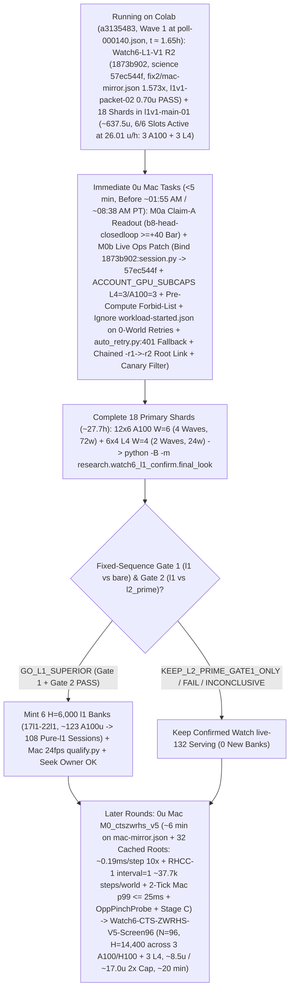

# T34 ExIt-B8 Research Roadmap (Round-26 Synthesis — Advice, Not Decisions)

Start: [project index](../INDEX.md) · [current status & authority](../STATUS.md) · [research record index](INDEX.md) · [study packages](../../research/INDEX.md) · [campaign log](final_run_20261019/CAMPAIGN_LOG.md).

> [!IMPORTANT]
> **Status: Research advice, NOT ratified decisions or release authorization.**
> Every current-round and later-round plan on this page is synthesized advisor guidance from Round 26 (2026-11-01 PT; primary synthesis artifact: `snake-dqn-artifacts/big-lever/exp/argon-rounds/round-26/synthesis/answer.md`, reconciling `round-26/{current,later,process}/answer.md` and `round-25/synthesis/answer.md` against `HEAD` `e3be0e72` and superseding Rounds 01–25). Nothing here amends a pre-registration, ratifies a confirmation gate, or changes served defaults. Binding campaign authority remains [`SUCCESS_CONTRACT.md`](final_run_20261019/SUCCESS_CONTRACT.md), [`DESIGN_V2_SHADOW.md`](final_run_20261019/DESIGN_V2_SHADOW.md) (+ Amendment 1), [`P7_STATISTICS.md`](final_run_20261019/P7_STATISTICS.md), unsuperseded parts of [`FINAL_PLAN.md`](final_run_20261019/FINAL_PLAN.md), and [`STATUS.md`](../STATUS.md); any serving or release change requires confirmation-lane evidence, Mac serving qualification, and the owner's explicit OK.

---

## 1. Snapshot Context & Code-Verified Round-26 State (`e3be0e72`, Nov 1)

### 1.1 Watch6 V3 `GO_EFFICACY_ONLY`, Watch `live-132` release, all-length screen, `DeviceSim` parity & live `Watch6-L1-V1` (`l1v1-main-01` Wave-1 at `poll-000140.json`, `t ≈ 1.65 h`, `6/6` Colab slots at `26.01 u/h`)

- **Watch6 V3 confirmation finished — `GO_EFFICACY_ONLY` (`52135312`, 2026-11-01 14:40 PT)** ([`REGISTRATION_V3.md`](../../research/watch6_search_efficacy_v3/REGISTRATION_V3.md), `t34-sol/watch6-v3-final-look-20261101/final-look-01/final_look.json`):
  - Sole registered final look (`75471246` V6.1 adapter) over all **`96/96` primary `H = 14,400` (`10 min @ 24 fps`) Watch6-v2 pairs** (`0` reserves, `24/24` L4 `W = 4` shards in `28` attempts — shards `00, 09, 12, 19` passed on single retry after the `09:16 PT` Fable-ratified quarantine of `23` historical non-V3 H100-503 manifests; `2,764,800/2,764,800` live-mirror frames matched):
  - **`Δdeaths/1k = -0.125`** (`CI95 [-0.153, -0.097] < 0`; `0.1580` vs `0.2830`, **`-44.2%`**) and **Fieller pooled mean-mass ratio `+63.7%`** (`CI95 [+49.8%, +78.5%] >= -5%`; **`+214.12` mass**, `550.25` vs `336.13`), with boost `0.733%` vs `0.625%`, `mean_max_length = 1,073.4` (peak `L <= 2,296`) vs `780.9`, and **`2,549.4` mean branches/session** (`5.67×` `H = 6,000`'s `449.6`, confirming superlinear late-horizon branch growth) $\Rightarrow$ **`ELIGIBLE_FOR_REPLAY_QUALIFICATION` for `exact-stop-l2-prime` (`L >= 600`) only**.
- **Watch `live-132` serving guards, Mac `24 fps` qualification & release — ALREADY LANDED (`dc834ded`–`f5912f44`, ~16:00 PT):**
  - [`.claude/launch.json`](../../.claude/launch.json) (`lines 8–11`) serves confirmed **`watch-replay-bank-live-132`** (`132` `exact-stop-l2-prime` `H = 6,000` sessions from banks `01–08, 10–12`) with **`SNAKE_WATCH_REPLAY_CONTROLLER=exact-stop-l2-prime`** on `:8000` (retaining `watch-replay-bank-live-168` on disk while `exact-stop-l1` runs `H = 14,400` confirmation).
  - [`GameSession`](../../web/backend/session.py) gates Watch replay on [`_is_clean_mixed_watch6_b8()`](../../web/backend/session.py) (`lines 722–753`) across `__init__` (`line 573`), `_build` (`line 769`), `reset_game` (`line 1261`), and `set_mode` (`lines 1520, 1563, 1576`); refuses `MODE_TRAIN` on forward-only `EGO2S_OBS_SPECS`, `(RASTER31V2, RASTER31V3)`, and un-overridden `_reward_contract_mismatch` **before** calling `_leave_watch_replay()` (`lines 1510–1550`, with replay recovery on Watch fallback); and scopes `_replay_opted_out = True` to `set_epsilon` (`line 1204`), live `set_hero` change (`line 1222`), and `set_food` (`line 1241`), cleared by `_build` (`line 763`) and [`new_game()`](../../web/backend/session.py) (`lines 1279–1284`, wired to `"new_game"` in [`app.py`](../../web/backend/app.py) `line 311`).
  - [`ReplayBank`](../../web/backend/watch_replay.py) (`lines 348–417`) implements `SNAKE_WATCH_REPLAY_CONTROLLER` (`all | exact-stop-l2-prime | exact-stop-l1`, failing closed to live B8 on invalid values), line-1 [`peek_header`](../../web/backend/watch_replay.py) (`lines 138–150`, `0` non-target `verify_payload` decodes), cycle-1 `shuffle_discovery: bool = True`, shallow [`Recording.snapshot`](../../web/backend/watch_replay.py) (`lines 315–330`), and **`0.25 ms`-slice / `64`-frame cooperative GIL yield (`max(1.0 ms, 4.0 * slice_elapsed)` = `<= 20%` GIL duty cycle)** in [`verify_payload`](../../web/backend/watch_replay.py) (`lines 30–33, 244–275`).
  - [`research/watch_replay/qualify.py`](../../research/watch_replay/qualify.py) (`t34-sol/argon-replay-qual/SUMMARY.md`, Fable review `APPROVE_WITH_CONDITIONS` with `C1–C3` resolved at `fec81656`) passed `132/132` inventory parity, cold session readiness **`0.349–0.435 s` (`< 0.45 s`)**, concurrent cold-verification live-B8 fallback **`update p95 = 8.78 ms <= 11.688 ms`**, **`0/120` paced-`24 fps` overruns** (`step p99 = 11.34 ms <= 41.67 ms`), and seamless recorded playback cutover after **`~18.5–23.1 s`** (`recorded update p95 = 0.002 ms`).
- **All-length exact-stop screen — `ADOPT` for new replay banks; `36` `l1` sessions staged for `Watch6-L1-V1`** ([`watch6_alllen_screen`](../../research/watch6_alllen_screen/README.md), `t34-sol/argon-alllen-a100/analysis.json`, `N = 48` paired `H = 6,000` Watch6-v2 sessions):
  - `exact_stop_alllen` (`L >= 1`, `interval = 5`, `H = 300`) reached **`559.43` mass** (`+208.37` / Fieller `+59.35%` vs `bare` `351.07`; **`+98.27` / Fieller `+21.31%` vs `l2_prime_600` `461.16`**, `CI95 [+50.57, +145.98]`) and **`0.0521` `deaths/1k`** (`-81.9%` vs `bare` `0.2882`; **`-67.4%` / `-0.1076/1k` vs `l2_prime_600` `0.1597`**, `CI95 [-0.1609, -0.0544]`), cutting `L < 600` deaths **`53 (bare) / 34 (L >= 600) -> 1`** (`mean_max_length = 1,096.0`) at **`2.821×` branches** (`1,268.5` vs `449.6`, `1,200.1` roots = **`1.057` branches/root**, stopping on `bare` at **`94.3%`** of roots). **`14/15` remaining deaths occur at `L >= 600` (`13/15` at `L >= 800`, `-14.2%` per-frame `L >= 800` hazard at `1.379×` living exposure), while per-session comparisons vs `l2_prime_600` show `14/48` (`29.2%`) mass losses (`27` wins, `7` ties) and `3/48` worlds with more deaths (`idx 36` `seed = 3075941873`, `idx 39` `seed = 3394546952`, `idx 47` `seed = 121131908`) due to modulo-5 phase shift (`DenseTrigger.fires()` in `trigger.py:35-42`) and inter-root unshielded `bare` ticks (`frame % 5 != 0` in `watch_replay/engine.py:146`).**
  - Three `12`-session A100 banks (`14l1–16l1`, `W = 6`, `H = 6,000`, `t34-sol/argon-banks-l1/SUMMARY.md:38-40`) completed `36/36` on Cap-6 `36285bc6` in **`3.03–3.07 h/bank`** (**`~61.5 A100 u` total**). They remain unserved on disk (`watch-replay-bank-live-168`) pending `H = 14,400` `Watch6-L1-V1` confirmation, Mac qualification, and owner OK.
- **GPU `DeviceSim` v2 parity — `PASS` on A100** ([`devicesim_v2_parity`](../../research/devicesim_v2_parity/README.md), commit `b500d111`): **`0` mismatches** across **`1,536,000` snake-ticks** (`E = 256 × 1,000` Watch6-v2 ticks, `1,434.6` steps/s under SplitMix64 RNG and `<= 1e-4` CUDA FP32 near-tie tolerances; SplitMix64 cannot mint MT19937 live Watch replay banks).
- **`Watch6-L1-V1` R2 Ratified (`1873b902` / `93c77f43`), `l1v1-packet-02` Canaries Passed & `18` Primary Shards Running (`l1v1-main-01`, `a3135483`, Wave 1 at `poll-000140.json`, `t ≈ 1.65 h` on `6/6` Colab Slots at `26.01 u/h`):**
  - [`research/watch6_l1_confirm/`](../../research/watch6_l1_confirm/) (`7,105` LOC; [`REGISTRATION_L1_V1.md`](../../research/watch6_l1_confirm/REGISTRATION_L1_V1.md) SHA-256 `8b46779ff52d0c9648ff8de00c1893f77beb9bd99eb4a4e51afbe0bdf36800a0`; initial `cf07791b` science identity `c015d5cb906066842c04202b66dac778eb04fb0b9b917882e1385a0e4474e84f`) was initially ratified pre-data by Fable (`t34-sol/argon-l1v1-pkg/RULING_L1_V1.md`; per Fable Condition 1, never cite `argon-l1v1-pkg-fix1/SUMMARY.md` or non-existent `prepare-receipt.json`).
  - **Two Full-`14,400`-Frame Mac 3-Arm Mirror Receipts (`fix1/mac-mirror.json` `de43850b…` & R2 `fix2/mac-mirror.json` `e89cc8c2…`):** On excluded fixture seed `34910101`, `{bare, l2_prime, l1}` passed **`43,200/43,200` mirrored frames (`0` mismatches)** across both Mac mirror runs (`1.272×–1.573×` 3-arm `l1 / (bare + l2_prime)` wall ratio per Fable R2 Condition 5):
    - `t34-sol/argon-l1v1-pkg-fix1/mac-mirror.json` (SHA-256 `de43850bc67bc230d6803335a6ce4635ac12767cc22354f5b28b92bc0a83a476`): `bare` `291.8 s` (`2` deaths), `l2_prime` `1,343.5 s` (`1,811` branches, `2` deaths), `l1` `2,079.7 s` total / `1,763.9 s` search (`3,108` branches across `2,880` roots = **`1.079` branches/root**, `567.5 ms/branch`, **`1.892 ms/step`**, `612.5 ms/root`, `1` death at **`L = 1,694`** where both `l1` and `l2_prime` died after `l1` eliminated `l2_prime`'s `L = 307` death), **`1.272×`** wall ratio, and **`1.115×`** serpentine step-cost ratio ($L = 150 \to 1,500$, `1.997 -> 2.227 ms/step`).
    - `t34-sol/argon-l1v1-pkg-fix2/mac-mirror.json` (SHA-256 `e89cc8c2ca8f5c3e5e96c9b24bd4f7e5538a787bbf1c753ae2ce940509b47079`, commit `1873b902`, `science = 57ec544fe45f7a8a876dbc9363048468b63358e224b2ee8e11dff41401dcfbd3`): `bare` `296.4 s`, `l2_prime` `1,325.4 s`, `l1` `2,550.7 s` wall / `2,190.2 s` search (`3,108` branches across `2,880` batches, `4,428,215` kernel rows, `2.035–2.105 ms/step` serpentine probe), **`1.573×`** wall ratio.
  - **`l1v1-packet-01` Canary Failure, Fable R2 Ruling (`1873b902` / `93c77f43`), `l1v1-packet-02` Canaries Passed & `l1v1-main-01` Wave-1 Progress (`poll-000140.json`, `t ≈ 1.65 h`):** After `l1v1-packet-01` canaries (`0.447 A100 + 0.103 L4 = 0.55 u` observed) failed with `CHILD_NONZERO_EXIT` on `job.sh:21` `COLAB_EXPORT_DIR: unbound variable` (`runtime.py:575-576` sets `COLAB_OUTPUT_DIR`), commit `1873b902` (`t34-sol/argon-l1v1-pkg-fix2/SUMMARY.md`) patched [`job.sh:21-45`](../../research/watch6_l1_confirm/job.sh) (`COLAB_OUTPUT_DIR` + `--fixture-horizon 6`) under science identity **`57ec544f…`**, Fable issued `t34-sol/argon-l1v1-pkg/RULING_L1_V1_R2.md` (`APPROVE-WITH-CONDITIONS`, amending `REGISTRATION_L1_V1.md` §5.2 canary `H=60 -> H=6` and retiring `cf07791b` to `superseded-cf07791b/`), rebuilt `t34-sol/l1v1-packet-02` canaries **passed** (`A100`: `365.4 s`, `0.574 u` observed / `0.688 u` priced; `L4`: `421.0 s`, `0.126 u` observed / `0.157 u` priced = **`0.70 u` observed**, `stop_verified = true`, `7/7` exports), and [`finalize.py`](../../research/watch6_l1_confirm/finalize.py) sealed and launched all `18` single-wave primary shards (`t34-sol/l1v1-main-01`, commit `1873b902`, `science = 57ec544f…`, `inputs/input-metadata.tar.gz` SHA-256 `cb72db0fa3e595e5c8284b76709e44257a49505fa649a4734d349dc9df585999`, **`~636.8 u` central** = `558.6 A100 + 78.1 L4 u`, **`~637.5 u` w/ `0.70 u` `l1v1-packet-02` canaries**, linear-to-p95 range `598.1–739.5 u`, **`~27.7 h` calendar wall**) at `19:10 PT` (`a3135483`). At `poll-000140.json` (`t ≈ 1.65 h`), all **`6/6` active Wave-1 shards** (`3 A100` `shard-00, 02, 04` at `5,100–5,640 s` @ `6.73 u/h` + `3 L4` `shard-12, 13, 14` at `4,440–4,680 s` @ `1.94 u/h` = `26.01 u/h`, input uploads `6.36–119.34 s / 150 s`, balance `2,106.84 u` at calibration / `~1,515 u` post-run) have crossed `1–2` intra-world `H = 14,400` arm boundaries (`{bare, l2_prime, l1}`); `done = 0` is expected until all `3` arms complete (`first L4 exits ~01:55 AM PT`).

### 1.2 Closed single-pass critics, distillations, RL, and standalone macro fallbacks

Between 2026-10-29 and 2026-11-01, every single-pass learned-policy, critic, distillation, and standalone macro-fallback track closed below its promotion or selectivity bars:

| Track | Scope & primary artifact | Measured outcome | Disposition |
| --- | --- | --- | --- |
| **TRAIN-01** ([`sandbox_a_resident`](../../research/sandbox_a_resident/README.md)) | `100.7M`-row (`384`-update) GPU-resident PPO from `b8-s3` (`t34-sol/train01-closeout/SUMMARY.md`) | H5000 equal-mix paired mass **`+8.09`** (`CI95 [-18.66, +34.85]`; scripted `+26.32`, frozen `+2.85`, mixed `-4.90`; update-320 peak `+14.23` `[-11.86, +40.32]`) vs bar `>= +40` | **Closed** (no strict-gate nomination) |
| **C/T Stage-2 distillation** | Continuation-teacher causal-root distillation (`t34-sol/ct-stage2-verdict/SUMMARY.md`) | Teacher rescued **`22/32` (`68.75%`)** deaths (`22/32 <= 65` ticks; indep-suffix H300 `+66.77`, `LB90 +23.96`), but student retention was **`46.9–50.0%`** (`0 pp` over `frozen_phi` vs `>= +15 pp`; topology AUC `0.5752 < 0.83`), ordinary flips **`44.4–64.5%`** (bar `<= 1%`), and lethal ordinary flips **`3–5`** (bar `<= 1`) | **`FAIL_DISTILLATION_RETENTION_OR_SAFETY`** |
| **Doom U-Net & `spatial-student-pilot`** | `83 × 145` spatial U-Net vs 33.7k B8-feature head (`t34-sol/doom-result-01/result.json`; `t34-sol/student-direction/{astra,fable}.md`) | Spatial U-Net lost late per-action doom ROC-AUC to frozen B8 features (**`0.753` vs `0.810`**, `Δ = -0.056`, `CI95 [-0.091, -0.023]`; all-strata death-lookback `0.7626` vs `0.8226`; ordinary late `0.690` vs `0.706`) | **`GRAY` / `40–48 A100 u` pilot fit canceled (`0 u`; retain `.so` caches)** |
| **B8 advantage head (offline OOF)** | `256 -> 128 -> 6` ReLU head on frozen B8 features (`t34-sol/b8-head-test/RESULT.md`) | Mass rule `GO` (late H300 `+30.09`, `LB90 +23.96`), Fable selectivity **`FAIL`**: **`26.42%`** late rescue (bar `>= 35%`) at **`97.60%`** non-death flips (bar `<= 15%`) | **Selectivity `FAIL`** (192-world closed-loop A100 `rc = 0`, awaiting Mac `M0a` readout) |
| **T4 Gate-1 factored critic** ([`t4_gate1`](../../research/t4_gate1/README.md)) | Clean-slate privileged `83 × 145` (`H = 320` 7-source BFS) hazard + foraging mass-flux critic on `384` disjoint Watch6-v2 worlds (`t34-sol/argon-t4-gate1-fix2/queue-03/READOUT.json`) | **`0/8` bars passed**: `L >= 600` residual EV **`+0.0266`** (`[-0.0280, +0.0869]` vs `>= 0.25`), death-root H300 rescue **`+19.99`** (vs `>= +40`), mature doom AUC **`0.5617`** (vs `>= 0.80`), ordinary H300 mass **`-22.21`** (vs `>= -15.0`), lethal flips **`3.13%`** (vs `<= 3.0%`) | **`KILL_T4`** (proves even privileged `83 × 145` critic lacks late value signal) |
| **R6 `L < 600` harvest census** ([`r6_l600_census`](../../research/r6_l600_census/README.md)) | `64`-world (`384`-root) Watch6-v2 early-game counterfactual + 5-fold OOF corpse/trail plane probes (`t34-sol/argon-mac-checks/r6-census/RESULT.json`) | **`34.90%` (`134/384`)** oracle-harvestable roots (`>= +5` H500 mass), **`7.69%`** non-bare H500 lethal flips, OOF ROC-AUC **`0.474–0.521`** (`0` passing threshold points); superseded operationally by `exact-stop-l1` | **`KILL`** |
| **R7 macro-option fallback** ([`r7_macro_fallback`](../../research/r7_macro_fallback/README.md)) | Pruned depth-2 (`2K = 30` ticks) spatial macro-options `{O_0..O_5}` on C/T train `1-step-all-die` roots (`t34-sol/argon-r7-repack/R7_READOUT.json`) | `3/5` bars passed (`0.316 ms` Mac 1-thread p95; **`33.0%` vs `9.0%`** `L >= 800` `all_die_sel0` rescue on `25/129` roots — `9/25` `36.0%` `macro_triggered` at `+66.7 pp` rescue vs `16/25` tick-`30` B8 re-traps, while `104/129` `80.6%` survived `H = 300` inside uncertified coils), but total `L >= 600` lift **`+3.85 pp`** (`< +10.0 pp`) and **`2 > 0`** ordinary lethal flips (`0` assessment roots opened) | **`KILL`** as standalone `30`-tick fallback |

### 1.3 Live `l1v1-main-01` Traps Armed on Disk (`e3be0e72`) & Code-Verified `CTS-ZWRHS-L1-v5` Advances (`~0.19 ms/step`, `RHCC-1` `interval = 1`)

1. **Live Trap 1 — The `retry_limit = 1` Zero-Retry Cliff on `shard-01, 03, 05`, Missing `output / "manifest.json"` Fallback at `auto_retry.py:401`, & the `~01:55 AM PT` / `~08:38 AM PT` `3`-Slot A100 Wall ([`CAMPAIGN_LOG.md:2111`](final_run_20261019/CAMPAIGN_LOG.md#L2111), [`ready_queue.py:40,335,641,682`](../../tools/ops/ready_queue.py), [`auto_retry.py:334-337,364-407`](../../tools/ops/auto_retry.py), [`dispatch.py:2935`](../../tools/ops/dispatch.py), `t34-sol/l1v1-main-01/output-shard-{01,03,05}/receipt.json`):**
   - None of Round 25's code patches have landed on `main` yet (`e3be0e72` is docs-only). At `19:10:40 PT`, [`ready_queue.py`](../../tools/ops/ready_queue.py) (`ACCOUNT_ASSIGNMENT_CAP = 6`, `ACCOUNT_L4_CAP = 3` at `line 40`, no `ACCOUNT_A100_CAP = 3`) launched `6` A100 shards (`00..05`): `shard-00, 02, 04` took the `3` A100s (`20.19 u/h`); `shard-03` hit HTTP `412` (`assignments: 3.0`, `3.43 s`, `0` exports) leaving `cleanup_error: "ALLOCATION_UNRESOLVED: retained pending record"`; and `shard-01` (`1.7 ms`) + `shard-05` (`1.6 ms`) failed on the `pending` fence because single-GPU [`dispatch.py:2935`](../../tools/ops/dispatch.py) skips `reconcile_unavailable()` (`line 2890`). At `19:12 PT`, [`retire_unavailable()`](../../tools/ops/ready_queue.py) (`lines 419–460`) unlinked `shard-03`'s `pending` record and [`reconcile()`](../../tools/ops/ready_queue.py) (`lines 324–395`) queued `shard-01, 03, 05` into `ops/auto-retry/<id>/` with **`"completion_attempt": 1`** ([`auto_retry.py:407`](../../tools/ops/auto_retry.py)) while launching `shard-12, 13, 14` (`3` L4s) alongside `shard-00, 02, 04` (`3` A100s).
   - Because all `18` rows in `l1v1-main-01` were enqueued with **`retry_limit = 1`** ([`CAMPAIGN_LOG.md:2111`](final_run_20261019/CAMPAIGN_LOG.md#L2111)), [`completion_limit()`](../../tools/ops/auto_retry.py) (`lines 334–337`) returns **`maximum = min(2, 2, 1) = 1`**, and `shard-01, 03, 05` already have **`attempt == 1 == maximum == 1` (`0` retries left)**. Furthermore, [`auto_retry.py:364-401`](../../tools/ops/auto_retry.py) lacks a `research/watch6_l1_confirm/` branch in `package_check()` (`line 364`) and unconditionally reads `output / "manifest.json"` at `line 401`, raising **`FileNotFoundError`** when a `1.6 ms` pre-allocation `Refused` exit (`shard-01, 05`) leaves `0` files in `output/`.
2. **Live Trap 2 — `write_once` `.sha256`/`.complete` Sidecars in `_prealloc_tree_clean()` & `exports/workload-started.json` at `t = 0 s` Poisoning `0`-World Retries ([`supervisor.py:976-977,2019-2024`](../../research/colab_cli/supervisor.py), [`run.py:124-140,196-210`](../../research/watch6_l1_confirm/run.py), [`auto_retry.py:265-270`](../../tools/ops/auto_retry.py), [`admission.py:55-67,474-519`](../../research/watch6_l1_confirm/admission.py)):**
   - **Why Round 25's filename allowlist is insufficient:** [`supervisor.py`](../../research/colab_cli/supervisor.py) writes `.sha256` and `.complete` sidecars on *every* file via `write_once`, whereas [`ALLOWED_PREALLOC_FILES`](../../research/watch6_l1_confirm/admission.py) (`lines 55–67`) in [`_prealloc_tree_clean()`](../../research/watch6_l1_confirm/admission.py) (`lines 474–490`) admits only `{manifest,receipt,unavailable}.json{,.sha256,.complete}` — rejecting `accounting-baseline.json.{sha256,complete}`, `terminal.json*`, `public-input-preflight.json*`, `upload-measurement.json*`, and `staging/`. Replacing the filename allowlist in `_prealloc_tree_clean()` with a **pre-compute forbid-list** (rejecting only if `exports/` has `world-*.json` or any `poll-*.json`/`telemetry-*.json`/`hardware.json`/`exec-*.json` exists) repairs both [`final_look.py:317`](../../research/watch6_l1_confirm/final_look.py) and [`resume.py:44`](../../research/watch6_l1_confirm/resume.py).
   - **`exports/workload-started.json` at `t = 0 s`:** [`run.py:196-210`](../../research/watch6_l1_confirm/run.py) publishes `exports/workload-started.json` before `ProcessPoolExecutor` starts any world, and [`supervisor.py:2019-2024`](../../research/colab_cli/supervisor.py) downloads it on poll `0` (`~15 s`). Any WebSocket drop during the `~6.7 h` single-wave window leaves `0` `world-XX.json` files, yet [`auto_retry.py:265-270`](../../tools/ops/auto_retry.py) (`receipt.get("exports") != []`) and [`admission.py:503-519`](../../research/watch6_l1_confirm/admission.py) reject it as non-zero exports and count it against `MAX_COMPUTE_COMPLETIONS_PER_SHARD = 2`. Ignoring operational markers `{"workload-started.json", "performance.json"}` keeps `0`-`world-*.json` drops in Tier 0 (`next_attempt = attempt`, `prestart_attempt < 6`, `0` re-canaries).
   - **Dual `.complete` per world at `t ≈ 6.7 h`:** [`_publish_world_unit()`](../../research/watch6_l1_confirm/run.py) (`lines 124–140`) publishes `2` `.complete` files (`world-XX.json` + `.meta.json`) per world (`8–12` files when `W = 4..6` workers finish together), forcing [`supervisor.py:976-977`](../../research/colab_cli/supervisor.py) (`len(batch) > 1`) onto WebSocket `export_batch` RPCs (`max_export_bytes = 4 MiB`; `6` worlds are `< 3.0 MiB < 4 MiB` during `l1v1-main-01`, while single-file unit export lands post-`L1-V1` since `run.py` is in `SCIENCE_PACKAGE_MODULES`).
3. **Live Trap 3 — Non-Mutating `57ec544f…` Binding, Chained `-r1 -> -r2` Unallocated Gap in `final_look.py`, Cold-Start `GuardError`, & Polling-Count Lag ([`protocol.py:73-82,251-280`](../../research/watch6_l1_confirm/protocol.py), [`final_look.py:368-459,603,674,802`](../../research/watch6_l1_confirm/final_look.py), [`admission.py:316,665,871`](../../research/watch6_l1_confirm/admission.py), [`auto_retry.py:296-301`](../../tools/ops/auto_retry.py)):**
   - **Non-mutating blob binding:** [`protocol.py:75,270-280`](../../research/watch6_l1_confirm/protocol.py) hashes `digest("research/watch6_l1_confirm/protocol.py")` and `1873b902`'s `web/backend/session.py` (`da7b4971…`) into `57ec544f…`, while `main` (`fec81656`) updated `web/backend/session.py` (`2df8bb76…`) and [`final_look.py:674,802`](../../research/watch6_l1_confirm/final_look.py) calls [`mirror.validate()`](../../research/watch6_l1_confirm/mirror.py) and [`resume.build()`](../../research/watch6_l1_confirm/resume.py). Bind `1873b902:web/backend/session.py` (`da7b4971…`) into `p.identity()` inside `final_look.py`, `prepare.py`, and `recover.py` (excluded at `protocol.py:251-256`).
   - **Chained `-r1 -> -r2` unallocated gap:** In [`final_look.py:388-401,459`](../../research/watch6_l1_confirm/final_look.py), if a shard's base attempt wrote `output-shard-XX/receipt.json` (`parent = None`) and `-r1` fails unallocated (`unavailable.json`, no receipt), `-r2`'s `unalloc_ref` sets `parent_of[att2] = None` (`found 2` roots crash); link `parent_of[att2] = att0.receipt_path` when `unalloc_ref` bridges an unallocated gap after an existing base root `att0`, accept `0 <= top_comp <= 2` (`line 369`), filter canaries before `line 603`, and admit `KERNEL_CREATION_GUARD_ERROR` (`admission.py:316`) + polling-count lag `AccountingError` (`admission.py:665`, `auto_retry.py:296-301`).
4. **Search & Kernel Advances in `CTS-ZWRHS-L1-v5` (`1.892 ms` $\to$ `~0.19 ms/step`, `10.0×` Speedup; `RHCC-1` `interval = 1` at `~37.7k` Steps/World; 2-Tick Mac Live Serving `p99 <= 25 ms`; `OppPinchProbe`):**
   - **Two post-move parity bugs in Round 25's `slot_pad` $O(1)$ TTL formula ([`v8_nb.py:217,753-843`](../../src/simd_env/v8_nb.py)) + `_region_kernel` modulo elimination ([`ego_raster_nb.py:570-592`](../../src/simd_env/ego_raster_nb.py)):** Pre-move `owner_pad` marks all `n = seg_count[e, s]` cells whereas `_eager_templates_owner` stamps only `j < max(0, ln - nh)` (`1..3` vacating tail segments) and overrides `(nx, ny)` (`rel_st[head] = 0`) and boost `(ix, iy)` (`when = lpost`). Passing scalar `(max_j = max(0, ln - nh), ix, iy, nx, ny)` into `_bfs_owner` restores **100% bitwise parity** (`0` body walks), while temporarily unmarking the `<= 6` tail-tip cells (`seg_count == length` and `k == seg_count - 1`) in `_region_kernel` + passing `hero_policies=[]` to `_dispatch_actions` cuts `E = 1` step time from `0.24 ms` to **`~0.19 ms/step` (`10.0×` vs `1.892 ms`)**.
   - **Receding-Horizon Incremental Continuation (`RHCC-1`, `interval = 1` at `1` step/frame = `~37.7k` steps/world, `10.3×` fewer than `v4`, `~14.5 s/world`) + 2-tick Mac live serving (`p99 <= 25 ms`) + `OppPinchProbe`:** Advancing the deterministic leaf clone $\hat{w}_{t+128} \to \hat{w}_{t+129}$ by `1` step/frame (`~0.19 ms`, with an 8-slot snapshot ring every 16 steps) delivers every-frame (`interval = 1`) `128`-step lookahead, eliminating `interval = 5`'s 4-frame blind spot (`25/129` `1-step-all-die` roots in `R7_READOUT.json:164`) and `80%` modulo-5 phase shift (`29.2%` mass-loss worlds in `analysis.json`). Splitting rare (`1.1%`) Stage-B rollouts into two `64`-step slices (`~21 ms/frame` across frames $t$ and $t+1$) keeps single-process Mac Watch **`p99 <= 25.0 ms < 33.0 ms`** (`0` worker processes), and `OppPinchProbe` (`+2` Stage-B rows forcing $K_{\text{opp}} = 8$ cutoff moves when a threat opponent has `OUTCOME_NO_SPACIOUS` or a second-best `v8` cutoff within $\delta S \le 0.15$ at [`v8_nb.py:898`](../../src/simd_env/v8_nb.py)) guards against opponent cutoff tie-breaks.

---

## 2. Current-Round Plan (Advice, Not Decisions)

### 2.1 `0 u` Mac `M0a` Claim-A closeout (`< 2 min`) & C4 telemetry

1. **Run `M0a` Claim-A readout (`< 2 min` Mac, `0 u`) & enforce binding v1 `H = 5,000` `>= +40` closure bar:**
   - Run [`closedloop_readout.py`](../../research/INDEX.md) (`t34-sol/b8-head-closedloop/SUMMARY.md:50-52`, `origin/astra-doom-auc-smoke` @ `591d94c3`) on completed `b8-head-closedloop` (`N = 192` v1 `H = 5,000` worlds, `m in {0, 10, 25, 50}`, `4.51 A100 u`). Audit `spatial-qbytes-01` (`t34-sol/spatial-qbytes-fix/SUMMARY.md:85-88`) strictly as a Q-byte/`.so` cache ruler (`40–48 A100 u` `spatial-student-pilot` fit stays canceled at `0 u`).
   - **Recommended Claim-A kill rule:** Permanently **close Claim A (`0 u`)** if no `m in {0, 10, 25, 50}` clears [`SUCCESS_CONTRACT.md`](final_run_20261019/SUCCESS_CONTRACT.md) §2 (`lines 29–33`) and [`P7_STATISTICS.md`](final_run_20261019/P7_STATISTICS.md) §§3–4 (`lines 33–48`): pooled `Δmass >= +40.0`, Bonferroni-4 `LB97.5 > 0`, scripted Guard B `>= +0.03` (`0` mix losses), Guard A `Δalive >= -0.05` pooled / `>= -0.075` single mix, and living overrides `<= 15%`.
2. **Monitor live `:8000` `watch-replay-bank-live-132` C4 telemetry (`0 u`):**
   - Keep `watch-replay-bank-live-132` (`exact-stop-l2-prime`) live on `:8000`, monitor `update_ms` / overrun telemetry (Fable C4), and mint **`0`** new `.watch.gz` banks before `Watch6-L1-V1`'s verdict lands.

### 2.2 `0 u` Mac `M0b` Live `l1v1-main-01` Ops & Final-Look Patch (`< 3 min`, Before `~01:55 AM PT` / `~08:38 AM PT`)

Work in a clean worktree with live runs/`ops/`/`exports/`/`pair-*.json` untouched, leaving `protocol.py`, `run.py`, `main`'s `web/backend/session.py`, and `research/colab_cli/*` (`36285bc6`) unedited while binding `1873b902:web/backend/session.py` (`da7b4971…`) into `p.identity()` so `p.identity() == "57ec544fe45f7a8a876dbc9363048468b63358e224b2ee8e11dff41401dcfbd3"` holds across `ratify.py`, `mirror.py`, `resume.py`, and `final_look.py`:

1. **Enforce `ACCOUNT_GPU_SUBCAPS = {"L4": 3, "A100": 3}`, define Tier-0 retry eligibility by `0` `world-*.json` units (ignoring `workload-started.json` / `performance.json`), bypass `attempt >= maximum` (`retry_limit = 1`), & fall back to `read(manifest)` at `auto_retry.py:401`:**
   - Enforce `ACCOUNT_GPU_SUBCAPS = {"L4": 3, "A100": 3}` inside `ops/alloc.lock` before `mkdir` in [`ready_queue.py:40,641,682`](../../tools/ops/ready_queue.py) and [`dispatch.py:2820-2935`](../../tools/ops/dispatch.py) (with single-GPU HTTP 412/503 `reconcile_unavailable()`) so neither the `t ≈ 6.71 h` (`~01:55 AM PT`) L4 Wave-1 gap nor the `t ≈ 13.42 h` (`~08:38 AM PT`) permanent `3`-open-slot L4 Wave-2 finish can fire queued A100 shards into the `3`-A100 wall.
   - Ignore `{"workload-started.json", "performance.json"}` in [`auto_retry.py:265-270`](../../tools/ops/auto_retry.py) and [`admission.py:503-519`](../../research/watch6_l1_confirm/admission.py) so `0`-`world-*.json` drops stay Tier-0 (`next_attempt = attempt`, `prestart_attempt < 6`, bypassing `if attempt >= maximum` on `retry_limit = 1` in [`ready_queue.py:335`](../../tools/ops/ready_queue.py) and [`auto_retry.py:397`](../../tools/ops/auto_retry.py)); fall back to `read(manifest)` at [`auto_retry.py:401`](../../tools/ops/auto_retry.py) when `output / "manifest.json"` is absent on `0`-file `Refused` exits (`shard-01, 05`); and add `research/watch6_l1_confirm/` to [`auto_retry.py:364`](../../tools/ops/auto_retry.py) `package_check()`.
2. **Replace `_prealloc_tree_clean()`'s allowlist with a pre-compute forbid-list; admit `KERNEL_CREATION_GUARD_ERROR` & polling-count lag; bind `1873b902:web/backend/session.py` into `p.identity()`; filter canaries before `final_look.py:603`; and link `unalloc_ref` after base root `att0` to `att0.receipt_path`:**
   - Replace the brittle filename allowlist in [`_prealloc_tree_clean()`](../../research/watch6_l1_confirm/admission.py) (`lines 55–67, 474–490`, repairing both `final_look.py:317` and `resume.py:44`) with a forbid-list (reject only if `exports/` has `world-*.json` or any `poll-*.json`/`telemetry-*.json`/`hardware.json`/`exec-*.json` exists, so `write_once` `.sha256`/`.complete` sidecars on `accounting-baseline.json*`, `upload-measurement.json*`, `public-input-preflight.json*`, `terminal.json*`, and `staging/` pass automatically); admit `"kernel creation already attempted; refusing uncertain retry"` ([`admission.py:316`](../../research/watch6_l1_confirm/admission.py)) and polling-count lag `AccountingError` ([`admission.py:665`](../../research/watch6_l1_confirm/admission.py), [`auto_retry.py:296-301`](../../tools/ops/auto_retry.py)); and enforce `0 <= top_comp <= 2` in [`admission.py:871`](../../research/watch6_l1_confirm/admission.py) and [`final_look.py:369`](../../research/watch6_l1_confirm/final_look.py).
   - Bind `1873b902:web/backend/session.py` (`da7b4971…`) into `p.identity()` in [`final_look.py`](../../research/watch6_l1_confirm/final_look.py), [`prepare.py`](../../research/watch6_l1_confirm/prepare.py), and [`recover.py`](../../research/watch6_l1_confirm/recover.py); filter `canary.is_canary(data) or WATCH6_FIXTURE == "1"` before [`final_look.py:603`](../../research/watch6_l1_confirm/final_look.py) (`lines 603, 662, 674, 683`); prefer `prior_rec_path in by_receipt_path` at [`final_look.py:380`](../../research/watch6_l1_confirm/final_look.py); and when `unalloc_ref` bridges a chained `-r1 -> -r2` unallocated gap (`unavailable.json`) after an existing base root `att0`, link `parent_of[att2] = att0.receipt_path` (`0` dual-root crashes at `line 459`). Defer single-file unit export (`run.py`), `science-contract.tar.gz` split (`uploads.py`), and `colab_cli` changes (`cli.kernel_idle()`, `PROVIDER_COUNT_LAG`, `DEFAULT_TRANSFER_SECONDS = 300.0`, `canary.py:318` `verified-ledger.json` SHA exemption) to post-`L1-V1` `requalify.sh`.
3. **Verification & kill rule (`M0b`):** Verify on 5 synthetic fixtures under `sys.addaudithook` (`0` non-`digest()` `world-*.json` opens) and check `6`-world batch size (`< 3.0 MiB < 4 MiB`). Block `ready_queue` reload / final-look seal if `p.identity() != "57ec544f…"`, if any of the 5 fixtures fails or opens `world-*.json` outside `digest()`, if `shard-01, 03, 05` hit `attempt >= maximum` or `FileNotFoundError`, or if `ready_queue` dispatches a 4th A100 or 4th L4.

### 2.3 Complete Live 18-Shard `Watch6-L1-V1` (`l1v1-main-01`, `~637.5 u`, `~27.7 h`) & Execute Sole Final Look

1. **Wave Progression (`12` A100 shards `00..11` `W = 6` = `72` worlds in `4` waves, `~6.92 h/wave`; `6` L4 shards `12..17` `W = 4` = `24` worlds in `2` waves, `~6.71 h/wave`):**
   - Under `M0b`'s `ACCOUNT_GPU_SUBCAPS = {"L4": 3, "A100": 3}` and `0`-`world-*.json` Tier-0 retry rules, L4 Wave 1 (`shards 12..14`) finishes at `t ≈ 6.71 h` (`~01:55 AM PT`) and L4 Wave 2 (`shards 15..17`) finishes at `t ≈ 13.42 h` (`~08:38 AM PT`) without triggering A100 stampedes, while A100 completes `4` waves in `~27.7 h` (`shards 00, 02, 04` $\to$ `06, 07, 08` $\to$ `09, 10, 11` $\to$ `01-r1, 03-r1, 05-r1`).
2. **Sole Final Look & Fixed-Sequence Decision Rules (`python -B -m research.watch6_l1_confirm.final_look`, $\alpha = 0.05$, `df = 95`):**
   - **Gate 1 (`l1` vs `bare`, $\alpha = 0.05$):** `UB95(Δdeaths/1k) < 0` (nondegenerate) AND paired Fieller pooled mass `LB95 >= -5.0%` (`-0.05`, bounded & connected).
   - **Gate 2 (`l1` vs `l2_prime`, tested ONLY IF Gate 1 passes, $\alpha = 0.05$):** `UB95(Δdeaths/1k) < 0` (nondegenerate) AND paired Fieller pooled mass `LB95 >= -2.5%` (`-0.025`, bounded & connected) AND session-denominator `Δd_ge800/1k UB95 <= +0.05/1k` (zero-variance `[0, 0]` passes).
   - **If `GO_L1_SUPERIOR` (Gate 1 PASS + Gate 2 PASS):** Mint **`6` `H = 6,000` `exact-stop-l1` `.watch.gz` banks** (`17l1–22l1`, `72` sessions, `~123 A100 u` in `~6.1 h` $\rightarrow$ **`108` pure-`l1` sessions** with `14l1–16l1`), pass Mac `24 fps` [`qualify.py`](../../research/watch_replay/qualify.py), and seek **owner OK** for Watch cutover.
   - **If `KEEP_L2_PRIME_GATE1_ONLY` / `FAIL_GATE1` / `INCONCLUSIVE_GATE1`:** Retain confirmed `watch-replay-bank-live-132` (`0` new banks) and advance to §3 (`CTS-ZWRHS-L1-v5`).

---

## 3. Later-Round Plan: `CTS-ZWRHS-L1-v5` (`~0.19 ms/step`, `RHCC-1` `interval = 1` Incremental Continuation, 2-Tick Mac Live Serving `p99 <= 25 ms`, & `OppPinchProbe` — Advice, Not Decisions)

### 3.1 `CTS-ZWRHS-L1-v5`: Exact Post-Move `slot_pad` Parity + `_region_kernel` Modulo Elimination (`~0.19 ms/step`, `10.0×` Speedup), `RHCC-1` (`interval = 1` at `1` Step/Frame = `~37.7k` Steps/World), & `OppPinchProbe`

1. **Exact Post-Move `slot_pad` $O(1)$ TTL Parity + `_region_kernel` Modulo Elimination + Triple Opponent BFS Elimination (`1.892 -> ~0.19 ms/step`, `10.0×` Speedup):**
   - Reuse [`free_space_counts(self.sel_state[e, s], sim.length[e, s])`](../../src/simd_env/vector61_policy.py) (`lines 329, 601–617, 677, 816`) instead of re-running the full 61-D featurizer in `decision_free_space` and pass precomputed `counts_sel` into `_v8_rows` ([`v8_nb.py:1047`](../../src/simd_env/v8_nb.py), proven `100%` bitwise identical across **`4,428,215/4,428,215` rows** in `fix2/mac-mirror.json`), cutting opponent `v2` floods **`45 -> 15`/step**.
   - **Fix the two post-move parity bugs in Round 25's `_slot_pad` $O(1)$ TTL formula ([`v8_nb.py:217,753-843`](../../src/simd_env/v8_nb.py)):** Pre-move `owner_pad` marks all `n = seg_count[e, s]` cells (`j = 0 .. n - 1`), whereas `_eager_templates_owner` (`line 753`) stamps only `j < max(0, ln - nh)` (`1..3` vacating tail segments) and overrides `(nx, ny)` (`rel_st[head] = 0`, `line 819`) and boost intermediate cell `(ix, iy) = (hx + dx, hy + dy)` (`when = lpost`, `lines 778–786`). Passing scalar `(max_j = max(0, ln - nh), ix, iy, nx, ny)` into `_bfs_owner` restores **100% bitwise parity** (`0` body walks, `0` array writes), while release-first `area` floods with a `used_release_under_160` flag cut hero floods **`12 -> ~6.4`**.
   - **Eliminate `_region_kernel` per-cell modulo (`ego_raster_nb.py:570-592`) & duplicate root inference (`watch_replay/engine.py:137,165`):** Inside `_region_kernel` (`lines 574, 589`), `length[e, o] - k <= 1` holds **iff `seg_count[e, o] == length[e, o]` and `k == seg_count[e, o] - 1`** (`<= 6` tail-tip cells board-wide). Temporarily unmarking those `<= 6` tail-tip cells in `owner_pad` removes `1,500–2,500` `slot_pad` loads and `% cap` divisions per step, and passing `hero_policies=[]` to `_dispatch_actions` + pre-allocated `V8ResultBuffer` + zero-copy `_i64` cuts `E = 1` step time from `0.24 ms` to **`~0.19 ms/step` (`10.0×` vs `1.892 ms`)**. Keep **5 separate `Vector61SimdPolicy` objects on the main/shadow spine** so `live_vetoes[int(env)]` (`vector61_policy.py:761`) never collides across opponent slots `1..5`.
2. **Receding-Horizon Incremental Continuation (`RHCC-1`, `interval = 1` at `1` Step/Frame = `~37.7k` Steps/World, `10.3×` Fewer Steps Than `v4`, `~14.5 s/world`):**
   - Because `GridBatchSim`, `Vector61Runtime`, `sim._rngs[0]`, and `v8_decide` are 100% deterministic (`0/4,428,215` mismatches in `fix2/mac-mirror.json`), when the real world executes $a_t = Q.\text{popleft}()$ from the winning 128-action FIFO tape $Q = [a_t, \dots, a_{t+127}]$, advancing the live leaf clone $\hat{w}_{t+128} \to \hat{w}_{t+129}$ by **`1` single step (`~0.19 ms`)** under Every-Tick $\pi_{\text{shield}}$ (`v8_tail_redecide` + `0`-flood frame-$t$ `free_space_counts(sel_state[0, 1:6], lengths)` `DesperateOppHeadOnShield`) keeps $\hat{w}_{t+129}$ **bitwise identical** to a fresh 128-step rollout from $w_{t+1}$.
   - Maintaining $\hat{w}_{t+128}$ plus an 8-slot snapshot ring (every 16 steps) delivers **every-frame (`interval = 1`) 128-step lookahead**, eliminating `interval = 5`'s 4-frame blind spot (`25/129` `1-step-all-die` roots in `R7_READOUT.json:164`) and `80%` modulo-5 phase divergence (`29.2%` = `14/48` mass-loss worlds and `3/48` death regressions at `idx 36, 39, 47` in `argon-alllen-a100/analysis.json`), while cutting total steps per `14,400`-frame session from `389k` (`v4`) to **`~37.7k` steps (`~14.5 s/world`)**.
   - At leaf $\hat{w}_{t+129}$, Tier-1 (`> 93%` of leaves, `0` floods) certifies immediately if $\max_a \text{elig}_L[a]$ holds; otherwise Tier-2 (`< 7%` of leaves, `~0.15 ms`) runs constructive `TailTrackWitness` (`ext_gain >= L_128`, `min_boost_length = 5`, `2.33` boost tail pops/tick in `grid_sim.py:481-554`, `150`-pellet trail cap, and throat-persistence re-test).
3. **`OppPinchProbe` Adversarial Cutoff Probing + Stage-B Slack/Mass Tie-Break + Stage-C `h = 15` 2-Ply Split (`0` Ordinary Flips):**
   - **Stage B (`~1.1%` of frames where $\hat{w}_{t+129}$ fails $\mathcal{C}_{\text{tail}}$ or `PinchFunnel` / `CorpseSurge` fires):** When a threat opponent $j^*$ ($d_\infty \le 8$, $L_{0,\text{post}} < 1.15(L_{j^*} + 1)$) has `OUTCOME_NO_SPACIOUS` or a second-best `v8` cutoff move within $\delta S \le 0.15$ in [`_space_pref`](../../src/simd_env/v8_nb.py) (`lines 898–935`), **`OppPinchProbe`** packs `+2` rows in the Stage-B batch forcing $j^*$'s cutoff move for $K_{\text{opp}} = 8$ steps, scoring each hero action by worst-case tail-reachability across nominal and pinch rollouts and ranking certified survivors by **`(tail_certified, flood_count >= 1.5*L, final_length + 0.02 * tail_slack, root_Q)`**.
   - **Stage C (`< 1.5%` of triggers where all depth-1 branches fail $\mathcal{C}_{\text{tail}}$, `0` ordinary flips):** Rewind the top-2 longest-surviving branches to their cached $h = 15$ snapshot and branch into all 3 directions (`E = 6` lockstep `GridBatchSim` for the remaining $113$ steps), rescuing 2-decision pinch escapes (`19.4%` = `25/129` of $L \ge 800$ deaths in [`R7_READOUT.json:164`](../../research/r7_macro_fallback/README.md)) with **`0` ordinary flips by construction**.

### 3.2 2-Tick Amortized Mac Live Serving (`p99 <= 25 ms`), Unshielded Play, `0 u` Mac `M0_ctszwrhs_v5` & `Watch6-CTS-ZWRHS-V5-Screen96`

- **2-Tick Amortized Mac Live Watch Serving (`p99 <= 25.0 ms < 33.0 ms`, `0` Worker Processes) & Unshielded Play:**
  1. **Watch (`~1.0 ms` on `98.9%` of frames, `~21 ms/frame` 2-tick Stage-B slice on `1.1%`):** On `98.9%` of frames, `RHCC-1` runs `1` real step + `1` leaf step in **`~1.0 ms`**. On the `1.1%` of frames where $\hat{w}_{t+129}$ fails $\mathcal{C}_{\text{tail}}$, the trap is `128` frames (`5.33 s`) ahead while local `elig_L[Q[0]]` holds (`> 95%` of triggers), so Stage B (`128` lockstep steps $\approx 42\text{ ms}$) splits into **two `64`-step slices (`~21 ms/frame`) across frames $t$ and $t+1$**, keeping synchronous single-process Mac Watch **`p99 <= 25.0 ms < 33.0 ms`** with `0` worker processes and `0 ms` refork stalls. Keep recorded `.watch.gz` v2 banks at **`H = 6,000`** (`< 512 MiB` `MAX_DECODED`).
  2. **Play — bare `b8-s3` untouched:** Keep Play strictly live bare `b8-s3` (`0` boss toggles, `0` `v8_tail_redecide` / `WitnessMask` in Play) per [`SUCCESS_CONTRACT.md:44-45`](final_run_20261019/SUCCESS_CONTRACT.md) and [`STATUS.md:48,69-74`](../STATUS.md), and keep `CORPSE_FOOD_CAP_MULTIPLE_V2 = 0.5` frozen.
- **Mandatory `0 u` Mac `M0_ctszwrhs_v5` gate (`~6 min` CPU on `mac-mirror.json` + `32` cached roots, `0` `exports/` or `pair-*.json` opened) before Colab spend:**
  - Run a read-only benchmark on `t34-sol/argon-l1v1-pkg-fix2/mac-mirror.json` (`seed = 34910101` shared `L = 1,694` death root) + **`32` cached roots** (`16` $L \ge 800$ `all-die` / coil roots from `t34-sol/argon-r7-repack/R7_READOUT.json` + `16` phase-divergent regression roots from `t34-sol/argon-alllen-a100/analysis.json`).
  - **Kill rule (`M0_ctszwrhs_v5`):** Kill the kernel/featurizer patch (`0 u` spent) on **`> 0` bitwise mismatches** across `43,200` mirror frames or `E = 1` step time **`> 0.30 ms/step`**; kill `RHCC-1` on **`> 0` sliding-leaf mismatches** or 2-tick Mac Watch **`p99 > 33.0 ms`**; kill `OppPinchProbe` + Stage C if they rescue **`< 35%` (`< 6/16`)** of $L \ge 800$ death roots.
- **Conditional 3-Arm `N = 96, H = 14,400` Colab Screen `Watch6-CTS-ZWRHS-V5-Screen96` (`3 A100/H100 + 3 L4` at once, `~20 min` wall-clock, `~8.5 u` expected / `~17.0 u` 2× cap):**
  - Compare **(1) `exact-stop-l1`** (fast kernel), **(2) `CTS-ZWRHS-L1-v4`** (`interval = 5`), and **(3) `CTS-ZWRHS-L1-v5`** (`RHCC-1` `interval = 1` + `OppPinchProbe` + Stage C) across `N = 96` fresh paired `H = 14,400` Watch6-v2 worlds (`3 × A100/H100` $\times 22$ worlds `W = 6` = `66` worlds in `~20 min` $\approx 6.6\text{ u}$; `3 × L4` $\times 10$ worlds `W = 4` = `30` worlds in `~20 min` $\approx 1.9\text{ u}$; total **`~8.5 u` / `~17.0 u` 2× cap**).
  - **Kill rule (`Watch6-CTS-ZWRHS-V5-Screen96`):** Kill `CTS-ZWRHS-L1-v5` if on `N = 96` paired `H = 14,400` worlds vs `exact-stop-l1` it fails **any** of: (1) mean search wall-clock **$\le 30\text{ s/world}$** (`>= 70×` faster than `exact-stop-l1`'s `2,190.2 s` in `fix2/mac-mirror.json` and `>= 4×` faster than `v4`), (2) paired **$\Delta\text{deaths/1k} \le -0.040$** (`CI95_upper < 0`, cutting $L \ge 800$ deaths by $\ge 40\%$) **and** per-world mass-loss rate vs `l2_prime_600` cut from `29.2%` (`14/48`) to **$\le 6\%$**, or (3) paired pooled mass delta **$\ge +60.0$** over `exact-stop-l1` (`LB95 > 0`).
- **Do not fund (`0 u`):** editing `research/watch6_l1_confirm/protocol.py` or `run.py`, reverting `main`'s `web/backend/session.py`, or editing `research/colab_cli/*` before `Watch6-L1-V1` seals (`protocol.py:75` and `run.py:77` are in `SCIENCE_PACKAGE_MODULES`, `session.py` holds live `:8000` guards, and editing `colab_cli` invalidates `36285bc6` until `12/12` `requalify.sh` passes), relying on a filename allowlist in `admission.py:_prealloc_tree_clean()` (which rejects `write_once` `.sha256`/`.complete` sidecars) or counting `exports/workload-started.json` against `0`-world Tier-0 retries (`auto_retry.py:265-270`, `admission.py:503-519`), leaving `retry_limit = 1` (`attempt >= maximum`) un-exempted or `auto_retry.py:401` (`output / "manifest.json"`) without a `read(manifest)` fallback, re-running `prepare.py` on live `l1v1-main-01` (`final_look.py:459` duplicate-root rejection), relying on `WATCH6_RECOVERY_LEDGER_B64` for `1873b902`-pinned `l1v1-main-01` shards (`uploads.py:112-178`), using Round 25's unguarded `slot_pad` $O(1)$ TTL formula without `j < max(0, ln - nh)` and `(nx, ny)`/`(ix, iy)` overrides (`v8_nb.py:753-843`), reading non-existent/stale `last_veto["tail_reaches"]` (`vector61_policy.py:830,960`) instead of frame-$t$ `free_space_counts(sel_state[0, 1:6], lengths)`, discarding `V8Result` in `ego_raster.py:511` or leaving `watch_replay/engine.py:146` unshielded, calling unmodified `v8_redecide` (`v8_nb.py:1838`) at $L \ge 600$ without `v8_tail_redecide`, re-running the 2nd full 61-D featurizer in `decision_free_space` (`vector61_policy.py:677`) or the 3rd `15`-flood loop in `_v8_rows` (`v8_nb.py:1047`), per-tick `V8Result` `np.zeros` allocations or redundant `_i64` copies, editing [`research/watch6_l1_confirm/job.sh`](../../research/watch6_l1_confirm/job.sh) (`protocol.py:258`), per-step Python BFS inside `H = 128` rollouts, reserve seed substitution in `Watch6-L1-V1` (`RULING_L1_V1.md:18,32`, `admission.py:792`), citing `argon-l1v1-pkg-fix1/SUMMARY.md` (`RULING_L1_V1.md` §4 Condition 1), upfront `B`-way batching on all roots (`1.057–1.079` branches/root), unconditional `membership="owner_pad"` on `LiveV8Source` (`ego_live_bv8.py:51`), shared-instance `Vector61SimdPolicy(veto_slots=(1..5))` on the main/shadow spine (`vector61_policy.py:761`), single-inequality `TailReach_v2` without `TailTrackWitness`, `WitnessMask` or boss-mode toggles in Play (`SUCCESS_CONTRACT.md:44-45`), `COIL_HOLD` cruising overrides (`PCCS-L1`), `CertStop@16` truncation (`TCES-L1`), `dto_split.py` helper dedication, cross-host `(world_idx, arm)` splits, `> 512 MiB` full-DTO `H = 14,400` `.watch.gz` v2 files, new bare PPO (`TRAIN-01`), single-pass distillation (`C/T Stage-2`, `spatial-student-pilot`), spatial/privileged critics (`Doom U-Net`, `T4 Gate-1`), `R6` harvest rules, standalone `30`-tick `R7` macros, or SplitMix64 `DeviceSim` live-bank minting.

---

## 4. Settled Round-26 Disagreements & Primary Code/Artifact Citations

1. **Adding filenames to `ALLOWED_PREALLOC_FILES` (Round 25) vs. pre-compute forbid-list + ignoring `workload-started.json` (`current` & `process` / [`supervisor.py:2019-2024`](../../research/colab_cli/supervisor.py), [`run.py:196-210`](../../research/watch6_l1_confirm/run.py), [`admission.py:55-67,474-519`](../../research/watch6_l1_confirm/admission.py), [`auto_retry.py:265-270`](../../tools/ops/auto_retry.py)):**
   `supervisor.py` writes `.sha256`/`.complete` sidecars on every file via `write_once`, and `run.py:196` exports `workload-started.json` at `t = 0 s`. **Settled:** Use a pre-compute forbid-list in `_prealloc_tree_clean()` (rejecting only if `exports/` has `world-*.json` or any `poll-*.json`/`telemetry-*.json`/`hardware.json`/`exec-*.json` exists) and define zero-result Tier-0 retry eligibility by `0` `world-*.json` units (ignoring `{"workload-started.json", "performance.json"}`).
2. **Editing `run.py`/`uploads.py`/`canary.py` now (`process` §2.A) vs. post-`L1-V1` (`current` / [`protocol.py:77`](../../research/watch6_l1_confirm/protocol.py), [`supervisor.py:976-977`](../../research/colab_cli/supervisor.py)):**
   `run.py` is in `SCIENCE_PACKAGE_MODULES` (`protocol.py:77`) and `canary.py` is in `research/colab_cli/` (`36285bc6`). **Settled:** Keep `run.py` and `colab_cli` untouched during `l1v1-main-01` (verifying `6`-world batch `< 3.0 MiB < 4 MiB` in `M0b`); land single-file unit export (`run.py`) and `science-contract.tar.gz` split (`uploads.py` + `canary.py`) post-`L1-V1`.
3. **36 supplemental `l1` worlds (`current` §3) vs. `6` banks (`72` worlds, Round 25/ROADMAP) on `GO_L1_SUPERIOR`:**
   Existing `watch-replay-bank-live-168` holds `36` `l1` + `132` `l2_prime` sessions (`H = 6,000`), while `Watch6-L1-V1` runs `record=None` at `H = 14,400`. **Settled:** Mint `6` `H = 6,000` `l1` banks (`17l1–22l1`, `72` sessions + `36` staged = `108` pure-`l1` sessions, `~123 A100 u`) if `GO_L1_SUPERIOR`.
4. **Round 25's `slot_pad` $O(1)$ TTL & `interval = 5` `CTS-ZWRHS-L1-v4` (`~0.24 ms/step`, `~14.8 u`) vs. Post-Move Parity Fixes + `_region_kernel` Modulo Elimination (`~0.19 ms/step`), `RHCC-1` (`interval = 1`, `~37.7k` steps/world), 2-Tick Mac Live Serving (`p99 <= 25 ms`), & `OppPinchProbe` (`later` / [`v8_nb.py:753-843,898`](../../src/simd_env/v8_nb.py), [`ego_raster_nb.py:574,589`](../../src/simd_env/ego_raster_nb.py)):**
   Passing scalar `(max_j = max(0, ln - nh), ix, iy, nx, ny)` into `_bfs_owner` fixes vacating-tail and new-head/boost-mid parity (`100%` bitwise match), unmarking `<= 6` tail-tip cells in `_region_kernel` + `hero_policies=[]` cuts step cost to **`~0.19 ms/step` (`10.0×`)**, and `RHCC-1` (`1` leaf step/frame) + 2-tick Stage-B slicing + `OppPinchProbe` delivers every-frame `128`-step lookahead at `~14.5 s/world` (`~8.5 u` / `~17.0 u` 2× cap for `Watch6-CTS-ZWRHS-V5-Screen96`).
