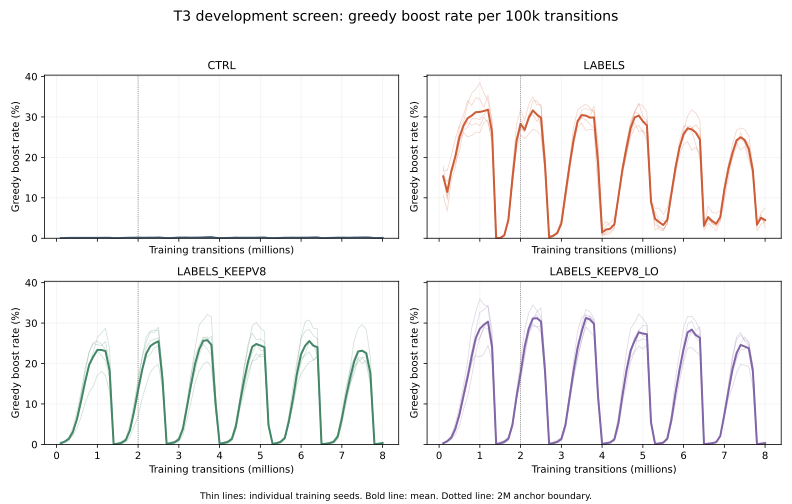

# T3 development screen, not gate evidence (2026-10-15)

**Development screen, not gate evidence.**

Labels are simulator rollouts of B8 in the `t3-rollout-labels-dense/v1` development namespace, pooled across B8 seeds; the served artifact stays a bare network. LABELS has an early bank-only trust region, while LABELS_KEEPV8_LO keeps CTRL's low anchor weight and changes anchor contents.

## Decisions

| arm | initial / final | scripted episode delta vs CTRL | scripted mass delta vs CTRL | failed runs |
|---|---|---:|---:|---|
| LABELS | EXTEND / EXTEND exhausted / stop | +0.008 (seed SE 0.021; world SE 0.023) | -87.970 (seed SE 15.898; world SE 11.163) | none |
| LABELS_KEEPV8 | EXTEND / EXTEND exhausted / stop | +0.017 (seed SE 0.032; world SE 0.023) | -87.907 (seed SE 15.263; world SE 11.257) | none |
| LABELS_KEEPV8_LO | EXTEND / KILL | -0.010 (seed SE 0.021; world SE 0.023) | -81.156 (seed SE 9.319; world SE 11.267) | none |

### Greedy boost rate per 100k

Each line is one training seed. The bank arms exhibit repeated high-boost peaks during training; final values alone do not describe those curves. CTRL final mean greedy boost rate is 0.000899 (0.0899%). Full per-100k values are retained below and in the telemetry artifact.

GO requires primary >= +0.06, mass delta >= -30 on every mix, and no frozen/mixed episode-survival drop beyond -0.05. KILL applies to primary <= 0 or any halted run. Otherwise one automatic round-63 scripted extension (96 worlds for arm and CTRL) is allowed, then stops.

Scripted final contrasts use 192 worlds per training seed after the one-time extension. Frozen/mixed contrasts retain round 62 (32 worlds per seed). Incumbent contrasts use round 62 only (96 scripted, 32 frozen, 32 mixed). An exhausted EXTEND is stopped without GO; guard failures alone do not satisfy the registered nonpositive-primary KILL condition.

## Secondary outcomes

| arm | mix | episode delta CTRL | alive-frame delta CTRL | mass delta CTRL | mass delta incumbent | death mean candidate / CTRL |
|---|---|---:|---:|---:|---:|---:|
| LABELS | scripted | +0.008 (seed SE 0.021; world SE 0.023) | -0.012 (seed SE 0.018; world SE 0.012) | -87.970 (seed SE 15.898; world SE 11.163) | +62.677 (seed SE 21.090; world SE 13.047) | 737.1 / 891.3 |
| LABELS | frozen | -0.025 (seed SE 0.027; world SE 0.047) | -0.025 (seed SE 0.016; world SE 0.022) | -74.321 (seed SE 8.946; world SE 17.088) | +81.755 (seed SE 11.941; world SE 18.746) | 637.2 / 797.0 |
| LABELS | mixed | +0.037 (seed SE 0.062; world SE 0.051) | +0.000 (seed SE 0.026; world SE 0.025) | -52.186 (seed SE 21.337; world SE 19.481) | +73.189 (seed SE 17.452; world SE 17.123) | 564.0 / 691.9 |
| LABELS_KEEPV8 | scripted | +0.017 (seed SE 0.032; world SE 0.023) | -0.014 (seed SE 0.016; world SE 0.012) | -87.907 (seed SE 15.263; world SE 11.257) | +47.614 (seed SE 6.244; world SE 13.334) | 720.5 / 891.3 |
| LABELS_KEEPV8 | frozen | -0.062 (seed SE 0.044; world SE 0.047) | -0.011 (seed SE 0.024; world SE 0.021) | -44.245 (seed SE 18.000; world SE 17.107) | +111.831 (seed SE 7.994; world SE 14.493) | 748.7 / 797.0 |
| LABELS_KEEPV8 | mixed | +0.006 (seed SE 0.023; world SE 0.047) | +0.013 (seed SE 0.017; world SE 0.021) | -16.944 (seed SE 9.224; world SE 17.294) | +108.430 (seed SE 8.901; world SE 16.447) | 696.0 / 691.9 |
| LABELS_KEEPV8_LO | scripted | -0.010 (seed SE 0.021; world SE 0.023) | -0.008 (seed SE 0.012; world SE 0.012) | -81.156 (seed SE 9.319; world SE 11.267) | +54.576 (seed SE 12.416; world SE 13.002) | 757.2 / 891.3 |
| LABELS_KEEPV8_LO | frozen | -0.050 (seed SE 0.051; world SE 0.050) | -0.048 (seed SE 0.016; world SE 0.025) | -73.733 (seed SE 15.616; world SE 19.763) | +82.343 (seed SE 21.091; world SE 19.239) | 627.4 / 797.0 |
| LABELS_KEEPV8_LO | mixed | +0.013 (seed SE 0.029; world SE 0.049) | +0.023 (seed SE 0.010; world SE 0.021) | -14.170 (seed SE 9.135; world SE 16.921) | +111.205 (seed SE 10.210; world SE 16.998) | 719.2 / 691.9 |

### Death-length distributions

Statistics below average the per-training-seed death distributions; they are not quantiles of a pooled death sample.

| arm | mix | policy | deaths | mean | mean median | mean q25 | mean q75 |
|---|---|---|---:|---:|---:|---:|---:|
| LABELS | scripted | candidate | 419 | 737.1 | 814.0 | 614.8 | 915.4 |
| LABELS | scripted | ctrl | 427 | 891.3 | 947.0 | 633.8 | 1168.2 |
| LABELS | frozen | candidate | 44 | 637.2 | 686.8 | 434.6 | 823.2 |
| LABELS | frozen | ctrl | 40 | 797.0 | 905.0 | 682.2 | 948.8 |
| LABELS | mixed | candidate | 33 | 564.0 | 635.6 | 443.6 | 688.0 |
| LABELS | mixed | ctrl | 39 | 691.9 | 656.0 | 475.6 | 868.6 |
| LABELS_KEEPV8 | scripted | candidate | 411 | 720.5 | 821.6 | 587.8 | 919.6 |
| LABELS_KEEPV8 | scripted | ctrl | 427 | 891.3 | 947.0 | 633.8 | 1168.2 |
| LABELS_KEEPV8 | frozen | candidate | 50 | 748.7 | 814.2 | 674.2 | 884.0 |
| LABELS_KEEPV8 | frozen | ctrl | 40 | 797.0 | 905.0 | 682.2 | 948.8 |
| LABELS_KEEPV8 | mixed | candidate | 38 | 696.0 | 747.6 | 595.2 | 831.4 |
| LABELS_KEEPV8 | mixed | ctrl | 39 | 691.9 | 656.0 | 475.6 | 868.6 |
| LABELS_KEEPV8_LO | scripted | candidate | 437 | 757.2 | 862.2 | 663.8 | 931.8 |
| LABELS_KEEPV8_LO | scripted | ctrl | 427 | 891.3 | 947.0 | 633.8 | 1168.2 |
| LABELS_KEEPV8_LO | frozen | candidate | 48 | 627.4 | 704.4 | 512.6 | 817.6 |
| LABELS_KEEPV8_LO | frozen | ctrl | 40 | 797.0 | 905.0 | 682.2 | 948.8 |
| LABELS_KEEPV8_LO | mixed | candidate | 37 | 719.2 | 802.4 | 658.2 | 850.4 |
| LABELS_KEEPV8_LO | mixed | ctrl | 39 | 691.9 | 656.0 | 475.6 | 868.6 |

## Training telemetry and re-roll

| arm | final greedy boost rate | bank_agree 2M | bank_agree 8M | re-roll labelled survivors | re-roll argmax in survivor set |
|---|---:|---:|---:|---:|---:|
| LABELS | 0.0449 | 0.9997 | 0.9961 | 0.8913719943422913 | 0.9949999999999999 |
| LABELS_KEEPV8 | 0.0035 | 0.9963 | 0.9674 | 0.9083451202263083 | 0.976 |
| LABELS_KEEPV8_LO | 0.0033 | 0.9030 | 0.9429 | 0.9100424328147101 | 0.9570000000000001 |

## Per-final re-roll

| final | survivor action survival | raw argmax in labelled surviving set | advisory argmax in labelled surviving set |
|---|---:|---:|---:|
| LABELS_KEEPV8_LO_s10 | 0.8868458274398868 | 0.955 | 0.96 |
| LABELS_KEEPV8_LO_s11 | 0.9222065063649222 | 0.955 | 0.955 |
| LABELS_KEEPV8_LO_s12 | 0.9207920792079208 | 0.965 | 0.965 |
| LABELS_KEEPV8_LO_s13 | 0.9052333804809052 | 0.955 | 0.955 |
| LABELS_KEEPV8_LO_s14 | 0.9151343705799151 | 0.955 | 0.955 |
| LABELS_KEEPV8_s10 | 0.8967468175388967 | 0.98 | 0.98 |
| LABELS_KEEPV8_s11 | 0.9363507779349364 | 0.95 | 0.95 |
| LABELS_KEEPV8_s12 | 0.8981612446958982 | 0.975 | 0.975 |
| LABELS_KEEPV8_s13 | 0.9038189533239038 | 0.985 | 0.985 |
| LABELS_KEEPV8_s14 | 0.9066478076379066 | 0.99 | 0.99 |
| LABELS_s10 | 0.8910891089108911 | 1.0 | 1.0 |
| LABELS_s11 | 0.867043847241867 | 1.0 | 1.0 |
| LABELS_s12 | 0.8995756718528995 | 0.985 | 0.985 |
| LABELS_s13 | 0.900990099009901 | 0.99 | 0.99 |
| LABELS_s14 | 0.8981612446958982 | 1.0 | 1.0 |

Attribution across all three arms: The two scheduled arms show similarly small positive point estimates: LABELS +0.0083 and LABELS_KEEPV8 +0.0167. Applying the preregistered qualitative attribution rule, we interpret this shared movement as the labels carrying the effect. This is a descriptive attribution: neither arm meets GO, the seed SE is larger than either estimate, and the low-anchor arm is negative. These results do not establish label contents alone as sufficient.

The attribution paragraph above is a reviewed qualitative interpretation applied after analyzer generation to implement the pre-registration's “both move similarly” case. No numerical similarity threshold was registered or added. Re-running the analyzer reproduces the numerical results and decisions; its automatic attribution text remains conservative until this qualitative review is applied.

Seed-level paired SE is the decision uncertainty; pooled-world SE is descriptive. `bank_agree` samples are bound to a 100k transition window: 2M is nearest and 8M is the first post-target observation. The 2.0-2.3M transient is not interpreted. This screen neither promotes nor changes serving.

## Evidence and reproduction

All 15 training runs exited 0. The screen completed 63 round-62 probes and 20 round-63
scripted extension probes (83 total): the five CTRL extensions are shared across the
three arm contrasts. No second extension is pending. LABELS and LABELS_KEEPV8 stop
with their single extension exhausted; LABELS_KEEPV8_LO is KILL. No arm is GO, and
this task authorizes no retraining, promotion, or serving change.

Each mean is across five paired training seeds. The primary is episode survival;
alive-frame survival is secondary. Final CTRL scripted contrasts use 192 worlds per
seed, while incumbent contrasts remain on the shared round-62 bank. Positive mass
against the incumbent does not offset the registered mass losses against CTRL.

The re-roll sample contains 200 distinct decisive states, drawn once with seed
20261015 and reused for every final. Every final tests the same 707 originally
labelled surviving state-action pairs. Each labelled first action is forced, followed
by that final's greedy advisory-masked continuation for the existing engine's
300-step horizon. The survivor fraction is retained labelled actions / 707; argmax
membership is states / 200 against the **original B8-labelled surviving set**. Raw
six-action argmax and advisory argmax are reported separately. These are post-hoc
label-validity measurements, not a new evaluation bank or promotion test.

The pre-first-probe audit established unused rounds 62 and 63 against the recorded
historical bank inventory, including NI/distillation, and verified the training bank's
manifest-bound files. The audit receipt was preserved unchanged.

Reviewable artifacts:

- [Machine-readable analysis](../../research/t3_screen_20261015/results/analysis.json)
- [All 83 probe rows](../../research/t3_screen_20261015/results/probes.jsonl)
- [All 15 re-rolls and per-state outcomes](../../research/t3_screen_20261015/results/rerolls.json)
- [Fixed sample](../../research/t3_screen_20261015/results/reroll_sample.json)
- [Training telemetry](../../research/t3_screen_20261015/results/telemetry.json)
- [Immutable bank audit](../../research/t3_screen_20261015/results/seed_bank_audit.json)
- [Completion and artifact hashes](../../research/t3_screen_20261015/results/completion.json)

Validation: 45 T3/T2 regression tests passed in 34.74 s; flake8 and `git diff --check`
passed. Independent review recomputed all probe contrasts and decisions from raw rows,
checked checkpoint and seed bindings, and checked all 15 re-rolls' accounting and
static rowwise raw/advisory argmax values. Re-roll survivor outcomes were not simulated
a second time. No probe or re-roll worker failed.

Implementation commits were pushed as work progressed. The running watcher was
launched before reporting-only refinements; this report was regenerated with the
current analyzer after all workers completed. A required merge brought concurrent
T4 rollout-engine changes during execution. Independent source comparison established
that the default T3 path was numerically unchanged: world restoration, preparation,
action selection, and rollout logic retained the same behavior, with the new optional
checkpoint/outcome paths disabled for T3. The tested reporting commit is `f6b0fb9`;
completion metadata records the full source commit and hashes of the binding spec and
pre-registration. Dedicated `t3-probe` workers only were managed; protected training
and sync sessions were never controlled.

Full per-100k greedy boost values

### Greedy boost rate per 100k

| run | transition:value |
|---|---|
| CTRL_s10 | 100224:0.000229, 200064:0.000351, 300160:0.000619, 400000:0.000791, 500096:0.000749, 600192:0.000739, 700032:0.000591, 800128:0.000819, 900224:0.000679, 1000064:0.000571, 1100160:0.001039, 1200000:0.001302, 1300096:0.001309, 1400192:0.000140, 1500032:0.000471, 1600128:0.000779, 1700224:0.001259, 1800064:0.000931, 1900160:0.001209, 2000000:0.001452, 2100096:0.001049, 2200192:0.001968, 2300032:0.002284, 2400128:0.002008, 2500224:0.002098, 2600064:0.001202, 2700160:0.000709, 2800000:0.000541, 2900096:0.002148, 3000192:0.002647, 3100032:0.002574, 3200128:0.003317, 3300224:0.001818, 3400064:0.001743, 3500160:0.001878, 3600000:0.001983, 3700096:0.002488, 3800192:0.003517, 3900032:0.001252, 4000128:0.000200, 4100224:0.000280, 4200064:0.000791, 4300160:0.000869, 4400000:0.001312, 4500096:0.001449, 4600192:0.001519, 4700032:0.001512, 4800128:0.000959, 4900224:0.001009, 5000064:0.001232, 5100160:0.001339, 5200000:0.000270, 5300096:0.000130, 5400192:0.000460, 5500032:0.001022, 5600128:0.001429, 5700224:0.001379, 5800064:0.001522, 5900160:0.001409, 6000000:0.002113, 6100096:0.002428, 6200192:0.002528, 6300032:0.002324, 6400128:0.002148, 6500224:0.000789, 6600064:0.000571, 6700160:0.000649, 6800000:0.001302, 6900096:0.001628, 7000192:0.001598, 7100032:0.001633, 7200128:0.001389, 7300224:0.001578, 7400064:0.002033, 7500160:0.001988, 7600000:0.002204, 7700096:0.001978, 7800192:0.000320, 7900032:0.000641, 8000128:0.001069 |
| CTRL_s11 | 100224:0.000120, 200064:0.000591, 300160:0.000969, 400000:0.000701, 500096:0.001189, 600192:0.001189, 700032:0.001102, 800128:0.000989, 900224:0.000979, 1000064:0.001302, 1100160:0.001928, 1200000:0.001482, 1300096:0.002028, 1400192:0.000260, 1500032:0.000300, 1600128:0.000619, 1700224:0.001259, 1800064:0.002214, 1900160:0.002418, 2000000:0.002754, 2100096:0.002048, 2200192:0.001359, 2300032:0.001362, 2400128:0.001019, 2500224:0.001988, 2600064:0.001653, 2700160:0.000190, 2800000:0.000310, 2900096:0.000609, 3000192:0.001598, 3100032:0.001322, 3200128:0.001199, 3300224:0.001499, 3400064:0.001542, 3500160:0.000969, 3600000:0.001993, 3700096:0.001069, 3800192:0.001479, 3900032:0.000931, 4000128:0.000160, 4100224:0.000929, 4200064:0.000811, 4300160:0.001349, 4400000:0.002594, 4500096:0.000929, 4600192:0.001149, 4700032:0.001042, 4800128:0.001129, 4900224:0.001539, 5000064:0.001432, 5100160:0.001439, 5200000:0.000331, 5300096:0.000200, 5400192:0.000150, 5500032:0.000611, 5600128:0.001549, 5700224:0.001029, 5800064:0.001653, 5900160:0.000849, 6000000:0.001442, 6100096:0.000629, 6200192:0.000919, 6300032:0.000911, 6400128:0.001419, 6500224:0.000040, 6600064:0.000160, 6700160:0.000270, 6800000:0.000591, 6900096:0.001878, 7000192:0.001249, 7100032:0.001082, 7200128:0.000759, 7300224:0.001119, 7400064:0.001122, 7500160:0.001489, 7600000:0.001863, 7700096:0.001519, 7800192:0.000160, 7900032:0.000240, 8000128:0.000719 |
| CTRL_s12 | 100224:0.000279, 200064:0.001092, 300160:0.001708, 400000:0.002153, 500096:0.001798, 600192:0.001838, 700032:0.001743, 800128:0.001429, 900224:0.001578, 1000064:0.001502, 1100160:0.001209, 1200000:0.000972, 1300096:0.001139, 1400192:0.000100, 1500032:0.000531, 1600128:0.000739, 1700224:0.000769, 1800064:0.001052, 1900160:0.000559, 2000000:0.000601, 2100096:0.000929, 2200192:0.000829, 2300032:0.000962, 2400128:0.001439, 2500224:0.001459, 2600064:0.001092, 2700160:0.000250, 2800000:0.000681, 2900096:0.000939, 3000192:0.001289, 3100032:0.001713, 3200128:0.001219, 3300224:0.001948, 3400064:0.002103, 3500160:0.001988, 3600000:0.002624, 3700096:0.003607, 3800192:0.003996, 3900032:0.001442, 4000128:0.000200, 4100224:0.000579, 4200064:0.000631, 4300160:0.000799, 4400000:0.000781, 4500096:0.000929, 4600192:0.001119, 4700032:0.001432, 4800128:0.001708, 4900224:0.001079, 5000064:0.002274, 5100160:0.002588, 5200000:0.000611, 5300096:0.000330, 5400192:0.000400, 5500032:0.000771, 5600128:0.001199, 5700224:0.001269, 5800064:0.001372, 5900160:0.001039, 6000000:0.001182, 6100096:0.001728, 6200192:0.001808, 6300032:0.002985, 6400128:0.002997, 6500224:0.000140, 6600064:0.000220, 6700160:0.000559, 6800000:0.000841, 6900096:0.000909, 7000192:0.000839, 7100032:0.001703, 7200128:0.001838, 7300224:0.002538, 7400064:0.002404, 7500160:0.003147, 7600000:0.003265, 7700096:0.002518, 7800192:0.000230, 7900032:0.000260, 8000128:0.000629 |
| CTRL_s13 | 100224:0.000040, 200064:0.000280, 300160:0.000340, 400000:0.000551, 500096:0.000400, 600192:0.000440, 700032:0.000791, 800128:0.000909, 900224:0.000839, 1000064:0.000721, 1100160:0.000679, 1200000:0.001012, 1300096:0.000659, 1400192:0.000090, 1500032:0.000341, 1600128:0.000669, 1700224:0.001069, 1800064:0.001532, 1900160:0.001718, 2000000:0.001973, 2100096:0.002168, 2200192:0.001978, 2300032:0.002043, 2400128:0.001339, 2500224:0.002607, 2600064:0.001002, 2700160:0.000160, 2800000:0.000631, 2900096:0.000969, 3000192:0.001249, 3100032:0.001202, 3200128:0.001169, 3300224:0.001369, 3400064:0.001422, 3500160:0.002647, 3600000:0.002053, 3700096:0.003087, 3800192:0.002018, 3900032:0.001643, 4000128:0.000090, 4100224:0.000649, 4200064:0.001152, 4300160:0.001509, 4400000:0.001673, 4500096:0.001988, 4600192:0.001758, 4700032:0.001492, 4800128:0.001618, 4900224:0.001908, 5000064:0.001653, 5100160:0.002318, 5200000:0.000391, 5300096:0.000120, 5400192:0.000659, 5500032:0.001312, 5600128:0.001289, 5700224:0.001529, 5800064:0.001342, 5900160:0.001618, 6000000:0.001623, 6100096:0.001429, 6200192:0.001069, 6300032:0.001272, 6400128:0.001858, 6500224:0.000310, 6600064:0.000611, 6700160:0.001499, 6800000:0.001532, 6900096:0.001778, 7000192:0.002128, 7100032:0.001663, 7200128:0.001648, 7300224:0.001908, 7400064:0.001983, 7500160:0.001339, 7600000:0.001643, 7700096:0.001219, 7800192:0.000130, 7900032:0.000341, 8000128:0.000799 |
| CTRL_s14 | 100224:0.000239, 200064:0.000511, 300160:0.000539, 400000:0.000551, 500096:0.000390, 600192:0.000340, 700032:0.000441, 800128:0.000480, 900224:0.000470, 1000064:0.000511, 1100160:0.000510, 1200000:0.000821, 1300096:0.000779, 1400192:0.000240, 1500032:0.000270, 1600128:0.000589, 1700224:0.000729, 1800064:0.000711, 1900160:0.000599, 2000000:0.000661, 2100096:0.000430, 2200192:0.000559, 2300032:0.000942, 2400128:0.001199, 2500224:0.001189, 2600064:0.000691, 2700160:0.000110, 2800000:0.000290, 2900096:0.000350, 3000192:0.001289, 3100032:0.000911, 3200128:0.000749, 3300224:0.000779, 3400064:0.000911, 3500160:0.000719, 3600000:0.001142, 3700096:0.001259, 3800192:0.001658, 3900032:0.000581, 4000128:0.000140, 4100224:0.000320, 4200064:0.000270, 4300160:0.000529, 4400000:0.000851, 4500096:0.000549, 4600192:0.000889, 4700032:0.000551, 4800128:0.001009, 4900224:0.001369, 5000064:0.001352, 5100160:0.001279, 5200000:0.000461, 5300096:0.000200, 5400192:0.000410, 5500032:0.000551, 5600128:0.000599, 5700224:0.001029, 5800064:0.001552, 5900160:0.001219, 6000000:0.000721, 6100096:0.001179, 6200192:0.001129, 6300032:0.001743, 6400128:0.001549, 6500224:0.000220, 6600064:0.000942, 6700160:0.001219, 6800000:0.001232, 6900096:0.000889, 7000192:0.000999, 7100032:0.000921, 7200128:0.000819, 7300224:0.000939, 7400064:0.000871, 7500160:0.000939, 7600000:0.000741, 7700096:0.000699, 7800192:0.000280, 7900032:0.000601, 8000128:0.001279 |
| LABELS_KEEPV8_LO_s10 | 100096:0.002727, 200192:0.008672, 300032:0.019091, 400128:0.044228, 500224:0.081202, 600064:0.123037, 700160:0.171675, 800000:0.204257, 900096:0.219789, 1000192:0.216133, 1100032:0.224048, 1200128:0.245105, 1300224:0.204953, 1400064:0.002053, 1500160:0.004346, 1600000:0.009415, 1700096:0.017353, 1800192:0.052140, 1900032:0.118460, 2000128:0.175611, 2100224:0.244805, 2200064:0.274740, 2300160:0.293248, 2400000:0.290976, 2500096:0.276944, 2600192:0.163293, 2700032:0.001823, 2800128:0.003956, 2900224:0.007243, 3000064:0.015925, 3100160:0.051541, 3200000:0.109345, 3300096:0.166200, 3400192:0.217721, 3500032:0.258584, 3600128:0.290381, 3700224:0.279741, 3800064:0.268169, 3900160:0.109115, 4000000:0.001242, 4100096:0.003327, 4200192:0.005495, 4300032:0.014373, 4400128:0.056126, 4500224:0.116608, 4600064:0.170292, 4700160:0.215523, 4800000:0.232592, 4900096:0.282499, 5000192:0.268902, 5100032:0.266146, 5200128:0.055547, 5300224:0.000759, 5400064:0.002714, 5500160:0.005954, 5600000:0.015234, 5700096:0.061791, 5800192:0.121733, 5900032:0.170272, 6000128:0.210868, 6100224:0.255445, 6200064:0.283183, 6300160:0.263737, 6400000:0.252434, 6500096:0.000340, 6600192:0.001309, 6700032:0.003305, 6800128:0.005934, 6900224:0.022349, 7000064:0.073387, 7100160:0.125939, 7200000:0.177194, 7300096:0.209849, 7400192:0.234125, 7500032:0.235196, 7600128:0.243876, 7700224:0.192555, 7800064:0.000521, 7900160:0.001469, 8000000:0.002895 |
| LABELS_KEEPV8_LO_s11 | 100096:0.002208, 200192:0.005894, 300032:0.011779, 400128:0.033318, 500224:0.079574, 600064:0.132151, 700160:0.177629, 800000:0.229778, 900096:0.283178, 1000192:0.326497, 1100032:0.333013, 1200128:0.344010, 1300224:0.281949, 1400064:0.000120, 1500160:0.000869, 1600000:0.003886, 1700096:0.011279, 1800192:0.040931, 1900032:0.112310, 2000128:0.167709, 2100224:0.224195, 2200064:0.277244, 2300160:0.310572, 2400000:0.320312, 2500096:0.299063, 2600192:0.172894, 2700032:0.000621, 2800128:0.001728, 2900224:0.003407, 3000064:0.008984, 3100160:0.037614, 3200000:0.102794, 3300096:0.162884, 3400192:0.213445, 3500032:0.256611, 3600128:0.298144, 3700224:0.318524, 3800064:0.301282, 3900160:0.108616, 4000000:0.000371, 4100096:0.001269, 4200192:0.003796, 4300032:0.010106, 4400128:0.039952, 4500224:0.104140, 4600064:0.152895, 4700160:0.204234, 4800000:0.229377, 4900096:0.242777, 5000192:0.236313, 5100032:0.246514, 5200128:0.047464, 5300224:0.000410, 5400064:0.001202, 5500160:0.003886, 5600000:0.015585, 5700096:0.050941, 5800192:0.101892, 5900032:0.156961, 6000128:0.203774, 6100224:0.238061, 6200064:0.239273, 6300160:0.229689, 6400000:0.220793, 6500096:0.000360, 6600192:0.000559, 6700032:0.002674, 6800128:0.006374, 6900224:0.019891, 7000064:0.068409, 7100160:0.113491, 7200000:0.142568, 7300096:0.177090, 7400192:0.198160, 7500032:0.195302, 7600128:0.192455, 7700224:0.142213, 7800064:0.000180, 7900160:0.000929, 8000000:0.002173 |
| LABELS_KEEPV8_LO_s12 | 100224:0.004600, 200064:0.009355, 300160:0.018712, 400000:0.040966, 500096:0.070512, 600192:0.113911, 700032:0.159736, 800128:0.200358, 900224:0.255974, 1000064:0.263201, 1100160:0.289062, 1200000:0.285887, 1300096:0.230279, 1400192:0.000240, 1500032:0.001763, 1600128:0.005085, 1700224:0.013957, 1800064:0.049499, 1900160:0.113981, 2000000:0.178095, 2100096:0.239700, 2200192:0.282419, 2300032:0.298027, 2400128:0.290341, 2500224:0.292150, 2600064:0.171174, 2700160:0.000330, 2800000:0.002224, 2900096:0.005155, 3000192:0.014716, 3100032:0.053636, 3200128:0.123172, 3300224:0.186881, 3400064:0.251482, 3500160:0.274457, 3600000:0.319361, 3700096:0.303998, 3800192:0.300641, 3900032:0.121394, 4000128:0.001239, 4100224:0.002428, 4200064:0.003986, 4300160:0.009751, 4400000:0.046204, 4500096:0.113711, 4600192:0.185662, 4700032:0.231410, 4800128:0.264206, 4900224:0.282319, 5000064:0.293620, 5100160:0.293678, 5200000:0.054858, 5300096:0.000689, 5400192:0.001429, 5500032:0.003435, 5600128:0.010030, 5700224:0.053898, 5800064:0.119060, 5900160:0.184043, 6000000:0.246104, 6100096:0.298164, 6200192:0.304937, 6300032:0.281060, 6400128:0.290951, 6500224:0.000320, 6600064:0.000841, 6700160:0.002248, 6800000:0.004788, 6900096:0.021499, 7000192:0.070243, 7100032:0.131160, 7200128:0.184223, 7300224:0.217331, 7400064:0.249850, 7500160:0.265755, 7600000:0.251352, 7700096:0.196192, 7800192:0.000450, 7900032:0.001402, 8000128:0.003247 |
| LABELS_KEEPV8_LO_s13 | 100224:0.001527, 200064:0.008684, 300160:0.021200, 400000:0.051923, 500096:0.092651, 600192:0.146519, 700032:0.205258, 800128:0.287674, 900224:0.327905, 1000064:0.359826, 1100160:0.345728, 1200000:0.340315, 1300096:0.260150, 1400192:0.000589, 1500032:0.004718, 1600128:0.009791, 1700224:0.016684, 1800064:0.054958, 1900160:0.131594, 2000000:0.206721, 2100096:0.283308, 2200192:0.325168, 2300032:0.344832, 2400128:0.331192, 2500224:0.314878, 2600064:0.184505, 2700160:0.002168, 2800000:0.005569, 2900096:0.011349, 3000192:0.016354, 3100032:0.049319, 3200128:0.124061, 3300224:0.206801, 3400064:0.280649, 3500160:0.313979, 3600000:0.320743, 3700096:0.316786, 3800192:0.307555, 3900032:0.130919, 4000128:0.002268, 4100224:0.005055, 4200064:0.006560, 4300160:0.015835, 4400000:0.067969, 4500096:0.149786, 4600192:0.230579, 4700032:0.286689, 4800128:0.300941, 4900224:0.322530, 5000064:0.310787, 5100160:0.297664, 5200000:0.062169, 5300096:0.003047, 5400192:0.004296, 5500032:0.005499, 5600128:0.017024, 5700224:0.074728, 5800064:0.162079, 5900160:0.225434, 6000000:0.289353, 6100096:0.316476, 6200192:0.316776, 6300032:0.304097, 6400128:0.281740, 6500224:0.001918, 6600064:0.003616, 6700160:0.004586, 6800000:0.006220, 6900096:0.020490, 7000192:0.076507, 7100032:0.148858, 7200128:0.218840, 7300224:0.265465, 7400064:0.277013, 7500160:0.255545, 7600000:0.244962, 7700096:0.183074, 7800192:0.001449, 7900032:0.003385, 8000128:0.005615 |
| LABELS_KEEPV8_LO_s14 | 100224:0.002385, 200064:0.006530, 300160:0.013947, 400000:0.024189, 500096:0.046016, 600192:0.087236, 700032:0.118219, 800128:0.168328, 900224:0.227052, 1000064:0.264183, 1100160:0.289043, 1200000:0.302424, 1300096:0.229979, 1400192:0.001489, 1500032:0.001803, 1600128:0.003477, 1700224:0.010520, 1800064:0.045603, 1900160:0.111793, 2000000:0.157682, 2100096:0.215953, 2200192:0.272918, 2300032:0.309095, 2400128:0.327765, 2500224:0.337706, 2600064:0.208403, 2700160:0.001818, 2800000:0.002614, 2900096:0.004725, 3000192:0.010530, 3100032:0.048177, 3200128:0.113321, 3300224:0.186941, 3400064:0.232863, 3500160:0.295486, 3600000:0.333924, 3700096:0.327965, 3800192:0.312410, 3900032:0.126953, 4000128:0.000959, 4100224:0.002787, 4200064:0.004257, 4300160:0.010760, 4400000:0.055018, 4500096:0.123471, 4600192:0.180597, 4700032:0.223628, 4800128:0.257862, 4900224:0.255465, 5000064:0.261298, 5100160:0.257942, 5200000:0.052895, 5300096:0.000969, 5400192:0.001818, 5500032:0.003165, 5600128:0.013397, 5700224:0.061601, 5800064:0.125120, 5900160:0.188639, 6000000:0.229557, 6100096:0.278513, 6200192:0.275665, 6300032:0.272175, 6400128:0.271379, 6500224:0.000869, 6600064:0.001142, 6700160:0.002088, 6800000:0.004137, 6900096:0.019471, 7000192:0.081452, 7100032:0.138141, 7200128:0.209609, 7300224:0.259761, 7400064:0.270403, 7500160:0.258702, 7600000:0.254457, 7700096:0.188469, 7800192:0.000380, 7900032:0.001462, 8000128:0.002408 |
| LABELS_KEEPV8_s10 | 100096:0.002078, 200192:0.007273, 300032:0.015976, 400128:0.034387, 500224:0.067685, 600064:0.116016, 700160:0.158238, 800000:0.199359, 900096:0.213655, 1000192:0.230778, 1100032:0.219681, 1200128:0.207581, 1300224:0.165501, 1400064:0.000891, 1500160:0.004256, 1600000:0.007682, 1700096:0.014037, 1800192:0.037974, 1900032:0.083554, 2000128:0.138257, 2100224:0.184793, 2200064:0.215805, 2300160:0.222347, 2400000:0.239193, 2500096:0.243047, 2600192:0.146369, 2700032:0.001913, 2800128:0.005075, 2900224:0.008502, 3000064:0.017398, 3100160:0.040281, 3200000:0.094241, 3300096:0.150835, 3400192:0.205263, 3500032:0.233403, 3600128:0.262958, 3700224:0.266164, 3800064:0.238662, 3900160:0.095189, 4000000:0.002274, 4100096:0.005385, 4200192:0.008072, 4300032:0.014894, 4400128:0.047055, 4500224:0.104400, 4600064:0.148007, 4700160:0.193474, 4800000:0.225741, 4900096:0.247173, 5000192:0.233376, 5100032:0.230479, 5200128:0.043508, 5300224:0.002028, 5400064:0.004617, 5500160:0.008262, 5600000:0.016106, 5700096:0.058214, 5800192:0.116658, 5900032:0.172726, 6000128:0.212086, 6100224:0.220309, 6200064:0.229177, 6300160:0.208949, 6400000:0.216076, 6500096:0.000440, 6600192:0.001618, 6700032:0.003736, 6800128:0.006913, 6900224:0.023428, 7000064:0.069912, 7100160:0.109934, 7200000:0.152945, 7300096:0.190677, 7400192:0.203385, 7500032:0.214363, 7600128:0.216242, 7700224:0.179697, 7800064:0.000651, 7900160:0.001559, 8000000:0.003275 |
| LABELS_KEEPV8_s11 | 100224:0.003482, 200064:0.005298, 300160:0.008612, 400000:0.025000, 500096:0.064268, 600192:0.122043, 700032:0.178115, 800128:0.229160, 900224:0.252448, 1000064:0.254577, 1100160:0.248262, 1200000:0.234495, 1300096:0.182495, 1400192:0.000000, 1500032:0.000140, 1600128:0.001698, 1700224:0.009251, 1800064:0.034896, 1900160:0.087726, 2000000:0.145783, 2100096:0.190297, 2200192:0.240000, 2300032:0.256090, 2400128:0.260640, 2500224:0.263527, 2600064:0.165905, 2700160:0.000450, 2800000:0.001002, 2900096:0.003137, 3000192:0.009481, 3100032:0.038071, 3200128:0.097446, 3300224:0.141414, 3400064:0.181250, 3500160:0.221547, 3600000:0.247827, 3700096:0.235224, 3800192:0.219329, 3900032:0.088221, 4000128:0.000839, 4100224:0.001748, 4200064:0.004036, 4300160:0.011259, 4400000:0.039724, 4500096:0.095868, 4600192:0.140795, 4700032:0.179908, 4800128:0.206332, 4900224:0.209759, 5000064:0.222406, 5100160:0.221577, 5200000:0.043429, 5300096:0.000819, 5400192:0.002248, 5500032:0.005769, 5600128:0.014456, 5700224:0.051880, 5800064:0.097997, 5900160:0.159527, 6000000:0.202334, 6100096:0.225703, 6200192:0.253527, 6300032:0.248027, 6400128:0.219389, 6500224:0.000699, 6600064:0.000962, 6700160:0.002657, 6800000:0.007021, 6900096:0.021459, 7000192:0.062880, 7100032:0.112240, 7200128:0.149916, 7300224:0.173244, 7400064:0.212560, 7500160:0.199708, 7600000:0.208514, 7700096:0.159077, 7800192:0.000260, 7900032:0.001092, 8000128:0.002967 |
| LABELS_KEEPV8_s12 | 100224:0.006017, 200064:0.008233, 300160:0.016045, 400000:0.031190, 500096:0.059293, 600192:0.099624, 700032:0.147907, 800128:0.198509, 900224:0.228241, 1000064:0.264694, 1100160:0.275486, 1200000:0.286979, 1300096:0.237262, 1400192:0.000300, 1500032:0.001242, 1600128:0.003447, 1700224:0.010320, 1800064:0.033814, 1900160:0.087066, 2000000:0.151382, 2100096:0.216073, 2200192:0.266204, 2300032:0.280409, 2400128:0.282868, 2500224:0.281410, 2600064:0.172556, 2700160:0.001329, 2800000:0.002474, 2900096:0.004985, 3000192:0.011969, 3100032:0.041657, 3200128:0.101053, 3300224:0.173813, 3400064:0.238652, 3500160:0.295486, 3600000:0.307893, 3700096:0.321032, 3800192:0.314828, 3900032:0.121795, 4000128:0.001429, 4100224:0.003307, 4200064:0.006370, 4300160:0.013527, 4400000:0.049379, 4500096:0.112132, 4600192:0.185482, 4700032:0.239163, 4800128:0.293039, 4900224:0.301750, 5000064:0.288131, 5100160:0.279242, 5200000:0.057983, 5300096:0.001519, 5400192:0.002967, 5500032:0.006010, 5600128:0.015355, 5700224:0.051970, 5800064:0.113201, 5900160:0.191566, 6000000:0.264994, 6100096:0.303848, 6200192:0.307755, 6300032:0.287310, 6400128:0.285916, 6500224:0.000779, 6600064:0.001112, 6700160:0.002328, 6800000:0.004808, 6900096:0.015885, 7000192:0.057854, 7100032:0.123758, 7200128:0.184103, 7300224:0.256134, 7400064:0.286709, 7500160:0.296176, 7600000:0.284265, 7700096:0.215273, 7800192:0.000909, 7900032:0.001763, 8000128:0.003507 |
| LABELS_KEEPV8_s13 | 100224:0.000998, 200064:0.007883, 300160:0.016444, 400000:0.042047, 500096:0.081222, 600192:0.130405, 700032:0.188642, 800128:0.228611, 900224:0.249111, 1000064:0.246835, 1100160:0.243716, 1200000:0.254657, 1300096:0.200777, 1400192:0.000080, 1500032:0.002324, 1600128:0.006374, 1700224:0.014936, 1800064:0.050511, 1900160:0.101592, 2000000:0.163512, 2100096:0.214804, 2200192:0.252997, 2300032:0.278155, 2400128:0.277084, 2500224:0.289842, 2600064:0.177274, 2700160:0.001928, 2800000:0.004357, 2900096:0.007493, 3000192:0.015575, 3100032:0.048277, 3200128:0.107487, 3300224:0.170626, 3400064:0.219161, 3500160:0.245195, 3600000:0.265164, 3700096:0.260650, 3800192:0.267253, 3900032:0.123668, 4000128:0.002767, 4100224:0.005305, 4200064:0.008444, 4300160:0.018532, 4400000:0.054978, 4500096:0.116129, 4600192:0.189548, 4700032:0.249169, 4800128:0.275565, 4900224:0.258572, 5000064:0.260958, 5100160:0.253307, 5200000:0.047366, 5300096:0.002288, 5400192:0.004006, 5500032:0.009095, 5600128:0.020370, 5700224:0.071911, 5800064:0.142438, 5900160:0.207840, 6000000:0.261929, 6100096:0.280431, 6200192:0.284247, 6300032:0.268980, 6400128:0.261819, 6500224:0.001439, 6600064:0.002774, 6700160:0.005465, 6800000:0.010086, 6900096:0.024956, 7000192:0.078445, 7100032:0.141046, 7200128:0.184443, 7300224:0.213355, 7400064:0.230879, 7500160:0.234015, 7600000:0.218470, 7700096:0.179588, 7800192:0.001389, 7900032:0.002484, 8000128:0.005205 |
| LABELS_KEEPV8_s14 | 100224:0.001557, 200064:0.005559, 300160:0.011909, 400000:0.021735, 500096:0.040681, 600192:0.066966, 700032:0.102534, 800128:0.128407, 900224:0.143173, 1000064:0.171004, 1100160:0.180577, 1200000:0.170573, 1300096:0.130215, 1400192:0.000100, 1500032:0.000501, 1600128:0.002398, 1700224:0.005994, 1800064:0.017969, 1900160:0.044277, 2000000:0.069321, 2100096:0.114130, 2200192:0.147249, 2300032:0.178135, 2400128:0.191186, 2500224:0.197241, 2600064:0.136148, 2700160:0.001279, 2800000:0.001673, 2900096:0.003077, 3000192:0.006704, 3100032:0.022756, 3200128:0.062480, 3300224:0.104799, 3400064:0.152754, 3500160:0.181626, 3600000:0.197646, 3700096:0.205073, 3800192:0.190717, 3900032:0.084976, 4000128:0.000639, 4100224:0.001519, 4200064:0.002925, 4300160:0.008162, 4400000:0.034836, 4500096:0.087906, 4600192:0.127438, 4700032:0.165895, 4800128:0.206052, 4900224:0.224524, 5000064:0.217618, 5100160:0.216602, 5200000:0.044521, 5300096:0.000599, 5400192:0.001299, 5500032:0.002905, 5600128:0.012088, 5700224:0.053668, 5800064:0.095783, 5900160:0.147928, 6000000:0.174519, 6100096:0.190137, 6200192:0.203435, 6300032:0.207752, 6400128:0.218670, 6500224:0.001289, 6600064:0.000671, 6700160:0.001459, 6800000:0.003265, 6900096:0.012568, 7000192:0.049572, 7100032:0.099429, 7200128:0.146280, 7300224:0.187770, 7400064:0.215825, 7500160:0.213615, 7600000:0.200841, 7700096:0.146969, 7800192:0.000310, 7900032:0.001382, 8000128:0.002757 |
| LABELS_s10 | 100096:0.157669, 200192:0.095468, 300032:0.161759, 400128:0.185142, 500224:0.215643, 600064:0.267698, 700160:0.274127, 800000:0.295503, 900096:0.295776, 1000192:0.293708, 1100032:0.304888, 1200128:0.319283, 1300224:0.256004, 1400064:0.000030, 1500160:0.000759, 1600000:0.007372, 1700096:0.047584, 1800192:0.138447, 1900032:0.220052, 2000128:0.255754, 2100224:0.246354, 2200064:0.257612, 2300160:0.269721, 2400000:0.265164, 2500096:0.254406, 2600192:0.161994, 2700032:0.002314, 2800128:0.004755, 2900224:0.011259, 3000064:0.032883, 3100160:0.092741, 3200000:0.161709, 3300096:0.234565, 3400192:0.274057, 3500032:0.284886, 3600128:0.266514, 3700224:0.269032, 3800064:0.267989, 3900160:0.124111, 4000000:0.007332, 4100096:0.015076, 4200192:0.022598, 4300032:0.036028, 4400128:0.108985, 4500224:0.164922, 4600064:0.206801, 4700160:0.260600, 4800000:0.285587, 4900096:0.262788, 5000192:0.267323, 5100032:0.240284, 5200128:0.098855, 5300224:0.019751, 5400064:0.027985, 5500160:0.023438, 5600000:0.034635, 5700096:0.108226, 5800192:0.166800, 5900032:0.228225, 6000128:0.247862, 6100224:0.274267, 6200064:0.263291, 6300160:0.230848, 6400000:0.197817, 6500096:0.028932, 6600192:0.052849, 6700032:0.035497, 6800128:0.032079, 6900224:0.051860, 7000064:0.122035, 7100160:0.165941, 7200000:0.201693, 7300096:0.240169, 7400192:0.246443, 7500032:0.237169, 7600128:0.205353, 7700224:0.147109, 7800064:0.040144, 7900160:0.047594, 8000000:0.044491 |
| LABELS_s11 | 100224:0.168433, 200064:0.167027, 300160:0.204564, 400000:0.246024, 500096:0.280151, 600192:0.305117, 700032:0.340515, 800128:0.328155, 900224:0.347626, 1000064:0.343970, 1100160:0.323479, 1200000:0.354137, 1300096:0.290481, 1400192:0.000030, 1500032:0.000982, 1600128:0.007483, 1700224:0.040221, 1800064:0.129918, 1900160:0.229610, 2000000:0.274299, 2100096:0.264186, 2200192:0.303169, 2300032:0.339694, 2400128:0.339774, 2500224:0.325218, 2600064:0.203856, 2700160:0.001479, 2800000:0.005809, 2900096:0.017333, 3000192:0.046036, 3100032:0.115946, 3200128:0.178209, 3300224:0.226523, 3400064:0.287841, 3500160:0.299113, 3600000:0.303325, 3700096:0.301511, 3800192:0.326367, 3900032:0.236929, 4000128:0.017863, 4100224:0.031400, 4200064:0.037931, 4300160:0.050851, 4400000:0.099299, 4500096:0.173523, 4600192:0.233396, 4700032:0.281581, 4800128:0.309583, 4900224:0.331851, 5000064:0.327123, 5100160:0.311221, 5200000:0.093349, 5300096:0.073839, 5400192:0.074748, 5500032:0.058454, 5600128:0.075597, 5700224:0.120664, 5800064:0.180970, 5900160:0.219739, 6000000:0.264353, 6100096:0.266734, 6200192:0.272568, 6300032:0.280288, 6400128:0.266974, 6500224:0.027244, 6600064:0.079728, 6700160:0.064318, 6800000:0.061639, 6900096:0.068614, 7000192:0.127757, 7100032:0.179798, 7200128:0.207930, 7300224:0.242617, 7400064:0.250431, 7500160:0.244295, 7600000:0.233904, 7700096:0.172434, 7800192:0.027623, 7900032:0.063011, 8000128:0.074888 |
| LABELS_s12 | 100224:0.153855, 200064:0.139864, 300160:0.160646, 400000:0.207893, 500096:0.276275, 600192:0.288463, 700032:0.331110, 800128:0.358576, 900224:0.368616, 1000064:0.384175, 1100160:0.359025, 1200000:0.339683, 1300096:0.285376, 1400192:0.000000, 1500032:0.000290, 1600128:0.006224, 1700224:0.050012, 1800064:0.169201, 1900160:0.281440, 2000000:0.318650, 2100096:0.290721, 2200192:0.331132, 2300032:0.349700, 2400128:0.329004, 2500224:0.330772, 2600064:0.196955, 2700160:0.002428, 2800000:0.008343, 2900096:0.012868, 3000192:0.038463, 3100032:0.120222, 3200128:0.190257, 3300224:0.274287, 3400064:0.317097, 3500160:0.324988, 3600000:0.332031, 3700096:0.322251, 3800192:0.310722, 3900032:0.164473, 4000128:0.029062, 4100224:0.041280, 4200064:0.030649, 4300160:0.033188, 4400000:0.098137, 4500096:0.174303, 4600192:0.230089, 4700032:0.279948, 4800128:0.313149, 4900224:0.334229, 5000064:0.301042, 5100160:0.292239, 5200000:0.085427, 5300096:0.064878, 5400192:0.045257, 5500032:0.042278, 5600128:0.043029, 5700224:0.107996, 5800064:0.181070, 5900160:0.227532, 6000000:0.265705, 6100096:0.302530, 6200192:0.317655, 6300032:0.309255, 6400128:0.291210, 6500224:0.032589, 6600064:0.043680, 6700160:0.046415, 6800000:0.037330, 6900096:0.055257, 7000192:0.123961, 7100032:0.178446, 7200128:0.232607, 7300224:0.266754, 7400064:0.272636, 7500160:0.269451, 7600000:0.253926, 7700096:0.178968, 7800192:0.018332, 7900032:0.034886, 8000128:0.041170 |
| LABELS_s13 | 100224:0.105933, 200064:0.067117, 300160:0.144252, 400000:0.175200, 500096:0.240749, 600192:0.261589, 700032:0.250831, 800128:0.254316, 900224:0.262228, 1000064:0.261699, 1100160:0.286105, 1200000:0.292628, 1300096:0.235414, 1400192:0.000010, 1500032:0.000661, 1600128:0.005555, 1700224:0.042199, 1800064:0.152835, 1900160:0.234485, 2000000:0.271274, 2100096:0.262148, 2200192:0.304727, 2300032:0.306130, 2400128:0.288823, 2500224:0.303778, 2600064:0.176212, 2700160:0.000669, 2800000:0.003375, 2900096:0.012808, 3000192:0.035306, 3100032:0.110847, 3200128:0.188159, 3300224:0.237392, 3400064:0.283774, 3500160:0.297205, 3600000:0.293399, 3700096:0.281700, 3800192:0.273118, 3900032:0.191296, 4000128:0.005595, 4100224:0.012038, 4200064:0.015976, 4300160:0.026445, 4400000:0.101683, 4500096:0.158118, 4600192:0.209829, 4700032:0.249750, 4800128:0.273657, 4900224:0.279931, 5000064:0.262640, 5100160:0.261189, 5200000:0.085407, 5300096:0.032878, 5400192:0.030261, 5500032:0.019702, 5600128:0.039033, 5700224:0.102282, 5800064:0.157081, 5900160:0.206692, 6000000:0.231961, 6100096:0.238851, 6200192:0.217321, 6300032:0.224209, 6400128:0.209928, 6500224:0.044967, 6600064:0.047776, 6700160:0.037674, 6800000:0.029147, 6900096:0.042949, 7000192:0.093250, 7100032:0.148738, 7200128:0.198360, 7300224:0.226612, 7400064:0.261639, 7500160:0.235864, 7600000:0.217738, 7700096:0.171845, 7800192:0.037434, 7900032:0.050481, 8000128:0.037314 |
| LABELS_s14 | 100224:0.178949, 200064:0.103415, 300160:0.160006, 400000:0.198848, 500096:0.241328, 600192:0.272748, 700032:0.287290, 800128:0.279582, 900224:0.284427, 1000064:0.278666, 1100160:0.299592, 1200000:0.284946, 1300096:0.239430, 1400192:0.000010, 1500032:0.001422, 1600128:0.010140, 1700224:0.046485, 1800064:0.149269, 1900160:0.241418, 2000000:0.295112, 2100096:0.278243, 2200192:0.291720, 2300032:0.315415, 2400128:0.306196, 2500224:0.274916, 2600064:0.164593, 2700160:0.006214, 2800000:0.007853, 2900096:0.011109, 3000192:0.031869, 3100032:0.103706, 3200128:0.178109, 3300224:0.245654, 3400064:0.286929, 3500160:0.317086, 3600000:0.320893, 3700096:0.317046, 3800192:0.315597, 3900032:0.216667, 4000128:0.011289, 4100224:0.008002, 4200064:0.011218, 4300160:0.025496, 4400000:0.102204, 4500096:0.182105, 4600192:0.237702, 4700032:0.289032, 4800128:0.312530, 4900224:0.307635, 5000064:0.288021, 5100160:0.289472, 5200000:0.091406, 5300096:0.048943, 5400192:0.020800, 5500032:0.019391, 5600128:0.036655, 5700224:0.110224, 5800064:0.181230, 5900160:0.240090, 6000000:0.277895, 6100096:0.277324, 6200192:0.275715, 6300032:0.261418, 6400128:0.255784, 6500224:0.020261, 6600064:0.037831, 6700160:0.028623, 6800000:0.018590, 6900096:0.043508, 7000192:0.128916, 7100032:0.184565, 7200128:0.214724, 7300224:0.235084, 7400064:0.217638, 7500160:0.227402, 7600000:0.193450, 7700096:0.164492, 7800192:0.044757, 7900032:0.057893, 8000128:0.026824 |

