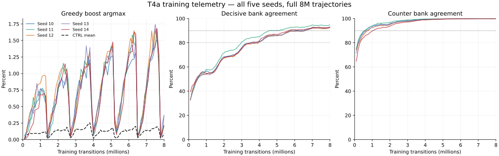

# T4a two-sided development screen, not gate evidence (2026-10-16)

**Development screen, not gate evidence.** TWO_SIDED is evaluated without a veto; it does not promote or change serving.

## Decision

| arm | initial / final | scripted episode delta vs CTRL | scripted mass delta CTRL | failed runs |
|---|---|---:|---:|---|
| TWO_SIDED | KILL / KILL | -0.027 (seed SE 0.045; world SE 0.031) | -24.127 (seed SE 23.182; world SE 16.918) | none |

GO requires primary >= +0.06, mass delta versus CTRL >= -30 on every mix, and neither frozen nor mixed episode-survival delta below -0.05. KILL applies to any halt or primary <= 0. Otherwise round 66 is the single 96-world scripted extension; an intermediate final result is inconclusive.

## Secondary outcomes

| mix | episode delta CTRL | alive-frame delta CTRL | mass delta CTRL | mass delta incumbent | death mean TWO_SIDED / CTRL |
|---|---:|---:|---:|---:|---:|
| scripted | -0.027 (seed SE 0.045; world SE 0.031) | +0.002 (seed SE 0.021; world SE 0.017) | -24.127 (seed SE 23.182; world SE 16.918) | +154.037 (seed SE 15.926; world SE 15.536) | 839.3 / 826.8 |
| frozen | -0.050 (seed SE 0.032; world SE 0.049) | -0.025 (seed SE 0.010; world SE 0.023) | -41.036 (seed SE 9.247; world SE 18.922) | +98.794 (seed SE 12.643; world SE 17.602) | 686.5 / 775.1 |
| mixed | +0.050 (seed SE 0.051; world SE 0.046) | +0.015 (seed SE 0.014; world SE 0.020) | -14.666 (seed SE 17.237; world SE 16.501) | +75.226 (seed SE 13.996; world SE 13.761) | 749.4 / 766.6 |

### Death-length distributions

| mix | policy | deaths | mean | median | q25 | q75 |
|---|---|---:|---:|---:|---:|---:|
| scripted | candidate | 215 | 839.3 | 930.2 | 642.0 | 1118.2 |
| scripted | ctrl | 202 | 826.8 | 872.4 | 583.8 | 1100.4 |
| frozen | candidate | 45 | 686.5 | 708.8 | 556.6 | 919.4 |
| frozen | ctrl | 37 | 775.1 | 886.0 | 612.0 | 1000.2 |
| mixed | candidate | 28 | 749.4 | 798.4 | 660.8 | 885.4 |
| mixed | ctrl | 36 | 766.6 | 792.8 | 563.4 | 931.6 |

## Registered bank-agreement readout

| seed | decisive at 8M | counter at 8M |
|---|---:|---:|
| 10 | 0.9280 | 0.9991 |
| 11 | 0.9487 | 0.9998 |
| 12 | 0.9246 | 0.9987 |
| 13 | 0.9272 | 0.9993 |
| 14 | 0.9317 | 0.9994 |
| mean | 0.9320 | 0.9993 |

both >0.9: supports the inputs carrying the distinction and labels being learnable.

Curves show every logged 100k window. The dashed boost curve is the five-seed CTRL mean; the bank panels show the registered 0.9 and decisive 0.8 thresholds.

### Greedy boost rate per 100k

| run | transition:value |
|---|---|
| CTRL_s10 | 100224:0.000229, 200064:0.000351, 300160:0.000619, 400000:0.000791, 500096:0.000749, 600192:0.000739, 700032:0.000591, 800128:0.000819, 900224:0.000679, 1000064:0.000571, 1100160:0.001039, 1200000:0.001302, 1300096:0.001309, 1400192:0.000140, 1500032:0.000471, 1600128:0.000779, 1700224:0.001259, 1800064:0.000931, 1900160:0.001209, 2000000:0.001452, 2100096:0.001049, 2200192:0.001968, 2300032:0.002284, 2400128:0.002008, 2500224:0.002098, 2600064:0.001202, 2700160:0.000709, 2800000:0.000541, 2900096:0.002148, 3000192:0.002647, 3100032:0.002574, 3200128:0.003317, 3300224:0.001818, 3400064:0.001743, 3500160:0.001878, 3600000:0.001983, 3700096:0.002488, 3800192:0.003517, 3900032:0.001252, 4000128:0.000200, 4100224:0.000280, 4200064:0.000791, 4300160:0.000869, 4400000:0.001312, 4500096:0.001449, 4600192:0.001519, 4700032:0.001512, 4800128:0.000959, 4900224:0.001009, 5000064:0.001232, 5100160:0.001339, 5200000:0.000270, 5300096:0.000130, 5400192:0.000460, 5500032:0.001022, 5600128:0.001429, 5700224:0.001379, 5800064:0.001522, 5900160:0.001409, 6000000:0.002113, 6100096:0.002428, 6200192:0.002528, 6300032:0.002324, 6400128:0.002148, 6500224:0.000789, 6600064:0.000571, 6700160:0.000649, 6800000:0.001302, 6900096:0.001628, 7000192:0.001598, 7100032:0.001633, 7200128:0.001389, 7300224:0.001578, 7400064:0.002033, 7500160:0.001988, 7600000:0.002204, 7700096:0.001978, 7800192:0.000320, 7900032:0.000641, 8000128:0.001069 |
| CTRL_s11 | 100224:0.000120, 200064:0.000591, 300160:0.000969, 400000:0.000701, 500096:0.001189, 600192:0.001189, 700032:0.001102, 800128:0.000989, 900224:0.000979, 1000064:0.001302, 1100160:0.001928, 1200000:0.001482, 1300096:0.002028, 1400192:0.000260, 1500032:0.000300, 1600128:0.000619, 1700224:0.001259, 1800064:0.002214, 1900160:0.002418, 2000000:0.002754, 2100096:0.002048, 2200192:0.001359, 2300032:0.001362, 2400128:0.001019, 2500224:0.001988, 2600064:0.001653, 2700160:0.000190, 2800000:0.000310, 2900096:0.000609, 3000192:0.001598, 3100032:0.001322, 3200128:0.001199, 3300224:0.001499, 3400064:0.001542, 3500160:0.000969, 3600000:0.001993, 3700096:0.001069, 3800192:0.001479, 3900032:0.000931, 4000128:0.000160, 4100224:0.000929, 4200064:0.000811, 4300160:0.001349, 4400000:0.002594, 4500096:0.000929, 4600192:0.001149, 4700032:0.001042, 4800128:0.001129, 4900224:0.001539, 5000064:0.001432, 5100160:0.001439, 5200000:0.000331, 5300096:0.000200, 5400192:0.000150, 5500032:0.000611, 5600128:0.001549, 5700224:0.001029, 5800064:0.001653, 5900160:0.000849, 6000000:0.001442, 6100096:0.000629, 6200192:0.000919, 6300032:0.000911, 6400128:0.001419, 6500224:0.000040, 6600064:0.000160, 6700160:0.000270, 6800000:0.000591, 6900096:0.001878, 7000192:0.001249, 7100032:0.001082, 7200128:0.000759, 7300224:0.001119, 7400064:0.001122, 7500160:0.001489, 7600000:0.001863, 7700096:0.001519, 7800192:0.000160, 7900032:0.000240, 8000128:0.000719 |
| CTRL_s12 | 100224:0.000279, 200064:0.001092, 300160:0.001708, 400000:0.002153, 500096:0.001798, 600192:0.001838, 700032:0.001743, 800128:0.001429, 900224:0.001578, 1000064:0.001502, 1100160:0.001209, 1200000:0.000972, 1300096:0.001139, 1400192:0.000100, 1500032:0.000531, 1600128:0.000739, 1700224:0.000769, 1800064:0.001052, 1900160:0.000559, 2000000:0.000601, 2100096:0.000929, 2200192:0.000829, 2300032:0.000962, 2400128:0.001439, 2500224:0.001459, 2600064:0.001092, 2700160:0.000250, 2800000:0.000681, 2900096:0.000939, 3000192:0.001289, 3100032:0.001713, 3200128:0.001219, 3300224:0.001948, 3400064:0.002103, 3500160:0.001988, 3600000:0.002624, 3700096:0.003607, 3800192:0.003996, 3900032:0.001442, 4000128:0.000200, 4100224:0.000579, 4200064:0.000631, 4300160:0.000799, 4400000:0.000781, 4500096:0.000929, 4600192:0.001119, 4700032:0.001432, 4800128:0.001708, 4900224:0.001079, 5000064:0.002274, 5100160:0.002588, 5200000:0.000611, 5300096:0.000330, 5400192:0.000400, 5500032:0.000771, 5600128:0.001199, 5700224:0.001269, 5800064:0.001372, 5900160:0.001039, 6000000:0.001182, 6100096:0.001728, 6200192:0.001808, 6300032:0.002985, 6400128:0.002997, 6500224:0.000140, 6600064:0.000220, 6700160:0.000559, 6800000:0.000841, 6900096:0.000909, 7000192:0.000839, 7100032:0.001703, 7200128:0.001838, 7300224:0.002538, 7400064:0.002404, 7500160:0.003147, 7600000:0.003265, 7700096:0.002518, 7800192:0.000230, 7900032:0.000260, 8000128:0.000629 |
| CTRL_s13 | 100224:0.000040, 200064:0.000280, 300160:0.000340, 400000:0.000551, 500096:0.000400, 600192:0.000440, 700032:0.000791, 800128:0.000909, 900224:0.000839, 1000064:0.000721, 1100160:0.000679, 1200000:0.001012, 1300096:0.000659, 1400192:0.000090, 1500032:0.000341, 1600128:0.000669, 1700224:0.001069, 1800064:0.001532, 1900160:0.001718, 2000000:0.001973, 2100096:0.002168, 2200192:0.001978, 2300032:0.002043, 2400128:0.001339, 2500224:0.002607, 2600064:0.001002, 2700160:0.000160, 2800000:0.000631, 2900096:0.000969, 3000192:0.001249, 3100032:0.001202, 3200128:0.001169, 3300224:0.001369, 3400064:0.001422, 3500160:0.002647, 3600000:0.002053, 3700096:0.003087, 3800192:0.002018, 3900032:0.001643, 4000128:0.000090, 4100224:0.000649, 4200064:0.001152, 4300160:0.001509, 4400000:0.001673, 4500096:0.001988, 4600192:0.001758, 4700032:0.001492, 4800128:0.001618, 4900224:0.001908, 5000064:0.001653, 5100160:0.002318, 5200000:0.000391, 5300096:0.000120, 5400192:0.000659, 5500032:0.001312, 5600128:0.001289, 5700224:0.001529, 5800064:0.001342, 5900160:0.001618, 6000000:0.001623, 6100096:0.001429, 6200192:0.001069, 6300032:0.001272, 6400128:0.001858, 6500224:0.000310, 6600064:0.000611, 6700160:0.001499, 6800000:0.001532, 6900096:0.001778, 7000192:0.002128, 7100032:0.001663, 7200128:0.001648, 7300224:0.001908, 7400064:0.001983, 7500160:0.001339, 7600000:0.001643, 7700096:0.001219, 7800192:0.000130, 7900032:0.000341, 8000128:0.000799 |
| CTRL_s14 | 100224:0.000239, 200064:0.000511, 300160:0.000539, 400000:0.000551, 500096:0.000390, 600192:0.000340, 700032:0.000441, 800128:0.000480, 900224:0.000470, 1000064:0.000511, 1100160:0.000510, 1200000:0.000821, 1300096:0.000779, 1400192:0.000240, 1500032:0.000270, 1600128:0.000589, 1700224:0.000729, 1800064:0.000711, 1900160:0.000599, 2000000:0.000661, 2100096:0.000430, 2200192:0.000559, 2300032:0.000942, 2400128:0.001199, 2500224:0.001189, 2600064:0.000691, 2700160:0.000110, 2800000:0.000290, 2900096:0.000350, 3000192:0.001289, 3100032:0.000911, 3200128:0.000749, 3300224:0.000779, 3400064:0.000911, 3500160:0.000719, 3600000:0.001142, 3700096:0.001259, 3800192:0.001658, 3900032:0.000581, 4000128:0.000140, 4100224:0.000320, 4200064:0.000270, 4300160:0.000529, 4400000:0.000851, 4500096:0.000549, 4600192:0.000889, 4700032:0.000551, 4800128:0.001009, 4900224:0.001369, 5000064:0.001352, 5100160:0.001279, 5200000:0.000461, 5300096:0.000200, 5400192:0.000410, 5500032:0.000551, 5600128:0.000599, 5700224:0.001029, 5800064:0.001552, 5900160:0.001219, 6000000:0.000721, 6100096:0.001179, 6200192:0.001129, 6300032:0.001743, 6400128:0.001549, 6500224:0.000220, 6600064:0.000942, 6700160:0.001219, 6800000:0.001232, 6900096:0.000889, 7000192:0.000999, 7100032:0.000921, 7200128:0.000819, 7300224:0.000939, 7400064:0.000871, 7500160:0.000939, 7600000:0.000741, 7700096:0.000699, 7800192:0.000280, 7900032:0.000601, 8000128:0.001279 |
| TWO_SIDED_s10 | 100096:0.000549, 200192:0.001099, 300032:0.002053, 400128:0.002997, 500224:0.003157, 600064:0.004908, 700160:0.005045, 800000:0.005799, 900096:0.006004, 1000192:0.007693, 1100032:0.007392, 1200128:0.007323, 1300224:0.006314, 1400064:0.001112, 1500160:0.001728, 1600000:0.002764, 1700096:0.004785, 1800192:0.005125, 1900032:0.005439, 2000128:0.007763, 2100224:0.008182, 2200064:0.009415, 2300160:0.007743, 2400000:0.008894, 2500096:0.009980, 2600192:0.006194, 2700032:0.001212, 2800128:0.002158, 2900224:0.002977, 3000064:0.005439, 3100160:0.007743, 3200000:0.008984, 3300096:0.007653, 3400192:0.009831, 3500032:0.010377, 3600128:0.009291, 3700224:0.012618, 3800064:0.009986, 3900160:0.004935, 4000000:0.001422, 4100096:0.002707, 4200192:0.004286, 4300032:0.005889, 4400128:0.006793, 4500224:0.009161, 4600064:0.009926, 4700160:0.011139, 4800000:0.009766, 4900096:0.011769, 5000192:0.012518, 5100032:0.012700, 5200128:0.003736, 5300224:0.001179, 5400064:0.002324, 5500160:0.005035, 5600000:0.006020, 5700096:0.007733, 5800192:0.009691, 5900032:0.010487, 6000128:0.011059, 6100224:0.011629, 6200064:0.012139, 6300160:0.012168, 6400000:0.013181, 6500096:0.000819, 6600192:0.001109, 6700032:0.002965, 6800128:0.004056, 6900224:0.006524, 7000064:0.007432, 7100160:0.009091, 7200000:0.011949, 7300096:0.012068, 7400192:0.012858, 7500032:0.014513, 7600128:0.015155, 7700224:0.012918, 7800064:0.000351, 7900160:0.000869, 8000000:0.003746 |
| TWO_SIDED_s11 | 100096:0.000140, 200192:0.000929, 300032:0.001282, 400128:0.002358, 500224:0.004376, 600064:0.006400, 700160:0.004815, 800000:0.006410, 900096:0.007303, 1000192:0.006843, 1100032:0.007782, 1200128:0.007373, 1300224:0.005495, 1400064:0.000361, 1500160:0.000619, 1600000:0.002003, 1700096:0.002528, 1800192:0.004995, 1900032:0.006500, 2000128:0.007293, 2100224:0.009421, 2200064:0.010216, 2300160:0.011559, 2400000:0.009876, 2500096:0.010760, 2600192:0.008242, 2700032:0.000310, 2800128:0.001219, 2900224:0.002148, 3000064:0.003435, 3100160:0.007093, 3200000:0.008033, 3300096:0.010680, 3400192:0.009851, 3500032:0.011929, 3600128:0.011309, 3700224:0.011279, 3800064:0.012109, 3900160:0.004036, 4000000:0.000661, 4100096:0.001229, 4200192:0.002787, 4300032:0.004327, 4400128:0.006064, 4500224:0.008452, 4600064:0.011659, 4700160:0.011789, 4800000:0.011569, 4900096:0.012988, 5000192:0.014076, 5100032:0.014012, 5200128:0.003117, 5300224:0.001089, 5400064:0.001683, 5500160:0.002837, 5600000:0.005889, 5700096:0.008292, 5800192:0.009571, 5900032:0.010347, 6000128:0.013257, 6100224:0.013127, 6200064:0.015855, 6300160:0.014596, 6400000:0.014133, 6500096:0.000420, 6600192:0.000829, 6700032:0.001763, 6800128:0.003327, 6900224:0.006813, 7000064:0.007592, 7100160:0.010490, 7200000:0.011859, 7300096:0.012738, 7400192:0.014216, 7500032:0.016627, 7600128:0.015205, 7700224:0.010999, 7800064:0.000441, 7900160:0.001469, 8000000:0.001963 |
| TWO_SIDED_s12 | 100224:0.000110, 200064:0.001182, 300160:0.002637, 400000:0.004026, 500096:0.004686, 600192:0.005225, 700032:0.006941, 800128:0.008032, 900224:0.008402, 1000064:0.008524, 1100160:0.009591, 1200000:0.009746, 1300096:0.009631, 1400192:0.000460, 1500032:0.002023, 1600128:0.003866, 1700224:0.004046, 1800064:0.006330, 1900160:0.008202, 2000000:0.009105, 2100096:0.010170, 2200192:0.010760, 2300032:0.010857, 2400128:0.010410, 2500224:0.010470, 2600064:0.006420, 2700160:0.000529, 2800000:0.001222, 2900096:0.002358, 3000192:0.004276, 3100032:0.006310, 3200128:0.008322, 3300224:0.009761, 3400064:0.009485, 3500160:0.010480, 3600000:0.011048, 3700096:0.012458, 3800192:0.013197, 3900032:0.005148, 4000128:0.001259, 4100224:0.002168, 4200064:0.004016, 4300160:0.005225, 4400000:0.007963, 4500096:0.008991, 4600192:0.010400, 4700032:0.012260, 4800128:0.013297, 4900224:0.013367, 5000064:0.013472, 5100160:0.014256, 5200000:0.002684, 5300096:0.001668, 5400192:0.003706, 5500032:0.004207, 5600128:0.006194, 5700224:0.007673, 5800064:0.009675, 5900160:0.010979, 6000000:0.013672, 6100096:0.015325, 6200192:0.014576, 6300032:0.016496, 6400128:0.015046, 6500224:0.000370, 6600064:0.001212, 6700160:0.002268, 6800000:0.004067, 6900096:0.006404, 7000192:0.008282, 7100032:0.011258, 7200128:0.013237, 7300224:0.016444, 7400064:0.013612, 7500160:0.016684, 7600000:0.016777, 7700096:0.012118, 7800192:0.000500, 7900032:0.001022, 8000128:0.002128 |
| TWO_SIDED_s13 | 100096:0.000020, 200192:0.000869, 300032:0.002143, 400128:0.003726, 500224:0.004735, 600064:0.003936, 700160:0.005734, 800000:0.008524, 900096:0.006584, 1000192:0.007713, 1100032:0.007472, 1200128:0.006334, 1300224:0.005445, 1400064:0.000140, 1500160:0.001179, 1600000:0.002835, 1700096:0.004266, 1800192:0.006014, 1900032:0.005980, 2000128:0.008392, 2100224:0.008602, 2200064:0.009155, 2300160:0.008732, 2400000:0.008313, 2500096:0.009411, 2600192:0.006324, 2700032:0.000471, 2800128:0.002128, 2900224:0.003417, 3000064:0.006100, 3100160:0.006943, 3200000:0.007853, 3300096:0.008812, 3400192:0.009541, 3500032:0.010998, 3600128:0.014216, 3700224:0.011259, 3800064:0.013942, 3900160:0.005944, 4000000:0.000551, 4100096:0.002458, 4200192:0.004366, 4300032:0.005108, 4400128:0.007313, 4500224:0.008292, 4600064:0.010958, 4700160:0.011639, 4800000:0.012670, 4900096:0.012138, 5000192:0.012848, 5100032:0.013892, 5200128:0.003537, 5300224:0.001389, 5400064:0.002354, 5500160:0.004176, 5600000:0.006480, 5700096:0.008752, 5800192:0.009571, 5900032:0.011609, 6000128:0.013027, 6100224:0.013867, 6200064:0.014313, 6300160:0.012418, 6400000:0.015345, 6500096:0.000549, 6600192:0.001239, 6700032:0.003005, 6800128:0.003267, 6900224:0.005265, 7000064:0.008634, 7100160:0.010340, 7200000:0.011779, 7300096:0.012898, 7400192:0.015515, 7500032:0.017448, 7600128:0.015715, 7700224:0.013287, 7800064:0.000531, 7900160:0.002438, 8000000:0.003636 |
| TWO_SIDED_s14 | 100224:0.000040, 200064:0.000230, 300160:0.000520, 400000:0.001332, 500096:0.001978, 600192:0.002478, 700032:0.004497, 800128:0.004596, 900224:0.004765, 1000064:0.006831, 1100160:0.006714, 1200000:0.007001, 1300096:0.006534, 1400192:0.000589, 1500032:0.002404, 1600128:0.002687, 1700224:0.004046, 1800064:0.004577, 1900160:0.005575, 2000000:0.007903, 2100096:0.008612, 2200192:0.009171, 2300032:0.010306, 2400128:0.011479, 2500224:0.009001, 2600064:0.006100, 2700160:0.000430, 2800000:0.001362, 2900096:0.002558, 3000192:0.003507, 3100032:0.005108, 3200128:0.007033, 3300224:0.008352, 3400064:0.010146, 3500160:0.011019, 3600000:0.010937, 3700096:0.011169, 3800192:0.011599, 3900032:0.005048, 4000128:0.000789, 4100224:0.002038, 4200064:0.002664, 4300160:0.004046, 4400000:0.005889, 4500096:0.009111, 4600192:0.009950, 4700032:0.011609, 4800128:0.011589, 4900224:0.012708, 5000064:0.013742, 5100160:0.014776, 5200000:0.002374, 5300096:0.000759, 5400192:0.001868, 5500032:0.002804, 5600128:0.004196, 5700224:0.005695, 5800064:0.009886, 5900160:0.010750, 6000000:0.012450, 6100096:0.013247, 6200192:0.013317, 6300032:0.016236, 6400128:0.016055, 6500224:0.000500, 6600064:0.001022, 6700160:0.002048, 6800000:0.002804, 6900096:0.004885, 7000192:0.007363, 7100032:0.009115, 7200128:0.012178, 7300224:0.012808, 7400064:0.013712, 7500160:0.013987, 7600000:0.016807, 7700096:0.012808, 7800192:0.000370, 7900032:0.001192, 8000128:0.002208 |

### Final and 2M telemetry

| run | final greedy boost | bank agree 2M / 8M | decisive 2M / 8M | counter 2M / 8M |
|---|---:|---:|---:|---:|
| CTRL_s10 | 0.0011 | missing / missing | missing / missing | missing / missing |
| CTRL_s11 | 0.0007 | missing / missing | missing / missing | missing / missing |
| CTRL_s12 | 0.0006 | missing / missing | missing / missing | missing / missing |
| CTRL_s13 | 0.0008 | missing / missing | missing / missing | missing / missing |
| CTRL_s14 | 0.0013 | missing / missing | missing / missing | missing / missing |
| TWO_SIDED_s10 | 0.0037 | 0.8341 / 0.9608 | 0.6844 / 0.9280 | 0.9588 / 0.9991 |
| TWO_SIDED_s11 | 0.0020 | 0.8513 / 0.9711 | 0.7158 / 0.9487 | 0.9691 / 0.9998 |
| TWO_SIDED_s12 | 0.0021 | 0.8268 / 0.9589 | 0.6727 / 0.9246 | 0.9492 / 0.9987 |
| TWO_SIDED_s13 | 0.0036 | 0.8302 / 0.9604 | 0.6769 / 0.9272 | 0.9541 / 0.9993 |
| TWO_SIDED_s14 | 0.0022 | 0.8302 / 0.9628 | 0.6776 / 0.9317 | 0.9361 / 0.9994 |

### Final retained learner telemetry

| run | TD | anchor | Q max | bank margin loss | bank rows | tight fraction |
|---|---:|---:|---:|---:|---:|---:|
| CTRL_s10 | 0.116203 | 0.00435147 | 141.16 | missing | missing | missing |
| CTRL_s11 | 0.104982 | 0.00352436 | 143.248 | missing | missing | missing |
| CTRL_s12 | 0.120119 | 0.00376265 | 140.998 | missing | missing | missing |
| CTRL_s13 | 0.126513 | 0.00335293 | 134.821 | missing | missing | missing |
| CTRL_s14 | 0.116703 | 0.00331189 | 145.771 | missing | missing | missing |
| TWO_SIDED_s10 | 0.129821 | 0.0212432 | 128.598 | 0.0327526 | 128 | missing |
| TWO_SIDED_s11 | 0.11391 | 0.0155991 | 133.496 | 0.0234298 | 128 | missing |
| TWO_SIDED_s12 | 0.0973101 | 0.0208945 | 135.995 | 0.0335497 | 128 | missing |
| TWO_SIDED_s13 | 0.113515 | 0.019708 | 132.768 | 0.031797 | 128 | missing |
| TWO_SIDED_s14 | 0.0982344 | 0.0186315 | 126.779 | 0.0292765 | 128 | missing |

### Bank agreement per 100k

| run | ordinary | decisive | counter |
|---|---|---|---|
| CTRL_s10 | missing | missing | missing |
| CTRL_s11 | missing | missing | missing |
| CTRL_s12 | missing | missing | missing |
| CTRL_s13 | missing | missing | missing |
| CTRL_s14 | missing | missing | missing |
| TWO_SIDED_s10 | 100096:0.625121, 200192:0.673753, 300032:0.697216, 400128:0.722866, 500224:0.738191, 600064:0.752744, 700160:0.757393, 800000:0.760737, 900096:0.764546, 1000192:0.772838, 1100032:0.771094, 1200128:0.764406, 1300224:0.767949, 1400064:0.772336, 1500160:0.779971, 1600000:0.793890, 1700096:0.802370, 1800192:0.815797, 1900032:0.829487, 2000128:0.834079, 2100224:0.835318, 2200064:0.837460, 2300160:0.839874, 2400000:0.840325, 2500096:0.844749, 2600192:0.845032, 2700032:0.851863, 2800128:0.856138, 2900224:0.866508, 3000064:0.876202, 3100160:0.885370, 3200000:0.890845, 3300096:0.892783, 3400192:0.893982, 3500032:0.896154, 3600128:0.897818, 3700224:0.899496, 3800064:0.898197, 3900160:0.898858, 4000000:0.902344, 4100096:0.904272, 4200192:0.909787, 4300032:0.916787, 4400128:0.922454, 4500224:0.925252, 4600064:0.925461, 4700160:0.925891, 4800000:0.928506, 4900096:0.926890, 5000192:0.925432, 5100032:0.927704, 5200128:0.926743, 5300224:0.929148, 5400064:0.933093, 5500160:0.937040, 5600000:0.940345, 5700096:0.943974, 5800192:0.948350, 5900032:0.945433, 6000128:0.947650, 6100224:0.948629, 6200064:0.948197, 6300160:0.946172, 6400000:0.948729, 6500096:0.945132, 6600192:0.952825, 6700032:0.952664, 6800128:0.954624, 6900224:0.957081, 7000064:0.958834, 7100160:0.960558, 7200000:0.958974, 7300096:0.957980, 7400192:0.958700, 7500032:0.958594, 7600128:0.956562, 7700224:0.955288, 7800064:0.955689, 7900160:0.958200, 8000000:0.960777 | 100096:0.325130, 200192:0.404372, 300032:0.443550, 400128:0.484415, 500224:0.507673, 600064:0.534896, 700160:0.543558, 800000:0.546354, 900096:0.552470, 1000192:0.567016, 1100032:0.562179, 1200128:0.550791, 1300224:0.553606, 1400064:0.564423, 1500160:0.577406, 1600000:0.606851, 1700096:0.622163, 1800192:0.649417, 1900032:0.677204, 2000128:0.684423, 2100224:0.686061, 2200064:0.687380, 2300160:0.692935, 2400000:0.691907, 2500096:0.702006, 2600192:0.701122, 2700032:0.713742, 2800128:0.721907, 2900224:0.742607, 3000064:0.760657, 3100160:0.780810, 3200000:0.791226, 3300096:0.793478, 3400192:0.797634, 3500032:0.800681, 3600128:0.804148, 3700224:0.807265, 3800064:0.804287, 3900160:0.805809, 4000000:0.811979, 4100096:0.816137, 4200192:0.827845, 4300032:0.840024, 4400128:0.852262, 4500224:0.857697, 4600064:0.857492, 4700160:0.858696, 4800000:0.864944, 4900096:0.861213, 5000192:0.857936, 5100032:0.862620, 5200128:0.860857, 5300224:0.864650, 5400064:0.872236, 5500160:0.881474, 5600000:0.886859, 5700096:0.894421, 5800192:0.902174, 5900032:0.897917, 6000128:0.900775, 6100224:0.902733, 6200064:0.902324, 6300160:0.898497, 6400000:0.903692, 6500096:0.896891, 6600192:0.911605, 6700032:0.911098, 6800128:0.915761, 6900224:0.920396, 7000064:0.923838, 7100160:0.927190, 7200000:0.923598, 7300096:0.922155, 7400192:0.923234, 7500032:0.922837, 7600128:0.918838, 7700224:0.916747, 7800064:0.917348, 7900160:0.923593, 8000000:0.927965 | 100096:0.743766, 200192:0.800991, 300032:0.836819, 400128:0.867048, 500224:0.889506, 600064:0.903846, 700160:0.913483, 800000:0.923838, 900096:0.932225, 1000192:0.935902, 1100032:0.944311, 1200128:0.942335, 1300224:0.949639, 1400064:0.949519, 1500160:0.955523, 1600000:0.950481, 1700096:0.950887, 1800192:0.949049, 1900032:0.951482, 2000128:0.958760, 2100224:0.963395, 2200064:0.965705, 2300160:0.969270, 2400000:0.974679, 2500096:0.974824, 2600192:0.977444, 2700032:0.979407, 2800128:0.981498, 2900224:0.981937, 3000064:0.983694, 3100160:0.981777, 3200000:0.984575, 3300096:0.985934, 3400192:0.987692, 3500032:0.989744, 3600128:0.989290, 3700224:0.991448, 3800064:0.991987, 3900160:0.992228, 4000000:0.992588, 4100096:0.993127, 4200192:0.992487, 4300032:0.994752, 4400128:0.994805, 4500224:0.994765, 4600064:0.995313, 4700160:0.996963, 4800000:0.995713, 4900096:0.995604, 5000192:0.996204, 5100032:0.995833, 5200128:0.996194, 5300224:0.997083, 5400064:0.997796, 5500160:0.997962, 5600000:0.997396, 5700096:0.998242, 5800192:0.998402, 5900032:0.998437, 6000128:0.998402, 6100224:0.998202, 6200064:0.998518, 6300160:0.998402, 6400000:0.998362, 6500096:0.998554, 6600192:0.998921, 6700032:0.998838, 6800128:0.998881, 6900224:0.999001, 7000064:0.999319, 7100160:0.999321, 7200000:0.999119, 7300096:0.999241, 7400192:0.999041, 7500032:0.999119, 7600128:0.999121, 7700224:0.998878, 7800064:0.999199, 7900160:0.998921, 8000000:0.999119 |
| TWO_SIDED_s11 | 100096:0.631881, 200192:0.666860, 300032:0.690605, 400128:0.717331, 500224:0.734735, 600064:0.749018, 700160:0.761629, 800000:0.768229, 900096:0.769801, 1000192:0.780810, 1100032:0.779267, 1200128:0.779691, 1300224:0.781490, 1400064:0.788181, 1500160:0.796475, 1600000:0.805889, 1700096:0.821172, 1800192:0.830902, 1900032:0.846114, 2000128:0.851303, 2100224:0.857797, 2200064:0.858574, 2300160:0.862952, 2400000:0.864203, 2500096:0.864390, 2600192:0.867568, 2700032:0.871735, 2800128:0.880854, 2900224:0.887888, 3000064:0.897937, 3100160:0.903313, 3200000:0.909215, 3300096:0.913183, 3400192:0.913763, 3500032:0.916727, 3600128:0.919218, 3700224:0.918738, 3800064:0.919571, 3900160:0.921354, 4000000:0.921034, 4100096:0.927370, 4200192:0.931706, 4300032:0.937901, 4400128:0.940837, 4500224:0.944653, 4600064:0.947115, 4700160:0.947410, 4800000:0.946494, 4900096:0.947231, 5000192:0.947870, 5100032:0.946174, 5200128:0.949800, 5300224:0.949429, 5400064:0.953205, 5500160:0.955043, 5600000:0.957171, 5700096:0.958460, 5800192:0.960957, 5900032:0.960156, 6000128:0.961497, 6100224:0.961157, 6200064:0.961899, 6300160:0.959419, 6400000:0.961810, 6500096:0.960432, 6600192:0.962056, 6700032:0.964163, 6800128:0.965173, 6900224:0.967052, 7000064:0.970733, 7100160:0.968191, 7200000:0.968810, 7300096:0.967791, 7400192:0.969409, 7500032:0.969872, 7600128:0.968510, 7700224:0.967808, 7800064:0.968109, 7900160:0.968410, 8000000:0.971114 | 100096:0.330230, 200192:0.382872, 300032:0.421675, 400128:0.469989, 500224:0.498841, 600064:0.527043, 700160:0.547834, 800000:0.558093, 900096:0.559783, 1000192:0.579963, 1100032:0.576963, 1200128:0.574409, 1300224:0.577324, 1400064:0.589423, 1500160:0.606458, 1600000:0.626202, 1700096:0.655091, 1800192:0.674193, 1900032:0.705970, 2000128:0.715833, 2100224:0.727422, 2200064:0.728205, 2300160:0.736173, 2400000:0.739062, 2500096:0.738491, 2600192:0.743910, 2700032:0.752564, 2800128:0.772019, 2900224:0.785046, 3000064:0.805208, 3100160:0.815497, 3200000:0.826482, 3300096:0.834399, 3400192:0.834119, 3500032:0.840385, 3600128:0.845708, 3700224:0.844230, 3800064:0.845753, 3900160:0.849079, 4000000:0.849159, 4100096:0.861133, 4200192:0.869805, 4300032:0.882412, 4400128:0.888667, 4500224:0.895740, 4600064:0.901322, 4700160:0.901375, 4800000:0.899880, 4900096:0.900336, 5000192:0.902494, 5100032:0.899199, 5200128:0.907292, 5300224:0.905691, 5400064:0.912540, 5500160:0.916280, 5600000:0.921034, 5700096:0.923553, 5800192:0.928788, 5900032:0.926843, 6000128:0.929548, 6100224:0.928708, 6200064:0.930649, 6300160:0.925312, 6400000:0.929053, 6500096:0.926894, 6600192:0.930547, 6700032:0.934295, 6800128:0.937860, 6900224:0.940297, 7000064:0.947316, 7100160:0.943494, 7200000:0.944111, 7300096:0.941896, 7400192:0.944094, 7500032:0.946514, 7600128:0.943694, 7700224:0.942668, 7800064:0.942388, 7900160:0.942975, 8000000:0.948678 | 100096:0.752672, 200192:0.818494, 300032:0.854527, 400128:0.876239, 500224:0.894461, 600064:0.898397, 700160:0.913723, 800000:0.925521, 900096:0.931825, 1000192:0.939498, 1100032:0.947035, 1200128:0.951686, 1300224:0.959255, 1400064:0.961619, 1500160:0.961277, 1600000:0.962420, 1700096:0.963875, 1800192:0.963355, 1900032:0.965184, 2000128:0.969150, 2100224:0.971268, 2200064:0.976442, 2300160:0.980379, 2400000:0.980849, 2500096:0.982377, 2600192:0.983774, 2700032:0.985697, 2800128:0.985414, 2900224:0.987732, 3000064:0.988421, 3100160:0.989130, 3200000:0.989503, 3300096:0.991728, 3400192:0.992407, 3500032:0.993269, 3600128:0.993446, 3700224:0.994725, 3800064:0.995232, 3900160:0.995873, 4000000:0.996474, 4100096:0.996443, 4200192:0.996403, 4300032:0.996915, 4400128:0.996883, 4500224:0.997442, 4600064:0.997316, 4700160:0.997602, 4800000:0.998077, 4900096:0.998002, 5000192:0.998122, 5100032:0.998678, 5200128:0.998678, 5300224:0.998322, 5400064:0.998838, 5500160:0.998961, 5600000:0.998798, 5700096:0.999281, 5800192:0.999640, 5900032:0.998918, 6000128:0.999001, 6100224:0.999401, 6200064:0.999519, 6300160:0.999560, 6400000:0.999445, 6500096:0.999474, 6600192:0.999241, 6700032:0.999559, 6800128:0.999480, 6900224:0.999520, 7000064:0.999559, 7100160:0.999720, 7200000:0.999599, 7300096:0.999800, 7400192:0.999600, 7500032:0.999679, 7600128:0.999640, 7700224:0.999679, 7800064:0.999479, 7900160:0.999441, 8000000:0.999800 |
| TWO_SIDED_s12 | 100224:0.627995, 200064:0.668610, 300160:0.696831, 400000:0.715986, 500096:0.730958, 600192:0.740869, 700032:0.750962, 800128:0.755595, 900224:0.757273, 1000064:0.758253, 1100160:0.762448, 1200000:0.762039, 1300096:0.763542, 1400192:0.768223, 1500032:0.777764, 1600128:0.785666, 1700224:0.800112, 1800064:0.812300, 1900160:0.822291, 2000000:0.826803, 2100096:0.830203, 2200192:0.833060, 2300032:0.836118, 2400128:0.838855, 2500224:0.834819, 2600064:0.839794, 2700160:0.846088, 2800000:0.851342, 2900096:0.859795, 3000192:0.868306, 3100032:0.878125, 3200128:0.884910, 3300224:0.890205, 3400064:0.889884, 3500160:0.888427, 3600000:0.894191, 3700096:0.891424, 3800192:0.894681, 3900032:0.892212, 4000128:0.898817, 4100224:0.902673, 4200064:0.906631, 4300160:0.913943, 4400000:0.920433, 4500096:0.922954, 4600192:0.926011, 4700032:0.925581, 4800128:0.926131, 4900224:0.926411, 5000064:0.924579, 5100160:0.925731, 5200000:0.929306, 5300096:0.928049, 5400192:0.933044, 5500032:0.938702, 5600128:0.941196, 5700224:0.945113, 5800064:0.944291, 5900160:0.944174, 6000000:0.944792, 6100096:0.944673, 6200192:0.944673, 6300032:0.943870, 6400128:0.942840, 6500224:0.945414, 6600064:0.947175, 6700160:0.948829, 6800000:0.951522, 6900096:0.953824, 7000192:0.956462, 7100032:0.956470, 7200128:0.956282, 7300224:0.957241, 7400064:0.955990, 7500160:0.955003, 7600000:0.954768, 7700096:0.954948, 7800192:0.956062, 7900032:0.957272, 8000128:0.958899 | 100224:0.326830, 200064:0.401162, 300160:0.447770, 400000:0.477204, 500096:0.500400, 600192:0.517064, 700032:0.532692, 800128:0.540281, 900224:0.539482, 1000064:0.539062, 1100160:0.547115, 1200000:0.544231, 1300096:0.545633, 1400192:0.555307, 1500032:0.573117, 1600128:0.590513, 1700224:0.617807, 1800064:0.642829, 1900160:0.664202, 2000000:0.672676, 2100096:0.676990, 2200192:0.681106, 2300032:0.685617, 2400128:0.691456, 2500224:0.681266, 2600064:0.691436, 2700160:0.704004, 2800000:0.713502, 2900096:0.731738, 3000192:0.747243, 3100032:0.767268, 3200128:0.779771, 3300224:0.789482, 3400064:0.789583, 3500160:0.787644, 3600000:0.796795, 3700096:0.791760, 3800192:0.796475, 3900032:0.792657, 4000128:0.806706, 4100224:0.812780, 4200064:0.820913, 4300160:0.835438, 4400000:0.847676, 4500096:0.854060, 4600192:0.859815, 4700032:0.858574, 4800128:0.861333, 4900224:0.859895, 5000064:0.857292, 5100160:0.858776, 5200000:0.864637, 5300096:0.864130, 5400192:0.874121, 5500032:0.884014, 5600128:0.890185, 5700224:0.897498, 5800064:0.894752, 5900160:0.894541, 6000000:0.895353, 6100096:0.896100, 6200192:0.894981, 6300032:0.894231, 6400128:0.892286, 6500224:0.897790, 6600064:0.900521, 6700160:0.904092, 6800000:0.909896, 6900096:0.914282, 7000192:0.919397, 7100032:0.919631, 7200128:0.919957, 7300224:0.921395, 7400064:0.918590, 7500160:0.916560, 7600000:0.915745, 7700096:0.917147, 7800192:0.917879, 7900032:0.920433, 8000128:0.924632 | 100224:0.739273, 200064:0.784295, 300160:0.814578, 400000:0.839623, 500096:0.865449, 600192:0.881873, 700032:0.896394, 800128:0.903013, 900224:0.919477, 1000064:0.927123, 1100160:0.929987, 1200000:0.937540, 1300096:0.937420, 1400192:0.942016, 1500032:0.943069, 1600128:0.942056, 1700224:0.944853, 1800064:0.941466, 1900160:0.944054, 2000000:0.949199, 2100096:0.956162, 2200192:0.962196, 2300032:0.965224, 2400128:0.969549, 2500224:0.972227, 2600064:0.972887, 2700160:0.974984, 2800000:0.976082, 2900096:0.977302, 3000192:0.977462, 3100032:0.977524, 3200128:0.981777, 3300224:0.982537, 3400064:0.983173, 3500160:0.984135, 3600000:0.987580, 3700096:0.986173, 3800192:0.989051, 3900032:0.989597, 4000128:0.990969, 4100224:0.991528, 4200064:0.991466, 4300160:0.991768, 4400000:0.992788, 4500096:0.992727, 4600192:0.992847, 4700032:0.993470, 4800128:0.994445, 4900224:0.994925, 5000064:0.994511, 5100160:0.994925, 5200000:0.995903, 5300096:0.995964, 5400192:0.995644, 5500032:0.996114, 5600128:0.997043, 5700224:0.997522, 5800064:0.997276, 5900160:0.997323, 6000000:0.997436, 6100096:0.997363, 6200192:0.996683, 6300032:0.997676, 6400128:0.997745, 6500224:0.998057, 6600064:0.998117, 6700160:0.998362, 6800000:0.998197, 6900096:0.998402, 7000192:0.998481, 7100032:0.999079, 7200128:0.998841, 7300224:0.998921, 7400064:0.998798, 7500160:0.999041, 7600000:0.998437, 7700096:0.998317, 7800192:0.998402, 7900032:0.998838, 8000128:0.998721 |
| TWO_SIDED_s13 | 100096:0.629169, 200192:0.665042, 300032:0.691627, 400128:0.715233, 500224:0.731678, 600064:0.745613, 700160:0.750380, 800000:0.756470, 900096:0.756634, 1000192:0.761369, 1100032:0.759615, 1200128:0.758212, 1300224:0.764964, 1400064:0.766867, 1500160:0.774017, 1600000:0.786098, 1700096:0.804548, 1800192:0.815277, 1900032:0.822496, 2000128:0.830223, 2100224:0.836017, 2200064:0.838341, 2300160:0.835178, 2400000:0.836999, 2500096:0.839854, 2600192:0.844511, 2700032:0.850701, 2800128:0.855199, 2900224:0.863931, 3000064:0.871855, 3100160:0.878956, 3200000:0.887220, 3300096:0.890525, 3400192:0.892523, 3500032:0.894792, 3600128:0.892923, 3700224:0.894281, 3800064:0.894732, 3900160:0.897055, 4000000:0.898458, 4100096:0.902254, 4200192:0.908448, 4300032:0.914744, 4400128:0.916900, 4500224:0.922894, 4600064:0.922796, 4700160:0.924253, 4800000:0.923678, 4900096:0.925811, 5000192:0.927030, 5100032:0.927885, 5200128:0.928285, 5300224:0.929288, 5400064:0.933333, 5500160:0.935961, 5600000:0.938421, 5700096:0.941576, 5800192:0.944473, 5900032:0.946855, 6000128:0.943354, 6100224:0.944254, 6200064:0.946314, 6300160:0.944273, 6400000:0.944242, 6500096:0.945495, 6600192:0.946571, 6700032:0.951763, 6800128:0.952226, 6900224:0.954963, 7000064:0.959195, 7100160:0.958800, 7200000:0.959275, 7300096:0.957820, 7400192:0.957820, 7500032:0.958173, 7600128:0.959119, 7700224:0.958093, 7800064:0.957812, 7900160:0.960298, 8000000:0.960357 | 100096:0.334440, 200192:0.381754, 300032:0.428686, 400128:0.465553, 500224:0.495924, 600064:0.520072, 700160:0.527893, 800000:0.536859, 900096:0.536005, 1000192:0.543918, 1100032:0.538301, 1200128:0.535646, 1300224:0.547756, 1400064:0.550120, 1500160:0.563539, 1600000:0.589984, 1700096:0.625080, 1800192:0.646979, 1900032:0.662340, 2000128:0.676870, 2100224:0.686381, 2200064:0.689704, 2300160:0.682385, 2400000:0.686138, 2500096:0.691176, 2600192:0.698798, 2700032:0.712139, 2800128:0.721308, 2900224:0.738651, 3000064:0.755128, 3100160:0.768542, 3200000:0.784175, 3300096:0.790841, 3400192:0.793878, 3500032:0.797837, 3600128:0.794277, 3700224:0.796915, 3800064:0.797837, 3900160:0.802163, 4000000:0.804888, 4100096:0.811941, 4200192:0.824209, 4300032:0.835938, 4400128:0.840193, 4500224:0.851582, 4600064:0.852404, 4700160:0.855219, 4800000:0.854167, 4900096:0.858696, 5000192:0.860934, 5100032:0.862861, 5200128:0.862740, 5300224:0.866129, 5400064:0.873037, 5500160:0.878557, 5600000:0.883494, 5700096:0.890945, 5800192:0.895021, 5900032:0.899119, 6000128:0.892943, 6100224:0.895301, 6200064:0.899199, 6300160:0.895340, 6400000:0.894036, 6500096:0.895887, 6600192:0.899217, 6700032:0.908934, 6800128:0.910606, 6900224:0.915161, 7000064:0.923878, 7100160:0.923314, 7200000:0.925160, 7300096:0.922355, 7400192:0.922674, 7500032:0.923438, 7600128:0.923913, 7700224:0.923157, 7800064:0.921755, 7900160:0.926670, 8000000:0.927204 | 100096:0.714662, 200192:0.795436, 300032:0.829127, 400128:0.860614, 500224:0.874760, 600064:0.894271, 700160:0.900416, 800000:0.912380, 900096:0.919437, 1000192:0.925631, 1100032:0.930529, 1200128:0.937060, 1300224:0.941506, 1400064:0.945192, 1500160:0.949009, 1600000:0.946635, 1700096:0.946571, 1800192:0.948449, 1900032:0.944712, 2000128:0.954124, 2100224:0.959239, 2200064:0.964623, 2300160:0.968430, 2400000:0.969471, 2500096:0.970828, 2600192:0.976683, 2700032:0.976402, 2800128:0.975623, 2900224:0.976782, 3000064:0.976963, 3100160:0.978780, 3200000:0.980248, 3300096:0.981817, 3400192:0.984415, 3500032:0.987380, 3600128:0.986733, 3700224:0.988371, 3800064:0.989463, 3900160:0.990345, 4000000:0.990705, 4100096:0.990969, 4200192:0.991288, 4300032:0.992067, 4400128:0.991608, 4500224:0.993326, 4600064:0.993670, 4700160:0.993446, 4800000:0.993630, 4900096:0.994445, 5000192:0.995364, 5100032:0.995793, 5200128:0.996875, 5300224:0.996124, 5400064:0.996474, 5500160:0.997323, 5600000:0.997155, 5700096:0.997442, 5800192:0.997802, 5900032:0.997837, 6000128:0.998002, 6100224:0.997882, 6200064:0.998277, 6300160:0.997962, 6400000:0.998612, 6500096:0.998017, 6600192:0.998561, 6700032:0.998798, 6800128:0.998761, 6900224:0.999201, 7000064:0.999119, 7100160:0.999241, 7200000:0.999199, 7300096:0.999560, 7400192:0.999161, 7500032:0.999399, 7600128:0.999161, 7700224:0.999439, 7800064:0.999359, 7900160:0.999560, 8000000:0.999319 |
| TWO_SIDED_s14 | 100224:0.651818, 200064:0.687961, 300160:0.702226, 400000:0.723017, 500096:0.739290, 600192:0.746004, 700032:0.759235, 800128:0.764506, 900224:0.760210, 1000064:0.759535, 1100160:0.759990, 1200000:0.762901, 1300096:0.762841, 1400192:0.767203, 1500032:0.777604, 1600128:0.785186, 1700224:0.800671, 1800064:0.816587, 1900160:0.822610, 2000000:0.830228, 2100096:0.832261, 2200192:0.833460, 2300032:0.835897, 2400128:0.838815, 2500224:0.838155, 2600064:0.842726, 2700160:0.848725, 2800000:0.852985, 2900096:0.861633, 3000192:0.869465, 3100032:0.879267, 3200128:0.887188, 3300224:0.891005, 3400064:0.891707, 3500160:0.893682, 3600000:0.897656, 3700096:0.896539, 3800192:0.899177, 3900032:0.898799, 4000128:0.904991, 4100224:0.914202, 4200064:0.916607, 4300160:0.921096, 4400000:0.925481, 4500096:0.927969, 4600192:0.930007, 4700032:0.929868, 4800128:0.931825, 4900224:0.931965, 5000064:0.930829, 5100160:0.931925, 5200000:0.936295, 5300096:0.937520, 5400192:0.939818, 5500032:0.941747, 5600128:0.944953, 5700224:0.947990, 5800064:0.949880, 5900160:0.951127, 6000000:0.951282, 6100096:0.950028, 6200192:0.951147, 6300032:0.950481, 6400128:0.950831, 6500224:0.951344, 6600064:0.951202, 6700160:0.954224, 6800000:0.955849, 6900096:0.955703, 7000192:0.960678, 7100032:0.960837, 7200128:0.959479, 7300224:0.960878, 7400064:0.961699, 7500160:0.958820, 7600000:0.959275, 7700096:0.958974, 7800192:0.959259, 7900032:0.959295, 8000128:0.962756 | 100224:0.394875, 200064:0.444030, 300160:0.458959, 400000:0.491947, 500096:0.520061, 600192:0.528053, 700032:0.554087, 800128:0.561221, 900224:0.550072, 1000064:0.547556, 1100160:0.547514, 1200000:0.551402, 1300096:0.550921, 1400192:0.558104, 1500032:0.577163, 1600128:0.590633, 1700224:0.620684, 1800064:0.652764, 1900160:0.662164, 2000000:0.677604, 2100096:0.680986, 2200192:0.683983, 2300032:0.686258, 2400128:0.690897, 2500224:0.691097, 2600064:0.696979, 2700160:0.708120, 2800000:0.717027, 2900096:0.733975, 3000192:0.749281, 3100032:0.768870, 3200128:0.784647, 3300224:0.791041, 3400064:0.793630, 3500160:0.797195, 3600000:0.804006, 3700096:0.802350, 3800192:0.805507, 3900032:0.805551, 4000128:0.816496, 4100224:0.835078, 4200064:0.840304, 4300160:0.849385, 4400000:0.858894, 4500096:0.863371, 4600192:0.867207, 4700032:0.866947, 4800128:0.870324, 4900224:0.870444, 5000064:0.867508, 5100160:0.870444, 5200000:0.878575, 5300096:0.882553, 5400192:0.885949, 5500032:0.890625, 5600128:0.896499, 5700224:0.903213, 5800064:0.907051, 5900160:0.908608, 6000000:0.908133, 6100096:0.904971, 6200192:0.908808, 6300032:0.907853, 6400128:0.907516, 6500224:0.908314, 6600064:0.909014, 6700160:0.913803, 6800000:0.917708, 6900096:0.918199, 7000192:0.928069, 7100032:0.928005, 7200128:0.924313, 7300224:0.927629, 7400064:0.928966, 7500160:0.924473, 7600000:0.925000, 7700096:0.924760, 7800192:0.924912, 7900032:0.924920, 8000128:0.931666 | 100224:0.647668, 200064:0.741867, 300160:0.798234, 400000:0.827684, 500096:0.840473, 600192:0.858816, 700032:0.865585, 800128:0.873881, 900224:0.887028, 1000064:0.896554, 1100160:0.905451, 1200000:0.912500, 1300096:0.917548, 1400192:0.921076, 1500032:0.920753, 1600128:0.928708, 1700224:0.927230, 1800064:0.927444, 1900160:0.932065, 2000000:0.936138, 2100096:0.944893, 2200192:0.949249, 2300032:0.956851, 2400128:0.959199, 2500224:0.961197, 2600064:0.965055, 2700160:0.966073, 2800000:0.968910, 2900096:0.970348, 3000192:0.971507, 3100032:0.972276, 3200128:0.974345, 3300224:0.976902, 3400064:0.979808, 3500160:0.981897, 3600000:0.983734, 3700096:0.985814, 3800192:0.989370, 3900032:0.988753, 4000128:0.988651, 4100224:0.990529, 4200064:0.990905, 4300160:0.991129, 4400000:0.992388, 4500096:0.993806, 4600192:0.993726, 4700032:0.994832, 4800128:0.995324, 4900224:0.995045, 5000064:0.996955, 5100160:0.997323, 5200000:0.996987, 5300096:0.997043, 5400192:0.997642, 5500032:0.997316, 5600128:0.997442, 5700224:0.997442, 5800064:0.997636, 5900160:0.998481, 6000000:0.998758, 6100096:0.998961, 6200192:0.998362, 6300032:0.998397, 6400128:0.998180, 6500224:0.998745, 6600064:0.998758, 6700160:0.998841, 6800000:0.999119, 6900096:0.998881, 7000192:0.999001, 7100032:0.999159, 7200128:0.999241, 7300224:0.999281, 7400064:0.999079, 7500160:0.999001, 7600000:0.999279, 7700096:0.999319, 7800192:0.999041, 7900032:0.998798, 8000128:0.999361 |

### Five-seed side means per nominal 100k

#### decisive

| nominal transitions | mean | n |
|---:|---:|---:|
| 100000 | 0.342301 | 5 |
| 200000 | 0.402838 | 5 |
| 300000 | 0.440128 | 5 |
| 400000 | 0.477821 | 5 |
| 500000 | 0.504580 | 5 |
| 600000 | 0.525426 | 5 |
| 700000 | 0.541213 | 5 |
| 800000 | 0.548562 | 5 |
| 900000 | 0.547562 | 5 |
| 1000000 | 0.555503 | 5 |
| 1100000 | 0.554415 | 5 |
| 1200000 | 0.551296 | 5 |
| 1300000 | 0.555048 | 5 |
| 1400000 | 0.563475 | 5 |
| 1500000 | 0.579537 | 5 |
| 1600000 | 0.600837 | 5 |
| 1700000 | 0.628165 | 5 |
| 1800000 | 0.653236 | 5 |
| 1900000 | 0.674376 | 5 |
| 2000000 | 0.685481 | 5 |
| 2100000 | 0.691568 | 5 |
| 2200000 | 0.694076 | 5 |
| 2300000 | 0.696674 | 5 |
| 2400000 | 0.699892 | 5 |
| 2500000 | 0.700807 | 5 |
| 2600000 | 0.706449 | 5 |
| 2700000 | 0.718114 | 5 |
| 2800000 | 0.729152 | 5 |
| 2900000 | 0.746403 | 5 |
| 3000000 | 0.763503 | 5 |
| 3100000 | 0.780198 | 5 |
| 3200000 | 0.793260 | 5 |
| 3300000 | 0.799848 | 5 |
| 3400000 | 0.801769 | 5 |
| 3500000 | 0.804748 | 5 |
| 3600000 | 0.808987 | 5 |
| 3700000 | 0.808504 | 5 |
| 3800000 | 0.809972 | 5 |
| 3900000 | 0.811052 | 5 |
| 4000000 | 0.817845 | 5 |
| 4100000 | 0.827414 | 5 |
| 4200000 | 0.836615 | 5 |
| 4300000 | 0.848639 | 5 |
| 4400000 | 0.857539 | 5 |
| 4500000 | 0.864490 | 5 |
| 4600000 | 0.867648 | 5 |
| 4700000 | 0.868162 | 5 |
| 4800000 | 0.870130 | 5 |
| 4900000 | 0.870117 | 5 |
| 5000000 | 0.869233 | 5 |
| 5100000 | 0.870780 | 5 |
| 5200000 | 0.874820 | 5 |
| 5300000 | 0.876630 | 5 |
| 5400000 | 0.883577 | 5 |
| 5500000 | 0.890190 | 5 |
| 5600000 | 0.895614 | 5 |
| 5700000 | 0.901926 | 5 |
| 5800000 | 0.905557 | 5 |
| 5900000 | 0.905405 | 5 |
| 6000000 | 0.905350 | 5 |
| 6100000 | 0.905563 | 5 |
| 6200000 | 0.907192 | 5 |
| 6300000 | 0.904247 | 5 |
| 6400000 | 0.905317 | 5 |
| 6500000 | 0.905155 | 5 |
| 6600000 | 0.910181 | 5 |
| 6700000 | 0.914444 | 5 |
| 6800000 | 0.918366 | 5 |
| 6900000 | 0.921667 | 5 |
| 7000000 | 0.928500 | 5 |
| 7100000 | 0.928327 | 5 |
| 7200000 | 0.927428 | 5 |
| 7300000 | 0.927086 | 5 |
| 7400000 | 0.927512 | 5 |
| 7500000 | 0.926764 | 5 |
| 7600000 | 0.925438 | 5 |
| 7700000 | 0.924896 | 5 |
| 7800000 | 0.924856 | 5 |
| 7900000 | 0.927718 | 5 |
| 8000000 | 0.932029 | 5 |

#### counter

| nominal transitions | mean | n |
|---:|---:|---:|
| 100000 | 0.719608 | 5 |
| 200000 | 0.788217 | 5 |
| 300000 | 0.826657 | 5 |
| 400000 | 0.854242 | 5 |
| 500000 | 0.872930 | 5 |
| 600000 | 0.887441 | 5 |
| 700000 | 0.897920 | 5 |
| 800000 | 0.907727 | 5 |
| 900000 | 0.917999 | 5 |
| 1000000 | 0.924942 | 5 |
| 1100000 | 0.931463 | 5 |
| 1200000 | 0.936224 | 5 |
| 1300000 | 0.941074 | 5 |
| 1400000 | 0.943884 | 5 |
| 1500000 | 0.945926 | 5 |
| 1600000 | 0.946060 | 5 |
| 1700000 | 0.946683 | 5 |
| 1800000 | 0.945953 | 5 |
| 1900000 | 0.947499 | 5 |
| 2000000 | 0.953474 | 5 |
| 2100000 | 0.958991 | 5 |
| 2200000 | 0.963643 | 5 |
| 2300000 | 0.968031 | 5 |
| 2400000 | 0.970750 | 5 |
| 2500000 | 0.972291 | 5 |
| 2600000 | 0.975168 | 5 |
| 2700000 | 0.976513 | 5 |
| 2800000 | 0.977505 | 5 |
| 2900000 | 0.978820 | 5 |
| 3000000 | 0.979610 | 5 |
| 3100000 | 0.979898 | 5 |
| 3200000 | 0.982090 | 5 |
| 3300000 | 0.983784 | 5 |
| 3400000 | 0.985499 | 5 |
| 3500000 | 0.987285 | 5 |
| 3600000 | 0.988157 | 5 |
| 3700000 | 0.989306 | 5 |
| 3800000 | 0.991021 | 5 |
| 3900000 | 0.991359 | 5 |
| 4000000 | 0.991877 | 5 |
| 4100000 | 0.992519 | 5 |
| 4200000 | 0.992510 | 5 |
| 4300000 | 0.993326 | 5 |
| 4400000 | 0.993694 | 5 |
| 4500000 | 0.994413 | 5 |
| 4600000 | 0.994574 | 5 |
| 4700000 | 0.995263 | 5 |
| 4800000 | 0.995438 | 5 |
| 4900000 | 0.995604 | 5 |
| 5000000 | 0.996231 | 5 |
| 5100000 | 0.996510 | 5 |
| 5200000 | 0.996927 | 5 |
| 5300000 | 0.996907 | 5 |
| 5400000 | 0.997279 | 5 |
| 5500000 | 0.997535 | 5 |
| 5600000 | 0.997567 | 5 |
| 5700000 | 0.997986 | 5 |
| 5800000 | 0.998151 | 5 |
| 5900000 | 0.998199 | 5 |
| 6000000 | 0.998320 | 5 |
| 6100000 | 0.998362 | 5 |
| 6200000 | 0.998272 | 5 |
| 6300000 | 0.998400 | 5 |
| 6400000 | 0.998469 | 5 |
| 6500000 | 0.998569 | 5 |
| 6600000 | 0.998720 | 5 |
| 6700000 | 0.998880 | 5 |
| 6800000 | 0.998888 | 5 |
| 6900000 | 0.999001 | 5 |
| 7000000 | 0.999096 | 5 |
| 7100000 | 0.999304 | 5 |
| 7200000 | 0.999200 | 5 |
| 7300000 | 0.999361 | 5 |
| 7400000 | 0.999136 | 5 |
| 7500000 | 0.999248 | 5 |
| 7600000 | 0.999128 | 5 |
| 7700000 | 0.999127 | 5 |
| 7800000 | 0.999096 | 5 |
| 7900000 | 0.999112 | 5 |
| 8000000 | 0.999264 | 5 |

## Post-hoc re-roll

| target action survival | raw argmax decisive / counter | advisory argmax decisive / counter |
|---:|---:|---:|
| 0.9039 | 0.8984 / 1.0000 | 0.8984 / 1.0000 |

### Per-final re-roll

| final | target survival | raw decisive / counter | advisory decisive / counter | states decisive / counter |
|---|---:|---:|---:|---:|
| TWO_SIDED_s10 | 0.8932 | 0.8906 / 1.0000 | 0.8906 / 1.0000 | 128 / 72 |
| TWO_SIDED_s11 | 0.9217 | 0.9219 / 1.0000 | 0.9219 / 1.0000 | 128 / 72 |
| TWO_SIDED_s12 | 0.9181 | 0.8828 / 1.0000 | 0.8828 / 1.0000 | 128 / 72 |
| TWO_SIDED_s13 | 0.8897 | 0.9062 / 1.0000 | 0.9062 / 1.0000 | 128 / 72 |
| TWO_SIDED_s14 | 0.8968 | 0.8906 / 1.0000 | 0.8906 / 1.0000 | 128 / 72 |

The re-roll uses the T4a target: v2 preferred set for decisive rows and the stored B8 action for counters, classified by `surviving_original`. It is descriptive and cannot change the decision.

The per-side agreement denominators exclude the other side; missing sides are not treated as zero. Seed-level paired SE is the decision uncertainty; pooled-world SE is descriptive. The 8M values are the first final 100k telemetry window at or after 8M, allowing normal actor packet overshoot.

## T3 final-arm context only

The following T3 values are context only and do not enter the T4a decision.

| arm | scripted episode delta CTRL | scripted mass delta CTRL | final decision |
|---|---:|---:|---|
| TWO_SIDED | -0.027083 | -24.126891 | KILL |
| LABELS | 0.008333333333333333 | -87.97049020833333 | EXTEND exhausted / stop |
| LABELS_KEEPV8 | 0.016666666666666666 | -87.90729770833333 | EXTEND exhausted / stop |
| LABELS_KEEPV8_LO | -0.010416666666666668 | -81.1557225 | KILL |

T3 source: [final screen](t3_screen_result_2026-10-15.md), commit `2ea7ea74becd6eeb026f70117230612c6c62e280`; analysis SHA-256 `febb02330e77f6a4d3237ccd0e13db9c368bc0788e1bb89c28cdb7af5fe50f3e`. T3 uses rounds 62/63 and T4a uses rounds 65/66; these are separate development screens, not a paired T3-vs-T4a comparison.

## Completion and artifact validation

All five runs exited 0 with no halt and actor exits [0, 0]. The round-65 screen comprises 33 validated checkpoint/mix rows: 96 scripted, 32 frozen and 32 mixed H5000 worlds per checkpoint. No round-66 extension ran: the initial primary was nonpositive. Exact primary delta is -0.027083333333333334 with paired five-training-seed SE 0.04547683323529807.

### Absolute mass integral

| mix | TWO_SIDED | CTRL | incumbent |
|---|---:|---:|---:|
| scripted | 548.781890 | 572.908781 | 394.745194 |
| frozen | 496.901961 | 537.938315 | 398.107594 |
| mixed | 515.884950 | 530.550614 | 440.658763 |

### Retained nonhalting diagnostics

| seed | final transitions | Q-value diagnostic flags |
|---|---:|---:|
| 10 | 8000000 | 75 |
| 11 | 8000000 | 76 |
| 12 | 8000128 | 76 |
| 13 | 8000000 | 76 |
| 14 | 8000128 | 75 |

These Q-value diagnostic flags were retained, not treated as failed exits or removed from the evidence. Full summaries and telemetry are archived. Death-length distribution statistics average per-seed distributions; they are not quantiles of pooled deaths.

Every final completed the identical deterministic 200-state bank-v2 sample (128 decisive, 72 counter), at reroll depth 300. Each reroll evaluates 281 forced target actions. The sample, source bank, and final checkpoint hashes are checked; reroll side metrics are separate from the registered final training-window diagnostic.

Validation: 22 T4a tests passed after telemetry/report changes; earlier shared T3/T4a regression run passed 29 tests. Flake8 and Black checks passed. Independent raw-row recomputation reproduced the primary, paired SE and mix deltas; all 19 registered inputs retained their hashes. The owned watcher exited 0 after all 33 probes and all five rerolls, with at most two single-thread CPU workers.

Evidence: [analysis JSON](../../research/t4a_screen_20261016/results/analysis.json), [raw probes](../../research/t4a_screen_20261016/results/probes.jsonl), [full telemetry](../../research/t4a_screen_20261016/results/telemetry.json), [training receipts](../../research/t4a_screen_20261016/results/training_receipts.json), [rerolls](../../research/t4a_screen_20261016/results/rerolls.json), [completion and hashes](../../research/t4a_screen_20261016/results/completion.json), and [launch receipt](t4a_probe_launch_2026-10-16.json).

[Separate post-hoc spillover and growth diagnostics](t4a_posthoc_diagnostics_2026-10-16.md) do not enter this screen decision. No promotion or subsequent training was launched by this task.
