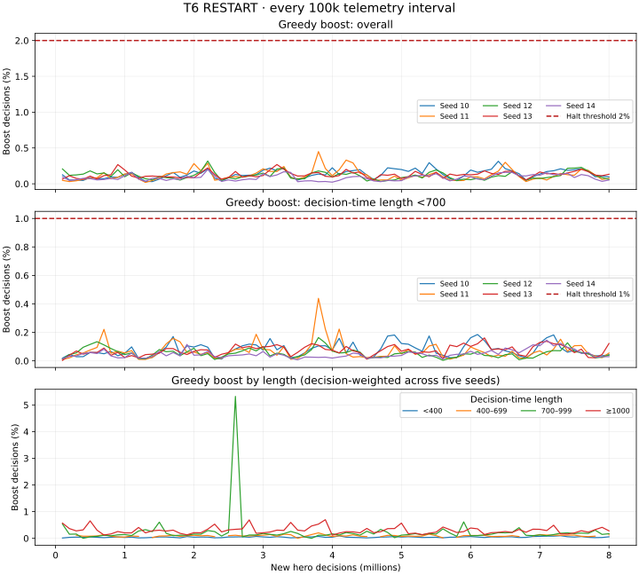

# T6 RESTART screen result (2026-10-17)

Decision: **KILL**. Development screen only; no promotion or serving change.

All five fixed RESTART finals completed cleanly and were evaluated on round 72.
The primary is exactly zero, so the registered `primary <= 0` rule applies.
No round-73 extension was launched. All reported SEs are across five paired seed means.

## Registered gameplay result

| mix | survival delta vs CTRL (seed SE) | mass delta vs CTRL (seed SE) | mass vs incumbent (seed SE) |
|---|---:|---:|---:|
| scripted | 0.0000 (0.0231) | -2.2037 (7.9417) | 205.2024 (8.2740) |
| frozen | -0.0813 (0.0212) | -40.1390 (20.7452) | 50.3596 (9.9444) |
| mixed | 0.0375 (0.0628) | 9.1161 (20.6290) | 183.8613 (17.8252) |

Primary five-seed scripted delta / SE: 0.0000 / 0.0231.

## Registered descriptive readouts

Shared-survivor H5000 length (scripted): five-seed delta -28.0016; pooled delta -27.5742; denominator 155.
Shared-survivor H5000 length (frozen): five-seed delta -23.6815; pooled delta -23.8667; denominator 90.
Shared-survivor H5000 length (mixed): five-seed delta -26.1391; pooled delta -26.2500; denominator 104.

Per-seed shared-survivor length deltas (count in parentheses):

| seed | scripted | frozen | mixed |
|---|---:|---:|---:|
| 10 | -10.4138 (29) | -30.6923 (13) | -45.1000 (20) |
| 11 | 21.6364 (33) | -23.2857 (21) | -35.2105 (19) |
| 12 | -46.7742 (31) | -53.6000 (20) | -7.1765 (17) |
| 13 | -51.1562 (32) | -8.8824 (17) | -33.4583 (24) |
| 14 | -53.3000 (30) | -1.9474 (19) | -9.7500 (24) |

### Restart/fresh L>=800 deaths

restart: L>=800 749/2310875 = 0.3241 deaths per 1,000; all lengths 915/3140235; mean decision/pre-death length 933.3475 / 1019.0470.
fresh: L>=800 1989/10122254 = 0.1965 deaths per 1,000; all lengths 4498/36860250; mean decision/pre-death length 541.3850 / 715.4217.

Per-seed L>=800 deaths (restart / fresh):

- 10: 144/468501 (0.3074) / 401/2051434 (0.1955).
- 11: 142/457812 (0.3102) / 450/2116676 (0.2126).
- 12: 153/464279 (0.3295) / 367/2007580 (0.1828).
- 13: 155/469315 (0.3303) / 403/1976759 (0.2039).
- 14: 155/450968 (0.3437) / 368/1969805 (0.1868).

All 400 telemetry points (80 per seed, every 100k) stayed below both tripwires.
Maximum overall greedy boost was **0.449888%** (threshold 2%); maximum below-700
boost was **0.439079%** (threshold 1%). The full length-stratified curves and
integer denominators are retained in the linked telemetry evidence.

### Immutable T4e holdout decisive Q gap

Identical immutable holdout observations/outcomes: **1,052 states / 5,418 branches** per model.

Fuse-free CPU rowwise Q(original B8 fatal action) minus max Q(recorded surviving legal actions), with paired RESTART-minus-B8 change.

| seed | B8 median | RESTART median | paired mean change |
|---|---:|---:|---:|
| 10 | 0.1536 | 0.1399 | -0.0127 |
| 11 | 0.1309 | 0.1355 | 0.0091 |
| 12 | 0.1293 | 0.1327 | -0.0059 |
| 13 | 0.1413 | 0.1365 | -0.0262 |
| 14 | 0.1329 | 0.1294 | -0.0121 |

Five-seed paired change mean / SE: -0.0096 / 0.0057.

## Execution, audit, and evidence

The refreshed launch audit passed for rounds 72 and 73. It excludes the 319
snapshot source worlds, the registered/observed prior banks and training
inventories, and the running T7 namespace (960 worlds). The audit retains its
explicit coverage limit for unrecorded/external experiments and lists legacy
training summaries that cannot be reconstructed from their recorded arguments.
The immutable preregistration and snapshot/holdout manifest bytes were preserved.

All 33 round-72 jobs exited zero: 96 scripted, 32 frozen, and 32 mixed H5000
worlds for each of five CTRL finals, the incumbent, and five RESTART finals.
CTRL plus incumbent completed before RESTART began. CPU rowwise inference used
one numerical thread per process; the observed maximum was two probe processes.
Only the task-owned `t6-probe` session and children were controlled. No T7 or
other existing session/process was changed. The watcher exited zero.

The scripted survivor-count differences (RESTART minus CTRL, seeds 10–14) were
`[-8, 0, +3, 0, +5] / 96`: exactly zero in aggregate. Independent review caught
a floating-point residual of `+1.3877787807814458e-18` before the decision.
The task-owned watcher was paused while the last child finished; survival
means and threshold comparisons were changed to exact rational counts, tested,
committed, and pushed before it resumed. This implements the unchanged
registered thresholds; it is not a threshold amendment or diagnostic override.
No extension audit or probe was launched.

Incumbent mass comparisons use the paired round-72 worlds. Shared-survivor
lengths condition on both policies surviving and are descriptive. Restart/fresh
training rates condition on decision-time length and do not establish a causal
restart benefit. Negative Q-gap change means reduced preference for the original
recorded B8-fatal action relative to the best recorded surviving legal action.

Verification: **28 focused tests passed**, flake8 passed, and independent
recomputation confirmed the exact primary, its SE, per-mix mass comparisons,
readout counts, all 34 fixed input hashes, and the two-process/control-first
event sequence. Supplemental fatal-action spool hashes and manifest-bound
holdout world receipts were verified before the Q-gap inference pass.

Portable evidence:

- [Full analysis and per-seed statistics](../../research/t6_screen_20261017/results/analysis.json)
- [Raw paired probe rows](../../research/t6_screen_20261017/results/probes.jsonl)
- [Launch seed audit](../../research/t6_screen_20261017/results/seed_bank_audit_round72.json)
- [Every 100k boost point and training counts](../../research/t6_screen_20261017/results/telemetry.json)
- [Holdout gaps, distributions, paired values, and provenance](../../research/t6_screen_20261017/results/heldout_q_gaps.json)
- [Training completion receipts](../../research/t6_screen_20261017/results/training_receipts.json)
- [Validation](../../research/t6_screen_20261017/results/validation.json)
- [Completion and SHA256 evidence inventory](../../research/t6_screen_20261017/results/completion.json)

Execution artifacts: `/Users/josenunez/Projects/ml/snake-dqn-artifacts/redesign-t6-probes-20261017`.
Implementation and exact-boundary fix were pushed through source commit `d1ddf17825496d5d2640285786e283c2cd39d7d5`.
The results commit is the Git commit introducing this document and evidence.
